# 半年出海做 AI 视频站，踩坑后的一点复盘与分享
作者：龙哥

## 260228 副业 SC 精华

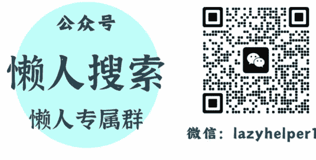

大家好，我是 A 梦。

今年 1 月 17 号，我在杭州的龙哥盟线下活动上讲了《AI 视频套壳站》的实操思路。紧接着在 1 月到 2 月这段时间，带了一期 Mini 航海《AI 视频 SaaS 网站》。

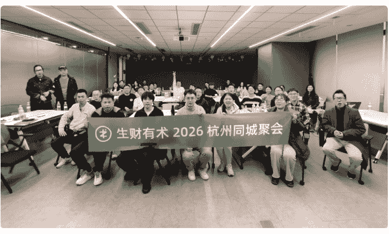

航海在年前面试结束，趁着有空，我把线下分享的干货整理出来，也方便航海里的小伙伴回头看。

这份梳理涵盖了概念认知、搭建路径、获客打法、转化提效和风险规避。顺带一提，过年那阵子大家都在刷 Seedance 2.0 的效果，不少人正好靠这个话题词拿到流量和收入。

## 01、从设计师到 AI 出海者

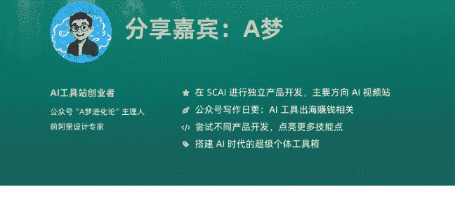

我之前是阿里交互设计师，2025 年开始自学 AI 编程，十月份才正式切到视频套壳站赛道。转型的直接原因很简单：早期做的那些小工具虽然好玩，但离赚钱太远，必须先拿到正反馈。

作为一个零基础转行的玩家，我过去十年的互联网产品全流程经验，包括设计、产品、运营和技术协同，帮助我更快看懂套壳站的商业本质。现在人在 SCAI 办公，👸号“A 梦进化论”每天更新国外的独立开发者出海案例。

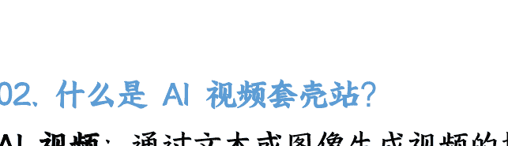

## 02、AI 视频套壳站到底是什么

**AI 视频**：基于文本或图像生成视频的技术，典型的就是 Sora 2、Veo 3 这类模型。

**套壳站**：在开源或闭源的模型 API 之上搭一层前端网站，给用户更顺手的交互体验。说白了就是“界面 + 功能 + API 调用”的组合体。

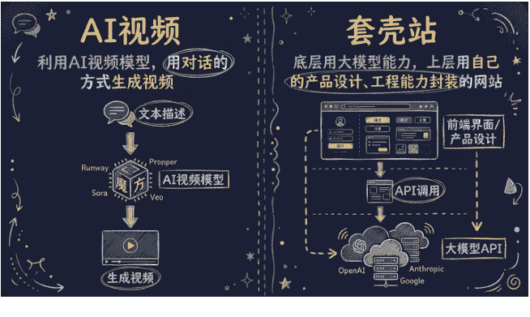

大家都知道 AI 视频可以直接去官方站用，比如即梦之类。那套壳站的价值在哪？从用户侧和商业侧两个维度看会更清楚。

### 用户能得到什么

套壳站填补的是模型可用和普通人会用之间的差距，主要体现在：

- 免环境：开源模型自部署要 GPU 和环境配置，套壳站打开就能用。
- 本地化：多语言界面、本地支付方式，比如 Sora 官网只有英文，俄罗斯等地区支付不便。
- 场景化：针对电商、短剧等场景做模板和工作流。
- 一站聚合：多个视频模型集中在一个后台，不用反复切换账号付费。

### 商业逻辑

借用小排老师的一句话“科技=科学+技术”。模型团队做“科学”层面的突破，套壳站做“技术”层面的落地，把研究成果包装成大众能用的产品服务，降低门槛、提升体验，让技术价值真正变现。

## 03、怎么赚钱：订阅制 + LTV 导向

### 主流模式是订阅收费

用户按月付费换取积分额度，积分用于消耗 API 成本。底层持续烧 API，订阅制是最匹配的现金流模式。

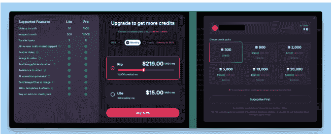

### 关键看 LTV

订阅制的核心是复利收入，而不是一次买卖。比如某用户在短时间内多次续费，产生的 LTV 远高于单笔订单。

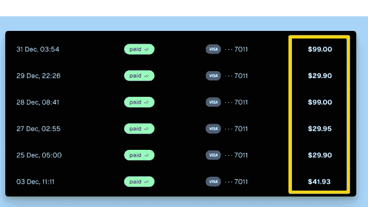

### 竞争点不一样

- 老派产品拼单笔客单价
- 订阅产品拼 LTV = 留存 × 复购 × 客单价

## 04、现在流行的三种形态

按定位和获客方式，AI 视频套壳站大致分三类：

### 1) 蹭词站

**定义**：域名和品牌词贴近官方模型名，借搜索流量。

**例子**：tryveo3.ai，Veo 3 是 Google 的模型，这个域名很容易被当成官方入口。

**红利期**：新模型刚发布时全网内容为零，关键词无竞争。抢先上线带新词的站，能短期吃到高排名。

**打法特点**：

- 上线快见效快
- 极度依赖 SEO
- 适合收割短期红利
- 风险高，合规与信任成本大

### 2) 品牌站

代表：Pollo AI pollo.ai

赚钱圈友阿彪的项目，拿到真格基金 1400 万美金融资。策略是多模型聚合，覆盖 Google、Sora、Runway 等主流。

用户价值是统一入口，不用为新模型换平台。

**优势**：自有品牌、无商标风险、持续迭代、全模型覆盖、私域运营、品牌复利、抗风险强。

**难点**：冷启动难、多模型维护成本高、需要强运营团队。

### 3) 功能站，垂直场景深耕

代表：StoryShort AI storyshort.ai

创始人是法国验光师出身的独立开发者，自学编程多年。

定位聚焦 YouTube Shorts 无脸短剧生成，提供从脚本到配音、字幕、成片的一条龙，服务短视频创作者。

本质是把 ComfyUI 工作流产品化，比闲鱼买工作流更易用。

**数据**：

- MRR 超 3 万美金
- 累计收入 35 万美金
- 估值 120 万美金，收到多轮收购报价

**优势**：场景精准转化高、差异化强、溢价空间大、直击痛点。

**门槛**：需要工作流开发或产品化能力。

## 05、搭建门槛：从模板开始

知道类型后，新手怎么起步？最省事的方式是基于现成模板改。

下面是一套成熟模板通常集成的服务，能省去大量重复开发。

AI 编程工具让技术门槛历史新低，模板就像样板间，配置一下就能用。

**成本参考**：我自己在用的商业模板是 Mksaas https://mksaas.com/zh，购买可用折扣码 AMENG 减 20 刀。

Mini 航海期间我也整理了一套视频站模板免费给圈友，手册里能领。技术细节不展开，感兴趣看航海手册 https://scys.com/activity/landing/9522?tabIndex=0 即可。

## 06、API 供给怎么选

视频生成依赖模型 API，供应渠道现在不少：

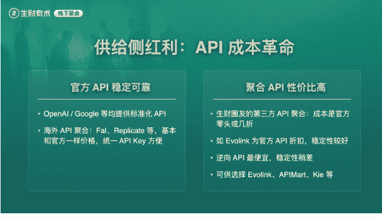

**官方 API**：OpenAI、Google，价格透明、稳定。

**海外聚合商**：Fal、Replicate，统一 Key 管理多模型，价格接近官方。

**国内第三方聚合**：成本更低，适合预算有限：

- Evolink：官方折扣，稳定，赚钱圈友产品
- Kie：模型多，价格有竞争力
- APIMart：多模型支持，赚钱圈友产品

**逆向 API**：成本最低，稳定性差，适合测试。

**建议**：起步用第三方聚合降本，规模化后切官方保稳定。

## 07、竞争焦点：流量 + 体验

技术门槛低，竞争必然加剧。我的判断是：门槛下降时，流量获取和产品体验是最后的护城河。

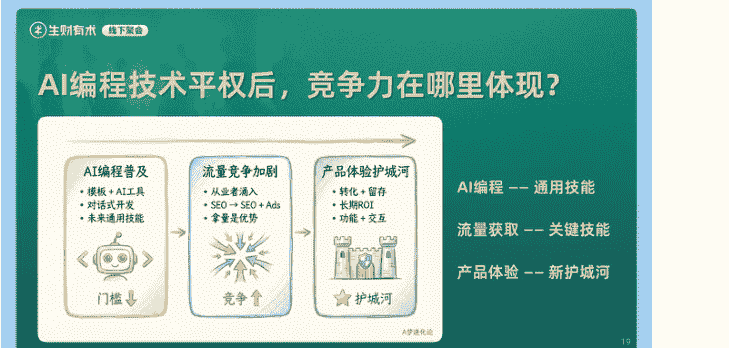

学做视频站，配置模板很快，后面是体力活。核心是能不能拿到流量，并把流量变现。

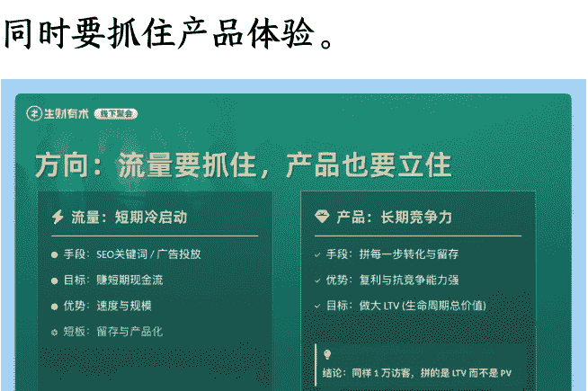

### 流量层面

- SEO 成本上升，排名周期变长
- 广告 CPC 上涨，获客变贵
- 入口集中在 Google 搜索和广告位

### 产品层面

- 转化率决定流量价值
- 逻辑：有流量才有机会，体验决定转化，长期迭代提升 LTV

**关键指标**：PV、LTV、ROI

同 1 万访客，最终比的是 LTV。预算有限时，提升转化率比买流量更划算。

## 08、获客打法：SEO 长线 vs 广告快线

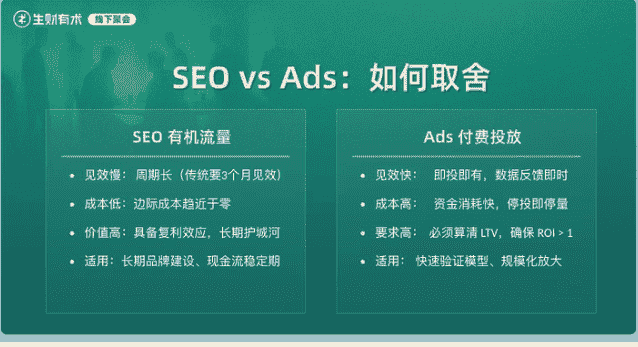

### 8.1 SEO：复利资产

**基础 SEO**：关键词布局、Meta 优化、结构化数据、加载速度

**外链建设**：免费外链慢且不稳，付费外链稳但贵，目标是提升域名权重

**内容 SEO**：Blog 抓长尾，工具页/模板页覆盖，How-to 内容满足真实搜索意图

详细可参考二哥的帖子 https://scys.com/personal/881885484552?number=2766

### 8.2 广告投放：快速验证

实践小结：

1. 给算法学习期，别频繁改
2. 广告文案和落地页保持一致
3. 部署转化追踪，覆盖注册到付费全链路
4. 转化率预期 0.1%-0.2%
5. CPA = CPC ÷ 转化率，按客单价控预算
6. 转化差时先改产品，别加预算

## 09、用数据而不是感觉做优化

很多人做产品靠直觉，容易踩坑。我建议看数据，按用户路径逐层优化。

### 9.1 看转化漏斗

最左边是 SEO 和广告带来的流量入口，进入站内后产品链路决定最终付费。

目标是把每个环节的流失补回来。

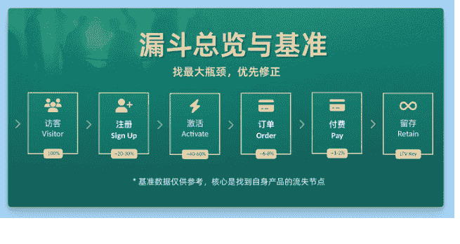

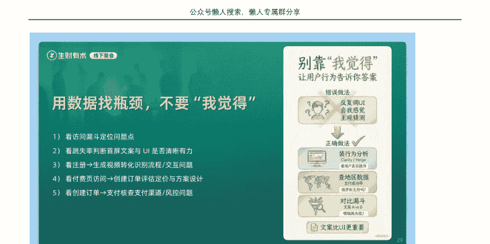

### 9.2 三个优化方向

#### 新手引导

- 放高质量示例模板，一键复用
- 按钮即时反馈，登录/余额/内容为空时立刻提示
- 视频生成需几分钟，用浏览器通知召回用户

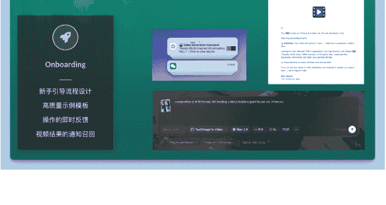

#### 付费转化

- 节日倒计时折扣
- 新人首单优惠
- 清晰套餐对比
- 付费墙弹出时机优化

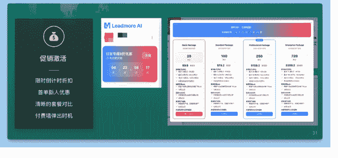

#### 留存激活

邮件是被低估的激活渠道：

- 未付款订单催付
- 余额/积分提醒
- 功能更新推送
- 流失用户召回

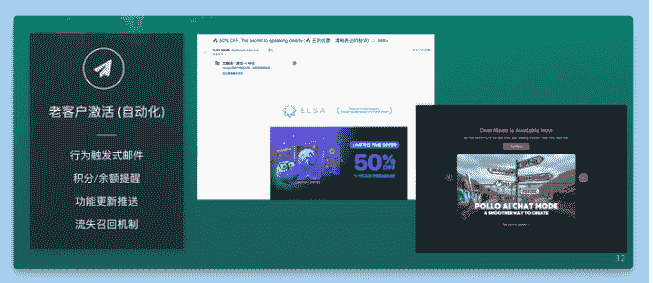

核心是每一步转化率提升，最终拉大 LTV。用用户旅程图去感知每个动作是惊喜还是吐槽，再用数据迭代。

## 10、风险与应对

新手常从蹭词站入手，因为起量快，但风险也真实存在。

### 10.1 最大的雷：商标版权

风险等级最高。

**表现**：收到律师函要求交出域名，主机商要求下架。

**应对**：

- 提前注册品牌域名，301 跳转迁移流量
- 收到通知及时响应，别硬刚

我一个站收到的律师函，服务器商只是转发邮件提醒，给了整改时间回复后也就没继续。

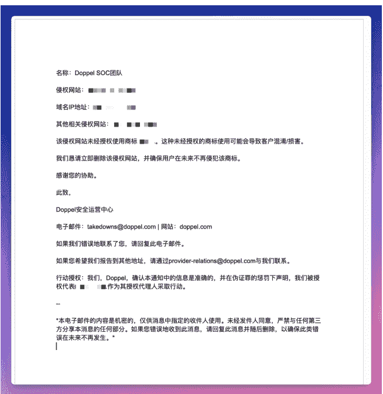

**域名被收时的断尾**：可以提前用新域名做 301，把老流量导过去。

**案例**：Veo3 套壳站的迁移

新模型发布初期，中国开发者注册速度快于官方维权，窗口期通常几周到几个月。也有运气好的域名躲过法务团队长期存活，但要心里有数。

### 10.2 其他风险

**API 稳定性**：选靠谱供应商，准备备用方案，监控可用性。Sora 2 逆向 API 近期被 OpenAI 封号，成本集体上涨。

**支付审核**：Creem 等平台不允许域名带模型商标，需提前备合规域名。

## 11、总结与行动建议

### 5 个核心结论

- 本质是产品化服务，不是做模型研发
- 竞争核心是全链路转化优化，最大化 LTV
- 流量要 SEO 长线 + 广告快线结合
- 决策基于数据，不靠直觉
- 商标版权是第一红线

### 3 个行动建议

- 门槛已降到历史最低，先做 MVP 验证
- 最大风险是永远不开始
- 持续基于数据迭代，别凭感觉改产品

## 12、Q&A

**Q1 模板在哪买多少钱？**
网上很多，大概 1000 出头。推荐 MKSaaS，更新快，折扣码 AMENG。国内 Shipany 第二版也不错。搜“SaaS starter”也能找到国外模板。

**Q2 支付怎么接，钱怎么回国？**
需要自己申请账号收款，美元回国比较麻烦，通常要香港卡再转汇。推荐看《全球收款手册》，讲得很细。

**Q3 品牌站和功能站有什么区别？**
界限模糊，主要是为了方便讲解划分。实际很多项目是混合形态。

很多人做 AI 视频站，最初只是借着热门模型的名字吸引搜索流量：先做一个简单页面，等访问量起来后，再不断补充新的模型和功能，逐渐从单一工具演变成一个完整产品。

这条路径背后，通常会出现两种不同方向：

- **品牌型网站**：聚合多个模型，长期进行品牌建设和用户运营；
- **功能型网站**：聚焦某个细分场景，专门解决一类用户的具体需求。

## 蹭热点的模型站，还值得做吗？

必须承认，这种模式的风险并不低。域名可能被平台收回，也可能遭遇品牌方的律师函，因此不适合被当成长期经营方案。

但它依然有现实价值：

- 快速测试自己的产品开发能力；
- 借新模型上线的短期关注度获取流量；
- 低成本积累首批用户、反馈和使用数据。

更稳妥的做法是：

1. 从一开始就注册并准备好自己的品牌域名；
2. 页面中明确标注“Unofficial”，避免造成官方误解；
3. 将新增流量和用户逐步迁移至品牌站；
4. 把热点站定位成测试渠道，而不是最终业务主体。

## 没有编程基础，也能做吗？

可以。

我自己就是从设计师转型过来的，起初并没有编程经验。现在 Claude Code、Cursor 等 AI 编程工具已经显著降低了开发门槛，很多项目都可以在模板基础上完成。

真正需要掌握的，主要是三件事：

- 能按照教程完成基础配置；
- 能理解用户真正想解决的问题；
- 遇到报错和困难时，愿意持续排查并解决。

换句话说，技术已经不是最难的部分。更重要的是产品判断力，以及把事情真正推进下去的执行力。

## 现在进入这个领域，会不会太晚？

还不算晚，但不能再抱着“随便做个站就能赚钱”的预期。

相比半年前，竞争确实更加明显。不过机会依然存在：

- 视频模型仍在高速更新，新模型上线就会带来新的流量窗口；
- 很多网站只是完成了搭建，却没有认真优化体验和转化；
- 大量细分行业和垂直需求仍然没有被充分满足。

因此，重点不能只是追逐模型名称，而要放在产品本身：用户是否容易上手、结果是否稳定、付费路径是否顺畅、转化环节是否持续改善。

## 一个人能不能完成？

一个人完全可以做出第一版，但工作量会比较大。

个人通常能够完成：

- 利用模板快速搭建网站；
- 对接模型 API 和支付系统；
- 做基础 SEO；
- 进行小规模广告测试。

如果有团队，以下事情会更容易推进：

- 同时维护多个模型和产品；
- 持续开发新功能；
- 长期生产 SEO 内容；
- 处理客服、社群和用户运营。

比较推荐的路径是：先由个人完成最小闭环，验证是否有人使用、是否有人付费。等产品产生收入，再决定是否招人或组建团队。

## 广告投放的 ROI 怎么计算？

最基础的公式是：

**ROI = 收入 ÷ 成本**

其中：

- **成本**：广告支出 + API 调用成本；
- **收入**：用户实际支付的金额。

至少要保证 ROI 大于 1，理想情况下最好超过 2。

如果需要更准确地评估，还可以关注以下指标：

- **CPC**：广告花费 ÷ 点击次数；
- **转化率**：付费用户数 ÷ 访客数；
- **CPA**：CPC ÷ 转化率；
- **LTV**：单个用户在整个生命周期内带来的累计收入。

比较健康的状态是：

**LTV > 3 × CPA**

只有客户长期价值明显高于获客成本，广告投放才具备持续扩大的基础。

## SEO 多久能看到效果？

传统 SEO 往往需要大约三个月才能逐渐产生明显效果。

但如果针对的是刚发布的新模型，情况可能不同。由于相关关键词竞争较小、搜索需求可能快速增长，Google 也可能较快收录新内容，有时一到两周就能观察到初步结果。

可以采用组合打法：

- 新模型发布后尽快上线，速度越快越有优势；
- 同时开展 SEO 和广告投放；
- 用广告快速验证产品和付费意愿；
- 用 SEO 沉淀长期、低成本的自然流量。

## 如何判断该做哪个模型？

可以从以下几个维度进行筛选：

- **热度趋势**：相关搜索量是否正在增长；
- **竞争情况**：市场上已有多少同类产品；
- **API 条件**：接口是否稳定、价格是否可接受；
- **使用复杂度**：官方产品是否难用，操作门槛越高，第三方工具的价值可能越大；
- **付费意愿**：目标用户是否愿意为更简单的体验买单。

实际操作上，可以这样安排：

1. 提前关注可能发布的新模型；
2. 预先准备网站模板、支付流程和接入方案；
3. 模型上线后迅速发布产品；
4. 同时运营 2—3 个站点，避免把风险集中在单一项目上。

## 最后想说

这次杭州线下分享来了不少优秀的圈友，现场交流也让我获得了很多新的启发。

如今，搭建 AI 视频 SaaS 站的技术障碍已经降低了很多。但进入任何一个市场之前，都应该先问自己几个问题：

- 我凭什么能在这里获得用户？
- 这个项目大概能带来多少收益？
- 这种收益能够持续多久？

未来真正拉开差距的，可能不是谁会不会调用 API，而是以下能力：

- 能否快速响应新模型上线，抢到早期窗口；
- 能否持续优化产品，把每一个环节的转化率做高；
- 能否依据数据做判断，而不是仅凭个人感觉行动。

这条路绝不是“放在那里就能自动赚钱”。它需要持续测试、不断改进，也需要面对失败和调整方向。

但对于愿意学习、愿意执行、愿意长期投入的人来说，AI 视频 SaaS 仍然可能是一条普通人借助 AI 时代机会、获得美元收入的现实路径。

2026 年，视频模型大概率还会持续快速发展。每一次新模型发布，都可能带来新的产品机会。

希望这份分享能够给你一些参考。如果你也在做相关项目，欢迎在评论区交流。

如果你对 AI 视频 SaaS 站的航海项目感兴趣，也可以持续关注，后续预计还会有更多内容。☺

📖 这里是你对抗信息过载的护城河。

已稳定运行 7 年，累计拆解、研读 3000+ 个互联网商业实战案例与行业前沿内参和时政/宏观文章。

## 我们不搬运垃圾，只做高价值信息的筛选器与放大镜。

