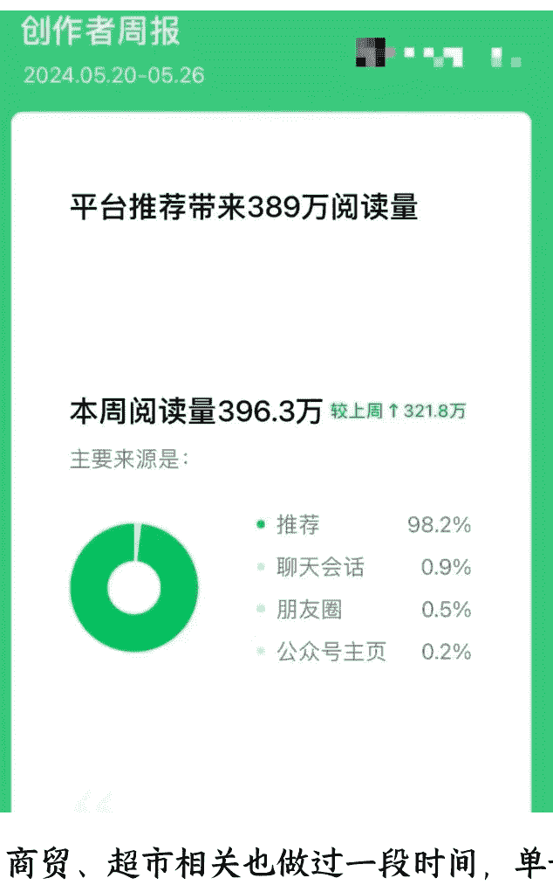
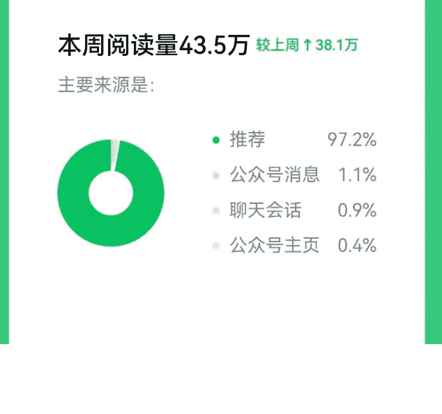

# 退休内容为何频繁出圈？一条适合长期经营的慢赛道

大家好，我是辰风。

做自媒体第六年，我没有频繁换项目，主要精力都放在持续创作上。近两年，我集中研究民生、养老以及社会议题，累计产出文字接近百万字。

老年方向其实很早就进入过我的视线，只是最初始终没有找到合适的叙述方式。几次试做下来，账号也没能延续下去。直到最近，我才真正摸索出一套更贴近退休群体阅读习惯的表达方法。

今天就聊聊退休与老年生活这个方向：

为什么它有机会做出高阅读？
为什么它适合长期投入？
普通创作者又该如何从中找到自己的位置？

先交代一下我的转型过程。

我并非一上来就选择了老年领域。最初受赚钱风向标启发，我做过历史类内容，后来又尝试职场方向，也取得过不错的数据。关于邓小平、毛主席、叶剑英、刘少奇等人物的历史选题，都曾有过较好的反馈。

之后，我还做过房地产和民生相关内容，也跑出过百万级阅读。

恒大破产清算、婚恋与就业等社会话题，曾经带来几十万甚至上百万的阅读。

商贸、超市类内容也试过，单个账号每月能带来几千元收益。养老金方向曾经组织团队测试，但核算下来效率不理想，后来便停止了。相关复盘之前已经写过，这里不再展开。

这些方向并非没有成绩，可真正长期做下来，身心状态并不轻松。

尤其是民生和社会议题，题材看起来很大，情绪也容易被点燃，但长期接触矛盾、争议和负面信息，创作者很容易陷入持续消耗。数据可能还在增长，内心却越来越疲惫。

于是，我开始系统观察退休群体的阅读行为：

他们愿意读什么？
哪些问题会反复搜索？
什么样的文字能够让他们耐心读完？
哪些内容会促使他们转给家人或朋友？

研究之后，我发现，老年领域的互动气质与传统社会热点很不相同。

同样是养老、医保、退休规划等现实议题，读者给出的回应往往更温和：有人表达感谢，有人分享自身经历，也有人继续追问具体做法。创作者并不是单向释放情绪，而是在交流中得到回应。

收入表现也值得关注。按照我的实际测试，相关内容每一万次阅读，大约可带来50至80元收益，表现较好时还会更高。

这并不依赖耸动标题，而是与读者停留时间、阅读习惯以及人群商业属性有关。

当然，轻松不等于随便。

退休政策、医保规则、养老金计算等话题，必须重视信息准确性。写错一个细节，可能就会让读者产生错误判断。但与此同时，这个方向不要求你每天追逐热搜，也不必反复设计冲突。更重要的能力，是把复杂信息整理成普通人能够理解的语言。

过去做账号时，我常常凭个人判断摸索，容易因为信息来源有限而走弯路。后来通过赚钱有术与社群成员持续交流，我才逐渐意识到，许多机会并不藏在表面数据里，而是在不同观点的交锋中被发现。

这期间，我从普通参与者逐步成长为垂直小号项目的内测船长与教练。一边继续实操，一边整理经验、帮助同行，我也重新审视了自己过去的选择，并在航海机制中完成了认知升级。

我的感受很明确：

方向错了，越努力越容易偏离；
方向对了，时间才会真正留下资产。

赚钱提供的并不是焦虑刺激，而是一套相对完整的执行路径，以及持续的陪跑支持。打卡、点评、直播和社群答疑，目的都是帮助参与者减少试错，争取更稳定的结果。

我在线上听过7天老师关于定位的分享，线下也交流过他对垂直账号的理解。几次接触下来，我对这个方向的信心更强，也更期待在垂直内容上继续突破。

带完两期航海后，我更加确定：

很多人迟迟做不起来，并非能力不足，而是没有在动手前想明白自己适合什么。

常见情况是：

看到房地产热，就转去写房地产；
发现情感内容涨粉快，又改做情感；
看到别人借助AI工具变现，马上再换方向。

最终，账号什么都涉及，却没有清晰定位；创作者每天都在更新，却感觉没有形成任何沉淀。

真正令人焦虑的，往往不是流量少，而是忙了很久之后，仍然不知道自己留下了什么。

所以，寻找方向时，我建议先问自己几个问题：

你愿意长期研究什么？
这个主题能否让你持续投入两三年？
你对它是否有真实感受？
创作结束后，你还愿不愿意继续思考？

能不能长期做下去，比短期是否热门更重要。

我判断一个方向是否值得投入，通常看两个维度。

第一，它是否拥有持续存在的需求。

不是当下火一阵，而是背后的人群和问题会长期存在，甚至逐步扩大。

第二，它是否能承载个人表达。

你能否在其中形成稳定判断，逐渐建立自己的风格与信任，而不是每次都依赖外部热点。

真正适合你的主题，会让表达变得顺畅；内心确实在意，文字自然会带有温度。情绪无法靠表演长期维持，只有真实关注才能支撑长期创作。

下面放一些近期数据。

某周内容总阅读约16.7万，比前一周增加15.7万；其中推荐渠道占97.4%，内容被转发3160次。

随后一周阅读量升至51.4万，推荐比例98.2%，分享次数达到4860次。

再下一周阅读28.9万，分享3437次。

之后一周阅读15.5万，分享2641次。

团队数据不完全公开，也没有采用矩阵堆号模式。单日收益同样有参考价值：12月4日阅读29449次，收益315.93元，单价10.73；12月8日阅读24697次，收益171.64元。

这些数据说明，内容不一定要靠单次爆发，稳定累积同样可以带来可观回报。

## 一、退休领域为什么值得关注？

人口结构正在变化，退休议题会越来越贴近每个家庭。

延迟退休、社会保障、养老金、医疗报销，这些内容并非短期热点，而是许多人迟早要面对的实际问题。

比如：

退休后每月大概能领取多少？
父母遇到突发情况时，家庭资金是否够用？
医保能报销哪些项目？
跨地区就医需要注意什么？

算法会变化，平台会调整，但这些生活问题不会凭空消失。

因此，我更愿意把退休方向看成一条长期刚需，而不是短暂风口。它依赖的不是单纯追逐热文，而是持续提供有用信息、建立可信形象，并给予读者适当的心理支持。

从这个角度看，老年群体长期缺少真正友好的互联网服务。

很多内容不是帮助他们理解政策，而是先用夸大的标题制造紧迫感：

“这几类人可能拿不到养老金”
“不知道就会吃亏”

看完之后，许多老人更加不安，却找不到可靠解释。

他们不是拒绝学习，而是面对复杂文件时确实存在理解门槛。政策表述专业，窗口咨询时间有限，子女又常常忙于工作，于是很多疑问只能留在心里。

我做这类内容，核心目标很简单：将专业信息拆解成易懂的说明，让读者看完之后知道发生了什么，也知道接下来可以怎样处理。

## 二、它的优势不在刺激，而在可持续

过去做社会热点时，我经常感到疲惫，主要有几个原因。

### 1. 选题容易陷入循环

政策、事件、争议，来回都是相似结构。若没有新角度，就只能不断追逐外部事件，创作很快会变得机械。

### 2. 负面信息容易影响创作者状态

矛盾、冲突、纠纷和争吵看得太多，创作者自身也会被情绪拖累。

### 3. 互动热闹不代表信任深

有些读者只是来宣泄，文章下方很热闹，却未必愿意长期关注，更难形成稳定转化。

此外，许多批量账号依靠大量生产和持续铺量，虽然短期可能获得曝光，但账号生命周期、收入稳定性以及内容质量都存在不确定。对普通创作者而言，完全照搬并不现实。

退休与老年生活类主题则更适合慢慢经营。

读者的反馈通常包括：

感谢提醒；
讲述自己的经历；
转给父母或亲友；
继续咨询具体问题。

商业层面也相对平稳。

我测试下来，单万次阅读的收益大致处于50至80元区间，优质内容可能更高。原因在于这类读者通常阅读时间更长，复看意愿更强，也更容易对持续提供帮助的作者产生信赖。

如果账号内容质量稳定，日收入达到200至300元并非没有可能。我目前制作此类文章，通常半小时左右可以完成：先用语音整理思路，再借助AI辅助梳理和润色，最后由自己核验信息与调整表达。

### 1）受众规模足够大

退休人口数量庞大，而且每年都会有新的退休群体进入这个阶段。他们会重新规划收入、医疗、家庭关系与日常生活。

需求不会突然消失。

### 2）旧内容也有生命力

有些热点文章发布后很快失去价值，但退休政策、生活安排和家庭关系类主题具有较强的长期检索属性。

我现在发布的文章，哪怕过了一段时间，仍会被平台重新推荐，也会有人通过搜索进入。现阶段只完成了五十多篇，旧内容每天仍能带来新增阅读。

### 3）深度服务更容易形成信赖

很多退休读者不需要华丽辞藻，也不喜欢被反复刺激。他们更在意三点：

能不能读懂；
信息是否靠谱；
看完后是否知道该怎么办。

因此，表达不必复杂，重点是清楚、朴实、有行动建议。你能把专业内容解释到位，读者就更可能持续关注。

而持续关注，意味着收入来源不只限于平台分成，还可以继续延展到私域与其他业务。

### 4）更容易建立长期联系

老年用户的关注方式往往更接近持续订阅。只要内容稳定，他们可能长期阅读，甚至持续打赏、转发或咨询。

所以，这个方向真正珍贵的不是某篇文章带来多少收入，而是能否留下一批愿意长期跟随的读者。

## 三、收入逻辑：慢慢积累，而非瞬间爆发

我做内容当然也关注收益，但退休方向的赚钱方式，与依靠激烈冲突制造传播的内容不同。

它未必频繁出现单日百万阅读，却可能呈现这样的节奏：

前几个月逐步出现5万、10万级文章；
半年左右，早期文章持续贡献阅读；
内容越多，长尾流量越明显；
账号整体收益开始形成叠加。

我测试的账号运行一两个月后，平台到了月底仍会推荐月初发布的内容。读者还会将文章转入朋友圈和群聊，带来后续传播。

通常情况下，10万级阅读带来几百元流量收益并不罕见；如果遇到合规且匹配度较高的广告，收入也可能进一步增加。

此外，只要坚持不编造、不夸大、不用恐惧式标题，内容风险相对可控。速度可以慢，经营不能乱。

## 四、我为什么愿意长期做下去

评论区里，我经常看到类似提问：

“我这种情况算正式就业吗？”
“以后大概能领多少？”

面对这些问题，我需要查阅政策文件、核对具体条件，再把专业表述转成通俗解释。

真正愿意花时间讲明白的人并不多。

有人借科普之名推销保险；
有人尚未弄懂规则就直接下结论；
还有不少读者无法区分知识分享与商业宣传。

这让我越来越明确：做这个方向，不是为了展示自己懂得多，而是希望读者少走弯路、少花冤枉钱，也少被无端制造的紧张感影响。

平台从来不缺争吵和刺激，长期稀缺的是：

经过核验的信息；
条理清楚的说明；
谨慎而有边界的判断。

这类内容不一定每次都冲上高峰，却更容易被反复检索，也更有机会获得持续推荐。

退休群体真正需要的不是恐慌，而是确定感。只要把事实、条件和处理路径讲明白，平台和读者都会逐渐识别出内容的价值。

## 五、我的创作底线

老年领域很容易被标题党带偏，也容易出现误导性表达。

例如：

《这几种人以后可能拿不到养老金》
《还不知道这件事，马上就要吃亏》

如果缺少事实依据，这类标题本质上是在利用恐惧换点击。

我给自己设了两条原则。

### 第一，先核验，再发布

涉及关键政策时，尽量查找权威来源。尚未完全确定的内容，要明确说明是趋势判断、可能情况或个人解读，不能包装成正式通知。

### 第二，呈现风险，也提供出口

问题可以讲，风险也可以提醒，但不能只把最坏结果推到读者眼前。说明困难之后，还应告诉读者可以咨询谁、核对什么、采取哪些准备。

屏幕另一端，可能是一位年过六旬的读者。他戴着老花镜，靠近手机，一字一句地阅读。也许他花了很久才学会找到这篇内容，因此会把其中的每句话都当真。

如果作者随意写下“某类人可能领不到钱”，对方很可能整晚都在担忧自己是否符合条件。

所以我的标准是：

每篇文章都应该经得住子女转发给父母。

孩子转过去时，不需要担心文章会把老人吓住，而是能够放心地说：

“这篇讲得挺明白，你可以看看。”

最后放几个选题案例：

周四：
《退休以后，真正能依靠的三样东西，不是儿女，而是房子和车子》

1月21日：
《过了五十岁，要懂得维护这四种关系，别轻易把人得罪》

它们没有刻意制造恐惧，也没有堆砌复杂概念，但依然能够获得阅读、转发与收益。

如果你已经厌倦了不断追热点、制造冲突、担心账号突然失控，想寻找一种可以积攒信任、持续更新，并逐步连接私域、电商和其他业务的方向，那么退休与老年生活值得列入备选。

它不承诺让人一夜暴富，却可能成为一门越做越稳、越积越有价值的长期生意。

做老年赛道越久，我越明白：10万+不是写出来的，是替读者说出来的

打开我的公众号，最近发过的文章有讲老年社交分寸的，有讲退休规划心理的，还有讨论“不留骨灰、不买墓地”的。点开评论以前，我以为大家会随便看看；点开以后才发现，评论区比文章本身精彩得多。

一场场“政策交流会”在评论区上演

吉林的读者说：我们这儿“30+10”是真的，去年我就是这么评上的。四川的读者报出地名：达州渠县农村，27年就能评副高。河南的读者补充：我们这儿是“25+5”，不过还得面试。山西的读者一脸不解：这政策我们那儿听都没听过。

一篇文章发出去，评论区自动长出了一张全国政策对照表。说实话，我挺感慨的。很多老师在一个学校待了一辈子，不知道隔壁省的政策早就翻天覆地了。他们不是不关心，是找不到打听的门路。有人惊讶，有人羡慕，更多人嘟囔一句“原来还能这样”。

有位河南开封的老师留言说，她1991年上班，2002年就评了中级，教了三十多年，教学成绩一直拔尖，结果因为没当班主任，一直卡在副高门外，眼看27年就要退休，自己彻底灰了心。我回她说：不如把身体养好，健健康康退下来，活到99，多拿多少年退休金，其实是一样的。湖南有位老师在农村干了32年，副高还是没影儿。接着另一个湖南人跟帖：这边的农村教师，退休前两年才有机会。同一个省，不同市县是两套规则；同一个县城，不同学校也可能两套规则。对一个普通老师来说，这道信息差就是一道天堑。

评论区有一条高赞话说得扎心：“埋头苦干专心教学的人永远吃亏，搞课题、走行政的人倒早早占了先。”我回复：确实，我们这儿也差不多，领导行政经历加分大，普通老师比不了。发出之前我犹豫了很久，因为这话听起来有点泄气。可我还是发了。读者不傻，你要是装作看不见，他们只会觉得你虚伪。你能体谅读者几分，读者心里就跟明镜儿似的。你自己都藏着掖着，还指望别人信你？

做老年和体制内赛道，真正值钱的不是专业知识，是你能不能说中他们心里那句没说出口的话。很多话他们搁了大半辈子，说出来怕人笑话，不说又堵得慌。你替他们倒出来，他们就拿你当自己人。

10万+的底层逻辑：让人看见“下一步”

老年读者刷手机，不是找刺激，是找答案。他们年轻时吃过太多信息差的亏，如今最怕被骗、怕走弯路。他们要的也不是情绪按摩，而是一个明白人告诉他们：别慌，这事有解决办法。所以每篇文章结尾，都得给一个“接下来怎么办”的提示。

想在这个领域跑出爆款，我观察下来，绕不开三类内容。

第一类：真焦虑

写养老金能领多少、延迟退休怎么执行、社保不满15年还有没有救，这类话题天然就能把人拽进来。关键是别在那喊焦虑，要写做法。

写作顺序可以这样定：先用一句真实的担心把读者拉进场景，再把担心的来源说透，然后用人话把政策讲清楚，最后给出行动路径。

比如说“社保只交了13年”这件事，可以写成：

“眼瞅着都56了，社保本上才13年，上不上、下不下，卡得人难受。我不嫌钱少，就怕到时候连退休证都混不上。”

也可以换一种：“年轻时不懂事，断断续续交了13年。上了年纪才知道怕，补也没法补，退又不甘心。我就想知道，是不是真没救了？”

再比如延迟退休，可以写成：

“专家天天在电视上喊延迟退休，大道理我听不懂。我就想问一句实在的：这把老骨头再熬几年，到底能多拿几块钱？划不划算？”

或者：“打开手机全是延迟退休的消息，有的说好，有的说坏，看得我脑仁疼。我就想找个明白人算算账：多干这一年，往后每个月能多买几斤肉？”

第二步，要把“怕”说完整，但别过度渲染。如果你在这时写“要保持乐观心态”，读者转身就走了。你要替他们把苦水倒清楚：怕的是钱不够花，怕手续办不下来，怕年轻时交的钱打了水漂。要让他们明白，这些担心不是想太多，是政策本来就像天书，没人给过一句准话。

第三步，用人话讲清楚。我习惯让AI帮我翻译成“跟家里长辈解释”的口气，然后自己再做三件事：删掉正确的废话，把结论单独拎出来，给不出烂大街的方案。写的时候优先用“先说结论、再说条件、最后说限制”的结构。

举两个例子。社保没交够15年：先说结论，别急着退保，绝大多数人有补救办法；再说条件，一看差几年，二看职工还是居民，三看户口在哪个城市；最后说限制，如果你户口在A地、社保在B地，补缴按B地算，别拿老家的政策往上套。医保要不要继续缴：先给结论，身体有点小毛病，砸锅卖铁也别断；再说好处，住院能报销一大部分，交够年限还能享受终身待遇；最后说限制，“终身医保”不是每个地方都有，要求年限也不同，必须去当地社保局问清楚。

第四步，写具体动作。最招人烦的结尾就是“具体以当地政策为准”。要写就写：第一步打开当地人社局的小程序查年限，第二步带上身份证去窗口问“我这种情况能不能补”，第三步记下答复再决定交不交。不同城市政策不一样，但动作是通用的。

第二类：身边人的故事

你写“社保缴费年限不足15年，会影响养老金领取”，没人愿意看。但你写“她今年58岁，只交了13年社保，她最怕的不是钱少，是两年后退都退不了”，读者马上就会点进来。这个差距，就是有没有“人站在那儿”的画面感。

这类故事不是靠惨，是靠像。比如“58岁在车间干了一辈子，退休金只有2200”“在广州打工20年，社保断断续续只交够13年”“当年被买断工龄的那批人，如今都怎么样了”，评论区总有人说：这不就是我爸/我妈/我邻居吗？

写这类内容，本质上干三件事。

第一，当翻译官。老人心里明白，嘴上却说不清楚，只会反复念叨“心里不踏实”“说不上哪不对”。你要帮他把模糊的“慌”翻译成具体的“怕”，让他一看就忍不住点头。

第二，当嘴替。很多老人带着一肚子问号进来，却不知道该怎么开口。你写到“王阿姨在厂里干了十几年，一直没签正式合同”，可以停一下，替读者问：“她这种情况算正式工吗？十几年工龄难道就白瞎了？”这一问，读者的魂就被勾住了。

第三，帮平台稳住情绪。你写清楚、不吓人、不乱给结论，平台就知道你在产出稳定信息，反而会给你更多推荐。

关于选题，也有迹可循。一是聊天时对方突然停住的那一下，比如说到一半叹口气说“算了，说不清楚”，那里往往藏着极大的痛点。二是反复出现的问题，三个人、五个人、十个人都在问同一件事，那不是偶然，是长期需求。三是你自己听着不舒服的地方，比如有人说“这类人以后领不到钱”，你一听就觉得太绝对，反而可以写一篇“情况没这么简单”来纠偏。要提醒的是，别刻意制造焦虑，想办法传递正向价值观，让老人多关心自己，别把所有钱都花在子女身上，也别把儿女当成捆住自己的绳子。说到底，老年人最关心的就是能活多久、怎么保持健康、退休生活怎么安排、家庭如何和睦、怎么和子女处好关系——这些藏在日复一日里的牵挂，才是取之不尽的选题。

第三类：看完能知道下一步怎么做

这类选题可以很轻松，比如“人老了趁身体还利索，抓紧办好这6件事”“人有善念，天必佑之”“原来旺自己是有方法的”“人过五十，惜命的最好方式不是睡觉和锻炼”“人到65岁才明白，千万别在兄弟姐妹面前做3件事”。

具体怎么写才不空洞？记住三个字：抓、演、戳。

抓，是抓那个膈应人的瞬间。别说“远离嫉妒心强的人”，要写：你显摆孙子考得好，他立马拿“国际班”来压你；你说出去玩了两天，他撇嘴说那破地方没意思。你脑子里一下子就有了那张脸。

演，是把戏演全。写势利眼的亲戚，别光骂势利，要把变脸的过程演出来：平时像丢了魂一样没动静，一听说你有钱了，突然“叔啊姨啊”叫得比谁都亲；借完钱不还，你稍微催一句，他反而倒打一耙说你看不起穷亲戚。读者看了就明白：这不是亲情，这是剧本。

戳，是戳破读者自己不敢说的念头。很多老人骨子里想当好人，哪怕被烦得不行也不好意思翻脸。这时你就要替他把桌子掀了：那个整天抱怨的老熟人，就是情绪垃圾桶；那个只借不还的亲戚，就是在绑架你。再补一句：你躲着他们不是冷漠，是活通透了。读者心里那口气，一下子就顺了。

几个小技巧也很有用：别用形容词，用动词；别聊概念，聊场景；适当当个“恶人”，替读者说他们不敢说的狠话。说白了，别总想着教育读者，多想想他们平时受了什么窝囊气，你替他把气出了，文章就成了。能跑出10万+的内容，本质上都是把说烂了的大道理，用大白话翻译了一遍。

最后说说长线变现。做这个领域不能只盯流量主，真正的富矿在私域。每天后台都会有读者来问社保怎么补、医保怎么续、退休手续怎么办。这些人不是随便看看，他们是真的有事。把这样的“问问题的人”留住，以后他遇到事第一个想到的还是你。这份粘性，比再多的阅读量都值钱。

这类人一旦愿意主动进入你的私域，通常不会轻易离开。因为他们本身就比较谨慎，愿意加你，往往意味着心里已经有明确的问题，或者正在寻找具体的解决方案。再加上他们长期看过你的文章，对你的表达和判断逐渐产生了信任，原本陌生的距离，也会在这个过程中迅速缩短。

## 2）电商与团购：围绕老年人的长期刚需

这个方向可以做，但一定要守规矩：

不碰灰色产品，不夸大效果，也不要触碰违规宣传。

适合老年人的商品和服务其实并不少，比如适老化用品、健康管理类产品、符合标准的中老年食品与营养品，以及日常生活服务团购等。

真正值得做的，不是一次性卖完就结束的产品，而是那些能够持续复购，同时也能让子女放心买给父母的东西。

这不是图省事，而是选择了一条更稳定、更长久的路。把心态放平，把自己的生活安排好，带着轻松的状态去陪伴老人，往往比守在病床边愁眉苦脸更有意义。

家里有老人，是一份难得的福气。陪伴比昂贵的礼物更重要，尊重他们自己的选择，珍惜还能相处的每一天，同时也别忘了照顾好自己，这才是真正的孝顺。

等到人生走到终点，我们至少不会因为错过陪伴而后悔。

愿每一位老人都有人照料、有处依靠，能够安稳、舒心地走完晚年。

从视频号小店、直播销售，到公众号内容引流，这套闭环是完全有机会跑通的。

## 3）短剧、书单与内容产品：让信任继续增值

还有一种变现方式，经常被忽视，那就是内容产品。

不少老年人并不排斥内容消费，他们更喜欢的是：表达清楚、节奏适中、容易理解，能够真正陪伴他们的内容。

不必刻意追求复杂和华丽。短剧、书单、适合中老年人的阅读推荐，甚至一些实用的生活内容，都可以成为切入口。

**他们最深的担忧，往往是生病。怕自己受苦，也怕给儿女添麻烦。**

很多时候，老人夜里睡不着，并不是没有困意，而是想到了将来：万一自己得了重病，既要承受身体上的痛苦，又要让孩子请假照顾，还可能花掉他们辛苦积攒的钱，心里自然不是滋味。可担心归担心，身体不舒服时仍然要及时就医，一年跑几趟医院也很常见。

能做的，就是尽量把身体照顾好。三餐规律，适当活动，按时休息。老人都明白，自己身体稳定，不需要儿女长期操心，就是对孩子最好的支持。少一些反复忧虑，接受生活的平常，踏踏实实过好眼前的每一天。

**有些老人总觉得自己不中用了，生活变得慌张，也越来越不自信。**

家务帮不上，自己的日常还要别人搭手，久而久之，就容易把自己看成家庭的负担。说话变得小心翼翼，做什么都觉得麻烦孩子。

但人本来就有老去的一天。孩子长大了，要承担养育下一代、照顾上一代的责任，这是一种家庭角色的自然变化。父母曾经辛苦把孩子养大，如今接受孩子的照顾，并不丢人，也不需要过度自责。

年纪大了，身体和生活出现变化，是正常现象。允许自己有难过、有失落，也要学会慢慢放下，不要反复放大那些不如意。日子一天一天过，把自己照顾好，身边那些细小的关心和温暖，终究会把心里的阴影一点点冲淡。

这类内容未必能带来惊人的利润，却往往更稳定。因为你提供的是老人真正需要、真正愿意消费的东西，而不是单纯把他们当成流量数字。

## 4）助农与农产品：把养老需求连接到乡土与农品

我反而认为，这个方向很值得关注。

许多老年人对农产品有天然的亲近感和信任感，比如土鸡蛋、杂粮、时令水果，以及带着家乡味道的食品。

如果你手里本来就有农村资源，或者能够接触到可靠的产地，就可以尝试做合规助农。产自哪里、怎么供应、质量依据是什么，都要尽量讲清楚，不能只靠几个“纯天然”“原生态”的模糊词汇包装。

用持续积累的内容信任，去推动真实的农产品成交，这是一条更朴实、也更容易形成长期关系的路径。

老年赛道的特点，本来就不是做一锤子买卖，而是慢慢建立信任、持续提供价值。

## 八、我对这个领域的真实看法：真正稀缺的是人味和长期信用

越深入老年领域，越应该保持敬畏。

你写下的一个数字、一个流程、一个判断，屏幕另一边可能对应着一个家庭的生活安排和安全感。

一个老人看完你的文章，终于确认自己的养老金、待遇或办理流程没有问题，心里的担忧少了一点，晚上也能睡得踏实些。这就是内容的意义。

不必动辄谈宏大价值。能够帮一个普通人少一点焦虑，少走一步弯路，少花一笔冤枉钱，本身就是很有价值的事。

### 什么是真实感？

不是故意表演，也不是反复喊“家人们”。

真正的人味，是你愿意替读者查资料、问流程、找出处，把那些枯燥难懂的文件认真看一遍，再用他们能听懂的话解释出来。

你到底是在应付内容、追逐点击，还是确实想帮人解决问题，经历过大半辈子的老人通常很容易分辨。

做得久了就会明白，流量只是技巧，信任才是基础。今天为了省事而偷懒，或者靠夸张标题骗取点击，迟早都会变成阻碍你长期发展的隐患。

这里必须划清一条底线：

信息来源不能随意加工。

涉及政策、办理流程和具体数字时，能找到官方文件，就尽量以原始文件为依据；暂时无法确认的内容，就明确告诉读者“目前无法确定”。不要把自己包装成专家，更不要冒充官方口吻。

很多老年人特别相信白纸黑字。你随口说错的一句话，可能被他们当成依据，甚至拿着文章去办事、去争辩。一旦因此造成损失，后果不是一句“我也没想到”就能承担的。

当你真正用这个标准约束自己，就会主动放弃很多夸张、模糊和不负责任的内容。

认知差可以合理转化为收入，但不能靠欺骗和昧良心赚钱。

老年领域确实存在机会，但机会更偏爱那些愿意认真服务、长期经营的人。只想着快速捞钱，最终很可能会被自己的短视反噬。

有些人刚进来时，以为这个赛道门槛低，随便写几篇就能见到收益。过了两个月没有数据，就开始说市场不行。很多时候，问题并不在赛道，而在于创作者只盯着流量和收入，却没有真正站在读者角度思考。

这个领域最难复制的竞争力，不是某个写作技巧，也不是一套爆款公式，而是你愿不愿意把每一篇内容都当成一份责任。

## 九、给准备入场的人三点建议

**第一，别急着求结果。**  
不要幻想靠一篇文章立刻翻身，至少给自己三个月的试错和积累时间，把基础打牢。

**第二，要接触真实的人。**  
不要只在网上拼凑素材。去和身边的大爷大妈聊聊，听听他们真正担心什么、需要什么。真实交流里的问题，往往比所谓爆款模板更有价值。

**第三，始终守住底线。**  
不造谣，不夸大，不靠恐吓促成转化。

流量可能来得快，但信任更值钱。方向正确时，走慢一点，反而更稳。

图文、文章都可以做，照样有机会形成收入，只是它不属于那种靠模板、矩阵和批量复制就能迅速铺开的项目。

前端可以持续输出内容，逐步积累关注和信任；后端则通过社群、私域把关系沉淀下来，之后再承接电商或带货，真正把“老年内容”和“商业转化”连接起来。

这条路不适合完全依赖批量起号。短时间内同时开十几个、几十个账号，也许能够制造一些表面规模，但很快就会因为缺少持续维护而失去价值。

原因在于，老年内容尤其需要真实的人情味。你面对的是具体的人、具体的困扰，以及具体可执行的解决办法。文字里必须有经历、有情绪，也有作者自己的判断，是一个真实的人在和另一个真实的人交流。

这类表达很难靠流水线批量复制。真正能让账号脱颖而出的，往往是清晰的立场、真实的经历、自然的情绪和独立思考。

只要真人、真事、真表达，慢一些并不可怕。

做这个领域越久，越会发现它不只是赚钱项目。

你写下的每一句话，都可能影响一个家庭的判断。老人看完内容后，确认自己的养老待遇没有问题，心中的担忧少了，晚上能好好睡觉，这就是内容创造的实际意义。

不需要把话说得多么宏大。帮助普通人减少一点恐慌、避开一个陷阱、少付一笔冤枉钱，已经是一件值得做的事。

很多老人年轻时吃过苦，到了晚年仍然在为子女、身体和生活操心。他们值得被认真对待，也值得有人耐心把复杂的事情解释清楚。

这个赛道真正的门槛，从来不是会不会写爆款，而是能不能把每一次表达都当成责任。

公众号懒人搜索，懒人专属群分享

### 最后，介绍一下小懒的付费群：

### 懒人专属群（介绍）

🛠这里是你对抗信息过载的护城河。

已稳定运行 7 年，累计拆解、研读 3000+ 个互联网商业实战案例与行业前沿内参和时政/宏观文章。

我们不搬运垃圾，只做高价值信息的筛选器与放大镜。

### 懒人专属群更新记录：

https://hk57gvIx7u.feishu.cn/docx/H0kRdZbSbolBROxkaXtcuVEOnTg

【免责声明】本资料归档于社群内部知识库，仅供成员课题研究与学术交流，请在查阅后 24 小时内删除。