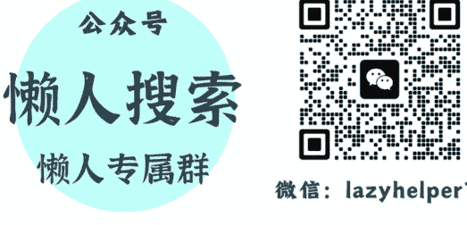
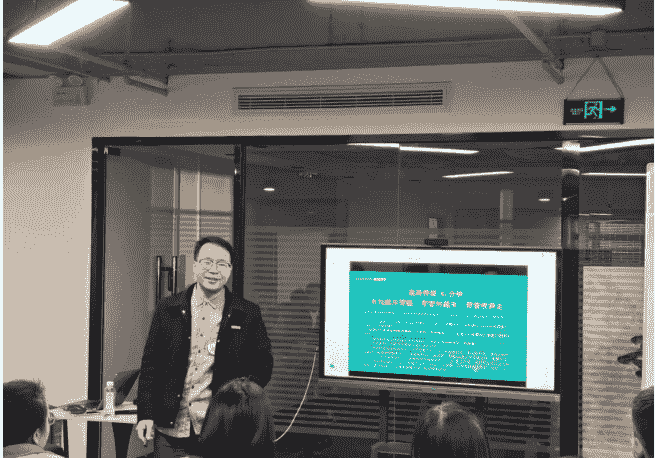
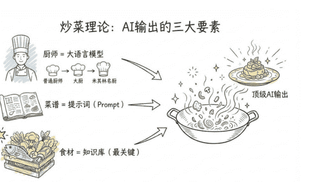
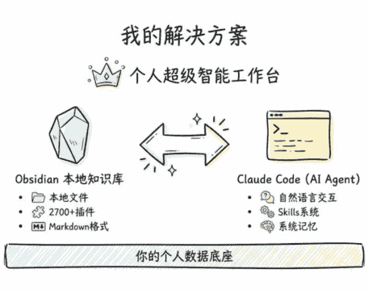
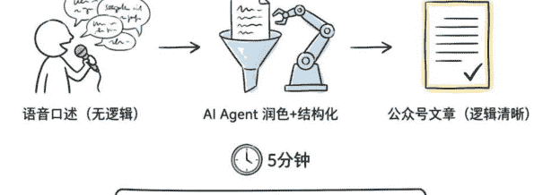
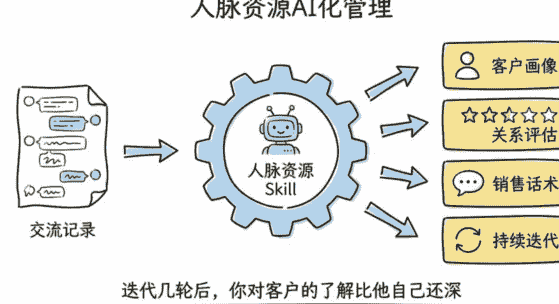
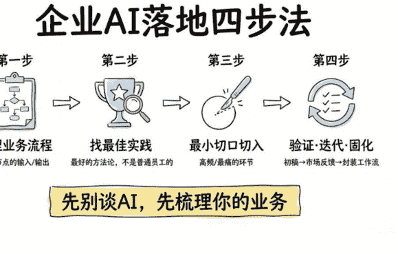
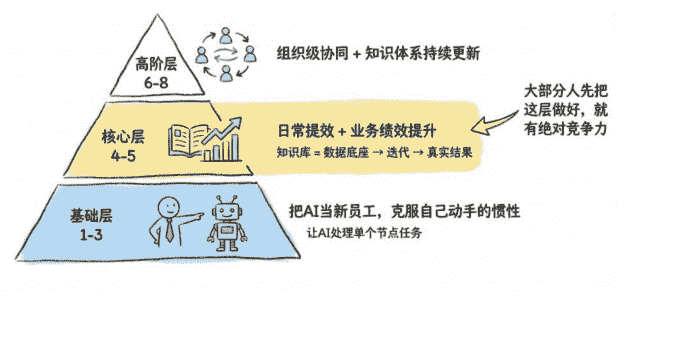
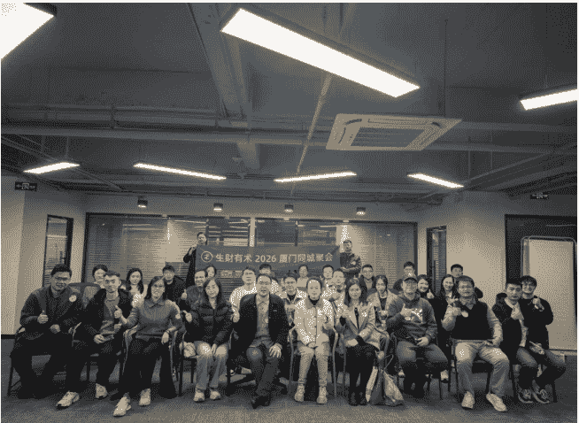

# 个人知识库：AI 时代的超级武器，用本地知识库+AI Agent 打造你的智能工作台，干货纯享版

## 公众号懒人搜索，懒人专属群独享

懒人微信：lazyhelper1

大家好，我是焦波，「AI 先锋队」社群发起人，也是多家企业的 AI 战略顾问。曾在游戏行业创业，带过日活 400 万的项目。如今聚焦在 AI 智能体落地。

今天只聊一件事：如何用本地知识库结合 AI Agent 搭建个人超级智能工作台，并把这套能力复制到企业里变现。

本篇会覆盖 6 个关键问题：

- 1. 为何你用 AI 总是差口气？——“炒菜”模型
- 2. 普通人使用 AI 的六大致命误区
- 3. 我的实战组合：Obsidian+Claude Code + Skills
- 4. 个人用法：口述变文章、人脉资产化、战略推演
- 5. 企业用法：睡眠类知识库客服、海外众筹选品创新
- 6. 企业 AI 落地的正确路径 以及你必须成为自己的知识架构师

## 二、为何你用 AI 效果不佳？——“炒菜理论”

很多人跟我说：“AI 好像也没那么神。”

我见过一家公司花钱上了 AI 客服，上线后一塌糊涂。原因很简单：没有自有语料沉淀，没有行业经验积累，完全仰仗大模型的通用能力。出来的回答，空泛且无用。

大模型知道的，公开网络也知道。你用通用知识提问，拿到的也就是通用答案，这对业务毫无帮助。

我习惯用做菜来比喻 AI 的工作方式：

### 1、厨师 = 大语言模型
普通厨师、大厨、米其林主厨，水平天差地别。模型越强，理论上限越高。我日常混用 Claude、GPT、Gemini、Grok，主力是 Claude。

### 2、菜谱 = 提示词 Prompt
火候、调料、时间，就是你对 AI 的引导方式。我手头积累了数百条常用指令，按场景归类。

### 3、食材 = 知识库，这是核心
青菜和鲍鱼海参，能做出同样的菜吗？食材的新鲜度也关键，过期信息做出来就是馊味。

所谓高密度的食材，就是营养高、时效新、强相关业务的知识。

顶级厨师 + 好菜谱 + 独家食材 = 顶级输出。

很多人把全部精力放提示词上，觉得一个神 Prompt 就能逆天。其实提示词只是表层，知识库才是真正的壁垒。

## 三、用 AI 的六大致命问题

用了两年多高频场景后，我总结出用户普遍踩的六个坑：

1. 数据无归属
今天 DeepSeek，明天豆包，后天 Kimi，再去海外。数据在各平台独立，海外甚至会封号，封了就全丢。

2. 对话框陷阱
多数产品是聊天窗口。日聊几十条，年累几千条。想复盘一条旧思路？基本找不到。搜索也全是乱码结果。

3. 记忆断层
新开对话，AI 一切归零。你得重复介绍背景。工具对长期记忆的支持都很粗糙。

4. 学习曲线陡峭
n8n 的权限和工作流配置会把人整崩溃，尤其是对接 Google 套件。Coze 稍好，也需要逻辑功底。

5. 信息混乱失控
群聊八十个，星球上百个，还要刷极客、Twitter 的动态。没梳理的信息就是流沙，过眼即忘。

6. 知识碎片化跨平台
内容散落在十几个软件里，想找一个要点，要跨四五个平台翻找。

## 四、我的解法：个人超级智能工作台

这套打法 2025 年 6 月就在服务企业客户时跑通了。核心就两件东西：

### 1、Obsidian——本地知识库的载体

我把国内十几种、海外主流的知识工具都试过，最终落回 Obsidian。

选它原因：

- **纯本地文件**：每条笔记都是文件，不依赖云服务。硬盘在，数据就在。
- **插件生态 2700+**：微信读书同步、网页抓取、导出 Word/PDF、格式转换……几乎只要的它都有。
- **分享简单**：整份文件夹直接复制给对方就行。
- **对 AI 最友好**：原生 Markdown，有层级、有重点，解析效率最高。

强调一下，Obsidian 只是容器，真正的引擎是下面这个。

### 2、Claude Code ——真正的执行力

这是 Anthropic 的 AI 编程 Agent，迭代速度极快。

有人担心不会编程。别担心，这里的编程不是写代码，而是一种对事务的对象化处理。方案、人脉、战略，都可以当成对象来操作。

核心优势：

- **纯自然语言交互**：像跟人说话一样，“这段太长帮我压缩”，“语气改一下”，直接说。
- **全库作为上下文**：输入年度规划指令，它会自行动员全库相关内容综合作答。
- **Skills 系统**：相当于封装好的工作流，能替代 Coze/n8n 的节点逻辑，不用再学工作流。
- **系统记忆 CLAUDE.md**：把个人信息、业务要点写进去，每次对话自动调用，且完全可控、可审计。比黑盒记忆可靠太多。

## 五、个人实战：这套系统能做什么？

### 场景一：从口述到公众号文章，5 分钟完成

我第一篇公众号文章就是口述原稿，没逻辑、没结构。

操作：

7. 把口述稿丢进 Obsidian
8. 指令 Agent：“按我的去AI写作模板改写成公众号体”
9. 指定输出目录
10. 等几分钟，成品出来

关键认知：你不用有逻辑。讲清楚故事和情绪是人的强项，整理逻辑是 AI 的强项。语音输入比打字快太多。

> 语音口述 无序
> AI 润色 结构化
> 公众号成品 清晰
> 5 分钟
> 你负责真实，AI 负责条理

### 场景二：人脉资源 AI 化管理

灵感来自根源老师的六抽屉、心谈七问方法论。

操作：

11. 让 AI 把方法论整理成人脉管理框架
12. 封装成 Skill，包含信息抽取、客户识别、分类评估、画像构建
13. 聊完客户后丢记录进去：“用该 Skill 整理张三”

它会自动抽取家庭背景、经历、荣誉、得意/失意、愿景、交集、付费情况、沟通质量等。

更进一步，把自己的产品资料写进 Skill，它会据此生成针对性的销售话术建议。每次新增记录就自动更新，迭代几轮后对人了解远超本人。

### 场景三：战略思考和决策辅助

- 导入赚钱嘉宾分享，结合自身业务做交叉分析
- 用李克的七件事框架拆解业务
- 用纪老板的项目标准评估可行性
- 做 2026 规划，从年到月逐级拆解

本质是把茅台顾问、华与华、麦肯锡的思维框架，通过知识库+Agent“请”进来当初稿，然后市场验证再迭代。循环速度提升十倍。

## 六、企业实战案例

### 案例一：睡眠企业——从 50 款产品到 1500 个问答

背景：50 多款产品，无人记全，新人培训成本高。

原有 AI 客服不好用，因为问题都是参数复述，不是客户真实提问。

做法：

**第一步：采集真实用户之声**
从小红书、抖音抓取评论：“睡不着怎么办”“颈椎不好选什么枕头”。

**第二步：四象限分类**
按频率和价值筛选。

**第三步：设计回答模板**
给 AI 一个有温度的回答框架。

**第四步：批量生成**
产品信息+问题库+模板交给 Agent，当天下午生成 1500 条高质量问答。

**第五步：多场景复用**
导入客服系统、内部培训、内容营销。

交付的不是问答，而是可复用的系统资产。新品进来直接套框架再生。

### 案例二：海外众筹——AI 驱动的产品创新

客户做 Kickstarter 户外背包。

原玩法：找爆品加减功能，选品要 2-3 周。

新打法：

1. 梳理完整业务流程
2. 先用 AI 跑通原有方法，效率质量双升
3. 引入 SCAMPER 创新法，七个维度拓展思路
4. 系统内调用浏览器采集评论与竞品数据
5. 关键洞察：爆品无女性专属款，女性用户却反馈佩戴不适，且平台女性占比 36%
6. 三轮验证：市场规模、需求真实性、成功案例

效果：时间从 3 周压到半天，分析从 3 个竞品到全品类，决策从拍脑袋到数据驱动。

## 七、企业 AI 落地的正确姿势

**第一步：先别谈 AI，先梳理业务流程。**
让老板画出流程，节点、输入输出、人机分工搞清楚，才知道哪里能提效。

**第二步：找最佳实践，不是普通员工做法。**
要找公司里最强者的打法，或行业顶级方法论，用 AI 替代低质处理。

**第三步：最小切口启动。**
别贪大，先找高频痛点跑通。

**第四步：验证、迭代、固化。**
当初稿，上线验证，迭代系统，成熟后封装成员工可用工作流。

> 先别谈 AI，先梳理业务

### 管理者 AI 能力分层

**基础层 1-3**：把 AI 当新员工，用来执行节点任务。

**核心层 4-5**：提效+业绩提升，核心是知识库与迭代能力。

**高阶层 6-8**：组织级协同，外部知识持续注入内部。

把核心层做好，已有绝对优势。

## 八、关键认知

1. 每个人都是老板，AI 是员工
别自己上手，要学会派活、质检、培训。

2. 积累独有数据
你的经历、交流记录是独一无二的资产。我的所有交流都已数据化，可回溯到任意一天。经过 AI 归纳后变成内容库、人脉库、决策库。

从今天开始记录，用任何工具都行。

3. AI 是放大器
基数 1 放大 10 倍是 10，基数 0.1 放大是 1。提升自己认知才是关键。

4. 信任是壁垒
AI 生成内容容易，值得信赖的人难。持续输出价值，建立信任。

## 九、行动建议

14. 立刻开始记录交流数据
15. 建本地知识库 Obsidian + Markdown
16. 用 Agent 连接知识库 Claude Code / CodeX 等
17. 从最小场景开始，如总结对话、口述变文章
18. 把赚钱大会优质分享入库，别听完即忘
19. 所有输出当初稿，市场验证后再迭代

我日常只用 Obsidian + Claude Code + Notebook LM，足够。

我是焦波，「AI 先锋队」社群创始人。对个人知识库搭建、企业 AI 智能体落地感兴趣，欢迎交流。

觉得有用请点赞投币。

最后安利懒人付费群：

**懒人专属群（介绍）**

这里是你对抗信息过载的护城河。

已稳定运行 7 年，累计拆解、研读 3000+ 个互联网商业实战案例与行业前沿内参和时政/宏观文章。

我们不搬运垃圾，只做高价值信息的筛选器与放大镜。

**懒人专属群更新记录：**

https://hk57gvIx7u.feishu.cn/docx/H0kRdZbSbolBR0xkaXtcuVEOnTg

**【免责声明】** 本资料归档于社群内部知识库，仅供成员课题研究与学术交流，请在查阅后 24 小时内删除。