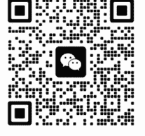
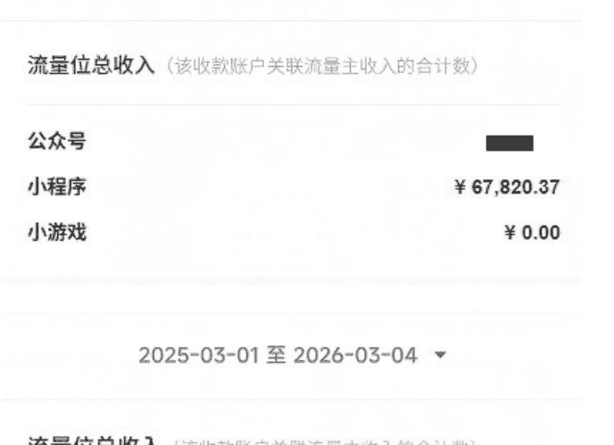
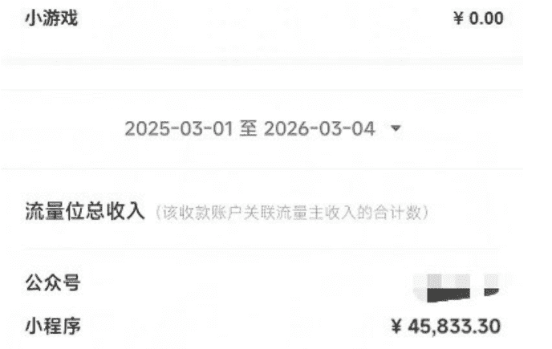
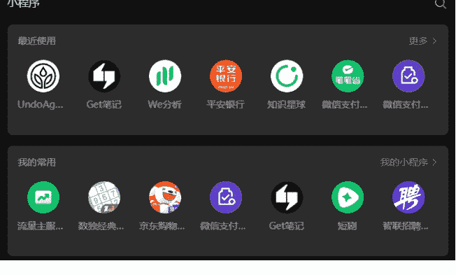
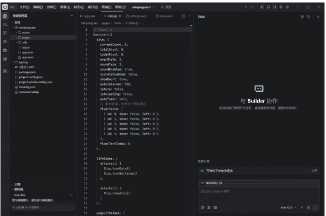
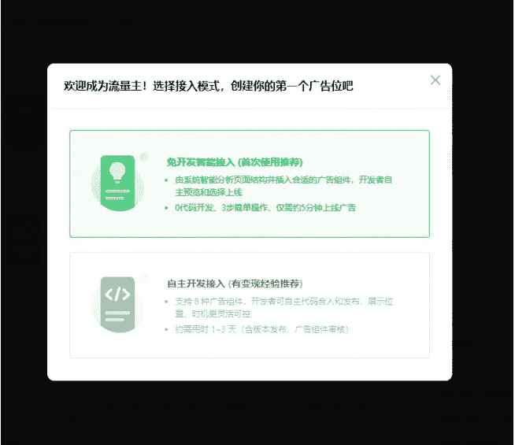
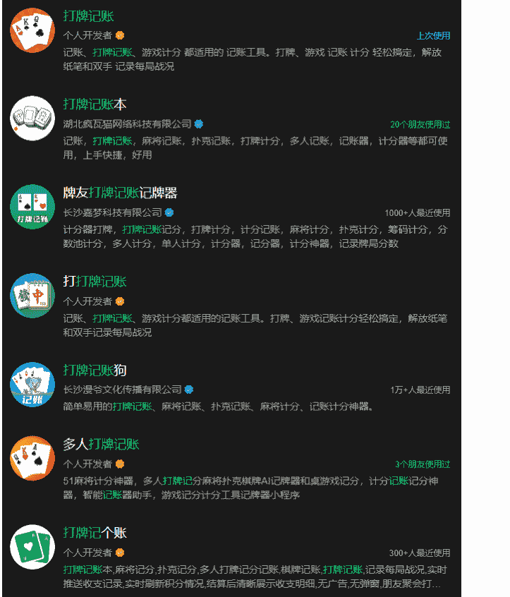

# 不会编程，也能靠 AI 做出小程序矩阵：10 个月赚过 10 万，月收入稳定 2 万+

## 260309 副业 SC 精华

👸号懒人搜索，懒人专属群独享

懒人微信：lazyhelper1

微信：lazyhelper1

## 大家好，我是西昂。

我已经在现在的公司待了四年，从最初的运营岗位一路做到团队管理，工作内容越来越多，薪资却几乎没有变化。

这几年实体生意普遍承压，公司也在不断控制成本。想单纯依靠工资实现收入增长，越来越不现实。好在我一直没有把全部希望寄托在主业上。

过去近十年，我持续尝试各种互联网项目：做个人网站、靠百度 SEO 获取流量并接广告，做虚拟电商、👸号搜索流量，尝试抖音 DSO 获客，也做过📕和抖音虚拟资料变现。

这些项目确实都赚过钱，但有一个共同缺陷：收入严重依赖持续投入。

👸号几天不更新，流量就会下滑；抖音一周不发内容，数据也会变差。只要你停下来，收入就跟着下降，像一直在跑步机上奔跑。

我一直觉得，自己最大的短板就是不会写代码。

我能发现需求，也能判断哪些方向可能有机会，却很难把想法真正变成产品。以前想开发一个工具，要么请外包，成本几千到几万元；要么因为成本和技术问题，直接放弃。很多看见的机会，最终都没办法落地。

直到 AI 编程工具出现，情况彻底改变了。

现在，我可以直接告诉 AI 自己想做什么，把参考截图发给它，让它生成页面和代码；遇到报错，就把错误信息复制过去，让 AI 协助排查和修改。

AI 让我从只能做内容、做流量的人，变成了可以独立完成产品开发的人。过去需要找外包、花费数周甚至数月的事情，现在往往一两天就能做出第一版。

从发现需求、开发工具，到上线和变现，一个人就可以完成。最重要的是，试错成本被压到了很低。

于是，我决定尝试小程序矩阵。

这并不是因为以前的项目不能赚钱，而是小程序更适合做长期收益：产品上线之后，不需要每天持续更新，用户照常使用，收益也能自动产生。

而我过去积累的流量经验、需求判断能力和推广能力，也可以直接迁移到小程序项目上。

## 我目前做的项目和收入情况

我主要做的是微信小程序流量主。

简单讲，就是开发一些实用工具，用户在使用过程中看到广告，我从广告分成中获得收益。

目前的实际情况是：

- 10 个月累计收入超过 10 万元；
- 现在每月收入约 2 万元，并且仍在增长；
- 手上有十几个小程序，其中 7 个能够稳定产生收益；
- 新做一个小程序，通常只需要 1～2 天；
- 有些小程序已经半年没有更新，但每天仍然会产生收入。

这类收入最吸引我的地方，不是数字本身，而是它不需要我每天盯着。

每天打开后台，就能看到前一天的数据。腾讯生成结算单后，通常 3～5 个工作日到账。最近一次更新这些产品，已经是半年前，但收益并没有停止。

十几个产品中，有的表现不错，有的效果一般，也有几个已经没有继续运营的价值。但只要整体组合起来，每个月依然能够带来两万多元收入。

这就是矩阵的意义：不押注单个产品，而是让多个产品共同贡献收益。

下面，我会把这个项目为什么值得关注、具体如何赚钱、普通人能否参与，以及怎样复制这套方法讲清楚。

## 现在入场，还有机会吗？

答案是：有，而且窗口期还没有关闭。

### 超级标 #015

超级标停了一段时间，因为之前连续发布了几条，不少圈友反馈信息量太大，需要时间消化。

过去一年，我明显感受到，星球里的机会正在变多：YouTube AI 视频、抖音自然流 CPS、AI 工具出海、B 站好物、垂直📕账号等，几乎每个方向都很热闹。

但机会从来不是越多越好。对大多数人而言，一年能够真正抓住一两次，足以改变结果的机会，就已经很不错了。

今天发布的是 2026 年第一条超级标，也是总计第 15 条。此前的超级标，可以点击#超级标标签回看。

本次超级标的主题是：📕产品打造养成系。

具体路径是：

先从📕中寻找真实需求，通过持续发布笔记聚集目标用户，再公开产品构建过程，最后把这批用户自然转化为产品用户。

最终承接产品，很多都会选择微信小程序。

可以把两个平台分工理解为：

- 📕：发现需求、验证需求、获取流量；
- 微信小程序：承载产品、完成交付、实现变现。

元旦第一天，微信上线了 AI 应用及线上工具小程序成长计划。平台释放出的信号很清楚：微信需要更多真正有使用频率、能够付费和复购的工具型服务。

因此，平台已经开始补齐关键环节：

- 云开发降低开发门槛；
- Token 和文生图额度降低模型成本；
- 数据分析和推荐入口帮助增长；
- 广告免开发接入、虚拟支付和订阅优惠，减少变现阻力。

微信并不缺内容，也不缺入口。它真正需要的是能够被用户持续使用的服务。只有工具被反复打开，才有机会形成订阅、复购和长期现金流。

## 为什么要把📕和微信小程序结合起来？

因为两个平台承担的用户行为完全不同。

📕更适合“逛”。

用户会在上面搜索问题、浏览经验、收藏内容、发现新需求。平台上已经积累了大量高频场景：

- 英语口语如何练习；
- 带孩子去哪里玩；
- 如何给孩子讲博物馆；
- 班级事务如何管理；
- 情绪低落时怎么办；
- 如何准备考试；
- 简历怎么写；
- 怎样减脂和祛痘；
- 第一次出国需要准备什么。

这些都不是创作者凭空制造出来的话题，而是用户每天搜索、提问和收藏的真实问题。

微信更适合“用”。

用户每天都会打开微信，小程序不需要下载安装，入口方便，支付、会员和订阅也都已经非常成熟。

工具产品最关键的，不是用户第一次是否愿意购买，而是会不会持续使用。一旦形成使用习惯，续费和复购就更容易发生。

所以，更合理的产品路径是：

📕负责发现问题和放大需求，微信小程序负责提供工具和完成交付。

龙哥老大最近发布的第 15 条超级标，就是「📕产品打造养成系」。本质上，就是先在📕验证需求、聚集用户，再用微信小程序承接产品。

正如龙哥所说：机会本来就不多，一年能抓住一两次真正改变结果的窗口期，就足够了。

之所以现在值得关注，是因为三个变化正在同时发生。

## 趋势一：微信用户规模大，细分工具仍有大量空白

微信拥有 13 亿月活用户。

小程序依托微信生态，用户搜索后即可使用，不需要额外下载。微信搜索、首页下拉、发现页分类、好友分享，都可能成为免费的流量入口。

你打开微信首页下拉，就会发现“最近使用”里往往都是一些已经形成习惯的工具。

热门赛道可能已经有大公司布局，但大量细小需求仍然没有被认真满足。

比如：

- 手电筒；
- 噪音检测；
- 保质期计算；
- 亲戚关系换算。

这些需求看起来很小，大厂通常不愿意投入，但对个人开发者来说，恰恰可能是机会。

工具产品还有一个优势：一旦用户用顺手了，替换成本并不低。越早上线，越早积累用户和产品权重，后来者越难追赶。

这并非单纯的流量生意，更像是在积累用户资产。每一个活跃用户，都可能成为未来持续产生收入的基础。

另一方面，📕已经沉淀了大量真实需求。从备考、育儿，到健康、职场和生活服务，每个高频问题背后，都可能对应一个工具产品。

关键在于，📕和微信各自发挥所长：

- 📕适合用户浏览、搜索和发现；
- 微信适合用户重复打开、长期使用和支付。

因此，用📕做需求验证，用微信小程序做产品交付，是一条非常自然的组合路径。

## 趋势二：AI 让个人开发工具成为可能

过去，开发小程序往往是程序员的专属工作。普通人要么学习编程，要么找外包，成本和周期都不低。

现在，AI 已经把这道技术门槛大幅降低。

我目前的工具组合是：

- 新手可以使用 Trae，它集成了 Kimi K2.5 模型，能够读取截图并生成代码；
- 有经验后，可以尝试 Claude、Claude Code 等工具。

你只需要把参考产品截图发给 AI，再描述希望实现的功能，它就能快速产出第一版代码。之后通过反复测试和调整，逐步完善产品。

这意味着，一个人也可以先做出 MVP，快速上线，而不必等到产品“全部完美”之后再发布。

以前需要一个月完成的工作，现在可能一两天就能完成。供给速度提高以后，竞争逻辑也发生了变化：

过去更看重谁最早发现机会；现在更重要的是谁能快速制作、快速上线、快速迭代。

也正因为成本足够低，“用数量换概率”才成为个人开发者可执行的策略。

你不需要赌某一个项目必然爆发，而是可以连续尝试 10 个方向，只要其中几个跑通，整体就可能获得不错的回报。

在 AI 出现之前，个人几乎不可能用这种方式批量试错。

## 趋势三：微信正在完善工具产品的基础设施

2026 年元旦，微信上线了 AI 应用及线上工具小程序成长计划。

计划周期为 2026 年 1 月 1 日至 2026 年 12 月 31 日，目标是帮助开发者从 0 到 1，再从 1 做到 100。

## 微信 AI 应用及线上工具小程序成长计划上线！

全方位支持体系

陪伴小程序开发者从 0 到 1，从 1 到 100

计划激励期：2026 年 1 月 1 日 -2026 年 12 月 31 日

平台提供的支持主要包括：

### 1. 云开发资源

微信云开发提供数据库、云函数等完整的小程序后端能力，并支持对接 AI 大模型与 Agent。

新开发者可以免费创建个人版云开发环境，使用期限为 6 个月；已有云开发环境的开发者，也可以领取相应抵扣券。

### 2. AI 算力额度

活动期间，开发者可以使用总计 1 亿 Token 的腾讯混元文生文模型额度，以及 1 万张混元文生图模型额度。

后续腾讯混元的新模型也会陆续接入，方便开发者直接调用。

### 3. 数据分析能力

开发者可以免费领取微信分析专业版权限 1 年，用数据了解用户行为和产品表现，从而更有效地进行迭代。

### 4. 流量激励

平台提供“发现—小程序”等推荐入口，帮助优质工具获得更多曝光。

同时，在👸号发布小程序相关图文，并带上#来微信做个小程序话题，也有机会获得额外公域流量。

### 5. 低门槛广告接入

支持免开发智能接入广告。

系统会分析小程序页面，在合适的位置和时机推荐广告，并支持开发者预览、编辑和直接上线。

### 6. 虚拟支付和订阅优惠

安卓、iOS、鸿蒙等终端均可使用虚拟支付和会员订阅能力，参与计划的 AI 应用及线上工具小程序可以享受优惠费率。

## 申请条件

目前开放的类目包括：

- 文娱；
- 工具；
- 社交；
- 深度合成；
- 资讯；
- 虚拟行业。

适用于各类虚拟工具和线上服务。

只要小程序主体信息完整，个人和企业主体都可以参与。

开发者登录「小程序后台 (mp.weixin.qq.com) — 行业能力 -AI 小程序成长计划」即可申请，新注册开发者完成注册后也可以参与。

换句话说，平台已经把很多关键环节提前准备好了：

- 开发成本：免费云开发环境；
- 模型成本：Token 和文生图额度；
- 增长成本：数据分析工具和推荐入口；
- 变现成本：广告免开发接入、虚拟支付、订阅和优惠费率。

微信想要的不是更多内容，而是更多能够被用户反复使用的服务。

目前流量主广告分成可达 50%，创意类 200 万以内还可能获得 70%。个人开发者并不是在正面挑战大厂，而是在补充那些大厂没有精力覆盖的细分场景。

## 一句话总结

📕已经聚集了大量成熟需求，AI 降低了工具开发门槛，微信则提供了产品交付、流量和变现基础设施。

三个条件同时出现，才让这个窗口真正打开。

## 具体靠什么赚钱？

知道有机会还不够，最重要的是弄清楚收入从哪里来。

整个模式可以概括为：

> 📕发现需求、沉淀用户 → AI 开发小程序 → 微信小程序交付并变现。

📕相当于市场调研和获客渠道。你可以先发布相关笔记，看用户是否感兴趣、评论区是否有人追问、收藏和互动是否明显。

如果数据证明需求存在，再投入时间开发工具。

这样做的好处是，先验证市场，再制作产品，不容易闭门造车。

## 两种主要变现方式

### 方式一：流量主广告

用户使用你的小程序，看到广告，你获得平台广告分成。

这种方式不需要主动销售，也不需要处理复杂售后，用户越多、使用频率越高，广告收入越稳定。

通常每天上午可以看到前一天的数据，腾讯生成结算单后，3～5 个工作日打款。

广告中比较重要的有两类：

- 封面广告：单次价格约 0.5 元，是主要收益来源；
- 激励视频：单次约 0.2 元。

很多新手只开通了部分广告，忽略了封面广告，导致少赚不少。开通流量主后，建议第一时间检查封面广告是否已经开启。

开通门槛也不高：累计独立访客达到 500 人，且没有违规记录即可。

认真推广的话，通常一周到一个月有机会完成。

### 方式二：付费工具

用户直接购买你的服务，可以采用：

- 单次购买；
- 会员订阅；
- 功能付费；
- 虚拟商品付费。

微信小程序已经支持虚拟支付，成长计划还提供费率优惠。

比如博物馆讲解类产品，可以把单个讲解内容定价为 29.9 元，用户觉得有价值，就会直接购买。

广告赚的是用户注意力和使用量，付费产品赚的是工具本身的价值。

广告模式进入门槛低，更偏被动收入；付费模式收入上限更高，但要求产品确实能够解决问题。

两者并不冲突。很多产品可以同时保留免费功能、广告收入和付费服务。

比较稳妥的做法是：先用广告验证用户需求，等用户量和使用频率起来后，再增加会员或付费功能。

## 一套完整的六步流程

不论最终采用广告还是付费，底层执行流程基本一致。

### 第一步：注册账号

通过微信公众平台注册小程序，个人主体大约 30 元，整个流程通常几分钟即可完成。

### 第二步：确定需求

寻找有真实需求、但竞争并不激烈的细分工具。

这一步非常关键。方向选对了，后面会顺很多；方向选错，即使持续投入，也可能没有结果。

### 第三步：用 AI 开发

找到参考产品后，把截图和需求描述交给 AI 编程工具，先生成第一版，再根据实际测试不断修改。

不要求你掌握完整编程能力，关键是能不能清楚表达需求、发现问题并让 AI 继续调整。

### 第四步：提交上线

使用微信开发者工具测试，再用手机扫码进行真机体验。

确认没有明显问题后提交审核，通常 1～3 天可以上线。

### 第五步：推广获客

在📕发布相关内容，引导用户使用产品，并尽快完成 500 人门槛。

推广过程本身也是验证需求的过程。笔记数据好、用户评论区主动询问链接，通常说明方向有潜力。

### 第六步：开通变现

达到条件后，可以开通流量主广告，或者设置付费入口。

从这一步开始，用户使用产品，就可能持续产生收入。

接着，回到第二步，寻找下一个需求。

这就是矩阵打法的循环。

每完成一个产品，你都会积累更多模板、经验和素材。做到第十个时，开发速度往往会比第一个快很多。

## 一些正在发生的真实案例

### 大壮壮妈：亲子博物馆内容变成付费产品

她原本在📕分享亲子博物馆讲解内容，围绕带孩子逛博物馆、如何理解展品等主题持续输出，单个账号获得了 1.9 万赞与收藏。

随后，她将讲解内容制作成微信小程序产品，单个讲解 SKU 售价 29.9 元，累计售出 9000～10000+。

按 9000 份计算：

29.9 × 9000 ≈ 27 万元流水。

她的路径非常清晰：

先在📕发布内容，验证亲子博物馆讲解需求；再把内容整理成产品，最后将📕用户转到微信小程序完成购买。

### 郭东超：内容引流到多个学习产品

他开发了一款朗读小程序，已经拥有 6000 多名付费用户，主要用户来自📕。

另外一款英语学习小程序刚上线不久，几乎没有进行大规模推广，也已经产生了 21 笔订单。

这说明他已经把“内容获客—小程序承接”的流程跑通了。做第二个产品时，可以继续复用已有的内容和流量能力。

### 六六：「我在」工具快速获得用户

六六推出「我在」后，发布内测消息，申请人数从最初的十几人、几十人迅速增加，很快达到名额上限，后续仍然有人排队。

更值得注意的是，内测后的一个星期几乎没有持续运营，每天仍然有大约 10 个新增用户，并能稳定完成 2～3 单转化。

它的付费设计也很值得参考：

先让用户免费体验一部分额度，额度用完后立即出现付费入口。

用户已经亲自体验过产品价值，继续付费就变成自然选择。与其反复向用户解释“产品很好”，不如让用户先用起来，再让实际体验促成购买。

还有一些规模不大、但非常典型的细分项目：

- 小目拼豆：将照片 AI 转成拼豆图纸，单次 5 元，已售 5557 份，流水约 2.78 万元；
- 流年记忆：黄委会刷题小程序，已售 1416 份；
- 严律己学堂：政府会计知识点工具，已售 2248 份。

这些产品都没有追逐大而全，而是切入一个明确、精准、愿意付费的小场景。

类似案例还有很多。龙哥盟也整理过相关案例数据表，涵盖教育、工具、健康、生活服务等多个方向，可以用来寻找对标项目。

## 这些成功案例有什么共同特征？

把这些项目放在一起看，会发现它们都遵循同一套原则：

第一，集中解决一个具体且高频的问题。

第二，认真听取用户反馈。

第三，能够快速进行调整。

没有哪个产品一开始就功能齐全、体验完美。

大壮壮妈最初可能只有少量博物馆内容；「我在」在内测阶段也不可能没有问题。但只要产品确实解决了用户需求，用户会用行动给出反馈：

- 主动申请内测；
- 愿意排队等待；
- 用完额度后付费；
- 在评论区持续询问入口。

用户不太在意你是不是大公司，也不要求界面一定华丽。他们真正关心的只有一件事：这个工具能不能帮我解决问题。

所以，做工具时可以遵循一个原则：先做减法，再做加法。

### 先做减法

不要一开始就堆叠大量功能。

拼豆工具就把拼豆图纸做好，刷题工具就把刷题体验做好，博物馆产品就专注于讲解。

不要动不动就想“顺便再增加一个功能”。功能越多，产品可能越复杂、越慢，也越不容易使用。

### 再做加法

当核心功能已经足够顺畅，再根据真实反馈进行优化。

用户提出“能不能收藏”“能不能离线使用”等需求，说明这些功能确实来自实际使用场景，可以逐步加入。

而不是坐在家里凭想象不断添加功能。

## 真正的核心：不要押注一个产品，而是建立矩阵

看到这里，很多人可能会担心：

如果我做的第一个产品没有火怎么办？

这正是矩阵打法要解决的问题。

### 做一个产品，靠运气；

### 同时做多个产品，靠概率；

### 持续迭代一组产品，才有机会形成稳定收入。

把小程序想成一组线上自助设备：有的表现突出，有的只是偶尔带来访客，也有的最终没能跑起来。只要整体回报为正，表现好的项目就能覆盖试错，而数字产品发布后也不必像实体设备那样天天照看。

我目前做过15款，结果分成三档：7款持续产生收入，约占47%；5款有些访问但收益有限，占33%；另有3款没有做出效果，占20%。

最后那3款并非毫无价值。每个项目用了几天和30元认证费；与之对应的7款，则持续为我带来进账。多做一些，才有机会让整体表现趋于稳定。若只押一个方向，碰上没跑通的概率就得承受全部后果；把尝试扩展到十个，哪怕有一半见效，组合结果也会好得多。

这并非靠运气下注，而是用多个项目分散不确定性，类似投资组合：不要求每项都获利，目标是总收益为正。

AI让这套做法更可行，原因很直接：过去验证一个点子，可能要耗上数月、投入数万元；现在往往几天、30元左右就能完成初步试验。失败不再意味着重投入，损失主要是有限的时间。

## 收入通常如何变化

**起步阶段（约1—3个月）**：月收入可能只有几百元。此时还在熟悉流程、处理各种小问题，日收入也许只有几元。做出5款产品，能有一款获得一些访问就不错。难熬，却是打基础的时期。

**积累阶段（约3—6个月）**：月收入有机会达到几千元。两三款产品开始稳定运作，制作效率也会提升：从早期一款要花两周，逐渐缩短到三五天。模板和可复用流程开始成形。

**增长阶段（约6—12个月）**：月收入有望超过一万元。五款以上产品持续贡献收益，新项目可能一两天就能完成。旧项目继续产生收入，新项目陆续上线。逐渐会出现这样的时刻：早晨查看后台，收益比前一天又多了一些。

**一年以后**：我正处在这个阶段。手上有7款产品在运行，日常维护很少，主要精力转向开发新项目。每新增一款跑通的产品，收入就可能再上一个台阶。随着模板、经验和判断力逐步积累，后续开发也更快。

不少人没熬过最初三个月，看到每天只进账几元就停了下来。实际上，用户积累、搜索表现改善和个人经验增长，都可能在这个阶段悄悄发生。前期看似缓慢，后续却能减少投入、累加产出，这正是这类项目的吸引力所在。

关键并非单月数字，而是每次尝试都有回报：奏效的项目持续贡献收入，没跑通的项目带来经验。时间会让这两类成果逐步显现。

## 落地流程

前面提到的完整流程中，账号注册和提交发布相对标准化。真正需要花心思的，是需求判断、借助AI完成开发，以及推广获客。下面逐项展开。

### 需求判断：先找具体问题

选题的核心，是发现有人确实需要、现有产品却没有解决好的小切口。

很多人会先在脑海里苦想“我该做什么”，但线索往往就在微信的搜索页、📕的留言中，也藏在用户反复输入的关键词里。

筛选方向时，可以用三个条件把关：

**功能聚焦。** 一款产品先解决一个明确问题，不必塞进一堆互不相关的工具。搜“手电筒”的人，打开后若同时看到天气、计算器等内容，反而容易困惑。用途越明确，用户越容易理解，搜索呈现也更有针对性；实现范围小，AI辅助制作通常也更快。

**使用时机明确。** 用一句话说清楚，用户在什么情况下会打开它。例如打牌时记录输赢、临近过期时核对日期、春节走亲访友时确认称谓。若连使用场景都描述不清，就应继续缩小范围。

**避开成熟巨头的正面战场。** 普通记账、天气、日历等领域早已有成熟大厂产品，新团队很难直接竞争。以记账为例，随手记、鲨鱼记账多年积累了用户和功能，用户没有明显理由改用新工具。但将需求具体到“牌局收支记录”，竞争格局就不同了：大厂通常不会专门服务这种窄场景，实际使用者却有明确需要。需求规模大，不等于新产品容易获得用户；细分服务的缺口更值得关注。

微信里有不少规模不大、却真实存在的需求，例如：

- 分贝测量：租房、装修或办公环境中，用户想快速了解噪声情况。
- 日期保质期提醒或计算：超市、仓库等岗位会频繁核对商品期限。
- 亲属称谓查询：春节走亲访友时尤其常用，节日期间访问可能明显上升。
- 单位换算、BMI、倒数计时等：使用场景实际，部分现有工具体验仍有改善空间。

这类方向往往场景具体、实现不复杂，也不是大厂重点投入的领域，但潜在使用者并不少。工具产品还有一个特点：一旦用户用顺手了，通常不太会特意换掉。

现在可以直接在微信里试搜“检测”“换算”“查询”等词，观察已有产品的质量。有些页面老旧、广告繁杂、操作不便，却仍有数千乃至数万用户。这说明问题确实存在；如果能提供更顺畅的体验，就有机会服务这些人。

再用三项条件复核：是否已经有人使用、现有领先产品是否存在明显短板、实现范围是否可控。都符合，就值得验证；若不符合，不妨及时换题。选方向不用无限拖延，半天通常足以找到候选。

更系统的需求挖掘、项目评估和竞品研究，需要完整的方法来支撑。眼下先建立基本判断：机会一直都在，关键是愿不愿意观察。

### AI辅助制作：从视觉参考开始

有了方向，就可以着手做产品。没有编程基础也能开始。

准备工作只需要电脑、微信开发者工具和一款AI编程产品。开发者工具可以免费获取；入门者可试TRAE，熟悉开发的人也可以选择Cursor，起步成本基本为零。

TRAE由字节跳动推出，集成Kimi K2.5模型，支持识别图片。把界面参考图交给它，它可以据此生成代码，对初学者尤其方便。

用我制作“电子木鱼”的经历说明，主要是三轮沟通：

第一轮，把参考界面截图交给AI，并说明希望实现的功能，让它先搭好页面和基础结构。很多时候，一张清楚的参考图就能代替长篇描述。

第二轮，把生成结果放进微信开发者工具查看。如果木鱼外观或排版不符合预期，就再提供截图和修改要求，让AI调整。

第三轮，检查运行情况。遇到报错时，把错误画面发给AI，请它继续排查和修正。

如此往复几轮，主要功能通常就能成形。人的工作是观察、描述和确认，和与设计师沟通改稿类似，只不过修改对象换成了AI生成的页面。

开发者工具中，一侧展示项目文件，另一侧可以预览效果。无需逐行阅读代码，主要盯着预览画面，发现问题就反馈给AI。确认运行正常后，再提交审核。

整个协作分工很清楚：你负责定义目标、判断是否好用、提出修改方向；AI负责生成与调整程序内容，以及协助处理错误。

制作时有几类情况值得留意：

- **权限声明遗漏。** 若产品涉及定位、录音等能力，需要在app.json中配置对应权限。配置缺失时，模拟器表现正常也不代表手机端没问题；将错误提示交给AI协助排查即可。
- **模拟器与手机表现不同。** 开发者工具中的预览不能代替真机检查，务必用手机扫码体验。我曾在模拟器上调整很久，自认为排版妥当，换到手机才发现页面布局走样。
- **审核未通过。** 可能涉及功能过于简单、虚拟支付或内容规范等原因。根据平台给出的意见修改后再提交，通常需要几轮调整。首次被退回并不罕见，不必立刻认定是程序写错了。

这些问题我都遇到过，提前了解能少走弯路。

**制作速度也会逐步提升：**

- 初次尝试可能需要一到两周，主要时间花在熟悉工具和处理意外状况。
- 做到第三至第五款时，通常能缩短到三五天，因为常见流程和问题已经熟悉。
- 累积到十款左右后，页面结构、广告位置、分享入口和常用组件都能整理成模板，开发一款新产品可能只需一两天。

心态上，先完成可用版本，再根据反馈完善。不要为了第一版的完美迟迟不发布。用户真正关心什么，往往只有实际使用后才看得出来。

### 推广获客：从📕起步

产品上线后，接下来面对的是没人使用的问题。新产品刚发布时通常缺少曝光，不能指望平台自动带来访问，因此需要主动寻找用户。

试过多个渠道后，我认为📕对初学者比较友好：内容制作门槛不高，反馈也相对快，小程序相关话题本身也有受众。

发笔记还有额外作用：它能帮助验证需求、聚集潜在用户。阅读、收藏和讨论表现不错，说明话题有人关心；如果留言里不断出现“怎么使用”之类的问题，说明用户已经产生行动意愿。

**常见的内容方向有三种：**

- **记录踩坑过程。** 适合刚开始的人，写下刚经历的审核、开发问题，例如“审核来回修改几次后终于通过”。
- **展示实际收益。** 用后台数据呈现项目表现，直观易懂。但必须如实说明，不能修图造假。
- **制作教程。** 适合已有一些经验后分享操作过程，通常更容易被收藏。刚入门时还在摸索，可以等做过三五款后再写。

标题可以加入数字、明确事件和情绪，让读者迅速知道内容价值。例如，“用Cursor完成3款工具，收益表现出乎意料……”通常比“聊聊小程序开发”更有吸引力：前者信息更具体，也留有悬念。

笔记中可以自然出现产品名称，并在评论里补充名称。不要添加二维码，也不要用“私信我”引导站外联系，避免触发平台的限流或降权机制。让读者自行搜索，通常更自然。

如果留言里有人询问名称、搜索方式或入口，说明这个方向获得了真实关注。这样的讨论还会吸引其他读者留意并搜索。

作为参考，一篇阅读量约2000的笔记，可能带来50至80名产品访客。连续发布5到10篇，若其中一两篇表现不错，就有机会起量；不必每篇都成为爆款。进展快时一周左右能积累500人，慢一些则可能需要一个月。

**发布时注意这些事项：**

- 新账号别急着连续发推广内容。先正常分享一段时间，让账号积累基础互动，再逐步介绍产品。
- 内容不要像说明书一样只有干货。适度加入真实经历和情绪，例如深夜修问题、第一次看到访问数据时的兴奋，更容易让人愿意读下去。📕用户通常更容易被故事吸引。
- 不要追逐敏感热点或踩规则边缘。账号被处理可能牵连同一微信主体下的产品，造成实际损失，风险远高于短期流量。

## 这套做法背后的关键

需求、制作和推广的操作已经说过。再往下看，为什么同样的方法，有人能坚持并取得进展，有人却始终停在准备阶段？

网上并不缺教程，真正值得理解的是方法背后的原则。具体工具会变化，底层判断却更耐用。

### 多做几次，比死磕一款更有效

这套策略看重的是尝试覆盖面，而不是先把某一款打磨到无可挑剔。

回看前面的15款：7款稳定，5款表现一般，3款没跑起来。那3款合计投入不到200元左右，却换来7款持续产生收益。若把小额试错换来的长期收入放在一起看，这笔投入并不高。

这和投资组合的逻辑相似：并非每个选择都盈利，而是关注整体是否向上。与其要求单个项目必然成功，不如通过多个项目降低整体的不确定性。

还有一个长期收益：项目做得越多，选题判断会更准确。前几次可能只跑通一部分，后续的命中率有机会提高。失败的项目也会提供信息，帮助你排除不适合的方向。

### 产品会继续工作，不必天天更新

👸号文章停更几天，阅读量可能回落；短视频账号一段时间不发布，曝光也可能减弱。许多内容业务需要持续投入时间维持流量，收入往往与持续劳动紧密相关。

工具类小程序则有不同的特点：产品稳定后，即便一段时间不更新，仍可能继续被用户找到和使用。

换句话说，表现良好的旧项目可以继续产生收益，你便能把精力转向开发新项目。起步时只有一款产品运作，半年后可能有五款，一年后可能有七款，而新项目所需时间却不断减少。

产出逐步累积，投入逐渐降低，这是一种由经验和资产带来的时间复利：过去做出的产品，在未来继续发挥作用。

### 更大的阻碍往往是迟迟不开始

真正让不少人停滞的，不是同行或大公司，而是反复研究却迟迟不行动。

有人花几天比较方向，再花几天挑工具，又继续研究别人的案例；时间过去了，项目却仍停留在想法阶段。

不少后来跑通的产品，早期版本并不完善：有的内容不多，有的内测问题不少，但它们先接触了真实用户。发布之后，用户行为才会告诉你应该改什么。

现在获取资料并不困难，真正拉开差距的是执行。了解同一套信息的人很多，愿意注册账号并完成首次尝试的人要少得多。结果往往属于真正迈出第一步的人。

### 普通人需要具备什么

先说不必具备的条件：不要求会编程，AI可以协助完成；不需要大笔资金，30元左右即可开始；无需辞职，每周安排5到10小时也能尝试；也不依赖特殊资源或人脉。

更重要的是两种能力：

**一是发现需求的眼光。** 留意“有人反复提起、现有服务却做得不够好”的问题。这种观察力可以训练。刷📕时多看看留言，哪些问题被重复提出？在微信搜索时换几个关键词，结果里有没有体验差却仍有人用的工具？持续观察后，判断会逐渐变敏锐。电商从业者会称它为选品能力，做SEO的人会说是关键词判断，内容创作者则叫选题直觉，本质相通。

**二是熬过早期的耐心。** 前三个月收入少，确实容易让人怀疑投入是否值得。但这一阶段可能正是用户增长、搜索表现改善和经验积累的时期。

我起步的头三个月做了5款产品，合计每天收入还不到10元。我知道用户和经验都在累积，所以没有停下。到了第四个月，有一天日收入突然超过100元。变化来得快，但前提是你没有提前离场；若在第三个月放弃，就看不到后面的变化。

## 我如何把经验整理成流程

也许有人会想：这些结果是不是只有我碰巧做到？换成普通人，能不能照着完成？

做了十几款产品、经历过不少问题后，我整理出一套可执行的SOP。它不是凭空设想，而是从实际过程里提炼出来的步骤。

### 新手从准备到发布，需要多久

先到mp.weixin.qq.com申请小程序账号，缴纳30元认证费用，个人主体即可；然后安装微信开发者工具并建立项目。准备工作大约半小时。

做到第三款时，我开始整理通用模板，把页面结构、导航、广告位置、分享入口和授权逻辑放在一起。之后建立新项目时，复制模板，再替换主要功能即可。模板能明显提高效率。第一款可能没有现成框架，但做完后应把重复使用的部分整理出来，后续会轻松许多。

开发大约需要1至3天。把参考画面交给AI，让它生成初始版本，再放到开发者工具中观察；哪里不合适，就描述问题并要求调整。反复进行“查看、反馈、修改”，就像和设计师沟通，只是AI可以持续配合修改。

通常经过3到5轮调整，就能得到可用版本。先让它满足基本使用，再考虑细节完善。

随后留出半天测试。不要只依赖电脑模拟环境，必须用手机扫码实际操作。检查打开是否正常、按钮是否顺畅、数据是否保存、分享后能否进入。

尤其注意三个方面：不同手机型号的显示差异、网络较弱时的使用情况，以及广告是否遮挡主要操作区域。这些问题未必能在模拟环境里暴露。

最后提交平台审核，通常一到三天会有结果。若被退回，常见原因包括类目填写不合适、缺少隐私说明或内容需要相应资质。依照审核意见修订后再次提交，多数项目经过两三轮就能通过。

从准备到发布，首款花一两周很正常；熟练之后，做到第五款左右，整体流程可能缩短到两三天。

### 从零积累到500名用户要多久

微信流量主的开通条件是累计独立访客达到1000人。若已积累500名用户，通常意味着日常访问开始稳定，距离门槛还差一段。

以我自己的经历，大约用了四周。这个节奏仅供参考：

不少人把这件事想复杂了。其实核心链路很清晰：📕负责找需求，小程序负责接住流量，流量主负责把注意力变现。四个阶段走完，一个完整的赚钱闭环就成型了。

**起步阶段：先把弹药备足**

前七天不要急着发内容，花时间囤三到五篇📕帖子。优先写自己亲身踩过坑、交了学费才搞明白的经验复盘——这种内容自带烟火气，平台也愿意多给推荐。每篇的骨架可以固定下来：

先用一个结果数字抓住眼球，比如“上线刚满一周，已经有300个人在用了”；然后老老实实交代你遇到了什么麻烦、又是怎么扛过来的；最后抛一个引子：“想试的朋友，微信里搜‘XXX’就能找到。”注意，只引导搜索，不贴码、不让人私信，否则很容易被限流。

**第二个阶段：放出去试水**

选晚上八点到十点之间发布，这是流量最活跃的时段。隔一天发一篇，别一口气全倒出来。这一周，数据好不好看不重要，重要的是看风向：哪条帖子点赞收藏特别突出，说明这个角度有戏，顺着它继续深挖；如果几条都平平无奇，就换个切入角度重写，别在一个选题上死耗。

有个细节值得多说一嘴：留言区要条条回复，别偷懒。有人问“在哪儿弄”，你认真回应，表面上是给这个人指路，实际上是在给所有围观的人演示操作流程。而且每一次互动都会让帖子获得更多推荐，相当于平台免费帮你做了加推。

**第三个阶段：加速放量**

再补两到三篇新帖，这次换换口味——之前写避坑经历的，可以尝试做成“用户反馈型”或者“晒收益型”。做到这一步，小程序后台的用户数量通常已经有肉眼可见的增长走势了。

**第四个阶段：集中冲线**

等用户攒到500人，马上做两件事：第一，去后台申请开通流量主，同时把封面广告的开关打开——这是收益的大头，很多新人压根不知道这玩意儿要手动开启；第二，把这二十多天的完整经历写成一篇复盘发出去，既是总结，又是新的引流内容，让整个系统形成正向循环。

换算一下：单篇帖子阅读量到2000，大约能带来50到80个新用户。运气好的话，一篇爆款直接帮你冲过终点线。整体节奏因人而异，快的话十来天，慢的话一个月也能走到底。

**流量主开通之后，怎么把收益拉起来**

开通当天就要把广告位配置好。先用智能托管模式——系统自动往小程序里塞入广告组件，你一行代码都不用写。零设置、即开即赚，对新手特别友好。

但有几种广告位需要自己去后台手动确认开启：

- 封面广告：用户一打开应用就能看到，收益最稳也最肥，好多人压根不知道要单独开。
- 插屏广告：做页面切换的时候跳出来。
- 激励视频：用户主动看完短视频来换取功能解锁，单价最高。

这三个全开，收益基本就到顶了。

等熟了以后可以切到自定义模式，自己控制广告的展示位置和出现频次。比如“查看完整结果”的按钮后面藏一个激励视频入口——用户刚做完一次操作，顺势点开视频的意愿很强，转化效果相当不错。不过前期没必要搞这么精细，先让智能托管跑起来再说。

广告上线后的头一个礼拜，每天抽五分钟盯两个数：日活用户量和广告进账。日活在涨，说明有自然流量进来，方向是对的；数据走平，说明留存还行；数字往下掉，就得回头检查产品体验是不是出了问题。

还有一个容易被忽略的指标：人均停留时长。有人点开几秒就退了，说明产品没真正解决痛点；有人每次能玩好几分钟，说明需求很硬，可以考虑加广告位，甚至上付费功能。

跑进第二个月，数据会明显分层。单日进账稳定在几十块以上的——恭喜你，让它在后台继续转，别再去动它，把心思放到下一个产品上；两三个月过去，每天还是几毛钱——果断砍掉，换下一个方向。放弃一个没起色的项目不叫失败，那只是用最小的代价做了一次市场验证，确认此路不通，本身就是收获。

跑通了的产品，基本不用怎么管。我手上有7个稳定运转的产品，大部分时候整个月都不会去打开一次。偶尔遇上微信调整接口、需要重新适配——把报错信息扔给AI，它负责改代码，你负责把改好的内容同步上去，用不了几分钟。日常要做的，无非是隔三差五瞄一眼后台流水，数字没有异常就不用管它。

这套打法的底层逻辑，四个字：选、做、推、看。选定方向，做出产品，推给目标用户，看数据反馈。

它能被复制，不是因为方法有多精巧，而是因为它足够简单、足够可标准化。你不需要成为某个领域的行家，不需要手握独家资源，把这套动作循环执行，就能持续产出结果。

**回到你最关心的三个问题**

**第一，这条路完整吗？**

完整。从在📕挖掘需求并验证，到借助AI把创意实现成应用，再到用微信小程序收口变现——从发现需求到钱到账，每一步都有具体打法，每一步都有能照着抄的清单。这不是一个“听起来不错”的概念，而是一条已经被人一步一步走通的路。

**第二，现在上车还来得及吗？**

来得及，窗口期正在逐渐打开。三件事正好赶在了一起：📕把各类小众需求培育得越来越成熟；AI让开发这件事从过去一个团队忙活半年，变成一个人两天就能交付；微信的AI小程序成长计划又把云资源、广告通路、虚拟支付这些底层设施全部提前铺好了。需求成熟、供给变轻、平台搭台，这种三重合流的时间窗口，在互联网行业里真的不多见。

**第三，普通人能上手吗？**

能。不需要写代码，不需要大笔资金，不需要辞职。三十块的开户费用，加上每周几个小时的零散时间，就能启动。你需要的是对用户需求的敏锐度——这个可以练，做多了自然有手感；还需要有熬过前三个月的耐心——这个只能靠你自己。

**如果今天只抽出一件事来做**

别贪多。信息量再大，你也不必全部记住。

现在只做一件事：打开📕，找出三个你判断“有真实需求、却找不到像样产品”的方向，记在手机记事本里。

之后有空的时候，进入微信公众平台，把小程序账号注册下来。三十块钱，个人身份就能办理。

不用今天就决定做什么，也不用今天就去学代码。先把账号注册了，把几个候选方向记录下来。等你真正动手遇到具体卡点时，再翻回来看这篇文章——到那时候，这些方法才会长出肌肉记忆。

当你第一次在后台看到真实用户正在使用你做的产品，第一次看到广告栏里的数字从0跳到1、又从1跳到10——这种正反馈会推着你一直往前走，想停都停不下来。

当技术、工具、信息都被AI抹平之后，唯一的壁垒，只剩下你愿不愿意立刻动手。这个时代，从来不会辜负那些说做就做的人。

---

不少人在正式开跑前，脑子里都攒着一堆疑问。挑典型的，逐个说透。

**问：完全没有技术底子，真的能行吗？**

我至今看代码也像看天书，但这不妨碍赚钱。整个过程里你根本不需要理解代码，要做的只有三件事：把需求描述清楚、把界面截图发给AI、把AI给出的代码粘贴进开发环境。遇到报错？原样复制给AI，它自己会修。你扮演的是产品经理，不是程序员。

**问：需要准备多少钱？**

三十块开户费，这是唯一必须从口袋里掏出去的钱。其余全部免费——官方开发环境不收钱，AI写代码的工具有免费额度，服务器层面的云资源在成长计划里也一并免了。不用买服务器，不用买域名。我前前后后做了十几个产品，总花费连五百块都没到，现在每个月稳定进账两万出头。这个投产比，放到任何行当里都算得上顶级。

**问：多久能看到钱？**

分两个阶段。第一阶段，开通流量主——攒够500个注册用户就行，快则七天，慢则三十天。开通当天就开始有广告收入。第二阶段，收益爬升期——头三个月，一天就是几块钱到十几块钱的量级，这是用户基数还在变厚、账号权重还在上升的正常过程。熬到六个月以后，手里的小程序攒到了三五个，每个月光广告分成就能到几千甚至五位数。我自己在第四个月迎来拐点，某天单日收益直接冲过了100块，之后就一路加速。

**问：一个人能同时维护几个？**

我如今同时运行十几个，毫不费力。产品上线后就进入自动运转状态——用户自己搜索、自己使用、自己把广告看完，你什么都不用做。我常说的“维护”，不过是隔几天打开后台看两眼，确认数据没异常。即便碰上微信调整接口，大概率也就是一个月一回的事——把报错丢给AI，很快改完，更新上去也就一顿饭的功夫。

**问：只能靠广告赚钱吗？**

不是，两条路可以并行。一条是广告分成——封面、插屏、激励视频都开着，用户用得越多你赚得越多，全程被动收入。另一条是卖货或卖服务——直接把自己的功能或内容定价出售。比如有人做景区导览语音包，29.9元一份，已经卖出一万多份；有人做AI转图纸服务，五块钱一次，流水做到了将近三万。广告模式门槛低、启动快；付费模式天花板高、单笔价值大。常见的打法，是先靠广告跑通闭环，等到需求被充分验证之后，再叠加付费选项。

**问：会不会被大厂抄走？**

基本不用担心。第一，这类碎片化的小需求，大厂看不上，投入产出完全不成比例。第二，这类工具型产品拼的是对细分人群的深刻理解和小步快跑的迭代能力，大厂的一整套流程反而做不出那种轻盈的手感。第三，先进场的人已经占据了用户心智和口碑位，后来者想抢并不容易。

**问：失败了怎么收场？**

失败的成本低到可以忽略——一个产品不过几天时间加三十块钱。两三个月没动静，直接扔掉换新的。我总共做过15个，其中3个废掉了，每个亏掉的时间成本不超过两百块。但剩下7个成功的产品，每个月都在替我赚钱。这件事本质是概率游戏：你做的数量足够多，结果一定是正的。你不必保证每一个都成功，只需要让成功的收益远远盖过失败的成本——而这个条件，在这套玩法里天然成立。

**问：怎么判断一个方向值不值得做？**

三个标准：功能足够单一——一个产品只解决一个具体问题；场景足够清晰——用户在某个特定时刻就是需要它；市面上没有明显头部——搜出来的同类产品都做得不怎么样。最快的寻找方式，就是刷📕，蹲在留言区看大家在反复追问什么，哪些问题的答复总是“去微信搜XXX”，但顺着找过去，发现全是凑合品。

**问：个人主体和企业主体怎么选？**

个人主体注册门槛最低，三十块钱就能搞定，前期用它攒经验正合适。唯一的限制是不能接支付类功能，也就是不能直接收钱——但这不耽误你赚广告分成。等方向验证完毕、收入稳定下来、需要上付费产品的时候，再升级成企业主体就行。很多人还没起步就纠结“要不要先注册个公司”——没必要，先用个人主体把第一个产品跑出来，后面的事后面再说。

**问：有全职工作，时间够用吗？**

绰绰有余。按每周五到十个小时来规划就可以了：工作日晚上抽一个小时，周末再集中几个小时。做第一个产品的时候节奏会紧凑些，等套路通了、模板齐了，速度自然翻倍。最舒服的地方在于，产品上线后就不再占用你的时间——不需要每天运营、不需要写文章、不需要做直播。它自己会安静地运转下去，你的生活照旧，该上班上班，该陪家人陪家人。

——————

看完这份全流程拆解，你可能会觉得自己已经懂了。但十个人里，有九个会卡在起跑线前。

工具和教程从不是真正的壁垒——一个人能不能立刻动手，身边有没有能提供关键信息的圈子，才是真正的分水岭。

想获取全网最新的变现思路，想和一群执行力拉满的人一起下场拿结果，欢迎常来我的私域圈子坐坐：【懒人专属群】。

这里不聊虚的，只拆商业闭环，只挖AI效率的极限。社群里已经沉淀了上千个经过实战验证的套利打法。

⚠️ □ 查阅圈子最新搞钱实操记录：

https://hk57gvIx7u.feishu.cn/docx/H0kRdZbSbolBR0xkaXtcuVE0nJg

认可这套价值、准备好真正动手的，可以直接来加我的微信，验证消息填：【实操上车】

