# 8000字拆解：小红书知识库类虚拟产品，优质海外信息源从哪里找？

## 260311 副业 SC 精华

公众号：懒人搜索  
懒人专属群独享

懒人微信：lazyhelper1


如果要挑一个成长空间大、值得长期经营的虚拟产品方向，知识库绝对名列前茅。

但不少人真正开始做时，往往卡在同一个问题上：内容从哪里来？信息源的质量，直接影响知识库的深度、体系和竞争力。没有可靠的素材支撑，再好的想法也很难持续做下去。

如果你正在准备制作知识库，或者已经在经营相关产品，这篇文章可以帮你理清信息源的寻找思路。

## 先理解一个关键：稀缺，才有价值

观察小红书上销售表现不错的知识库，会发现其中不少产品并非简单整理国内内容，而是把海外优质资料筛选、翻译、归纳后重新呈现。

为什么稀缺性如此重要？

因为用户对轻易就能获得的内容，通常缺乏付费意愿。比如公众号里有很多好文章，如果只是把它们集中放在一起，往往很难让人产生购买兴趣。

海外资料则不一样。用户可能面临语言、搜索能力和筛选成本等门槛。创作者需要找到真正有价值的内容，再通过翻译、整理，甚至转化成视频等方式，让用户更容易理解和使用。背后的时间与精力，恰恰构成了产品的价值。

明确了这一点，接下来就看看有哪些值得关注的海外信息渠道，以及如何高效利用它们。

## 四类值得挖掘的知识库素材来源

### 1. YouTube：长视频里的专业知识宝库

YouTube 是我最推荐的渠道之一。平台汇集了来自不同国家和领域的创作者，而且特别适合承载长内容。

视频时长往往能反映创作者对主题的研究深度。YouTube 上有不少一小时、甚至三小时的节目和访谈。美国的视频播客生态也很成熟，许多领域的专业人士会在节目中分享经验和见解，其中不乏免费、深入且专业的内容。

例如，我常看 Huberman 的视频。他是斯坦福大学教授，不仅自身知识扎实，也会邀请神经科学、营养学等方向的专家参与讨论，内容相当硬核。

YouTube 还有一个实用优势：它能与 NotebookLM 配合使用。两者都是 Google 旗下产品，直接把 YouTube 视频链接放进 NotebookLM，就可以让它解析内容。你可以把 NotebookLM 当成一位随时在线的学习助手，对视频里的观点提问、补充理解。

目前 NotebookLM 一次能够读取多达 300 个视频，因此也适合做专题研究。比如想制作“外企求职指南”，可以先收集一批相关视频，导入同一个 NotebookLM 项目，再从中筛选和整理出完整的知识体系。

此外，还有一个值得尝试的插件：NotebookLM 网页导入器。它可以把你选中的视频快速导入 NotebookLM，也能批量导入某位 YouTuber 主页上的视频。比如我关注的 David Perlin，内容主要围绕写作，用这个工具就能方便地把他的相关视频集中起来。


关于如何借助 NotebookLM 学习、制作虚拟产品，可以看看我之前发布的内容。这里特别推荐使用它的“报告”功能：你可以告诉它想要的主题和方向，并设置输出篇幅，让它据此生成文章。

我曾经测试过，一次生成的内容最多约有 1.3 万字，而且并非单纯堆砌文字，其中能够提炼出不少有用信息。

### 2. Reddit：从零散讨论中搭建主题知识库

Reddit 常被称作“互联网的心脏”，可以把它理解成海外版的知乎。它的内容不一定是完整文章，更多是帖子、提问和用户之间的讨论，但这其中常常藏着不少领域干货。

小红书上也有很多关于 Reddit 的内容，互动数据往往不错。对我来说，Reddit 是获取 AI、提示词以及各类 AI 工具使用经验的重要渠道。我经常阅读资深用户分享的提示词思路，也能从讨论中学到不少东西。

怎样把这些素材转化为自己的内容？关键不是搬运单个帖子，而是围绕一个主题持续收集、筛选和归纳。单篇帖子价值有限，但如果把同一领域的优质讨论按照逻辑整理起来，就能形成有系统的知识库。

Reddit 的内容在中文环境里相对少见，因此也可以把它当作选题来源：把值得关注的讨论翻译、提炼后发布到小红书，既能丰富账号内容，也有机会吸引流量。

总结来说，Reddit 内容可以有几种用法：单条讨论改写成笔记，多个相关帖子整合成虚拟产品，或者把精华内容设计成引流用的钩子产品。

#### 海外社媒财务分析帖子精读 100 期

#### Reddit FPA Posts English Learning Hub

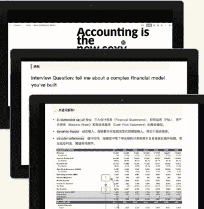

##### 英语帖子学习法

- 第一步：挑选学习材料
- 第二步：阅读英文原文
- 第三步：逐句精读
- 第四步：理解全文内容
- 第五步：复习并背诵

#### Reddit 财务分析社群帖子精选

适合外企白领练习英语职场表达与日常沟通

@关尔正_TeiSan

共 3 款 >

¥359.9

已售 44

#### Reddit 财务相关帖子英语精读笔记【共 100 期】

- 承诺 24 小时内发货，晚发必赔 | 上海包邮
- 晚发必赔 | 不支持无理由退换
- 已选：Reddit+FPA 资料包 + 播客学习 Flowus（国内手机：

##### 开箱精选


店铺 客服 购物车

加入购物车 立即购买

#### Harper 的英语茶点


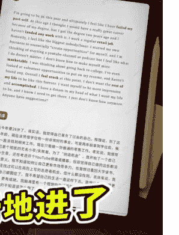

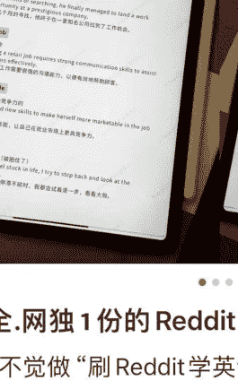

#### 英语就这样顺畅地进入

我的脑海

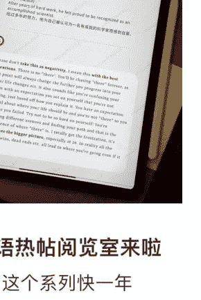

#### 📚全网独一份的 Reddit 英语热帖阅览室上线啦

“刷 Reddit 学英语”这个系列已经做了快一年。很多粉丝从我发布语料库时就一直在问，什么时候能推出 Reddit 内容合集。现在终于整理完成，并正式上架了。

This ChatGPT prompt is literally a $20K growth consultant. 这个 ChatGPT 提示词，简直像一位价值 2 万美元的增长顾问。

```
Here's the prompt

<instructions> You are a top-tier strategy consultant with deep expertise in competitive analysis, growth loops, pricing, and unit-economics-driven product strategy. If information is unavailable, state that explicitly. </instructions>

<context> <business_name>{{COMPANY}}</business_name> <industry>{{INDUSTRY}}</industry>
<current_focus> (Brief one-paragraph description of what the company does today, including key revenue streams, pricing model, customer segments, and any known growth tactics in use) </current_focus>
<known_challenges> (List or paragraph of the biggest obstacles you're aware of - e.g., slowing user growth, rising CAC, regulatory pressure) </known_challenges> </context>

<task> 1. Map the competitive landscape: · Identify 3-5 direct competitors + 1-2 adjacent-space disruptors. · Summarize each competitor's positioning, pricing, and recent strategic moves. 2. Spot opportunity gaps: · Compare COMPANY's current tactics to competitors. · Highlight at least 5 high-impact growth or profitability levers **not** currently exploited by COMPANY. 3. Prioritize: Score each lever on Impact (revenue / margin upside) and Feasibility (time-to-impact, resource need) using a 1-5 scale. · Recommend the top 3 actions with the strongest Impact x Feasibility. </task>

<approach> - Go VERY deep. Research far more than you normally would. Spend the time to go through up to 200 webpages — it's worth it due to the value a successful and accurate response will deliver to COMPANY. - Don't just look at articles, forums, etc. — anything is fair game... COMPANY/competitor websites, analytics platforms, etc. </approach>

<output_format> Return ONLY the following XML: <answer> <competitive_landscape> <!-- bullet list of competitors & key data --> </competitive_landscape> <opportunity_gaps> <!-- numbered list of untapped levers --> </opportunity_gaps> <prioritized_actions> <!-- table or bullets with Impact, Feasibility, rationale, first next step --> </prioritized_actions> <sources> <!-- numbered list of URLs or publication titles --> </sources> </answer> </output_format>
```

#### Reddit 上热传的“2 万美元顾问”级提示词

你是不是也经常这样使用 AI：

> “帮我写一篇小红书文案。”

> “给我想 5 个营销创意。”

### 3. Z-library：寻找尚未被广泛翻译的海外书籍

Z-library 是一个容易被忽视的小众资源渠道。它像一座全球图书馆，可以检索到来自不同国家和地区的书籍，每天也能免费下载。

前面提到，稀缺内容更容易形成差异化。国内出版物的竞争往往比较充分，用户也能通过微信读书等渠道轻松接触。相较之下，一些在海外很受欢迎、却没有中文版的书，天然更容易成为产品亮点。

举个例子，《纳瓦尔宝典》曾经非常热门。虽然它已经有中文版，但我读的是英文版，也见过有人通过分享英文版资源做网盘拉新，并从中获得收益。

如果要把 Z-library 用于知识库，重点不应只是收集一堆书，而是帮助读者快速抓住书中的精华。用户通常没有足够耐心逐本读完。如果你只是列出 100 本海外必读书目，读者可能会觉得负担很重，也不容易看出产品除了“整理书籍”之外还提供了什么价值。

这时可以用 AI 提炼书籍要点。我推荐的工具包括 NotebookLM，以及知识库管理软件 ima。

#### 工具一：ima

ima 是腾讯推出的知识库产品，操作门槛比较低。上传文件，或者直接通过笔记整理资料，就能开始搭建知识库。对不熟悉知识库制作的新手来说，上手比较轻松。

它还有几个值得注意的特点：

**一是与微信的连接更方便。** 用户可以直接在微信里打开 ima，这有助于降低使用门槛、提高打开率。相比之下，飞书在这一点上不太方便。

**二是内置了 AI 能力。** 知识库加入问答功能后，可以把它设计成产品卖点，例如“随时提问”“你的专属商业外脑”等，让用户清楚感受到使用价值。

此外，ima 还支持生成播客和思维导图。播客适合开车、通勤等场景，也可以成为产品介绍中的一个特色功能。

#### 工具二：NotebookLM

NotebookLM 不只适合分析 YouTube 视频，也能够辅助理解书籍。

它由 Gemini 大模型提供支持，上下文容量达到 100 万 token，因此能够处理相当长的资料，读者不必太担心整本书无法上传或理解。

#### NotebookLM + ima + Z-library：书籍知识库怎么做

可以按以下流程操作：

1. 在 Z-library 中挑选需要研究的书籍，并准备好 PDF 文件。
2. 将 PDF 上传至 NotebookLM。
3. 使用“报告”功能，让它围绕书籍内容进行提炼和整理。

第三步尤其重要。理解一个底层逻辑：AI 能够根据指令重新组织信息。你可以通过提示词，要求 NotebookLM 梳理各章节重点、保留关键观点、摘录值得记忆的句子，并尽可能充分地呈现内容。

例如可以这样写：

“请帮我整理这本书的核心内容。请按照章节依次归纳，尽量保留有价值的信息，并摘录每章的代表性句子，输出内容尽可能详细。”

这只是一个示例，你可以根据产品定位调整要求。重点是让 AI 按照你的目标重新梳理书籍，而不是只生成一段笼统摘要。

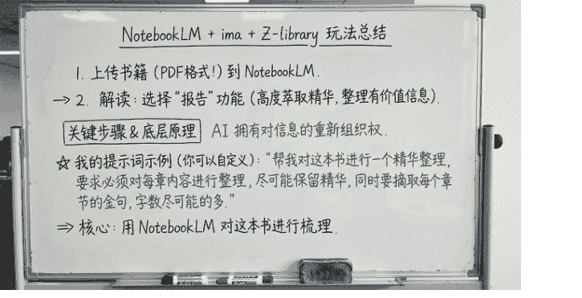

如今，小红书上已经有不少类似知识库产品，常见的制作流程就是：先从 Z-library 选择书籍，再借助 NotebookLM 解读，最后把整理好的内容上传到 ima。持续积累 50 本、100 本，甚至 200 本书后，就可以把 ima 知识库包装成一款虚拟产品。

这个方向仍有发展空间。读书本来就是广为认可的成长方式，而 NotebookLM 能解决一个常见痛点：用户想获得书里的精华，却不想花大量时间读完整本书。人们总希望用更轻松的方式获取知识，AI 的价值就在于提炼重点、提高信息密度，让用户更快获得收获感。这也是 AI 时代出现的一种新型内容生意。

### 4. Twitter：追踪海外观点与热门话题

Twitter（X）上的内容比较碎片化，但聚集了来自不同领域的创作者和专业人士。许多博主还会发布 Newsletter 的公开内容。

平台提供的互动数据，也能帮助我们判断内容的传播情况。比如，一人公司领域的创作者 Dankoe 曾发布一篇文章，获得了近亿次浏览。这样的内容说明它已经在多个平台引发关注。如果你做的是相关主题知识库，就可以把它作为研究素材或选题线索。

对我而言，Twitter 更像是一个观察热门内容和优质信息流向的窗口。你可以通过平台数据筛选值得关注的博主，也可以从他们发布的观点和洞察中寻找灵感。

### 5. Newsletter：获取深度文章与个人观点

Newsletter 也是值得留意的内容渠道，尤其适合寻找长篇文章和观点表达。它有些像国内的公众号，Medium、Substack 都是比较有代表性的平台，内容通常以文章形式呈现，其中也包含付费内容。

如果你需要研究某个领域的深度文章、专业观点，Newsletter 是不错的补充来源。

## 怎么更快找到真正有价值的信息源？

知道有哪些平台，只是第一步。很多新手接下来的难题是：面对海量内容，如何快速找到靠谱资料？又该怎样从零搭起一个领域的知识地图？

关键在于主动搜索，并找到真正有专业表达能力的创作者。

同一个领域，新手与专家关注的层次并不一样。新手往往停留在基础介绍，而知识库若想具备价值，就不能只讲入门概念，还需要有深度、有结构。

比如要做“一人公司”主题的知识库，如果全部围绕“为什么要做一人公司”“一人公司有多好”展开，内容就会显得浅。更好的做法，是先搭建领域框架，再沿着框架深入研究具体问题。

### 方法一：让 AI 帮你生成搜索路线

这是我实践下来很有效的方法：先用 AI 帮忙确定搜索方向。

AI 接触过大量公开语料，通常可以协助你梳理一个领域的主要议题、拆分知识结构，并生成适合搜索的关键词。

例如，你想制作一份“如何进入外企”的知识库，却不知道该从哪些问题入手，可以这样向 AI 提问：

“我想系统了解不同工作经验阶段的人应该如何进入外企。请从基础到进阶，帮我设计一套搜索关键词，方便我逐步构建完整的知识体系。请只提供英文关键词。”

拿到关键词后，再去 YouTube、Reddit、Twitter、Newsletter 等平台逐一查找资料，就能更有方向地筛选内容，逐步搭建出自己的信息地图。

这个方法论我自己反复验证了很多轮，核心非常朴素：凡是让 AI 帮忙检索信息，都要求它给出英文关键词。原因不复杂——全球范围内真正高质量的内容语料，绝大多数存放在英文世界，YouTube 尤为集中。

我把同一条指令分别丢给几个大模型，对照它们产出的检索词逐一实测，搜出来的信息源相当精准，甚至可以说刁钻，而且恰好是很多国内用户迫切需要却找不到入口的内容。

> 我想把"不同资历的职场人如何进入外企"这个课题研究透，从入门到进阶，逐步构建完整的知识框架，能不能给我一套英文检索词？

模型给出的答复是一套按学习路径拆解的结构化词表，大致覆盖了认知奠基、求职准备、策略执行、面试、入职适应与长期发展几个阶段，也兼顾了不同工作年限的人群。针对 3-8 年经验的职场人，检索重心普遍放在"转岗""能力迁移""社招进入跨国公司"上，比如 mid-level career switch to MNC、transferable skills multinational companies、experienced hire foreign company，以及 lateral move to international firm、industry switching multinational 等。

资历更深的管理人员（8 年以上），关键词则集中在"高管岗位""区域管理""外派机会"等方向，像 senior leadership roles MNC、executive positions multinational、C-suite career path foreign company、regional management roles、expat assignment opportunities 都属于这一类。

至于简历与个人品牌，ATS-friendly resume multinational、international resume format、LinkedIn profile optimization MNC recruiters、global resume best practices、cover letter foreign company 这些检索词基本能覆盖全部需求。

说实话，以前用中文搜，根本摸不到这么垂直的信源。

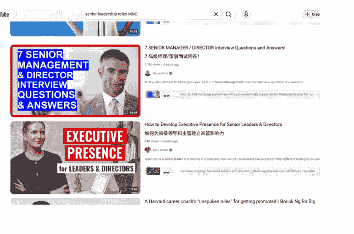

第二件事，从人切入。

高价值内容的源头，永远是具体的人。与其在信息流里大海捞针，不如先锁定那个关键的人，把他变成你的专属信源，再定期整理他的产出。难点在于"如何锁定"——你要找到那个连接度最高的枢纽人物。

YouTube 的播客生态里，深度访谈类节目是绝佳的挖掘入口。这些节目的嘉宾名单本身就是一份经过筛选的高质量作者列表。你要做的只是紧盯访谈类播客的主理人，然后顺着嘉宾名单向外延伸。

以互联网和 AI 领域为例，Lenny 的播客值得长期关注。他访谈的对象大多是各大 AI 企业一线业务的负责人。拿到嘉宾名单后，逐个关注他们的社交账号；如果你格外欣赏某位内容创作者，把他参与过的所有节目汇总到一起，做成一个专题合集，会是非常独特的内容资产。

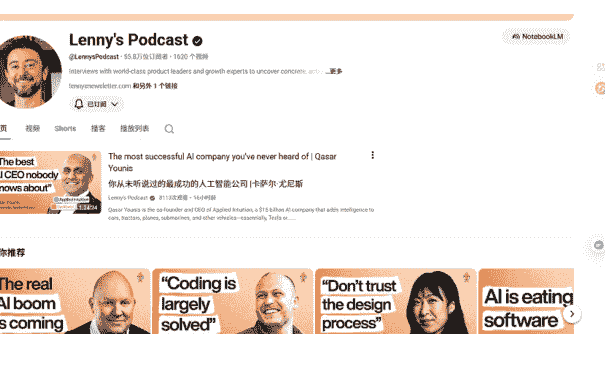

写作领域同理。你不知道该跟谁学，就去找这个行业里最会"牵线搭桥"的人。David Perell 常年采访各类作家，追他的账号、建他的嘉宾图谱，基本就能把当代优质写作观点一网打尽。

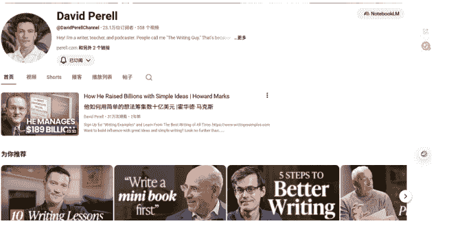

如果连行业枢纽人物是谁都毫无头绪，那就直接求助 AI——建议优先使用谷歌的 AI 搜索模式，把问题描述清楚即可。

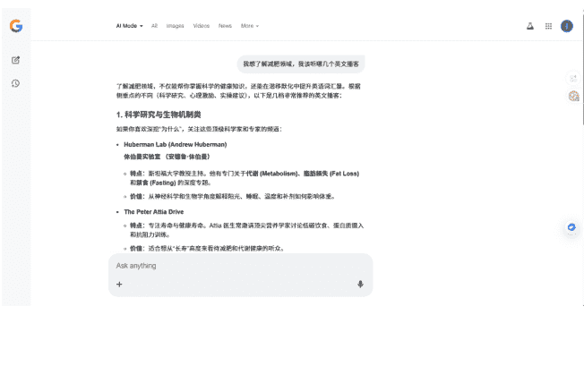

信息源确定之后，下一步是整理与策展。坦白说，这一步会筛掉一大批人。

最近看到 Dankoe 的一条分享，观点很有意思：AI 时代，人和人之间的差距早就不是技术或编程，而是审美、品味和视角。横看成岭侧成峰，同一个事物，角度不同，看到的内容截然不同。所以，你必须懂得如何讲故事，如何找到独特的切入角度。

具体做法就是找对标。去研究小红书头部知识库卖家怎么做产品包装，是很直接的提升路径。

有个小红书商家，靠一款知识库产品做到了月销 1000 多单。她的生产流程恰好就是我们前面讲的那套：Z-Library 找英文原版书，NotebookLM 提炼核心内容，最后沉淀进 ima。这条流水线几乎人人能复制，谈不上门槛。那真正的门槛是什么？是品味与视角，而这两样东西完全取决于你日常的积累。

这个商家的聪明之处，在于她重新定义了产品的价值。她的底牌是"500 本 + 全球经典好书"，但她把卖点包装成了【加入这个知识库相当于聘请 100 位终身私教】。你买的不是书，不是资料库，而是 100 位终身私教，一个随身携带的"认知私董会"，定价只要 16.8。

详情页的文案也很有讲究："领先国内市场，我们带你版本前瞻。纽约时报/亚马逊畅销的现象级爆火的海外书单，国内滞后两三年才有的中文版，我们拆解给你看。"这不就是我们反复强调的【刻意制造稀缺性】吗？非常值得学习。

研究完同行的打法，再借助 AI 优化成你自己的卖点。

### 500 本 +

- 全球经典好书
- 精华浓缩知识库
- 一键 AI 播客听书
- 快速生成约 10 分钟的 AI 播客
- 大量阅读跨学科经典书籍
- 拓展人生边界提升思维认知
- 平均 1.2 万字精华浓缩
- 已累计更新 600W 字 +
- 30 分钟读懂一本书
- 帮你节省 5000 小时
- 告别单向输入
- 随时互动提问

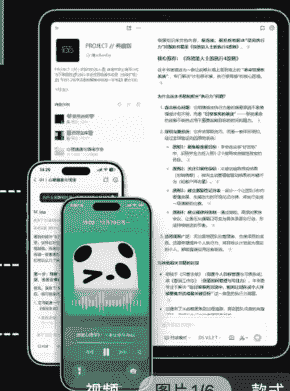

珍藏版 500 本 + 终身书库
典藏版 365 本 + 全球高分
财富版 150 本 + 财富经典
共 3 款 >

| 版本 | 内容 | 原价 | 到手价 |
| :--- | :--- | :--- | :--- |
| 珍藏版 | 500 本 + 终身书库 | ¥29.9 | ¥16.8 |
| 典藏版 | 365 本 + 全球高分 | ¥29.9 | ¥16.8 |
| 财富版 | 150 本 + 财富经典 | ¥29.9 | ¥16.8 |

已售 1562
限时立减 10.1 元
商家券 新客立减 3 元

#### 全球 500+ 经典好书 精华浓缩 AI 播客问答知识库 | 持续更新
- 3 个月内 1000+ 人购买
- 24 小时内 200+ 人加购
- 300+ 人收藏

店铺 客服 购物车
加入购物车 领券购买


## 加入这个知识库，相当于聘请 100 位终身私教
欢迎加入全球好书重读计划，在这里，每一本经典都被浓缩成了 30 分钟左右的内容精华

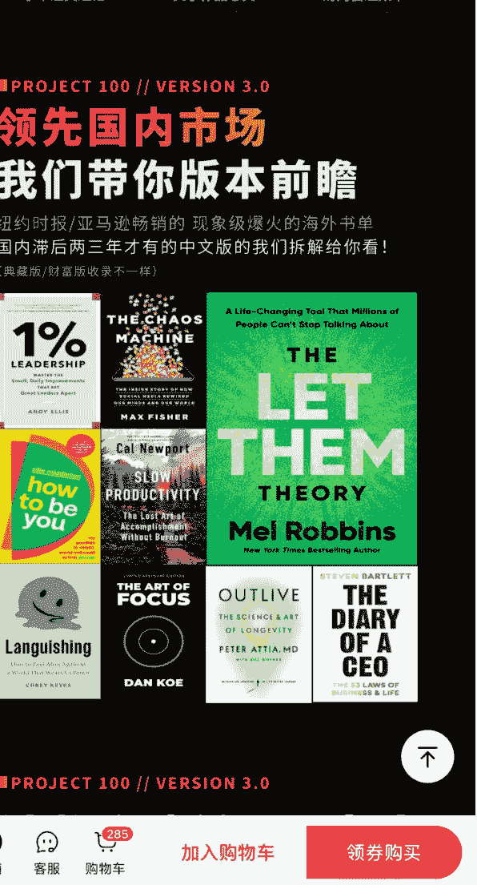

说到底，知识库产品能不能持续出单，关键就看品味和视角。你要有自己独特的审美，并且能用文字把它传递出去，让消费者发自内心地觉得"这个东西值"，这才是解开所有问题的钥匙。

下面这一点，我想单独拎出来重点讲：信息源必须靠筛选，不能靠一键囤积。

我一向反对"一键收集"，因为一键收集等于没有收集。筛选本身就是最重要的功夫——你得有自己的标准，清楚自己喜欢什么、反感什么，对收进来的每一条内容都了然于胸。一键囤积恰恰摧毁了这一切。

拿小红书爆文举例。你用工具一次性屯下 500 篇，表面上效率无敌，实际上都是在做无用功。未经筛选，你根本不知道这 500 篇里有多少与自己的定位匹配、有多少真正能帮到你。这种策略显然不成立。

AI 时代反而有一些笨功夫是绕不过去的，语料收集就是典型。语料即上下文，上下文决定产出质量。当每个人都在使用同一个大模型时，能拉开差距的就只有语料本身的含金量。


今天的信息与内容，都在快速通货膨胀，最稀缺的资产是判断力。

手动精筛 50 篇爆文，看上去很慢，实际上你同时完成了三件事：第一，你在给大脑搭建索引，以后遇到类似场景可以瞬间调用；第二，你在培养"元认知"，慢慢摸清什么内容对自己真正有效；第三，你在和语料发生真实互动，而不是简单囤积。

那些一键囤积 500 篇的人，囤的其实不是语料，而是焦虑。他们害怕错过，结果恰恰错过了"深度咀嚼"这个过程。库存越来越庞大，输出却没有质变。AI 能做的只是放大你的判断力，永远无法替代判断本身。喂进去的是杂草，再强的模型也开不出玫瑰。

再往深一层看：语料的核心价值不在"拥有"，而在"用得上"。

大脑的记忆机制有个特点：记忆靠的是提取强度，而非存储数量。手动筛过的 50 篇，因为你为每一篇都倾注了注意力，产生了情绪反馈——"这个开头绝了"或者"这段逻辑站不住"——大脑会给它们贴上强标签。下次创作时，相关场景一出现，素材自己就会被唤醒。

至于那 500 篇一键囤下的内容，它们只会安静地躺在文件夹里，和你的大脑毫无化学反应。真到需要用的时候，你还得重新搜索、重新理解、重新判断。这等于把筛选环节挪到了最后，成本反而更高，而且你早已失去了批量对比时的语境。

知识库想快速出单，请记牢八个字：人无我有，人有我优。尤其当你尝试了很多方法仍然没有起色的时候，这八个字就是破局的公理。

拆开来说：面对同一类知识库产品，别人没有的卖点，你要补上；别人已有的卖点，你要做优。想做到这一点，前提是切换到消费者的视角去看问题。

先说第一个卡点：打开率。

跟着我一起想：知识库类虚拟产品最普遍的痛点是什么？答案是打开率。这类产品有个外号叫"年卡健身房"——多数人下单的动机是缓解焦虑，而不是真的打算阅读。

要让用户真正打开，运营动作必须跟上。比如建一个专属社群，每周或每月把知识库里最值得读的内容整理成周刊、月刊推送出去，慢慢帮用户养成阅读习惯。

但还有更关键的一层：这些运营动作，必须被转译为产品的卖点。人无我有、人有我优的具体落地就在这里——你要让用户明确知道，他买到的是一套持续提供整理的服务，有人会定期帮他消化知识库，而不是付款之后再无下文。

打开率做起来了，复购率才有立足之地。毕竟，没有人会为一个从未打开过的东西付第二次钱。

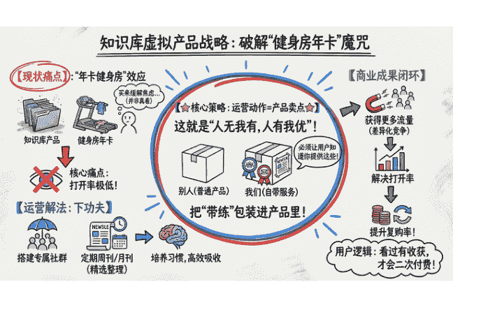

再说第二个卡点：内容太多，看不过来。

知识库天然承载海量内容，"看不完"几乎是必然的。关键在于，你把它视为障碍，还是机会。

有一个案例特别妙：有人把 Dankoe 的全套产出整合进了 ima。如果只是告诉用户"这里面有 Dankoe 的所有内容"，卖点会很单薄，也解决不了"看不完"的担忧。这位商家的处理方式很聪明——ima 自带 AI 知识库问答功能，他直接把"AI 问答"包装成了"一款可以随时向 Dankoe 提问的外包大脑"。

他还主动给用户松绑：你不需要全部读完，只要你有一人公司相关的问题，直接来问就行。因为 Dankoe 本人就是一人公司的标杆。这一设计把传统"读书式学习"变成了"提问式学习"，等于在传递一套全新的学习理念。

问你所想，答你所问，与百万油管大神 Dankoe 随时对话。DeepSeek 新模型

**百万油管大神 AI 智能库**
@人生智库参考出品
集全 Dankoe 播客访谈、博客文章、书籍、付费内容笔记等 900 多份 600 余万字文档，形成 Dankoe·AI 问答知识库。
用高手大脑里的思维、走出来的经验，解决人生难题。


问你所想，答你所问，与百万油管大神 Dankoe 随时对话。DeepSeek 新模型

- 一站式捕获
- 思想、逻辑、经验、方法、技能、细节、故事
- 有系统、可追溯地与 Dankoe 第二大脑互动
- 不再让 AI 瞎编段子
- 让你的每一个问题，都能追溯到百万油管大神的一手信息源头

种一棵树最好的时间是在 10 年前，其次是现在！

- Mac 客户端
- Windows 客户端
- 微信小程序
- iOS 客户端
- Android 客户端
- 鸿蒙客户端

店铺 客服 购物车
加入购物车 立即购买

29/34

## 和 Dankoe 随时对话

@人生智库参考出品
遍历 Dankoe 播客访谈、博客文章、书籍、付费内容等 900 多份文档，形成 Dankoe·AI 问答知识库。

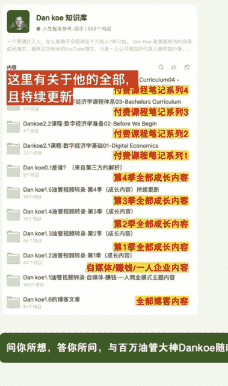

从苏格拉底到孔子，人类最古老、最高效的学习方式就是对话，智慧在诘问、辩论和共同探索中产生。
无需阅读，直接对话。

### 模型对比

| 模型 | 特性 |
| :--- | :--- |
| DS V3.1-Think | 更快深度推理（最新） |
| DeepSeek V3.1 | 多种场景回答更精炼（最新） |
| DeepSeek V3 | 适用多种应用场景 |
| DeepSeek R1 | 深度思考推理 |
| Hunyuan | 适合大部分任务 |
| Hunyuan T1 | 快速思考推理 |

价值 1999$ 课程笔记内容

店铺 客服 购物车 加入购物车 立即购买

第三个卡点：内容深度。

知识库的底座永远是内容。这里有一个值得反复咀嚼的概念：新事物都是由旧元素重组而来的。套用到知识库上——围绕某一主题，把散落在各平台的优质内容系统化地收拢起来，这本身就是你的竞争力与护城河。

以职场沟通和演讲方向为例，想让内容更有厚度、更硬核，可以着重从 YouTube、Twitter、Reddit、Z-Library 四个渠道去挖掘海外素材。

最后聊"投石问路"。

很多时候，你想做某一领域的知识库，却连怎么搜都不知道。这时候最有效的起手式是：让 AI 替你探路。把你的真实需求直接描述给它。

我曾经这么问过：我想做一档关于职场沟通和演讲的知识库，打算从 Reddit 和 YouTube 上挖掘深度信息源，请帮我规划检索关键词，基础技巧类的内容直接跳过，只要进阶的，记得用英文回复。

AI 返回的词表非常清晰，按主题做了归类，也解释了每类方向的理由。

#### Reddit 搜索策略

**演讲技巧进阶：**
- executive presence communication
- high-stakes presentation
- thought leadership speaking
- narrative structure storytelling business
- rhetorical devices persuasion

**心理学与影响力：**
- cognitive load presentation design
- priming audience psychology
- persuasion architecture
- status dynamics workplace communication
- nonverbal dominance cues

**专业人士讨论区：**
- 在 r/consulting、r/consulting_memes、r/ProductManagement 搜 stakeholder communication，能直接看到咨询、产品等岗位从业者真实的管理困境
- r/leadership 里搜索 difficult conversations framework，大量管理者的一手经验会浮现出来
- executive communication coaching 则偏向教练视角的独家方法论

Search in r/ProductManagement

##### Struggling with stakeholder management as a PM, how do you influence without authority?

##### 作为项目经理，在利益相关者管理上遇到困难，你如何在没有权威的情况下产生影响？

**Learning Resources**

I'm a PM and honestly terrible at stakeholder management and cross-team communication. I'm an IC but need to influence multiple teams that don't report to me, and it's creating constant friction.

我是项目经理，说实话，我很不擅长利益相关者管理和跨团队沟通。我是独立合作者，但需要影响多个不向我汇报的团队，这造成了持续的摩擦。

职场中，很多冲突并不是因为目标不同，而是因为沟通方式让对方产生了“你在替我做决定”的感觉。

比如，上周你希望工程团队先处理一个直接影响客户和收入的严重缺陷，而不是继续推进原定功能。工程负责人却认为路线图早已排好，无法临时调整。你本想说明问题的商业影响，结果在对方听来，可能像是在越权干涉团队安排。

类似的情况也发生在设计协作上。为了完成一次冲刺，你需要设计团队投入人力，但设计经理认为项目经理没有资格直接规定他们团队的工作顺序。你的本意是协调资源，却因为措辞不当，最终被理解成了“指挥别人怎么做事”。

于是，你陷入了一个尴尬循环：

- 推得太用力，团队觉得你控制欲太强；
- 不主动推动，跨团队事项又迟迟没有进展；
- 明明是在推动业务结果，却被误解成了争夺资源。

问题的关键，往往不在于你是否应该坚持，而在于你把自己放在了什么位置上。

当你说“我需要你们把这件事排在前面”，工程团队接收到的信息可能是：“为了你的问题，放弃我们的既定计划。”

当你说“我需要设计团队的人支持这次冲刺”，设计团队听到的可能是：“把你们的人调过来完成我的任务。”

即使你的真实目的只是协调，表达方式也会让对方觉得：你已经替他们做完了判断，现在只是来通知结果。

更有效的方式，是把沟通从“要求对方调整计划”，改成“邀请对方共同判断问题”。

不要直接说：

> “我需要你们优先处理这个事项。”

可以换成：

> “目前有一个影响客户和收入的问题。我知道工程路线图已经确定了，我们能不能一起梳理一下不同选择的代价和影响，再作为一个团队决定是否调整？”

这样一来，工程负责人就不是被动接收你的结论，而是参与到决策过程里。你仍然在推动重要问题，但没有剥夺对方的判断权。

设计协作也可以采用同样的逻辑。

与其说：

> “这次冲刺需要设计资源。”

不如说：

> “接下来的冲刺里，设计工作是最终交付的一部分。我们怎样才能让合适的人参与进来，同时尽量不影响你们当前的优先事项？”

这不是在向对方下命令，而是在明确一个交付依赖，并邀请对方一起找到解决办法。

当然，真正高质量的跨团队协作，不应该等到问题已经紧急时才开始建立。

平时在没有资源请求的时候，就可以主动和工程、设计等团队负责人建立联系：

- 了解他们当前的限制和压力；
- 提前分享自己的项目计划；
- 询问他们通常如何处理优先级冲突；
- 讨论什么样的协作方式最适合双方。

这样，真正出现突发需求时，你们之间依靠的就不只是临时沟通，而是已经建立起来的信任和共同语境。

这类案例说明了一个非常具体的内容方法：把海外不同平台上分散的信息，围绕一个明确场景重新组合起来。

比如，很多人都在制作 NAVAL 知识库，做法通常是翻译和整理他的 YouTube 视频。但如果你进一步收集 NAVAL 在 Twitter 上的观点、他发布过的 newsletter、以及他参加其他嘉宾访谈时表达的内容，再把这些材料统一整理、交叉验证、重新编排，就能形成一套更完整、更有辨识度的语料体系。

这正是提升内容深度的一种方式。

知识库想要真正产生销售，本质上要做到：

> 别人没有的，你能提供；别人已经有的，你能做得更完整、更好用。

消费者购买的从来不只是资料堆积，而是希望有人替他们解决信息筛选、理解、归纳和应用过程中的痛点、卡点与摩擦。内容质量、产品体验和服务交付，缺一不可。

---

很多人看完一套 SOP，会产生一种“我已经掌握了”的错觉。

但真正开始执行时，绝大多数人甚至会在第一个步骤就停下来。

工具和教程只是入场券，真正拉开差距的，通常是两件事：

1. 能不能马上行动；
2. 能不能接触到圈层内部的信息和真实打法。

如果你想了解全网持续更新的变现方式，并和一群执行力强、愿意亲自下场验证的极客一起拿结果，欢迎关注我的核心私域：【懒人专属群】。

这里不讨论空泛概念，只拆解完整商业闭环，研究如何借助 AI 提升效率。目前系统内已经沉淀了 1000+ 个经过实践验证的套利案例。

### ⚠️ 查阅圈子最新搞钱实操记录

https://hk57gvIx7u.feishu.cn/docx/H0kRdZbSbolBR0xkaXtcuVE0nTg

如果你认可这套价值，也准备好亲自执行，欢迎扫码添加我的微信。

添加时请备注：【实操上车】

