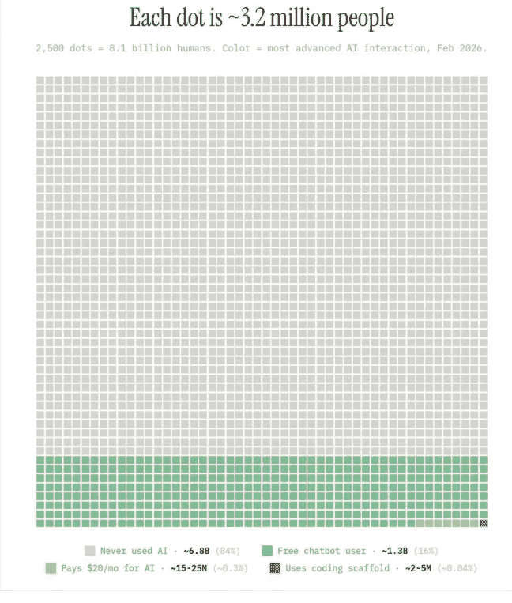
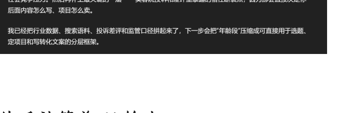
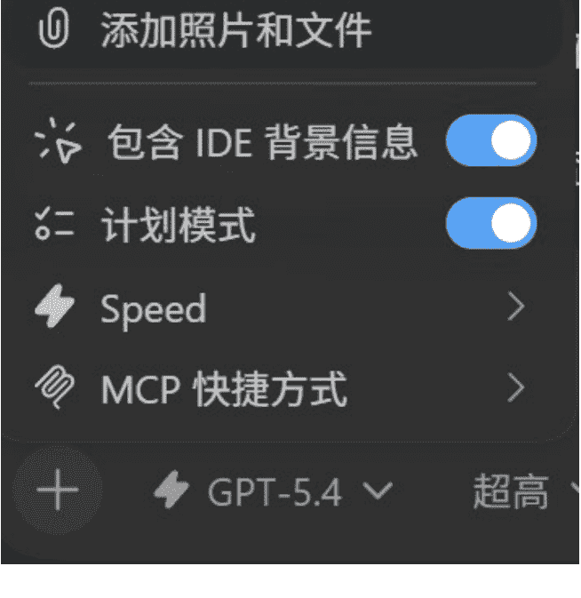
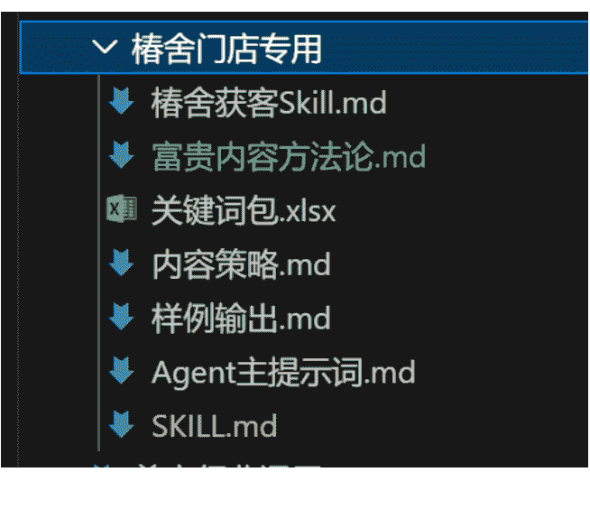
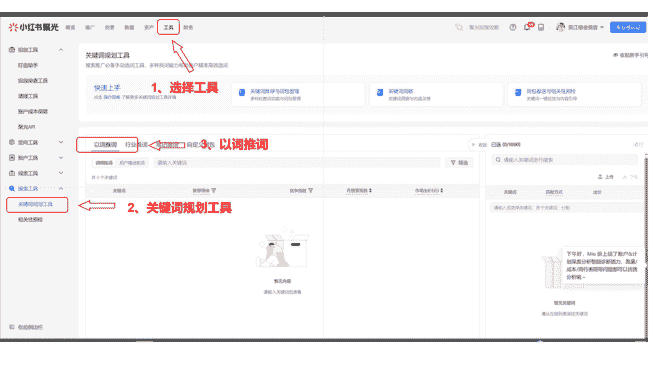

本文来自“懒人搜索”副业社群·懒人专属群独享  
微信：lazyhelper1  


微信：lazyhelper1  

我在美容行业摸爬滚打十五年，手上有三家门店，同时帮二十多家同行打理线上代运营。混生财圈子八年，研究AI也有四年时间，算是实体圈里较早把AI用在生意上的人。2021年参加生财大航海的抖音同城项目，用了半年时间新增顾客六千多人，累计回款超过两百万。这几年我不断琢磨：实体门店到底怎么让AI真正帮上忙？今天专讲一个问题——如何用AI锁定精准客流。

先说结论：门店真正的缺口，往往不在于客源，而在于对顾客内心真实顾虑的把握。很多人把生意变差归因于大环境，可真正的盲点是：顾客在搜什么、在躲什么、为什么走到门口又掉头走。

我身边的实体老板，普遍感觉平台推广费越来越贵，内容越做越难出效果，顾客下单越来越谨慎；新客补不上，获客成本一路走高。美业尤其如此，顾客的需求一直都在，只是戒心很重。她们真正怕的，未必是价格高，更多是进门被推销办卡、中途被随手加项、留了联系方式就被反复打扰、花了钱没有改变、甚至护理后问题加重。

所以门店如今拼的，早已从项目和价格的比拼，转向信任成本和精准度的比拼。这项能力，比以往更依赖内容表达。

先看一张让我印象极深的图。  


图中每个小方块代表320万人，整张网格代表81亿人。灰色区域是84%从未接触过AI的人，约68亿。底部一条绿色窄带，是16%用过免费聊天机器人的。右上角一小撮黄色，是0.3%愿意每月付20美元使用AI的人。角落里几乎看不到的红点，是0.04%用过Claude Code这类编程Agent产品的人。可见，我们口中常说的AI主流化，其实还只存在于极小的圈层。世界上有84%的人，至今没有完成第一次AI对话。

我前几天看到一句很受触动的话：1978年，一定要去深圳；2026年，一定要用Claude Code。连我店里，都有不少人连豆包助手都没打开过。大多数生意人不知道AI能干什么、怎么用，所以把AI落到实体场景的具体环节，正是巨大的机会窗口。

美容行业里，AI既能用于拉新，也能用于客户管理，还能用于美容师话术训练。至于具体怎么发现自家门店的AI切入点，可以回看我之前在生财发的文章。今天只围绕流量这个话题展开。

什么是精准流量？我理解是：你找到了顾客最真实的需求与顾虑，再通过抖音、小红书、视频号或私域，告诉她你能解决，她最终愿意为方案付费。整个流程，我总结成一句话：检索词洞察需求，差评发现顾虑，场景承载情绪，文案把专业语言翻译成顾客能懂的话，AI负责把这一切规模化。

顺着这个框架，我分享一个自己用过很多次的实操办法。

我不习惯凭空憋想法。更常做的，是先找一位我认可的高手，把她过去的输出全部收集起来，交给AI拆解。这一步的关键，不在模仿句式，而在抽取判断方式。此前，我把生财圈里富贵老师的分享全部整理出来后，用一句提示词让AI提炼底层逻辑：请仔细读完以下内容，深入思考，提取作者的底层思维，并说明哪些能用在短视频和公众号写作上。

AI给出的结果很惊艳。核心判断是：那些文章表面讲小红书获客和AI提效，本质只有一条主线——内容的锚点，是人的动机：谁在什么时刻、带着什么情绪想买什么。再浓缩，就是：搜索词藏着需求，评论区藏着人话，差评藏着痛点，场景装着情绪，文案做翻译，AI做批量放大。

我梳理出他的底层判断体系，大概有十个关键点：

- 他是典型的转化派，文案、爆款、AI、平台技巧都服务于精准线索和成交，数据好看只是副产品。
- 他偏爱具体的人而非模糊的群体。不讲“25-35岁白领女性”，讲“深夜搜空气炸锅一人食的独居女孩”“想给前任点颜色看的姑娘”“想给孩子办个体面生日的家长”。
- 他把买点放在卖点前面。参数无法促使用户付费，真正驱动付费的是面子、体面、被爱、赢、安心、补偿、自我照顾和身份感。
- 情绪是内容真正的引擎。他尤其看重爱、嫉妒、愧疚、遗憾、孤独、安全感、向往感和身份认同这几类高转化情绪。
- 搜索词的可靠度远高于灵感。因为搜索词的背后，是用户主动的欲望，是她说不出但已经准备行动的心声。
- 评论区比粉丝群更真实。高赞评论代表群体共识，差评代表未被解决的矛盾，比用户自述更接近成交真相。
- 具体场景比大词更有杀伤力。少用“焦虑”这类词，改用失恋、被PUA、孩子叛逆、下班独自吃饭；少说“环境好”，直接说“南北通透”。
- 人负责判断，AI负责放大。AI可以整理关键词、改写文风、批量生产、归纳语义，但真正值钱的是人的洞察、审美、连接能力和知识库。
- 精准压倒泛爆。高客单价产品不怕看的人少，只怕来错人。封面、场景、语气都是筛选器。
- 内容本质是替用户表达。最强文案的秘密，是替用户说出那句憋在心底的话。

这套判断用在短视频上，很直接：

- 开头别讲道理，先给一个具体的人、一个具体时刻。
- 前3秒直接甩搜索词、评论原话、差评原话，因为这些句子自带人感。
- 别解释产品功能，要制造情绪落点。比如不说“杯子是316不锈钢”，说“加班到凌晨，打开还是热水，至少还有东西在照顾你”。
- 镜头要场景化、人格化。手、桌面、房间、路上、车里、餐厅、办公桌，都比产品图有效。
- 嫉妒、赢、后悔、愧疚、反差、身份落差这类冲突情绪，更容易带来停留和转发。
- 最稳定的脚本骨架，就是“表层需求是A，深层需求是B”。
- 适合短视频的公式：具体人群+具体场景+单一强情绪+一句转译+一句解决方案。

公众号适合承接这套转译能力。短视频负责触动感受，公众号负责把道理讲透：为什么用户表面上在搜产品，底层其实在找关系、体面、确认感和身份认同。公众号很适合写“从卖点到买点”的文章，可以把搜索词背后的欲望做成系列，比如深挖“小个子大衣”“空气炸锅一人食”“孩子叛逆怎么办”这些关键词背后的欲望——表面是关键词内容，底层是人性内容。它也比短视频更适合做案例拆解：先讲原卖点失效，再讲人群重构，再讲场景映射，再讲情绪转译，最后讲结果。文章结构可以直接借用这个模板：一个具体场景开头 → 点破表面需求是假 → 拆出真实动机 → 给出买点转译 → 用案例证明 → 上升为认知。最值得学的那件事，是“把专业知识翻译成普通人有感觉的话”。

最值得直接拿来用的五个创作手段：

- 卖点转译：把“产品有什么”改成“用户能获得什么身份、情绪和关系结果”。
- 搜索词解欲：不只分析词，还要猜词背后的羞耻、焦虑、愿望、贪婪和孤独。
- 评论迁移：把高赞评论、差评、吐槽原话变成标题、开头和口播前3秒。
- 场景颗粒度：少用抽象词，多写时间、地点、动作、人物关系、物件细节。
- 替用户发声：不要教育用户，而是帮助用户把没说出口的话讲出来。

也要提醒几个别踩的坑：小红书投流、聚光、蓝V矩阵属于平台打法，未触及文案内核；嫉妒、愧疚这类情绪要克制，公众号过度操控会伤信任；某些适合作者语境的表达，不必照搬；只学钩子、不学人群判断，很快会失效。

一句话总结这位高手的价值，真正值得带走的并非爆款技巧，本质是一套判断：先找到那个正在搜索、正在纠结、正在难受的具体人，再把产品改写成他此刻愿意买单的情绪答案。

接下来，我让AI基于这套方法论做行业调研。工具是GPT-4 Pro，效果确实惊人。我的提示词是：“基于上面这套方法论，调研不同年龄女性进入美容院的深层动机，输出完整报告”。AI输出的第二段非常厉害：  


这份报告的开篇结论就很有冲击力：大多数美容院把年龄当分层，把项目当商品，这是错的。年龄不该成为购买决策的标尺，用户做选择，依据的是“这个阶段我最怕什么、最想挽回什么、最想证明什么”。年龄只是参考线，不是答案。

报告把年龄段拆成六组，每一组的动机都不同：

18-24岁：核心诉求是“社交安全感”。她们最在意痘痘、闭口、泛红、上妆翻车，重心不在抗衰。调研显示，12-24岁中约85%的人经历过至少轻度痤疮；18-24岁更容易因化妆品使用不当而敏感。她们到店，目标很朴实：明天能见人、拍照不崩、别让痘和泛红先替自己出场。可以讲烂脸修复、重要场合不翻车、低风险，贵妇抗衰这套先放一放。

25-29岁：第一次意识到年轻会过期。超六成消费者在26-35岁开始关注抗衰；麦肯锡也发现，年轻人更愿意买有科学依据的美容健康方案。她们并非突然迷上抗衰，真正触发需求的是发现熬夜、压力、工作、关系全都会写在脸上。她们核心诉求是：看起来不疲惫、不垮得快、不只剩下年轻。文案可以翻译成：表面是买初抗老，深层诉求是“我不想这么早输掉状态”。

30-34岁：这个阶段出现关键拐点，效率压过仪式感。她们对护肤更上心，敏感问题会求助于美容院，TGI达到133；也追求养肤功效。她们没有时间不断试错，需要更稳、更快、更专业的方案。与其说“补水舒缓”，不如给“熬夜垮脸修复”“换季敏感稳定”“初抗老+屏障管理”“三次能看到变化”。

35-44岁：要体面、掌控和不显累。皮肤状态更不稳定，衰老外观会带来社交焦虑，女性还容易面对职场歧视。她们的真实想法是：不能看起来像被生活打败。嘴里说补水提亮、紧致抗衰，心里却在担心会议、婚姻、社交里露出疲态。她们对有效、安全、可信、省时非常敏感，最烦被忽悠。

45-59岁：并非想装嫩，只是不想断崖式变老。更年期症状会加重负面身体认知；绝经后胶原流失明显加快，前五年可能流失近三分之一。她们在意的是抵抗衰老速度、修补吸引力与自尊、缓冲身体失控感。对她们说“18岁水光肌”等于冒犯。合适的表达是：熟龄干敏、松弛暗沉、睡不好导致气色崩，需要温和而有尊严的恢复。

60岁以上：要舒服、体面、愿意出门。皮肤更薄、更易干燥，护理首先要带来舒适感。她们不追求少女感，真正想要的是皮肤舒服、人显干净、有精神，愿意继续外出社交。她们吃温和、简单、被尊重那套，不吃复杂术语。

报告还给出了三个跨年龄的洞察：

一是美容属于外貌管理，本质是社会信号管理。外貌会被别人读成状态、能力、自律和魅力，因此美容扮演着社交通行证的角色，远超虚荣消费的范畴。

二是中国语境下，美容更接近自我管理。东亚研究显示，中国女性常把外貌管理视为自我发展、自我要求、自我经营，甚至把“会照顾自己”当作值得尊重的品质。所以文案不能只讲“让别人夸你”，更高级的转译是：我把自己维持在不狼狈的状态，是因为我还看重自己。

三是美容是情绪消费，线下尤其明显。越来越多人愿意为疗愈和情绪价值买单，美和身心的边界在模糊，消费者不仅要功效，还要被安抚、被理解、被照顾。但情绪价值可以卖，伪心理治疗不能碰，价格不透明、夸大疗效、虚假宣传、过度营销都是红线。

最后是门店经营层面的启示。

线下美容的核心门槛在于信任，而非流量。用户不吝啬花钱，真正卡住购买的是怕被坑。消费数据里，买化妆品的人最看重成分和功效，但也抱怨说明模糊、效果短暂；服务端，预付费跑路、虚假宣传、资质不清、边界混乱频频被监管点名。某地调查显示，七成以上受访者分不清医美和生活美容，八成以上认为存在虚假广告或误导宣传。杭州推行的“按次核销、剩余可退”，正是对预付式消费戒备的回应。如果门店还指望“先把卡卖掉再说”，那就是在行业信任崩塌中一起沉底。真正可持续的做法，是边界清晰、过程透明、效果讲透、按次验证、风险可控。

分层方面，别再用“25-35岁女性”这种粗糙标签。有效分层应该包含五个字段：人生阶段、主要皮肤问题、触发场景、主导情绪、风险敏感度。比如标签要换成：“32岁，连续熬夜，换季泛红，下周要见客户，怕被推销，预算1500，想快速看起来有精神”。这样的人，才叫精准客户。

最后，门店的产品线，最终应收敛为三类解决方案：针对不同阶段、不同恐惧、不同深层动机的具体解答。用AI拉新没有玄学，说到底就是：用AI挖出顾客的真实需求，再用内容把“我懂你”送到她面前。流量从不靠运气碰撞，要靠洞察换回。想清楚这些，剩下的就是下场去干。

别再做“年龄+项目”了！10701条差评告诉你，美容院顾客真正要的是什么

“老板，做脸到底有没有用？”
“我不办卡，能按次做吗？”
“你们不会也全程推销吧？”

这三句话，估计每个美容院前台都耳熟能详。但你有没有想过，顾客在进店之前，心里已经设好了三道防线。

我最近把一份数据拆了又拆：216个搜索词，10701条真实评价，而且大部分还是来自低分店的“差评”。把这两份料摊开一看，发现一个特别反直觉的事实——顾客根本不是按年龄走进美容院的。

她们是带着“问题 + 场景 + 防御心理”走进来的。年龄，不过是我们做内容时硬贴上去的标签，压根不是她们自己描述需求的方式。

这句话，建议你贴在收银台后面没事就看看。

一、搜索数据里的真相：没人搜“35岁该做什么项目”

热度最高的词，不是“贵妇抗衰”，而是“去黑头”“毛孔粗大怎么改善”“祛痘印”“刷酸”这一大串问题词。说白了，绝大多数人进美容院，不是想“更高级”，是想把眼下这张“见不了人”的脸先拉回正常。

更值得琢磨的是，216个词里几乎找不到“25岁”“30岁”这种年龄词，唯一明确的人生阶段词是“产后修复”。用户习惯用问题来描述自己，比如“毛孔”“痘痘”“法令纹”，而不会说“我35岁需要抗衰”。

所以你写“35岁女人必须做的项目”没人搜，但你要是写“法令纹刚冒头，做脸还来得及吗”，反而有人看。

还有一个很微妙的词：“美容院退费不给退怎么办”，月搜索指数3944，市场出价25块。而本地泛词“苏州美容院”热度才512，出价要27块。这说明什么？很多人还没找店，先在想“你会不会坑我”。那些疑虑词——做脸有用吗、美容院套路、退卡，才是离成交最近的流量。

你可以试着去小红书、抖音、大众点评上搜这些词，再翻评论区，特别容易抓到真实的人话：18~24岁爱搜“烂脸修复”“闭口痘印”“上妆卡粉”；25~29岁盯“脸黄”“法令纹”“换季敏感”；30~34岁搜“松弛下垂”“屏障受损”“熬夜垮脸”；35~44岁关心“眼周干纹”“颈纹”“做脸能维持多久”；45岁以上则找“更年期皮肤干痒”“温和修护”“淡斑”。

二、差评里最痛的，不是贵，是“被搞”

把这一万多条低分评论翻完，你会发现最让人难受的并不是顾客嫌贵，而是她们觉得自己“被搞了”。技术不专业/效果差被提到的比例最高，38.2%；随后是虚假宣传/货不对板33.1%；强推销/办卡压力29.4%。这三样要是串在一起，就是行业最毒的三连。

评论里频繁出现这种原话：“全程和我推销8800的卡”“妆都没卸干净就往脸上涂”“预约成功了还打三个电话确认”“打听出生年月日，还要扫码留资”……你看，顾客真正在意的不是你那台仪器多厉害，而是你有没有尊重她、是不是在算计她、到底专不专业。

最讽刺的是，推销根本不是差店的专属，它已经成了行业底噪。连3.0~3.5星的店，都有25.2%的评论在抱怨推销压力。也就是说，顾客进店前早就默认你是“推销员”了。你要是不先拆掉这层防御，聊再多项目优势都是自我感动。

三、不同年龄，买的根本不是同一个东西

把数据和真实场景交叉比对，各年龄段的真实动机大概是这样的：

二十岁上下，买的不是清洁，是“明天见人别被痘痘抢戏”的底气。你以为她爱美，其实她是想确保第二天出现在别人面前时，痘痘别第一个替她打招呼。跟她讲“深层清洁”太抽象，你得说“做完能不能稳定见人”。

二十五六到二十七八，买的不是抗老，是状态感。她第一次开始担心“光靠年轻撑不住了”，熬夜脸、上妆卡粉、气色差，都让她在职场和社交里感到虚。你要给她的不是“抗初老”三个字，而是“熬夜后怎么把气色拉回来”的方案。

三十到三十四，买的不是项目，是确定性。她不是突然舍得花钱，是没时间再把自己当试验品。忙、累、没空，你给她一个明确答案：做几次、多久见效、会不会反复、会不会被推卡，比什么花哨话术都管用。

三十五到四十四，买的是体面。她知道自己会老，但不想看起来像被生活掏空了。她要的是精神、不显疲态、在职场和关系里还有分量。与其夸她“你看起来很年轻”，不如告诉她“这套护理能让你显得没那么累”。

四十五岁以上，买的是尊严和缓冲。她不是想装嫩，是不想断崖式地老下去。舒服、得体、有精神，才是她真正需要的。你给她“逆龄”的大饼，不如给她一种温和、被接住的感觉。

另外，产后修复一定要单独说。这不是普通美容的附属品，而是一个完全独立的入口。产后用户买的不是“恢复身材”，是身体控制感、是身份转换后的重建，是“我还是我自己”的感觉。你如果做这个板块，别只讲瘦身，要讲重建身体秩序。

四、门店接下来该做的四件事

第一，产品结构别再用“年龄+项目”。改成“人生阶段 + 当前问题 + 触发场景 + 主导情绪 + 信任阈值”。比如一个32岁上班族，连续熬夜，脸黄粗糙，下周要见客户，怕被推销，预算2000——这才是能成交的用户画像。但别贪，门店不是研究院，选两三条你能做深的方向就够。

第二，项目包装从“项目名”改成“状态答案”。别卖“小气泡”“补水”“提拉”，卖“见人修护”“熬夜脸抢救”“重要场合状态管理”“松垮疲态修复”“产后身体重建”。项目只是交付方式，不是你和顾客沟通的语言。

第三，内容别老讲原理，先讲“这个人此刻为什么来”。做短视频和公众号，别一上来就“补水、紧致、提亮”。换成人话：18岁买的是见人底气，25岁买的是抗住疲惫，30岁买的是不试错，40岁买的是藏起疲态，50岁买的是体面老去。这才是把“卖点”变成“买点”。

第四，把“不会坑你”变成明面上的承诺。不强推卡、不乱加项、不过度留资、按次可做、剩余可退、过程透明、做前说清适合不适合、过敏不适有处理预案。在这个行业里，最稀缺的高级，就是可信。

五、立刻就能落地的三件事

第一，清洗词包。把外地城市词、品牌词、跟你们店能力不匹配的词、以及高风险交付不稳的词统统删掉。现在的问题不是词少，是词脏。

第二，内容双线并行。一边做问题词，比如痘痘、毛孔、法令纹；一边做疑虑词，比如“做脸有用吗”“美容院为什么总推卡”“第一次做脸怎么防坑”。后一类内容才是真正拆防御的。

第三，话术从“卖卡”改成“卸防”。别再一上来就说“姐你问题很严重”“今天办卡最划算”，换成“今天先看你适不适合，不适合我直说”“不推卡，按次也能做”“做之前把流程、时长、可能反应讲清楚”。行业已经把顾客训练成了惊弓之鸟，你只要正常、透明、边界清楚，就已经赢了一大半同行。

最后，把整份报告压成一句话：

无论哪个年龄段，走进美容院表面上是在处理皮肤，心里真正在问的是：我还能不能体面地被看见？而在成交之前，她还必须先确认一件事——你不是另一个想套路她的美容院。

这，才是你接下来最值钱的破局点。别再泛泛调研了，把这份洞察变成你的选题库、话术库、项目包装和成交链路，比什么都实在。

后来我又让AI补了一轮，它直接把前面的分析整理成了一张带有关键词、搜索意图、竞争程度、热度指数、市场出价、转化率指数、优先级评分和建议方向的表格，可以作为落地工具直接参考。表格放在这里：


把上万条真实反馈倒进关键词池，美业获客的答案自己浮出来了。

当一家门店的差评池里躺着上万条真实反馈，最扎眼的往往不是“效果不行”，而是“又被套路了”。美业生意的瓶颈，从来不是价格战打不赢，而是信任这块地基早就有了裂痕。

先看关键词。把用户搜索的词铺开，能清晰分辨出两种心理。第一种是验证型提问：治痘是否管用、做一次效果怎么样、收价高不高。这些词背后不是想了解项目，而是怕再次被忽悠。对应的承接方式，应当是竖屏短片、订阅号图文问答和预约页，在犹豫的第一秒给出确定性。第二种是修复型诉求：清理黑头、收缩毛孔、淡化痘印、刷酸、美白、抚平痘坑。这类词的搜索量高出好几个量级，需求旺盛，竞争也惨烈，它们的共同命门只有一个——问题为何反反复复。谁能把“反复的根源”讲透，谁就能建立专业信用。投放落地首选搜索结果页、种草笔记和直播间，用因果逻辑代替项目叫卖。

那批差评则把顾客的防守心理摊得明明白白。占比最高的三类，都冲着“被当成韭菜”而来。一是到店后被追着推销储值卡，占三成还多，顾客的原话是“我只是想来救个急，不是来开卡”；二是操作不专业、做完没变化，占两成，顾客不是不舍得花钱，是怕被乱折腾；三是预约规则反复变、白跑一趟，占近两成，最消磨好感。其余几类同样戳中体验底线：操作前不评估痛感和风险，占13%；被诱导升单、强制开卡，占12.8%；离店后被电话轰炸；环境卫生堪忧；宣传照片与实况不符；价格和体验不匹配。这些负面体验汇集起来，只说明一件事：顾客要的不是话术，而是“先被尊重，再被服务”。对应到门店动作，应该前置修改方案边界、首单只推最低门槛的选项、统一预约改期规则、售前做好风险告知、成交留在到店之后。把丑话说在前面，反而最能卸下防备。

进一步把这些需求和情绪分群，能看到六类典型的人。二十岁出头的大学生和职场新人，被痘痘、闭口、黑头和粗大毛孔困扰，触发场景往往是约会、拍照、上妆前的临门一脚，心里装着羞耻和怕输，最怕踩坑被骗，不能开口就抛高价项目。二十五到二十九岁的人，被熬夜后的暗沉、黑眼圈和浮肿折磨，想维持“在线感”，怕钱花了却看不到变化，也怕被说得太严重。三十到三十四岁开始关注抗初老和屏障修复，没时间试错，只想确认哪个方案真的适合自己、多久能见效。三十五到四十四岁，面子是刚需：见客户、开会、照镜子都觉得自己被掏空，他们怕浮肿、怕被“回到十八岁”之类的话术哄骗，效果可以不明显，但绝不能有被冒犯的感觉。迈过四十五岁之后的人群，要的是舒展和体面，别拿“少女感”去刺激她们。还有一类是刚生完宝宝的女性，整个人处于失控感里，想重新找回自己，最反感一上来就推重金长疗程；若没有稳定的交付能力，宁可不碰这个市场。

把这些洞察铺进选题清单，优先级的答案非常统一：先筑“信任护城河”。例如，不去跟顾客争论“到底管不管用”，而是拆穿这个命题本身；写一写第一次进店的人最怕什么——最怕的不是看不到结果，而是做完开始被推销算总账；解释行业里返现送卡的套路，用本店规则划清边界；告诉不想储值的人，一样可以完整体验；整理那些最蠢的推销话术，让同行引以为戒，也让顾客觉得“这家店懂我”。所有选题守同一条纪律：先讲人，再讲项目；先讲反复的成因，再讲破解的办法。当内容从“卖项目”转向“拆焦虑”，转化是自然发生的。

把这些关键词、差评、人像和选题串成体系，就能沉淀为一套可复用的获客工作流。我的做法是交给 Coze：先搭好底层的资料库，把搜索词、负面反馈归类、人像拆解和爆款结构都结构化地放进去；再建人物设定库与经历故事库，让 AI 产出的内容带着号主自己的性格。这里有一套“记者型操盘手”的玩法：让 AI 扮演一位 24 岁、有采访经验的女记者，用双轨策略采编——一轨收集公司、产品、客户、团队这些硬信息，一轨挖掘人生经历里的冲突片段；再围绕工作、家庭、社交、自由四个维度，连续追问几十上百个问题，最后生成一篇不超两万字的个人小传，里面至少包含二十个有记忆点的真实故事。这样一来，AI 输出的不再是冷冰冰的资料，而是有温度、有辨识度的“人”的内容。


我是之前就把 skill 搭好了。你们可以直接用这段提示词，注意一定要先打开 Plan 模式：

请认真分析一下所有资料，然后进行深度思考。基于资料内容，帮我生成 XX 行业的获客用的 skill。

你要反复向我提问，直到你觉得你完全了解我的需求之后，才开始进行计划方案的输出



最后就获得了一份这样的 skill：



回看整条链路，那句“祛痘管不管用”的潜台词，其实是“这次会不会又被骗”。把关键词、差评、人像和选题串成一条线，先用反复的成因说明专业，用风险边界说明坦诚，用“不储值也能做”说明规矩，信任才有了落点。内容不再为了卖货，而是为了让人安心——这才是美业获客真正该做的事。

做人物访谈，最怕的不是对方话少，而是对方讲了一大堆，你却只得到简历式的信息，留不下一个让人记住的画面。真正会问的人，懂得在对方说完“结果”之后，再轻轻补一句，把干巴巴的答案掰开，露出里面藏着的血肉和体温。今天这篇文章，就把我压箱底的“故事挖掘方法论”完整拆给你。

先把信息变成故事。这里有一套非常实用的“追问三件套”。

第一种，数字追问法。当对方说出“我们年营收大概几千万”这种话，别只顾着记数字，可以顺着问一句：“这个数字拿得轻松吗？背后是不是有一些特别的经历？”数字只是结果，真正动人的，是通往结果的那条路。

第二种，选择追问法。对方说“我选了这一行”，你可以立刻追问：“做这个决定的时候，你放下了什么？家里人是支持还是反对？”所有重大的选择，背后都有取舍，有舍弃的故事就有张力。

第三种，变化追问法。对方提到“公司从X个人发展到了Y个人”，你不要只感叹“好厉害”，要追着问：“增长最猛的那一段，到底发生了什么？最难招人的时候你是怎样熬过来的？”变化是表象，变化背后的冲突才是故事。

聊到一定程度，你得知道什么样的故事值得深挖。这里有一张“高张力故事”的寻宝地图，十种类型，基本涵盖所有让人记住的经历。

一是生死存亡型：比如账上资金断了，能不能精确到某一天、缺口有多大、最后用什么方式活了过来；核心团队突然倒戈，谁带走了谁、当时说了什么话；政策一变业务停摆，损失多少、如何转型；突发危机、质量门、安全事故，怎样力挽狂澜。

二是人性考验型：利益面前合伙人的背叛；被大平台收购、被竞对挖角、灰色地带面前的诱惑；裁员、违约、商业伦理的两难；被骗以后还能不能重新信任。

三是绝境逆袭型：卖房、借高利贷、抵押所有的最后一搏；贵人突然出现、政策转暖、市场翻转的意外转机；破釜沉舟的疯狂决定；小人物从被轻视到被仰望。

四是情感爆发型：对家人、员工、合作伙伴的愧疚；关键时候谁帮了你、怎么帮的；对最恨的人如何释怀；无人可说的孤独。

五是身份撕裂型：事业和家庭不可兼得；理想向现实低头；为了活下来去求人、弯腰；良心和利润打架。

六是极限状态型：身体连续多少天没睡、住进医院；精神焦虑抑郁到崩溃；兜里没钱、住过哪些地方；婚姻、友情走到破裂边缘。

七是关键转折型：那通改变命运的电话；一次命运攸关的见面；某个看起来荒唐却改变了一切的决定；一次意外的发现。

八是竞争对抗型：商战中的贴身肉搏和手段；价格战怎么打、亏了多少、如何翻盘；核心员工被挖角的来龙去脉；在别人嘴里抢下一块市场。

九是成长蜕变型：第一次失败是怎样跌倒的；第一桶金到底怎么赚到；第一个员工是怎么被你说服的；第一个大客户又是如何拿下的。

十是救赎重生型：犯过的错怎么弥补；和宿敌握手言和；放下执念后得到了什么；从零开始的勇气。

有了故事方向，还需要一套把故事“钻”出来的工具。我最常用的，是七层递进追问法。

第一层，把事件钉在具体时空里。问：“具体是哪一天？发生在早上还是晚上？你当时人在哪里？第一反应是什么？”

第二层，让环境说话。问：“办公室里还有什么人？你记得那天的天气吗？桌上摆着什么？手机响了吗？”

第三层，还原当时的对话。问：“他的原话是怎样说的？你怎么回的？他说的时候表情是什么？你们沉默了几秒？”

第四层，捕捉身体的反应。问：“手有没有发抖？心跳是不是特别快？后背有没有冒冷汗？腿软了吗？”

第五层，叩开内心。问：“你脑子里冒出的第一个念头是什么？那一刻你最怕的是什么？有没有后悔？你首先想到了谁？”

第六层，追问行动。问：“挂掉电话之后你做的第一件事是什么？去了哪里？打给了谁？哭了多久？”

第七层，拉到今天。问：“这件事怎么改变了你？现在想起来什么感受？如果重来一次你会怎么做？那道伤疤现在还疼吗？”

七层走完，就算是最普通的事，也能变成像电影一样的画面。

另外，在访谈节奏上，有一个“70%检查点”。每一个板块聊到差不多七成的时候，快速在心里自查：这次必须问到的信息都覆盖了吗？还漏了什么？哪一条线索值得继续挖成完整故事？这样能避免散场之后才想起“哎呀忘了问”。

如果真的漏了，也别慌。可以用最自然的“闲聊式补充”来补救。比如：“对了，刚才忘记问了，你们的产品到底怎么收费？”“说到这儿我才想起，还没问公司现在在哪个城市呢？”“能顺便聊聊你的合伙人吗？”这种话入耳不突兀，又能把缺口悄然补上。

接下来，是更完整的“身份题库”。不同身份，要打开不同的抽屉。

先说工作身份。这一套问题一共25个方向，可以分几条线来聊。

第一条线，入行与选择：为什么做这个行业？是谁、在什么时间、因为什么机缘把你带进来的？做决定的那一晚你在哪、放弃了什么、第一天上班是什么心情？

第二条线，围绕产品：主打产品是什么，最吸引人的三条卖点是什么？用户怎么评价，还有多大优化空间？第一版产品长什么样、最大的bug是什么、第一个用户怎么来的？

第三条线，行业与经营：上游下游有哪些板块，合作模式是怎样的？最难搞的合作方是谁，怎么谈下来的，付出了什么代价？公司未来想做成什么样，有没有清晰规划，万一失败有没有Plan B？这件事要做好，关键是产品、技术、营销还是心态？护城河到底在哪里，别人为什么抄不走？

第四条线，危机与转折：公司最危险的时刻是什么样？账上还剩多少钱，那个夜晚你人在哪，想过什么极端的念头，又是谁拉住了你？刚起步时最难的坎如何翻过去？最凶险的一次危机，靠什么死里逃生？

第五条线，人与关系：一路走来，最想感谢的人是谁，对方具体做了什么事？你和合伙人、高管、员工的关系如何，最激烈的一次争吵是什么？父母是不是反对过，最反对的人说了什么？另一半如何看待你创业，你们吵得最凶的一次是为了什么？被人嘲笑过吗，谁的嘲笑最扎心？有谁对你产生了最大的正面或负面影响？

第六条线，竞争与对抗：你最大竞争对手是谁，为什么把他当成对手？你俩最惨烈的一次交锋是什么？对手有没有用过不光彩的手段，你如何反击？如果事业里有一个反派，你会写下谁，现在和解了吗？

第七条线，价值观与选择：理想的工作状态是什么，现实和理想差距最大的是哪一块？你从何时开始觉得赚钱重要，最缺钱时因为钱错过了什么？赚到多少钱才算毕业？有人用两倍的营业额来收购公司，你卖不卖？如果财富自由了，你会彻底退休，还是继续折腾？

产品方向上，还可以再加一组15问的“产品深挖”：核心功能和设计理念，解决的是哪个具体痛点；产品迭代过程中最失败的一次是什么，被用户骂得最狠的是哪句话；定价策略背后有什么考量，价格战最惨时亏了多少；收到过最有价值的用户反馈是什么，现在和那位用户是不是成了朋友；目标用户画像是谁，为什么服务这群人；开发中最绝望的bug与通宵；决定产品命运的关键设计，有没有差点被砍掉；和竞品比，差异化在哪里；产品失败后的教训和重新站起来的过程；上线前怎样测试、躲过什么大坑；体验设计背后的代价；因为限制不得不砍掉的功能；第一批用户是怎么来的；产品意外走红那晚，团队如何度过；未来路线图上最大的挑战和最担心的事是什么。

再看家庭身份。这一块的问题，能够照见一个人最柔软的部分。按顺序可以聊这些方向：家乡与去留；家人是助力还是阻力；和爱人是怎样认识的，或者为什么选择单身；孩子的情况，你错过哪些重要时刻；伴侣的职业和家庭分工，有没有为带娃问题起过争执；事业低谷时，家里是否因为钱红过脸；家人态度改变了你的什么决定；什么最容易让你情绪失控；希望孩子将来成为谁；赚钱和陪伴哪个更重要；你的教育理念是怎么形成的；父母各自的职业是什么；父母哪句话、哪个场景影响你最深；岳父母或公婆又是什么样的人；爷爷奶奶、外公外婆的故事；家族里最令你印象深刻的亲戚；待你最好的亲戚；同辈中最羡慕谁、又最讨厌谁；今天的成绩与家庭背景有多大关系；个人努力和家世背景哪个更重要；家庭里哪件事改变了你的一生；你最想与哪个家人毫无保留地谈一次；有没有后悔的事；如果拥有一座大房子，每个房间想留给谁；如果明天是世界末日，最后一天你想和谁一起度过、说些什么。

社交身份，同样是一口井。从校园开始挖：学生时代最好的朋友是怎样认识的，现在还联系吗；有没有一位老师让你始终忘不掉；谁给过你重大影响和改变；当年偷偷喜欢的人后来怎样了，有没有遗憾；小学、中学、大学各自最难忘的是什么；以及你喜不喜欢社交、朋友多不多、是否乐衷于张罗员工聚餐或合伙人聚会。这些看似平常的话题，往往最能看到一个人的底色。

说到底，采访和写作的功力，不在于你列了多少问题，而在于你愿不愿意陪对方把走过的路，重新再走一遍。当你真的掌握这套方法，你会发现，再平凡的人生里，也藏着值得被千万人听见的故事。

很多创始人都在困惑：为什么我的故事没人听？品牌做了好几年，却始终缺少那种让人过目不忘的记忆点。答案也许不在于你拍了几条视频，而在于你有没有真正坐下来，做一场把人生翻个底朝天的深度访谈。

这不是普通的聊聊天。优秀的访谈是“双轨并进”的：一条轨道负责把事实信息收集完整——年龄、城市、公司全称、产品线、融资数据，一个都不能含糊；另一条轨道则负责把故事挖出来——那些失败、争吵、绝境和破局的时刻，才是一个IP真正吸引人的地方。

提问的维度可以铺得很开，从社交到生意，从生活细节到投资哲学。比如，问问对方最孤独的时候是怎么熬过来的，平时爱组织什么活动，最难忘的聚会发生了什么；问问他抽不抽烟、喝不喝酒，压力大到极限时用什么方式解压。消费上，汽车在他眼里是工具还是社交名片？他怎么看新能源车？第一辆车背后又有什么故事？商业上，面对实体经济和互联网经济的现状，他身处其中是什么感受？怎么看待有钱人移民国外，自己有没有动过心？炒过股吗，对A股有什么判断，亏得最惨的一次学到了什么？手里有几套房，怎么看房地产市场，买房时最纠结的是什么？接触过区块链或比特币吗，错过过什么机会？最近大热的生成式AI，对他的行业又造成了哪些冲击？

再往下要聊竞争。如果对手里有官二代、富二代，白手起家的他该怎么打？遇到过最不公平的竞争是什么，又是如何破局的？员工里谁最让他印象深刻，谁又让他失望透顶？合伙人是如何相识的，有没有吵架翻脸、甚至差点散伙的危机？朋友多不多，创业后失去了哪些朋友？习惯相悖时，他会迁就别人吗，最难迁就的一次结果如何？人脉帮忙到底有多大，关键时刻是谁拉了他一把？他认识的最牛的大人物是谁，给了什么启发？现在最想链接谁，又为什么迟迟没有行动？

还有一组叫作“自由身份”的问题，专门用来让人卸下伪装。最早记得的一件事是什么？小时候的梦想后来怎么样了？一个人呆着的时候最爱去哪里、吃什么？最穷和最宽裕的日子分别是怎样的？后悔创业吗？他觉得自己算不算称职的儿子、丈夫和父亲，有没有一直无法弥补的亏欠？觉得自己是穷人还是富人？如果还能许一个愿望，会许什么？这些问题看起来琐碎，却是通往人物内心的钥匙。

访问的节奏也要有章法：前5到10分钟先暖场，把基本信息摸清楚；在每个板块里，先用15分钟把必采信息压实，再花30到45分钟顺着细枝末节追问故事，最后留5分钟核对有无遗漏。整个过程要有进度管理，可以沿用一套提示格式——

```
"[总进度 35%,信息完整度 70%,已挖掘 7 个张力故事]"
```

总进度、信息完整度、故事数量，三项指标清清楚楚，每一次更新都让访谈不至于跑偏。

对信息质量要有苛刻标准：数字不能模糊，公司名称不能缩写，时间必须准确到年份。故事则必须细节丰满、情绪真实、影响深远，而不是一两句总结就带过。

采访素材攒够了，就可以动笔写IP传记。一部合格的传记，总字数至少1.5万，最好包含20个以上的张力故事，其中产品与服务板块要超过2000字。传记的骨架可以这样搭：人物简介、早年经历、职业发展、企业概况、产品与服务、商业成就、管理哲学、人物关系、个人特质、人生信条、社会贡献、争议与挑战、未来展望、媒体报道、经典语录、联系方式、大事年表。尤其是产品服务部分，要写清楚功能定位、目标用户、核心功能、技术优势、价格体系、用户规模和客户案例。这样既有干货，又有温度，读者才会在阅读中被种草。

写完还要过质量关：必采信息是否100%覆盖，数据是否准确无矛盾；故事数量够不够，分布是否均匀，细节是否生动，能不能引发共鸣。最终要达到的效果是：读者既看懂了他的生意，也记住了这个人。

如果你做的是消费类产品，还有一个逆向打法值得试——别小看差评，那是一座金矿。去点评网站、电商平台、种草社区里抓真实差评，花几百块在闲鱼上就能买到上万条。把差评丢给AI，让它提炼出高频出现的痛点词，筛出前100个关键词。

接着，打开小红书聚光后台的“关键词规划工具”，选择“以词推词”：



把这批词逐一导入搜索框，系统会同步推荐一批关联词，你只需要挑那些搜索指数最高的词。这些词直接对应着用户的真实需求，既是内容选题的方向，也是投放买量的弹药。

说到底，无论做人物传记还是做产品内容，底层逻辑都是同一套：信息要扎实，故事要动人，关键词要精准。把这三件事做到位，你的IP才真正立得住，你的品牌也才不会被流量洪流淹没。


把目标搜索词全部检索齐全后，一键就能导出。你手里便多了一份聚焦度极高的词库。

接下来把这份合集交给智能体，按我前面演示的路子：让它自动拆、自动归类，最终汇总成一份完整的热词报告。

### 3. 建立金句集与对标素材库

刷小红书、抖音或视频号时，只要碰到点赞火爆或者让你心里一动的作品，记得顺手翻翻评论区。那些被顶到前排的评论，很多本身就是天然的选题，直接收进你的素材夹。

以后让智能体反复调用这些短句，成片的层次感会明显不一样。

我自己用的是 Openclaw 搭配飞书。看到好句子或想存的视频链接，顺手转给飞书，云端自动归档，回到电脑前再同步到本地，特别省心。

下面这张表就是我从飞书同步回来的记录示例：


| 类型 | 内容 |
| --- | --- |
| 高赞短句 1 | 慢慢来，反而最快 |
| 高赞短句 2 | 真正的高贵，是比过去的自己更好 |
| 高赞短句 3 | 与其等机会，不如造机会 |

这些素材迟早都能成为智能体的养料。它们本身已经被真实流量验证过，放进你接下来的作品里，更容易跑出爆款。

当然，其他资料库也可以陆续补充，但最核心的就是这三样。

这就是我资料库的搭法，想动手的话，可以照这个思路做：


### 2. 打造你的主力智能体

工具方面，我只看重两套：GPT5.4 的 Codex，以及 Claude Code 4.6 Opus。

现在我自己常开的只有 GPT。

### 1. 先想清楚底层打法

圈里很多前辈都有自己的成熟体系，比如我常看的富贵老师。你也可以选任何你认可的博主或讲师，原理完全相同。

操作就是把他的全部内容找齐，用 Markdown 文件整理出来，再一股脑交给智能体。


先请智能体把他整套体系的骨架抽出来，再让它按这个骨架，为你生出一套适用于“XX 行业”的获客流程。

之后等它输出就行。具体怎么问前面已经写过，重点还是要多沟通，把想法描述得足够准确。

遇到讲不明白的地方，直接对它说：

“给我解释一下，我没看懂，说人话。”

多碰撞几个回合，这套流程基本就立住了。

### 2. 接入素材库，给工作流注入灵魂

把前面整理好的资料整体 @ 给智能体，让它围绕这些一手内容，继续优化工作流。

记住，计划模式一定要打开，而且对话要拉长。

这样打磨之后，你手里的工作流会长出你的样子：有你的个人设定、有金句积累、有对标案例、有真实热度的词库、有用户的真实差评，还有一套稳定的作战逻辑。

### 3. 不断测试，持续微调

先让智能体跑出几个版本的草稿，感受一下成品调性。

你自己先过一遍，判断哪些地方的语气对味，哪些地方还欠火候。

然后新开一个窗口，换一个智能体来做“外部评委”。

同样可以让当前智能体自己做一次复盘，把薄弱环节揪出来。

哪一段不满意，就让它重写哪一段。

当你对某个版本满意了，就让它把整段对话的要点整理成小结，再根据这份小结去升级工作流。

反复来几轮，它产出的东西就会越来越贴近你的表达习惯。


更进一步，你还能授权智能体每天定时拉取账号后台数据，自动完成统计与洞察，让真实反馈推动内容迭代。


做到这一步，你就拥有了一套高度匹配个人领域的获客流程。

它不是凭空想象出来的，而是从真实业务数据、真实客户需求里长出来的，智能体只负责归纳和塑造。

所以它产出的内容会天然带着你的气场，而不是一股机器味。

## 5. 什么行业适合，什么行业别生搬硬套

下面的特征，适合用这套打法：

- 客单价不低，服务半径留在一座城市
- 用户习惯先搜“怎么解决”，再搜“哪家靠谱”
- 出品能顺畅接住搜索带来的流量
- 服务过程可以拆出标准化步骤

典型例子包括：

- 颜值护理、SPA、养生
- 摄影、月子、家政、教培
- 本地医疗周边配套
- 所有需要先攒信任再成交的线下生意

不适合直接照搬的也有：

- 只能靠低价跑量、利润极薄
- 内容完全找不到切入角度
- 交付结果忽好忽坏、售后问题一个接一个

有句话得提前撂在这：

**交付不过关，这套方法帮不了你藏拙，只会让问题更快暴露在台面上。**

所以做内容前，至少守住这几条底线：

- 边界画得清清楚楚
- 过程全部摊开
- 价格写成白纸黑字
- 风险提前讲透
- 每次服务都能查可验

## 6. 实体行业结合大模型的三条路

#### 1. 自己的门店先用起来

这是最快见效的那一层。

先别急着卖服务，把店里的基本功补好：

- 搜索入口的匹配度高一点
- 选题方向的命中率高一点
- 顾客的防备心降一点

对实体老板来说，能完成这些，已经很值了。

#### 2. 把方法打包卖给同行，做代运营

自己跑通一遍之后，这套玩法天然就是服务。

交付的东西不止是“帮你写几篇”，还可以是：

- 一份垂直赛道调研
- 一份差评和痛点总结
- 一份搜索词库解读
- 一份现成的选题清单
- 一套完整的内容生产流程

很多同行缺的不是 AI，而是“有人替他把框架搭好”。

#### 3. 做成标准产品：模板、训练营、服务包

再往前走，你可以把沉淀的经验直接商品化。

比如：

- 按行业定制的 Prompt 模板
- 按行业定制的智能体工作流
- 小班训练营
- 轻咨询交付包

等原始资料、执行步骤和质检规则全部固化下来，这件事就不再是“你会用 AI”，而是你掌握了能反复复用、稳定产出的整套体系。

---

看完这篇，你可能觉得自己懂了。但真正动手时，十个人里九个会卡在第一步。

工具和教程永远只是最浅层的屏障，真正的分水岭是“说干就干”和“信息圈差”。

想看全网最新的套利玩法，想和一群行动力极强的人一起拿结果，欢迎来我的核心私域：【懒人专属群】。

这里不聊虚的，只做商业闭环拆解，顺带把大模型的效率掘地三尺。社群里已经沉淀了 1000 多个跑通的套利实战案例。

⚠️ 查阅圈子最新搞钱实战记录：

https://hk57gvlx7u.feishu.cn/docx/H0kRdZbSbolBR0xkaXtcuVE0nTg

觉得有价值、准备下场的，扫码加我微信

备注：【实操上车】


微信号：lazyhelper1