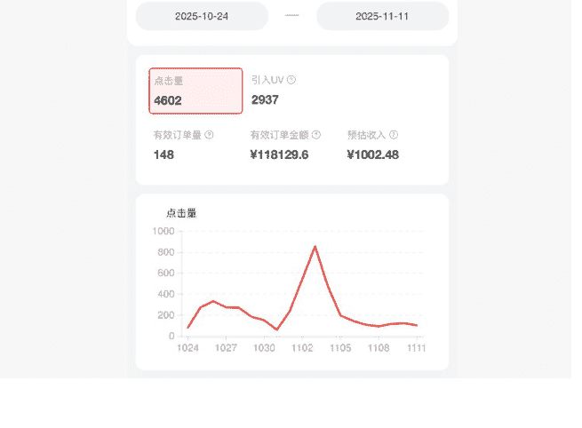
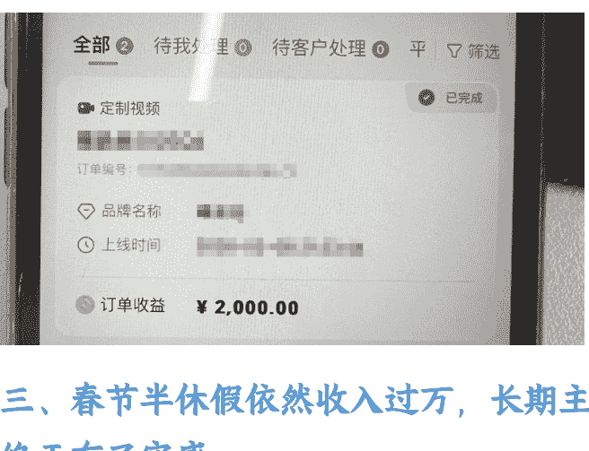

# 00后裸辞闯B站好物：从首月亏损到月入1.8W+，我只改对了三件事

> 副业实战复盘 | 精华分享

👸号：懒人搜索 | 懒人专属群独享

🛰️：lazyhelper1

## 一、写在前面

先简单介绍下自己：我，00后，自由职业者，加入赚钱圈子刚满一年。

去年九月，揣着半年生活费，我脑子一热裸辞了。当时目标很明确——All in B站好物，想在这里闯出一片天。但现实给了我当头一棒：第一个月几乎没日没夜地做，结果收入只有不到20块钱。

说实话，那一刻我差点就放弃了。

可熬过了前三个月那种“怎么折腾都没反馈”的至暗阶段，我慢慢找到了两个破局点：一套能复用的选品方法，和一个足够窄的细分赛道。从第四个月开始，数据终于有了起色。到了今年1月，我做到了单月收入1.8W+，其中带货佣金1.6W，商单稿费2000块。

更让我意外的是2月——哪怕只开工了10天，依然轻松破万，商单稿费就占了6000左右。这让我真真切切吃到了B站长尾流量带来的复利甜头。

### 这篇内容你会看到：
- 从裸辞到首月18块，我是靠什么撑下来的
- 一个关键决策，如何让收益从谷底反弹
- 一套能直接照做的选题筛选方法，帮你避开我踩过的坑
- 我接下来的布局，以及给新人的几句大实话

如果你也在项目探索里迷过路，或者想找一个能长期做、越做越轻松的赛道，那我觉得我的这段经历，也许能帮你少走好几个月的弯路。

## 二、从裸辞到月入18块：我为什么没被劝退？

### 1. 为什么偏偏选B站？

在决定全职做B站好物之前，我也零零散散折腾过不少副业。但绝大多数项目给我最大的感受就俩字：不安。它们大多周期性很强，可能红利吃个三五个月就凉了，根本撑不起一个全职工作。

那会儿我整个人特别拧巴：明明在职，心里却天天想离职，可手里又没有一个能拿得出手的底牌项目。直到有天刷到家蒙老师的帖子，第一次听说了B站好物。

真正打动我的，是它的“长期可持续”。B站的长尾效应决定了——你发出去的每一条内容，都有可能在未来某天持续帮你赚钱。这特别适合我这种想长期深耕的人。刚好那阵子赚钱深海圈第一期训练营开课，我觉得天时地利都齐了，果断报名入局。

### 2. 裸辞后的第一课：滤镜碎了一地

很多没裸辞过的人可能觉得，一旦All in，每天肯定像打了鸡血一样往前冲。但我的真实感受是：刚开始那段时间，效率低得可怕。

刚离职那阵，我根本找不到办公状态，在家摸鱼摸得心安理得。九月份大概给自己放了两周“适应假”，紧接着又赶上国庆七天连休。等真正坐回电脑前剪视频，才发现最难的从来不是剪辑，而是那种“做了半天没人理”的自我怀疑，简直能把人吞噬。

更尴尬的是，我之前完全没有长视频经验。镜头前表情僵硬，文案不知道怎么写。为了逃避最核心的“选品”，我还给自己找了个冠冕堂皇的借口：先别管选品，把视频数量堆上去再说。于是我开始盲目跟风，专挑最热门也最拥挤的数码品类去做。结果每做一个新视频，都像在机械重复，毫无长进。

首月我咬牙做出了5个视频。当时心里预期能赚个两三千块，现实却是——一个月只出了一单。

那一单我记得特别清楚。那天下午我正在健身房，习惯性掏出手机刷“京粉”，突然看到后台蹦出一笔订单——一把键盘，佣金18元。

你们可能很难理解，对当时那个裸辞、迷茫、焦虑了整整一个月的人来说，这18块钱带来的冲击力，比我后来一天赚几百块都大。因为它让我瞬间确认：这套逻辑，真的能跑通！

### 3. 放下执念，先让结果发生

虽然出了第一单，但国庆收假后我状态依旧稀碎。直到项目里出现第一个真正的转折点。

当时群里一位伙伴分享了“录屏流”的玩法——不用真人露脸，不用漫长制作周期，把视频门槛一下子拉低了一大截。他发完的第二天我就跑去试验，结果神奇的事发生了：当天就出单了！这堪称我做项目以来第二次激动到想尖叫。

顺便分享下我当时的时间分配：
- 选品+找热点（约1小时）：这是最核心的环节，直接决定视频能不能赚钱
- 写高转化脚本（约1小时）：把热点和产品做结合
- 录屏+剪辑排版（约0.5小时）：纯执行活

算下来，一条视频总共能控制在3小时以内。

从那天起一直到双十一，我都在死磕录屏流。整个双十一期间，依靠这个路子赚了一千多块钱。

现在回头看，这段经历真的太关键了。要不是录屏流及时给了我反馈和几千块收入，我大概率早就弃坑了。

所以想对0基础的新人说一句：初期千万别眼高手低，想尽一切办法先赚到一块钱的正反馈——那是支撑你走下去唯一的燃料。

### 4. 瓶颈期顿悟：方向不对，努力白费

双十一过后，录屏流的红利明显消退，我的热情也跟着凉了一半，又顺势躺了几天。可看着群里那些做长视频的大佬，一个接一个发精华帖、拿大结果，我又坐不住了：凭什么别人能做起来，我不行？

我沉下心去研究他们的打法，尝试把“保姆级选购/避坑指南”这类视频做得更扎实。质量确实有所提升，但数据依然半死不活。

我意识到再闭门造车下去就废了，于是硬着头皮找家蒙老师帮忙诊断账号。他一句话就戳中要害：视频质量已经够用了，真正的问题出在“品和赛道”上。

回过头想想，我其实早就在选品上吃过亏，可人就是这样，身在局中看不清，非得有人点醒。这件事让我彻底明白：做项目最可怕的不是做不出好内容，而是闷头在错误的方向上瞎忙。

## 三、关键决策：用“细分赛道+长尾效应”打进收益拐点

### 1. 做对一次选题，胜过盲更十次

12月，我彻底换了个活法——不再碰那些泛流量大品类，转而专攻竞争相对小、用户需求特别精准的“细分刚需品”。不过为了保底，我当时还是接了不少低价商单，一期也就赚个400块左右。在这些商单的间隙，我悄悄做了3期自己真正想试的品类。

这3期视频，加一块只花了6天时间，最终却给我带来了近1W+的收入！要说制作质量，其实没有质变，纯粹是选题选对了，数据直接开始指数级增长。具体怎么找这种赚钱选题，后面我会展开讲。

### 2. 长尾流量有多香？垂直高溢价有多高？

1月，我的总收入达到1.8W+。复盘数据时发现一个很有意思的现象：12月那几支爆款视频带来的长尾流量，竟然贡献了将近一半的当月佣金。那一刻我才真正体会到，B站内容的生命周期有多长——只要做对了，它就能一直静默地替你赚钱。

同时，1月我还尝试做了件大事：起了一个垂直品类的小号。这个号粉丝只有3000，也就发了2个视频。但因为内容垂直度高、数据不错，居然很快就接到一个2000元稿费的商单。这件事让我意识到：在B站，垂直意味着溢价。哪怕你赛道再冷门，只要内容能打，品牌方照样愿意为精准流量买单。

### 3. 春节半休假仍月入过万，长期主义终于落地

2月因为过年，我实际只工作了十来天。但靠着1月那波好选题带来的长尾流量，再加几个商单，整月收入依然轻松破万。

熬过前期的迷茫和试错，到这里我才终于摸到“长期主义”的质感——原来复利，真的会兑现。

## 四、怎么找到能赚钱的选题？一套能直接上手的三步筛选法

选品，才是这项目的生死线。下面这套方法，能帮你从“拍脑袋”进化到“有章法”地判断。

### 1. 先分清两种赛道，再谈策略

做选题前，先判断你面对的品属于哪类：

**红海赛道（竞争激烈）**
- 特征：市场已经很成熟，同类内容多到爆炸，典型如数码、美妆这波大众品类。
- 策略与预期：想靠它们做出极高佣金，很难。它们真正的价值在于：稳定佣金收入 + 不错的商单机会（品牌预算充足）。所以你需要把心思花在差异化内容和视频质量上。

**蓝海/细分赛道（竞争较少）**
- 特征：内容不多，或者精准击中某个尚未被满足的需求，也就是我常说的“细分刚需品”。
- 策略与预期：这里是收入爆发的主要机会区。一旦押中，回报常常超预期。我12月的转折，就是靠抓到了一个细分刚需品实现的。

### 2. 具体怎么筛？三步走

**第一步：建立自己的初始选品库**
别坐在那儿空想。你可以：
- 借助AI工具，让它帮你列出“适合在B站做推荐的商品品类”；
- 直接去淘宝、京东翻一级/二级类目，找找灵感；
- 目标：先攒出一个够大的备选池，建议至少15-20个品类起步。

**第二步：评估B站里的竞争环境**
把品类名+“推荐”放到B站搜索，重点看结果的数量和质量：
- 蓝海信号：优质、用心的带货视频不超过3个——这就是潜力股；
- 红海信号：优秀内容一大堆，远超3个——说明这片海已经很卷了。

**第三步：判断商业价值**
对筛出来的潜力品类做最后一轮评估：
- 估算佣金水平：找一个优质对标视频，把里面推荐的高、中、低价位商品的佣金都拉出来，算一笔平均单笔订单佣金。如果长期不到10元，除非转化潜力逆天，否则谨慎入局。
- 综合权衡三要素：
  - 佣金率：单笔能赚多少
  - 出单概率：产品单价、平台竞争度、是否应季/蹭上热点，都会影响这个概率
  - 商单价值：这个品类未来接品牌商单的可能性有多大

记住一个核心原则：高佣金不一定香，低佣金也不意味着没戏，关键是把出单概率和长期商业价值一起算进去。

### 3. 选品库的厚度，决定你的成功率

这点极容易被忽略，但恰恰是最要命的：你日常积累的选品库有多深，你的正确决策概率就有多高。

假如你的池子里只有5个选项，那这个月的所有尝试都只能从这5个里挑。但如果你的池子里有50个已经被初步筛过的选项，你就能优中选优，挑出最值得执行的5个去发力。两者最后产出的效果，完全不是一个量级。

所以，持续往选品库里补充和筛选新品类，必须变成每天的固定动作。

### 4. 实战案例：怎么把一个红海品，做成细分刚需品？

很多新人一提找赛道，脑子里蹦出的都是“数码”“家电”“服饰”这种大词。我拿去年冬天的“羽绒服”来举个例子：

冬天推羽绒服，确实是热点思维标配。可这同样是一片红海，新人想和大UP硬碰硬，基本没有胜算。

聪明的做法是什么呢？给大类目叠加上“特定人群+极端场景”。还记得去年哈尔滨冰雪游爆火吗？无数南方游客蜂拥而至。这时候，如果你做一期《南方人去东北，怎么挑羽绒服？保姆级避坑指南》，这就是一个绝佳的高转化“细分刚需品”。

**为什么它好卖？**
- 痛点极其清晰：南方人看不懂充绒量、蓬松度，怕买错被冻感冒，又不想花大几千买一件这辈子只穿一次的极地装备。
- 受众极其精准：能自己搜到这个内容来的人，基本都是机票酒店都订好、兜里揣着钱等买衣服的刚需用户。

这种时候，你只需要在脚本里拿出硬核保暖参数做对比，帮大家做好不同价位的避雷排坑，直接给购买建议，转化率就会高得离谱。“特定人群+极端场景+保姆级避坑”这套内容公式，就是这么好用。

而且这套思路完全能复制。去年沿着“哈尔滨防寒”场景，什么发热鞋垫、防风雷锋帽、防冻打底裤，只要顺着这个逻辑去选品，几乎都能卖爆。

## 五、下一步怎么走？我把重心放在这三件事上

B站好物的主要收入就两块：带货佣金和商单稿费。而我的下一步，就是把这两块系统化、放大化。

**1. 带货佣金：靠矩阵放大**
单条视频爆到1W+，那是玄学；但让单条视频稳定赚1000-2000，这是可以复制的。我打算把已经跑通的高转化脚本，换不同的出镜人、用多账号分发（重点攻克查重和限流问题），把整体利润放大。

**2. 商单稿费：靠质量提价**
目前B站商单对中小达人还算友好，还有红利期。我会把剪辑外包出去，让单人单条视频的投入时间控制在8小时以内。再通过持续打磨拍摄和文案质量，把单条商单的出价从现在的2000块，逐步提到3000-5000块。

**3. 打造个人资产：系统化沉淀**
真正的资产不是账号本身，而是你“能稳定产出高质量视频的那套系统”。接下来我会搭建完整的素材库，包括对标账号库、剪辑素材包、爆款品类库，让每一次创作都在为复利蓄水。

## 六、给0基础想进场的你几句掏心窝的话

从0到1，永远是最难的一段。

我们在圈子里总能看到“一个月跑通项目”的大佬，但你不知道的是，那背后往往是他在别的领域已经积累了多年。如果你是0基础起步，想做B站好物，我只有两个建议：

**第一，前期死磕视频质量，对结果保持钝感。**
如果选题一般、出单困难，别过度内耗。只要你的文案逻辑、剪辑排版都在线，哪怕长视频带货差一些，还有机会接商单保底。先活下来，你才有时间慢慢培养出对“爆款选题”的感知力。

**第二，给策略设一个“信任期”。**
比如定30天，如果这30天过去还没有任何正反馈，那大概率不是执行的问题，而是方向错了。这时候你应该退一步，向上社交，找更高维度的大佬指点，或者向AI求助。失败是常态，项目反馈有滞后也很正常，只要能从失败里总结出新的认知，迟早会等到属于自己的结果。

祝每一个正在摸索的人，都能早日撞上自己的那波“指数级增长”！

——分割线——

看完这份复盘，你可能觉得自己已经懂了。但说真的，90%的人一到实操还会卡在第一步。

工具和教程从来不是壁垒，真正的壁垒是“立刻动手”和“圈层信息差”。

如果你想知道全网最新的变现玩法，也想和一群执行力极强的伙伴一起拿结果，欢迎来我的核心私域：【懒人专属群】看看。我们只聊商业闭环和AI效率，不喊口号。目前系统里已经沉淀了1000多个跑通的实操案例。

⚠️最新搞钱案例与实操记录：

https://hk57gvlx7u.feishu.cn/docx/H0kRdZbSbolBR0xkaXtcuVE0nTg

如果你认同价值，并且准备好下场干活，扫码加我🛰️，备注：【实操上车】

🛰️：lazyhelper1