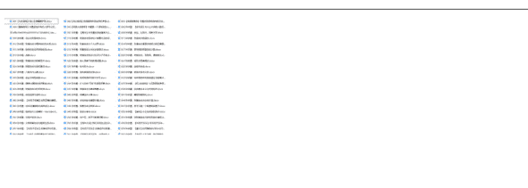
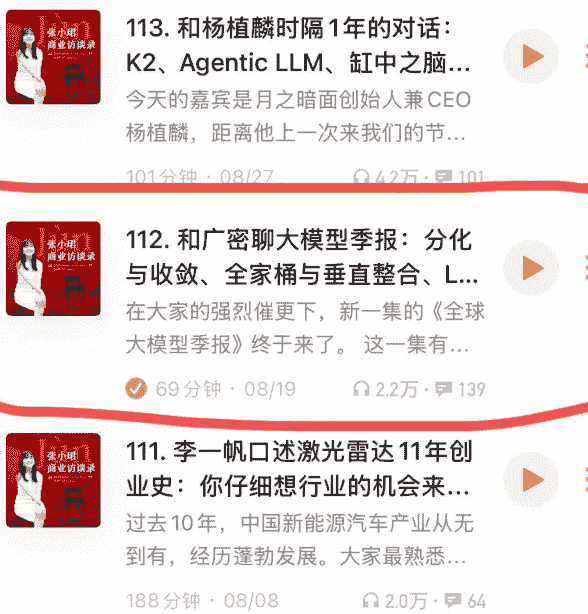

## 从 0 到一万粉的垂直号复盘：我在美股小号里踩过的笨办法

260316 副业 SC 精华

公众号懒人搜索，懒人专属群独享

懒人微信:lazyhelper1


放老大镇楼！很感谢亦仁大大给我这次复盘的机会，能把自己做垂直小号这段经历梳理一遍。


先交个底：我前后实打实做了三个月，从零做到一万粉，平均阅读两千出头，变现当天社群产品就过了万。

眼下成绩谈不上漂亮，所以这不算什么成功学，而是一份阶段性复盘。把我做号的心路历程和操作细节写出来，给也在做垂直公众号的朋友做个参考。

### 01 我为什么确信垂直小号能做

这个念头萌芽于几个真实案例。

我平时炒美港股，去年底正好要买车，研究理想汽车的时候，刷到一个专门写给理想投资者的公众号，篇篇阅读两三千。出于好奇我花 299 块进了群。

进去后我愣了一下，群里 500 人满员，而且大概率不止一个群。粗略一算，光付费社群的收入就很可观，更别说号主因此积累的隐性资源和人脉。

同期的还有粮厂研究员 Will 专写小米、林氪专写拼多多、猫笔叨的读后感专区专写猫笔刀本人。

这些案例给我最大的启发不是数字，而是认知上的确认：**哪怕投注在理想、小米、拼多多这样极其具体的公司身上，看似人群窄到不行，只要钻研够深，依然能做成可持续的内容生意。一寸宽，一万米深。**


> 右滑查看更多

当时脑子里冒出很多联想，蔚来能不能做？英伟达能不能做？特斯拉呢？蒋介石能不能写？

想法不少，却一直没动手。直到 2025 年 7 月，亦仁发了垂直小号超级标，思路一下子通了，我才决定必须马上开始。

在开干前，我把那篇超级标反复咀嚼了好几遍，把逻辑想透了。

### 02 我为何选择深耕型垂直 IP

航海期间我看到大家做垂直号基本分两路。

一条是做流量生意，铺矩阵、接流量主、卖货卖课，路子很清晰，像刘智行老师、辰风老师都走得很顺。

另一条是做深度垂直 IP，文章未必每篇都爆，但靠时间积累信任，把个人品牌沉淀下来。

我内心更偏向后者。看亦仁分享的硅谷王川社群，我就知道这才是我想要的，不为单纯的流量，而是想在自己热爱的领域里，带一群志同道合的人一起走。

总结下来，如果要走深度垂直这条路，最好挑一个自己发自内心有感觉、愿意长期泡着的赛道。因为短期可以靠勤奋硬撑，长期终究要靠热爱和认同去续航。

### 03 起号与定位的弯路

起号时我给自己定的方向是写美港股。刚开始更新半个月，基本石沉大海，阅读量个位数。

转机来自 X 上一条关于孙宇晨的内容，讲他十年前就喊 90 后别结婚别买房要买英伟达、特斯拉。那种超前视角一下戳中我。

这条帖子当时的互动远超博主均值，属于明显异常值，而且我也高度认同，于是我决定按这个思路重写一篇发到公众号。重点是把爆款重写，而不是凭空想点写点。


很幸运，这篇直接炸了。

有了第一波正反馈，我必须抓住。我意识到起号阶段活下来最重要，虽然这篇和我最初设想的定位有偏差，但先把号跑起来再说。

自媒体有个规律，爆过的题材容易反复爆。于是我顺着孙宇晨金句这条线继续更。

我用的方法很笨但有效：系统性地搜集孙宇晨过往的公开表达，从多年前的喜马拉雅录音课，到最近几年在抖音、X、视频号、小红书的发言和直播，全都找来梳理，把其中关于投资判断和时代机会的部分摘出来再重构成选题。




那段时间正好是“孙学”爆发期，好多号都在写，我靠先发优势连发几篇都过万，号基本就活了。

> 启示很直白：起号期先找一个有传播力的爆款，复刻它，再想办法延长它的生命周期，先把号做起来再谈别的。

起号后我开始纠结了，本想做个人 IP，结果不小心把号做成了孙哥 IP😂。这也侧面证明了垂直红利的存在，围绕孙宇晨是可以做成变现社群的。

但我最终还是想回到自己。结合之前的美港股定位和当下的受众，我把细分方向收敛为：挖掘 AI 革命下的全球投资机会。

相比起初的定位，这次清晰了很多，也更贴合经营小众人群的垂直逻辑。所以我觉得起号时定位不必钻牛角尖，大方向对就行，有了流量后慢慢会自洽。

### 04 如何把推荐流量拉起来

在强化个人 IP 后，我开始写自己捕捉的新机会、AI 判断、全球套利思路。

结果并不美妙：粉丝数掉、阅读降、推荐占比下滑。

做 IP，掉粉是必经的筛选，留下来的才是认同你的人。你只要坚持表达自己。

要提升推荐比，我主要靠异常值找选题，这个方法很管用。公众号文章能不能火，核心是选题和标题。其他平台火的选题搬到公众号成功率很高，标题直接借鉴，试几次就能感受到差别。

举个例子：


第一步，锁定垂直领域的热点事件。比如我是美股方向，段永平在雪球发帖看好谷歌大模型就属于典型的信号。

大道无形我有型 09-12 22:46

现在市面上大模型成堆，十年后能活下来的估计十个以内，这基本是九死一生。大家可以猜猜十年后我们还在用的主流大模型会是啥？我会押 Gemini，背靠 Google 足够强，已经醒了。

> @吉建晔 0666：@大道无形我有型 段永平老师：就像您港股自选里排位第三的商汤一样，很多人一直拿汤教授去世为由，认为没有创始人的商汤，也将走下坡路一样


$ 谷歌 A +0.74% 加自选

我发现这条帖子的互动远高于段永平均值，属于异常值，且符合号的定位，就判断可以做。

第二步，选题确定后做内容。光有好选题不够，必须有好内容。我的做法是去找这个选题已经爆过的内容。市场验证过的才叫好内容，要么数据异常高，要么是头部大号发的。

这篇我主要回应为什么段永平看好谷歌、大模型竞争格局如何、谁会胜出。我参考的是头部访谈号《张小珺商业访谈录》里关于 AI 大模型竞争的内容。



第三步，内容之后是互动。互动的核心是观点和争议，让人忍不住说句话。这篇我本来讨论国外模型，结果评论区因为我随口一句“豆包比通义强”炸锅了，我没刻意挑事，但这无疑抬高了互动率，也拉高了推荐。

所以选题时对比更容易吸睛，写文时适当埋一两个钩子，比如豆包 VS 通义、理想 VS 问界、苹果 VS 小米，会更有效。注意别主动挑起两派对线，容易违规。

以上是靠爆款选题提升推荐的做法。

另外一个补充手段是适度氪金加热。对自然推荐还不错的文章小小推一把，如果底层选题和内容过硬，带来的增量粉丝和阅读很可观。

### 05 关于日更

去年底我去菲律宾学了三个月英语，公众号断更了。回来后流量明显掉。日更回补了一个多月，数据才慢慢回暖。


我逐渐理清一件事：做公众号就像摆摊。选定品类后，剩下的就是按时出摊。出摊不一定卖得掉，不出摊一定卖不掉。

所以我给自己定规矩：有灵感没灵感，写得好写得差，都要按时出摊。哪怕下雨、哪怕预感生意不好，也得把摊子摆出来。我不是为了当场卖掉，而是让每天路过的人知道我还在。

在这么不确定的时代，我想做那个确定的存在。晚上打开公众号，就能看到我。文章可能平平，但我在。

我知道日更很难，尤其是卡选题时。有个笨技巧：实在没思路就先发段短文字，总比空白强。只要开始写十个字，手感就会回来。

当然你未必需要日更，但最好有一个稳定频率。断更会伤流，缺乏纪律更容易放弃。

### 07 一些碎碎念

写公众号对我来说不只是做号。

2023 年我赚到第一桶金后，接下来的两年特别不顺，陷入了长达两年的迷茫。换过五六个项目，有的短暂起色，有的直接死掉，时间被耗掉，钱没赚到，心态也差。

写公众号这件事慢慢把我拉了回来。每天坐下来写哪怕几百字，哪怕没人看，也帮我找回生活节奏，让我更安定。写作确实是一种修行。

前阵子刷到胖东来创始人教年轻人创业的视频。那个小伙在杭州摆烤肉摊四五年没做起来。于东来跟他说，摆摊也要讲品质，选好肉、环境干净，让人感受美好。扎根一两年本地就有名，做五年算优秀，做十年就是杭州烤肉大王。

我当时很有触动。这两年我东奔西走切换赛道，很多时候不是方向错了，而是扎根不够、坚持不够。我们常高估一年的变化，却低估十年的复利。

垂直小号这条路不轻松，但想拿大多数人拿不到的结果，就得走大多数人走不下去的路。

共勉！

如果你也在做垂直号，欢迎留言交流。

——————分割线——————

看完 SOP，你会觉得懂了，但 90% 的人实操第一步就卡死。

工具和教程是最低级的壁垒，真正的壁垒是立刻开干和圈层信息差。

如果你想看全网最新的变现打法，和一群执行力强的极客一起实操，欢迎围观我的核心私域：【懒人专属群】。

我们不聊虚的，只做商业闭环拆解和 AI 效率压榨。系统里已沉淀 1000+ 跑通的套利实战。

⚠️⬜ 查阅圈子最新搞钱实操记录：

```
https://hk57gvIx7u.feishu.cn/docx/H0kRdZbSbolBR0xkaXtcuVE0nJg
```

认同价值、准备下场干的，扫码加我微信

备注：【实操上车】


微信:lazyhelper1