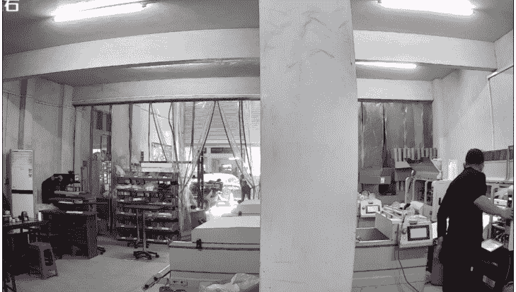
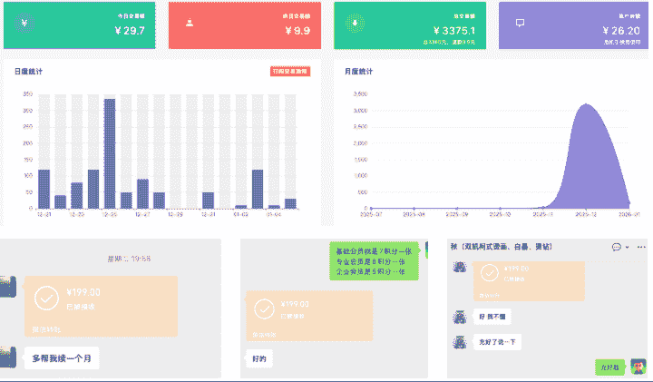
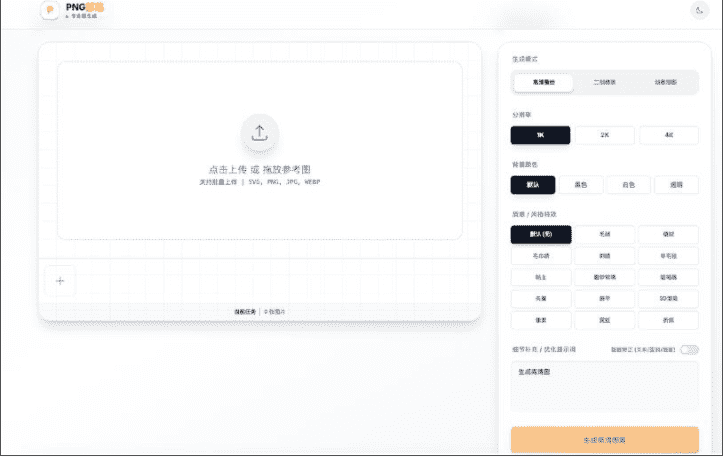
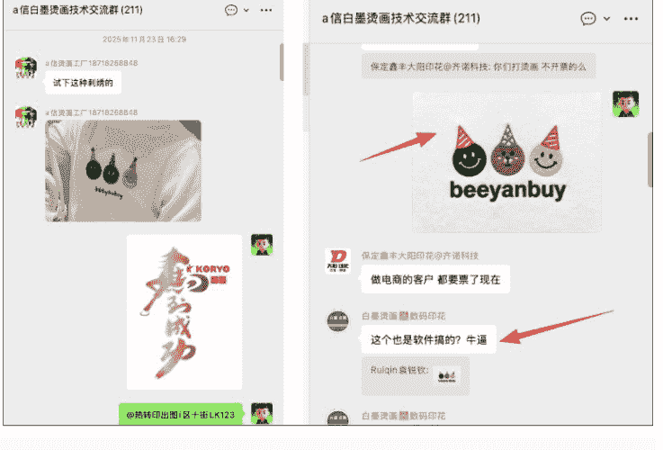

# 👸号懒人搜索，懒人专属群分享

### 👸号懒人搜索，懒人专属群分享

# 零投放一个月收回5K+：一位工厂老板靠AI编程扭转局势的复盘

### 260320 副业 SC 精华

👸号懒人搜索，懒人专属群独享

懒人微信:lazyhelper1


文章摘要：没有写代码基础的传统行业老板，如何用AI编程做成一个能赚钱的小产品？本文复盘了我从0到1用AI搭建AI生图服务的过程：从发现痛点到技术选择，再到上线运营和变现，附带具体细节和真实数据，供想尝试AI编程的朋友参考。

## 一、一个不安分到极致的创业者


我一直不喜欢被条条框框限制。

2014年高中毕业参军，在部队文职岗位上自学设计与社群运营。

2019年退伍后，我的经历很杂：奶茶店倒闭、做玻璃幕墙工程、教插画、做自由职业、玩电商……

2022年接触Midjourney，第一时间意识到它会重塑设计行业，便开始做教学。

2024年和合伙人开了家白墨烫画打印作坊。工厂对图案消耗极大，人工成本扛不住。3名美工月薪1.8万，画不出的图外包单张5-20元，质量参差。

我算了一笔账：若能让AI承担部分工作，每月能省下多少钱？

答案是每月约省1.2万，相当于两名美工的产出。

这就是我All in AI编程的起点。

## 二、共性痛点：工厂为高清图买太多单

### 我的现状

自家打印厂每天需要大量高清素材。过去靠3名美工，月开销1.8万。外包单张5-20元，效果不稳定。



### 技术带来的降本

豆包4.0出来后我开始尝试，后来阶跃AI的Step-2模型发布，效果直接惊艳。

单张成本仅0.3-0.7元，品质反而更高。

对比一目了然：

- 之前：1张图 = 5-20元 人工
- 现在：1张图 = 0.3-0.7元 AI

成本压缩超过90%。

### 从内部工具到对外产品的思考

起初只是想做个自用工具。很快发现同行都有类似困扰。

我一个运营一年多的小厂都有需求，更别提那些十几年历史的大厂，人力开销更大。

> 商业判断：从自用工具转向SaaS，关键不是“我觉得别人可能要”，而是“我每天在用，且别人主动问我要”。刚需、高频、可复制，三条件齐全才具备产品化基础。

于是我把工具做成对外产品，命名为PNG部落，是早年注册的商标。

## 三、一个月上线的数据实录



项目成绩：上线1个月，未花投放费用，收入5K+。

金额不大，但意义特殊，这是我第一次用AI编程做出收费产品。

| 指标 | 数值 |
| --- | --- |
| 变现金额 | 5K+ |
| 注册用户 | 约230人 |
| 付费转化率 | 约70% 注册转付费 |
| 投放花费 | 0元 |
| 开发周期 | 1个月 |
| 团队构成 | 1人+AI |

### 定价方案

会员制：

| 等级 | 价格 | 定位 |
| --- | --- | --- |
| 基础会员 | 9.9元 | 个人小量使用 |
| 专业会员 | 49元 | 小批量使用 |
| 企业会员 | 249元 | 大批量使用 |

积分充值：

- 1元 = 10积分
- 1K分辨率 = 20积分/张
- 2K分辨率 = 30积分/张
- 4K分辨率 = 40积分/张

成本测算：

单张图片API成本约0.4元，会员价格可覆盖成本并留利润。

### 获客路径

仅在2个行业群发了消息，朋友圈同步，余下均为自然裂变，用户带用户。

- 行业群：精准打印圈层，只进2个
- 自然增长：用户认可后主动转介绍
- 朋友圈+社群：持续更新进展

运营洞察：垂直工具要靠精准渠道。2个精准群的效果远超100个泛群。

### 用户画像

三类核心用户：

- 设计师：追求快速出素材提升效率
- 白墨打印厂美工：同行群体，需大量高清图
- 电商从业者：需要主图、详情页素材

共同点是都在和时间赛跑，AI出图快且便宜，正好是刚需。

## 四、技术选型逻辑：合适大于追新

### 开发工具

| 工具 | 用途 |
| --- | --- |
| Google AI Studio | 快速生成初始代码 |
| VSCode | 编辑器 |
| Claude Code | 主力编程助手 |
| npx zcf | 脚手架，生成标准模板 |
| GitHub Desktop | 可视化版本管理 |

### 第三方服务

| 服务 | 用途 |
| --- | --- |
| 302.ai | API聚合，国内访问稳定 |
| apimart.ai | API聚合，价格占优 |
| evolink.ai | API聚合，备用 |
| z-pay | 支付接入 |

### 部署平台

| 平台 | 用途 |
| --- | --- |
| Vercel | 前端部署 |
| Zeabur | 后端、数据库、Redis |
| Cloudflare | 对象存储 R2 |

选型原则：

- 前端Vercel，免费额度够用，部署简便
- 后端从Railway迁移到Zeabur，看重成本与运维难度
- API多源备份，防单点故障

## 五、0到1的13步实操

### 第一步：生成初版
用Google AI Studio输入需求，快速拿到基础框架。

### 第二步：下载与隔离
下载代码到VSCode，放入临时文件夹，用.gitignore隔离，避免污染主仓库。临时文件夹可命名.临时文件。

避坑：当时未及时隔离，差点把临时文件提交。AI生成代码质量不均，先隔离测试再合并。

### AI编程常见坑

- 硬编码：API Key、域名被写死
- 复制粘贴：同一功能多处重复，改动困难
- 逻辑断层：片段ok，拼接后出问题

经验：AI是执行者，你是架构师。先厘清业务逻辑，再给出明确指令。

### 第三步：Claude Code开发
VSCode + Claude Code + npx zcf组合。Claude Code使用zcf工程师专业版角色，遵循SOLID/KISS/DRY/YAGNI。

给非技术者的心法1：描述要具体。别说“帮我做用户系统”，要说“做用户系统，含注册登录积分，注册用手机号验证码，登录支持微信和账号密码，积分兑换会员等级”。

### 第四步：模板化
下载Supabase集成模板，在对话中@临时文件，让AI整理并集成。不要从零搭建。

### 第五步：版本管理
GitHub Desktop推送代码，方便回滚。可视化对新手友好。

### 第六步：本地测试
先本地跑通再上线，着急上线后期填坑更久。

### 第七步：API权限
Google AI Studio付费模型部分文件需填入API Key，需配合AI正确配置。

### 第八步：第三方API测试
依次测试302.ai、apimart.ai、evolink.ai。

心法3：必须多平台备份，单点依赖一旦涨价或宕机业务即中断。

### 第九步：核心功能开发
会员系统、用户系统、积分系统、后台管理。

避坑：先理清业务逻辑，否则后期重构成本高。

### 第十步：接入支付
用z-pay，下载demo放入docs文件夹供AI参考，本地无法测回调，上线后测试。

支付坑：z-pay必须先绑定域名才能接收回调，否则用户付款后会员不生效。

### 第十一步：部署上线
部署到线上，配置域名，测试支付。

### 第十二步：内测
免费内测，邀请用户试用收集反馈。

### 第十三步：迭代优化

### 服务器踩坑

最有价值的经验。

初期方案是：

```
前端：Vercel 后端：Railway 数据库：Neon.tech 储存桶：Cloudflare（R2）Redis：Upstash
```

> ⚠️ 重要提示：公测两天后，服务器就不够用了，直接开付费模式。结果半个月收到两张信用卡账单，分别是 20 美金和 20 美金——后端和数据库各扣了 20 美金。

现用方案：

```
前端：Vercel 储存桶：Cloudflare（R2）后端、数据库、Redis：Zeabur
```

用了3天仅1美金，管理更省心。

心法4：成本意识要贯穿。免费额度用完收费很猛。从Railway切到Zeabur主因是更低成本更易管。存储桶建议设置图片定期清理。

## 六、提升Claude Code效率的做法

1. npx zcf脚手架
终端输入npx zcf，首次回车默认配置，预制角色与MCP。

2. CCMate插件
此前三家中转月费约1800元，CCMate切换顺畅，现用GLM-4.7模型，性价比高。

3. 明确指令
对话指令越清晰，产出越快。

4. 多窗口并发
提示词：帮我列出项目计划中未完成项，给出并发开发建议并提供具体提示词，我要开多个窗口并行。

并发烧钱但效率高，前提是模块边界划清，否则AI会冲突。

## 七、迭代历程

### V1 初始版
基础功能可用。



### V2 洗衣机版
参考tools.dverso.io，增加抠图等功能。


### V3 现行版
发现好看不实用后，优化交互与界面。


## 八、冷启动路径

1. 员工内部测试
让员工真实使用，优化流程。


运营心法：第一层验证是自己用不爽就别推广。

2. 行业群免费试用
在行业群免费帮忙出图，收集反馈。



运营心法：免费是验证也是获客，帮10次比发100条广告更有说服力。

3. 逐步释放信息
在社群中慢慢透露在做AI生图项目。


运营心法：别一上来就卖，而是“我在做个好用的东西”，让用户参与成长。

4. 朋友圈推广
加好友、建群、发更新。


5. 社群运营
内测送积分、报bug送积分、邀请好友送积分、定期送会员提升粘性。

6. 引导邀请返利
用户反馈积分贵时，引导邀请返利机制。

7. 用户筛选
提醒：别和爱挑刺的人纠缠，转化价值低。

## 九、后期维护要点

1. 每日查看反馈
后端及时响应。


2. 快速修复
复制报错直接丢给Claude Code处理。

3. 谨慎部署
> ⚠️ 重要：不要改一点就推送！先确认后端是否有人在线，在线时推送可能导致服务崩溃。本地测试通过再推送。

4. 优化部署时长
Vercel前端部署我优化到50多秒。


5. 持续优化
前端展示、交互细节、功能排查。

## 十、反思总结

问题1：邀请机制不清
未充分利用种子用户传播，奖励力度不足。应学习大厂前期做法，减少白嫖次数。

问题2：会员积分说不清
用户分不清会员与积分，上线仓促说明不清，导致不敢充值。

问题3：开发不规范
代码硬编码多，未组件化，改一处要改多处。近期在重构。

> 升维思考：这些问题是AI编程创业的必经阶段。AI能快速写代码，不能保证好代码。先验证想法再迭代，比一开始追求完美更重要。

下一步规划：

- 功能优化，按反馈迭代
- 体验升级，优化前端与交互
- 代码重构，减少硬编码
- 用户增长，稳定后再考虑投放

长期主义：先打磨产品再放大，用户付费是认可，活下来比跑起来重要。

## 十一、可复用破局框架

想尝试的老板，核心三步：

第一步：找到真痛点
是你自己每天在为它付钱花时的，不是别人可能需要。

第二步：用AI快速验证
先用AI工具验证可行性、解决程度、付费意愿，再投入。

第三步：产品化放大
验证成功后再考虑技术选型、冷启动、迭代优化。

AI编程不是让普通人变程序员，而是让有想法的人更快把想法变成产品。

## 十二、结语

项目从想法到上线仅用一个月，无投放已实现5K+变现。

作为一位从未系统学过编程的设计师，我对 AI 辅助开发的潜力感触极深。只要你目标明确、敢于尝试，借助 AI 工具，任何人都能把自己的构想落地成真实可用的产品。

希望我踩过的坑和总结的经验，能为那些打算用 AI 做产品的小伙伴提供一点参考。项目体验入口：https://www.pngtrid.com

编者按：这篇文章真正值得关注的，并不是「PNG 部落」这个产品本身，而是一位传统行业老板如何借助 AI 思维，一步步解决真实商业难题的完整过程。从“每月节省 1.2 万人力成本”到“每月带来 5000 多元的产品收入”，这中间的每一次决策、每一个误区，都值得想用 AI 创业的人反复琢磨。

给行动派的建议：想用 AI 编程打造产品，请记住三个要点——痛点要真实、先做小范围验证、用最小成本快速迭代。

---

看完这篇 SOP，你可能觉得自己已经懂了。可实际上，九成的人一上手，就会堵在第一步。

工具和教程从来不是最难的关卡，它们只是最外层的门槛。真正的分水岭，是你能否立刻开干，以及你所处的信息圈层够不够前沿。

如果你希望看到全网最新的变现玩法，并和一群执行力超强的极客并肩实战、拿到结果，欢迎进入我的核心私域圈子：【懒人专属群】。

这里不谈空话，只做商业闭环拆解，以及把 AI 效率压榨到极致。目前圈内已沉淀了 1000+ 经过验证的套利实战方案。

⚠ 查看最新的搞钱实操记录：

https://hk57gvlx7u.feishu.cn/docx/H0kRdZbSbolBR0xkaXtcuVE0nTg

如果你也认同这套逻辑，准备好下场干活，扫码加我微信，备注：【实操上车】


微信：lazyhelper1