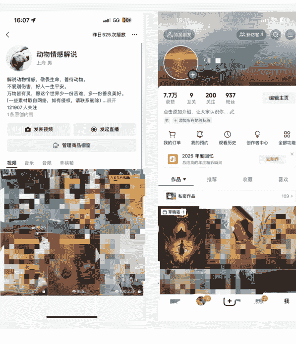
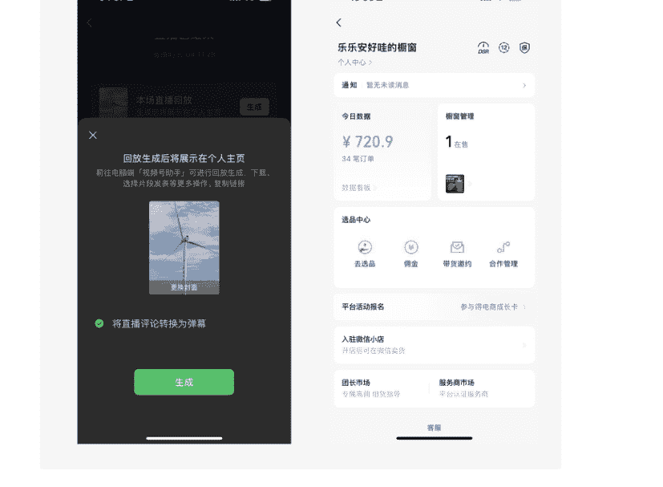
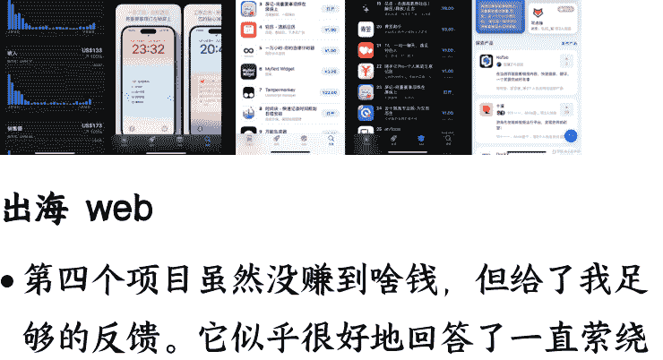
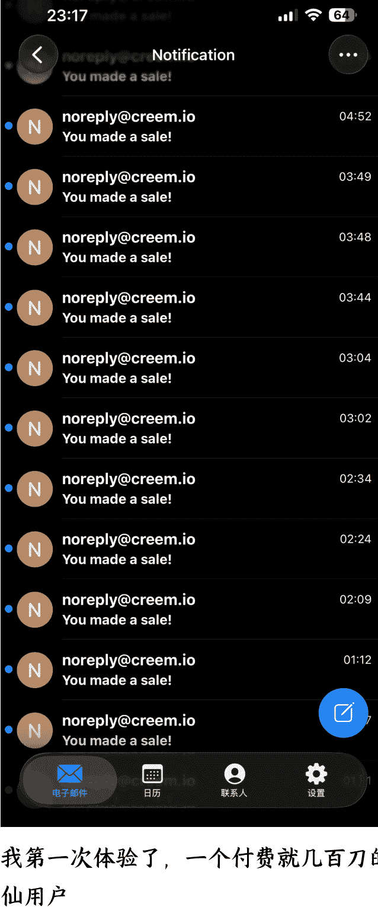
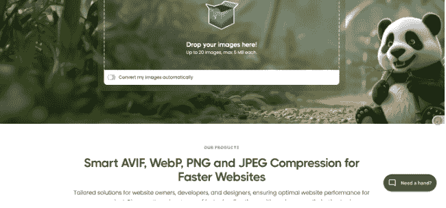
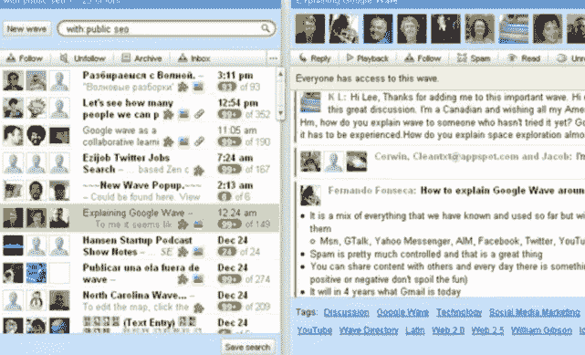
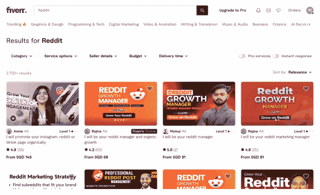

# 折腾一整年，终于靠出海Web赚到第一桶金，我的万字实操复盘

> 公众号懒人搜索，懒人专属群独享
> 懒人微信：lazyhelper1

各位朋友，我是小耳朵。

过去这段时间，我在互联网的浪潮里兜兜转转，试了不少路子。没想到，最后是AI的爆发，让我兜回了Web出海这条赛道，并且真正拿到了想要的结果，心里这块石头总算落了地。

距离我上次发帖，一晃半年多过去了。中间其实好几次都想写点什么，但每次都半途而废。这下终于理解了为什么亦仁总劝大家别写长文——这东西写起来，无形中的门槛真的很高，很容易把自己劝退。

## 先看看成绩单

这是之前收入最高的那个月的数据截图（不是纯利润）。让我意外的是，春节那几天单量不仅没跌，反而蹭蹭往上涨。那阵子头一回体验到什么叫“躺着收钱”，每天睁眼都有进账，那种感觉，回想起来还是很感慨。要知道去年这个时候，我还在四处碰壁，AI时代的变数，真的超乎想象。

不过，收入只是其中一个方面。这一年多的摸爬滚打带给我的，更多是对市场的嗅觉、对商业逻辑的理解，以及对自己的认知，这些加起来，甚至比过去十年学到的还要多。

这里必须郑重感谢几位贵人：亦仁帮我开阔了视野，刘小排老师教会我怎么做产品，哥飞带我入门了SEO，良辰美让我看到了坚持下去的希望。还是那句话，人生能遇到这样的良师益友，实属难得，心里满是感激。

## 为什么想写这篇分享

- 最开始的目标，是那些刚进生财、还在迷茫期的新朋友。我一直坚持输出的原因就在这，想给那些找不到方向的人当一个“参照物”。至少对一年前的我来说，这种真实的案例太重要了。就像我公众号简介里写的：“深知小白摆脱惯性进入正循环的不易。”

- 也想为做出海Web的同行们加把劲，让圈友们看到希望，这行真的能做成。

- 最后，就当是为自己过去这一年做个梳理总结吧。

## 新人的终极一问：我到底该做什么？

相信每个刚入圈的朋友都有过这个困扰。在给出我的答案前，不妨先看看我走过的弯路。这一年里，我刷了无数案例，也亲自动手试了很多方向：

### 短视频平台矩阵

当时顺手把抖音、快手也一起做了。为了尽快测试路径，起了好几个号，粉丝最高的一个做到过12w+。抖音那边因为1000粉丝才能开带货权限，硬是没用一分钱刷粉，慢慢熬到了1000粉——经历过的人才知道，那个阶段抖音涨粉有多折磨人。后来放弃后切回个人号，粉丝又慢慢掉回了1000以下。不过这段经历让我彻底搞懂了这几个平台的玩法和生态，剪辑的基本功也练出来了。

### 直播间叫卖

因为看到太多人靠这个赚快钱，也心动了。听说凌晨竞争小，我就每天半夜12点开播，一播就到凌晨四五点。很难想象，曾经很抵触直播那种喧闹氛围的我，后来也能熟练地喊出“1、2、3，上链接”那套话术，而且数据还过得去。

### 小红书种草

陆陆续续做了4个不同领域的账号，都做到了1000粉以上，现在只留了一个，因为主要收入来源就是接一些广告。

上面三个项目有个共同点——就是看别人做啥赚钱我就去做，背后其实是那颗又迷茫又焦虑的心。也不是说这些项目不好，但我始终找不到状态，而且有个问题绕不开：这些门槛不高的赛道，我的核心竞争力在哪？难道永远从零开始跟别人拼？要知道，我亲眼见过六七十岁的老奶奶都在做视频号直播，竞争激烈程度可想而知。所以，我一直没停下寻找新方向的脚步。

### App开发

这里要感谢生财，让我有机会接触到各种不同项目。当时报名了App开发航海，觉得这技能以后肯定用得上，加上AI编程工具越来越成熟，零基础的我花了二十多天，捣鼓出了一个叫“屏记”的App。后来的故事大家也知道了，真的上了App Store榜单。一个定价1块钱的App，居然卖出了1000多块钱，搜索时发现名字还被人山寨了，国区也因此下架了。具体情况我在上一篇精华帖里写过：0代码上付费榜Top3无保留分享，及新人避坑建议。

### 出海Web

第四个方向虽然没直接赚到钱，但给我的反馈价值巨大。它好像回答了我一直纠结的那个问题——对啊，我完全可以走产品这条路，AI的出现让互联网重新充满了可能性。

但新的选择题又来了：做App还是做Web？直到我听了刘小排老师、亦仁的解答才豁然开朗：

- 良辰美老师请教过亦仁关于这个选择的问题。亦仁的意思大概是，两者天花板都很高，但App极度依赖投流，没有足够的资金很难做大；出海Web就不一样，小排老师就是典型的产品自驱案例。

- 小排老师的解答更是让我下定决心做出海AI Web。这些核心观点我当时直接抄在桌面上，前期就是靠它们撑过来的：

  - 出海Web还处在红利窗口期：很多国内公司，哪怕是互联网公司都还没入场，思维还停留在App上，从我的互联网人脉圈也能感受到这一点；

  - 快速失败、快速验证，试错成本极低：Web比App的优势在于迭代速度快，开发门槛和成本低得多。而且出海意味着不用折腾国内那些审核流程。快速失败尤其重要，因为做Web本质就是博概率——其实做项目、创业不也一样？现在有几个方向能像出海Web这样，低成本、高天花板？对普通人来说，几乎没有更好的选择了；

  - 躺赚、长期生意、边际成本低：订阅制加上Google搜索的机制，Web就像一台365天×24小时不停运转的“自动售货机”，客户来自全世界任意角落，时间和空间完全不受限。所以说Web是真正的“睡后收入”一点不夸张。长期生意更不用多说，十几年前的网站现在还在持续赚钱的例子比比皆是。至于边际成本，随着用户规模变大，收入水涨船高，但成本的增长幅度要小得多。

那还犹豫什么，干就完了！我立刻报名了出海Web航海，又加入了出海AI Web的深海圈，最后有幸成为小排老师第一期的学员。小排老师的课在上线前就呼声很高，我的期待值已经拉满了，但真正看到课程内容时，还是被那种专业性和系统性深深震撼到了。

## 一切如约而至

从跟着小排老师All in学出海Web，到拿下第一个订单，前后大概花了4个月。可能是我这个人比较较真，学习过程确实痛苦，坑也没少踩，后面我会详细复盘。在这之前，咱们先感受一下这门“软件生意”的魅力吧。

我第一次体会了什么叫“睡后收入”

我第一次碰到了一位付费就花几百美金的“神仙用户”

第一次体验了真正的“躺赚”——只要网站走上正轨，你做的又不是短期时效需求，它就会源源不断带来收益，而且边际成本还在持续下降。

第一次体会到边看电影、打游戏、春节钓鱼，边看着手机不断弹出订单的奇妙快感。

第一次赚的是美刀，花的却是人民币——众安银行绑定支付宝微信，国内消费直接支付，还没有手续费。

第一次尝到了SEO带来的正反馈甜头。

当然，我也经历过Google Ads一天烧掉几千上万的“酸爽”；也统计过买外链的钱前前后后花了好几万；也体会过网站宕机时，从最初的手忙脚乱到现在的从容应对。

对了，看到这里，你还记得开头那个问题——“我到底该做什么”吗？我想你心里已经有答案了。

我的答案就是：没有捷径可走。不管你分析得多么缜密、推理得多么严谨，都没用，因为你脑子里的信息量和认知边界就在那，根本撑不起一个真正正确的决策。唯一的路就是停止空想、开始行动，不停地折腾、试错、总结。懒得动？那就遵循最小阻力和最快获得反馈原则。这个答案听着很老套，但确实是我花了一整年才真正悟出来的道理。

## 出海AI Web深度复盘

如果你对出海Web也有兴趣，那咱们继续聊。从这部分开始，我会系统地梳理我在出海Web路上经历的一切，包括新手常见问题、我自己的产品与流量心得、踩过的坑、后面的计划等等，你可以直接根据需求跳读对应章节。

### 不知道做什么需求？

经常有新手说，看别人一个接一个地上站，自己却迟迟不知道从哪下手。先别自责，你不是一个人，这是新人最常见的状况。而且这个状况是可以改善的，下面说几个常见方法：

#### 刷榜单

要非常熟悉主流平台的榜单产品。小排老师曾在一场直播里提到，Toolify月度榜单上的产品，他熟悉到随便说一个都能讲出它是干嘛的。听完我就震惊了，从那以后圈子里就流行起刷榜了。良辰美老师更是直接用公众号一个接一个拆解榜单产品，执行力满格。

具体怎么刷？

平台推荐：Toolify、TAAFT、Traffic.cv 等。

新手建议按照以下维度去拆解榜单产品。很多人会用AI辅助，但说实话，最好的效果还是亲力亲为：

- 这个产品解决了什么问题？
- 目标用户是谁？
- 用户为什么需要它？
- 用户是怎么评价它的？
- 它是怎么找到用户的？
- 它赚钱吗？赚多少？
- 我从它身上学到了什么？
- 它的什么做法难以复制？
- 一句话推销它：
- 有没有不同的做法？
- 我能做出来吗？
- 怎么找到用户？
- 为什么是我做？
- 我能坚持下去吗？

至于老手，可以有意识地挑选和自己赛道一致的产品类型去刷就行。

#### 日常记录需求

养成随手记录需求的好习惯，这个方法来自Pieter Levels——推特上非常出名的独立开发者，他还写过一本叫《Make》的书，在圈子里流传很广。

具体做法：

每天强迫自己记录需求，至少3个以上。想不出需求？本质上还是没养成思考的惯性。

其实只要做有心人，需求真的做不完。多留意日常的抱怨和痛点，不管是生活上的小麻烦，还是工作上的不便，哪怕是在你刷视频、打游戏娱乐的时候。

拿刷视频举例：

我会故意给一些AI视频点赞收藏，让大数据多给我推这类内容。尤其是Ins上的AI爆款视频，经常会透露它用的是哪家API，那我能不能把不同API组合起来，做一款批量生产这种爆款的产品？对了，你应该见过那种超级吸睛的开头——一个翻车镜头瞬间无缝衔接人物后空翻的视频。当时就是有人专门做了这种万能开头素材网站，没错，那个人就是我。

刷视频只是日常里的一个缩影。我会下意识去想：视频里传达的这些东西能不能产品化？其实生活中类似场景太多了，只要你愿意多看多想，久而久之，需求根本做不完。做互联网产品是这样，做其他任何生意也一样。核心就两件事：刻意思考，保持开放。

顺便说一句，用这个方法，我现在需求池里已经躺了100多个需求了，根本做不过来。我自制了一个模板，大家可以直接参考：需求池管理_副本。

#### 新词

前面两个方法，本质都是培养产品敏感度。那有没有更快的方式？

有的，“新词”就是一种。所谓新词，一般指新发布的模型名称，或者围绕新模型衍生出的AI工具服务。

这是新人弯道超车的好机会。因为新词抢得早，就能快速获得正反馈——而正反馈对新人来说太宝贵了。不过正因为如此，新词赛道的竞争也格外激烈，拼的就是速度。

怎么提升速度？

多关注头部AI自媒体账号，每天刷推特，刻意让算法给你推相关内容。除了人肉刷，还可以用AI工具持续监控相关领域的最新动态，这类工具方法在生财里一搜一大把。

最后，速度还体现在上站效率上。准备一套专业的Starter Kit，行业里最出名的就是ShipAny、MKSaas，然后不断打磨成最适合自己的。每次上站形成一套高效的SOP，现在甚至因为Clawbot的出现，从捕捉产品机会、搭建产品到上站，全流程都能自动化了。

但最后想补充一句：对新手来说，新词虽然能快速拿到反馈，但不意味着要一直只做新词。老手会去挑战老词——那些在市场上存在已久的机会，也会更擅长用上面第二种方法。

### 需求到底是真是假？

咱们先看个案例：

小明发现现在的AI模型能很好地做拍照识别，于是冒出个想法：做个App，拍摄食材就能立刻推荐对应的菜谱组合。这样每次去菜市场买菜时，打开App拍一下食材，就能知道该买什么了。小明兴奋得不行，花了一个月终于做出来了，发到小红书，结果几乎无人问津。

其实小明就是我本人——前半段是真的，后半段是我编的，最后我并没有去开发它。我不能说这个想法100%没市场，但凭我的判断，大概率是个伪需求。理由：人群定位模糊，现在愿意去菜市场买菜的年轻人本就不多，最后筛出来的“目标用户”是“愿意去线下菜市场但又不会做菜”的人，这本身就自相矛盾。而且买菜组合来来回回就那么几样，试过几次就熟了，产品留存是硬伤；再加上这个需求本身也没强到让用户愿意掏钱。综合考虑，我放弃了。

这个例子就是想让大家感受一下，真伪需求很多时候并没有那么界限分明。别说普通人了，专业产品经理甚至公司老板都经常判断失误。失败的案例一大把：圈内著名的musical.ly，当年有位颇有分量的股东去找马化腾投资，一连两次都没谈成；扎克伯格前几年砸重金搞元宇宙，罗永浩之前做AR……翻车案例比比皆是。

那有没有办法尽量避免伪需求？

有的。这里又得搬出刘小排老师的新手必读经典——《如何获得产品idea》（https://scys.com/articleDetail/xq_topic/212485241245121），传阅度极高。直接给你们上“抄作业版”答案，新手照着这4点做就够了，听话照做就能快速出结果。

1. 首先，这个产品得能满足你自己的需求（这个概念可以搜“eat your own dog food”）。

2. 关注市场上已经成熟的同类产品，这不是让你直接抄。要问自己一句：既然它已经存在了，我要做出什么不一样的东西？是性价比更高，还是用户体验更好？

3. 记住小排老师的万能公式：什么人、在什么场景下、愿意花多少钱、解决什么问题？我把这句话打印出来贴墙上了，群里甚至有人做了专属表情包。

4. 还有个心理测试：假设这个产品来自于一个你不太喜欢甚至有点讨厌的人，你还会为它付费吗？如果答案是肯定的，那大概率是个真需求。

最后我还想再补充一点：

其实很多时候，**无法确定需求真伪也没关系**。因为现在产品MVP的开发门槛已经降到了历史最低点，我们甚至只需要几个小时甚至更短的时间，就能快速上架一个MVP去做验证。

所以，大胆一点吧！如果你真的想做、真的感兴趣，那就先快速动起来，用概率去博成功率。这里又得提良辰美老师，一年做一百多个网站，靠的就是“大力出奇迹”。

## 产品设计的基本原则

### 简单易用

国内用的App大多又臃肿又复杂，好像大家都忘了好产品应该长什么样。我理想中的好产品，应该足够简单易用。注意，功能不一定要单一，但必须对新用户足够友好，用完之后的感受应该是愉悦甚至惊喜的。

比如像tinypng.com（大名鼎鼎的熊猫压缩）、remove.bg、Anybox——最近让我体验最深的是Typeless，用完真有种不好意思不付费的感觉。

用小排的话来说：把简单留给用户，把复杂留给自己。简单到爸妈看一眼就能明白怎么用。所以下次设计产品时，不妨多问自己几个这样的问题。

### MVP原则

接触过互联网的朋友应该都对MVP不陌生。Web比App的优势就是轻量、快，加上AI编程降低了门槛、提升了上站效率，MVP的价值就更加凸显了。

这里我就不放那个经典的造车图（从脚踏车一步步迭代到汽车）了。但实操中确实会遇到一个难题：如何清晰地定义MVP的功能边界？听起来很简单，做起来就发现，要么是边界划不清楚，把一些锦上添花的功能塞进去；要么一开始定义得好好的，做着做着就跑偏了。

问题的核心，其实是没彻底想明白“为什么做这个产品”——这又绕回了前面说的“新人怎么找需求”，两者是深度绑定的。

我说下我的实操结论：可以把MVP功能一项项列出来，再按照前面讲的需求真伪维度，一条条划掉，直到剩下最后那个核心。拿它和你做这个产品的初衷对比，如果对得上，方向就对了。如果还能找到目标用户聊一聊，那就更好了——拿着基本产品原型直接跟用户沟通，往往非常有效，能帮你跳出自己的单一视角。

另外强调一点：MVP可以粗糙，但核心功能不能将就。怎么判断功能做到位没有？如果目标用户用完核心功能后，有种“诶哟不错”的惊喜感，那基本就成了。

### 一句话原则

一句话原则，就是用一句话说清楚你的产品只做哪一件事。

用现在流行的话说，别一上来就想做all in one。道理很简单，但实践起来特别容易当局者迷，被各种因素带跑偏——没错，说的就是我。

大而全往往是“结果”而不是“起点”。你去观察一下，市面上90%的大而全产品，都是一步步迭代出来的。都是先从一个切中真需求的小点切入，做出一个够优雅、够好用的产品，留住用户，再根据用户反馈，一步步搭积木一样丰富功能。

印象最深刻的是阿彪说的——Pollo AI一开始也并不是all in one的。因为团队发现用户文生图之后，还要拿着图去其他平台做视频，于是顺势就做了“图生视频”。这是用户真实需求自然长出来的功能，而不是拍脑袋式的“全家桶”。

反面案例也不少。比如Google Wave，你没听说过它，是因为Google当年也犯了同样的错误。具体细节可以问AI。

从单点切入，足够锋利，才能击穿用户心智：

能看到这里的朋友很不简单啊，一看就是做事容易成功的那种人——没错，说的就是你。

咱们讲个“鬼”故事放松一下。《鬼灭之刃》里有个人气爆棚的角色善逸，他不会像师兄那样掌握雷之呼吸的很多招式，他只会一招——霹雳一闪。一开始他特别自卑，动不动就哭鼻子。但经过后面的魔鬼训练，他愣是把这一招

## 伟大不是规划出来的，是迭代出来的

先聊个大家都容易踩的坑。我这些年辗转各个公司，也算见过不少老板，手里稍微宽裕点，就急着定宏大目标：“我们要做这个，也要做那个，我们要打造整个xx生态。”但说句实在话，伟大不是计划出来的，这句话大家常听，可它后面还有半句往往被忽略了——伟大是迭代出来的。

## 新人怎么搞流量？

### 先把问题问到足够细，答案自然就浮现了

搞流量这事儿，应该没人不关心。但先别急着动手，停下来问问自己：我搞流量到底为了啥？你可能觉得这不是废话吗，当然是为了有人用啊。那我再追问一层：要有多少人用才算数？很多新人到了这一步就卡住了。

新人面对的第一道坎儿，不是盲目拉流量，而是敲开第一单。这才是第一个真正要跨越的里程碑。说来也有意思，当年我出第一单的时候那个激动劲儿，到现在还记得清清楚楚。后来赚得多了，反而再没体验过那种狂喜。

那怎么拿下第一单呢？咱们再把问题拆细一点。一般新上线的产品付费率在0.5%到1%之间，换算过来，至少得有两百个人用才有可能出单。为了稳妥点，按三百人来算好了。于是“怎么破首单”就变成了“去哪儿找这三百个目标用户”。这么一拆，是不是瞬间清楚多了？

把这个问题丢给AI，把背景信息、目标都喂足了，以现在的AI能力，能帮你做的事多得超乎想象。很多新人的问题是产品做出来就完事了，随便吆喝两声就干等用户上门——我自己刚入行时也这样。发布产品其实只是万里长征迈出的第一步。

下面说说我摸索出来的路子：

### 不花钱的路子

#### 先把目标用户群翻个底朝天

如果你的产品需求是老老实实按前面讲的方法验证过的（不是拍脑袋想出来的假需求），那这活儿已经成了一半。你既然清楚用户的痛点，就该知道哪群人会被这个问题困扰。信息都具体到这个份儿上了，想找不到用户群都难。你要做的就是撒网，把散落在各个平台的用户聚集地都捞一遍。反过来，如果这一步你都觉得模糊，那是不是产品需求本身就站不住脚？

找到目标用户群就好办了，该铺软文的铺软文，该发优惠活动的发活动。

#### 别漏了独立平台

除了目标用户扎堆的地方，还能同时去独立开发者、产品经理、技术社区这些平台转转。尤其你的产品要是有什么创新点，很容易激起一小波关注，有时体量还相当可观。比较典型的有V2EX、indieHackers（早先提交产品收费，如今免费）、小众软件、Product Hunt、Hacker News、BetaList这些。

#### 拿我自己的一个网站说说冷启动

我早期的主力流量来自Reddit和一个YouTube红人。Reddit这边我同时养了5个号，Karma基本都在1000上下，前后阵亡了3个——据我观察，只要不是永久封禁，号过几个月还能活回来，但要是解封后你又拿去营销，很大概率就永久没了。

最后的效果是：在几个最相关的Reddit版块里，我的网站被用户自发地转发了起来。Reddit垂直社区的传播效率是真快（但奇怪的是，付费投流的效果却很一般）。

**Reddit**

Reddit这座“金矿”大家都知道，欧美用户占了很大比例，引流效果不错，我甚至能每天看到网站流量的变化。简单整理几点体会：

- 社区的氛围比我想象的要浓烈。帖子一旦有人给负面回复，自己主动删掉，比等群主出手好得多

- 一步步试探着来。别一上来就甩链接帖。比较稳妥的顺序是：先在热门帖下认真评论、发求助帖但不带链接、发求助帖（用小号互动再把链接引出来）、最后才发带链接的帖子（最好先私信群主问问能不能发），前提是你这内容确实对社区有价值

- 多刷爆款帖子，感受爆款背后戳中的是什么情绪，总结出规律。但光看是不够的，得赶紧粗糙地实践出去

- 发链接有个小心机：先别用超链接形式，拿纯文本试试水。等帖子火起来，再把链接换成超链接，主页上也能放

- 把置顶和二次编辑回复结合起来用。比如先置顶一条留言，先回复一版，过阵子再编辑这层回复，把链接带出来。别直愣愣地放，用小号互动或者用间接的方式引出来更好

- 要是嫌这些操作太麻烦，终极省心方案是去海外版“闲鱼”Fiverr上下单，花点钱让别人帮你传播，至少确定性高一些

**YouTube**

在我这儿，YouTube的价值和Reddit不相上下。实践证明，一个腰部AI博主就能带来持续几个月的订单。YouTube在海外的地位相当于视频版Google——大家遇到不懂的事，比如家里水管漏了，直接上YouTube搜。这方面有点像国内的小红书。我的网站从YouTube那儿拿到了两类价值：

- 冷启动流量：我靠发Shorts，再到热门视频的评论区引流，搞到了一批像样的早期流量。Fandom粉丝社区、Hacker News的讨论帖这些地方，也可以用类似的玩法。

- 长尾流量：有天我发现网站每天都有一大块流量来自YouTube，顺藤摸瓜才发现是一个AI博主推荐了我，理由是支持免费额度，还能接入Affonso第三方代理平台，用户每次充值代理自己都能拿50%佣金。当然，前提是网站本身功能体验过关，不然肯定被他的粉丝骂死。

细心的朋友应该发现了，上面这套组合拳基本不需要花钱（Reddit那部分是可选项），唯一消耗的就是你的时间。但对出过单的老手来说，还有更省事的付费玩法。

### 花钱的路子

还记得前面提过的刷榜单吗？这里面就涉及Toolify和Taaft——这两家平台流量够大，还都支持付费推广（Toolify标价99美金，Taaft我印象里也不超100美金）。直接把钱投到这类导航站上，能快速验证需求、快速出单，效率很高。

类似的导航站还有：

- https://www.saashub.com/services/submit

- https://app.aibase.com/zh/submission

- https://aitoolsdirectory.com/submit-tool

- https://topai.tools/submit

那为什么我还是鼓励新人别一上来就全靠砸钱？因为前面那套“免费打法”里，有个特别珍贵的过程：你得想方设法贴近你的用户，在这个过程中会慢慢长出一种直觉——哪些用户最容易转化、哪条渠道的用户质量最高、产品里哪个功能才是真正的钩子。

最后总结一句：甭管免费还是付费，这些都只是冰山一角，新人的流量玩法远不止这些，你还能把它们排列组合起来。说到底就是“黑猫白猫，抓到耗子的就是好猫”。

我记得林悦己有次直播被问到怎么搞流量，她的意思大概就是：什么来流量就搞什么，绝不把自己绑死在一个平台一种玩法上，甚至连拍短视频穿什么衣服她都琢磨过——这才是流量高手该有的样子，无孔不入。

回到最开始那个问题：去哪儿搞首批300个目标用户？只要死咬住这个目标不放，脑子活一点，行动力强一点，区区300个人，对于聪明的你来说，真不是什么难事。

## 怎么把业务放大？

第一块里程碑是出单，第二块里程碑是持续出单，说白了就是怎么放大业务。

这块我自己也是学生，也没有百试百灵的路子。比如小排老师，产品口碑好，属于典型的“产品自驱型”，但大多数人还是得靠各种市场手段来放大，咱们都得慢慢摸索适合自己的节奏。

### 流量四板斧

这个说法得谢谢哥飞老师。他组织过一次出单群友分享，其中一位群友总结得很精辟，简称“流量四板斧”：SEO、各大平台广告投流、红人传播、自己发帖灌水。

红人传播和自己发帖前面免费方法里已经聊过了，这里重点说下SEO和Google Ads的心得。

### SEO

这块还得感谢哥飞公众号的免费文章，学到了不少SEO的门道。对一个SEO新手来说，我不但没跑偏（尤其没踩那些新手常见的大坑），流量长得还挺喜人。

关于SEO的操作，哥飞公众号和深海区课程都讲得很详细，我这儿只聊聊自己的理解和心得。

SEO要做的事虽多，但核心就围绕三件事：关键词、外链、产品体验。这整个过程是在反复向Google证明自己的网站，一点点赢得信任、把排名做上去。

### 关键词

贯彻“一个关键词对应一个页面”的原则。先用长尾关键词把流量一点点搜刮过来，慢慢攒Google的信任、养网站权重，等底子厚了再覆盖主关键词——这叫农村包围城市。

### 内链与外链

内链存在的意义是帮Google看清你网站的结构和权重分布，同时也传递权重、延长用户停留时间，整套带动整体权重上升。如果只嘱咐一句话，那就是：外链要坚持发，别停。这里附一份别人分享的外链资源列表：https://potent-measure-3lf.notion.site/14368f418f50804ba419d3ce7a333fa8?v=14368f418f508191a695000c6fcd329a

### 产品体验

除了产品设计的基本功，还有一点容易被忽略——网站（移动端更甚）的性能指标。用https://pagespeed.web.dev/测一测，然后把结果丢给AI帮你优化。

### 新手绕坑指南

- 一口气铺几百个页面（尤其是AI批量生成的廉价内容）

- 上来就开多语言版本

- 一个页面恨不得把好几个关键词全塞进去

- 不管内链，短时间猛上一堆低质甚至垃圾外链

### 关于“新词”

没赶上新词第一波也不用太崩溃。我亲眼见过不少比我早起步的新词网站，第一个月流量拿到手软，结果接下来几个月一路下滑。所以新词这块儿，真的不必过度焦虑。

把产品体验做好，老老实实、耐心地搞SEO，这才是正道。

### Google Ads

网站跑顺了以后，Google Ads几乎是绕不开的一步。记得有位大佬说过类似的话：SEO在Google Ads面前就是弟弟，玩得好的Google Ads就跟印钞机似的。我现在每天的广告成本里，Google Ads也占了最大头，确实香。而且随着Google在AI方面越来越强，Google Ads对Web站点的分量只会越来越重。

Google Ads的常规配置教程网上多的是（公众号或X平台直接搜索），下面说说我踩过的坑和一些自己的小体会，边做边学，欢迎交流。

**国家选择**：开通Google Ads账号时得先选定一个国家，注意，选了就不能改。有一个坑：如果你选了非大陆地区，后面迟早会莫名其妙冒出来一个“客户认证”，要是认证过不去，好容易跑起来的号就废了。不过真走到这一步也别马上放弃——可以试着联系Google Ads顾问，有路子能换成国内身份再提交认证。我就是这么救回一个老账号的，只不过不敢打包票每次都能成。

**赠金**：每个Google账号开通广告账户都有机会领赠金，不同档位对应的广告消耗门槛不一样。我当初怕触及不到最高档，领了个中等档位，现在想想，能到中等档的消耗，高档一般也问题不大。

多说一句，不同国家的新客赠金活动金额也不同。我因为一开始选的是美国，后面拿到的赠金也是美元。

**统计代码**：这玩意儿一定尽早装。我广告跑了好长时间都没正经装统计代码，实际上没有统计代码，Google就拿不到转化数据回传，没法帮你精准找目标用户，直接拖累收益。我用的是Tagmanager工具，全程AI帮我埋点、指导配置。

**14天ROAS**：看广告收益，一定要把时间轴拉到14天。很多新人只盯着单日或两天的ROAS看，但现实是用户很可能不是当天看到广告就下单，很可能过了好几天才成交。另外，投广告的前半个月别急着看收益，要给Google至少两周时间调优，这笔时间账也得算进去。

**找专业顾问**：决定投Google Ads的话，可以在第一步就联系对应国家的专业顾问。他们给的基本指导和建议都免费，大平台的服务确实不一样。比如我也开过国内Google Ads账号，对方除了给专业建议和基础扫盲，最后还客气地邀请我去上海Google Ads中心尝尝他们食堂的饭菜，哈哈。如果找不到人，可以联系鱼丸要我的微信，我直接把顾问微信推给你。

Google Ads的用途也不止转化收益这一项。一般人都拿它来做转化，但还有很多别的玩法：比如你对网站功能体验有足够自信，就能用Google Ads向Google证明——用户来了持续留存，网站权重自然会被拉高。

再比如，网站做大了肯定不止一个功能页，你可以借Google Ads把各个功能内页的权重拉起来，进而带动网站整体权重。更多的思路可以问问AI，总之别把思维锁死在一条道上。

## 付费转化

前面聊的全是向外搞流量，流量来了关键要看能不能转化。想放大业务，向内的漏斗转化也得打磨到位。

从完整的用户路径来看，付费转化不是独立一关。流量进来只是序章，用户从落地页到注册、到留存、到掏钱，中间的每个环节都会流失掉一批人。

我的理解是：尽可能降低门槛，尽快让用户充分体验核心功能的价值，然后在他们心里“诶哟不错”的那一瞬间，顺势把付费引导推出来。付费环节越短越好——每多一步就多流失一批人。

下面聊聊我认为比较关键的几个点：

### 定价策略

定价这件事学问不小。定高了影响单量，定低了拉低客单价。而且它不该是一成不变的——在市场不同阶段，综合竞争对手、成本等因素，需要配合着阶段性调整。

**拉高客单的入门操作**：把最高档年付费设为默认选项，这招就是价格锚点策略，圈内早就成了常识——哪怕它有点违背直觉，但确实管用。我自己的体感是，用户要是来自发达地区，效果尤其明显。好处至少有两点：一是客单价被大幅拉高了；二是用户第一眼看到年订阅那个高价位，心理锚点不自觉被抬升，回头看月付那个低价位，会觉得“挺划算”，付费率自然往上走。对了，还有一点：用户基数大了之后，按概率学来说，碰上价格不敏感的土豪用户只是时间问题。而只要碰上一回，可能瞬间释放掉几周甚至一个月的销售压力，心态好得不得了。

**死磕年订阅比例**：我后来一门心思想着怎么把年度订阅比例干上去，弄完之后网站营业额又上了一个台阶。可能有人觉得年度付费就是一次性到账，但实际情况是，新手往往会高估月付用户的次月续费率——不信你自己回头翻翻数据。

除了默认勾选最高档年费，价格上还得给出一个明确的折扣。具体展开聊聊：

把API成本先算清楚，然后大胆一点，年订阅至少打5折以上。5折是量变到质变的临界点。前端显示成比如3.9美元/月（实际按年计费）的样子。我实测下来，这个操作能把年订阅拉高至少30%。

而且不止价格打折——年度会员的实际权益要比月度会员高出不少。我一开始还担心用户会不会用得特别狠，结果真正在周期内把API用量跑完的少之又少。只要你没被恶意刷量，基本亏不了。

**往上加权益点**：记得有位大佬说过，All-in-One能提高付费。我的体感是，我上线了新功能权益点之后——哪怕那不是用户的核心需求——年付费还是变多了。当然，加的权益也不能随便乱来，得贴合用户工作流场景。所以，只要你有基本盘用户，核心需求场景的上下游工作流也值得去冲一冲。

**取消挽留弹窗**：这个我自己还没来得及上，但看有人分享过，效果不错，其实是App领域玩剩下来的经典招数——用户点“取消订阅”时弹出一个挽留优惠，比如“取消前最后机会：年付再享7折”。对了你可能不知道，X（原Twitter）取消订阅时会给你一个50%折扣。哈哈，所以没事儿多去取消取消手上的订阅吧，说不定真有惊喜。

**限时优惠制造紧迫感**：一个永久有效的优惠，等于没有优惠。带截止日期的折扣，转化率远比常年挂着的那种高，本质还是拿捏FOMO心理。

### 其他提高付费率的实战心得

- 免费额度/试用设计：这比“免费试用X天”更有效。心法不是给时间，而是给用量。比如每天免费3次、新用户注册送50积分。好处在于用户是实打实体验了核心功能，而不是在免费期随便逛逛就走了。额度设计的命门在于：免费的部分得让用户爽到，但又不足以让他不花钱就满足——这个度得自己反复测。

- 邮件召回：对那些重度用户、或者有明显付费意愿但没付成的，得用好邮件召回这个工具。比如：付费过但没续费的、走到支付最后一步又取消的、留存挺好但从来没付过费的——这些都是邮件触达的对象。能配上优惠激励当然更好。最后提醒一下，别踩邮件风控的雷，我就因为短时间发太勤被封过Resend的账号。

- 用户证言：用户掏钱之前会下意识找“别人也在用”的社交证据，跟电商里“这款卖爆了”一个道理，都是从众心理在起作用。常用做法：首页放真实用户评价，带头像带名字；实时显示“今天已有XX人使用”或“过去24小时生成了XX个作品”；再有就是媒体或知名网站的推荐标志（"As seen on..."）。

- Upsell与套餐设计：有人分享过一个观点我特别认同——持续赚高价值用户的钱，比赚新用户的钱更容易。常规操作：付费完成页放一个“升级到年付再省XX”；月付用户用到一定额度自动触发“升级提示”。

- 用户越精准、场景越垂直，付费率越高：想起小排老师在公众号分享的RoofClaw案例，月入5万美金，目标用户是屋顶修复承包商。在OpenClaw创业圈里，这个数字比大多数面向大众用户的产品要高得多。

- 发达地区用户：用户群体要是以欧美为主，付费率基本都在平均线以上。

- 支付方式：能用Stripe就尽量用Stripe，它更专业，更容易赢得用户信任。

- 支付门槛：要是付费率一直上不来，试试上一个低门槛的一次性付费，让用户先用一小段时间体验到核心价值。

- 打消用户顾虑：免费试用、不满意退款、随时取消订阅、无隐形消费——这些都是降低用户心理防线的好设计。

- 付费墙：做成页面内弹出而不是跳转，这点也是别人分享的，理论上是能拉高转化率的，我还没顾上做。

- UI与用户体验：一个看上去专业可靠、视觉舒服的网站，天然更容易获得用户的信任。

- 沉没成本：如果不能一步到位引导付费，那就先想办法留住用户，让用户参与进来、付出时间成本——比如先把注册登录率做上去。

## 感谢AI，感恩时代

写到这里回头看看，满篇其实都是些老生常谈的基础功夫。很抱歉，我没有什么独门绝技。我也反思过，自己能拿到这么强的反馈，根本原因到底是什么？

我觉得有两样东西缺一不可：

先聊聊运气这件事。我从来不否认运气的分量，这些年见过的大佬，几乎没有一个不承认自己靠过好运。表面上看，运气这东西好像完全随机，但仔细一想，我们其实有办法提高“被好运砸中”的概率。有个比喻挺有意思：好运就像天上掉下来的馅饼，谁也不知道它什么时候落下来，我们唯一能做的，就是在它掉下来之前，把手里的容器做得足够大，并且时刻做好准备。用现在的话讲，就是永远别下牌桌。

再说说AI。AI的进化速度，已经远远超出了所有人的预料，说它日新月异一点都不过分。作为一个普通人，会不会写代码这件事真的越来越无关紧要了。以前很多想法只能停留在脑内，现在有了AI，居然能亲手把它们设计出来，做成作品，甚至产品化。我时常冒出一些兴奋又好奇的点子，有些甚至横跨游戏、视频、音乐这些完全不同的形态。放在几年前，我会觉得这是痴人说梦，可如今我只想撸起袖子试一试。想起罗永浩采访Liblib创始人陈冕那期，陈冕说AI是给他的救赎，那一刻我完全懂了他的心情。

最近在听孟岩和李继刚的《人何以自处》，里面有个观点特别打动我：我们其实同时活在三个世界里。第一个是我们身处的现实世界，由原子组成；第二个是比特世界，也就是互联网；第三个是AI世界，由向量构成。工业时代重塑了第一个世界，让物质变得空前丰富；第二个世界让地球变得扁平；而第三个AI世界，会让时间不复存在。现在正是第三个世界开启的元年，这背后一定是史无前例的机遇。我真的非常感恩能活在这个时代。

感谢你坚持看到这里。这是一篇一万三千八百多字的长文，你能有这样的耐心，相信你做什么都能成。祝你早日实现财富自由，咱们下次再见。

看完这份SOP，你可能觉得自己已经懂了。但现实是，90%的人一到实操就会卡在第一步。工具和教程从来都是最低级的门槛，真正的壁垒只有两个：一个叫“立刻动手”，一个叫“圈层信息差”。

想看全网最新的变现玩法，也想和一群执行力极强的极客一起下场拿结果，欢迎来我的核心私域：【懒人专属群】。这里不讲虚的，只做商业闭环的拆解，以及AI效率的极致压榨。目前系统里已经沉淀了1000多个跑通的套利实战局。

- 点这里看圈子最新搞钱实操记录：
https://hk57gvlx7u.feishu.cn/docx/H0kRdZbSbolBR0xkaXtcuVE0nTg

如果你认可这个价值，而且已经准备好下场干活，那就扫码加我微信，备注：【实操上车】

微信:lazyhelper1