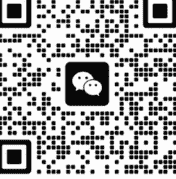
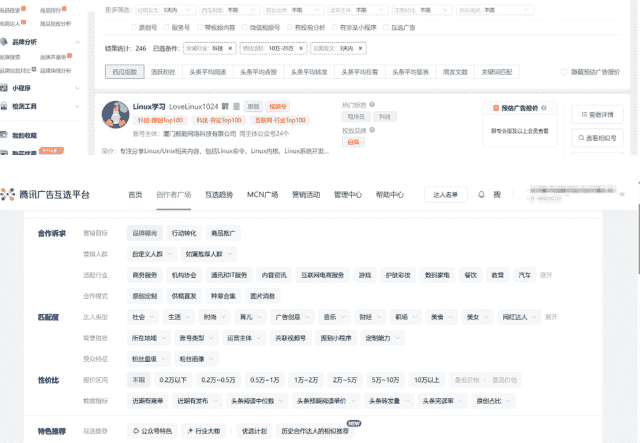
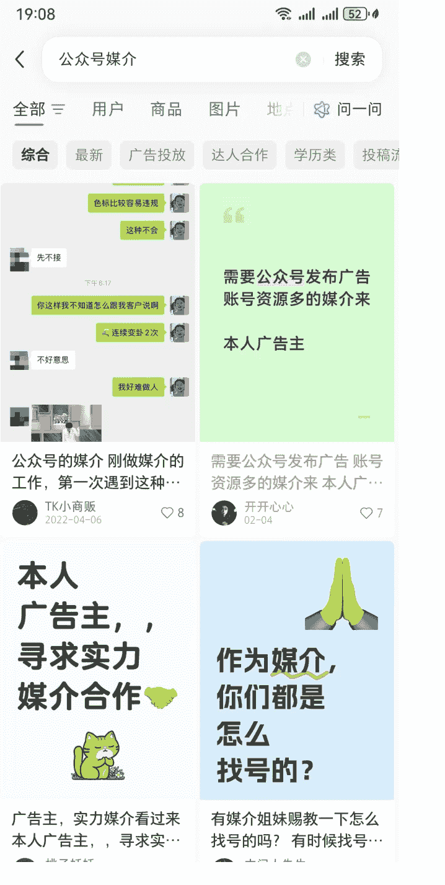
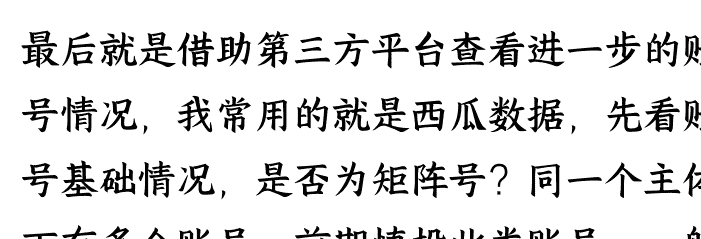
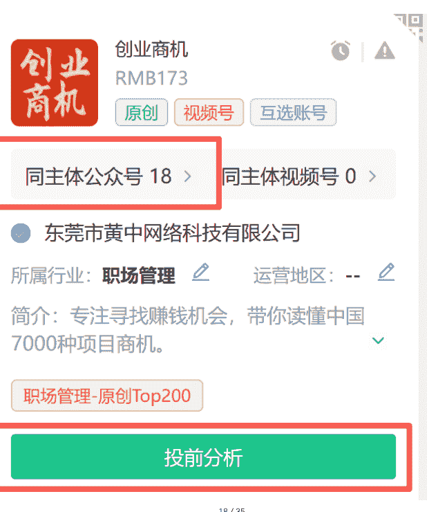
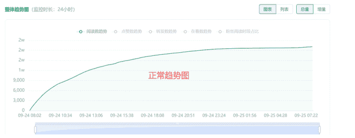
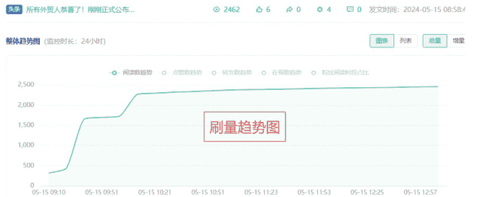
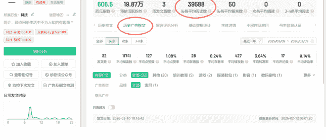

# 春节7天撬动42万，单号ROI冲到25：AI产品做👸号派单的实操拆解

## 260320 副业 SC 精华

👸号懒人搜索，懒人专属群独享

懒人🛰️:lazyhelper1

🛰️:lazyhelper1

我是胜前 Vic，一直在靠这里的经验在赚钱。

这次能拿到项目，是源于赚钱联合办公每周的分享会。有位同行随口提到，他用自有👸号矩阵卖某款工具，自然流每天稳进上百人，月利润已经到六位数了。

回去后我去扒了下同类AI工具的投放，发现有一家产品打法很猛但投放体量并不大。我尝试谈贴牌，把流量沉淀到自己私域。因为第一桶金是淘客出身，我对留量有执念。贴牌没谈成，最后转成了帮对方做投放。

下文不聊技术，我也没懂。

只讲一个投放打法：不是信息流，而是更低门槛的👸号派单，直接找博主发广告。

我大概是1月入场的，前期全是试错。好在赶上春晚带起的AI热度，假期里开始密集开号。下面晒的春节7天真实数据，全是干的。

我会从五个角度复盘这套思路：

- ①底层逻辑：AI产品为什么在👸号能拿到信用溢价和价格洼地
- ②选号方法：怎么做快速判断一个号值不值
- ③落地SOP：投放前后全链路怎么走
- ④避坑点：花真金白银换来的教训
- ⑤适配人群：什么产品能做，谁更合适做

☆□能拿走什么

- ①一手实操经历
- ②跨赛道套利的思考方式
- ③一套可复用的派单SOP：如果你有货要增量，或想做CPS代理，这套流程能帮你省下几万学费

👸号投放无论走官方互选还是找号主商务聊，数据都不透明，基本都是闷声发财。我刚上手时去星球搜了下，相关分享很少，希望这篇能补上空白。

ps:该产品还在投放中，不方便公开名字。有伙伴猜到了也看出来了，还请别在评论区提产品名，谢谢理解。

先丢一组数据，春节7天，投了43个号，投放花费121950，产出426330，客单价298，最高单号ROI25，整体ROI3.5，1.5可回本，低于1.5标绿。以前做淘客信息流，见过这么漂亮的投入产出比真的很少。

| 账号昵称 | 粉丝量 | 广告费 | 销售额 | ROI |

| :--- | :--- | :--- | :--- | :--- |

| 财* | **25 万** | 1300 | 297 | 0.23 |

| 弥* | 2.1 万 | 400 | 887 | 2.22 |

| h* | 5.9 万 | 1000 | 1480 | 1.48 |

| 深* | 16.92 万 | 2500 | 3540 | 1.42 |

| 数* | 15 万 | 500 | 2662 | 5.32 |

| H* | 3.9 万 | 300 | 887 | 2.96 |

| 漫* | 6.7 万 | 700 | 2655 | 3.79 |

| * | 37 万 | 3800 | 13275 | 3.49 |

| b* | 3.9 万 | 900 | 1475 | 1.64 |

| 写* | 52 万 | 9400 | 17130 | 1.82 |

| 数* | 23 万 | 2800 | 7092 | 2.53 |

| Q* | 2.4 万 | 2800 | 7092 | 2.53 |

| 只* | 1.8 万 | 2800 | 7092 | 2.53 |

| 黑* | 1.8 万 | 2800 | 7092 | 2.53 |

| 硕* | 33 万 | 3800 | 28666.00 | 7.54 |

| 信* | 14 万 | 3800 | 28666.00 | 7.54 |

| 小* | 7552 | 3800 | 28666.00 | 7.54 |

| 材* | 6.2 万 | 3800 | 28666.00 | 7.54 |

| C* | 26 万 | 6400 | 18917.00 | 2.96 |

| 乔* | 4.3 万 | 6400 | 18917.00 | 2.96 |

| 地* | 39 万 | 53750 | 176393 | 3.28 |

| 唐* | 622 万 | 53750 | 176393 | 3.28 |

| 留* | 9.6 万 | 53750 | 176393 | 3.28 |

| 留* | 9.6 万 | 53750 | 176393 | 3.28 |

| C* | 5.4 万 | 53750 | 176393 | 3.28 |

| O* | 5.6 万 | 53750 | 176393 | 3.28 |

| 晓* | 7.5 万 | 53750 | 176393 | 3.28 |

| 中* | 5 万 | 700 | 4142 | 5.92 |

| 植* | 6.6 万 | 2300 | 7683 | 3.34 |

| 渗* | 2.4 万 | 800 | 1478 | 1.85 |

| B* | 7.6 万 | 1500 | 37585 | 25.06 |

| i* | 23 万 | 3000 | 5145 | 1.72 |

| 月* | 2.2 万 | 600 | 7519 | 12.53 |

| R* | 2.2 万 | 1000 | 5538 | 5.54 |

| 九* | 1.5 万 | 600 | 4349 | 7.25 |

| 曹* | 3.5 万 | 3000 | 5144 | 1.71 |

| 期* | 4.6 万 | 1000 | 396 | 0.40 |

| 寒* | 16 万 | 3500 | 9099 | 2.60 |

| 算* | 22 万 | 1500 | 791 | 0.53 |

| 飞* | 48 万 | 9000 | 39561 | 4.40 |

| 模* | 12.5 万 | 800 | 6726 | 8.41 |

| 常* | 4.6 万 | 1000 | 9491 | 9.49 |

| T* | 6.7 万 | 800 | 2373 | 2.97 |

| 财* | 8w | 3300 | 3954 | 1.20 |

## 第一章：👸号做AI套利的底层逻辑

为什么放弃信息流，选择更老派的👸号派单？

因为买的不仅是曝光量，更是博主多年积累的IP信任。

实操下来，👸号流量有两大特质：

### ① 信任溢价：长期输出建立的IP背书，给产品加分

抖音📕是算法推流，刷完即走。👸号是深度阅读，粉丝对主理人忠诚度高。哪怕文章明显是广告，粉丝也会想：我长期看他写的东西，感觉挺靠谱，他推荐的应该能用。

AI工具多靠订阅变现，国内用户对线上付费习惯差，对这种无实物高成本感的产品，决策极度依赖信任。一个偶然刷到的信息流很难完成转化，但一个👸号作者用多年长文建立的师生式或朋友式关系，在推荐时等于把一部分IP信用抵押给产品，能大幅降低陌生感和对订阅制的抵触。

### ② 价格洼地：跨赛道认知差，AI在👸号还是新品类

AI是当下大热点，垂类博主报价已经很高，头部AI号头条2-12万很常见。但非垂类的账号并不懂AI变现，比如170万粉的周国平老师，3天保留的AI广告不到2万，用户精准度却很高。

和很多号主聊下来，法务、科研、工业设计、情感等非AI垂类主理人，并不清楚自家高知中产粉丝对AI工具的付费潜力，也没意识到这是精准人群。相比课程、金融、电商、公益等老牌投放品类，AI产品的交付风险低，号主接受度更高。

而👸号的老品类如理财课、保险，阅读单价、万粉价、进线成本早已透明，卷到极致。AI目前没形成参照价，定价洼地还能挤利润。比如表格里B*号，只花1500广告费，跑出37585销售额，ROI25，在传统红海类目里几乎看不到。

## 第二章：如何挑出优质账号？

选号本质是选人，先搞清产品用户画像，谁会买？账号粉丝结构是否匹配，男女比、年龄段、城市分布。可通过腾讯广告互选平台查，或直接让号主给数据。

### 数据统计

#### 全部发表 | 单篇发表 | 用户统计

用户概况 用户趋势 用户画像

数据类型 性别分布 年龄分布 地域分布

男 82.59%

女 16.95%

未知 0.46%

##### · 数据详情 ·

| 性别 | 用户数 | 占比 |

|---|---|---|

| 男 | 329.1 万 | 82.59% |

| 女 | 675,242 | 16.95% |

| 未知 | 18,287 | 0.46% |

#### 用户统计

用户概况 用户趋势 用户画像

总人数 3,984,222 人

- 26 岁到 35 岁 47.39%

- 36 岁到 45 岁 27.85%

- 18 岁到 25 岁 14.87%

- 46 岁到 60 岁 8.98%

- 60 岁以上 0.7%

- 18 岁以下 0.17%

- 未知 0.05%

##### · 数据详情 ·

| 年龄 | 用户数 | 占比 |

|---|---|---|

| 18 岁以下 | 6,650 | 0.17% |

| 18 岁到 25 岁 | 592,489 | 14.87% |

| 26 岁到 35 岁 | 188.8 万 | 47.39% |

| 36 岁到 45 岁 | 111.0 万 | 27.85% |

| 46 岁到 60 岁 | 357,680 | 8.98% |

| 60 岁以上 | 27,805 | 0.7% |

#### 全部发表 | 单篇发表 | 用户统计

用户概况 用户趋势 用户画像

数据类型 性别分布 年龄分布 地域分布

| 城市 | 用户数 | 占比 |

| :--- | :--- | :--- |

| 上海 | 160,670 | 4.03% |

| 北京 | 145,358 | 3.65% |

| 深圳 | 143,036 | 3.59% |

| 广州 | 127,961 | 3.21% |

| 成都 | 112,020 | 2.81% |

| 苏州 | 103,052 | 2.59% |

| 重庆 | 95,432 | 2.4% |

| 杭州 | 93,445 | 2.35% |

| 武汉 | 84,826 | 2.13% |

| 东莞 | 78,421 | 1.97% |

| 西安 | 75,428 | 1.89% |

| 佛山 | 64,643 | 1.62% |

| 南京 | 62,091 | 1.56% |

| 郑州 | 59,604 | 1.5% |

| 天津 | 58,680 | 1.47% |

我更倾向两类号：一是IP属性强的个人IP、名人、品牌，如龙哥盟。通过简介、写作风格、评论区互动能看出号召力，信任感强，转化更好。

二是流量池里的垂直小号。粉丝可能1-2万，但阅读稳定且经常爆，这说明在🛰️推荐池里有分发，广告单价低，常常有开盲盒惊喜。

选号时最看重粉丝基数、调性匹配、点赞转发留言互动，转化路径通顺后再加码大号。小号试错交学费后，会发现大号坑更少、ROI更稳。

## 第三章：实操步骤

## （1）准备投放素材

文案技巧不展开，核心是标题抓眼球、图文突出使用场景、价格做时限优惠、开头用号主口吻推荐、结尾做互动抽奖。

标题是打开率的根，广告标题与正文相关性可以弱一些，为点击而生。别自己瞎想，直接抄同行爆款，贴合人群即可。长期用同一标题容易被系统和同行盯上，也会审美疲劳。持续收集好标题，用AI不断迭代，并蹭热点，如近期OpenClaw火热，可直接借势。

开头一定要用号主口吻，哪怕号主介意，用“今天给大家分享一款XX神器”这类委婉表达也行，既降低广告感，也借信任背书。

结尾互动一是为了触发平台推荐，二是评论区可配合水军补充，推一把转化。

## ( 2 ) 寻找可投放的账号

找号两条路：

一是自己在西瓜数据、新榜、极致了等平台按关键词或分类筛，或直接在👸号搜相关内容找号。一般接广告的号会在底部导航、文末留商务方式，或设置“商务合作”自动回复。找不到就私信留言描述需求。

二是找媒介推。媒介账号多、效率高，部分价格比号主还低。缺点是带中介费，大多会加价，新手易踩坑。

没资源可以在📕找多年还在做的媒介业务员，手上资源更足。需求大也可以BOSS直聘找本地媒介公司直接谈。

前期不建议用媒介。中介利益与投放方有时冲突，会混进劣质号。需要先建立自己的号感，能预判转化后再放量。跑通后可找靠谱媒介签合同长期合作，要求只推符合要求的号，审号后谈价，要敢砍价。

### (3) 审号

审号就是判断值不值得投。

先看号皮：

**原创度**：警惕内容多为转载的号，阅读高但水分大，不建议首投。

**近期平均阅读**：判断是否被限流，阅读骤降的号可记录，解封后再投。

**互动数据**：转发和评论最能体现价值和粘性。

**阅读与点赞评论的比例**：阅读高但点赞评论异常低或长期不变，可能是刷量。

再让号主或媒介提供后台粉丝数、用户画像、爆款阅读来源分布。粉丝数用于报价参考，注意截图可能P图，需去极致了或腾讯互选核实。用户画像判断匹配度。阅读来源看👸号消息占比，比如原文26万阅读，👸号消息占23.7%，可调动粉丝约6.1万，也是出价依据。

在正式敲定投放前，我会先做一轮账号尽调。习惯性打开西瓜数据，把账号的基本面逐项拆开看：头号判断它是不是矩阵批量起的号——同一个主体底下如果养着好几家👸号，大概率是流水线做号，水分会比较高，前期宁可少投。

### 看走势图，先筛出刷量嫌疑

健康账号的阅读曲线通常是整体平稳抬升，发文后两三个小时内会被铁粉的即时打开拉出一道陡坡，随后增速放缓，曲线趋于平滑并保持稳定。若是凌晨发文，零点后会出现短暂的平缓，次日上午会有一点小回弹。右上角增量入口能看到夜间表现的具体细节。

异常信号比较明显：阅读在数分钟内近乎垂直拉升然后骤停变平线、在已经趋稳后无故断崖式暴涨、非高峰时段尤其是夜间出现脉冲式激增，这些形态都高度指向作假。

账号健康度确认后，再评估商业价值：看头条均阅、翻看过往广告案例的阅读表现，有没有老客户二次下单。这些历史指标，会直接成为出价时的参考依据。

### 第四步：议价博弈

目前👸号常见的结算形式是 CPT 与 CPS。

**CPT**：买断价，双方约定曝光周期，可能是1天、3天、7天或永久保留，后续数据好坏不影响结算金额。

**CPS**：按实际转化结算，按成交额抽成。接受这种模式的号主很少；如果产品在👸号已跑通转化路径且需要扩量，可把媒介和投手发展成代理，用 CPS 与代理结算，实现快速放量。

实际操作中 CPT 仍是主流。号主和媒介会先给一个报价，部分账号同时接私单和腾讯互选，报价会是两套，平台价一般低于私单。能不能投，得结合自身产品毛利、投放经验综合判断。

一类头部账号为控风险只走腾讯广告互选，必须通过官方下单，对素材审核要求高，文案要规范脱敏，流程也繁琐。测试阶段建议走私单，验证跑通后需要放大再去注册互选、测试互选专用文案。

省钱的办法就是敢砍价。媒介报上来的号被我选中后，我会让对方再去找号主压价。先给自己定一个目标价：参考粉丝体量加近期头条均阅，算出心里价位，再找理由谈：粉丝基础偏弱、阅读波动大、本轮预算受限、效果好会持续复投等。

心理价位因人而异。IP属性强的优质号，号主通常不轻易让价，心态放成交、小幅砍即可；没有IP属性的号，可用两个粗尺度做参考：每万粉约100元、头条均阅×0.5。我的标准偏严，行业不同需自行校准。预算前紧后松，测试期把预算卡紧，能筛掉不少坑。

AI产品阅读单价仅作参考：

| 类型 | 阅读单价 | 逻辑 |

| :--- | :--- | :--- |

| 垂类账号 (必投账号) | 0.6-0.8 元 | 赛道与用户画像高度契合，经测试转化好，溢价也值得； |

| 职场/资源/副业类 | 0.4-0.6 元 | 非垂类但测试转化不错，可作为备选区间； |

| 泛生活/情感/娱乐/新闻资讯类 | 0.3-0.4 元 | 粉丝量大但不垂直，付费意愿需验证。 |

压缩成本的小技巧：别急着成交。对号主保持若即若离的节奏，很多靠广告变现的账号最怕空档期。你压价后对方当时不接受，淡季没单时可能主动来松口。我就遇到过1.5w的报价，因上家放鸽子，对方主动降到1.2w，最后1w成交。

### 第五步：预览确认 + 定时群发

价格和排期敲定后，就进入预览环节。我习惯发文前一天约好号主核对预览，留出调整空间。

预览就是把标题、封面、正文、营销物料整理给号主，由号主在后台生成预览链接转发回来核对。

核对重点：发文账号是否一致、排版是否正确、二维码能否正常扫码、购买路径是否通畅；发文设置要求关闭所有广告，留言需作者精选后再公开，防止负面留言影响转化。

确认无误后让对方做定时群发。发文时间以账号调性和产品为准，IP号通常有固定发文习惯，尽量尊重其粉丝的阅读生物钟。务必确认群发对象是“全部用户”，避免分组群发影响效果。

### 第六步：费用结算

对号主的结算节奏主要有三种：预览通过并定时后付款 > 发文前1小时付款 > 定时后付定金、发文后再付尾款（少数接受）。

对媒介的结算一般两种：签合同周结/月结 > 定时后付定金、发文3天后结尾款。

发文后仍需媒介和号主配合维护，所以不建议发文前付全款。对媒介的约束可参考：

- 1、正文、关键词或留言区出现未关闭广告，每条扣效力金额的20%。
- 2、发文后10-15分钟内需手动精选首批留言，后续2小时内分批放完优质留言，延迟扣尾款40%。
- 3、发文30分钟内未放留言，扣效力金额80%；2小时内仍未放，扣80%并追责发布价20%罚款。

| 发布价区间 | 对应效力金额 |

|---|---|

| < 500 | 100 |

| 500 ≤ 价格 < 1000 | 200 |

| 1000 ≤ 价格 < 2000 | 300 |

| 2000 ≤ 价格 < 3000 | 400 |

| 3000 ≤ 价格 < 5000 | 500 |

| 5000 ≤ 价格 < 8000 | 800 |

| 8000 ≤ 价格 < 10000 | 1000 |

| 10000 ≤ 价格 < 30000 | 3000 |

| 30000 ≤ 价格 < 100000 | 8000 |

| 100000 ≤ 价格 | 20000 |

对接号主或媒介，尽量走对公转账，税务更合规，也能过滤掉部分不靠谱方。

### 第七步：发文后的维护

账号多了必须做排期表，到点要盯盘：检查二维码/链接是否可用，适时安排正面留言带动氛围。经媒介投放的，要求对方把发文后的页面转发给你，便于监测和复盘。

### 第八步：投后复盘

发文隔天就要统计前一天各账号的阅读、进线、转化，沉淀成表格，形成投放数据资产，帮助建立号感，指导后续投放。

AI产品目前主要靠订阅费，复投间隔建议一个月以上；其他产品可按需调整，数据好的号可以乘胜追击，如工作日表现好周末再投，或上午好隔段时间选晚上投。若赛道竞争激烈，复投间隔要适当缩短，防止被竞品截胡。

## 第四章：经验与教训

### 原则一：付款越晚，话语权越大

不考验人性。号主未发文不打款，媒介能压就压，避免打款后不配合后续工作。

这里放三张图，希望用不上：

- 👸号懒人搜索，懒人专属群分享
  - 媒介
  - 取消
  - 人人脉品牌方交流 3 群 (374)
    包含：辰 (古星 - 晓晨 - 媒介)
  - MCN 公关媒介推广开心群④
  - U 客直谈 | 品牌媒介公关合作群 9
    包含：皮蛋瘦肉粥 (媒介 kk)
  - 美博会化妆品品牌交流群 (231)
    包含：皮蛋瘦肉粥 (媒介 kk)
  - 索离离商务精英交流提升群 (286)
    包含：胡一万 (媒介胡一万)
  - 快乐的品牌 (346)
    包含：盈美媒介美子
  - 公关资源 5 群 (217)
    包含：盈美媒介美子
  - 给力品牌商家群 (342)
    包含：晃晃🍒 (冲榜版媒介)
  - 🛰️自媒体交流 (禁广)(99)
    包含：美颂科技 - 媒介
  - MCN 机构接单群三号 (197)
    包含：过客 (媒介)
  - U 客直谈 | 品牌媒介公关合作群 7
  - 品牌方交流群 (343)
    包含：上海灵智媒介
  - pr 交流群 (禁广)(498)
    包含：学习努力向前进 (众媒汇 媒介 天天)
  - 品牌.公关.Pr 交流群禁广 (387)
    包含：朱朱女孩 (青瓜传媒 - 二代 - 媒介)
  - MCN 禁广②群 (464)
    包含：安愉~(AE 媒介 阿青 18620504747)
  - 威武霸气的 MCN 们 (499)
    包含：ZJK(JSC-品牌媒介-ZJK)
  - 某不知名 MCN 交流群 (禁广)(294)
    包含：葛馨 (媒介和商务)
  - 国际品牌 pr 群 (298)
    包含：不凡 (媒介晓晓)
  - 公关避雷群 (禁广)(243)
    包含：不凡 (媒介晓晓)
  - pr 小群 (废话无广版)(471)
    包含：Alex(媒介-)
  - 优质诚信👸号资源交流 (478)
    包含：阿狸-(媒介~阿狸)
  - 禁广&甲方乙方摸鱼聊嗨 (429)
    包含：...張張張張張哪吒 (酸碱度媒介哪吒)
  - MCN 相互勾兑群 (禁广)(375)
    包含：不凡 (媒介晓晓)
  - 润花 - 品牌公关交流群 (禁广)(179)
    包含：超超 (原数护肤媒介超超)

产生纠纷时，可把截图发给对方并表示要公开曝光并举报账号，通常有威慑力。

### 原则二：坚持数据复盘

投多了会产生两种心态：自认号感无敌，或过度怀疑数据。只有持续沉淀和复盘，才能提升盈利能力，培养投手。

### 原则三：选账号就是选人群

别盲信历史广告数据，你看不到后端转化。AI在👸号投放属新品类，广告多不等于适合你的产品。先明确用户画像，文案和选号都围绕画像展开。

### 原则四：评论区是转化的“第二战场”

评论区能强化信任，发文后必须维护。AI类产品用户疑虑多，可提前预埋引导评论，并积极回应真实反馈，让号主把相关留言同步给你，你提供回复话术。

### 原则五：素材是撬动流量的最大杠杆

量上来后要备多套素材，防止风控，也适配不同账号气质。好内容自带筛选力，平庸稿投资再准的号也浪费。每个转化点都要反复从用户角度推演。

## 第五章：这个看似捡钱的机会适不适合你

方法论通用，也适合多品类。虽然7天42万的战绩让人兴奋，但不是一步到位。入局前需冷静判断。

### 适合人群

- 产品成熟已验证需求，需增量的操盘手
- 有淘客、外卖红包或CPS经验的流量套利者

CPS本质是帮卖，不怕没产品，可代理正在投放的品。ps：圈友@玉伯老师的“YouMind”很适配👸号，广告物料可用YouMind生成，是强说服点。

### 不适合人群

- 风险厌恶者：前期需测试，ROI可能低至0.23，文章被删、号主变卦、风控拦截会很疲惫
- 短期割韭菜者：产品问题会被媒介和号主追责，圈内口碑传播快，会被拉黑

90%的人卡在第一步。壁垒不是工具，而是行动力和信息差。想看最新变现玩法，可关注【懒人专属群】，沉淀1000+跑通的实战案例。

### ⚠️ 查阅圈子最新搞钱实操记录：
https://hk57gvlx7u.feishu.cn/docx/H0kRdZbSbolBR0xkaXtcuVE0nTg

认同价值、准备下场，扫码加🛰️备注【实操上车】

🛰️：lazyhelper1