# 📕虚拟资料副业，我每天只花1小时，却把单日营收做到了1000+，出单率85%的秘密全公开
作者：龙哥

## 260323 副业 SC 精华

先自我介绍下，我是龙哥，短视频流量操盘四年。以前大多在潜水状态，看着各路圈友分享干货。去年底辞了职，空窗期没项目可做，索性拿📕虚拟资料练手，从零开始。头一个月流水从0爬到100、200，现在每天投1小时做产品和笔记，日常能有300多，巅峰那天破了千。

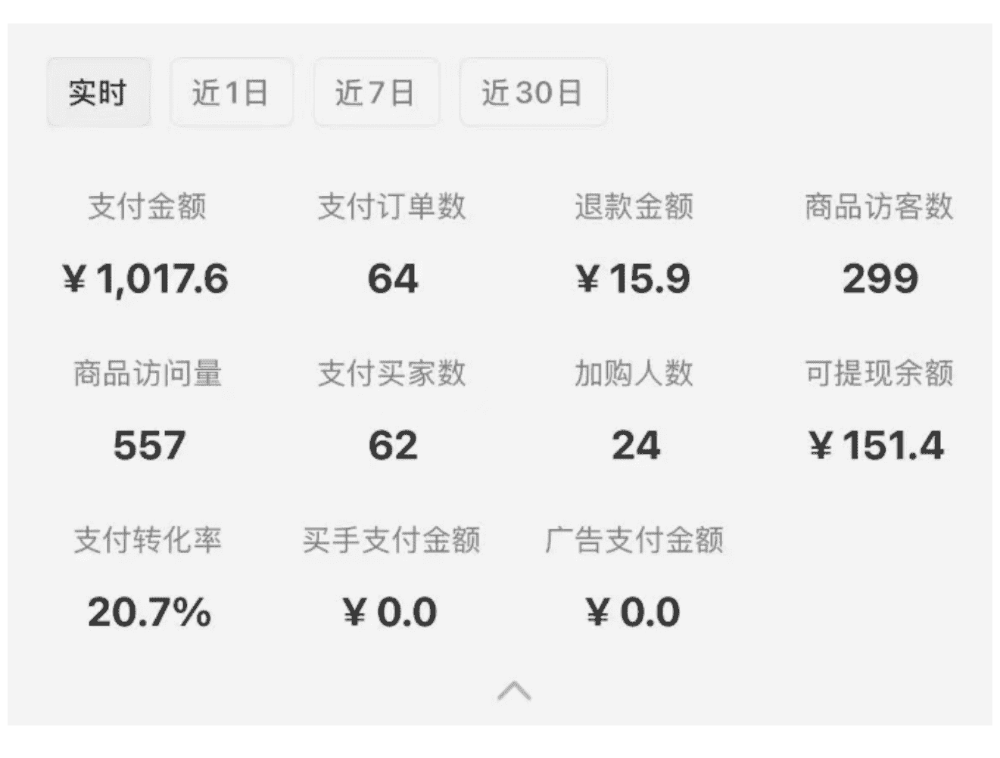

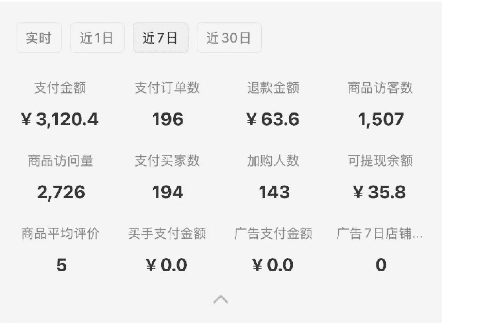

今天的内容分成三个板块：

- 第一块：怎么锁定能卖爆的品
- 第二块：怎么把品包装成高转化形态
- 第三块：跌坑后攒下的一些体感

## 一、怎么锁定能卖爆的品

聊了一圈圈友，发现蛮多人还在用杂货铺打法——品挂了一堆，转化却惨淡。我的成交率能稳定在85%，核心不在铺货，而在挑品。这是最近十天后台的真实数据，上架时间和成交都列出来了，今天20号，昨晚才挂的品今天照样开了单。

| 近 30 天销量 | 商品笔记 | 渠道品 | 商品状态 | 上架时间 |

| :--- | :--- | :--- | :--- | :--- |

| 0 | 已发布：0 设置精选笔记 | 0 | ● 售卖中 | 2026-03-19 21:57:51 |

| 1 | 已发布：0 设置精选笔记 | 0 | ● 售卖中 | 2026-03-19 10:37:25 |

| 2 | 已发布：0 设置精选笔记 | 0 | ● 售卖中 | 2026-03-18 23:59:35 |

| 0 | 已发布：0 设置精选笔记 | 0 | ● 售卖中 | 2026-03-18 16:57:24 |

| 12 | 已发布：0 设置精选笔记 | 0 | ● 售卖中 | 2026-03-17 13:32:07 |

| 4 | 已发布：0 设置精选笔记 | 0 | ● 售卖中 | 2026-03-16 21:37:36 |

| 4 | 已发布：0 设置精选笔记 | 0 | ● 售卖中 | 2026-03-16 19:29:04 |

| 8 | 已发布：0 设置精选笔记 | 0 | ● 售卖中 | 2026-03-13 20:30:56 |

| 10 | 已发布：0 设置精选笔记 | 0 | ● 售卖中 | 2026-03-13 19:47:27 |

| 15 | 已发布：0 设置精选笔记 | 0 | ● 售卖中 | 2026-03-12 23:06:44 |

| 4 | 已发布：0 设置精选笔记 | 0 | ● 售卖中 | 2026-03-12 22:31:48 |

| 0 | 已发布：0 设置精选笔记 | 0 | ● 售卖中 | 2026-03-12 22:28:11 |

| 9 | 已发布：0 设置精选笔记 | 0 | ● 售卖中 | 2026-03-12 16:11:28 |

| 52 | 已发布：0 设置精选笔记 | 0 | ● 售卖中 | 2026-03-11 21:26:13 |

| 4 | 已发布：0 设置精选笔记 | 0 | ● 售卖中 | 2026-03-11 12:01:38 |

| 4 | 已发布：0 设置精选笔记 | 0 | ● 售卖中 | 2026-03-10 23:29:29 |

| 13 | 已发布：0 设置精选笔记 | 0 | ● 售卖中 | 2026-03-10 23:24:45 |

坦白讲，我过去是做流量起家的，选品方面完全是野路子，下面讲的全是拿真金白银试出来的。

挑品在📕虚拟资料里权重最高。品选对了，笔记做糙点照样有人买；品不行，笔记雕出花也难出单。前期一定要多刷多逛，把品类感觉养出来。

开搞之前，我连续一周每天至少抽1小时刷📕虚拟资料，全用碎片时间。别只盯那几个热门词，能挖的词远比你想得多。刷多了你会发现很多认知以外的玩法。下面是我常用的搜索词库：

知识库、模版、计划、笔记、攻略、SOP、指南、工具、评估、咨询、诊断、测试、问卷、PDF、PPT、逐字稿、飞书、多维表格、急救包、手把手、效果、话术、批注、指导

搜完经常能撞见一些神奇产品，像下面这种：

### 审计师博主的独家精华装修索引笔记

2 个月啃完上百份资料 + 装修书

提炼成纯业主视角的

实操工具手册

内行人万字避坑笔记 + 各阶段必做项和参考文档 + 全套装修资料库，相当于... 请个审计师帮你做一遍功课

送 9.9 元的全套装修资料 不满意直接退款

已售 5553

### 审计师博主独家精华装修索引笔记资料 (任何疑问请通过客服戳我)

- 7 天无理由

- 100+ 人好评

- 900+ 人加购

- 200+ 人收藏

承诺 24 小时内发货，晚发必赔 | 上海 包邮

7 天无理由退货 | 晚发必赔

¥19.9

已售 609

判断大小脸，脸歪的原因，以及改善。

200+ 人加购

100+ 人收藏

承诺 48 小时内发货，晚发必赔 辽宁沈阳 包邮

晚发必赔 不支持无理由退换

商品评价 100+

品质 4.7

娜美米

我的问题比较复杂，但老师完全不会因为套餐价格便宜而随便应付。反而很负责任的听我描述后，看完片子才给出诊断，在两...

贾***方

客服小姐姐超级耐心细致，恢复锻炼中

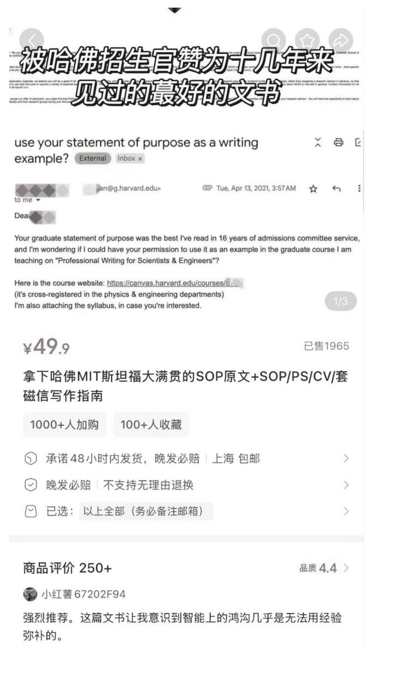

定方向这事，我一般看两个维度：干过这行，或者真心感兴趣。两者都占意味着你天然比外行更懂用户痛点。如果两个都没有，就找那种红利正盛、门槛友好的入口。

举个例子，你在装修行业做过运营，那装修和运营都能作为方向。但运营赛道在平台上已经杀成红海，没有特别硬的技能别硬挤，反而不如做装修内容，装修预算表这类资料一直卖得不错。

我自己老本行是求职方向，对求职者心态和卡点拿捏得比较准，所以直接切了求职资料。

求职这个大池子里还能分出职业规划、岗位信息汇总、简历优化、笔试真题、面试复盘，再往后走还有新人适应期、转正汇报、晋升答辩、职场沟通话术这些延伸方向。关键是看清自己的优势落在哪，以及用户真正肯为什么掏钱。

用求职举例，这里面还能切出更多细分：

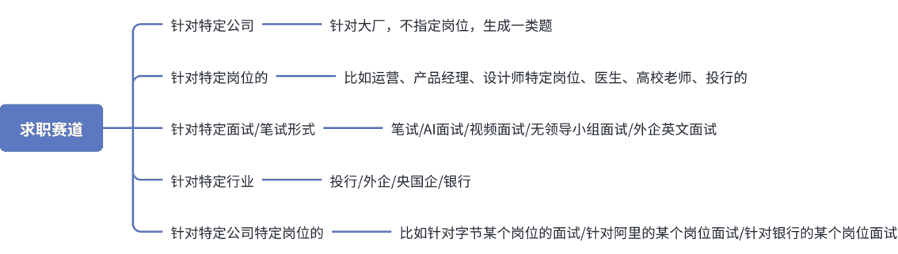

给新手一个忠告：别碰大而全，越垂直越好。

你在大厂待过，就可以只做那几家大厂的求职包，做深了还能引流私域搞1v1陪跑；有外企背景，就专心做外企英文面试资料，英语面是老大难，有痛点就有付费意愿；体制内混过，可以做对应的笔试面试和入职资料。

怎么判断一个品类对新手友不友好？最糙的办法就是去搜同类产品，看销量是压在几个头部大号手里，还是有不少新号也能跑出量。我还发现求职赛道里，有些号粉丝只有几百甚至几十，但销量能冲到几百上千，这说明新人确实还有肉吃。

大方向定了之后，判断需求别死盯已售数字——你压根不知道别人卖了多久，有没有掺水。我一般参考这几个维度：加购人数、近90天成交人数、账号粉丝量、店铺开了多久、最近上架时间，串起来看需求信号更准。

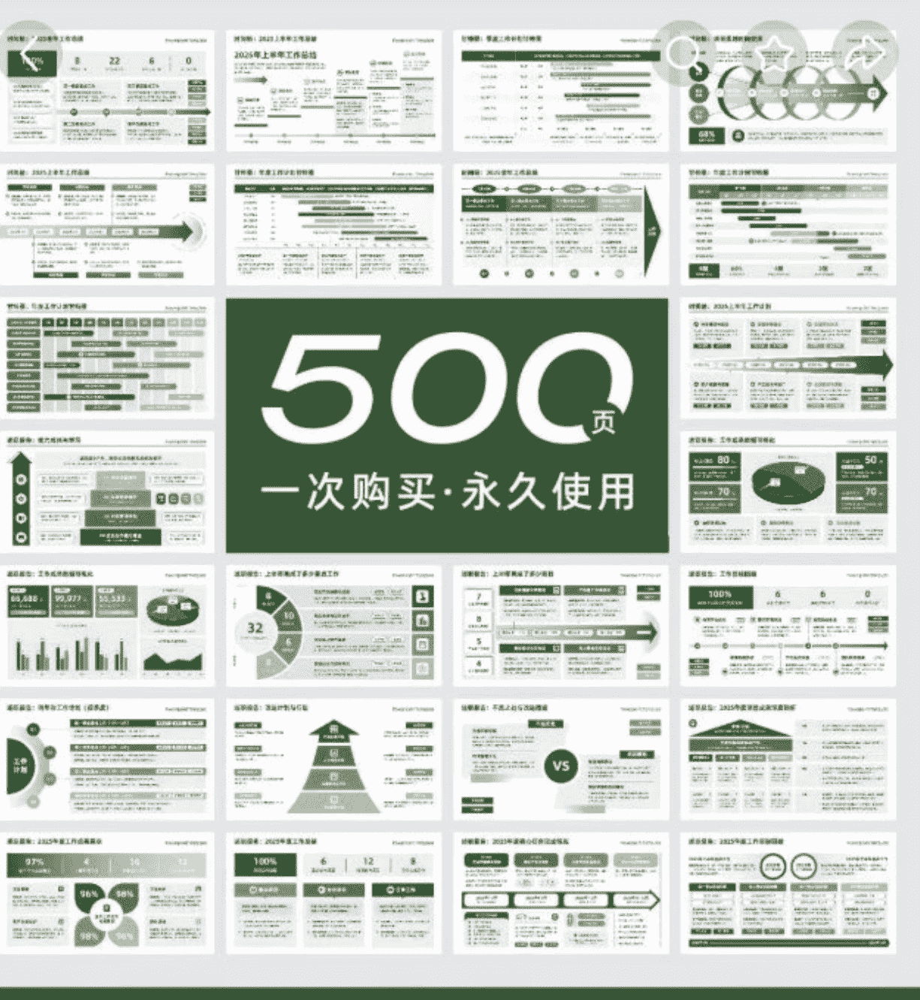

年终述职 | 年中述职 | 时间轴 | 甘特图 | 流程图 | 数据图 | 图文排版 | 逻辑图形 一杯咖啡的钱，拿下能永久使用的 PPT 素材库 1/10

¥59.9 到手价¥39.9 已售 1.2 万+

满 40 减 20

## 500 页 - 领导喜欢的工作汇报 PPT 模版 | 年终述职 | 时间轴 | 图文排版

好评 7000+ 人加购 3 个月内 2000+ 人购买 500+ 人收藏

付款后自动发货

不支持无理由退换

9/24

¥29.9

到手价 ¥19.9

已售 9106

商家券 满 20 减 10

## 公孙羽装修宝典 | 避坑指南 | 预算清单（100+ 文档，持续更新）

3000+ 人加购 3 个月内 1000+ 人购买

400+ 人收藏

付款后自动发货

不支持无理由退换

## 商品评价 3500+

品质 4.7

Allzeros

买过起码十份装修资料，公孙先生的是逻辑最合理，表类最全的。非常适合我这类想自己参与的人，装修是一种修行，公孙...

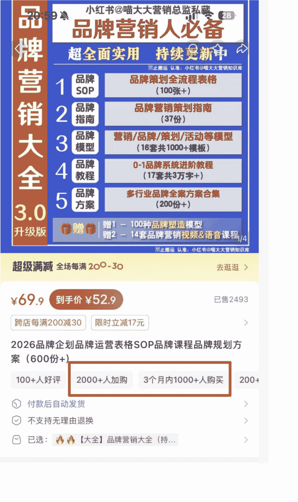

查店铺开了多久的办法：进对方店铺点极速退款，基础信息里就有开店天数。好比上面这个号已经开了1年287天，老号权重高，小白拿它当对标容易把自己劝退。

## 序言职场 PPT

4.7 已售 1.2 万

粉丝 2.5 万 昨天更新 10 篇笔记

极速退款 好评率 100% 客服平均 23 秒回复

- 综合 销量 新品 价格

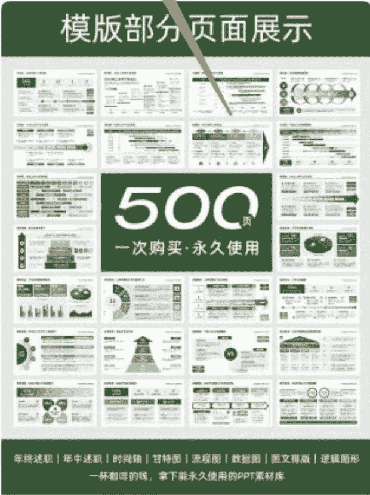

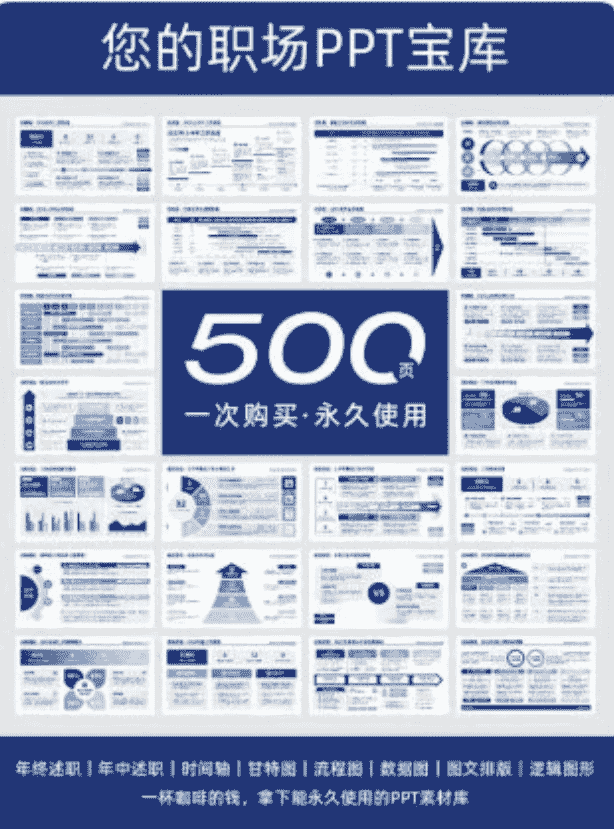

年终述职 | 年中述职 | 时间轴 | 甘特图 | 流程图 | 数据图 | 图文排版 | 逻辑图形

一杯咖啡的钱，拿下能永久使用的 PPT 素材库

年终述职 | 年中述职 | 时间轴 | 甘特图 | 流程图 | 数据图 | 图文排版 | 逻辑图形

一杯咖啡的钱，拿下能永久使用的 PPT 素材库

当月热销第 2 名 满 40 减 20

500 页 - 领导喜欢的工作汇报

¥39.9 已售 1.2 万+

当月热销第 1 名 满 40 减 20

500 页 - 高级感工作汇报 PPT

¥39.9 已售 387

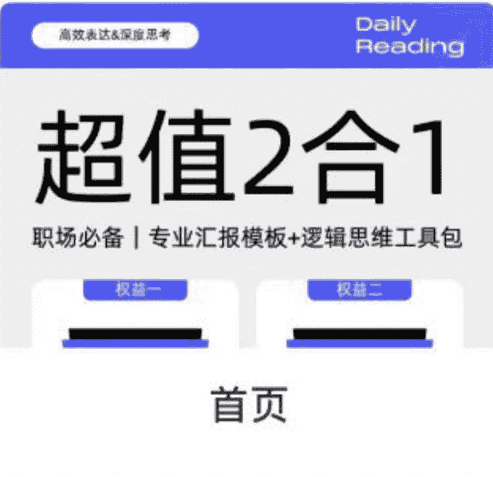

首页

上新

12/24

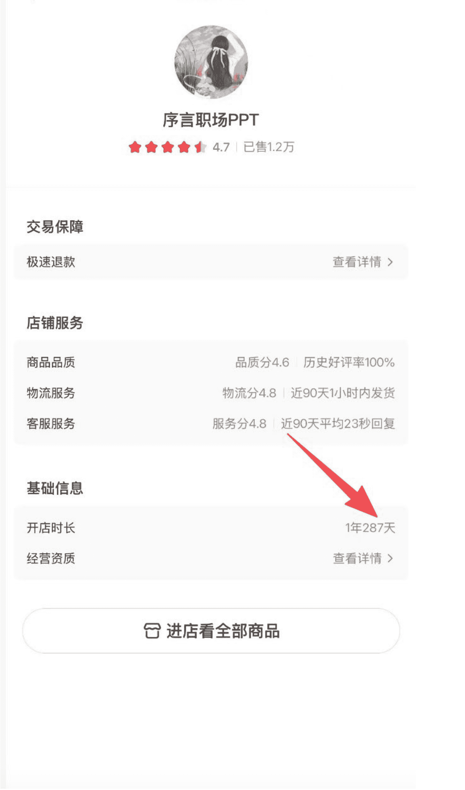

我给对标的门槛是：粉丝低于1000，开店时间在3个月以内。也可以直接盯对标账号近期上架的品，看什么时候挂的、几天出了多少单。

求职这个赛道我观察下来，有做1V1私教的、有做社群陪跑的、有纯卖资料的，客单价几乎每次递减一个量级，这说明愿意为求职花钱的人是真的多，几百块培训都有人买单，几十块资料更不用说了。

### 对标账号怎么挑、品怎么跟：

- 第一类：跟我一样做求职资料的同行。我会拆两块看：内容上，每天发几条笔记、数据怎么样；产品上，每天上几个新品、新品卖得动不。尤其是那种一天上新不超过3个但能出2单的号，说明人家选品是有一套的，不是广撒网。店铺里能直接看到当月销量第一和加购第一的品，重点关注。

如果一个号发了10条笔记，有的数据好有的数据差，但一单没出，这个品就得打个问号——当然也可能只是商品本身不够勾人，可以再拿到平台上二次验证。

- 第二类：铺量型选手。一天上5个甚至10个品，每品只配1到3条笔记。这种号的思路是帮你试错，你只需要盯住他跑出单的品，再去平台上验证需求真假。铺量里还有一种变体：单品但一天更5条笔记以上，这时候要看内容质量，以及你能否复制。

- 第三类：高客单价玩家。做1v1私教或小班的，这类人对求职信息的敏感度和完整度通常更高，毕竟贵价的交付逼着他们持续深耕。关注他们最近笔记里数据好的那些，反推选品方向，同时他们的内容也可以拿来当对标素材。

### 有对标之后怎么挑品：

前面那套对标法已经能筛掉一部分差品。但做到一个月后我发现，光抄对标不行——尤其是第一类那种懂运营的，人家出一个爆品，一堆人扑上来抢用户，很快就卷烂。更聪明的做法是自己去挖用户需求，抢在别人前面把品做出来，拿先发优势。

### 挖需求、验需求的几个实操招：

- 1.盯招聘信息流。可以在📕上直接买招聘信息表，9.9一份，每天更新哪些公司在招人。优先锁定招聘量大的公司——阿里、字节、腾讯这些。为什么看岗位数？一个岗位招1个人和招20个人，前期的简历池子完全不在一个量级。

下面这份是我买的表，📕上蛮多的，9.9就能拿到一手资源：

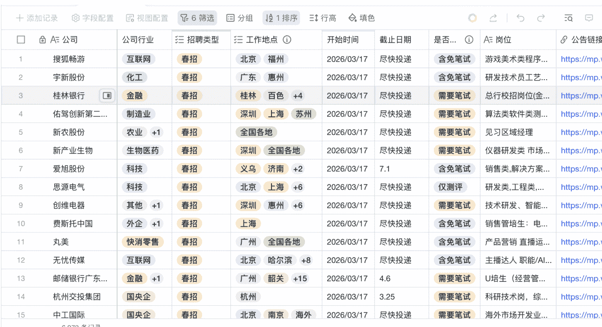

- 2.盯重点企业的招聘👸号。这些号一发招聘基本就意味着求职者要开始行动了。列一些我关注的：百事中国招聘、百威中国招聘、立白集团招聘、美的集团招聘、腾讯互娱招聘、腾讯音乐招聘、舒客电商招聘、苏宁易购招聘、贪玩游戏招聘、高途高端校园招聘、网易游戏互娱校园招聘、网易游戏雷火伏羲招聘、IBM 招聘、TCL 招聘、中建招聘、中海招聘、华帝招聘、天华招聘 TIANHUA、宝洁招聘、强生招聘、融创招聘、鼎信招聘、龙旗招聘、TP-LINK 招聘、亚马逊招聘、娃哈哈招聘、毕马威招聘、苏宁易购招聘、融创校园招聘、新希望地产招聘、欧莱雅校园招聘、碧桂园集团招聘、MINISO 名创优品招聘、信永中和集团招聘、先声药业集团招聘、美的置业集团招聘。

- 3.刷素人吐槽帖。比如你做的是大厂方向，隔三差五去搜这些大厂的面试经验帖——有人问流程、有人骂面试官、有人分享面经，这些信号说明该岗位开始批量面试了，此刻上架对应资料最容易出单。

- 4.蹲求职连载帖。有些素人博主会天天更新自己投了哪些公司，这等于免费给你播报需求。看到下面这种博主，就赶紧动手：

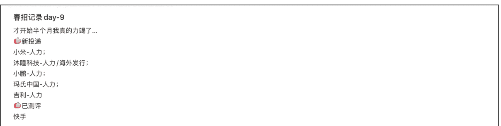

这套逻辑不止适用求职赛道。比如你做教师课件PPT，除了对标同行，更关键的是蹲老师群体当下正在焦虑什么问题，然后做成对应的课件方案。

## 二、怎么把品包装成高转化形态

品选对只是第一步。别人比你早进场，你卖一模一样的品没有任何优势，那你的差异点到底在哪？这才是决定一款品能不能持续跑量的核心。展开讲几个方向：

- 功能加码。别人只卖PPT，你额外给一张配套海报或者教案，同样的价格多一份价值。
- 时效抢跑。别人挂的是下半年旧版，你上的是今年最新上半年版；行业新政策刚出，大家都还在用旧资料，你已经出好新版本——这种节点最容易爆单。
- 功能做厚。比如说考试资料，别人基础版100页，你在100页之外再加一份速记版，1小时就能把核心知识点过一遍。

为什么要做速记版？这里得代入用户视角。买资料的人分两种：认真备考的和临时抱佛脚的。后者要的是“快”，快速记住重点、快速上考场。卖的是资料，但真正的卖点是“省心”“省时间”和“确定感”。

还有一个点：夜间下单的用户特别在意发货速度。你在页面标一句“3分钟发货”，同样的品用户就可能选你不选别人。

分享几个挖用户需求的小窍门：

- 把自己当用户去买同行的品，搜索页里那么多长相差不多的产品，哪个最抓你眼球，记下来。
- 盯后台私信，用户反复追问的问题就是需求缺口。
- 翻同行商品和笔记的评论区，看最高频的问题是什么，那就是优化的切入点。

## 三、跌坑后攒下的一些体感

强烈建议大家装个手机版千帆工作台。前面100条成交订单都会弹提醒，尤其是头几单，你就是个小白，完全不知道用户会出什么幺蛾子，及时回复比什么都重要。

我出第一单的时候，手忙脚乱。手机弹了订单提醒，但那个品其实还没完全打磨好——当时我就想先测测能不能卖出去。接了单之后跟用户商量，说两小时后发货，额外再送一份其他资料。结果半小时就发出了，用户人挺好，也没说啥。

所以送给你们一句话：“烂开始”也好过“不开始”。

如今再看自己的第一个产品，确实还有不少不足。但也正是这些不够成熟的地方，让我从用户反馈里看清了改进方向。

- 别被不完美困住：产品上线得匆忙，并不意味着做错了；在实践中成长，本来就是必经过程。
- 先行动起来：只有真正开始跑，才会发现问题，也才知道怎样调整。
- 持续迭代：完整的反馈闭环，往往是在一次次试错和修正中建立起来的。与其等到准备得十全十美，不如先出发，再不断优化。

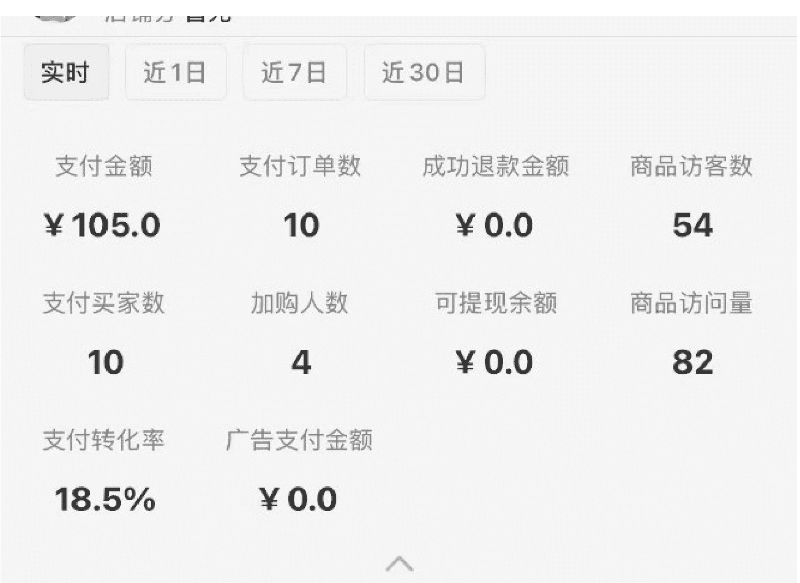

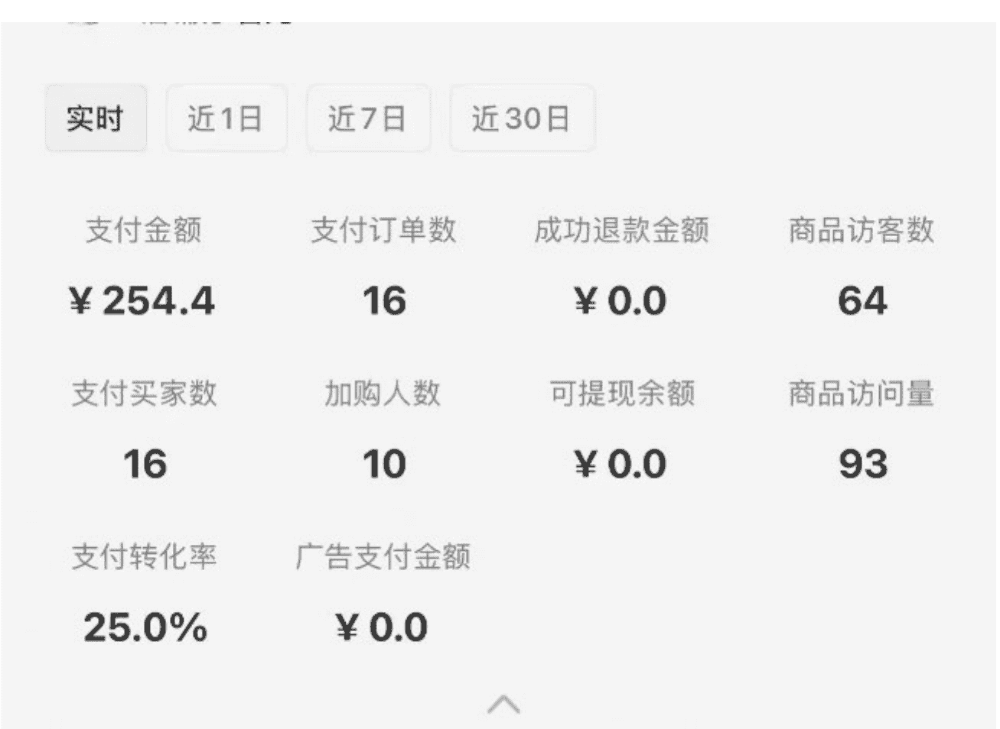

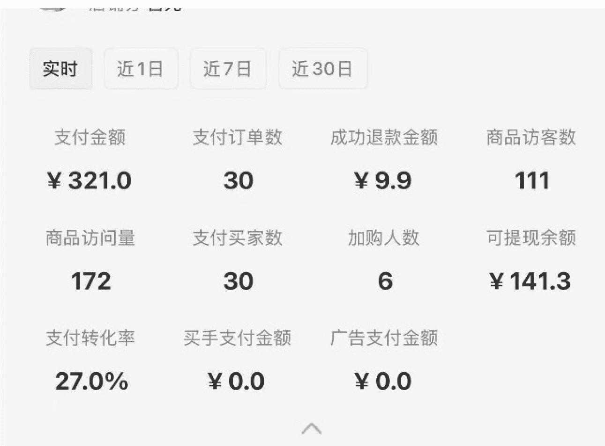

这是我单日收入突破 100、200、300 时留下的截图。既然我能做到，我相信大家也有机会做到。

最后简单介绍一下自己：我是柠檬，在求职赛道做流量操盘已经 4 年。后端有高客单合作需求的朋友，尤其是教育行业从业者和咨询师，欢迎来找我聊流量合作。

这是我第一次发帖，感谢你看到这里～

——————分割线——————

读完这份 SOP，可能会觉得已经掌握了方法；可真正开始操作时，很多人连第一步都迈不出去。

工具与教程并不是核心门槛，真正拉开差距的，是马上执行的行动力，以及圈层带来的信息差。

这里不讲空话，专注拆解商业闭环、提升 AI 使用效率。目前，系统内已沉淀 1000 多个跑通的套利实战案例。

- 查看圈子完整数字资产与加入门槛：

  https://lazyso.com/insider/

添加时请备注：【实操上车】，不闲聊。