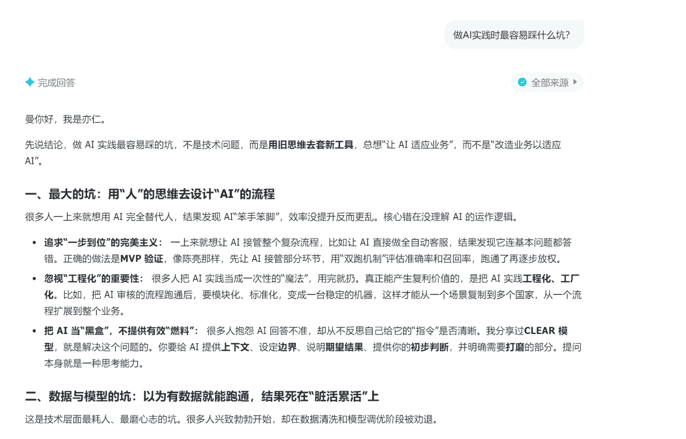
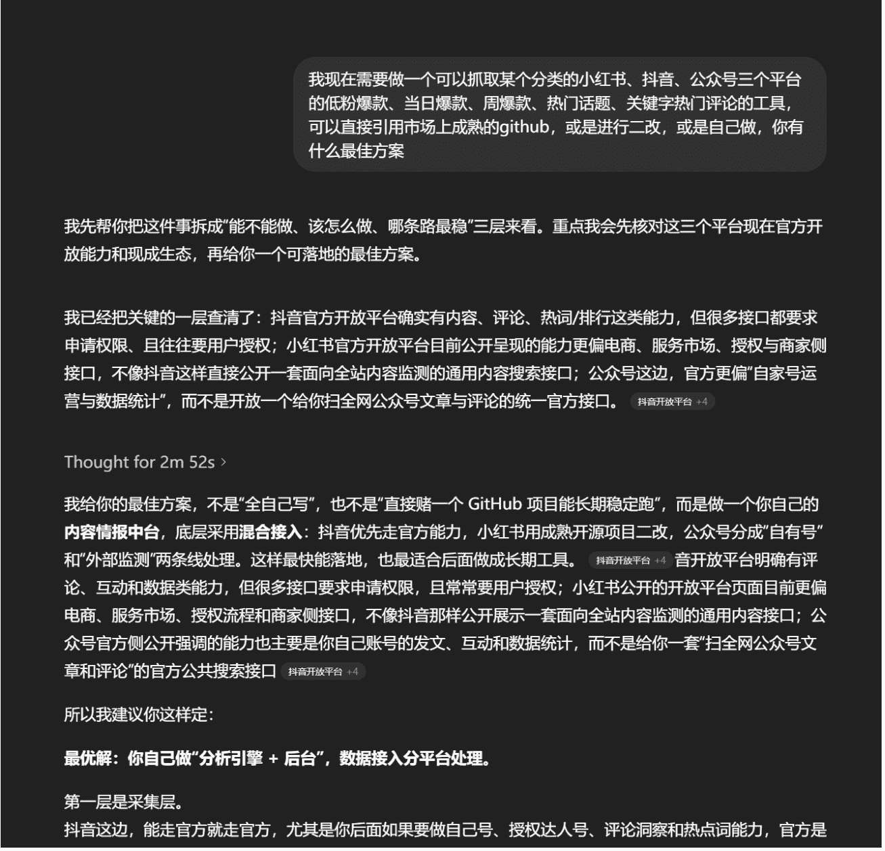
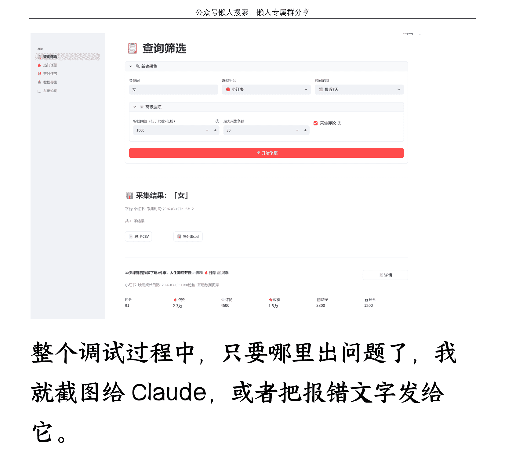
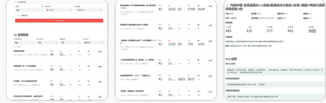

# AI 风口真来了，一个不懂写的门外汉半天撸出爆款抓取器

## 260324 · 副业 SC · 精华

公众号懒人搜索，懒人专属群独享

懒人微信：lazyhelper1


> 我一直没离开赚钱，不是多能吃苦，而是放不下这条机会线

2020 年我就入了赚钱，属于老面孔。

这些年里，我其实没真正怎么折腾它。一年能打开几次就算多的。可到了续费节点，我总会犹豫再三不肯走人。

于我而言，留在圈子里就等于兜里还揣着一本“变现工具箱”。当下可能用不上，但哪天心血来潮想干点事，它就在那儿，随时能掏出来用。

### 赚钱给我的唯一一次正反馈

唯一算得上落地的经历，是两年前跟的一期航海，做小红书虚拟资料。

那次航海后我建了一个小红书 AI 壁纸号，一直运营到现在。巅峰期挤进了壁纸头像类目的前五，月入几千到一万，对我来说已经够满足了。

今年初，小红书对 AI 内容开始大清洗。所有 AI 生成号都被波及，我的壁纸号被判违规，直接进小黑屋关了一个月。

那段时间打击不小。同期全网热议“养龙虾”和“AI 全自动”，一波又一波。

也就是在这个节点，我又一次认真翻开了赚钱。

一翻开，有种“哇，有新大陆”的冲击感。

### 被收拾之后，才看懂自动化在干嘛

这次回来，赚钱里的氛围完全变了。

里面不少人已经在用 AI 把流程跑起来。不会就问 AI，不懂就让 AI 解释。就连以前不敢想的“直接找龙哥聊”，现在也能用龙哥 AI 把思路打开：



龙哥那句话太扎心：技术这块最费人，最磨意志。

过去我不是没想过创业，只是卡在同一个死结：时间不够用、精力扛不住、又一堆陌生领域。光学习就已经很累，遇到不懂的硬啃，半天也啃不动。最后往往是还没做出任何成果，刚燃起来的那点劲就被掏空了。

久而久之，我干脆不碰变现的事，一想到过程就发怵。

现在有了 AI 工具，那些曾经吓退我的技术门槛、学习成本、试错压力，瞬间变得可接受。

简单说就是：用魔法打败魔法。

### 我没想着一步到位做全套

那时脑子里冒出一个念头：像我这种时间稀缺、精力有限的人，要是能把每个环节都尽量自动化，是不是就不会再被时间精力卡死？

顺着这个思路往下看，AI 自媒体运营自动化大致就是这么一条线：

抓取爆款 → 拆解爆款 → 分析爆款 → 二次创作 → 审核 → 发布。

于是我先盯第一步：把“抓取爆款”搞定。

圈里有人提过现成工具，但我完全不知道在哪下、怎么装、怎么跑。索性想，自己能不能做一个“抓爆款”的小 agent。

想法很朴素：如果第一步能成，后面环节理论上也能逐个攻破。

更离谱的是，我压根没有代码基础。就这种水平，看了几篇赚钱精华，居然就敢动手做 AI 工具。我自己一开始都不信。结果，半天就做出来了，而且能用。

## 实操拆解

第一步，先把脑子里一团乱的想法倒出来给 ChatGPT 梳理。

我的思路很模糊，很多东西说不清楚。但 ChatGPT 的好处是，你不用客气，表达再乱它也能一点点理顺，最后给你一个结构清晰的版本。

它不仅理解我要做小红书、抖音、公众号多平台爆款监控的需求，还帮我整理出一份好几千字的落地方案。它建议别自己从零写代码造轮子，而是基于现成的开源项目二改。



它当时甩来一段回复，特别长，估计有几千字。

前面很多我看不懂，但最后一句我记住了：它可以继续帮我把方案落成一份能直接丢给 Claude 或 Cursor 的完整 PRD、技术架构说明和 MVP 清单。

看到这句我就明白下一步怎么走了。

拿来做研究可以，但别把商业 MVP 架在上面。

最终结论很清晰：

做你自己的“跨平台爆款发现后台”，采集底座别自己造，用 MediaCrawler 二改负责小红书/抖音采集，再用抖音官方能力补位，wechatpy 处理自有公众号，外部公众号先做轻量监测用合规数据源。核心研发资源放在统一数据模型、爆款评分引擎、分类体系、评论洞察和可视化后台，而不是死磕各平台底层对抗。

我说：我是小白，请把上面的想法变成能直接交给 Claude 的执行指令。

它立刻给了我一个“可复制给 Claude”的版本，要求写得非常死，避免跑偏，目标是直接产出可运行的 MVP，而不是空谈方案。

Thought for 1m 26s

下面这段你可以原样复制给 Claude，尽量别改动。目标不是出方案，而是直接交付一个能跑的 MVP 项目。

```
你现在是一个“高级全栈架构师 + Python 自动化工程师 + 数据产品经理 + 本地部署助手”，请你直接为我生成

【项目名称】
内容爆款雷达（MVP）

【我的身份与要求】
我是技术小白，希望你直接帮我完成一个可以本地运行、尽量简单、尽量稳、尽量少折腾的工具。
请你默认我的目标是：
```

### 第二步，Claude 像个靠谱的技术搭子

我切到 Claude 窗口，把 ChatGPT 整理好的 MD 丢进去。对这种零基础的人来说，Claude 更像一个细心又靠谱的高级工程师。

你把需求给它，它不会空聊，直接开干。

我把 PRD、技术架构和 MVP 清单发过去后，它基本没废话，很快就把文件骨架搭出来了：

```
你现在是一个“高级全栈架构师 + Python 自动化工程师 + 数据产品经理 + 本地部署助手”，请你直接为我生成一个**可运行的完整项目**，不要只讲思路，不要...

PASTED
```

Unable to provide summary: user prompt is empty

这是一个大型项目，我来为你完整构建。先读取相关技能文档，然后逐一创建所有项目文件。

### 第一部分：项目理解与默认假设

#### 关键假设：

- 前端使用 Streamlit (最适合小白，无需前端知识)

- 后端使用 FastAPI 提供 API + Streamlit 做界面

- 数据库默认 SQLite，通过 SQLAlchemy ORM 保留切换兼容性

- 爬虫基于 Playwright，需用户手动登录后复用登录态

- AI 分析先用规则引擎占位，预留大模型接口

- 公众号外部监测仅支持手动录入链接

- 评论采集默认关闭，可手动开启

开始创建项目文件：

The user prompt is empty, so there is no primary language established. However, I'll provide a summary...

对新手而言，真正让它加分的是带人走。

这一点对我太关键了。因为我真的一窍不通。像“打开终端”这种事，对很多人是日常，对我就是陌生世界。它不会嫌弃基础差，会从最底层讲起，甚至告诉你按哪个键、点哪个位置、什么画面算正常。

> 我把文件包存在以下目录：cd C:\Users\HUAWEI\Desktop\自动化流程\爆款抓取工具\content-radar，以后每次要运行的时候要如何操作终端，请将详细的步骤一步步告诉我

整理了项目路径并准备逐步运行指南。

好的，你之前依赖已经装在 C:\Users\HUAWEI\Desktop\content-radar 那个路径了。中文路径虽然装依赖会有问题，但运行一般没问题。

有两个方案供你选择：

方案 A：继续用桌面那个英文路径（推荐，最稳）

方案 B：用中文路径（可能遇到编码问题）

我建议你用方案 A，把中文路径当作备份存储就好。下面是每次启动的完整步骤：

#### 每次启动操作（共需打开 3 个终端窗口）

##### 窗口 1：启动后端

按 Win + R，输入 cmd，回车，然后逐行输入：

```bash
cd C:\Users\HUAWEI\Desktop\content-radar
venv\Scripts\activate
python main.py
```

看到 Uvicorn running on http://0.0.0.0:8000 就说明后端启动成功了。这个窗口不要关。

##### 窗口 2：启动前端

再按 Win + R，输入 cmd，回车，逐行输入：

```bash
cd C:\Users\HUAWEI\Desktop\content-radar
```

### 工具跑起来那一刻，我被惊到了

按 Claude 教的步骤一步步操作，流程并不复杂。浏览器自动弹出“爆款笔记收集器”时，我整个人愣了一下。

界面简洁、清爽、逻辑通顺。

说实话，我完全没想到，像我这种水平的人，能在半天内把一个模糊想法变成能用工具。

那刻我既震惊，又为自己骄傲。



调试期间，只要出错我就截图或把报错文字丢给 Claude。它每次都给非常细致的排查步骤。

感觉不是“你去试试”，而是真有人在旁边一步步带你把问题解决。

我特别想强调：Claude 会直接给最终代码文件，所以别一发现问题就发一次。最好完整跑一遍，把问题汇总成一批再一起发。它这样改的效率更高，一次到位概率更大。



> 1. 运行时，抖音平台登陆需要点击图形验证确认，二次采集需要我验证手机短信。

> 2. 采集出来数据了，但是因为字号太大，我看不完整（图 1）。

> 3. 点击详情，并不会跳转到对应的页面。

> 4. 我采集完小红书后，再重新选择抖音采集，采集结果抖音会和之前采集的小红书的数据混合（图 2）。希望第一次采集完后进行的第二次采集，在查询结果下面，将原来的采集数据清空，完整生成第二次采集的内容，不要混合显示。

> 5. 在查询结果边上，有一个一键导出的按钮，可以导出当次的查询内容，导出字段和数据导出里下载的一样。

> 6. 在采集结果的尾部，有一个分析，但是这个分析的标题，我在查询的结果里没有找到对应的内容，不知道这条视频单独拿出来做详情分析是什么理由？

> 7. 数据导出页面，数据导出最经常用的是一键导出当天所

分类整理九项反馈，规划三个文件的重点修改方案。

非常好的反馈！你说的每个问题我都修复。我重写几个核心页面文件：

组织了九个问题的解决方案和文件更新指导。

下载这个 zip 解压后里面有 3 个文件。按以下步骤更新：

## 更新步骤

- 1. 先停掉两个终端窗口

窗口 1 和窗口 2 分别按 Ctrl + C 停止。

- 2. 替换文件

把解压出来的 3 个文件复制到这个文件夹里，替换掉旧文件：

更让我意外的是，因为 ChatGPT 在做架构说明时已经考虑周全，这工具不仅能收爆款，还顺带做了 AI 分析层。

## 内容详情

## 30 岁裸辞后我做了这 3 件事，人生彻底开挂

关闭详情

平台：小红书

粉丝数：1200

爆款评分：90.6

增速分：100.0

作者：晚晚成长日记

发布时间：2024-03-19T02:37:43

互动分：76.5

低粉分：100.0

点赞

2.3 万

评论

4500

收藏

1.5 万

转发

3800

播放

一

### 内容摘要

去年 30 岁裸辞，很多人说我疯了。但一年后的今天，我的收入翻了 3 倍。分享我的蜕变过程...

标签：女性成长 · 裸辞 · 30 岁 · 人生转折

### AI 分析

### 为什么它爆了：

> 数据表现：互动数据优秀、增长速度极快、低粉高互动 (1200 粉丝)；标题策略：使用了数字型手法；内容引发了大量讨论 (评论/点赞比高)；高收藏率说明内容实用价值高；仅 1200 粉丝却获得高互动，说明内容本身质量过硬

### 可模仿的标题结构：

> 使用具体数字增加可信度 (如'5 个方法'、'3 步搞定')

### 可模仿的话题策略：

> 使用了标签：女性成长，裸辞，30 岁，人生转折；话题领域：成长/蜕变；话题领域：赚钱/副业

并且每条内容都附带了一个“爆款评分”。再回头看 ChatGPT 当初写的架构，我才明白，它其实早已把一套精细的“爆款引擎”思路定下来了。

```
【评分与判定逻辑】
请你不要把“爆款”停留在概念层，必须实际实现可运行的判定逻辑。
请设计一个可配置的爆款评分引擎，至少包含：
1. 互动分
    - 点赞、评论、收藏、转发等指标综合
2. 增速分
    - 越新且互动越高，分数越高
3. 低粉权重
    - 粉丝数越低但数据越好，加权越高
4. 平台兼容
    - 某些平台缺少某些字段时，自适应降级
5. 最终输出：
    - explosive_score
    - is_low_fan_hit
    - is_daily_hit
    - is_weekly_hit
```

## 这件事触动我的，不止工具做出来了

以前我总以为，“做工具”“写代码”“搭系统”这些事离我很远，是技术人的专利。

但这次，一个彻头彻尾的代码小白，居然只用半天就搭出了一个能满足自己需求的爆款笔记收集器。

这件事让我第一次真切相信：在 AI 时代，以前觉得不可能的事，已经变成只要你敢想就有机会实现。

很多时候束缚我们的，不是能力，而是旧时代留下的限制性思维。总觉得自己学不会、做不成、门槛太高、成本太大，于是连试都不敢试。

AI 时代本质上是洗牌期。

别把 AI 当敌人，也别一边焦虑一边抵触。它不是来取代你的，它是你想法的延伸，是你执行力的放大器。

过去做不到，不是因为你不行，而是缺少合适的工具。现在有了。

所以，可以更放得开。

## 分割线

看完这篇 SOP，你可能觉得懂了。但 90% 的人实操到第一步就会卡住。

工具和教程只是入门级壁垒，真正的壁垒是“立刻动手”和“圈层信息差”。

如果你想追踪全网最新的变现玩法，并和一群执行力强的极客一起落地拿结果，欢迎关注我的核心私域：【懒人专属群】。

我们不聊虚的，只做商业闭环拆解与 AI 效率压榨。内部已沉淀 1000+ 跑通的套利实战案例。

## 查阅圈子完整数字资产与上车门槛

https://lazyso.com/insider/

认可价值、准备好下场干活的，扫码加我微信 (lazyhelper1)


微信：lazyhelper1

备注：【实操上车】，不闲聊