# 【AI+小绿书】两个月引流1112人、签约近5.9万：高客单获客实操复盘

2026/03/24 副业 SC 精华

公众号懒人搜索，懒人专属群独享

懒人微信：lazyhelper1

大家好，我是些些怡，00后，主业在体制内服务群众，副业则一直在小红书做获客，接触过海外医美、研学基地、Reddit营销等项目。

去年12月，我开始尝试一个此前并不熟悉的领域——青少年厌学。

借助AI内容生产流程，我在两个月内通过小绿书和视频号吸引了1112位精准用户，后端签约金额约5.9万元。

让我意外的是，小绿书的内容分发效率很高。同一套内容，在小红书往往只有几十次阅读，换到小绿书却能达到约1500次，获客效率相差近十倍。以前在小红书频繁遇到限流和封禁，没想到还能有这样的体验。

所以想把整个项目的做法整理出来，希望能给正在找方向的圈友一些参考。

这篇内容尤其适合：

- 在小红书运营受挫，想寻找更低成本获客渠道的朋友；
- 做教育、养生、医美、法律等高客单业务，却难以触达精准客户的经营者；
- 执行力强，希望建立AI内容生产流程的操盘手；
- 收藏了许多爆款模板、持续更新笔记，却始终没有有效客资的朋友。

在上篇里，你可以获得：

- 高客单项目AI知识库的搭建流程与提示词；
- 小绿书冷启动、撬动推荐流量的实操思路；
- 相对稳妥的小绿书引流方法；
- 适合新手尝试的另外四种变现方向。

本文主要围绕以下问题展开：

- 小绿书的流量机制是什么，为什么获客效率可能高于小红书？
- 怎样在一天内启动账号，并争取更多推荐？
- 如何用AI搭建能产出客资的内容流程？
- 怎样做好小绿书引流，并通过长文建立个人品牌？
- 哪些行业适合小绿书，还能用它做哪些变现？

## 一、项目数据先看结果

先把实际表现摆出来：

- 总计引流1112人，一个月签约金额约5.9万元；
- 后端产品是青少年厌学陪跑服务，客单价从几百元到数万元不等；
- 小绿书贡献770人，占比约69%；
- 视频号贡献342人；
- 整体转化率约1.8%，成交20人。

签约记录里，既有399元的服务，也有12800元、26800元等高价订单。按照合作约定，渠道分佣比例为30%。这期累计签约及结算基数为59183元，对应渠道分润17754.90元。双方每月25日核对账单，确认后3个工作日内完成转账；大额订单也可以另行协商结算。

## 二、为什么选择这个项目？

### 为什么把重点放在小绿书？

同一篇内容、同一套模板，发布在不同平台，表现可能差别很大。

我最初在小红书测试时，只获得了5个客资，评论里还有不少只是凑热闹的用户。后来把内容同步到小绿书，阅读和获客表现明显改善。

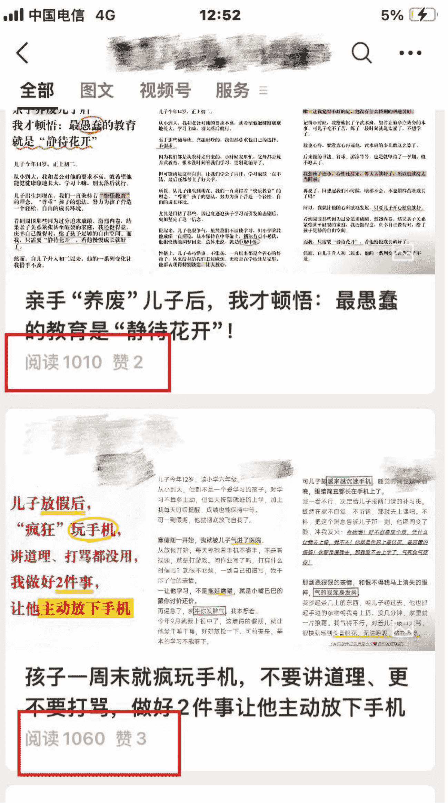

## 数据统计

全部发表 单篇发表 用户统计

共发布32篇文章。部分笔记表现如下：

- 《做对这3件事，把女儿从厌学磨蹭变得主动》：1107次阅读，2026/01/05
- 《没有“能量”的厌学孩子，永远学不会努力》：1100次阅读，2026/01/07
- 《跟厌学孩子讲道理是下策，真正的上策是？》：1099次阅读，2026/01/09
- 《女儿厌学后我才懂，最愚蠢的是“过度尊重”》：1084次阅读，2026/01/08
- 《给爸妈的一封信：我的叛逆，不是故意的》：1064次阅读，2026/01/06
- 《学会做婴儿式父母后，女儿的厌学懒惰消失了》：1073次阅读，2026/01/05

如果你也在做厌学教育，不妨看看这类内容怎样切入家长的真实困扰：

孩子常见的表现包括：情绪容易失控，动辄顶撞父母；生活习惯松散，听不进家长意见；沉迷手机、昼夜颠倒，逃避上学和现实；也可能缺少对家庭付出的体谅。你的服务对象是否也遇到类似情况？可以从这些具体问题出发，设计更有针对性的内容和沟通方式。

## 这种家庭，为什么更容易陷入厌学困境？

### 孩子拒绝上学，问题未必只出在孩子身上

“我就是不去学校！”

儿子眼睛通红，堵在门口和父亲僵持，身体紧绷得像一只受惊的小兽。事情的起因，是物理考试只考了30分。父亲撕掉试卷，骂他“猪脑子”；数学只考了58分，我也拿起扫帚打他，指责他让家里丢脸。直到看到他无助落泪，听见他低声说自己明明复习过，我才意识到自己一直没有真正听他说话。

家里已经因为儿子的情况乱成一团，女儿也把自己关进房间，和我们越来越疏远。看着紧闭的两扇门，我气得胸口发闷，几乎喘不过气。我和丈夫一直相信“不打不成器”，却没想到换来的不是进步，而是怨恨和逃避。那一刻，我觉得自己像个失败的母亲。

这类故事之所以能引发共鸣，是因为它触碰到家长最真实的焦虑：孩子为什么会厌学，家庭互动又如何一步步走到这一步。

换到小绿书后，内容分发效果明显不同。发布的仍是曾在小红书验证过的模板：

- 小红书阅读量大多只有10到100；
- 小绿书阅读量可以达到约1500；
- 推荐流量占比能到85%左右，内容方向匹配时，发两三篇就有机会进入推荐池。

评论区也逐渐出现真实咨询和讨论，例如有家长询问孩子情况是否相似、希望获得建议，也有人讨论“无条件接纳”和家庭边界的关系。

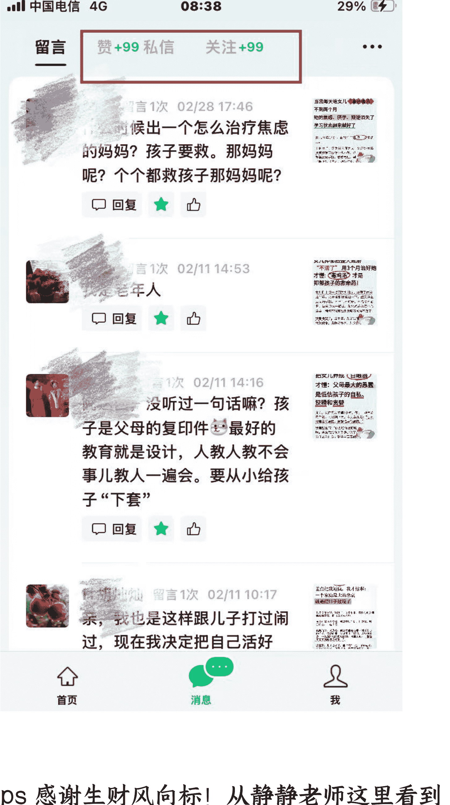

PS：感谢生财风向标，让我从静静老师的分享中注意到小绿书这个机会。实践后有了正反馈，我便继续做了下去。

项目推进期间，我也从静静老师那里学到不少，她的解答细致又热心。相关分享可参考：《46岁中年小白，8个月靠生财有术公众号副业翻身：公众号流量主项目做到收入6位数的实操心得》。

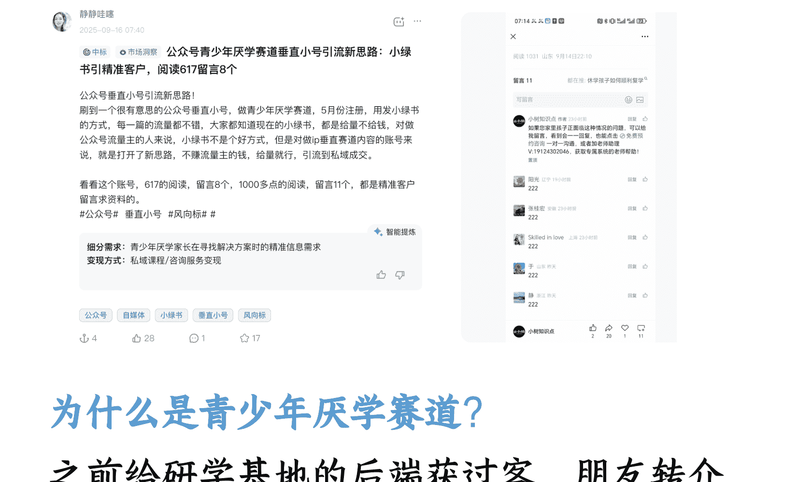

## 为什么选择青少年厌学方向？

此前我曾为研学基地做后端获客，后来经朋友介绍，开始了解这个赛道。

我主要从三个角度判断是否值得做：

- **需求真实存在。** 小红书相关内容评论区里能看到不少真实家长，不过也混杂着水军和截流信息；
- **产品有利润空间。** 后端服务客单价可达数千至数万元；
- **个人能够执行。** 这类内容模板适合单人复制和测试，而且我自己也经历过厌学，对家长的担忧有一定体会。

# 第一部分：小绿书获客怎么做

## 一、小绿书的流量逻辑

小红书主要依赖平台算法推荐，公众号则更侧重社交关系传播，小绿书兼具社交扩散和内容推荐的特点，因此有机会通过互动放大曝光。

举个简单的例子：假设50个人给一篇小绿书点赞，他们的好友就可能在“看一看”里刷到这篇内容。每个人假设有1000位好友，其中实际看到的占十分之一，那么单是这一轮传播就可能带来：

50 × 100 = 5000次曝光。

这就是社交关系带来的传播杠杆。

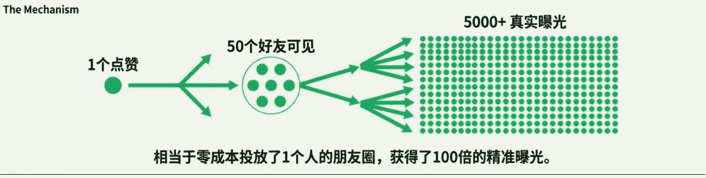

即使暂时没有自己的私域，只要内容足够贴合用户需求，也可能获得平台推荐。推荐流量占比达到80%左右，就已经有机会覆盖不少目标人群。

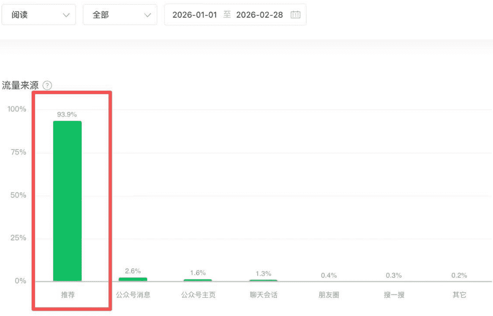

## 二、从零启动的两种办法

### 方法一：借助合作方私域启动

这是效果较好的方式，前提是后端业务方愿意配合。

我合作的服务方有一批老客户，可以协商借助他们的社群做首轮互动。有同行曾把文章发进后端客户群，覆盖50个、每群约200人的社群，48小时获得200个点赞，随后推荐流量明显增长，阅读量在一天内从500左右涨到2.5万。

### 方法二：通过微信群邀请目标用户互动

我会在宝妈群、家长群里发红包，请群友帮忙点赞。做养生茶等大健康项目的朋友，也可以寻找兴趣相近的社群。

还可以到线下广场舞活动点和长辈们熟悉起来，请他们帮忙转发、邀请进群，通过互动争取更多曝光。

执行时有两个细节不能忽略：

1. **首轮互动人群要尽量精准。** 如果内容面向家庭教育用户，点赞的却大多是创业人群，账号标签可能被带偏。
2. **根据用户活跃时间安排发布。** 先判断目标客户什么时候容易刷手机。我面对的主要是上班族家长，因此会选择上午11点、下午5点左右发动群友，尽量让内容在他们吃饭或下班途中进入朋友圈视野。

## 看一看

独家 | 对话黎群：当银行遇见组织韧性，如何让文化“长”在业务里？

现代商业银行杂志

实用信息 | 送给2026新同学们的爱丁堡住宿选择小帖士

留学在爱丁堡

621名！江苏省2026年省属事业单位公开招聘公告

中国无锡

## 三、用AI打造有转化能力的内容流程

### 方法一：借助Coze迁移小红书内容

这里也分享一个可参考的做法，感谢圈友哈默老师的经验文章：《做了30天小绿书实操复盘：抓住红利，新手也能多篇10W+，每月被动收入1000+，卖课成交120人+》。

我前期也用类似方法获得过客资和订单。后来为了让内容生产更稳定，才转向搭建自己的行业知识库。

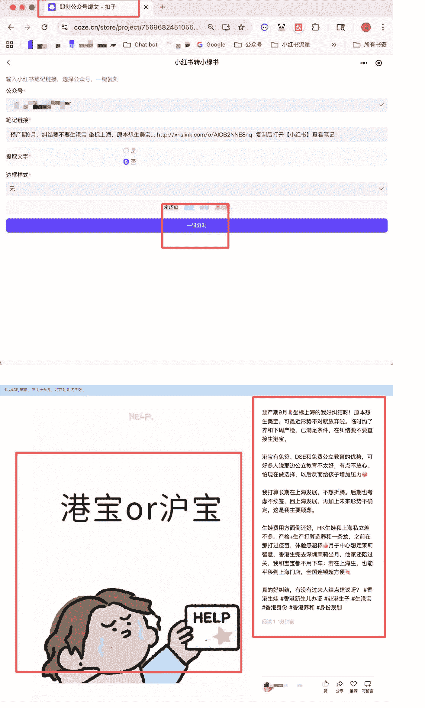

我做的家庭教育内容，主要采用长篇故事或轻动画配音形式。关键是用家长的视角讲述一个具体故事，让目标用户更容易代入。

### 方法二：先建行业知识库，再让AI写内容

早期我的做法比较粗放：把后端客户案例、小红书差评、自己整理的用户痛点和爆款文章结构等内容，全都塞进Gemini智能体，再由人工判断每篇应该使用哪些素材。

这种“什么都放在一起”的方式有两个问题：AI处理十几万字的资料负担很重，生成内容也容易重复、同质化。

后来我改用IMA知识库，并结合Claude Code和Skill来搭建流程，使用体验更顺手。

这里也要感谢珍妮老师的方法。建议大家有机会看看她在2025年10月27日至2026年2月10日期间的相关分享。我读完后受益很大。

### 避雷群 2025-2026 目录列表

### （2025.03.31-2026.03.31）

### 26. 红海赛道厮杀攻略：博士留学

- 2025年10月27日 - 红海赛道厮杀版：博士留学赛道获客方案优化（附全程调研思路版：第一集）  
  https://articles.zsxq.com/id_aa6ad4ulzxwa.html

- 2025年10月29日 - 红海赛道厮杀版：博士留学赛道获客方案优化（附全程调研思路版：第2集）  
  https://articles.zsxq.com/id_imm2u9bihaab.html

- 2025年10月31日 - 红海赛道厮杀版：博士留学赛道获客方案优化（附全程调研思路版：第3集）  
  https://articles.zsxq.com/id_sswwervqpt3t.html

- 2025年11月3日 - 红海赛道厮杀版：博士留学赛道获客方案优化（附全程调研思路版：第4集）  
  https://articles.zsxq.com/id_f4xpbhm7fp4l.html

### 第一步：从三个业务环节收集资料

知识库素材可以分别来自销售、交付和运营端：

- **销售端：**整理咨询时客户反复提出的问题，以及有代表性的成功案例；
- **交付端：**归纳服务优势、专家方法论、咨询话术和具体解决方案；
- **运营端：**收集同领域高表现选题、标题、互动数据、内容结构和关键词。小绿书可以参考小红书及视频号的相关内容。

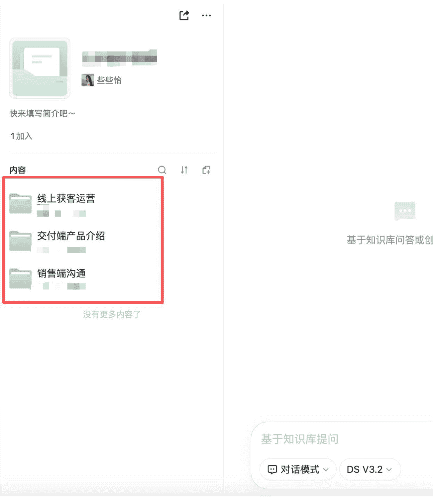

素材收集提示词可以这样写，具体行业名称和关键词按自己的业务替换：

【任务】请为青少年厌学咨询项目搭建一套行业知识库，分别从销售、交付、运营三个环节收集和整理资料。

**销售端资料：**

- 整理客户咨询中的常见问题，按问答形式归档；
- 汇总典型服务案例，记录客户背景、面临的问题、处理过程和最终变化；
- 案例需尽可能具体，保留真实场景和细节。

**交付端资料：**

- 提炼产品与服务的核心优势、差异化价值；
- 整理专家或老师使用的方法、理论框架；
- 收集咨询过程中重要的话术和解决方案。

**运营端资料：**

- 收集同赛道高表现内容的标题、阅读数据和互动数据；
- 分析内容的组成方式，例如开场、问题呈现、案例、建议和结尾；
- 建立关键词清单，例如青春期叛逆、厌学、亲子关系、母女矛盾等；
- 也可参考小绿书、视频号等平台的优质内容。

请依据以上框架，梳理现有的[具体素材/文档]，并分类整理为结构清晰、便于检索的知识库。

### 第二步：清理资料并建立标签

资料积累到一定程度后，需要去重、归类，并为内容添加标签。

以家庭教育为例，案例可以按日夜颠倒、沉迷手机、家庭关系紧张等问题分类。客户也可以按孩子年龄、家长类型和家庭结构区分；内容选题则可分成故事案例、方法分享、情绪共鸣和家长成长等类型。

整理时可以使用下面这段提示词：

【任务】请对以下青少年厌学项目知识库进行清理、分类和标签化。

**可参考的分类维度：**

- 客户案例类型：
  - 作息混乱、昼夜颠倒
  - 沉迷手机或游戏
  - 亲子冲突、家庭关系紧张
  - 学习动力不足
  - 情绪困扰，如抑郁或焦虑倾向
  - 早恋、人际交往问题
  - 父母婚姻关系对孩子的影响

- 客户画像：
  - 孩子年龄阶段，如初一、初二、初三、高中
  - 家长风格，如焦虑型、控制型、较为放任型
  - 家庭情况，如双亲家庭、单亲家庭、重组家庭

- 内容选题类型：
  - 真实案例
  - 实用方法
  - 情绪共鸣
  - 家长自我成长

请将以下素材[粘贴具体内容]进行去重、整理和分类，为每条资料标注合适标签，并以表格形式输出。

### 第三步：教AI理解好内容的标准

知识库建好之后，还要亲自把每种内容的优点讲清楚，让AI知道什么样的表达更适合目标用户。

我会用口头表达的方式，把自己拆解内容的思路说出来，再交给AI整理。亲自完成一次拆解非常重要，因为AI未必能准确感受到文字背后那些细微的人情绪。但只要每个类别都示范一次，它学习和复用的速度会快很多。

给AI的背景信息尽量充足。你提供8000字素材，让它写2000字，通常会比只给100字却要求扩写到2000字靠谱得多。

AI更像一个放大工具，并不会凭空替你创造认知。最终内容能达到什么水平，很大程度取决于操盘手输入了多少真实经验和判断。

语音输入方面，可以试试豆包输入法，中文识别准确率已经能达到约90%。

对标内容分析提示词示例：

我是负责小红书运营的操盘手，现在需要为家庭教育项目做内容营销。请先认真学习我的分析过程和判断标准。

【以下是我对对标笔记的口头拆解】

先说人话，不是干巴巴的技巧课。

你看对标那篇文，本来以为在讲青春期女儿怎么叛逆，结果是句句把妈的心拎出来炙烤。语言特别像楼下遛弯的阿姨在跟你抱怨，不是专家在台上讲课。

她开口就不是“分析”二字，而是“往沙发上一瘫耳机一戴”“收化妆品时劈头盖脸一顿训”。你脑子里立刻就有了画面，像翻《意林》小故事，一下子被吸进去。

客户是谁她门儿清。不是泛泛的家长，是家里正好卡在14岁左右、原本乖乖的那个女孩突然开始画眼线、爱打扮、成绩滑坡的妈妈。

更绝的是痛点她分了三层。

最外面一层是看得见的闹：孩子打扮上头、成绩一塌糊涂、管了就顶嘴，最后干脆不想上学。

再往里一层是关系裂了：管教反弹，母女俩从对话变成对骂。

最里头那层才扎心，是妈妈自己小时候也被骂“不够努力”的那口怨气，她拼命控制女儿，其实是想救从前的自己。这个点一出来，读者眼泪都快下来了。

情绪她也掐得准。开头是懵的、气得慌；接着是委屈、觉得自己没用；老师点拨一句，人就懵了、开始自责；然后慢慢松了、愿意试；最后释然了。

———

现在把这个套路拎出来给你用，你写小绿书就照着走。

1. 语言必须像聊天。口语化、接地气、画面具体。不要“亲子沟通技巧”，要“周日晚11点，她把作业本往桌上一甩说我不写了”。
2. 痛点一定要分层。表象行为 → 关系冲突 → 妈妈内在小孩的自我价值匮乏。
3. 情绪线必须走完一遍。困惑愤怒→委屈→震惊自责→愿意改变→释然。别一上来就给答案，要让她先认出自己。
4. 坚决不用AI腔、不要专家说教。每个场景都要能看见、能闻见。
5. 结构就按我们拆的那套来：第一句制造冲突的具体对话，痛点三层递进，一个可执行的建议，一个100字左右的转折案例，结尾不硬卖，只轻轻引导。

这一步才是把数据和故事缝起来的地方。标签化调用数据，让AI真正写出深度。

你是xxx公众号的人，我的目标读者是xxx，我要写一篇小绿书。

从【痛点库】调：学业类痛点 1 孩子闭门不出日夜颠倒玩手机
从【爆款库】调：正文结构 5 场景故事类具体痛点+激烈对话开头
从【案例库】调：案例 3 海淀家庭于妈妈

按对标那篇的爆点、语言、痛点分层、情绪设计来生成800字：

第一句要周日晚11点+具体对话
痛点分析三层递进
解决方案给一个能立刻上手的小建议
案例100字转折
结尾自然引导不推销

关键有两个：素材库要厚，第二要会分层调用。那样文章才有层次，不是干货堆砌。

现在用claude code+skill就更顺了，写文配图都能串起来。

补充一个小技巧。小绿书标题和第一句就是生死线。标题可以直接抄最近半年同赛道爆款，一字不落发也没事。小红书搬过来更是降维打击。进阶就是自己建爆款标题库，让AI去组合。

开头模板其实就几种：互动式“一个逃学的孩子是怎么被毁掉的？”；反认知“最愚蠢的教育就是静待花开”；痛点场景“家里那面贴满奖状的墙，现在成了女儿最怕的催命符”；好奇包装“学霸和学渣之间，还有一种孩子叫学酥”。

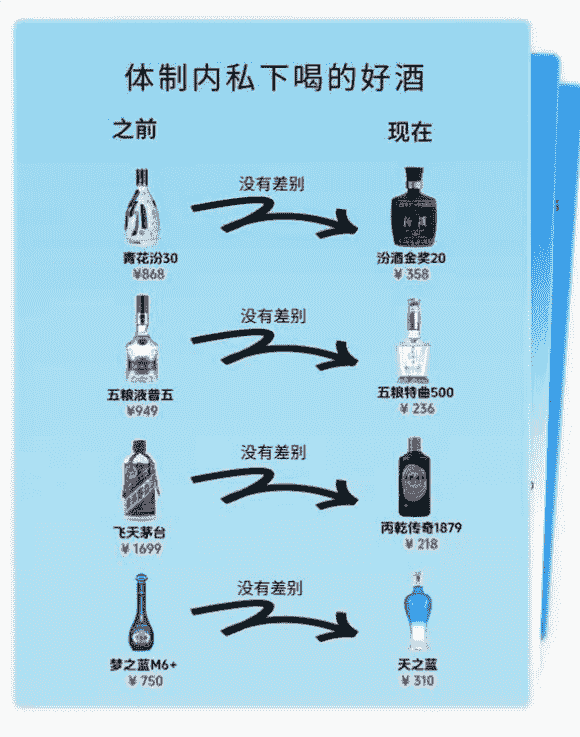
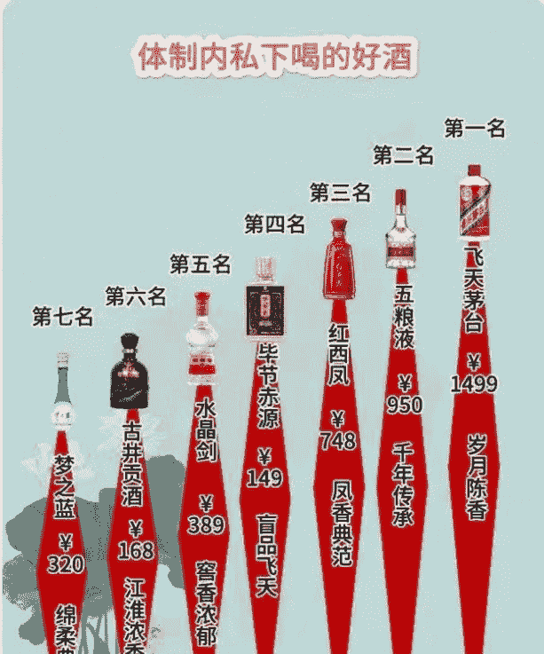
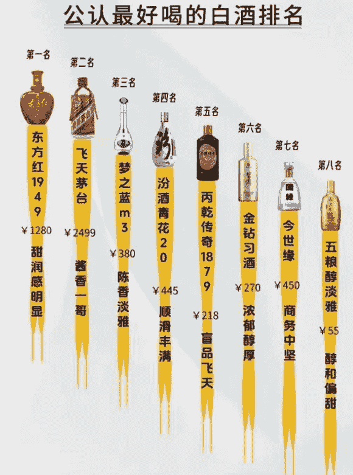
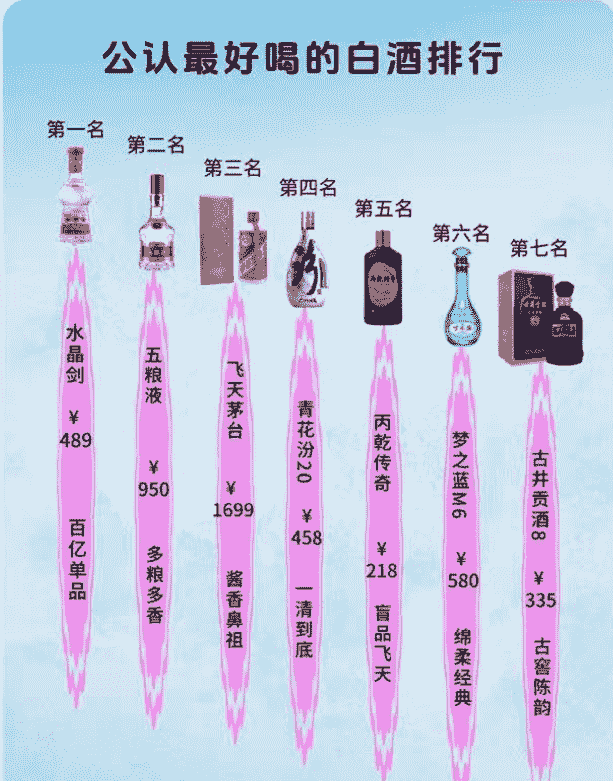
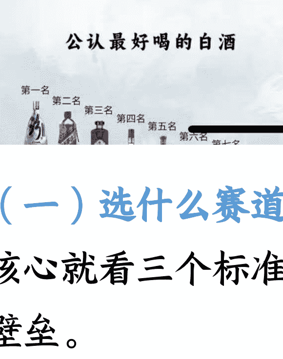
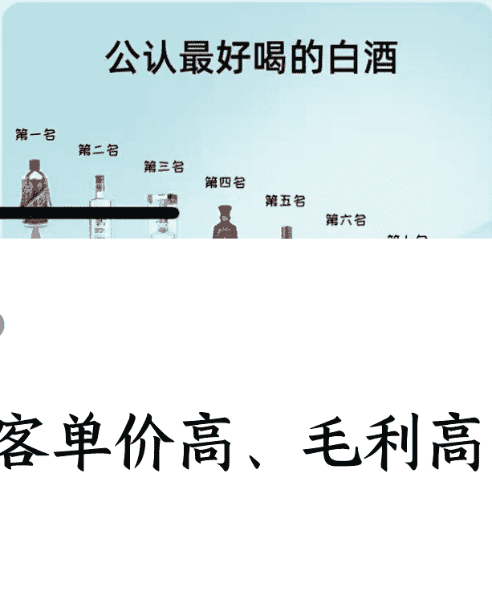

2026年公众号这一波公域流量红利，确实值得认真对待。和几位圈内实操的朋友深聊之后，我把一套可复制的打法做了重新整理，不堆理论，全是落地细节。看完你大概就知道，为什么有人用“傻瓜式搬运”的内容，流量反而比原创还猛。

先聊选赛道这件事。

旅游类目的阅读单价能做到0.7到0.8元，服务类变现客单价高，但风险系数也略高，自己评估。文玩珠宝是典型的高客单、高毛利，值得考虑。家庭教育这个方向也能做，虽然围观的多、白嫖党不少，但通过资料包引流，照样能把人洗到私域里转化。

如果把粉丝按价值排序，大概是这么个顺序：宝妈群体排第一，然后是中老年，再往后是宠物爱好者，最后才是男性用户。说句实话，男性流量现在性价比很低，做得不好可能连成本都收不回来，不推荐碰。

再说避坑。精酿啤酒、普通水果、沙县小吃、螺蛳粉店、白牌化妆品这类低价值品类，尽量绕开走。客单价低、复购率也撑不起来，做起来非常吃力。

账号怎么搭？不需要折腾企业号认证，直接上个人服务号就行，成本很低。一个微信号对应一个公众号，粉丝没破万之前，连实名都不用做。如果你是想做矩阵，就按预算批量上号，每10到20个号编成一组，风险分散开。哪怕报废一批，后面还有替补能顶上。设备方面，二手手机200到300块一台足够用了。IP要做好隔离，挂服务器避免冲突——这说的是矩阵的情况。10个号以内的获客规模，用独立流量卡就够。

内容怎么批量造？一个号一天要发两篇，实际生产至少6篇来筛，整体走的就是粗放路线。AI工具用DeepSeek、豆包这些就行，内容同质化不可怕，白酒排名、旅游攻略这类被验证过的模板直接套。稍微手动微调一下，绕过平台查重就能发。

去重有几招：图片去百度、小红书、Pinterest找背景图，再配合AI做混排换背景；文案生成后改改语序、换换用词，肉眼不可见的细节微调；标题套公式就是“地域+痛点+解决方案”。小绿书的标题逻辑和小红书一模一样。

新号起量阶段，一天发4篇激活流量，靠搜索流量吃饭——这跟小红书的关键词布局是一个底层逻辑。每个类目准备5到8个内容模板就够用了。

数据怎么盯？核心看两个维度：内容端看平均阅读、涨粉、完读率，完读率低于30%直接淘汰；转化端看私域转化率、客单价、复购率。优化机制就是每天做A/B测试，标题、封面、内容形式轮着来，流量模板每日更新，测出高互动的素材就无限复制放大。

防封号记住一个底线：单号日更不超过3条，别一天怼一百多条，更别用第三方工具群发。核心原则是，你干正事就不会被封，只要流量价值能覆盖账号成本，这事就能跑。说白了，无脑复制、批量放大就是放大器。

说一下我调研到的同行数据：2个人的小团队，管着100个号，按这套特定方法来操作，单人月收入能做到三万到五万。这个信息要感谢小伟哥，他的风向标每次都是又准又及时。

最后说点心法。

家庭教育这个赛道，表面上是重度依赖“专家IP”的领域。你看到头部玩家，像复旦沈奕斐老师那类人物，有学术背景、有社会光环、有大量个案积累。我是个00后，没结过婚没生过娃，既不是心理学教授，也没有二十年的咨询经验。跟那些真正的大佬比起来，我的综合能力系数可能只有0.2。

但这不意味着普通人没法在这个价值空间里切一块蛋糕。术业有专攻，我正是因为没自带光环，才被逼着找到了一套穷人打法——用AI搭建工业化内容生产流水线，用小绿书这个侧翼战场去撬动流量。就像我们主席说的，游击战的核心就是你打你的、我打我的，弱小的那一方反而有灵活的优势。简单粗暴的方法，有时候正是在红海里撕开一道口子的最快路径。先进来，再慢慢修炼。

前端流量打通之后，后面还有更高级的关卡等着破解。比如，怎么让用户看完内容就愿意前置下单，不给销售老师增加太多负担？再比如，当私域里真正沉淀了一千多个高质量客户，没有专家光环的操盘手，该怎么靠正规的运营动作去促成转化？这些话题有机会下篇再详细聊。

搞流量这件事，本质都是从不精细走向精细的。我也一直是从菜鸟状态入场，遇到什么问题就解决什么问题，乱拳打死老师傅。但只要你迈进那个窄门，后面的路自然会推着你往前走。

感谢珍妮，她是AI+获客的百事通，毫无保留地分享了很多关键的方法；感谢一来哥，想深入学习公众号流量的朋友，一定要看他做的深度拆解；感谢yeye同学，在文章写作上给了我不少有价值的建议。也感谢生财，祝大家顺风顺水顺财神。

看完这套完整SOP，你可能会觉得懂了。但实际动手的时候，90%的人会卡在第一步。工具和教程只是最表面的壁垒，真正的护城河是“立刻去做”和“圈层信息差”。

如果你想看全网最新的变现玩法，和一群执行力拉满的极客一起下场拿结果，欢迎加入我的核心私域【懒人专属群】。我们只聊商业闭环的拆解和AI效率的压榨，系统里已经沉淀了1000多个跑通的实战案例。

查阅完整数字资产与上车门槛：
https://lazyso.com/insider/

认同价值、准备好干活的朋友，扫码加微信：

微信：lazyhelper1
备注：【实操上车】，不闲聊