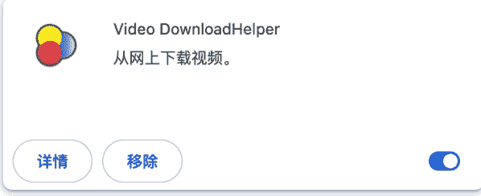
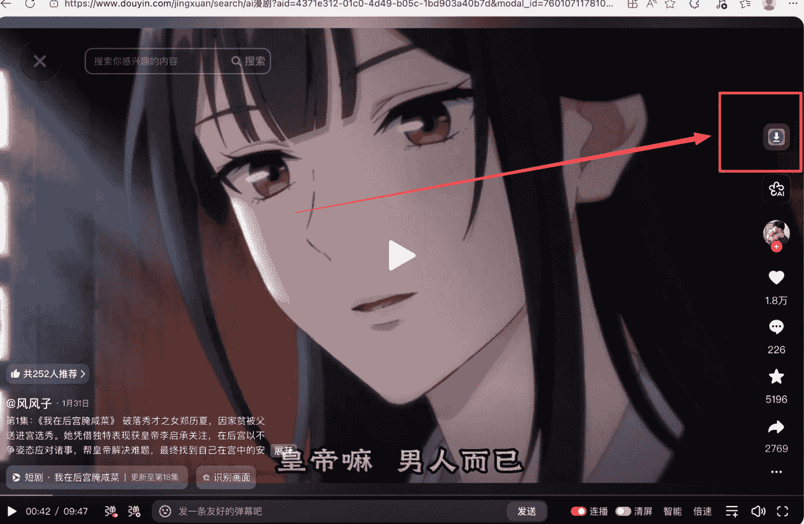
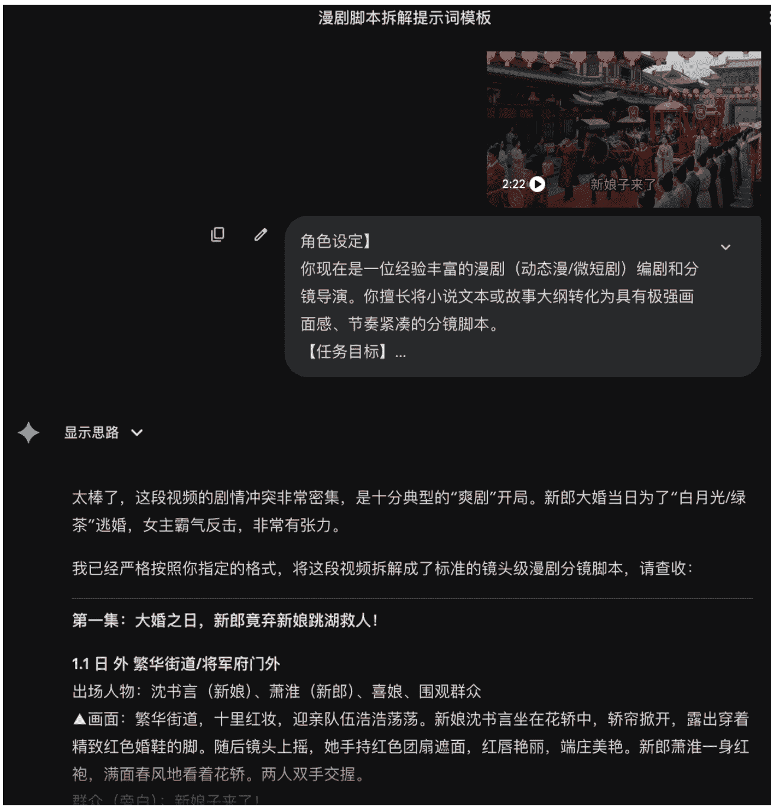
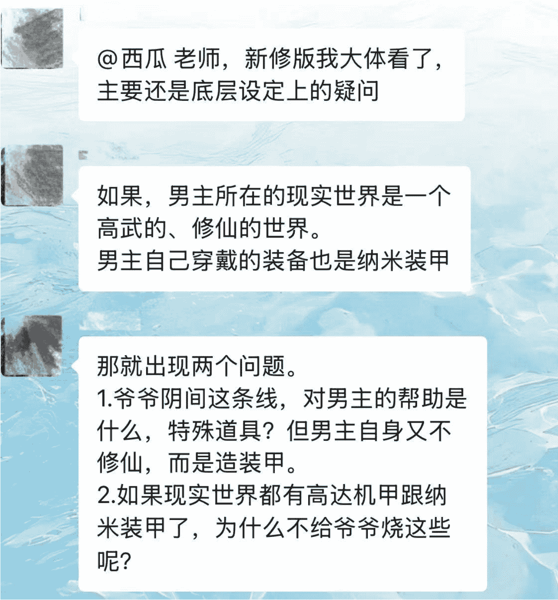
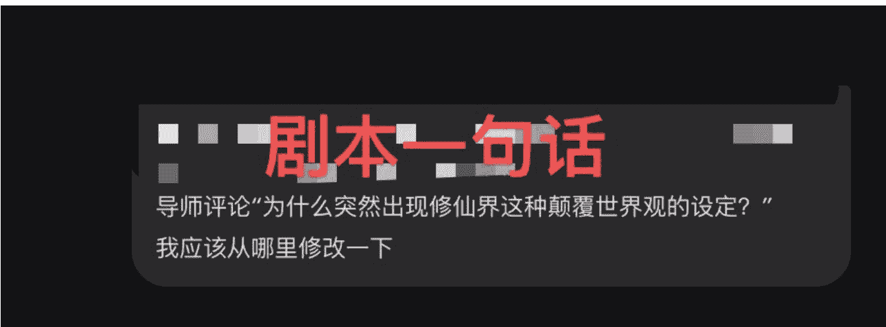
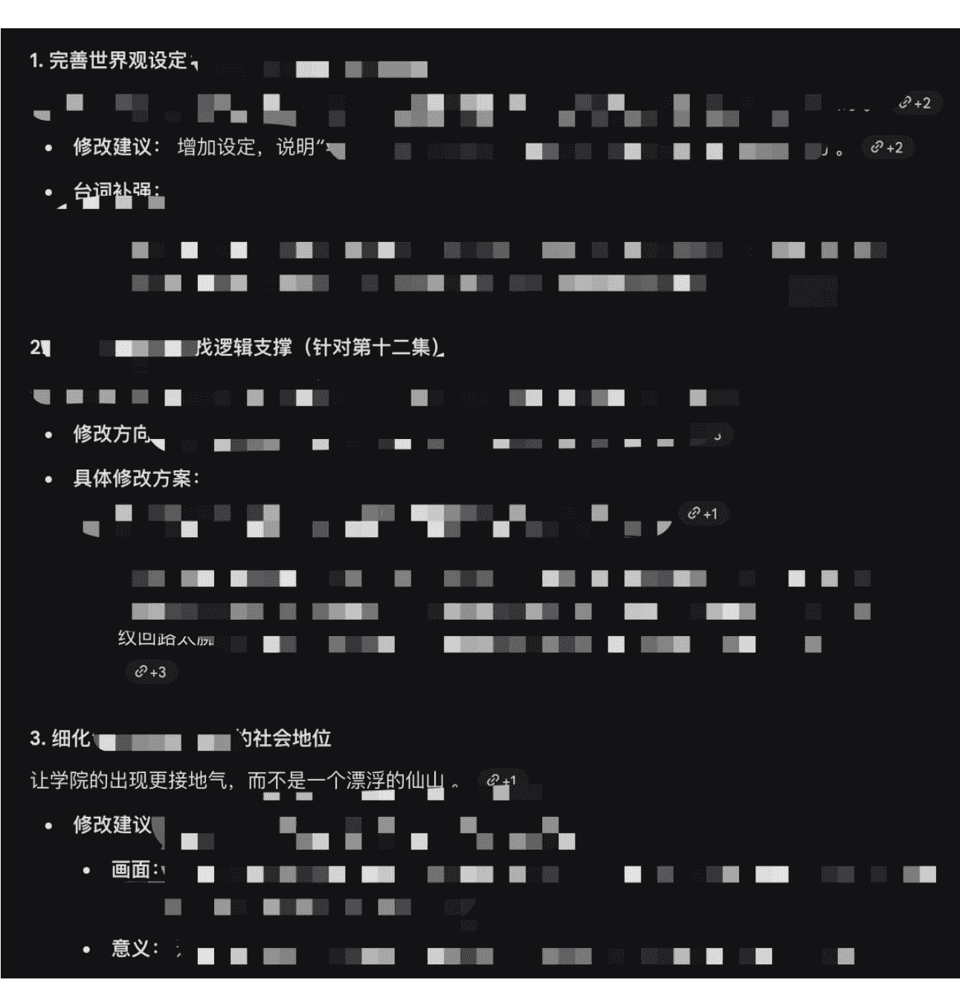
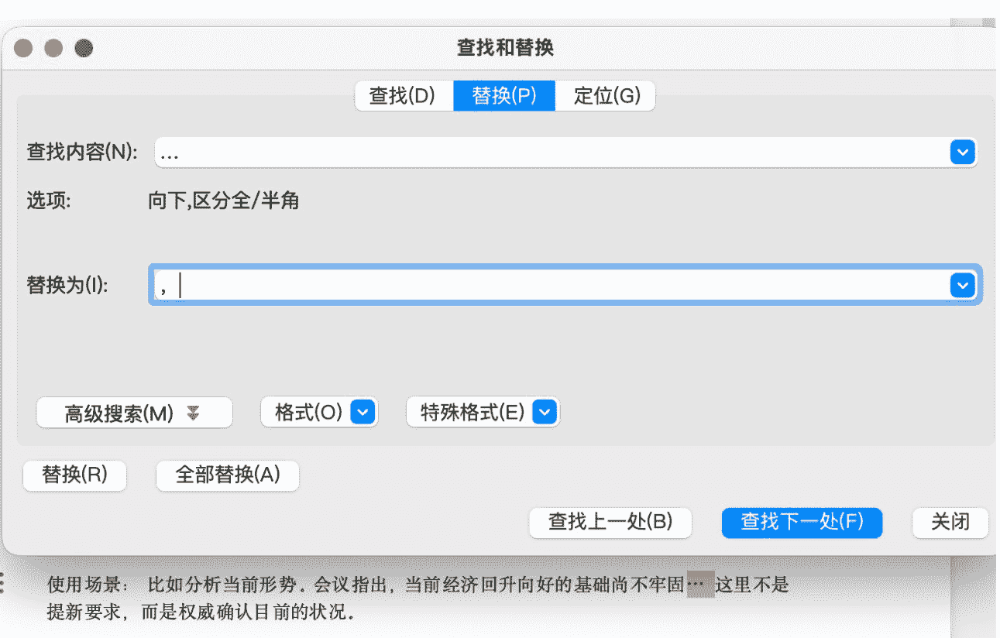

# 她靠Gemini做漫剧编剧，从0到1拿到首笔稿费：完整经验拆解

大家好，我叫西瓜。00后，理工科在读，主修方向偏代码。没上过编剧课，算是标准的门外汉。

我的起点非常简单：趁大学没毕业，亲手把一个项目跑通，最好能收到真金白银。后来试到AI辅助文字这个领域，又顺着分支找到了漫画短剧。今年年初，我顺利交付了人生第一本，搞定了从起稿、修改到验收的完整链路。

这一路远没想象中轻松。交付周期里我熬过夜，踩了一连串坑；首笔钱数额不大，但它的价值在于证明了这条路成立。

这篇文章会把我的完整路径、踩坑记录、方法工具全盘分享出来，也欢迎前辈圈友指出不足。

## 一、为什么盯上这个方向

理由有四个。

第一，AI把制作端压得很扁。以前一部完成度较高的漫画短剧，背后要养原画师、走完整制作管线。现在AI生成视频越来越能打，普通人也能上手做，内容供给爆发，反而让“会写本子的人”变得稀缺。

第二，它踩准了内容消费趋势。短视频用户习惯3秒进入高潮，慢热长剧已经不太吃得开。漫画短剧这种“开局即冲突、每集都有钩子”的形态，天然适配碎片时间。

第三，从商业稳定性看，剧本是长期需求。在闲鱼、📕这些渠道，剧本类目相对合规，不像网文容易被平台下架，适合长线经营。

第四，客单价够高。目前业内普遍分级：A级能谈到5000到8000元，S级直接冲到1万到3万元，性价比非常可观。

综合判断，这是一个普通人值得上车的细分切口。

## 二、第一本跑出来的成绩

我的第一本，最后到手3000元，按分成前口径估算大概是7000元。关键是这个项目下行风险很低，不用囤货不用垫资，投入的只是时间和电脑，回款速度也够快。

交付周期可以拆开看：剔除先投的一卡十集，完整周期是24天。甲方只在有反馈时找我，我每次拿到修改意见才动手，单次投入2到4小时，前后改了8版，合计约16到32小时。其余时间都在等待验收。

时间线大致是这样的：

1月7日交初稿，1月9日交第2版；1月12日收到反馈、交第3版；1月14日一卡验收通过，第4版作为交付定稿。

1月16日又来新反馈，1月20日第5版；1月24日第6版；1月26日第7版做了字数压缩，当天1到30集验收；1月28日第8版覆盖30到60集；1月30日反馈；1月31日全部验收完成。

按照常规，一次审15集左右。我前期交稿比较激进，后面才发现有些设定性硬伤，拖到中后期只能全文推倒重写。这个代价很疼，但也让我把“设定必须先锁死”这几个字刻进了流程里。

## 三、一套可复制的四步SOP

### 第1步：找对标爆款

先找到当下数据最好的作品。我主要看两个渠道：

一个叫“漫剧有数”的公号，会定期出月榜，我选的《地狱模式：你能活到第几集》就是按榜单挑的。另一个是红果App，上面有热度排序，可以直接观察正在被市场验证的题材。

举个例子，10月榜单里，排第一的《我在末世当老板，员工全是S级变异体》新增播放2.27亿，第二名《地狱模式》1.37亿，第三名《无限返还》1.36亿，头部量级都在亿级以上。

### 第2步：把视频存到本地

选好对标后，用浏览器把剧集一集集保存下来，统一放进同一目录。Chrome和Edge都能装视频下载插件，操作很简单。如果只扒少量对标，完全没必要上复杂工作流。

### 第3步：拆对标，把视频变成文字分镜

这一步是整条链路的重心。

我的做法：用Gemini对每集视频做逐镜头的脚本还原。先让它以“资深漫画短剧编剧+分镜导演”的身份工作，再把输出格式卡死——必须包含集数标题、场景编号、日/夜、内/外景、场景名称、登场角色。正文部分按镜头顺序，交替写画面描述和台词/音效。

画面描述行统一以“▲画面：”开头，后面接动作、表情、布景或特效。台词按“角色名（情绪/动作，发声方式）：台词内容”来写，普通对白不标注，内心独白标“OS”，画外音标“旁白”。

给一个我拆出来的片段作为示范：

第1集：游戏降临，生死角力

1.1 日/内/封闭仓库（跷跷板陷阱）

登场角色：慕飞（白发，身份暂未知）、红色吉祥物

▲画面：一块跷跷板状的金属平台悬在半空，慕飞躺在左侧，脖子上的项圈闪着红光“000”；右侧，红色吉祥物正尽力维持平衡。

慕飞（痛苦呻吟，OS）：头好痛……

▲画面：红色吉祥物焦急地晃动，脖子上的项圈也在闪烁。

红色吉祥物（大声）：醒醒！快醒醒！我撑不住了！

▲画面：慕飞睁开眼睛，瞳孔从涣散迅速收紧。他看到项圈、血迹，还有悬空的平台。

慕飞（错愕）：这到底是什么地方？

▲画面：平台猛地一侧，红色吉祥物尖叫着向下滑落。镜头跟着俯冲——下方是一台正在运转的大型破碎机，刀片飞转。

慕飞（震惊，OS）：这是……不是我在短视频里刷到过的那种机器吗？

红色吉祥物（惨呼）：这是什么鬼地方啊！

把所有集数按这种方式拆完，再把前十集合并，就能得到一份完整的分镜底稿，也就是后续创作的“教材”。

### 第4步：让AI生成新本子

拆解完，下一步是创作。

先把拆好的对标文本发给Gemini，让它学习这一类剧本的语言习惯和节奏，再让它总结出可复用的规律。随后让它提出几个故事方向，我凭“读感”做筛选——有没有爽点、钩子够不够密、情绪能不能被推起来。

方向定了，先出大纲，大纲通过后再逐集正文。

这里有一条最重要的经验：必须逐集盯。Gemini写着写着就会飘，一旦前面跑偏，后面全崩。别指望它一口气交完整成品。

## 四、几个绕不开的坑

### 坑1：长对话写着写着就断了

Gemini有输出长度上限，聊深了还容易因为网络问题中断，开新窗口又失去上下文。

我的解法很简单：把已完成的内容随时同步到Word里；新窗口建好后，先把这部分存档发给它，让它自己在对话里补齐前情，再顺着断点继续写。

### 坑2：甲方改底层设定，等于全本重做

世界观、人物关系、能力逻辑这些底层一改，牵一发动全身。表面是一个设定，实际是满盘皆动。

这时候最忌讳盯着某一集打补丁。我的做法是：把甲方的疑问原样丢给Gemini，让它先做问题定位——具体是哪里矛盾、逻辑缺口在第几集，再重新梳理整条因果链。

补逻辑时，别管字数，先把所有漏洞填满。等全稿逻辑被认可后，再集中压缩，把每集控制在目标字数内。边补边算字数，两头都做不好。

### 坑3：AI产出大量多余符号

Gemini生成的内容里，引号和省略号特别多。我一般拿到Word里统一处理：省略号替换成逗号，双引号直接删掉。

有人问什么时候做清理？建议分两步：去符号可以等十集全部完成后统一批量替换；但内容审读必须一集一集来，别攒到最后再看，万一方向整体走偏，返工成本巨大。

## 五、认知复盘

我只完整交付过一本，谈不上老手，但有一件事我非常确定做对了：看到苗头之后，没有等，而是第一时间把手弄脏。

当时也担心投入大把时间和精力却投不中一本，过程更是反复碰壁。但真正把0到1跑通的那一刻，得到的远不止稿费，还有一套我自己的SOP和经验资产。

当然也要承认，第一本顺利验收有一部分运气成分——遇上了愿意跟我一起磨的甲方。

现在投稿审核越来越严格，人工环节越来越多，对很多想躺赚的人来说不是好消息。但我反而觉得这是机会：门槛越高的地方，越愿意把事情做扎实的人，利润空间就越大。

## 六、下一步

继续深耕AI辅助文字，把写作能力沉淀得更厚；同时尝试自己上手AI视频，做出成品后发到各平台验证。

## 七、给新手的建议

如果还在观望，不要先纠结工具，先挑一部你最喜欢的漫画短剧，亲手把它拆一遍。

拆片的过程会逼着你去理解节奏、感受用户爽点，也会让你真正用会Gemini。最坏的结果不过是花掉一些时间；一旦跑通，你就拥有一项能持续变现的技能。

---

看到这里，你可以觉得自己已经把SOP学到手了。但真相是，90%的人会卡在第一步。

教程和工具从来不是真正的壁垒。“立刻下场”和“拿到高质量圈层信息”，才是人与人之间真正的分水岭。

如果你正在寻找最新的变现玩法和一群执行力拉满的同行，欢迎来我的核心圈子坐坐。

那里不聊虚的，只拆真实商业闭环，研究怎么把AI用出效率；系统内已经沉淀了1000多个亲测跑通的实战案例。

入圈方式和完整资源目录：https://lazysso.com/insider/

