# 👸号懒人搜索，懒人专属群分享

## 👸号懒人搜索，懒人专属群分享

# 新手入局📕虚拟电商，如何用矩阵实现稳定变现

260325 副业 SC 精华

👸号懒人搜索，懒人专属群独享

懒人🛰️：lazyhelper1

感谢邀请。日前在青岛参与了一场 AI 项目的线下闭门分享，主题围绕《新手进入📕虚拟电商，依靠矩阵实现持续变现》展开。

本次分享的内容来自团队运营上百家店铺和账号后沉淀的实战复盘。参与者能带走的核心收获有：

- 2026 年虚拟赛道的可行机会点
- 新人切入虚拟项目的落地路径
- 高效选品的思路与判断标准
- 如何借助 AI 实现效率跃升
- 从 0 到 1 实现稳定出单的方法论

以下为分享要点梳理及现场问答精华。

### 一、项目背景与方法论

自我介绍环节先做说明。主营方向为📕虚拟店群，目前自营店铺约 80 家，运营周期约一年，累计营收破百万元。

在此之前，团队深耕视频号电商超过三年，经历过自然流量、付费投放、混剪、实拍、口播、引流等多种打法，并取得过阶段性成果。但整体来看，该类玩法普遍存在平台对抗属性，且规则迭代频繁，导致业绩波动极大。旺季单周可达十几万甚至二十万，淡季则连续数月零收入甚至亏损，对团队心力消耗极高。

创业初期只能先求生存，抓住风口换取第一桶金。随管理能力和资金积累逐步提升，选择标准也随之升级。去年 2-3 月视频号出现规则大调整，多项旧打法失效，团队抓住窗口期启动转型。

多年的项目试错让我们形成共识：选择的重要性远超执行。为此我们系统调研了抖音电商、淘宝、美团、闲鱼、👸号等十余个方向，并据此提炼出一套项目筛选的判断框架。建立框架后，工作思路明显清晰，效率大幅提升。

首个核心观点：先定标准再做事。

标准能提供决策依据，帮助聚焦关键抓手，剔除干扰项。若缺乏统一标准，执行易陷入低效试错。

自我检视问题：当前业务是否具备清晰的执行标准？标准来源是否合理？若无，建议尽快建立，这是科学创业的起点。

最终确定的项目筛选四要素，按优先级排序：

1. 稳定可预期。不追求极端高波动收益，把可预测性置于首位。只要按流程执行，就能获得正反馈并持续盈利，不达标即剔除。
2. 可规模化复制。过往经验表明，单纯追爆款的内容电商容易归零轮换，而可复制的店群模式能够长期稳健增长。我们必须选择可规模复制的方向。
3. 合规可持续。平台对抗型项目需耗费大量精力研究规则漏洞，无暇做本质增长，故不再涉猎。
4. 具备门槛。理想情况是有门槛且我们能满足；若无门槛但前三项满足，亦可接受。

四项中，可预期性为 1，其余为 0，无 1 则 0 皆无意义。

第二个核心观点：不同阶段关注不同目标。

创业早期目标是活下来、不被淘汰。若早年未赶上红利期，很可能已无法坚持至今。运气不可依赖，如今仍处于积累期，不宜好高骛远，可预期性应作为第一原则。

阶段自检：当前所处创业阶段与执行策略是否匹配？

在标准明确后，可选范围急剧缩小。我们又用约两个月时间深度跟踪对标账号的发内容频率、节奏、转化表现，并通过访谈在途同行获取一手信息。最终确定切入📕虚拟店群。

虚拟店群的核心优势：

- 可预期性强，流程简洁，新手也能快速获得首单反馈，通常 1-3 天出单，极端情况一周内完成。
- 投入门槛低，无需囤货与采购，试错成本极低。
- 可复制性强。核心动作标准化，可批量铺量，确定性与可复制性构成基本盘组合。
- 合规且具备复利属性。全流程符合平台规则，旧笔记仍可持续转化，具备长期积累价值。
- 官方扶持。平台已设立电子资源类目，支持站内成交及自动发货，免去第三方工具费用；同时类目准入收紧也起到筛选竞争对手的作用。
- 覆盖广阔。几乎所有行业内容均可虚拟化，对比实物电商的供应链与库存压力，虚拟资料一次制作即可无限售卖。

变现路径以站内直接售卖资料为主，笔记挂链完成成交，路径为开店→选品→发笔记→成交发货，以自然流量为主，可少量配合投放。私域导流属于进阶玩法，本场不展开。

项目本身不复杂，难点在于如何将出单稳定化并做规模化扩张。思路是靠数量换取概率：多店、多品、多笔记，覆盖更广的人群与关键词，逐步形成稳定收益。

规模化重复依赖工具与 AI。目前团队约 80% 流程已工作流化，100% 笔记由 AI 生成。人工时代单人最多维护 7-8 家店，现在单人可轻松管理 30 家以上，且不增加人力成本。

### 二、如何实现多店扩张

账号与店铺关系说明：一个📕账号对应一个手机号与一个实名，每人仅能实名一个账号。开店入口为📕千帆后台。

个人店提交身份证即可开通；个体店需个体工商户执照，建议使用注册满一年的执照。

账号与店铺为关联但独立关系。账号实名可用 A，店铺实名可用 B。每人仅能实名一个账号，但可实名众多店铺。因此只需多渠道获取账号实名，即可用同一资质集中管理多店，资金结算至同一账户。

起步建议准备 1-3 个账号开 1-3 家店，先跑通全流程，一般 15-30 天可完成闭环，之后再逐步复制。店铺基础配置包括银行卡绑定、收款方式、物流模板与发货地址，并开通电子资源或成人教育类目用于上架。

电子资源类目开通说明：自 2025 年 2 月 10 日起，类目改为定向邀约。我们测试出免费自荐通道：店铺管理→品牌类目资质→新增资质→电子资源→自荐提报，填写企业信息，主营平台填“无”。资质材料包含📕主页截图、合规承诺函照片、近月流水截图等。承诺函需按模板填写信息并签字，个体店需注明“个体店无公章”。

自荐审核周期约 3-14 天。若无法通过，可备选成人教育类目，第三方开通成本约 13 元/店。

### 三、如何实现多品上架

新手最优策略是跟随市场。先看同行在售爆款再复刻，快速获得首单反馈。待积累足够认知后，再考虑原创与差异化。

主要跟品渠道：

淘宝跟品：按类目或关键词搜索，筛选销量表现好的商品，复制链接通过工具同步至📕店铺。定价建议：采购价 ≤9.9 元售价 9.9 元；>9.9 元售价 19.9 元；>19.9 元按原价上架。

📕站内跟品思路与淘宝类似，核心为找高互动笔记下的商品链接并复刻。

### 总结

核心就三点：先立标准、顺应阶段、以量换机。项目框架简单，差距在于是否能将简单动作标准化重复并做到极致。

想继续交流可关注👸号“懒人搜索”，或添加🛰️ lazyhelper1，懒人专属群内会同步资料更新。

做📕虚拟资料店，选品比技巧重要。先看图感和资料时效：图必须清楚，内容要够新。2025、2026 年的新资料可以重点考虑，2020、2021 年的旧资料直接放掉。

下面这些是能直接落地的选品方向：

- 初中数学冲刺专项（2026 最新版）：Word 电子版，可编辑、可打印，分教师端和学生端，内容覆盖题型总结、考点梳理、真题练习和拔高培优，适合中考提分刚需。


- 幼教获奖公开课资源（2026 新版）：覆盖小班/中班/大班，教案、PPT、视频都齐，共 5200 节，2026 年 3 月更新。一次获取长期有效，每周持续更新，不满意可以退。

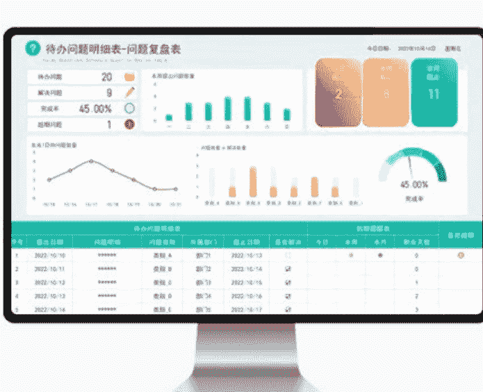

- 职场复盘与学习总结模板（2026 新版）：包含每日回顾、工作总结、数据回顾，覆盖问题梳理、学习心得、项目进展和直播记录，Excel 格式，长期有效、后续更新免费。


- 健康常识科普文案库：内含 2800 份文案，围绕日常护理、注意事项等内容，9.9 元成为永久会员，电子版持续更新，拍下后 24 小时内发货；另有 2025 年整理的 1200 套合集，终身持续更新。
- 电商公司全套资料：薪资绩效、人员管理、客服话术、直播流程、岗位说明、表格模板，不满意可全额退款。

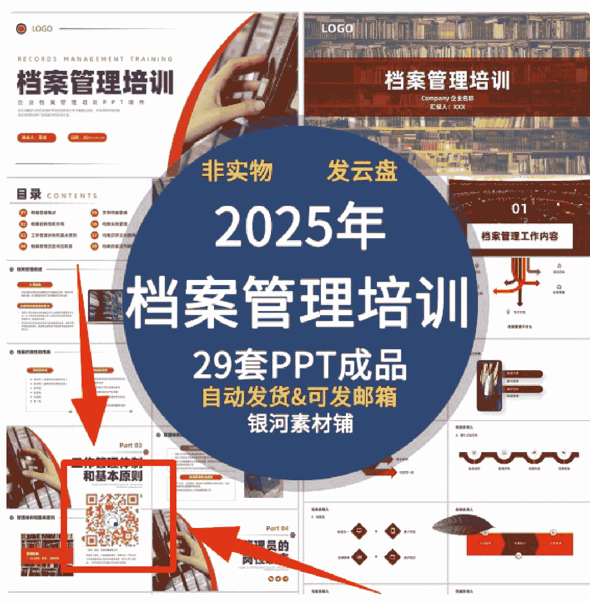

选品有两条经验值得记：

第一，看店铺积累。优先选经营时间长、销量稳定的店，这类品已经被市场反复验证，版权风险相对小。第二，看图是否干净。图片带平台水印、二维码、真人肖像、明星姓名等元素，上架很容易违规，尽量绕开。

爆品裂变的逻辑也很简单：店铺跑一段时间后，找出单多、销量好的品，照着这个品的类目和标准继续搜索同类商品，批量上架，放大收益。

不少人整天想找选品捷径、骚操作。回看电商这些年，套路每年都有，但没过多久就失效，又要重新换。真正把店群做长久的人，做的都是简单事：固定动作、批量铺货、日积月累。与其追求变化，不如守住不变的底层逻辑，把有效动作重复做。

类目怎么选？四个方向值得优先看：

- 学科资料是📕虚拟品里体量最大的赛道，细分足够多，不同年级、不同科目、不同教材版本都有持续需求，最容易出爆品；缺点是竞争也很卷，新手前期出单可能不太稳，要有预期。

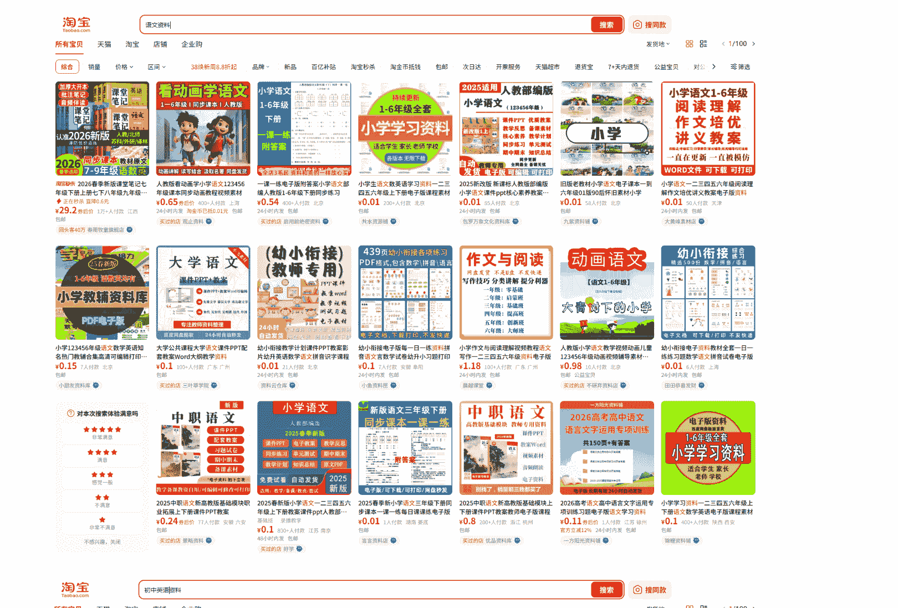
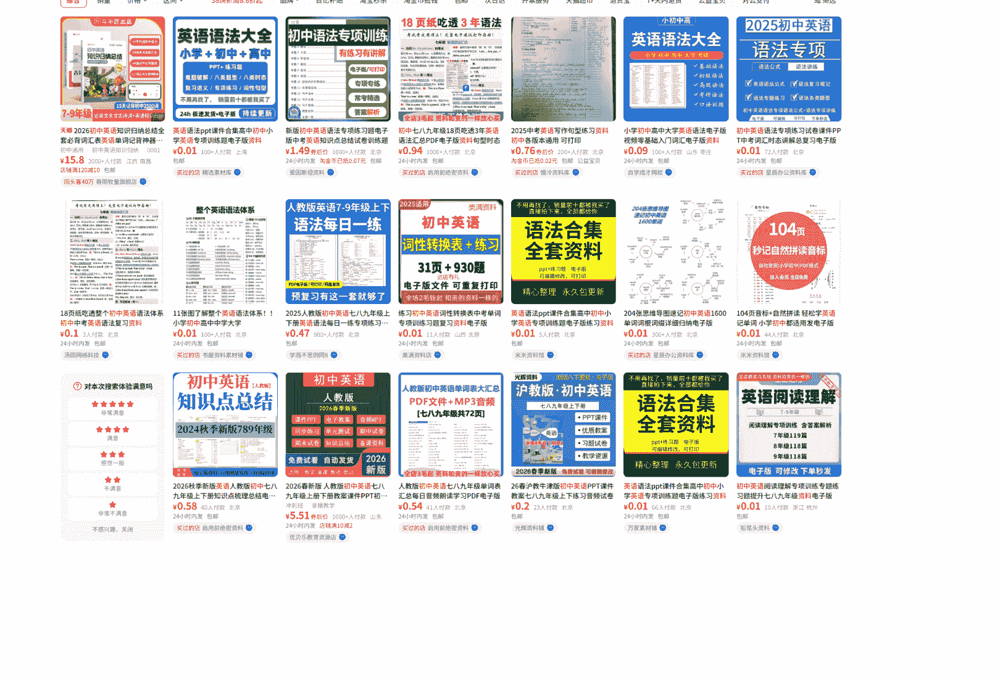

- 课件方向跟学科资料逻辑类似，核心是 PPT，除了学科课件，家长会、年会、活动、学生会、社团等需求也很大，细分场景非常充足。

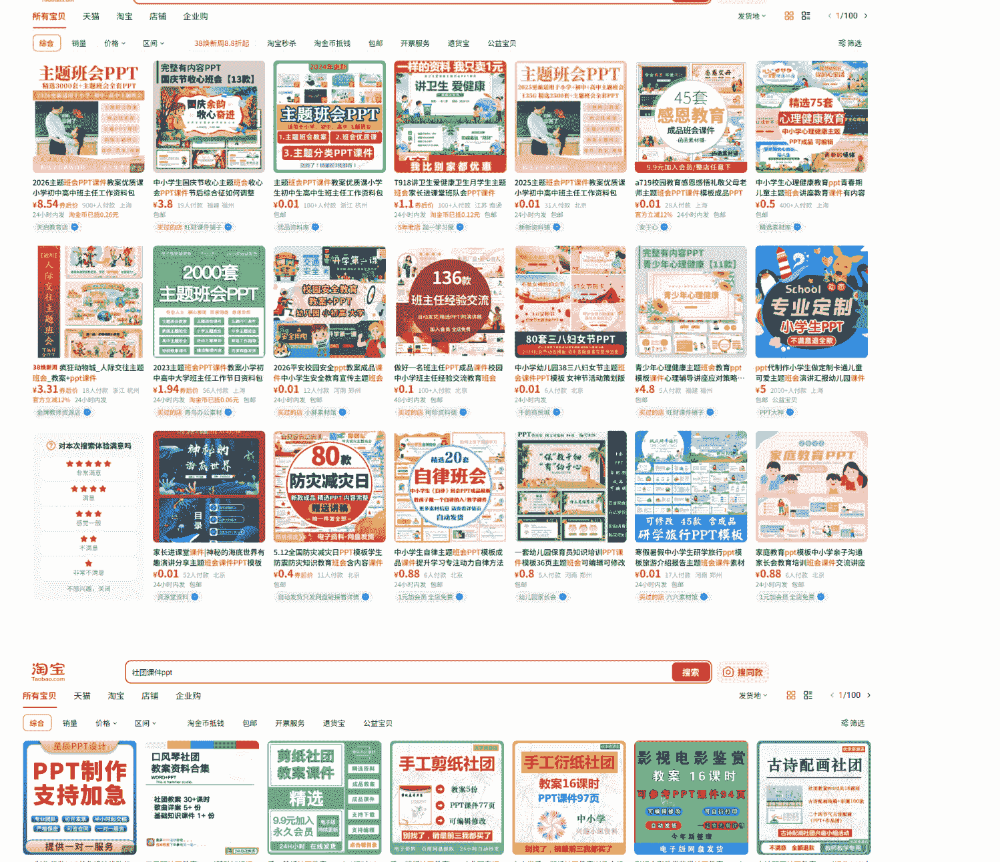
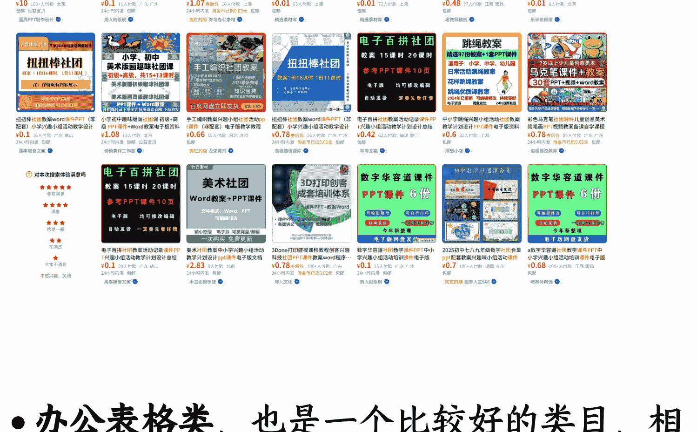

- 办公表格类竞争比前两个小，需求并不少，像合同台账、保险表格这些，能覆盖很多行业，适合铺量。

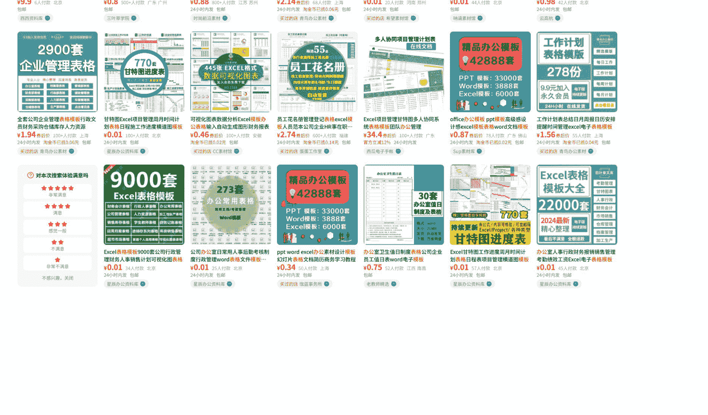
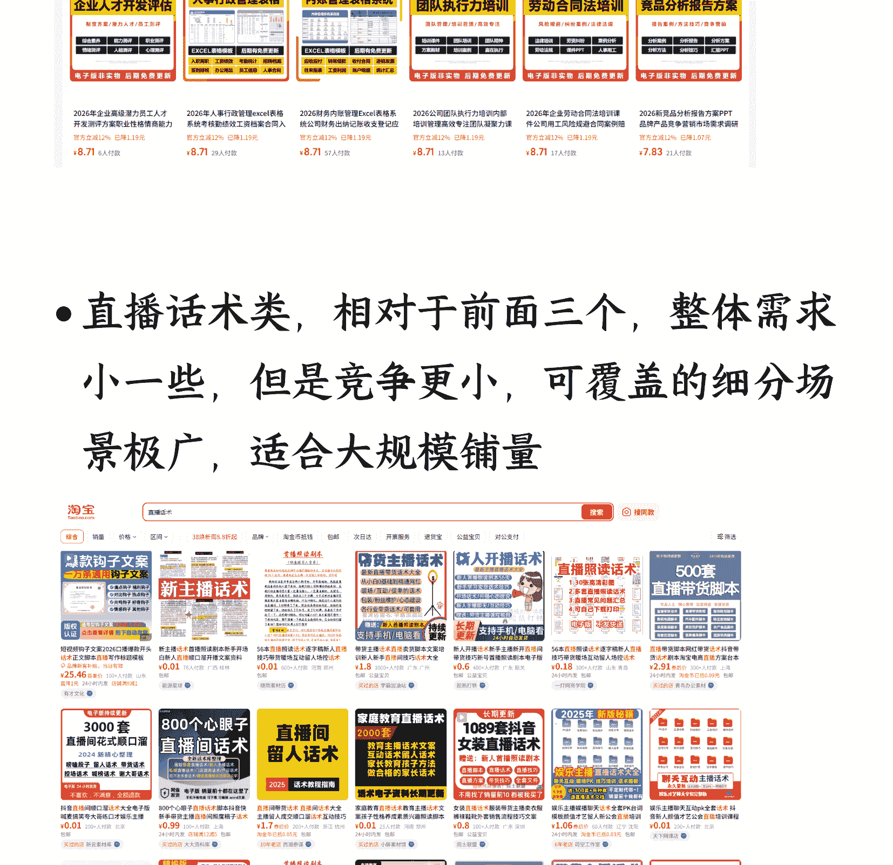

- 直播话术类整体需求小一些，但竞争也小，能细分的场景极多，同样适合大规模铺量。


其他可以参考考试面试、培训、营销策划、运营管理。我们看过大量店铺数据，能长期大量出单的还是大品类；偏门小众类目能出单，但既不稳定也不持续。大品类也不是天天爆，只是店群模式靠多类目互补，今天这个品起来，明天那个品接上，整体收益就能稳住。所以新手不要花太多时间挑类目，多开几个号、用数量换概率，才是普通人最合适的打法。

至于原创，问的人不少：一上来就做原创精品能不能出单？能，也有人做到了，但那是少数。你现在做，能不能出、什么时候出，全是未知数。我们也在做原创，但前提是有稳定营收打底，试错不慌；没有这个基本盘，真的不建议起步就原创。想做原创，也可以先用店群思路做伪原创。很多新人不好意思“抄”，老电商人没这个包袱，先跑通再优化；实在过不了心里那道坎，想想那些靠成熟模式规模化起家的大佬，你比人家强多少？

禁售清单也要背下来：影视、音乐、小说、软件等强版权品；医美、医疗、养生等碰疗效的品；涉黑、涉政、涉黄等违法违禁品；带名人肖像或姓名的品；法律、金融类需要资质才能卖的品；以及所有引流私域、招商、兼职、加其他平台推广的品。这些都是几万个品测出来的红线，轻则限流，重则封号。

在📕跟品，平台已经帮你筛过一轮，但还是要自己判断：别人卖音乐、小说，可能是他有版权，你没有就不要碰，禁售类目照旧规避。

官方给了两个跟品入口：
- 千帆后台的“商品商机”页面：搜“电子资源”，能看到近期热度最高、货源最稀缺的品；
- 乘风后台的“数据-商品洞察”页面：选电子资源类目，可看不同月份的成交排行、趋势热度、推广热度，支持下载数据。

挑销量高、适合自己店铺的品上架即可。


店铺怎么铺货？

一是从淘系渠道铺。付费软件效率最高，市面上常见的红麒麟、羽悦助手、雷霆上货、📕助手，效果都差不多。工具下载和教程地址整理在 https://kdocs.cn/l/coH9jgdtmG84 和 https://kdocs.cn/l/cfdL26eViBS5，卡密可以在闲鱼买，装好就能用。

二是从📕服务市场铺。搜“稿定商品”“妙手商品”这类工具，按提示设置商品信息，上传完成。

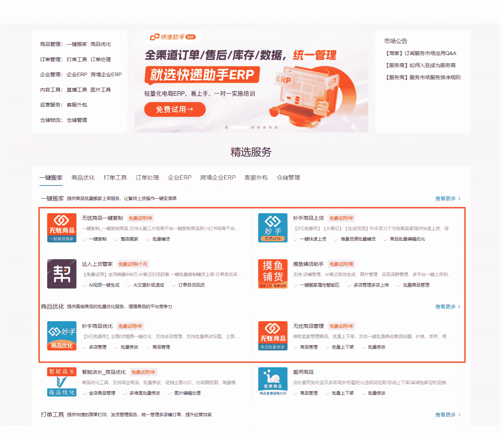
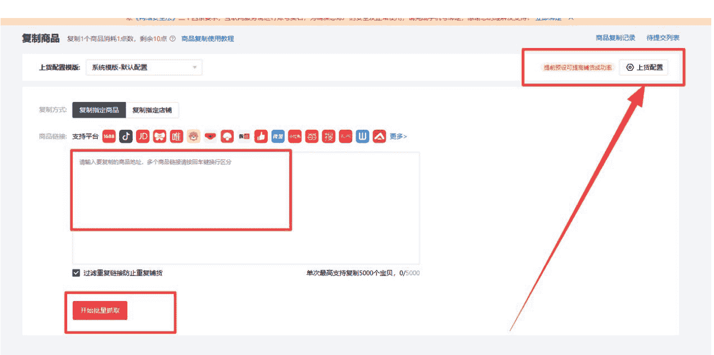

提醒一句：📕单店每天上品不要超过 100 个，超出会被限制 24 小时，节奏要控制好。

最后说笔记量产。早期笔记靠人工一条条写，效率很低；现在可以在飞书多维表格里调用 AI 能力，成批生成笔记文案和图片。具体做法是配置好 AI 字段，输入商品标题和 ID，系统按规则自动生成标题、正文、话题和图片。再配一个发布状态字段，还没发布的记为“待发布”，发布成功后自动变成“已发布”。我们测下来，飞书多维表格是目前性价比和实用性最好的方案。

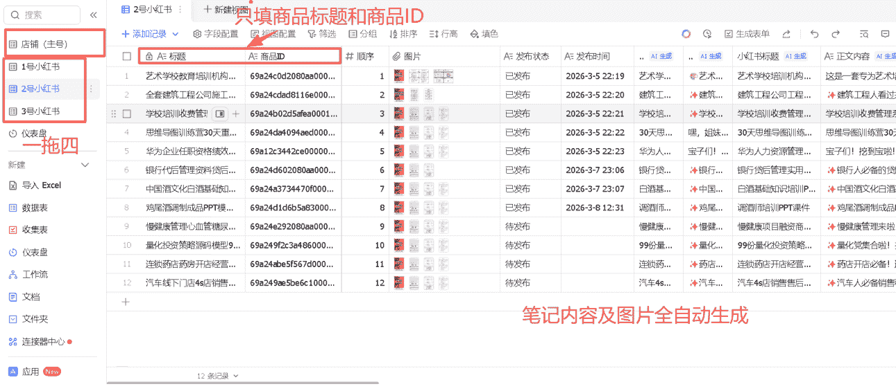

笔记发布用浏览器插件完成，整个生产和发布流程就跑通了。

这个浏览器扩展，是我和 cloudcode 连续打磨三天的成果。整个过程没有手写代码，基本都是靠自然语言沟通完成的。想尝试 AI 编程的朋友，确实可以把它当成一个很好的练手机会。

## 插件怎么配置

进入设置区域后，需要先完成账号与飞书多维表格的连接。将对应的表格标识、访问凭证等信息填入即可。

随后进入任务发布页面，配置每天要处理多少条、何时执行，以及两条内容之间暂停多久。参数保存后，点击启动，扩展就会从飞书表格里读取处于待发布状态的内容，并按照计划依次提交。发送成功后，表格中的状态也会同步更新为“已发布”。

同一浏览器可以同时开启多个插件实例。

连接正常后，系统会显示飞书数据源可访问。若尚未完成授权，需要先补齐下面这组连接资料：

| 配置项 | 值 |
| :--- | :--- |
| 飞书 App ID | cli_a9387f6258f89cd1 |
| 飞书 App Secret | 表格 Token (App Token) |
| 数据表 ID (Table ID) | R21fbilFgadXP8suxQicixEVnWh tblh5sGPdxXnbzOd |

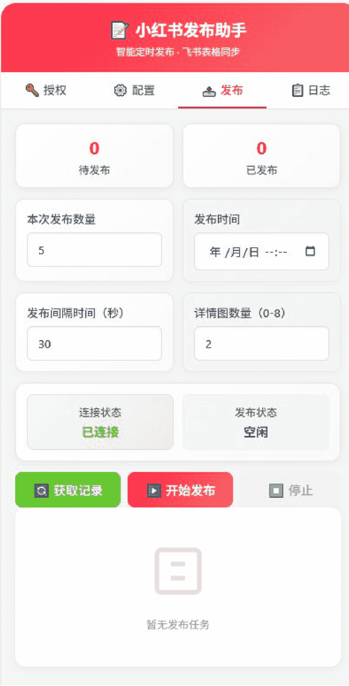


### 字段对应关系

将飞书表格字段与笔记数据逐项对应：

| 字段 | 映射内容 |
| :--- | :--- |
| 标题 | 📕标题 |
| 正文 | 正文内容 |
| 话题 | 话题 |
| 图片 | 图片 |
| 发布时间 | 发布时间 |
| 发布状态 | 发布状态 |
| 商品 ID | 商品 ID |
| 详情图 | 详情图 |

完成后依次执行“测试连接”和“保存配置”。

## 出单后的处理方式

内容发出后，接下来就是等待成交。有人下单，就根据对应需求采购资料，再向用户交付。

处理订单时，可以先复制成交商品的标题，到淘宝搜索相近商品。筛选时先看价格，再参考成交数量。若常规渠道没有找到合适资料，也可以到闲鱼或百度继续查找。


目前观察到的流量结构是：约八成来自用户主动搜索笔记，约两成来自推荐页与商品检索。因此，运营重点应当放在搜索场景，而不是把大量时间分散到投流、刷单或平台活动上。

基于这个判断，项目流程被压缩成几项高频动作：扩大店铺数量、增加商品覆盖、提高内容发布量，然后持续执行和复盘。

## 五、怎样让成交更加稳定

很多人能够拿到第一笔订单，却迟迟无法让数据稳定，问题通常出在早期运营思路不清晰。0-1 阶段可以重点抓住以下四个方向。

### 1. 先扩大样本，再谈稳定

根据多家店铺的实践经验，早期结果往往来自足够大的测试规模。无论采用店群方式还是精细运营，样本太少，就很难形成可靠判断。

刚入场时，可以先把“扩大测试面”作为基本意识。能交给 AI 或自动化流程处理的重复工作，就尽量减少人工投入，先让项目得到正向反馈；等基础收益稳定后，再投入更多精力做原创与深度优化。

先处理成功概率更高的事情，再尝试高收益但不确定性更大的方向。看起来简单粗放的扩量，反而是一种容易复制的做法。样本足够多时，哪怕转化概率只提升一点，也会放大整体收益。

### 2. 提升单店的承载能力

运营多家店后会发现，类似的操作并不会带来完全相同的结果。有的店表现活跃，有的店始终没有起色。经过多轮变量排查，我们认为，账号与店铺虽然存在联系，却不是同一个经营主体。

实际操作中，账号和店铺甚至可以由不同实名主体承载。由于主要访问来源来自内容搜索，店铺表现不佳时，问题往往更可能出在账号端，而不是店铺本身。

因此，我们测试了子账号结构。每个店铺最多可关联 3 个子账号，也就是常说的“1 拖 3”。此前有两家数据偏弱的店铺，各自新增了两个子账号，并让子账号承担内容发布。运行一段时间后，店铺成交表现出现了明显改善。后续复制到其他店铺，结果也较为稳定。

绑定入口：

手机版千帆 → 我的 → 全部工具 → 账号关联 → 关联邀请

参与关联的子账号需要保持正常状态，且没有违规记录，也不能已经开设店铺。

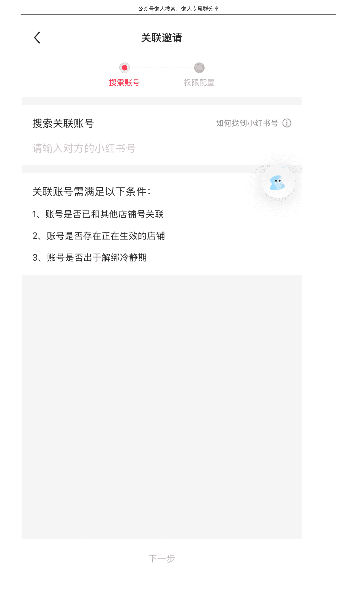

### 手机端工具目录参考

**全部工具**

- 全部订单
- 任务单
- 售后订单
- 售后助手
- 物流设置
- 售后纠纷
- 在线寄件
- 运费宝
- 物流拦截
- 电子面单
- 打单发货

**资金**

- 账户资金
- 货款账单

**成长**

- 数据中心
- 用户资产
- 任务中心
- 薯条推广
- 热搜词
- 账号关联

**营销**

- 优惠券
- 单品特价
- 满减打折
- 赠品
- 直播间秒杀
- 活动报名
- 核销管理

**更多工具**

- 电脑端

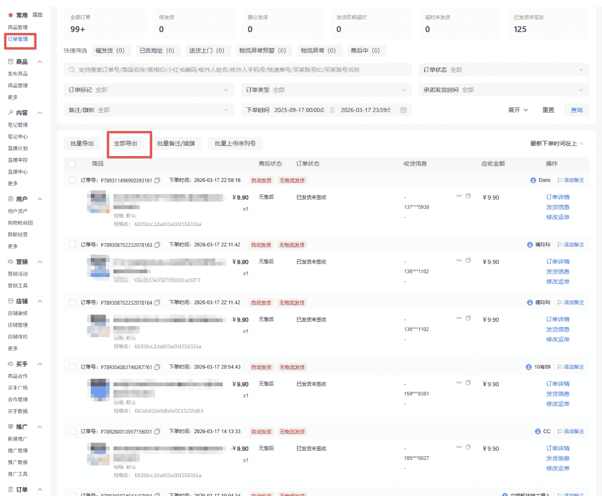

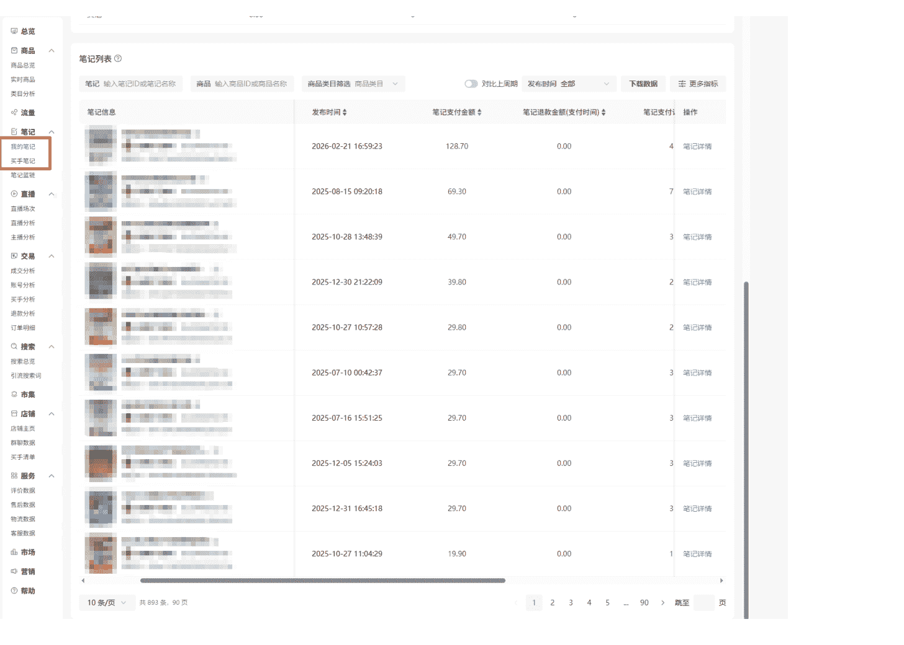

### 3. 让商品和内容持续更新

#### 商品侧

刚开始经营时，可以让每家店先覆盖 300—500 个商品，形成足够的测试范围。此后保持固定上新节奏，每月增加约 100 个新品。新品通常会获得一定的初始曝光，有些商品即使尚未搭配内容，也可能自然产生订单。

经营满三个月后，可以清理首批商品中长期没有成交的部分。

这里的思路不是花大量时间“养”每个商品，而是持续筛选：有成交的方向继续扩展，沿着相近类目和相似类型寻找更多机会。需要注意，商品通常不做查重，但内容存在查重机制。

#### 内容侧

每家店每天可以发布 20—40 篇内容，由主账号和 3 个子账号共同承担；平均到每个账号，每日 5—10 篇即可。

图片方面，较容易规模化的做法是建立自己的视觉模板库，再根据不同商品进行组合调整。模板不是一次制作后永久不变，而是要持续测试、淘汰和升级，慢慢沉淀出质量更高的素材体系。

### 4. 用时间换取复利

这是一个具有明显累积效应的项目。现在产生的部分订单，可能来自七八个月前发布的内容。

它的另一面是见效速度并不快。很多人希望短期看到结果，但这类项目通常越到后期越容易体现价值。有人因为前两个月没有及时获得反馈，便中途停止，最终错过了积累阶段。

找到适合自己的长期方向后，持续执行本身就是竞争优势。时间会把早期动作逐渐放大，因此不要用短期波动否定长期价值。

从开店、选品，到内容发布、订单处理和持续维护，完整路径已经梳理完毕。具体结果仍取决于执行质量、平台规则和实际经营情况，不宜把任何项目简单理解为绝对保证。

## 六、经验总结与常见误区

### 可复用的做法

- 先参考已经验证过的路径，再进行改良
- 通过扩大测试范围尽快获得反馈
- 优先处理确定性更高的环节
- 用 AI 与自动化流程承接重复劳动
- 依据数据调整，而不是凭感觉决策
- 先建立统一标准，再批量执行
- 根据所处阶段安排对应任务
- 重点做筛选和淘汰，不在低潜商品上长期消耗

### 需要避开的坑

- 刚开始不要急着追求完全原创，可以先参考、再优化
- 不要一上手就做复杂精细化，先把基础流程验证清楚
- 不要沉迷低价值操作，始终围绕关键指标投入时间
- 不要把自己关在信息孤岛里，多观察同行和市场变化
- 不要只因短期没有反馈就贸然放弃
- 不要等所有条件完美才开始，先完成，再逐步升级

## 七、常见问题

### 1. 网络和设备如何安排？

由于整个流程以合规经营为前提，我们没有把主要精力放在 IP 隔离上。实际使用过的方式包括：一部摩托罗拉手机开启六个分身承载六个账号；电脑端则曾经同时管理约 15 个账号，使用同一网络环境，暂未出现因 IP 引发的问题。

更重要的是，不要把运营建立在规避平台规则的基础上。即便网络环境被刻意拆分，法人、收货信息、联系方式等仍可能形成关联。真正稳妥的方向，是遵守平台规范，而不是和平台进行对抗。

### 2. 内容浏览量低，如何判断是否被限制？

除非收到平台明确的违规或限制通知，否则不要仅凭浏览量偏低就下结论。

曝光不足更常见的原因，是内容本身吸引力不够、图片表达弱或选题匹配度不足。此时应回到素材质量、标题表达和视觉呈现上继续改进。

### 3. 多家店推广同类商品，会不会造成内容相似？

文字部分可以通过不同提示词和表达方向生成多个版本，避免每次使用完全相同的表述。真正需要重点区分的是视觉素材：图片结构、排版、配色和信息组织都应有所变化。

### 4. 内容数量和质量，哪个更重要？

建议先把内容质量稳定在及格线以上，再扩大产量。数量决定测试范围，质量决定内容能否获得有效反馈，两者并不是二选一。基础质量达标后，还要继续根据数据改进。

### 5. 虚拟资料制作耗时，怎样改善投入产出？

许多原创和精细化操作者都会遇到类似情况：投入数周完成一个产品，最后只产生少量订单，甚至没有成交。

精细化追逐爆款，本身就是概率游戏，无法保证每次投入都对应固定回报。相对稳妥的安排是，先搭建能够持续运转的基础项目，再拿出一小部分时间尝试原创，不让试错影响整体现金流。

如果完整原创超出当前能力和时间承受范围，可以先从改良型内容开始，逐步提升，而不是强行追求高难度创作。

### 6. 面向 AI 托管账号，怎样降低违规风险？

平台通常会关注三个方向：单个账号的发布总量、发布节奏，以及内容质量。这些信息曾与客服进行过确认。

数量方面，可将单账号控制在每天 5—10 篇，并借助账号关联扩大整体承载量；节奏方面，在扩展中加入随机或合理的时间间隔，避免短时间集中提交；质量方面，则应持续升级图片与内容模板，减少高度同质化。

### 7. 如何判断一个虚拟产品选题是否值得测试？

店群思路更重视规模测试，而不是为每件商品投入大量研究时间。

别人卖得很好，并不意味着它放到你的店里也会成交；别人表现一般，但如果在你的账号体系中产生订单，同样值得继续观察。可以先铺开足够多的候选商品，再根据真实成交结果保留、放大或淘汰。用户是否愿意付费，最终仍要看市场反馈。

### 8. 节日或节点型商品要提前多久准备？

如果是明显的时点型需求，通常可以提前约一个月开始铺设内容。

多个账号共同推广同类商品在执行层面可行，但仍要注意内容差异、发布节奏和平台规则。也有人采用不直接挂商品链接的内容形式，再在评论区域放置蓝色链接，具体效果需要结合账号状态和平台政策测试。

### 9. 哪些工作适合交给 AI？

凡是高频、重复、规则清晰的工作，都适合考虑自动化处理，包括资料整理、标题变体、内容初稿、图片批量制作、数据汇总等。

先把流程压缩到最短，再找出每天重复率最高的几个动作，逐项交给合适的工具处理，效率提升会更加明显。

---

看完 SOP，很多人会产生“已经掌握了”的错觉，但真正开始执行时，往往第一步就会停住。

软件和教程只是入门条件，真正拉开差距的，是马上行动，以及能否获得持续更新的行业信息。

如果你想了解近期的变现案例，并和一群执行力较强的人一起拆解项目、验证方法，可以关注我的核心私域：【懒人专属群】。

这里不做空泛讨论，主要围绕商业路径拆解、自动化效率提升，以及已经验证过的实战案例展开。目前系统中已整理 1000+ 套套利实践记录。

👉 查看圈子数字资产详情与参与门槛：

```
https://lazyso.com/insider/
```

认可这套价值观，并准备真正执行的朋友，可以扫码添加🛰️：lazyhelper1


添加时备注：【实操上车】，不闲聊。