# 公众号“贴图”正在成为新的流量入口：普通人如何借垂直内容涨粉、曝光与变现

## 260327 副业 SC 精华

## 公众号懒人搜索，懒人专属群独享

懒人微信：lazyhelper1

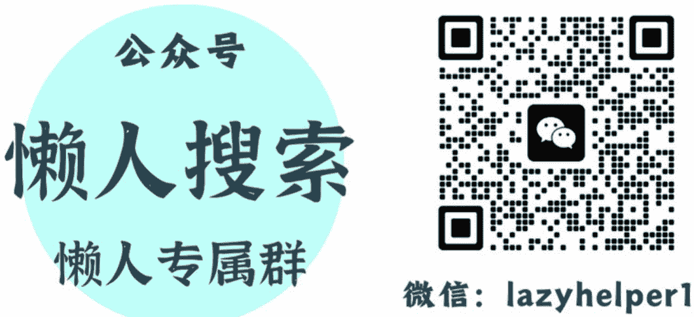

大家好，我是辰风。

最近一段时间，微信里出现了一个值得关注的新玩法：公众号“贴图”。有人把它称作微信版小绿书，也有人把它当作新的内容分发入口。

我是辰风，一名 00 后职场自媒体人。过去 5 年，我持续进行长内容创作，累计写作超过百万字。最近，我也对公众号贴图进行了测试，今天就把这段时间的观察和实操经验整理出来，和大家聊聊这个新赛道。

如果你正在寻找 2026 年的引流机会，想通过内容涨粉、获取曝光、推广产品、卖书，或者把公域流量导入私域，那么这篇内容值得认真看完。

先说明一点：由于我目前测试的账号数量不多，且仍然以长文为主，所以贴图数据并不算特别丰富。下面展示的是目前几个账号中表现较好的一类案例。据我了解，圈内也有朋友跑出过百万级爆款，单个账号已经产生了上千元收益。

单纯看流量分成，这笔钱可能不算巨大；但从曝光规模和后续变现空间来看，贴图的潜力并不小。

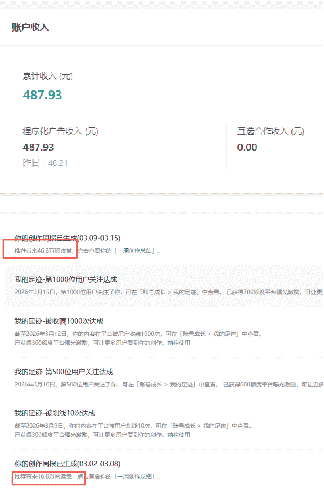

## 一、为什么说 2026 年的公众号贴图，可能是普通人的新机会？

很多人还没有真正理解微信最近的产品变化。

当微信把原本的“图文”逐渐调整为“贴图”，并且在看一看、服务号消息页等位置持续增加入口时，它的意图其实很明显：微信正在争夺用户碎片化阅读的时间，也在尝试与小红书争夺图文内容消费场景。

现在的公众号贴图，还处在一个相对早期的阶段。内容供给没有完全饱和，大型机构也没有全面涌入，对于普通创作者来说，反而存在几个比较明显的优势。

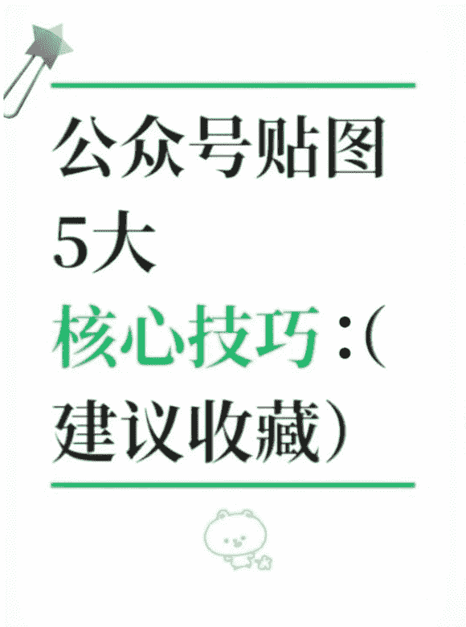

**【公众号配图文案方案】**

星梦的理想

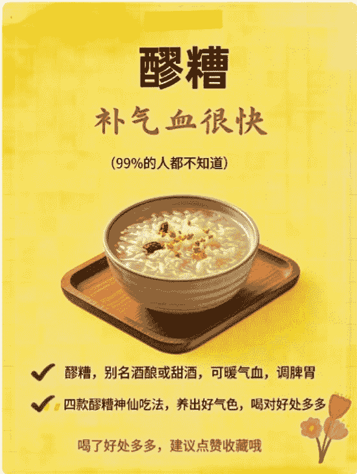

吃出营养和健康

靠自己♡

心之归宿 2025

**服务号**

**贴图**

豆包万能指令·修改要求就能使用

去有光的地方 ing

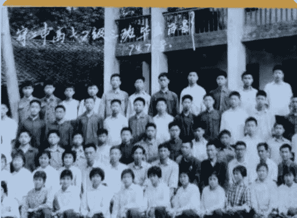

祝我的学生们一切安好！

蓝海知音的自述

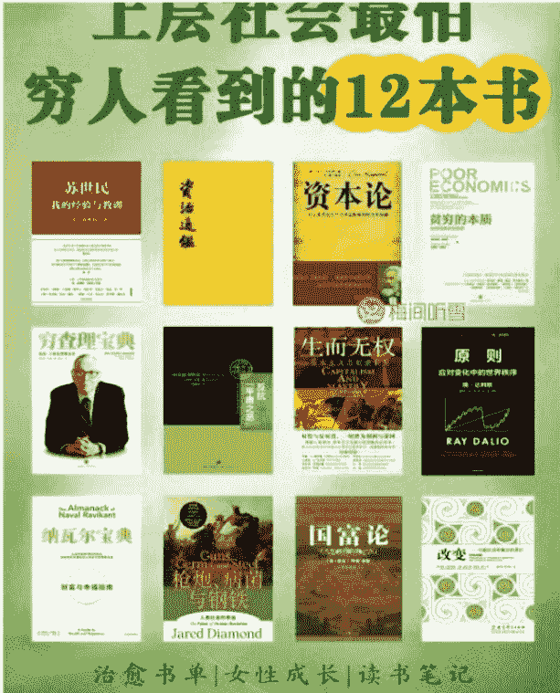

这 12 本书将是你跨越阶层

的开始🔑认知觉醒

32💰03-110 陈林♡

梅间听雪

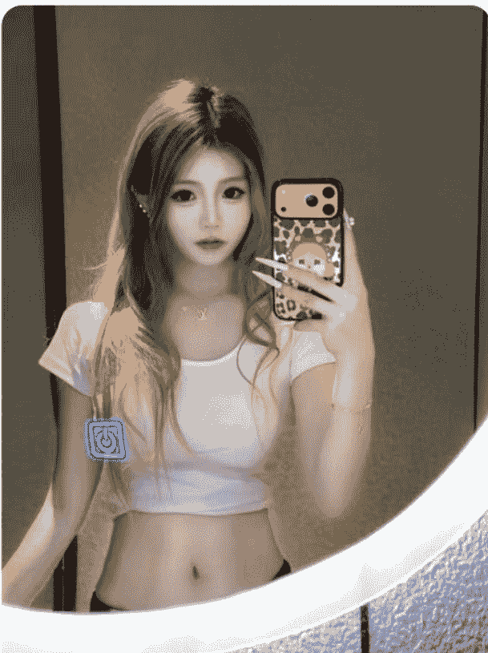

分享图片

茹茹小宝贝

深圳 今年怎么了？

朋友发表

麦子的流量手记

### 1. 大机构尚未全面下场，个人创作者仍有空间

目前，MCN 机构和大型矩阵团队并没有大规模进入贴图赛道。

原因也不难理解：现阶段贴图的直接收益，主要来自留言区广告等方式，单条内容的商业价值还不足以支撑大型团队的运营成本。对于拥有几十个账号、多人协作的机构来说，这种收益暂时不够稳定。

但站在个人创作者角度，这反而是好消息。

没有大量专业团队与你竞争，不需要复杂的自动化系统，也不用投入高额成本。只要一部手机，再加上稳定的内容执行力，就有机会参与其中。

### 2. 贴图对原创的要求相对宽松

与长篇图文相比，当前贴图生态对原创深度的要求并没有那么高。

小红书上已经被验证过的热门内容，可以经过重新排版、调整图片、改写表达后，再放到公众号中测试。由于微信目前需要大量内容来丰富这一新板块，因此对轻度二创内容的容忍度相对较高。

这里需要强调的是，所谓“搬运”和“二创”并不是简单复制。更稳妥的方式，是对图片进行边框、滤镜、版式等处理，再对文案做适度重组。图片可以重新设计，文字也可以借助 AI 工具进行改写，但不要直接侵犯他人的原创权益。

### 3. 微信的封闭推荐机制，形成了天然的细分壁垒

小红书的内容推荐更加开放，一个热门选题很容易迅速扩散，同行也能第一时间发现并跟进。某个赛道一旦爆火，很快就会吸引大量机构入场，竞争随之加剧。

微信的推荐逻辑则不同。它更依赖社交关系、用户画像和兴趣标签，因此很多内容只会出现在特定人群的信息流中。

举个例子，有朋友专门运营“中老年养生偏方”类账号，常见内容包括：

- 一把花椒配生姜，帮助祛湿；
- 每天踮脚十分钟，身体更健康；
- 某些草本搭配能够改善身体状态。

这些内容配图往往颜色鲜艳、字体醒目，视觉上并不精致。对于一二线城市的年轻白领来说，这类内容可能显得夸张，甚至不会产生兴趣。

但对于下沉市场中存在健康焦虑、又缺少医学知识的中老年群体来说，它们却可能被当成实用经验。用户不仅会阅读，还可能点赞、留言，并转发到家庭群。

类似的还有中老年情感、家庭关系、人生感悟等方向。只要你不属于目标受众，可能根本看不到这些内容；而正因为同行也很难看到，运营者反而能在一个相对封闭的圈层里持续积累流量。

这就是贴图的特殊之处：你不一定需要争夺所有人的注意力，只要找到一群明确的人，为他们持续提供内容，就有可能建立起外界难以察觉的流量壁垒。

## 二、选对方向，比盲目追求大流量更重要

很多人一上来就想做大主题，结果虽然有阅读，却没有转化。

贴图真正适合的，是围绕明确人群和具体需求进行细分。只有用户需求足够清楚，后续的产品、服务和私域承接才容易建立。

### 1. 优先选择与你业务相关的领域

如果你手里已经有产品、课程或服务，最好的方式就是围绕现有业务做内容。

例如：

- 减脂与体态管理；
- 国学与传统文化；
- 职业规划；
- 学科资料；
- 闲鱼电商；
- 职场技能；
- 女性成长。

这些方向通常具备较强的问题导向，用户本身就带着需求而来，因此后续无论是售卖产品、推荐服务，还是导入私域，都比较顺畅。

需要注意的是，平台重点监管的灰黑产不要碰，例如夸大玄学、低质祛痘、虚假功效等方向。除此之外，一些已经严重依赖付费投流的行业，也不适合普通人单纯依靠自然流量切入。

### 2. 从你的职业、经历和兴趣出发

你长期接触的领域，往往就是最适合持续输出的方向。

如果你喜欢历史，可以做历史故事和地理冷知识；如果你擅长表达，可以做情感沟通和家庭关系；如果你有职场经验，可以分享工作方法和成长经历。

兴趣并不是装饰，而是决定你能不能坚持的重要因素。一个自己完全不感兴趣的方向，哪怕短期有流量，长期也很容易因为找素材困难、写作痛苦而放弃。

小时候经常挖，却不知道它还能吃呀!

阅读 3.7 万 天津 2025 年 12 月 24 日 13:13

留言 51

写留言

### 3. 把赛道切到足够具体

不要只说自己做“美食”，可以进一步限定为“适合上班族的 10 分钟晚餐”；不要泛泛地做“育儿”，可以聚焦“帮助挑食宝宝改善饮食的营养辅食”。

人群越清楚，需求越具体，内容越容易获得精准反馈。

比如，与其做宽泛的“省钱”，不如做：

#### 月入普通，也能过好极简生活：每月 2000 元怎么安排？

不点外卖、自己买菜做饭，一周食材控制在 100 元左右；减少冲动消费，旧衣服循环利用；上下班优先步行或乘坐公交，把交通支出降到最低。

极简生活并不是委屈自己，而是把有限的钱花在真正重要的地方。每月生活费控制在 2000 元，依然能够存下部分收入，这种对生活的掌控感，往往比盲目消费更让人轻松。

#极简生活省钱攻略 #极简消费习惯 #极简主义生活方式 #省钱小妙招分享 #如何合理规划开销 #掌控生活的秘诀

醉梦看花开

1 人喜欢

阅读 7.2 万 江西 2 月 2 日 12:03

留言 87

- ### 3. 减少不必要的服装消费

过了 30 岁之后，越来越偏爱黑白灰等低饱和色系。比起追逐流行款式，更关注面料、剪裁和耐穿程度。

衣服越简单，反而越容易穿出质感，也更不容易被时间淘汰。

- ### 4. 放下无休止的工作内耗

不再要求每件事都做到完美。工作只是生活的一部分，先把职责范围内的事情做好，不把精力浪费在无关的琐事和过度揣测上。

- ### 5. 清理消耗型关系

年龄增长之后，真正需要维系的关系并不多。与其费尽心思经营表面热闹，不如把时间留给那些能够真诚交流、彼此支持的人。

👋我是悦安，我正在尝试过一种更简单的生活。

🔘关注我，让身体和心灵都轻松一点。

白悦安

喜欢作者

收录于 🗂️ 极简生活

作者提示：个人观点，仅供参考

阅读 2.4 万 湖南 2025 年 12 月 31 日 11:01

+ 关注 191 294 61 19

### 4. 想快速获取曝光，可以关注大流量话题

如果你的目标主要是做曝光和涨粉，可以选择影视评论、热门电视剧、娱乐明星和社会热点等内容方向。

这类题材本身自带关注度，适合参考短视频和小红书图文的选题逻辑，围绕正在热播的影视作品、突发热点或明星事件制作内容。

但要明确：大流量不等于高转化。热点方向更适合用于获取曝光，真正的商业变现仍然需要结合清晰的产品、服务或私域承接。

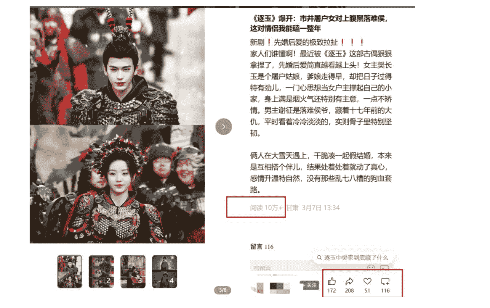

## 三、如何建立自己的爆款素材库？

不要一开始就闭门创作，也不要因为不会原创而迟迟不行动。

更高效的方式，是先去其他平台寻找已经被市场验证过的内容，再结合公众号用户特点进行重新加工。

小红书上已经获得大量点赞、收藏和评论的内容，说明它至少在选题、情绪和表达上击中了某类用户。把这些经过验证的内容重新组织后，放到微信的新流量池中，仍然有机会获得不错的反馈。

这并不意味着可以无授权地复制内容，而是要从选题、结构、情绪和用户需求中寻找规律，再用自己的表达重新制作。

例如，你在小红书搜索“职场沟通技巧”，可以提炼出热门笔记的核心观点，再用自己的语言重新组织，并配上重新设计的图片。重点不是凭空制造全新的知识，而是把已有信息重新整理、包装，并分发到另一类用户群体中。

### 第一步：主动训练小红书的推荐标签

假设你要做“女性成长”，不要只搜索一次就离开，而是需要让平台逐渐确认你的兴趣。

可以这样操作：

- 阅读图文时尽量停留 10 秒以上；
- 视频不要快速划走，尽量完整观看一段；
- 对有价值的内容进行点赞、收藏；
- 保存图片、查看评论区；
- 围绕同一个关键词连续阅读至少 20 篇内容。

当你的行为足够集中，平台会逐步向你推荐更多同领域笔记，素材采集效率也会提高。

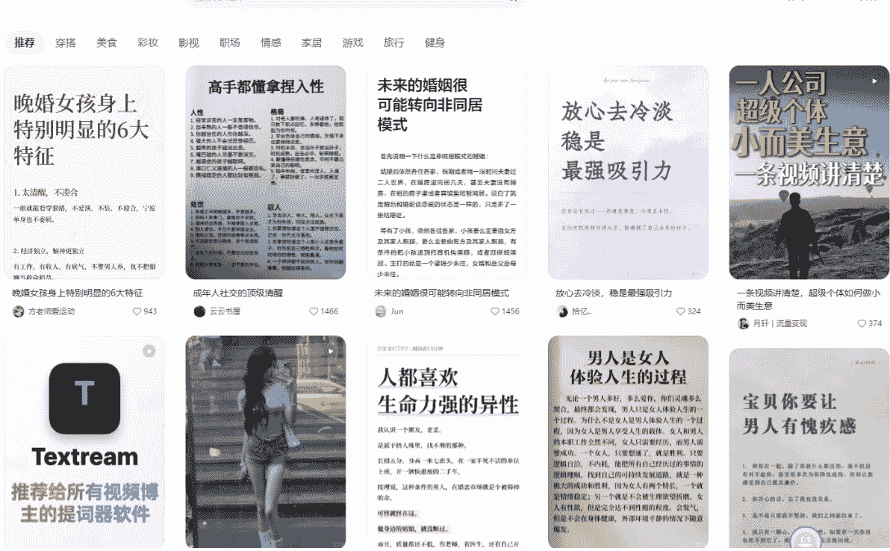

### 第二步：重点寻找低粉账号的高互动内容

完成一轮深度浏览后，返回发现页刷新，系统通常会持续推荐相关赛道内容。

这时不要只盯着大 V。更值得关注的是那些粉丝数量不多，但某一篇笔记数据非常突出的账号。

头部账号的爆款，有时依赖已有粉丝基础；低粉账号突然出现高赞、高收藏，往往说明内容本身的选题、情绪或表达方式足够精准。

这类内容更适合拿来研究和拆解：它为什么能引发共鸣？封面用了什么表达？标题抓住了哪种情绪？评论区里用户最在意什么？

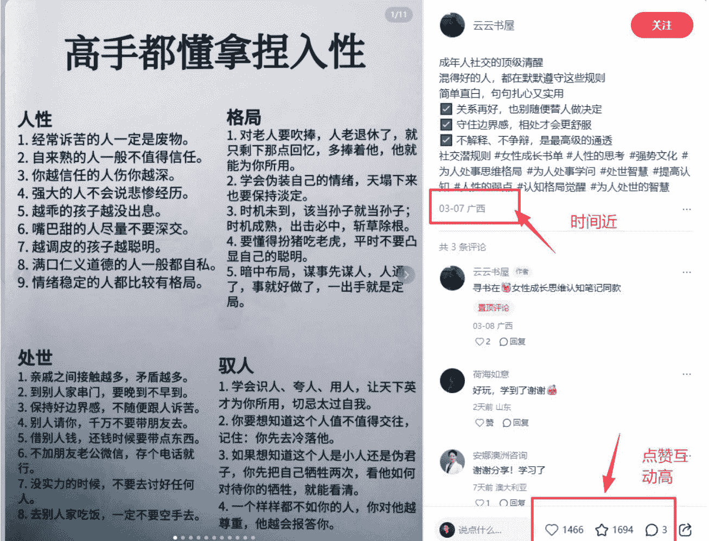

## 四、内容制作：把贴图做成可复制的流水线

贴图内容能不能获得点击，很多时候取决于封面和标题。

用户每天接触大量信息，不会因为你的正文写得很好，就愿意主动打开一张毫无吸引力的封面。因此，内容制作要优先解决“第一眼能不能被看见”的问题。

### 1. 封面设计要遵循五个原则

- 字数尽量精简，第一眼就能看到核心痛点；
- 标题表达直接，不要故意绕弯；
- 关键词要清楚，例如搞钱、减脂、情感、职场；
- 对比度要明显，字体不能太小；
- 一张图尽量交代清楚主题，让用户看完就知道内容价值。

实际制作时，可以研究已经验证过的热门图片，从配色、布局、标题结构中寻找规律，再使用 Canva、醒图等工具重新设计属于自己的版本。

不要直接复制他人的图片和文字，尤其要注意版权、肖像和平台规则。

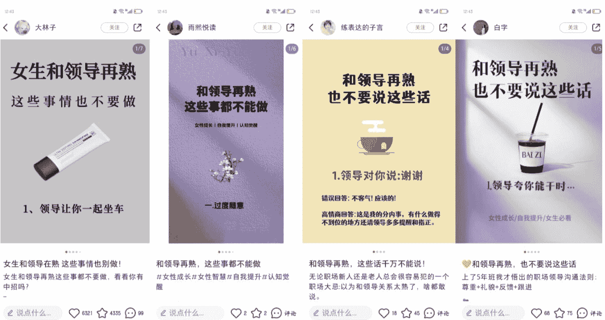

### 2. 标题要利用用户的心理驱动力

高点击标题通常会涉及一些强烈的情绪或需求，例如：

- 金钱；
- 关系；
- 权力；
- 性别；
- 反差；
- 悬念；
- 数字；
- 对比。

同一个意思，换一种表达，点击率可能完全不同。

例如：

- “聪明的女人”可以换成“高情商的女人”；
- “高情商的女人不会因为别人焦虑”可以改成“真正高情商的人，早就学会了断舍离”；
- 做减肥内容时，可以结合大众熟悉的人物或事件；
- 做养生内容时，可以使用用户正在搜索的热门关键词。

不过，热点词必须与内容相关，不能为了蹭流量而制造误导。

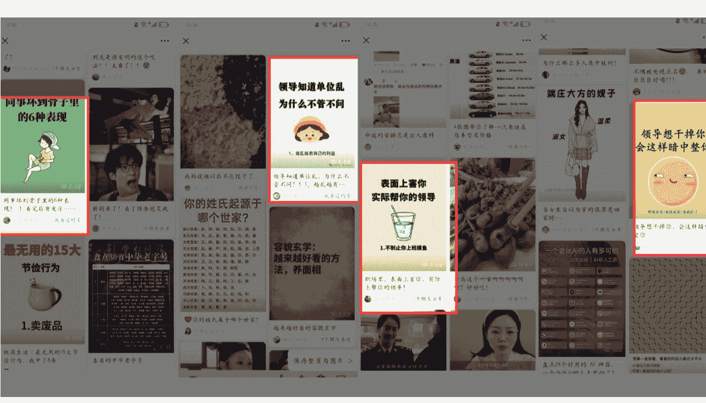

### 3. 正文、互动和发布设置同样影响结果

贴图正文不必写成很长的文章，通常 3—5 句话就可以完成表达。但这几句话不能只是重复图片上的内容，最好增加一点新的信息，比如：

- 你的真实体验；
- 对某个现象的吐槽；
- 具体执行方法；
- 常见误区；
- 个人判断；
- 使用建议。

用户愿意评论，往往是因为内容里有真实感，而不是因为它看起来过于完美。

结尾也可以留下一个开放问题，例如：

- 你遇到过类似情况吗？
- 如果是你，会怎么选择？
- 你认同这种观点吗？

发布之前，还要检查【更多设置】里的功能选项，确认“平台推荐”和“留言功能”已经开启。

留言功能不仅关系到互动数据，也可能影响底部广告收益。很多人内容发出去后没有结果，往往不是内容完全不行，而是关键设置没有打开。

#### 赛道参考

##### 职场赛道：

##### 旅游赛道：

##### 美食赛道：

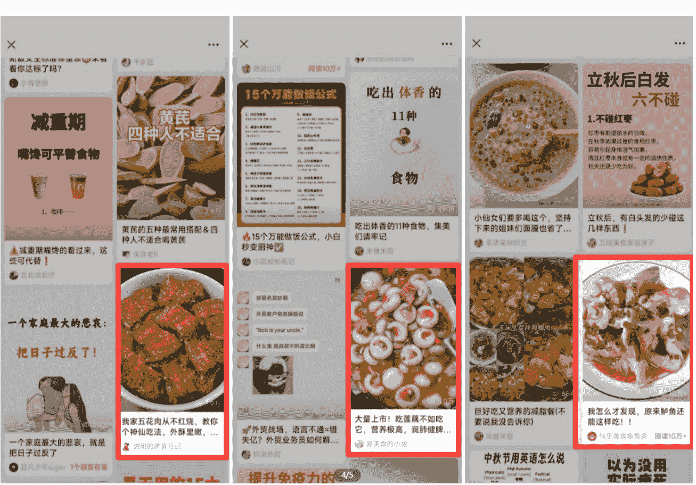

##### 女性气运：

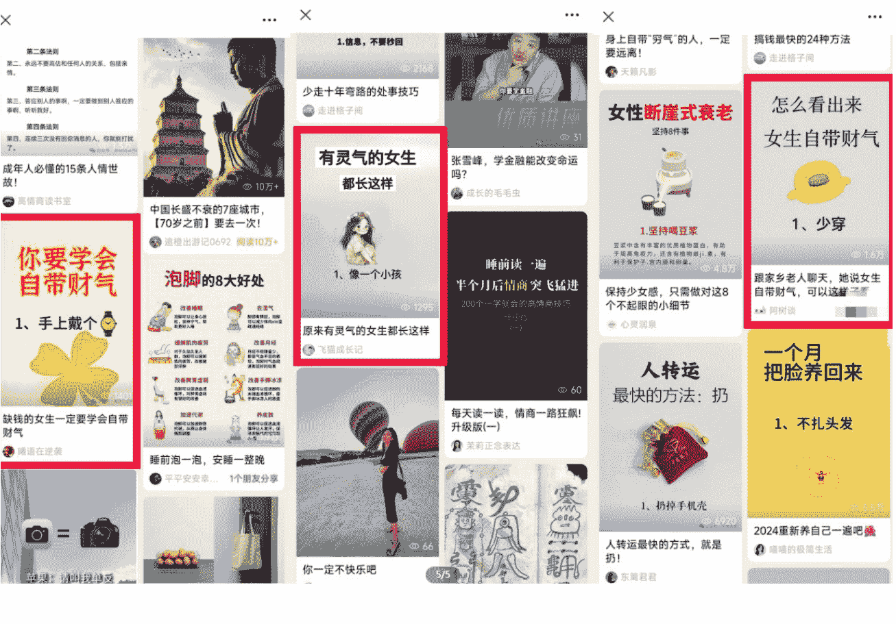

## 五、一个下沉赛道的测试案例

前段时间，我们曾经测试过一个看起来并不主流的方向：老年情书、岁月来信。

这类内容通常不复杂，核心就是用同龄人的语气，写一些关于青春、婚姻、子女、辛苦半生以及“往后余生要学会心疼自己”的话。

放在年轻人的社交圈里，这类文字可能显得有些年代感，甚至会被认为过于煽情。但当内容下方出现打赏入口后，结果却完全出乎预料。

一篇排版非常简单的贴图，一天之内就获得了几百元左右的打赏。即使测试结束、准备注销账号时，团队成员仍然有些舍不得，因为转化来得实在太快。

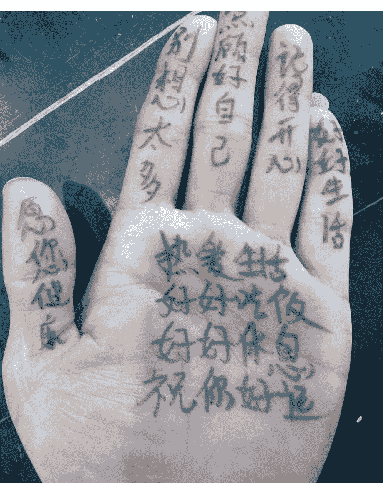

无论每天多忙，都别忘了照顾好自己。累了就停下来休息，不必一直硬撑。人生不可能事事圆满，但身体健康、心情舒展，才是最值得守住的东西。

五十岁以后，真正的成熟是：

不再为了任何人反复委屈自己；

把身体放在更重要的位置；

学会接受生活中的不完美；

累了就歇一歇，难过时也允许自己停下来。

#生活小确幸 #中年生活 #好好爱自己

> “感谢您带来的安慰和鼓励”

> 喜欢作者

> 4 人喜欢

阅读 1.0 万 江苏 3 月 9 日 17:19

留言 200

写留言

白军英 浙江 3 月 18 日

> 感恩遇见，感谢老师关心。往后的日子照顾好自己，我也会好好爱自己🙏🙏🙏❤️❤️❤️❤️❤️

世荣 四川 3 月 18 日

> 谢谢老师的提醒和祝福，您的话让我感觉特别温暖，感恩遇见！

### 亲爱的宝，对不起，我真的错了

2020 年 3 月 6 日 05:58 广东 45 人

> 这句道歉，我已经在心里藏了很久。做错了就是做错了，不找借口，也不把责任推给别人。那时候撒谎，可能只是害怕你生气，可现在才明白，谎言真正伤害的是彼此之间的信任。你可以责怪我，我都愿意接受。只希望你能再给我一次机会，接下来我会用行动，一点点把你的安全感找回来。感情里最重要的，从来不是说了多少承诺，而是犯错之后愿意承认，并且真的改变。

阅读 1288

> 没关系，事情都过去了。谢谢你一直以来的陪伴和关心，也希望我们都能放下过去，好好生活。

> 能够在人前主动认错，说明你足够真诚。知道错了，愿意改，就是很难得的事。

> 过去的就让它过去吧，照顾好自己，活在当下，愿你今后的日子顺顺利利。❤️❤️❤️🌹🌹🌹

> 你不用一直责怪自己，往后好好生活，照顾好自己。

最开始，我们只是想观察一下贴图的打赏功能，并没有设计私域引流，也没有搭建复杂的商业路径。

但真正开始测试之后才发现，微信的内容生态里隐藏着许多我们原本看不到的细分圈层。

我们曾经以为自己偶然发现了一个新机会，后来深入搜索才发现，这个领域早已有不少账号在低调运营，只是它们被分散在不同的推荐池里，普通用户很难察觉。

恭喜靳东首次获得白玉兰视帝，获奖感言真挚而有力量

> “入行三十多年，这是我第一次拿到电视剧最佳男主角。”在第 30 届白玉兰奖上，靳东发表获奖感言时一度哽咽。

凭借《西北岁月》中的角色，靳东获得最佳男主角，这是他第一次摘得白玉兰视帝。

> 6 人喜欢

阅读 7002 广东 2 月 27 日 19:42

留言 396

写留言

韩喜玲 河南 3 月 4 日 回复 6👍

> 晚上好！祝贺靳东获得白玉兰奖。成功来自长期坚持和努力，愿您未来继续拍出更多好作品，新年快乐，事业顺利，天天开心，晚安！👍👍👍👌👌👌

善良 黑龙江 3 月 5 日 回复 4👍

> 你好东先生，恭喜你获得这个奖项🙏🙏🙏❤️

女神妈妈 北京 3 月 4 日 回复 5👍

> 恭喜阳光帅气、才华横溢的靳东老师，能够获得白玉兰大奖非常不容易。一路走来靠的是坚持、努力和实力，愿您事业越来越好，继续给大家带来优秀作品！

这里是敏敏 + 关注 1 个朋友关注

775 64 705 396

#### 为什么大多数人完全不知道这些内容？

因为它们常常被隐藏在非常细的推荐路径里。

如果你不是经常在微信中搜索“转运”“还阴债”“菩萨保佑”等词，也不是被平台识别为某类高敏感人群，那么这些内容可能永远不会出现在你的信息流中。

这正是信息茧房的另一种表现：你看到的，只是算法根据你的行为为你筛选出来的一小部分世界。

当我们真正进入这些细分圈层后，会发现不少内容的制作非常粗糙：

一张 AI 生成的泛黄照片、一辆老式自行车、一杯冒着热气的茶，再配上一段“致 50 后、60 后：辛苦了大半辈子，余生要学会对自己好一点”的文字。

如果把它放进一二线城市白领的朋友圈，可能只会被认为普通甚至空洞；但在特定人群的内容池里，它却可能精准触发孤独、回忆、健康焦虑和情感缺口，并进一步带来点赞、留言、转发，甚至打赏。

所以，公众号贴图真正值得关注的地方，并不只是“发一张图片能赚多少钱”，而是它背后的分发机制：

找到足够具体的人群，围绕他们真实存在的需求持续创作，再通过评论区、产品、服务和私域完成承接。

这才是贴图流量真正可能产生价值的地方。

几十个、上百个打赏接连出现，有些读者甚至直接点到平台允许的最高额度。

很难想象，这样一篇情绪浓烈的图文，配图和文字都由 AI 完成，花费不到一毛钱，制作时间也不过几分钟，却能让账号单篇获得数百乃至上千元收益。它不需要物流，也几乎没有售后，成本低到近乎可以忽略。

这套做法瞄准的，是那些渴望倾诉、盼望陪伴、希望有人理解自己的老年用户。也正因如此，当打赏生意迅速膨胀，甚至演变成灰色产业的狂欢时，平台很快采取了行动。

近期微信的规则调整，显然不是泛泛而谈，而是直接针对这类玩法：

其一，新注册的账号无法马上开通打赏，需达到一定注册时长，才有申请资格，批量注册、快速起号的路被堵住了。

其二，打赏准入和审核明显收紧，风控措施也随之加强。

最重的一击，则是对过往违规行为的追查。利用玄学许愿、极端情绪煽动，或专门消费老年人孤独感来博取打赏的账号，遭遇集中清理。曾经收入可观的矩阵号，一夜之间被封禁，甚至连申诉渠道也没有。

有人因此断言，这条路已经走不通了，红利彻底结束了。

但与其惋惜那些被封的账号，不如认真看清它们为什么曾经有效：**被平台清理的是违规的变现方式，而不是人们真实存在的情绪需求。**

平台可以禁止用煽情内容诱导打赏，却无法消除老年人夜深时的寂寞、无处表达的委屈，以及对陪伴和理解的期待。

这些需求不会凭一轮封号就消失。被淘汰的，是那些过度收割、触碰规则的人。对真正理解用户、尊重平台规则的人而言，行业洗牌也意味着竞争环境被重新整理。

不能再靠刻意煽情诱导打赏，那么，提供中老年心理陪伴、记录人生经历、讲述岁月故事，是否仍有空间？不能直接要求付费，能否先提供怀旧歌曲合集等免费内容，再通过合规方式经营用户关系，进一步推出怀旧日历、听书设备、个人回忆相册等产品？关键不在于换个包装继续收割，而在于能否为用户提供真实、有价值的服务。

**流量背后是情绪需求，生意的核心则是解决真实的匮乏。**

比如，一段讲述放下旧情的文字：

放下一个人，不一定意味着彻底忘记。

有些感情走到终点，就像两个人来到岔路口。不是谁做错了什么，只是后来选择了不同的方向。

曾经认真爱过的人，心里未必立刻没有了牵挂。但当一个人终于清醒，便不会再用执着挽留谁。感情也许还在，骄傲却提醒自己，已经走到了该停下的地方。

你没有敷衍，也没有给自己留退路。能给的诚意，已经全部交付。若故事最终没有圆满，遗憾不该只由你承担。

每段旅程都会有落幕的时候。这一次，就安静地告别吧。那些泥泞和风霜，留在身后；整理好自己，继续向前。

依依 Ease

“谢谢你，曾照亮过我的世界。”

喜欢作者：4人  
阅读量：10万+  
广东，2025年12月27日21:38，已修改  
留言：146

当你因为别人被封而担心时，也应该看到另一面：在这个常被忽略的市场里，存在着大量重视情感连接、愿意为情绪价值付费的人。

别试图跟平台规则对着干，而要理解规则所保护的用户、以及用户真正需要什么。只有这样，才能在这个领域做得长久。

## 六、从内容曝光到商业闭环

如果贴图只是为了赚取评论区广告收入，没有爆款支撑，收益往往有限。但要是能把贴图内容、垂直账号和电商业务串联起来，整体价值就会大得多。

贴图可以承担涨粉和触达用户的作用。积累到一定规模后，可以围绕细分领域持续输出有用内容，或用差异化选题建立账号特色。

### 用内容引流到私域

有个虚拟产品领域的案例很有代表性。

一位创作者持续发布学习资料类贴图，例如名校历年试题易错点、小学数学知识结构图等。文章末尾附上一句提示：回复关键词“资料”，即可领取高清完整版 PDF。

这个简单的入口，吸引了不少精准的家长用户进入她的个人微信。

进入私域之后，商业空间就不再局限于几毛钱的流量收益：实体教辅可以带来几十元利润，线上课程的单笔收入可能达到数百元，家长陪伴社群也可以采用年度付费模式。

贴图是引导用户的入口，私域则是长期经营关系的场所。

有些人还在纠结一篇内容有没有点赞，而更成熟的运营者会思考：点赞的人是谁？他们正在为什么事情发愁？我能提供什么真正有帮助的产品？这就是经营认知上的差距。

不少人对微信图文笔记和视频号存在刻板印象，觉得内容偏中老年、风格不够时髦，因此没有商业潜力。但这样的判断，很可能让人错过机会。

在熟悉微信生态的人看来，中老年和下沉市场并非没有价值。用户往往使用习惯稳定、对平台信任度高，也有时间和一定的消费能力。微信的商业路径早已不止广告分成，而是可以形成多层次的经营闭环：

### 1. 前端：流量主广告

达到平台要求并开通流量主后，文章可以展示广告，这是相对基础的收益方式。内容若能带来有效讨论和评论互动，就有机会增加广告曝光。

### 2. 中端：商品销售与内容带货

贴图内容同样可以连接电商。比如围绕养生、居家生活制作内容，在分享季节调理经验时，搭配视频号小店中相关商品的介绍。

微信依托社交关系和熟人信任，用户对平台内购物的接受度可能更高。若内容、商品和视频号推荐形成配合，优质作品便有机会带来较好的销售表现。需要注意的是，产品必须与内容相关，宣传也应真实合规。

### 3. 后端：经营私域与个人品牌

还可以通过资料领取、内容福利等合理方式，让公域用户主动关注个人微信或企业微信，在持续服务中逐渐建立联系。

这时，账号就不只是发布内容的渠道，也可以成为一个有明确定位、能持续提供价值的个人品牌。通过朋友圈分享、社群交流和有边界的个性化服务，逐步积累信任。

当关系建立起来后，提供的服务也可以更加丰富，例如课程、陪伴服务、咨询或品质可靠的商品。但用户的长期价值，来自持续交付和信任，而不是把人加进微信后立刻高频推销。单个精准用户的长期价值，有时确实远高于大量短暂的阅读量。

### 需要避开的四类风险

看懂商业模式，并不意味着一定能稳妥经营。以下问题尤其要重视。

#### 风险一：触碰平台规则

微信对违规内容的审核严格，面向中老年用户时更要谨慎。

养生和医疗内容不能使用“包治百病”“降三高”“祖传秘方”等夸大或绝对化表达，也不能用暗示方式替代违规承诺，否则可能面临限流甚至封号。

文章中也不要使用强迫关注、转发等诱导话术，例如要求用户转发到特定群聊，或用“不转就怎样”施压。平台会通过文字识别和语义判断处理此类内容，违规还可能影响打赏、流量主等功能。

#### 风险二：过度营销，消耗用户信任

用户愿意添加联系方式，往往是因为内容带来陪伴感、知识帮助或情绪慰藉。若刚加好友就连续发送商品链接、频繁刷屏推销，很容易让人觉得此前的交流只是为了卖货。

更稳妥的做法，是先持续提供免费且有用的内容，分享适度的生活信息，回应用户需求，慢慢建立信任。等用户确实有相关需要时，再以自然、透明的方式介绍产品或服务。

#### 风险三：忽略售后，影响店铺经营

通过视频号小店销售商品时，要考虑部分中老年顾客不熟悉退款、物流查询等操作。遇到问题时，他们可能会直接向平台投诉。

若客服响应迟缓、产品质量不稳定、退款纠纷不断，店铺评分就会受到影响，后续推荐和经营资格也可能受限。面向这一群体销售，商品质量、说明清晰度和耐心服务都不能打折。

#### 风险四：完全依赖 AI 批量生产

AI 可以辅助写作、润色和制作配图，但不能代替真实观察与判断。批量生成的内容短期内可能偶尔获得流量，长期却很难建立有辨识度、值得信赖的个人品牌。

中老年用户也能察觉内容是否空洞、套路是否重复。若账号没有真实的人设，也缺乏切实的情感理解，粉丝数量再多，也未必能转化成稳定关系。AI 应该提高效率，内容核心仍要由创作者把关。

记住：公域运营要有增长意识，私域经营更要守住诚信与服务。

## 最后：能不能做起来，取决于是否行动

做自媒体，尤其是面对变化很快的内容机会，光研究理论远远不够。真正重要的是持续观察、快速测试，并在合规范围内执行。

别急着用自己的审美去否定那些看起来不够精致的内容。去研究它们为何能引发共鸣，分析标题和表达方式，再结合自己的理解，做出适合目标用户的内容。与其站在旁边评价，不如亲自验证。

我最初也曾觉得图文笔记不过如此。直到真正做过小红书，才意识到这种内容形式的价值，也因此错过了去年小绿书借助流量主变现的阶段。

当时我们曾通过把小红书图文内容发布到公众号，单个账号做到月收入两三千元，靠的是持续更新和内容爆款。这样的机会大约持续了半年，后来平台收益方式发生变化，主要剩下评论区广告。

到了2026年，与其坐在岸边评判水流，不如亲自下场试一试。先行动、再复盘，才能真正知道机会在哪里。

我是辰风，关注商业价值，也希望你能靠自己的能力获得收入。

愿每次相遇都带来一点收获，也祝大家在实践中找到适合自己的赚钱之道。

——

读完这套流程，可能会觉得已经掌握方法，但很多人真正开始操作时，依旧会卡在第一步。

工具和教程只是入门条件，能否立刻执行、能否接触到真实的一线信息，才更重要。

如果你想了解新的商业实践，也希望和一群愿意动手验证的人一起交流，可以了解我的私域社群：【懒人专属群】。

我们专注拆解商业闭环与 AI 效率工具，不谈空泛概念，社群中已积累 1000 多个经过实践验证的项目案例。

👉 查看社群介绍、数字资产及加入条件：

https://lazyso.com/insider/

认可这些内容、也准备亲自实践的朋友，可扫码添加微信：lazyhelper1

![二维码图片]

![二维码图片]

添加时请备注：【实操上车】，暂不闲聊