# 走过十年内容创业，在 AI 时代我留下的三点体会

## 一个资深博主的真实复盘

260327 副业 SC 精华

整理：公众号懒人搜索，懒人专属群精选

懒人微信：lazyhelper1

作者：马小帅

各位生财圈友，幸会。我是公众号“网罗灯下黑”的主理人马小帅，圈里人都叫我黑哥。

说句实在话，我在生财很少发帖，多是潜水。今天受朋友之邀，把这十年的心得翻出来，跟大伙儿聊聊。

先交代下近况。我现在河南一所高校工作，负责新媒体相关事务。2016 年前，我在某省级党报的新媒体部门做产品经理，参与过全国两会报道。因为工作原因，我很早就开始接触微信公众号，当时就负责微信端的内容编辑。

那会儿上班很忙，但心里始终藏着个念头——我想有一个属于自己的号。

2016 年我告别报社，回到老家南阳，进了高校。学校的生活节奏舒缓不少，属于自己的时间多了，那个念头终于有机会落地。2017 年 9 月 15 日，“网罗灯下黑”正式上线。

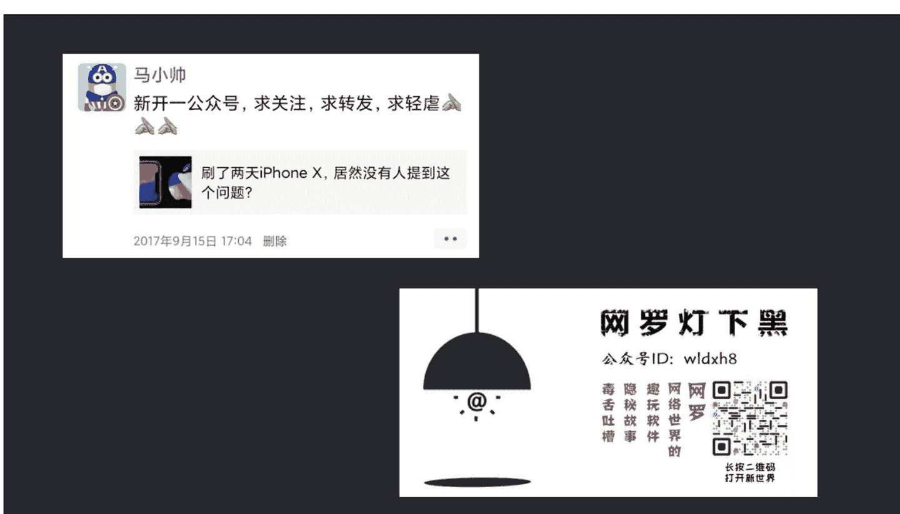

名字的由来，顺便解释一句。“灯下黑”这个词，指的是近在眼前、却被我们忽略的东西。这个号这些年想做的，恰恰就是把这些你天天用、却不晓得还能怎么用的工具和技巧，捡出来讲透。

大家看到的这张截图，是当年留下的记录。到现在，这个号已经快满十年了。在 AI 内容这个方向上，我的排名通常稳在前十，运气好时能到前五。这里有几张排名截图，大家可以过目。说句“头部 KOL”，应该不虚。

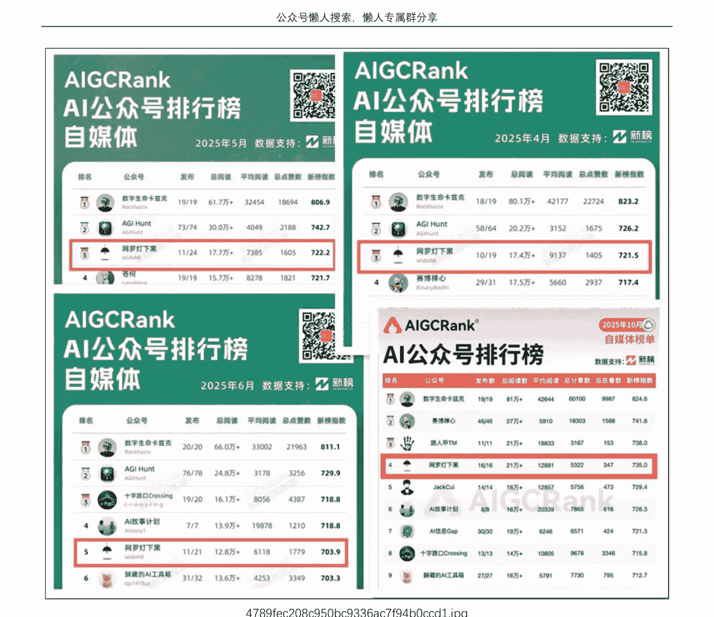

今天这场分享，大概一个小时，我打算围绕三个点来讲：

第一，从零起号：怎么从真正的需求出发，找到适合自己的细分方向；
第二，穿越周期：为什么说个人 IP 和审美判断，是你最宽的护城河；
第三，效率突围：如何用一套原创提示词，复刻自己的文风。

这三件事，是我做了近十年内容，栽过跟头、走过低谷之后，觉得最要紧的。不是什么高深理论，全是真实复盘。

## 上篇：从 0 到 1

### 从真实需求切入细分赛道，具体怎么操作

### 1. 先泼盆冷水：AI 自媒体没那么好做

讲起号之前，我想先聊一个很多人没考虑过的困惑。

总有人问我：AI 这么火，搞 AI 方向的内容号是不是特别容易？

我的答案完全相反：难多了。

原因不复杂。门槛一低，人人都能进场。AI 能写东西，早就不是秘密，几乎人人都会用。可问题也来了——当所有人都能批量产出内容，读者凭什么非看你不可？

我自己有个标准：一篇文章想立住，得同时满足三件事——对读者有实实在在的好处，对品牌方有投放的价值，对创作者自己过得了良心关。三样缺一样都站不住。

说到底，真正让你不可替代的，还是文字里带出的“人味儿”。AI 能替你动笔，却替不了你的判断、你的阅历、你的视角，也替不了你对读者真实处境的感知。

AI 时代就是这么拧巴：写作的门槛降了，但好内容的标准却更高了。这是最难的挑战，也是最大的机会。

机会具体在哪儿？我放一组数字。

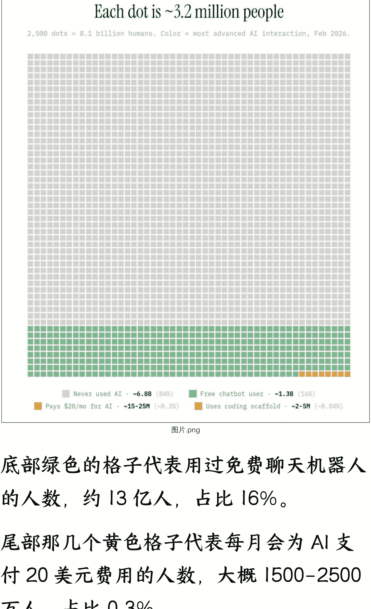

底部绿色那块，是用过免费聊天机器人的人，约 13 亿，占 16%。

旁边黄色那块，是每月愿意为 AI 掏 20 美元的人，大概 1500 万到 2500 万，占 0.3%。

最右边红色那块，是碰过 Claude Code、Cursor 这类代码生成工具的人，只有 0.04%。

剩余 84% 的 68 亿人，从没用过 AI。

这意味着什么？AI 想要真正普及，路还长得很。别看我们整天被各种 AI 消息轰炸，好像全世界都在用，但技术要下沉到最普通的群体，还需要很多年。在这个过程中，市场永远缺一类人——能把复杂技术翻译成大白话的“翻译者”和“向导”，把信息一层一层传下去。

这正是 AI 自媒体最大的机会。

所以我今天不聊怎么快速赚钱，只聊怎么做成一个有价值、有内核、扛得过周期的 AI 内容号。等你内容做好了、人设立住了、粉丝信任攒够了，打开率、阅读量、涨粉都会跟着来，甲方也会主动登门。这是顺理成章的事，但前提是，你得熬得住前面没人理你的日子。

### 2. 起号心法：帮读者做完一件他们没空做的累活

好，讲回我自己，这个号当年是怎么起来的。

我从小就喜欢数码科技，常年泡在里面，对这类产品还算敏感。当年微信、QQ 的新用户排行榜，我都排得很靠前。对这个领域，我一直没断过关注。所以后来时间宽裕了，开这样一个号，算是顺理成章。

但号开好了，写什么？

这才是真正要命的问题。

那会儿移动互联网刚起来不久，工具和信息的量是爆炸性的。东西一多，怎么筛选反而成了读者最大的麻烦。

### 我想明白了一件事：你真的会用你的手机吗？同类产品那么多，究竟哪一款才适合你？

这个疑惑，几乎人人都有，但没多少人愿意花时间挨个试。行，那我来。

所以号子刚起步那阵子，我开始做一种“论文级”的产品评测。

比如 OCR 识别准确率测评。做法很简单：挑一张图，喂给市面上所有主流 OCR 工具，让它们各自识别，再把每家的结果跟原文逐字对照，算出准确率，排出名次。

说起来轻巧，真做起来才发现，Word 自带的文本对比功能、各种代码小工具，全都派不上用场——它们的逻辑是，一行字不管错几处，都只算一个错，根本没法体现字符级别的差距。我想要的对比是：这家识别 100 个字错几个，那家识别 100 个字错几个，放一起比，谁更准。

找遍了现成工具，没一个能干的，最后只能靠手，一个字一个字地核。

还有语音输入法准确率测评，同样不省心。除了常规的识别率，我还加了方言识别，又考察各家输入法在英文大小写、自动空格、标点补全这些排版细节上的表现，再按权重打分，最后凑出一套更接近日常使用场景的综合评测。

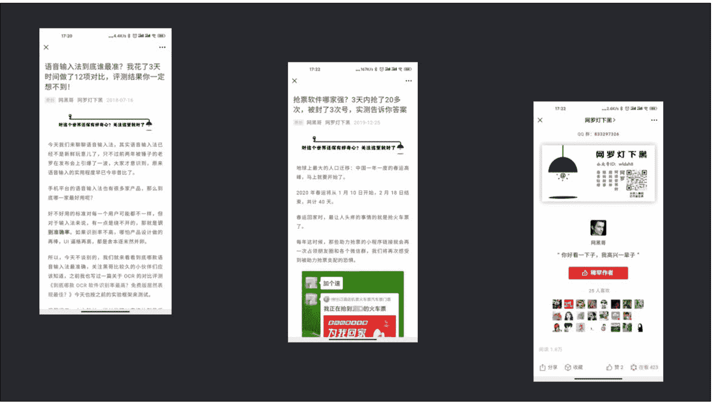

这种评测做起来别提多累了，每篇都跟写论文一样。可怪就怪在，每回发出来数据都特别好。

我还专门做过一次对比：一篇 10 万+ 的普通爆文，大约能带来 2000 个新粉丝；我的文章阅读量大多在 1 万上下，差了一个量级，却能带来近 1000 个精准粉丝。原因很简单，在这个细分领域，愿意把一篇 3000 字评测读完的人，都是真有需求的人。精准，比数量值钱得多。

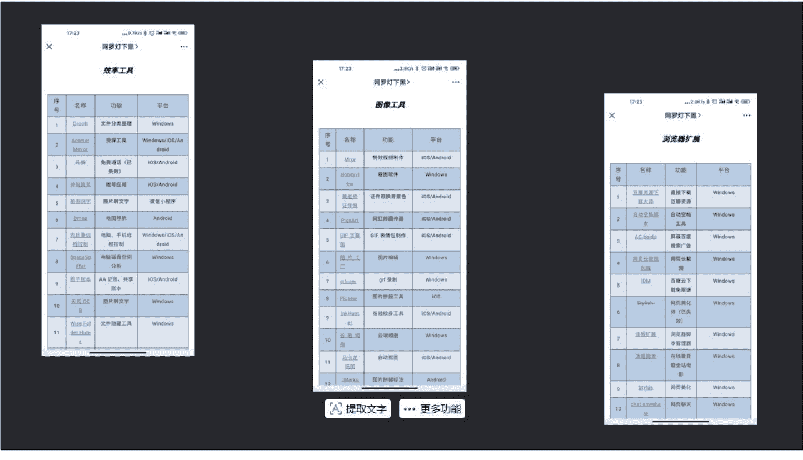

另外，这些内容我也会同步发到知乎。那会儿知乎的测评内容流量也很猛，两个平台互相导流，我的前期读者基本盘就这么攒下来了。

你写下的每篇文字都在变成积累，积累又变成别人的信任，信任就是你的壁垒。早年间埋下的每一分用心，说不准哪天就用一种你想不到的方式回报你。

### 3. 同样的路数，放到今天照样走得通

听到这儿，可能有人会说：这都是七八年前的经验了，搁 AI 时代还灵吗？

我讲一个刚做完没多久的案例吧，证明这套打法到现在照样成立。

现在大家拿大模型处理文档，常碰到一个挺邪门的情况：同一个链接，A 模型打开没问题，B 模型也能处理，到 C 模型就废了。普通人碰上这种事儿，除了猜就是一个个试，赌对了省事，赌错了认栽。

我查了很多资料，翻了不少文档，发现市面上根本没有人做过一份权威的基准测试，系统地告诉大家：哪个模型能读哪些链接，成功率是多少。

没人做？那我自己来。

一开始，我想着现在都是 AI 时代了，干脆让 Agent 来跑。当时用的是 OpenClaw，拿 Playwright 模拟真人浏览器的操作，把链接一条一条塞进各个 Chatbot 的对话框，让它们分别总结，再比对总结的质量。

想法听着挺圆满，现实却给了我一巴掌。

这个测试磨了整整 5 天，反复跑了六七轮，每一轮出的问题还不重样：

第一轮：模型压根没有内容基准。我们让它去判断各家大模型有没有把链接内容总结对，可问题在于，AI 自己判断“总结得对不对”这件事，本身就不可靠——每个链接它都说自己行，可总结出来的东西，有些简直是风马牛不相及。这就是大模型的幻觉，它自己还觉得自己挺对。

第二轮：测试刚跑到一半，模型突然冒出一句：“天不早了，剩下的我直接预估吧。”好嘛，它倒学会给自己省事儿了。

第三轮：换招，试了试无头浏览器，想绕开一些检测机制，照样不行。

第四轮、第五轮……每一轮都能冒出新的幺蛾子。总之前前后后跑了六七轮，没一轮能给出经得起验证的结果。

最后，还是老老实实回到人工。

4 家国产模型、8 家海外模型，凑齐 12 个；11 条不同类型的链接。12×11，一共 132 次内容总结测试，全部手动跑完，每一次都逐字核对总结质量，最后做出一张明明白白的对比表，告诉所有人：哪些模型能读哪些链接，哪些读不了。

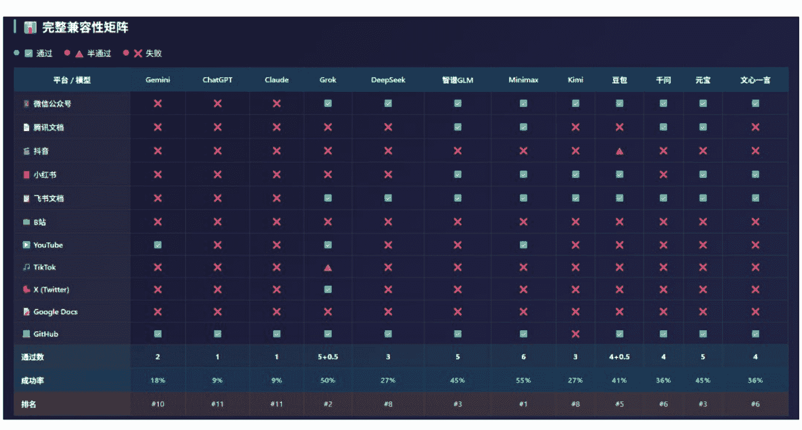

图片.png

这个选题没什么花哨技巧，纯粹是费力气。但它解决的是全行业每天都会撞上的真问题。发出去之后，点赞、转发的数据都不赖，因为大家看得到这份笨功夫。

图片.png

从大家都习以为常的日常里，找到别人还没碰过的位置——这是做内容最难的地方，也是最值钱的能力。

### 4. 选题从哪来？从自己的真日子里来

我想专门强调一句话：选题，永远比写作更要紧。

很多人想做 AI 自媒体，一上来就问“我写什么”。然后满世界找热点，看谁火就跟谁。这条路，走不长的。

先说一个现实：热点根本追不过来。AI 这个行当，大新闻专挑半夜发。等你第二天醒来准备动手，可能已经是第三波跟风了。这时候你写的东西没有半点增量，纯属给人作配。

更要命的是，你老跟着别人跑，你的文字里就没有“你”了。

我自己写的文章，八成以上都来自真实的工作和生活需要。

图片.png

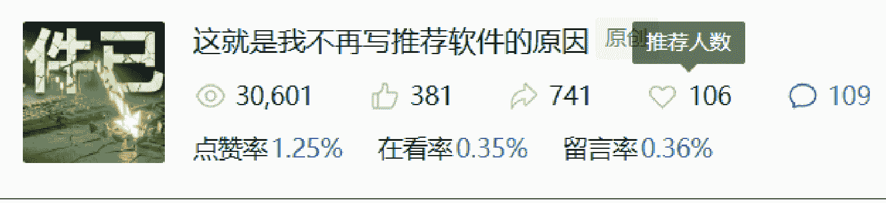

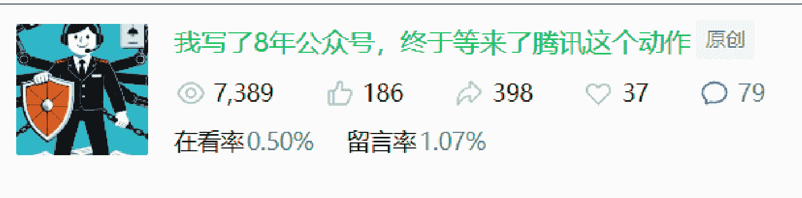

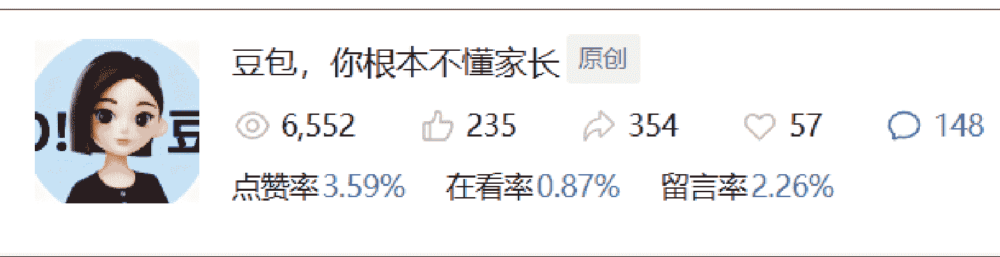

比如，我给我女儿做过一个 AI 有声广播，把全程都写下来了；

比如，我用新版钉钉搭了一个自动语音打卡的工作流，把思路和实现过程公开写了出来；

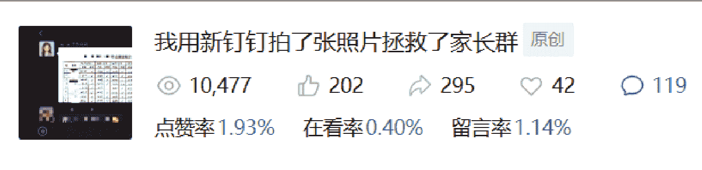

比如，我发现大模型读外部链接有盲区，就手动跑了 132 次测试，把结论整理成了文章……

这些选题，没有一个是坐在那儿硬憋出来的，全是工作和生活里自然而然冒出的需求。先自己动手拿 AI 解决，解决了再动笔。

这么写出来的东西，有细节，有温度，有只有亲历者才写得出的真。读者能感受到这份真，这种真，是任何纯 AI 生成的内容都给不了的。

所以我也建议大家：先从眼前最真实的麻烦下手。

- 干工程造价的朋友，就让 AI 帮你做预算，把操作过程、踩过的坑全写出来，这类内容流量特别准；
- 做文秘工作的，就写写怎么让 AI 自动格式化公文——字号、字体、行距定好，扔给 AI 一套模板，让它自动排。你只要真做出来、写出来，所有需要写公文的人都会搜到你；
- 做 HR 的，就把 AI 批量筛简历的流程写出来……

这些需求看起来小，可每天都要做这些事的人，谁没遇到过？不必硬造需求，工作与生活里，处处都是选题。

### 5. 赛道怎么选：切口越小，挖得越深

说完选题，再单独说说赛道，因为新人特别容易在这儿走弯路。

如今“AI 自媒体”是个很大的筐，里面细分方向多得是：有人专搞视频生成，有人专做图像生成，有人玩音乐创作，有人做写作优化，有人弄办公效能，还有人专门教用 AI 写公文、写论文……随便拎一个出来，都能撑起一个垂类号。

去小红书、抖音上扫一眼，那些做得好的号，多半是死磕一个领域，流量精准，粉丝粘性还极高。

我自己的号，一路走的是“泛 AI”路线，什么热写什么，什么新追什么。这条路的优势是覆盖面广，代价也不小：热点追不完，精力被切成碎片，写着写着，就没了自己的味道。

所以说，如果你从零开始，我的建议恰恰相反——先找一个小切口，往深处扎根。

我在高校经常跟学生聊论文，常讲一句话：切口越小，对手越少，你能挖出的深度反而越大。

做号一个道理。你只做“AI 怎么帮工程造价”，受众虽然没有泛 AI 那么多，可但凡刷到你的人，全是精准的目标读者。他们留存高、互动好、对你格外信任，商业转化自然也漂亮。

切口越小，护城河越深。做大而全，不如做少而精。等你在小圈子里攒够了口碑，再琢磨扩张，那时候扩起来也稳。

## 下篇：活过周期

### 个人品牌与审美，才是你最深的壁垒

### 1. 首次变现：四个月、一万粉、飞轮启动

好，接下来聊聊一个关键节点：我起号四个月，就完成了第一次商业变现。

那会儿写了四个月，账号阅读量大概稳定在五六千，知乎那边也积累了不少粉丝。

有一天，我看到一款叫网易有钱的产品。它当时最抓人的卖点，是可以自动同步支付宝和微信的每一笔支付记录，全自动记账。

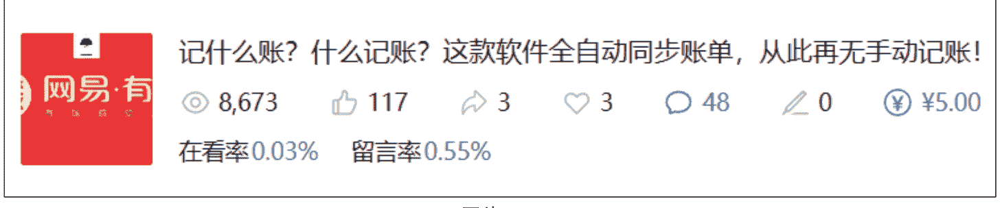

也就是说，根本不用手动记，每次付完钱，它自己就同步了。对于爱记账又怕麻烦的人来说，这个功能相当戳人。

我注意到，这款产品的核心差异点，恰好就是“自动同步”四个字——这正是它和其他记账 App 的分水岭，也是它真正的卖点。

这里我想分享一种很要紧的能力：面对一堆产品，你能不能迅速看出它的核心差异化是什么、真正的卖点在哪里，然后拿这个点当破口，撑起整篇文章。

这种能力，靠的是长期在大量产品里泡出来的手感。它不是一天练成的，但会越练越快。等练熟了，你看任何产品，都能很快找到那个“可写的落点”。

当时我想：既然都要写它了，不如主动找他们的运营聊一聊，试试接个商务合作？

在这之前，我可从来没接过商单。但我还是厚着脸皮发了封邮件，大意是：我是个科技类公众号博主，觉得你们产品不错，想谈谈合作。

没想到对方回得特别快。

他们告诉我，拉新成本大概是每个用户五十多块钱，预算有限，能给到两三千块——具体数字真记不清了，毕竟九年前的事了。条件是我去写，帮他们完成约定的拉新指标。

那篇文章阅读量不算高，可最后帮他们带去了相当于一万元拉新成本的新用户。

头一回合作，居然就这么成了。

那一刻我心里特别确定：这条路，走得通。

当时号里才四个月，阅读量也就那样，但这一次成功，给了我巨大的信心。一是因为喜欢，二是看到了真金白银的结果。这两样都有了，飞轮就转起来了——你会有更强的动力写下去，继续积累，继续向前。

能守住冷清的人，无非靠两样：热爱，和看得见的结果。两样占一样，就能走很远；两样都有，飞轮自然停不下来。

### 2. 知识星球的一次踉跄：内容一旦被指标绑架，创作就没了魂

在讲活过周期前，我想先坦白一段弯路。这段经历，可能比那些成功故事更值得参考。

ChatGPT 火了之后，知识星球上一夜之间冒出一堆 ChatGPT 社群。大家应该还有印象，那阵子各种社群截图满天飞，博主们一窝蜂地开，价格也是五花八门。我当时没多想，觉得这风口不能错过，拉着团队说：也搞一个吧。

| | 知识星球名字 | 星主 | 价格 | 成员数量 | 运营天数 | 收入预估 |

|---|---|---|---|---|---|---|

| 2 | 粥左罗 • ChatGPT AI 变现圈 | 粥左罗 | 279 | 10,000 | 17 | 2,790,000 |

| 3 | ChatGPT&AI 破局俱乐部 | findyi | 198 | 8,300 | 13 | 1,643,400 |

| 4 | 玩赚 chatGPT | 老罗 | 299 | 5,100 | 25 | 1,524,900 |

| 5 | ChatGPT 掘金 | 阿枫 | 365 | 3,200 | 22 | 1,168,000 |

| 6 | ChatGPT 俱乐部 | 不会笑青年 | 199 | 4,800 | 120 | 955,200 |

| 7 | 比比和 ChatGPT 降临派 | 梓泉 | 699 | 1,300 | 20 | 908,700 |

| 8 | ChatGPT 星球 | 柒 | 299 | 2,000 | 24 | 598,000 |

这张表里的数字，足以看出那一阵的狂热。后来我慢慢想明白一件事：当你把创作当成考核指标来经营，内容本身就活不长了。

## 内容真正的价值，不在于追热点，而在于提供别人没有的信息

曾经有一段时间，我做过一个付费星球，最终收入超过了 30 万。

表面上看，这是一笔不错的成绩，但真正开始交付之后，我才发现，收入背后还有一整年的内容责任。

因为我不愿意让付费用户觉得“买亏了”，所以几乎每天都要在星球里更新。可能是一篇随笔，也可能是一份教程，哪怕当天没有灵感、状态很差，甚至还有本职工作要处理，也必须想办法产出。

公众号每周稳定写三篇，已经相当消耗精力；而星球要求每日更新，压力完全是另一种量级。

那一年，我确实写了很多东西，但始终有一种不舒服的感觉：自己不是因为真的有内容想分享才写，而是在完成一项每天必须达成的任务。

以前接广告，本质上是和广告主做 B2B 交付。对方付费，我提供内容，双方的关系相对清晰。但面向粉丝收费之后，情况完全不同。粉丝付出的是真金白银，而你承担的是持续提供价值的承诺。

一旦创作变成了 KPI，内容质量就很难不受影响。

你会明显感觉到，主动分享和被迫更新写出来的东西，完全不是一个状态。前者是“我真的觉得这个东西有价值，想告诉大家”；后者则是“今天还没发，必须凑出一篇”。

最后，我还是关闭了那个星球，重新回到公众号创作。

这段经历让我更加确定：

> 内容一旦被迫服从 KPI，创作就开始失去生命力。  
> 真正能够长期留下来的内容，应该来自真实判断和真诚表达，而不是因为不得不说才说。数量可以少一些，但质量不能让步。

---

## 热点已经被写烂了，还能从哪里找到新角度？

当一个话题已经冲上热搜，很多人会选择把已有内容重新整理，换一个标题再发一次。

这种方式看似省事，实际效果通常很差。

因为读者早就看过类似信息了。如果你的文章只是重复别人讲过的内容，他们往往看几段就会退出。想在同一个热点里获得关注，关键不是抢着跟进，而是提供“信息增量”。

我通常会从三个方向寻找新的切入口。

### 第一，认真翻评论区

一篇爆款文章的评论区，往往藏着大量真正的问题。

有人会问：

- 这个产品到底适不适合普通人？
- 它能不能解决我工作中的具体需求？
- 教程看懂了，但实际操作时为什么还是不会？
- 文章里没提到的限制到底是什么？

这些评论，恰恰说明原有内容还没有覆盖完整。

把读者提出的问题整理出来，再逐个回答，你写出的内容自然就拥有了别人没有提供的信息。

### 第二，主动寻找被忽略的反面角度

当所有人都在介绍一个产品“能做什么”，你可以反过来研究它“做不了什么”。

当大家都在夸它的优点，你可以客观分析它的局限。

当市场上到处都是入门教程，你可以去总结普通用户最容易踩到的坑。

同一个产品，不一定非要重复它已经被说过无数遍的优势。那些没有被充分讨论的边界，往往更有价值。

### 第三，把自己的真实经历写进去

真正用过一个产品，和只看过产品介绍，得到的信息完全不同。

你在工作中遇到过什么问题？哪些功能和宣传不一样？哪些细节是官方没有强调、其他文章也没写过的？

这些真实体验，就是你的独家素材。

比如我之前写“龙虾”时，网上已经有很多教程了。但我注意到，评论区里大家真正关心的并不是“它怎么安装”，而是：

> 它到底能不能帮我完成工作中的具体任务？

于是，我直接拿几个真实工作场景做测试，观察它能做到什么程度，哪些地方表现不错，哪些地方仍然有限。

这就是信息增量。

同一个热点，真正能形成差异的，不是你跟得多快，而是你能不能补充别人没有讲清楚的部分。缺乏增量的追热点，本质上只是在透支读者的注意力。

---

## 一个账号如何经历繁荣、低谷，再重新增长？

接下来，我想回顾一下自己这十年在商业化上的变化。

这段经历让我更直观地理解了什么叫“穿越周期”。

### 第一阶段：2017 年至 2020 年，广告市场的高峰

账号稳定之后，早期最主要的收入来自软件评测和 IT 培训类广告。

当时市场上资金充足，Java、Python 等培训项目层出不穷，科技类公众号成为许多培训机构争抢的投放渠道。

那时的广告市场甚至热闹到一种夸张的程度。有些广告主会直接表示，他们不太在意单次投放能不能带来转化，只要能把某个时间段买下来，让竞争对手无法投放，就已经达到了目的。

那时候的合作模式很简单：稿件送来，链接放上去，广告费到账。一个月收入十几万并不罕见。

但我也知道，这种模式存在明显隐患。

如果什么广告都直接推给粉丝，内容质量难以控制，用户看得多了，会逐渐觉得账号越来越像广告栏。打开率下降只是时间问题，用户对账号的信任也会被一点点消耗。

短期看是赚钱，长期看却是在透支账号。

### 第二阶段：2020 年到 2024 年初，行业进入低潮

后来，外部环境发生变化，原本充足的市场资金迅速退去。

培训类广告减少，过去那些大规模投放的广告主逐渐消失，自媒体行业的商业合作明显收缩。做过这一行的人，应该都能感受到那段时间的冷清。

我也尝试过很多方向：

- 注册公司；
- 组建编辑团队；
- 做 B 站视频；
- 尝试不同的内容形态。

视频前期其实做得还可以，但每一期的制作都需要投入大量时间和精力，最终还是慢慢停了下来。

那几年，收入并不理想，团队也从最初的规模逐步缩减，最后只保留了一名助理。

不过，有一件事我一直没有停止：持续关注 AI。

早在 2019 年或 2020 年，我就写过 GPT-2。

当时的 GPT-2 还只是 2.0 版本，能力远不能和今天相比，但已经能够完成一些文章续写和内容生成。更重要的是，它当时已经开源，普通人可以把模型部署到本地显卡上运行。

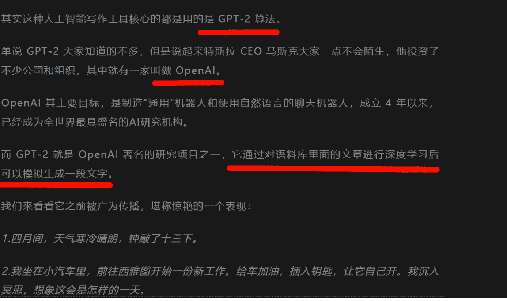

那篇文章发布时，我完全没想到几年之后，这项技术会发展成后来家喻户晓的 ChatGPT，更没有想到它会改变公众对 AI 的整体认知，并给我的账号带来一次新的增长机会。

所以，持续关注一个新技术，并不只是为了追逐热点。

它的价值在于：真正的大机会到来之前，你已经提前理解了它的基本逻辑，知道它从哪里来，也知道它可能走向哪里。等风真正吹起来时，你不会因为陌生而恐慌，反而更容易借势前进。

ChatGPT 出现之后，我很快意识到一个变化：

过去，我写的每一款软件通常只能解决一个具体问题；而 AI 的潜力，可能是把许多单点工具都重新替代一遍。

如果还只是继续介绍某一款具体软件，意义已经没有那么大了。账号需要转向 AI。

这个转型对我来说并不突兀。因为科技产品和人工智能本来就有连续性，过去积累下来的产品判断力、技术敏感度和内容经验，在新的赛道依然有效。

### 第三阶段：2024 年下半年至今，新的增长周期

转型之后，商业环境再次发生变化。

从去年上半年开始，越来越多的大模型公司和 AI 应用主动寻找公众号合作。去年暑假，我甚至连续发布了八篇商业合作文章。

之后，无论是行业内知名的大模型，还是许多普通用户还没听说过的 AI 产品，基本都陆续开始投放。

而这一次，广告主的策略与早期 IT 培训时代不同。

他们不再单纯追求批量曝光，而是更加看重账号的用户质量、内容影响力和受众匹配度。真正有信任基础的账号，反而能够获得更高的合作单价。

过去是投放数量增加，但价格下降；现在则出现了数量和价格同步上升的情况。

这就是周期变化。

资金会进场，也会离场；行业会升温，也会降温。但那些持续认真做内容的人，往往能在每次周期切换时更早恢复，甚至成为新一轮增长的第一批受益者。

真正的内容能力，只有在热钱退去之后，才会显出价值。

---

## 40 万阅读量，背后不是偶然踩中风口

前段时间，我写了一篇阅读量超过 40 万的文章。

这是我运营公众号以来单篇阅读最高的一次，合作产品是扣子编程，也就是大家熟悉的“龙虾”。

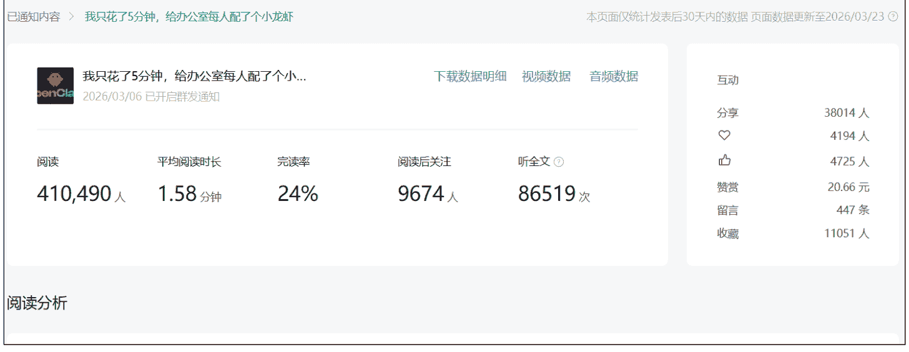

故事要从今年 1 月 26 日说起。

那天我第一次看到龙虾，马上写了一篇随笔，大意是：接下来它可能会刷屏，但大家没必要立刻焦虑。因为产品当时还存在不少不完善的地方，急着投入学习，未必有必要，等它更成熟之后再研究也不迟。

当时我也不确定它能火多久。

AI 领域的新热点出现得非常快，很多产品可能热闹几天就消失了。

但龙虾不但没有退潮，反而持续升温，并且完成了第三次破圈。

接下来的一周，我又陆续发布了几篇相关内容。直到扣子编程联系我，最终合作完成那篇文章。

文章发布后，第二天阅读量就突破 10 万；到第三、第四天，数据最终超过 40 万，单篇新增粉丝接近 1 万。

一篇纯技术内容能够达到这样的传播量，确实超出了我的预期。

但如果只把它归结为“运气好”，就忽略了真正重要的部分。

### 第一，足够早地进入话题

1 月 26 日，我在大多数人还没有形成认知时就开始跟进，提前建立了账号在这个话题上的关注度。

### 第二，持续输出让账号形成关联

后续不断发布相关内容，让读者逐渐把账号和这个话题联系起来，也让账号在该领域积累了一定的专业感。

### 第三，不重复写教程，而是回答真实需求

接到合作之后，我没有简单介绍功能，也没有照着产品说明书写一篇使用指南。

我围绕读者最关心的问题来设计内容：

> 这个工具究竟能不能帮我处理工作中的具体事情？

于是，我把真实工作场景放进测试里，用实际任务展示它能做什么、效果如何、边界在哪里。

这类内容既有热点，也有实用价值，读者才有转发和传播的动力。

所以，所谓踩中风口，往往是长期积累的结果；所谓产生共鸣，则来自真实表达。

积累让你更早发现机会，真实让你在机会出现时获得更大的传播。

---

## 一篇精华帖为什么能脱颖而出？

除了公众号，我还想分享一次在生财有术拿到精华帖的经历。

平时我在生财并不算活跃，因为主要精力都放在公众号上，输出不多，所以一直觉得有些惭愧。

那次的背景是：DeepSeek 发布了一篇新的研究论文，同时 Grok 也推出了新版本。

但 Grok 的消息其实已经是前一天的内容了。

当天刷微信时，我看到河南日报的一条推送。仔细观察后，我发现这篇文章原本很可能是围绕 Grok 写的，但发布前编辑看到了 DeepSeek 的新动态，于是临时把 DeepSeek 放到了开头，连标题也一并调整。

这透露出一个重要信号：

连传统媒体都判断，在那个时间节点，DeepSeek 的新进展比 Grok 更新更值得传播。

我马上决定写 DeepSeek。

我先把论文找出来，完成翻译，再让 Gemini 配合我设计的提示词进行解读。技术分析部分，我并没有亲自完成，而是借助 AI 处理；我负责的是重新组织内容，把它整理成普通读者也能读懂的表达。

文章发布到公众号之后，我又同步到了知乎，并找到一个刚出现不久的相关问题，把文章内容整理成回答发布。

第二天，这个问题登上知乎热榜第一，我的回答也成为该问题下点赞最高的回答。

随后，我把整个过程复盘成一篇帖子，标题是：

《我是如何在知乎热榜第一下拿到热赞第一的？》

没想到，这篇内容最终在生财有术拿到了精华帖。

坦白说，这个结果有些出乎意料。后来我还发布过一篇关于文风提示词的帖子，那套提示词可以复刻任意作者约 90% 的表达风格。从我个人判断来看，那篇内容的方法论含量更高，但实际反响却没有那么好。

这让我更加确认：

> 当你的选题判断、平台编辑的偏好，以及用户此刻真正关注的问题发生重合时，才是最容易获得传播的节点。

选题对了，很多事情会变得顺理成章；选题错了，即使内容本身写得很好，也可能收效甚微。

---

# 第三部分：效率提升

## 用原创提示词复刻个人文风

### AI 在写作中真正帮到我的地方

目前，我大约每周更新三篇公众号文章，通常安排在周一、周三和周五。

每篇内容基本都由我亲自负责，尤其是 AI 实测和教程类文章，往往需要投入一整天。再加上我还有本职工作，所以每周三篇已经接近我在保证质量前提下的上限。

我的原则一直是：

> 宁可少写，也不要为了更新而发布没有价值的内容。

因为一篇低质量文章损耗的，不只是当天的数据，更是读者长期积累起来的信任。

那 AI 到底在哪些环节提升了我的效率？

我把目前的流程整理成了一套相对清晰的 SOP。

---

## 一套提示词，如何还原作者的写作风格？

我自己使用的核心工具，是一套原创提示词。

它的作用，是让模型尽可能还原某位作者的语言习惯和写作方式，整体相似度可以达到 90% 以上。

基本步骤并不复杂：

首先，准备目标作者过去写过的 10 到 20 篇文章。样本类型最好足够丰富，既包括观点表达，也包括教程、复盘、案例等不同内容。

然后让模型分析这些文章中的稳定特征，例如：

- 常用句式；
- 段落组织方式；
- 开头和结尾的习惯；
- 词汇选择；
- 信息排列顺序；
- 论证节奏；
- 观点展开方式。

接着，把这些规律总结成一套可复用的风格描述模板。

下次写新文章时，只需要把素材和风格模板一起交给模型，生成的初稿在语言气质上就会更接近目标作者，不需要再花大量时间重做表达层面的修改。

这套方法也并不局限于复刻自己的文风。

如果你喜欢某位作者的表达方式，准备他的 10 篇文章作为样本，同样可以完成分析和提炼。这是一种通用方法，而不是只能服务于某一个人的工具。

它真正释放出来的，是我在“如何组织素材、如何写成一篇文章”上的时间。

有了 AI 之后，写作本身的门槛下降了，但也因此，选题和测试的重要性反而被放大了。

现在最难的事情，不是写，而是测。

---

## 好的测试，必须同时满足三个条件

设计一个真正有说服力的测试，至少要考虑三个维度。

### 一，场景必须来自真实需求

不要为了测试而测试。

如果这个场景是普通用户日常根本不会遇到的边缘问题，那么测试结果很难引起共鸣，也没有太多传播价值。

### 二，任务要有足够难度

题目过于简单，所有产品都能轻松完成，测试结果自然无法拉开差距。

需要设计一个有一定复杂度、但又符合真实使用情况的任务，让不同产品的能力差异自然暴露出来。

### 三，难度不能靠刻意刁难制造

测试不能为了追求“难”而设计一些极端、偏门的问题。

如果读者觉得你是在故意设置障碍，或者明显针对某一个产品，测试的公正性和你的可信度都会受到影响。

最好的测试应该处于一种平衡状态：

- 场景是真实的；
- 难度是合理的；
- 产品差异能够自然呈现；
- 读者看完会觉得这个测试有参考意义，而不是在刻意拉踩。

理想的反馈不是：

> 这篇文章到底在黑谁？

而是：

> 原来不同产品的差距这么大，我也想亲自试试。

这才是高质量测评最难的部分。

---

## 为什么有些 AI 测试必须依靠人工？

以那次进行了 132 次手动测试的案例为例，真正难判断的并不是模型能不能输出文字，而是它到底有没有真正读懂内容。

比如，让模型总结一个链接时，我们需要区分两种情况：

- 它确实读取了页面，并准确提炼了信息；
- 它其实无法读取，却根据标题或上下文编造了看似合理的答案。

对 AI 来说，这个判断并不容易。

模型本身可能产生幻觉，有时很难准确区分“与原文相关但并不准确”和“完全凭空生成”。

但人类打开结果，通常几秒钟就能发现它到底是真的读过，还是只是在胡说。

因此，即使前期测试设计得非常完整，执行阶段仍然需要人工介入，才能保证结论可靠。

真正需要人来完成的，不只是点击测试按钮，而是制定测试逻辑、判断结果有效性，以及确认数据能否支持最终观点。

测试设计得好，结论会自己浮现；测试设计得差，投入再多时间，也可能什么都证明不了。

---

# 一篇 AI 商业合作文章的完整流程

## 第一步：先判断这个产品有没有写作价值

拿到产品邀约后，我通常会先问自己三个问题：

1. 它和同类产品相比，是否存在清晰且值得讨论的差异？
2. 这个差异对读者是否真的有帮助？
3. 我能不能设计出一个场景，把这个差异直观地展示出来？

只有三个问题都能得到肯定回答，我才会考虑接下这个合作。

并非所有商单都值得发布。

如果读者根本不关心产品，文章打开率低，转化效果差，广告主不满意；与此同时，用户也会因为内容质量下降而流失。

这是一种两边都受损的合作。

## 第二步：围绕核心结论设计测试

这是整个流程中最耗费思考、也最关键的环节。

先明确文章最终想告诉读者什么，再从结论反向推导测试方案。

测试场景需要满足几项要求：

- 来自真实工作或生活；
- 难度适中；
- 能体现产品差别；
- 能让读者产生“我也想试试”的兴趣。

不要先堆砌一大堆功能，再勉强拼成文章。应该先确定核心判断，再让测试过程一步步把这个判断呈现出来。

## 第三步：执行测试并积累素材

测试阶段通常是最耗时的。

每一个有意思的现象都值得记录，尤其是那些事先没有预料到的结果。因为这些意外发现，往往正是读者没有接触过的信息，也最容易构成文章的价值。

传统软件的测试相对直接：能完成就是能完成，无法完成就是无法完成。

但 AI 产品的输出往往存在波动。同一个任务，模型可能第一次表现很好，第二次却出现偏差。因此不能只看一次结果，通常需要重复测试，确认表现是否稳定之后，才能形成可靠结论。

真正有价值的内容，不是把产品说明书换一种说法，而是通过合理场景、真实测试和独立判断，告诉读者：它究竟能做什么，不能做什么，以及在什么情况下值得使用。

当所有候选素材都齐活，我也会把在测试中随手记下的判断、零碎思考一并打包，全部塞进我的文风提示词系统。这一步基本不费时间，因为素材准备到位的话，模型吐出来的初稿通常都在水准之上，行文结构也大体能看。

这几步里，最省不了的反而是“人的加工”——AI交付的初稿也许骨架是好的，逻辑也讲得通，但总觉得少了一点“活人感”。所以最后一道工序我从不省：手动修改，亲手去加进那些只有经历过才知道的细节。真实遇到的细节、偶然撞见的意外、甚至当时脑子里一闪而过的念头，我都会不动声色地手写回去。

比如我说自己做过132次手动测试，文章里我不会泛泛而谈。我会如实交代：本来是想用AI Agent替我跑，结果连着七轮都在翻车，更绝的是，每一轮的失败方式都不一样。有一回，模型跑着跑着竟自己“体贴”地说：“时间来不及了，剩下的部分我来预估一笔。”这种真实发生的小插曲，才是一篇文章最鲜活的烟火气，也是让读者确信“他是真的跑过，而不是编的”的关键证据。IP说到底就是在这样一篇篇里攒出来的：靠的不是发稿频率，不是篇幅数量，而是每一篇里下的笨功夫和捧出的真心。

如果要给今天这些唠嗑留一句话的总结，那就是：把内容做扎实，把IP做长久，把提供给用户的真实价值交付到位，然后安心等它瓜熟蒂落。它不会一夜之间发生，但值得的等待，终将发生。

回看这十年：我见过热钱疯狂地来，也见过市场冷到冰点；接培训广告透支过读者的信任；背着KPI的包袱做过知识星球的交付；踩中过几次风口，当然也栽过不少跟头。可回头望过去，真正带着我穿越所有这些起伏的东西，和哪篇爆款、哪次红利、哪阵风口都没什么关系。是那些默默吭哧吭哧测试、耗尽心思打磨、认真对待每一个读者的日日夜夜。它们慢慢显影成一样极难被复制的东西——信任。

内容能够被挤牙膏一样批量生产，文风能被AI模仿得惟妙惟肖，热点更是一哄而上谁也不慢——然而“你”这个人，你的判断力、审美口味、你留在内容里的那点诚恳，没有任何机器能替你重造一遍。这，大约就是AI时代里，做自媒体最宽的那道护城河。

最后一句话，也是那些最煎熬的日子里我一遍遍默念的：能熬住寂寞的底气，无非就是热爱，加上一个字——做。

看完这篇复盘，你以为你会了。真到动手那天，九成的人会在起跑线上就被绊住。

工具和教程，只是最低的那层护栏；真正隔开人的，是“马上动手”的冲动，以及你所在圈层里的信息差。

如果你正缺一份全网还在追赶的最新变现玩法，也想和一群不废话、只索结果的行动派一起下场拿结果，欢迎到我的核心私域【懒人专属群】看看：这里不讲正确的废话，只做商业闭环的拆解，以及把AI的剩余价值彻底压榨。目前社群里已经沉淀了1000多个跑通的实战套利局。

☝🏻 想看成套数字资产与价值门槛，可点：https://lazyso.com/insider/

觉得对路、准备好下场干活的，微信加我（lazyhelper1）。
备注：【实操上车】，不闲聊