# 从九千万到百亿月播：我们在油管做AI影像的这一年

SC精华·260323 | 本文首发于懒人搜索内部社群


各位好，我是Gary，和波妮共同负责龙哥盟旗下“深海圈”（YouTube方向）的带教，之前也做过五期赚钱航海活动的主理教练。

转眼间，这个圈子已经运转了一年多。去年三月深海圈正式成立，到如今恰好满一周年，也该交一份年度盘点了。这篇文章会带大家回顾这一年里AI影像创作经历的起落，也回答几个高频问题：一年过去，圈友们的钱包鼓了多少？现在大家整体做到什么程度？这么多人涌进来，这个平台是不是已经卷成红海？最近总听人说同质化、限流越来越严重，用AI做内容还值得吗？到了2026年，油管还有哪些窗口？AI影像的下一个新机会藏在哪？深海圈下一步又会押注什么？

当然，比回答更重要的是总结。我们希望把过去十二个月的经验梳理成可复用的东西，也为接下来一年重新校准方向，给已经在做、或者正打算入局油管和AI创作的伙伴一份更完整的参考，也给一直在坚持的圈友一点心气和思路上的补给。

## 1. 深海圈年度成绩单

先亮一亮过去一年里圈友跑出来的硬数据：

- 已有1100多位AI影像创作者加入，500多个频道成功进入YPP；
- 银盾频道（10万+订阅）超过100个，金盾频道（100万+订阅）超过10个；
- 全圈日均总播放量5亿以上，月均播放量100亿以上；目前收录到的单支最高播放作品已突破12亿，长片最高也破了千万；
- 圈友的作品多次挺进ViewStats的Shorts月度榜、周度榜前十，还反复登顶油管泛娱乐类热门搜索词；
- 带货GMV超过200万美元，平台侧带来的直接变现超过100万美元；
- 在赚钱平台累计发布近100篇油管相关精华文章，其中有4篇被评为超级术。

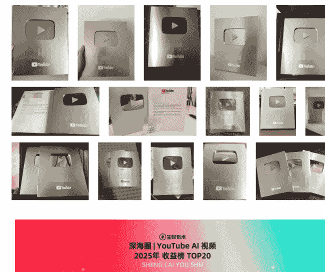

来看个人收益侧的TOP20榜单（金额为美元，括号内为人民币）：

第一名：鬼哥（编号137230），收入6.0万刀，折合人民币约41.8万；
第二名并列：Zero（80974）和Ace（153832），各5.0万刀，约34.8万；
第四名：张小铺（104187），4.4万刀，约30.6万；
第五名：猫大人（62949），4.1万刀，约28.5万；
第六名并列：李香君（123239）、四水年华（195233），各4.0万刀，约27.8万；
第八名：六只猫（155804），3.4万刀，约23.7万；
第九名：张九月（25336），3.0万刀，约20.9万；
第十名：Geektao（3228），2.7万刀，约18.8万；
第十一名：明媚（55112），2.2万刀，约15.3万；
第十二名并列：清清又雨声（33217）、Do_no（137726）及一位隐藏信息圈友，各2.0万刀，约13.9万；
第十五名：晓元（30161），1.8万刀，约12.5万；
第十六名并列：波哥（18907）、海洋（26083），各1.5万刀，约10.4万；
第十八名：木子先生（59653），1.2万刀，约8.5万；
第十九名：翔哥（29631），1.2万刀，约8.4万；
第二十名并列：六位隐藏信息圈友，各1.0万刀，约7.0万。

今年1月，深海圈办了第一届“万刀收益闭门会”，地点定在深圳南山。波哥、六七、明媚三位分享者的文稿当场或事后被评为精华帖。

回顾一下议程：2月1日下午1点半签到；2点由总教练方波妮主持开场；2点15分，总教练Gary曹淦主讲《2026年油管新趋势与深海圈规划》；3点50分，从UI设计转行全职做油管的明媚分享“从模仿爆款到设计爆款——用5个月做到8亿+播放、两个银牌、2.5万美金收益”；4点40分，曾任武汉高校老师的Agnes.分享“原创IP获得5亿+播放、半年拿到1万+美金收益”；5点20分大合影。


再说说圈里那些熟悉的名字和精华帖：

Agnes（帖内自称六七）于2月9日发布精华帖，讲的是“原创IP在油管跑出5亿播放，我在深海圈交出的第一份万刀答卷”。她2024年11月加入赚钱，2025年7月进入深海圈，之前是武汉某高校老师，现在全职投入油管创作半年，手里有3个高级YPP频道。她自认没有天赋、创意也不算出众，但靠着执行硬生生攒下了这1万美元。

杨爽在2月6日分享了一篇“过年期间悄悄赚钱”的项目实操，内容涉及千问拉新、视频号特效分成、油管等方向，还提到元宝分10亿、千问分30亿、支付宝集福等平台玩法。

明媚在2月6日复盘了自己从0到8亿播放、总收益2.2万美元的油管AI影像之路。她目前是以油管内容为全职工作的自由职业者，2月开始试水AI短片，9月开通收益，一路走到现在。

波哥在1月9日分享了自己的长片爆款过程：5月开始做长片，作品从8月中旬上线到12月底跑完，四个多月达成1000万播放，中间迭代了9次。

再把时间拨回一年前：当时私教陪跑项目回收了75份有效问卷，涉及138个频道，初级YPP 4个、高级YPP 3个，累计订阅约30.7万，总播放量9010万，人均播放约120万。

AI短内容方向上，四水年华专门做语言类AI Shorts，单个频道月收入已超过2万美元。

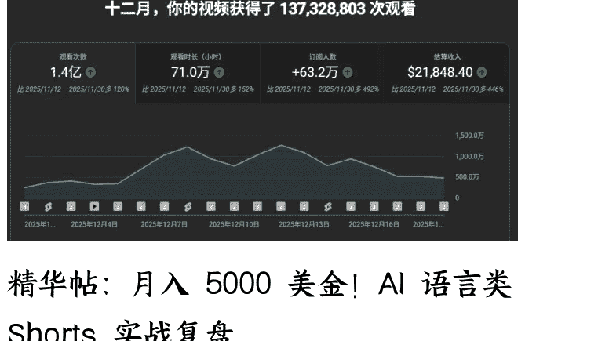

他写过一篇《月入5000美金！AI语言类Shorts实战复盘》，链接如下：
https://scys.com/articleDetail/xq_topic/22811822251121221

Tugo曾用两个月跑出2亿播放，并在精华帖里还原了自己如何搭建工作流、做复盘拆解。

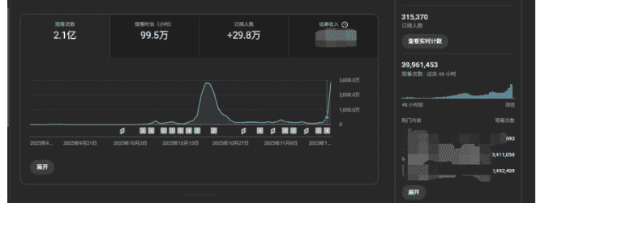

链接：
https://scys.com/articleDetail/xq_topic/45811845844822418

长片方向同样有标杆。深海圈教练波哥的单支AI长片已破千万播放，收益接近6000美元。

### 精华帖：1年9次迭代：油管长片终破1000万播放
https://scys.com/articleDetail/xq_topic/82811258484841252

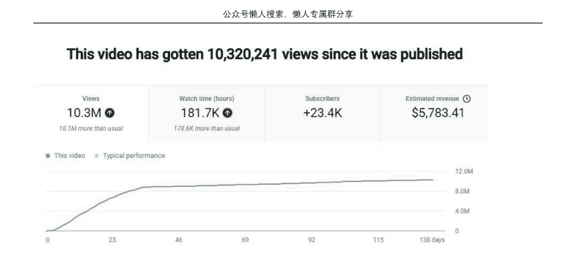

怅惘教练的路线是弱画面长片矩阵，单频道每月入账2500美元。他的精华帖专门讲了怎样让零基础的人用AI轻松复制一个油管频道。

https://scys.com/articleDetail/xq_topic/8852445442481842

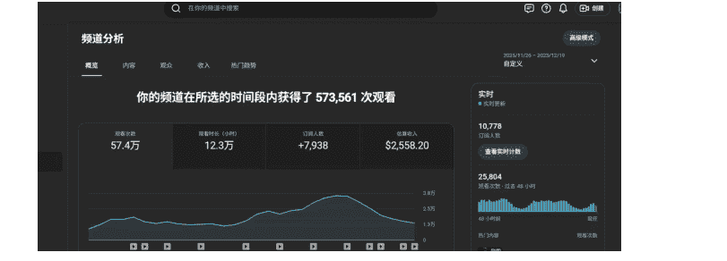

运气选手走得远也来自深海圈，他的一条AI长片已有220万播放、4000美元收益。

精华帖：
https://wx.zsxq.com/group/l824528822/topic/l524115488251212

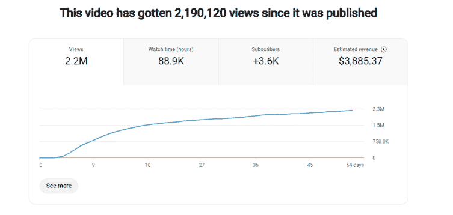

带货组同样有亮点：四水年华单月GMV达到19.3万美元，佣金4429美元，另有活动激励1400美元。


张九月单月GMV为5万美元，佣金超过800美元。


当然，空间有限，这里只能晒出一部分。更完整的案例和数据都可以在赚钱官方的精华帖合集与“赚钱好事”栏目里查看，完全公开。我可以拍着胸脯说，这一年走下来，龙哥盟的深海圈，在整个油管AI创作这个垂直领域里，信息密度和实战参考价值都是第一梯队的。如果你在这里也被某篇文章、某场分享或某个人点亮过，欢迎在评论区告诉我们。很期待看到更多属于大家的故事。

## 2. 风口与低谷：这一年我们都经历了什么

上面这些成绩看着光鲜，但这一路我们踩中的机会和吃过的苦头，远比外人看到的要多。报完喜，我想带着大家重新走一遍过去十二个月的起承转合。

### 2025年1月：窗口初开，用直播批量解锁YPP

春节假期，我和波妮在一次偶然测试中，跑通了直播的低成本玩法，发现它能以极低门槛把账号批量推进YPP。我们马上把SOP整理出来，发给当时参与私教陪跑的圈友。从1月中旬到2月底，104位参与者一共开出了107个YPP。除去那段时间最稳的达人秀、动物示警等赛道，直播贡献了很大一部分。

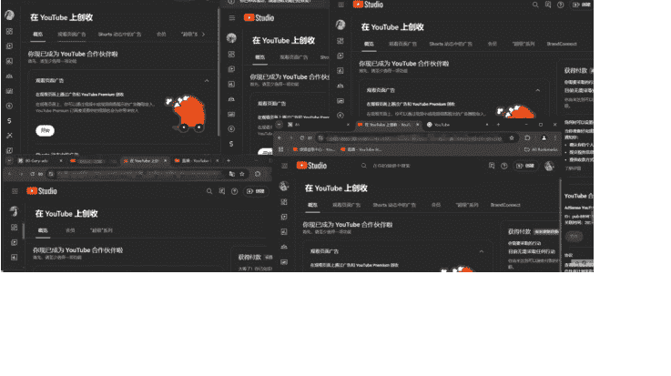

### 3月：深海圈启航，从“有YPP”到“有收益”的阵痛期

3月，不少账号虽然拿到了YPP，但因为走的是捷径，普遍还缺乏制造爆款的能力，流量上不来，收益自然少得可怜。深海圈就在这个节点艰难起步，几乎每条路都要靠试错摸出来。所以整个3月，我们一面继续验证YPP量产方法论，一面在Shorts和长片里探索新可能，总算找到几条新赛道。

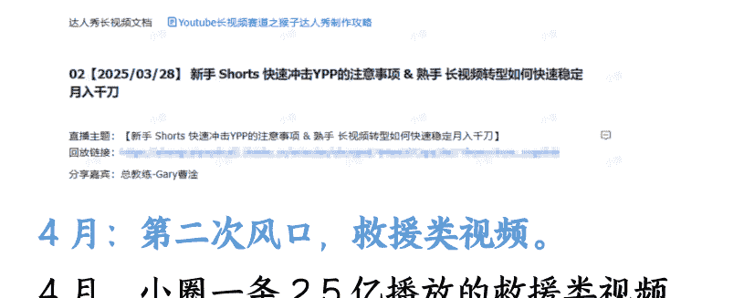

### 4月：救援类内容爆红，第二次风口到来

4月，一条救援类短视频冲上2.5亿播放，单支收益1850美元，整个圈子都为之沸腾。大家开始把重心压到短视频，试图整理出一套能跨类目复用的爆款公式。哪些方向可行、哪些方向是坑，也在这段时间慢慢显出轮廓。

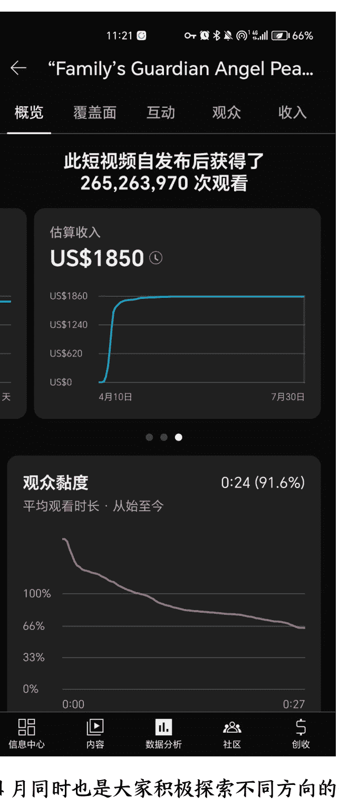

同时，4月也是圈友四处开疆拓土的月份。四周四场直播分别聚焦Shorts爆款方法、AI短剧、AI个人IP、虚拟形象。到月底再看问卷数据，大家的总播放量已经比1月大幅跃升，可全部收益加起来只有3万多美元——放在今天，连一个语言类单频道的月收入都比不上。回首那一刻，真的很不容易。

这里也把4月直播信息补充如下：

- 4月11日：把爆款元素重新组合，连续做出千万级作品；另外还讲了平台申诉攻略和AI工具推广。嘉宾：Gary曹淦、方波妮、ISland。回放：https://meeting.tencent.com/cw/KPGEMO7W3b
- 4月18日：《我的10倍回报AI商业短片项目落地分享》上下两集。嘉宾：裘裘笔记。上集 https://shengcaiyoushu01.feishu.cn/minutes/obcnx182858js1p9pvxrp2s4?from=from_copylink ；下集 https://meeting.tencent.com/cw/2jgw4vVbfa
- 4月25日：海外AI自媒体市场现状解读 + AI个人IP从0到1上手。嘉宾：贺小波、汤姆cc。回放：https://shengcaiyoushu01.feishu.cn/minutes/obcn3sjae6w99o5148gz7436?from=from_copylink
- 4月29日：JOGGAI的用法演示 + 虚拟形象赛道新玩法 + 轻松复制爆款视频。嘉宾：邢冬冬、教练李香君。

另外，深海圈在5月初做过一次成员数据盘点。基于116份有效问卷，截至5月3日：全体成员共运营777个频道，人均6.7个；其中204个频道已开通YPP，人均1.8个；开通YPP的成员占65.5%（76人）；总订阅量超523.9万，人均4.5万；总播放量超22.9亿，人均1977.3万；已开通YPP的76位成员合计收益33,242美元。

### 5月：美国山海经、鱿鱼游戏与真人演绎；油管第一次大清洗

5月信息量极大。一边，我们借着《美国山海经》的热度，把真人演绎融入AI内容，做出一套几乎无法被同行逆向拆解的玩法。这套组合对纯生成式影像堪称碾压，爆款开始批量复制。深海圈里，谷梓超等圈友用“鱿鱼游戏+真人演绎”的打法，三个月就吸引了10亿流量。

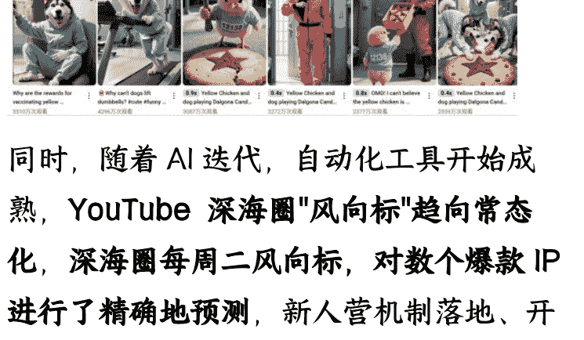

另一边，AI工具的进化也让自动化生产越来越成熟。每周二固定的“风向标”慢慢常态化了，好几个爆款IP都被提前押中；新人营机制也落地开营，百万级长片在这个月实现了突破。

5月两场直播的信息：
- 5月8日：《高精度模仿，打造你的第一个百万爆款长片》（达人秀惨故事第一季）。嘉宾：教练酷拉皮卡、教练运气选手走得远。回放：https://meeting.tencent.com/cw/2VRo3k7Oac
- 5月15日：油管魔法女孩虚拟形象IP打造分享（赚到第一千美元）+ 深海圈手册迭代说明。

2025年，在YouTube上用AI辅助做视频的人，一定对两个词深有体会：风口和清洗。它们轮流登场，让一些人冲上浪尖，也让不少人摔进谷底。

但今天不谈焦虑，只讲一群普通创作者如何在风浪里不断调整姿态，活下来，并且赚到钱。

3月的时候，用AI做海外视频这个概念开始升温。真正的爆发出现在4月——那时我们内部刚发完两期选题建议，瞬间点燃了大家的热情，“幼儿播客”和“根据华夏神话改编的本土化作品”成了讨论度最高的话题。从4月的调研来看，已经开通YouTube变现功能的成员，平均月收入为332美元。当然，没人料到这才刚刚开始。

热闹背后，第一记重拳落下。平台对涉及儿童的危险内容突然加强了审核，许多靠“小孩遇险获救”这类题材起来的账号，一夜之间被撤销了变现资格。老实说，这些号不算冤——官方条款里关于儿童内容的规定写得明明白白。从那时起，我们社群把规则意识提到了最高位置，并在指导文件的第一页列出所有禁区。

5月，新的机会出现。图因教练带来了一个虚拟偶像案例，讲的是怎么把一个名为“魔法少女”的角色从零运营起来，最终收获首笔1000美元。这个领域的壁垒不是技术，而是创意与人设。到了5月底的问卷，每个人的平均收入已经达到500美元，大家的信心明显上升。


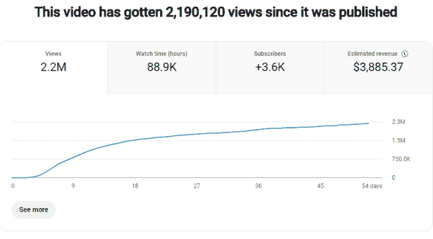

6月，我们开始把线上关系搬到现实。在北京和深圳分别办了一场见面会，反响大大超出预期——几乎每次结束，都有成员跑来报喜，说自己的视频火了。如今，这类活动已经办了几十场。6月的调研也很亮眼：个人平均收入达到800美元，几十个人的总观看次数突破1亿。但同一时间，紧接着又一轮整治到来——才艺选秀类内容面临版权风暴。内容所有者一改往日的温和，全面禁止评委原片，很多早期账号收到侵权警告。于是，这个方向基本消亡。这次经历让我们懂得：任何版权素材都不要碰，事实也证明没必要——那些使用AI生成的评审形象的号，至今仍然活跃。


7月，我们的方法体系逐渐成型。当时我们摸索出一套对真人拍摄的热门视频进行AI化重写的流程。核心观点是：优先选择以剧情推动的作品，而不是依赖表演和外在形式的，因为AI在微表情、肢体动作和复杂空间互动上还有明显不足。但好故事的底子，哪怕画面细节不够精致，观众也愿意看下去。比如有个“等人进来时突然吓人一跳”的短片，悬念极强，让人忍不住反复观看。我们仿制的版本，在YouTube已经积累50多万次播放，还在持续增长，在其它平台上也表现不俗。

印度相关领域同样值得关注。虽然单次点击收益低，但流量巨大。我们社群里有一位叫翔哥的成员，快40岁，是两个孩子的爸爸。3月入行时，整整30天才磨出一条视频；半年后，他的单一频道订阅量达到150万，并拿到平台金牌认证。他运营三个号，累计观看次数30亿，其中面向印度市场的金牌号占到20亿。9月，三个号合计收入约9600美元，而金牌号从6月15日开通变现至今，累计收入超过15000美元。翔哥的建议很朴素：先把一个频道做透，不要贪多。

7月15日，平台推出了一项严厉新政。这次动作针对分屏拼接、搬运型视频，以及用千篇一律的AI生成设定批量做出的粗糙内容。处罚方式也和以往不同——直接关停频道，而非暂停收益。我们社群当时并没有感到慌乱，因为大家的作品普遍偏精品化，很少有人做搬运或流水线式生产。但后来的发展表明，这项政策为几个月后的内容撞车问题埋下了隐患。

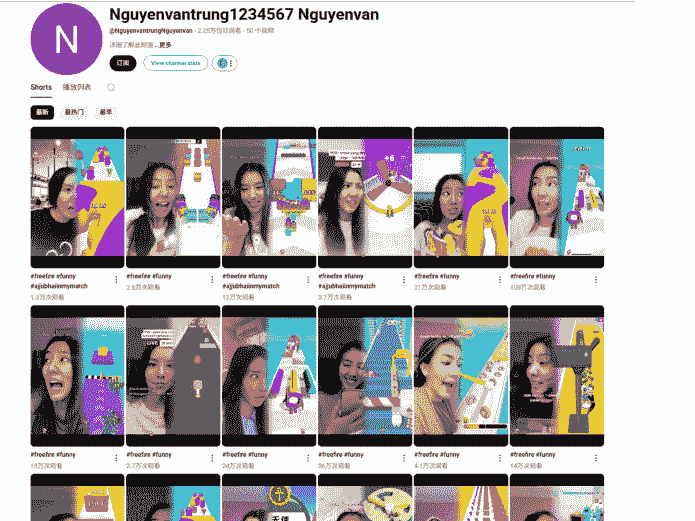
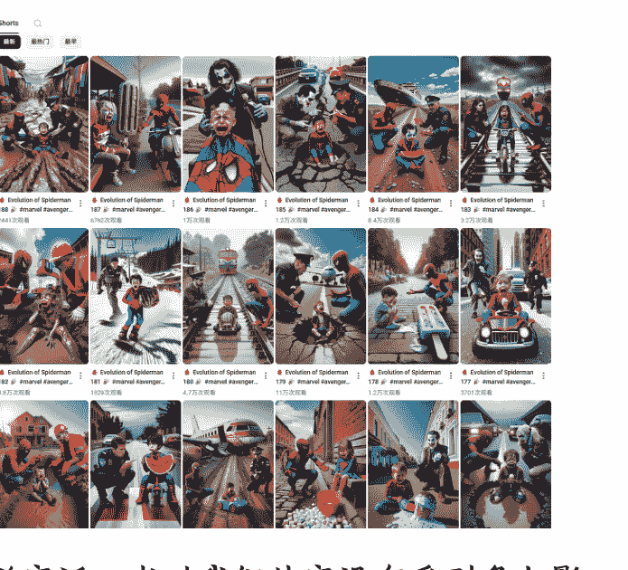

8月，真正的顶级机遇降临。通过观察YouTube上的异常流量和Google Trends的搜索攀升，我们从8月初起，连续两周在社群内部推荐K-pop Demon Hunters这个IP。当时没人能预见，它会超越鱿鱼游戏和神话题材作品，成为2025年平台第一IP，甚至在2026年赢得一座小金人（最佳长篇动画）。我们社群借助这一IP，拿下了数以百亿计的观看量。更关键的是，一卒分享了一套借助Gemini 2.5 Pro的指令体系，把二次创作门槛降到极低。据说这份方法让他收到了5000元红包，也让社群成员几乎包揽了这个IP下的大多数热门视频。8月的调研结果令人咋舌——146份有效问卷，每人平均观看次数达到亿级，好几个人借此实现单月入账过万美元。

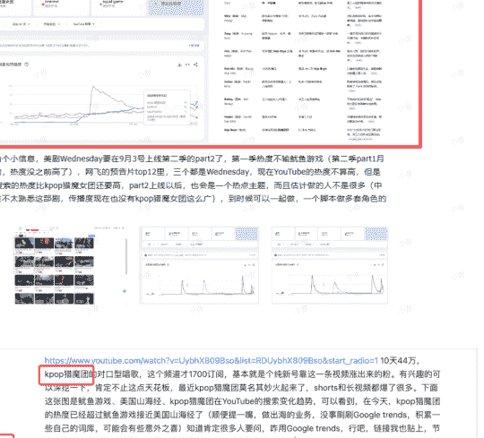
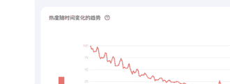
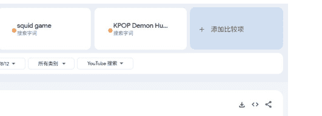
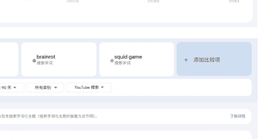
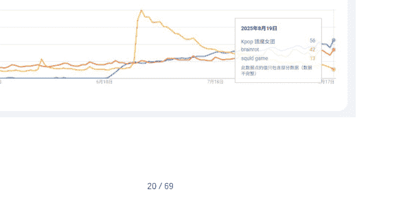

然而，8月也有阴影。平台对儿童保护内容又提出更高要求，这一次，哪怕动物或卡通角色只要带有拟人化特征，也不得出现惊险动作。更多频道被关闭，我们几位成员约上万美元的收入瞬间清零。痛心之余，整个社群把合规的重要性提到前所未有的高度，不再以任何方式鼓励打擦边球。这一原则，也成了每周直播里的固定话题。

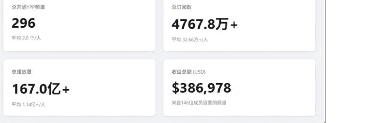

9月，重点转向系统化和规模放大。9月20日，我们社群受邀参加一场行业大会，多位教练和优秀成员上台分享。Gary在演讲中提出了一个日后被广泛流传的公式：热门作品 = 出色的呈现形式 × 扎实的脚本 × 较低的竞争密度。从那时起，许多成员按这个思路搭建账号矩阵，甚至建立了小型创作团队。S.Z就是其中的一个典型，他一人掌舵十多个频道，利用程序化工具放大个人对内容的判断力，硬是在一个垂直领域里闯出了名堂。

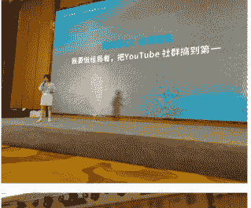
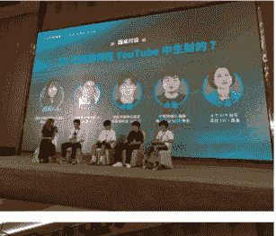
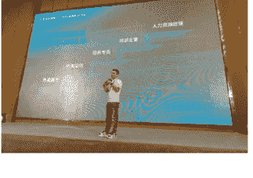
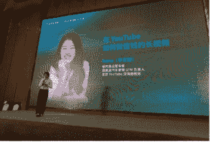
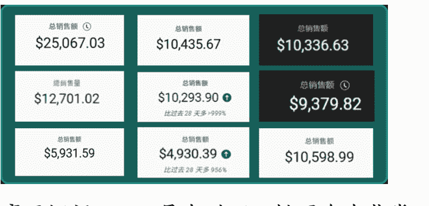
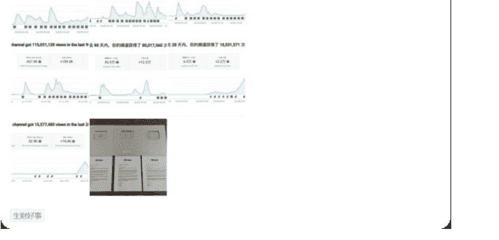
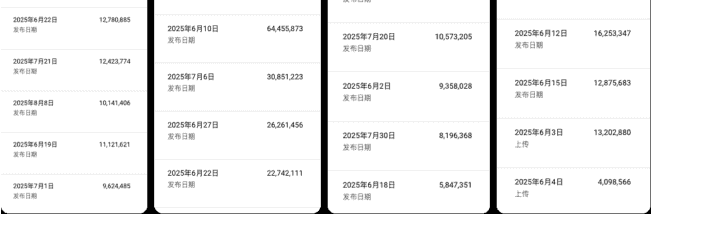

回头看这半年多，我们遇到的不仅是风口轮换，更是在规则不断收紧中的生存进化。每一次清洗都在告诉所有人：平台红线不是装饰，在流量面前，活得久比跑得快更重要。而那些能穿越周期的人，往往是既懂内容又守规矩的人。2025年还没结束，下一波浪潮已在远处蓄力。等风再来时，谁在无人关注时还在苦练基本功，谁就最有机会接住它。

## 从千人里程碑到平台整肃期：2025 下半年六次关键拐点复盘

十月，社群规模首次破千。人多之后，过去的小圈层协作模式已难以承载更复杂的经营需求，于是当月启动了两项升级：把近一年验证过的方法整理成系统的视频课，并在新人营里加入作品互评环节。我和教练组一年来沉淀的判断与实操经验，通过这套机制同步给新老成员。被点评环节催生的优质创作者，后续还受邀到每周四的线上分享会做案例回流，为大家提供更落地的一手经验。

公众号懒人搜索，懒人专属群分享


### 课件:
#### ⑬【深海圈】课程使用材料汇总

1. 10 分钟从 0 到 1 学会最简单也是最先进的 AI 视频制作流程
视频教程：https://ncnmu5q1eqm9.feishu.cn/minutes/obcnCy6ix21qp7x8ul434x91

2. 10 分钟理解 YouTube AI 内容出海的價值
视频教程：https://ncnmu5q1eqm9.feishu.cn/minutes/obcnCyzeIvruDNfe443137f8

3. 10 分钟完成谷歌账号注册与 YouTube 频道创建
视频教程：https://ncnmu5q1eqm9.feishu.cn/minutes/obcnC1q45v4651t185p71kC

4. 10 分钟了解 YouTube 工作室常用功能
视频教程：https://ncnmu5q1eqm9.feishu.cn/minutes/obcnC1d9e2204762625589b4

5. 10 分钟了解深海圈及配套交付体系
视频教程：https://ncnmu5q1eqm9.feishu.cn/minutes/obcnC1q66l89gJ814u3Izv33

6. 10 分钟心力提升：新手阶段的正确预期与规划
视频教程：https://ncnmu5q1eqm9.feishu.cn/minutes/obcnfICcwA313fQ163cp5er8

### 内测反馈:
#### ⑭ 深海圈视频反馈

(敬请期待) 基础篇：修练基本功，开通 YPP，做出爆款

1. 现阶段 YouTube 主流 AI 赛道解析：形式爆款与脚本爆款
https://ncnmu5q1eqm9.feishu.cn/minutes/obcnf58fhg91stiyqgtvy24s

2. 有门槛的内容上最大的杠杆：脚本爆款赛道推荐与通用制作教程
配套图文指引：⑬【深海圈】课程使用材料汇总

第一部分，脚本爆款简介&即梦 agent 与批量出图、出视频工具操作 讲解:
https://ncnmu5q1eqm9.feishu.cn/minutes/obcnhkdx2w885p5s23zv21f1

第二部分，即梦 agent 生成的印度故事与批量出图出视频工具生成的 kpop 故事剪辑 讲解:
https://ncnmu5q1eqm9.feishu.cn/minutes/obcnhl519bewepd4ng95268y

十一月，纯视觉竖屏已跑通打法，规模天花板开始显现。市场盘子有限，增速放缓。带语音的短视频与长片，其单价、变现深度和垂直延展空间明显更优，且模型的多语能力天然适配该类内容。传统配音类作品在文案与表现上普遍薄弱，而社群已有的无对白叙事能力完全可以平移过去。因此启动了首次龙珠悬赏，并邀请已在该方向取得初步成绩的 Geektao 进行首场公开分享。

## 深海圈龙珠悬赏：YouTube 语言类 shorts&长视频

Gary 曹淦 方波妮 2025 年 12 月 23 日修改

目前，深海圈已经基本打通了无语言的 shorts 赛道，爆款方法论基本成熟，然而无语言 shorts 的赛道容量有限，实际上无语言内容在 YouTube 占据的市场份额是比较小的，语言类 shorts 和长视频有更高的 RPM、更强的变现能力和更多的垂类拓展能力，而 AI 的多语言能力恰好也非常适配语言类内容和长视频，在新赛道的红利期，信息的互通往往能带来更快速的发展，为鼓励圈友开拓新赛道、强化信息交流互通、进一步放大各位目前的创收体量，现针对语言类 shorts 和长视频发起龙珠悬赏：

- 悬赏奖励：第一名一颗龙珠，第二到第八名瓜分一颗龙珠。
- 投稿时间：2025 年 11 月 6 日至 2025 年 12 月 15 日
- 投稿表单：https://scys.com/form/z27VzvoS
- 评选时间：2025 年 12 月 16 日至 2025 年 12 月 22 日
- 评选结果公布：小鹅通直播、赚钱发帖/公告

投稿要求：

- 1.对标赛道可以是非 AI 内容，但要求用 AI 进行内容制作，可以是 AI 完成部分环节，如画面、音效、音乐、配音、文案、脚本等；
- 2.跑通了基本的 0-1 闭环，如已开通 YPP，需要在 1 个月的时间内实现了 100 美金以上的收益；如未开通 YPP，需要在一个月内实现语言类 shorts 100 万以上的播放量或长视频 10 万以上的播放量；
- 3.需要对赛道、对标、制作流程、内容优化等基本环节进行拆解，梳理变现模式与投产情况；
- 4.发帖时，加上 #深海圈 | YouTube 龙珠悬赏# 以及具体方向标签： #YouTube 语言类 shorts#、 #Youtube 长视频#

截止到 12 月 15 日晚 24:00。

解释一下 YouTube 语言类 shorts&长视频两个方向。

### 什么是用 AI 做语言类 shorts？

### 21【2025/11/20】语言类 + 搞笑赛道：制作流程&变现拆解分享

直播主题：语言类 + 搞笑赛道：制作流程&变现拆解分享

直播回放：https://flv5.xetslk.com/sl/3chihb

分享嘉宾：Gary 曹淦、优优秀圈友-GeekTao

直播文档： [语言类 + 搞笑赛道：制作流程 & 变现拆解分享 | 新人入局语言类推荐](https://...) (链接图标)

### 首次 YouTube 深海圈龙珠悬赏榜单：


| 排名 | 星球昵称 | 星球编号 | 赛道 | 标题 | 奖励 |
| --- | --- | --- | --- | --- | --- |
| 1 | Geektao | 3228 | 语言类 | 语言类 + 搞笑赛道：制作流程 & 变现拆解分享（新人入局语言类推荐） | 半颗龙珠 |
| 1 | 四水年华 | 195233 | 语言类 | 月入 5000 美金! AI 语言类 Shorts 实战复盘 | 半颗龙珠 |
| 2 | 亿豪 | 130975 | 语言类、长视频 | 1.8 万字分享「Youtube 新人如何突破千万播放&提高 RPM 单价」 | 一颗碎片 |
| 3 | 雨文 | 5751 | 长视频 | 初学者从 0 到 1 制作 AI 短视频全流程 | 一颗碎片 |
| 4 | Zero | 80974 | 语言类、长视频 | 【月入万刀】2 天速通高级 YPP——亿播放量的语言类 Shorts 探索心得 | 一颗碎片 |
| 5 | 金鱼 | 60563 | 语言类 | 《Youtube 语言类 Shorts 月入万刀秘籍》——金鱼的火爆指南 | 一颗碎片 |
| 6 | 波哥 | 18907 | 长视频 | 1 年 9 次迭代：YouTube 长视频突破 1000 万播放 | 一颗碎片 |

十二月年会抛出了年度最震撼的数据。四水年华凭借单一频道，将带语音短片做到月入近三万美金，并带出十九万美金的带货 GMV。这一结果刷新了大家对该赛道上限的认知。年会后，社群迅速进入配音赛道的集中迁移期，随后数月内社群产出的相关作品激增，几乎占据了平台 AI 配音内容的头部位置，且延续至今。

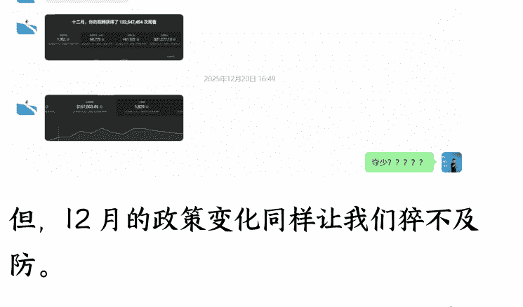

同一月份，平台规则突变打了个措手不及。

十二月初起，大批频道因“同质化内容”被取消创收资格或无预警限流。此轮打击并非仅针对生成内容，3D 动画、原创漫画、游戏类频道同样重灾，715 政策的余波由此全面显现。


### 你的频道目前无法启用创收功能

对你的频道综合运用自动和人工审核之后，我们发现它未遵循 YouTube 的频道创收政策。

我们的审核人员发现你的频道包含以下内容：

同质化内容 疑似为增加观看次数而大量生成或重复呈现的内容，这些内容并未额外带来有意义的教育价值或其他价值。了解详情

注意：我们可能会依据相关规定扣留未支付的收入，包括《YouTube 合作伙伴计划条款》和适用政策。

#### 选项 1

#### 通过发送视频提出申诉

如果你认为我们的处理有误，可以提交申诉告诉我们原因。我们会审核你的申诉，并在 14 天内告知你我们的决定。只有满足以下条件才能选择申诉：自你的频道被暂停创收后，你未删除过任何视频。

如果未能申诉成功，使此频道恢复正常，你运营的其他频道也可能会被暂停参与 YouTube 合作伙伴计划。

了解详情

| 日期 | 观看次数 |
| :--- | :--- |
| 2026 年 1 月 26 日<br>发布日期 | 18 |
| 2026 年 1 月 24 日<br>发布日期 | 3 |
| 2026 年 1 月 22 日<br>发布日期 | 2 |
| 2026 年 1 月 20 日<br>发布日期 | 16 |
| 2026 年 1 月 16 日<br>上传 | 11 |
| 2026 年 1 月 15 日<br>上传 | 46 |
| 2026 年 1 月 14 日<br>上传 | 40 |
| 2026 年 1 月 7 日<br>上传 | 19,302 |
| 2026 年 1 月 7 日<br>发布日期 | 14,649 |
| 2026 年 1 月 6 日<br>发布日期 | 39,239 |
| 2026 年 1 月 5 日<br>发布日期 | 27,831 |
| 2026 年 1 月 4 日<br>发布日期 | 12,929 |

照搬爆款文案批量投放的旧打法在此阶段正式失效。平台对改编深度与原创价值的要求显著提升。我们第一时间在社群发布风险提示，可回溯的参考为 [l223 航海直播——近期 YouTube 风险警示与机会解读](l223 航海直播——近期 YouTube 风险警示与机会解读)。此后，同质化与未成年人安全等议题，几乎成为内部直播的固定议程。

二月春节前，Seedance 2.0 突然上线。体验后我在当周风向标里写道：该模型几乎终结了游戏，截至目前仍是视频生成领域断层领先。即便暂不计风控降智问题，结论不变。

> 【0211 风向标】
>
> **本周最重磅：即梦 2.0**
>
> 这周我想传递的有且仅有一个点，就是即梦 2.0，都给我去买，太夸张了。
>
> 没什么好纠结的，直接用就完了，现在不用过半个月肯定会后悔的，即梦 2.0 带给我的震撼，大概和去年 veo3 发布的时候差不多，甚至还更强，这真的是划时代的迭代，内容市场又要迎来一次大洗牌了，AI 再次突破原来的边界，更多类型、更高质量的视频能够被更低成本制作出来，不客气的说，很多二流及以下的真人博主、动漫、影视公司，都要被一波干死，应证了那句话：消灭你，与你无关。
>
> 那当然，大家更关心的肯定是即梦 2.0 怎么用，首先推荐你们去看下即梦的官方文档，写了非常多的 case：👇🏻 [即梦 Seedance 2.0 使用手册 (全新多模态创作体验)](https://mp.weixin.qq.com/s/...)
>
> 然后推荐看下卡兹克今天这个推文，给了不少使用场景上的参考：https://mp.weixin.qq.com/s/HlX7YiLRFTwhjk6mCzxCDA
>
> 再推荐赚钱友饼干干这个推文，对带货场景的开发很丰富，YouTube 带货指日可待（高手或许能做出带货视频，但我请问到了 YouTube，你有 YPP 账号吗）： https://mp.weixin.qq.com/s/jTWvtkM790JuPHMBTMADQA?scene=1
>
> 好了，别人的教程推荐完了，更重要的当然是对我们做 YouTube 来说，即梦 2.0 真的能用了吗，能提效吗，能出爆款吗，难用吗？
>
> 事实就是，即梦 2.0 杀死了比赛，即使是在 YouTube。先感谢 zero、金鱼、天才老师、Lueyow 等圈友贡献的数据图，都是用即梦 2.0 做出来的视频：

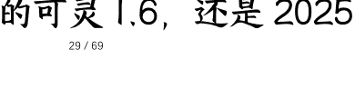

回顾往年，我几乎没有把模型迭代当成核心讨论点。无论是年初的可灵 1.6，五月的 veo3，还是十月的 sora2，都未改动创作主线：脚本、提示、分镜、生图、生片、剪辑，决定胜负的仍是内容理解与审美把控。

Seedance 2.0 打破了这一逻辑。它把流程压缩到极简：脚本截图丢进去，成品直接出。中间步骤可大幅省略，稳定性仍在线。中间图为一次直出效果，最右侧为姜洪涛圈友半年前用 sora2 复刻同一脚本反复抽卡的最好结果，对比明显。


### 换灯泡搞怪视频

下面这条对经典影视片段的复刻来自 YouTube 深海圈邵先森教练的分享，放在 Seedance 2.0 之前，还需要相当高的分镜设计能力才能复刻出来，而且还很容易反复抽卡，但现在的门槛已经非常低，基本是口喷内容就能实现很好的效果。

### 周星驰电影原片片段


以@图片 2 为首帧，镜头切换到右眼黑掉的男人的脸部特写，他愤怒地用舌头舔了一圈嘴唇，然后镜头拉远，他斜看向女人，生气地“哼”了一声。

场景切换到客厅的另外一角，在餐桌旁边的椅子上，黑发男人@图片 3 坐着，他左手抓成拳头，右手则紧紧包着左手的拳头，他俯着身，一只眼眯上，另一只眼紧贴到右手和左手拳头的洞洞上面，他兴奋地说：“I've never seen anything like that!”

这时女人疑惑地半弯曲身体悄悄走到男人身后，她对男人说：“what's that? Let me take a look!”然后男人侧身护着双手，他反问女人：“You really wanna see?”女人连忙笑着点头 (带着可爱的卡通点头声音)。

这时特写男人上半身 (女人不在画面中)，男人说:Taste it Rumi!然后他把握着拳头的手，用力打向女人刚才所在的方向，他的拳头最终完全在屏幕以外 (只看到手臂)，然后男人突然仰头持续惨叫。

这时镜头不切换仅拉远，在男人拳头的方向，男人的拳头完全在女人的嘴里面，手臂则在女人的嘴外面，女人面无表情，而男人则非常痛苦地惨叫，非常滑稽。

### 用 Seedance 2.0 复刻周星驰电影片段

在国内，Seedance 2.0 对 AI 短剧、漫剧以及广告影视行业的冲击大家都感受到了；而在 YouTube，原本还有一定制作难度的大量真人实拍类视频被彻底打平门槛，2 月初的风向标，我的篇幅全部都给了 Seedance 2.0，年后邀请了徐徐和邵先森两位教练进行 Seedance 2.0 分享，直播分享文档发布到赚钱，也拿下了两篇精华帖:

徐徐教练精华帖:

https://t.zsxq.com/3Fyiz

邵先森精华帖:

https://t.zsxq.com/WVBOK


社群在同一时间共建了 Seedance 2.0 的信息文档。当外界还在讨论排队与真人还原限制时，我们的文档里已有来自实操的解决经验。该模型也确实兑现了预期，最早一批使用者在约一周内产出新一代爆款，基本取代了传统工作流的旧版本。

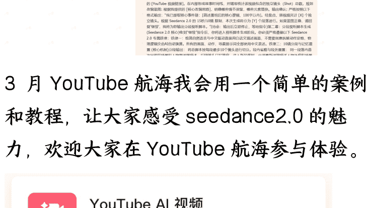

三月航海课，我将用一个直观案例配合上手教程，让大家现场体验该模型在真实创作中的价值，欢迎携带项目参与。

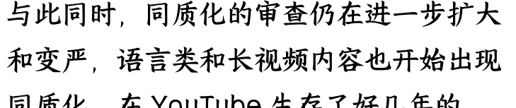

与此同时，内容同质化的审查持续收紧，配音类竖屏与长片也开始出现限流，连存活多年的 Reddit 故事赛道一夜之间几乎清零。平台的系统性调整，倒逼创作者重构变现逻辑：不能用同一套素材反复消耗同一批受众，账号矩阵也必须分散风险。具体做法后文展开。

### 回顾这一年我们得到的关键结论：

- 机遇与风险始终并存，且轮番上演
- 赛道、频道、方法论都在变，真正恒定的是内容理解力与制作能力的持续进阶
- 尽管经历诸多波折，社群已沉淀可观的内容资产：近百篇精华帖、逾三千条风向标与拆解、五十余场不同方向的直播回放，这些构成穿越周期的底牌

## 3. 既求革命，何来稳定？

回看这一整年的实战记录，你对YouTube这台流量机器里涌起的智能内容潮，会给出什么样的判断？

“方向反复横跳，一轮轮整治从没停过”
“迭代太快，普通人根本跟不上”
“要会的东西太杂，门槛把很多人拦在门外”
“折腾一整年了，早就卷成红海了吧”

我知道，很多圈友，无论有没有跟过航海计划、有没有在深海圈里泡过，心里都会浮现同一个念头：

只要认真经营账号，有条不紊地更新，粉丝是不是就会慢慢涨起来，收入是不是就能长期稳定落袋？

先把话说在前面：我不打算灌鸡汤。真实答案就两个字：没门。

这种错觉，多半源于对YouTube底层逻辑的陌生。接下来我用几个已经发生的真实案例，把大家的预期校准一下。

27亿月活、体量差不多装得下四个抖音的YouTube，在过去一年全站观看数据最高的那批内容里，排第13的那条累计拿到了12.6亿次观看。这是什么概念？粉丝量4.7亿、长期坐在流量王座上的Mr.Beast，都没能出现在这张榜单上。更戏剧性的是，这份榜单里唯一一条机器生成的作品、也几乎是唯一出自国内创作者的作品，恰好就是第13名，作者是深海圈的拾风，这条片子后面我会专门放出来。另外，深海圈里频繁登上viewstats每周榜、每月榜的圈友还有不少，篇幅有限就不逐一列举了。

| Rank | Video | Video Views | Uploaded | Channel |

|---|---|---|---|---|

| 1 | who loves FROZEN? #frozen | 2,339,586,083 | a year ago | Taylor R... |

| 2 | Baby Im Bauch: Das süßeste Familien!... | 2,115,736,355 | 10 months ago | Baby Be... |

| 3 | Kashvi bahut dar gayi | 1,704,306,932 | 8 months ago | Cute Ka... |

| 4 | WOW Tube DRAWING! Easy Art... | 1,624,863,866 | 9 months ago | Fizzle W... |

| 5 | diy mini tractor video mini water pump ... | 1,557,544,136 | 6 months ago | MiniWor... |

| 6 | Tanya ko cake cut karna nahi aata ... | 1,497,930,521 | 4 months ago | The Iam... |

| 7 | جاحد الأسدي الدنيبة عنتمة انتام | 1,456,078,237 | 5 months ago | Ahmad... |

| 8 | Come On Kids, Let's Learn Shapes ... | 1,418,552,816 | a year ago | LearnTo... |

| 9 | مرسى دسارنورثى جبلة | 1,370,228,577 | 2 months ago | 2 道 1 | |

| 10 | पाणपे, सुंदर और सीधी बने पत्नी एसआईए ... | 1,360,105,207 | 9 months ago | Udit Pra... |

| 11 | Independence Day Craft #shorts #yout... | 1,322,361,201 | 7 months ago | Mom an... |

| 12 | Teaching Hygiene Rules Visually Mak... | 1,298,537,604 | 10 months ago | BlippyBop |

| 13 | Jimu Tries to Save Baby Rumi From the ... | 1,267,206,855 | 4 months ago | | |

更有意思的是，这个爆款最初是由风向标分享出来的一个灵感点，后来在深海圈作品点评里也被多次复盘，而原片的观看数据不过几千万。

| 链接 | 日期 | 圈友 | 内容描述 | 点评 |

| :--- | :--- | :--- | :--- | :--- |

| https://www.youtube.com/watch?v=DkNe5_VfOq0&list=PLz8H_cUoZmkPQhRG89KUPR99mT-1rcO-&index=56 | 2025/10/30 | do 小鱼 | Kpop 二维动画 (33M): zoey 在娃娃机里面求食，她对应的 cp 路过，按币抓娃娃，按错了方向结果 zoey 自己卡在了出口，萌萌。 | 很搞笑的一个 2d 动画，蛮可爱的，可以做；这个夹娃娃的元素拓展性也挺强，改成故事也可以，大家自由发挥吧 |

不得不承认，智能工具把门槛彻底拆掉了。没有专业背景、只能算半路出家的人，现在有了和头部创作者乃至大公司同场竞技的资格。仅深海圈内部，一年里就跑出几十个百万订阅频道，几百个十万订阅账号，观看破亿的爆款更是数不过来。

但YouTube上的流量从来不是存折，追不上更迭速度，就会被扫地出局。

来看一张图。这个4000万订阅的巨型账号，是我们在去年五六月份锁定的重点研究目标。当时她提前押注了《鱿鱼游戏》，几乎是发一条爆一条，每条都冲到亿级观看，单月卷走几十亿流量。后来圈友谷梓超三个月做到10亿观看，灵感源头就是这位。

## 原因在哪？

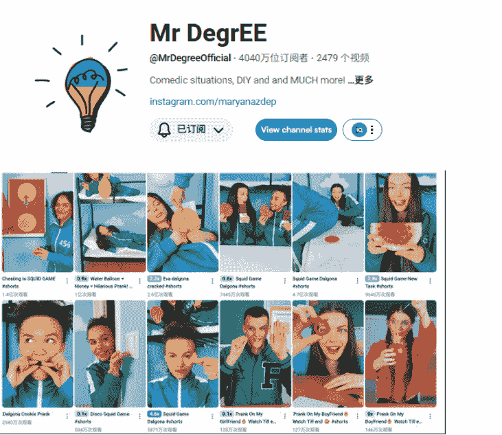

再看她现在的数据，已经缩水到平均几十万观看，破千万都成了稀罕事。

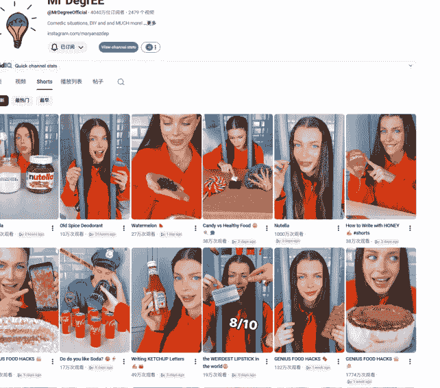

原因不复杂。这半年来，她对K-pop猎魔女团这一类的热度完全不敏感，也没有再等到《鱿鱼游戏》那种量级的窗口，做出来的东西和当初没什么两样。

另一个样本，是长期稳居韩国第一、去年全平台涨粉最多的KIMPRO。这位粉丝量1.3亿的真人博主，在看到拾风那条12亿观看的抓玩偶短片之后，居然用自己的形象做了一支智能生成版本。KIMPRO能在YouTube存活这么多年、反复登顶流量榜，靠的就是不断自我刷新——她始终在追最新的热点、最新的形式、最新的脚本，再把它们改造成符合自己频道气质的表达。

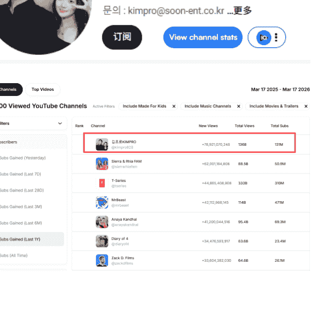

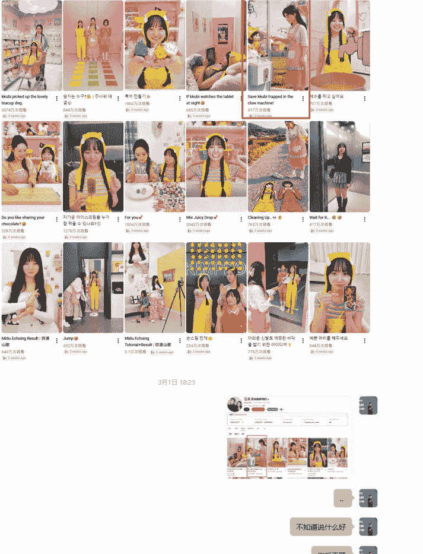

3月1日18:23

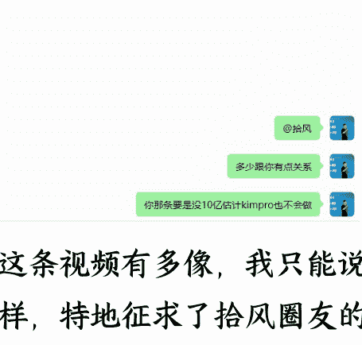

这两条片子的相似程度，坦白说，连音轨用的都是同一份。我已经征求过拾风的同意，放出来给大家自行对比。

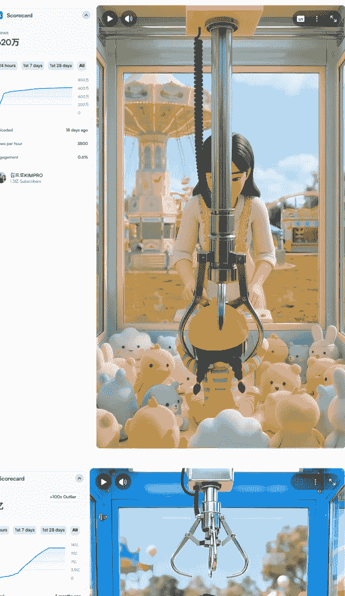

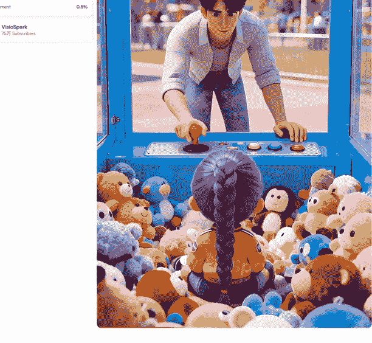

金字塔尖的博主们，已经被这场变革逼着各自找出路：有人直接上手模型，有人把模型嵌入原有流程做改造，还有人掉头去做模型暂时够不着的品类。反应迟钝的那批创作者，早就一茬接一茬地被换了血。

在这个行业深耕多年的顶级玩家都不得不拼命向前跑，我们这些刚搭上车的后来者，凭什么觉得自己可以一成不变地享受所有好处？

未成年人保护、同质化治理、限流机制这类东西，就算今天不叫这个名字，明天也会换一副面孔落下来。平台不可能允许一个账号加一堆算力，就批量倾倒粗制滥造的内容，把年营收400亿美元级别的全球最大内容平台活活灌垮。

大潮不会倒流，红利的窗口期也终会关闭。等到变革彻底收官、行业重新归位，那些莫名其妙的限流和突如其来的处罚会变少，一切都会变得规范、有序。但到了那个节点，普通人还能不能拿到上桌的门票？

乱局，本来就是供人攀爬的梯子。它可能是普通人唯一向上的通道，区别只在于你认不认得出来、敢不敢踩上去。

在龙哥老大的超级标02（YouTube）之前，没人敢想象有这么多普通人能靠智能工具当上油管博主，冲上十万粉、百万粉，赚到一千美、一万美，甚至十万美。

所以YouTube真的杀成红海了吗？尘埃落定之前，牌桌上依然留着你的位置。

再退一步讲，去年圈内年会上涛哥放过一页PPT：哪怕不谈播放量、不谈收益，能站在时代前沿走一趟，这件事本身就已经是回报。


回头看，轻舟已过万重山，你我皆是局中人。

## 4. 现在的真实局面：还能不能上车？

道理都清楚了，那眼下该从哪里下手？生态走到哪一步了？新人还有没有戏？

人人都说这行重复度太高、平台在限流，那它到底还碰不碰得？

先想明白一件事：YouTube只是智能内容的一个分发出口。想判断YouTube，得先看更大的盘。

去年9月我画过一版示意图，半年之后再回看，理解已经变成了右边这张。

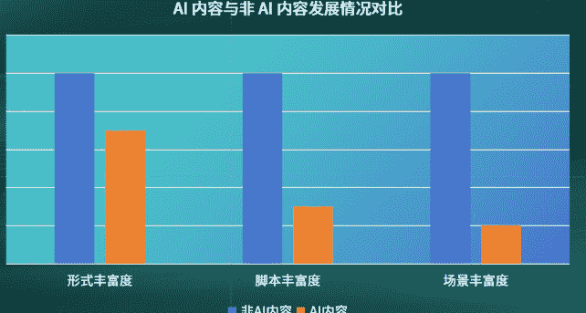

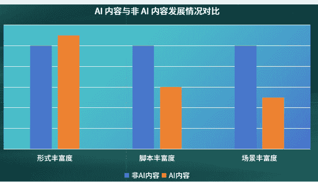

第一批工具是Veo 3、Sora 2，现在又冒出了Seedance 2.0。创作者们纠结的问题，从“vlog、第一人称、猫咪搞笑这类内容，模型到底能不能做出来”，变成了“用户究竟想看什么”。观众那边也不再追问“这是手工的还是机器做的”，只会判断“这条有没有意思、有没有用”。尤其是过去这两个月，各种形态、各种玩法的智能生成短片轮番轰炸，地铁和公交上到处都是刷短剧、漫剧、段子的年轻人。一个新的共识正在出现：大家讨厌的从来不是机器生产，而是粗制滥造。

B站算是国内在内容生态和社区氛围上最贴近YouTube的平台。最新一期0313的周推精选榜单里，首屏14条作品，有4条完全由模型生成。这事放到以前，一个没有任何背景的新人UP主，想靠近那个榜单都难。


```
https://www.bilibili.com/video/BVIDFNTzPEAk/?spm_id_from=333.934.0.0&vd_source=f224fe3780ce928dc9e7466c64c78a40
```

那条日语老电影风格的作品，只要不挂上“AI创作大赛”的标签，恐怕没人会往机器生成的方向联想。

聊到这一步，已经不需要再论证模型有多大潜力，也没必要把“智能生成”和“手工制作”分成两个阵营。真正值得关心的，始终是内容本身。

YouTube当然也不例外。

2026年3月18日那一周的观看榜，前十名里，智能生成的内容占了6席，其中还有我们圈友的频道。


放到去年同期，这个榜的前一百名里都很难找出几条。

那现在算是到顶了吗？看看榜单上那些成片的制作难度，再看看国内智能生成内容的制作水平，然后回头想想“已经没机会了”这种话，你信几分？

抛出一个宏大的总体判断，其实没什么落地价值。去年4月，我说过智能生成的内容至少会在内容大盘里占据半边天，当时听着像科幻，现在看可能很快就要兑现，甚至不止半边。

但这类结论落到一线创作者身上，并不能直接解决问题。想知道做什么能变现、怎么参与进来，还得拆开了看。

就眼下而言，YouTube上的智能生成内容仍处于中前期阶段，大量传统题材还在等着被重做一遍。这些内容的声势虽然夸张，但放到整个平台的商业化版图里，占到的份额依然很小：

- 泛娱乐向的无台词shorts、带语言信息的shorts
- 以及为数不多的长篇内容

水面之下还有大量受众狭窄、主流视野看不到的分支。就像我们刚开始做的时候，总有人反复问“机器生成的视频能不能开通YPP、能不能赚钱”，现在这些问题已经没人再问了，大家只关心什么样的题材更好变现。

接下来分享几个风向标里藏着的有趣方向：

### 小切口盘点

- ### 用俄语讲历史


- ### 用3D动画做英语科普

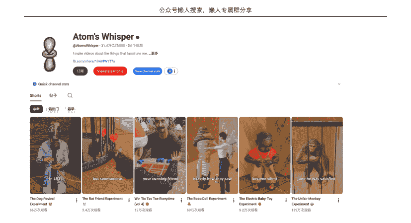

- ### 用西语讲圣经人物

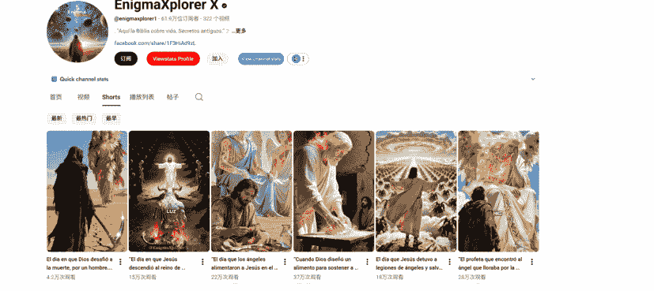

- ### 植物大战僵尸，上下分屏对比

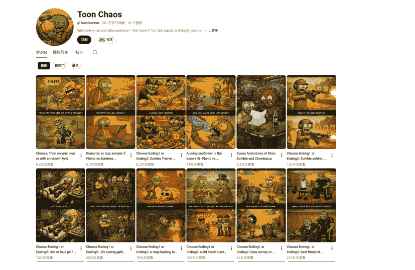

- ### 用卡通讲汽车零件，英语配音

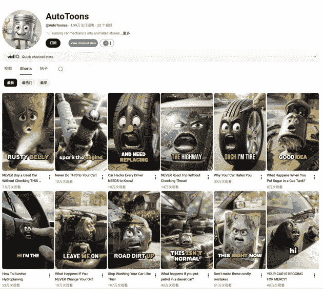

### 智能生成+真人拍摄的组合玩法：

https://www.youtube.com/@YoungEmperors/shorts 这家频道值得多说两句。不知道大家有没有察觉到，境内外的很多真人创作者，早就在反向借力智能工具抬高自己的上限了。这个账号的玩法非常典型：一条片子先拍一段真人实景，后半段交给模型续写。

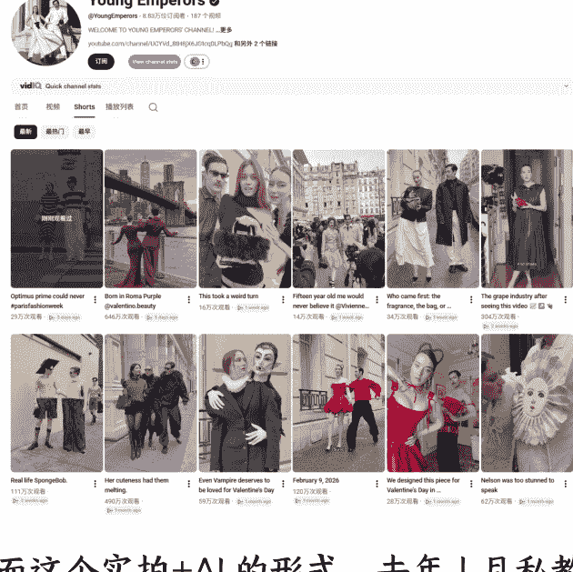

这种“真人实拍+模型续写”的组合，我在去年1月的一对一陪跑、3月的航海行动里都专门拆解过，如今已经成了大量真人创作团队的基础配置。

### 能被模型迅速复制的爆款支点，到底有哪些？

- 性吸引力：美人、性感、擦边、XP
- 新鲜感：奇异物种、陌生演出、意想不到的转折、从未听过的故事
- 同理心：萌物、戳中人的情感连接
- 熟悉度与从众效应：名人面孔、熟脸评委、热门影视IP、动画大厂等

短期入门，就是大量拆解现成的智能生成案例，把工具摸熟，把网感练出来。长期的胜负手，一定落在“人+模型”对爆款要素的重组和重构上，对纯手工或纯机器内容形成压制。


https://www.youtube.com/shorts/nCitam1e0uY 这条有1.9亿观看，就是真人实拍+模型逐帧转绘。

像这类还没卷起来的方向，翻一翻还有大把。哪怕“多语种短内容”只是众多变现分支中的一小块，也还有相当大的纵深可以挖；更别提长篇类的智能生成内容，现在连前中期都还算不上。

把注意力放回内容。K-pop猎魔女团这类素材，火起来不过半年，已经成了同质化最严重的“老项目”。至于新的方向往哪找，下面进入机会拆解。

## 5. 2026年：YouTube与智能内容的机会在哪里

年初龙哥哥和我深聊过一次，他的判断非常清楚：深海圈现在做的YouTube智能视频项目，应该全面升维成“智能视频”来看待，不要把所有价值和变现路径都挂在YouTube一棵树上，要把AIGC的能量彻底摊开。这个方向我举双手赞成，它也是今年所有机会的底层逻辑。当然，YouTube依然是我们的根据地，下面的判断都会顺着这个主阵地，往更深、更广的地方延伸。

### 1. 未来半年最大的变量 = 垂直内容/真人复刻 × 多语种 × 多IP × 工具杠杆

平台动手清理同质化，本质是生态在自救，并不是冲着某个创作者或某种技术来的。真正被清掉的，是拿着几乎一样的作品反复收割同一批观众的做法。

现在最卷的地方在哪儿？无非是YouTube平台上那批老套的智能生成剧情号、泛娱乐号，K-pop也算一个。剧本同一个模子、角色同一张脸、剪辑同一套公式，连台词都能互相背诵。这样的东西，还有什么理由被平台持续推荐、被观众持续买账？

### 先看垂直度

满屏都是智能生成的剧情号和泛娱乐，但垂直领域的内容没人试吗？

科普行不行？教育行不行？游戏和音乐呢？


前面已经给过一些例子。细分方向里的空白，远比多数人想象中大。别把前人蹚出来的路当作唯一的地图。

### 再看脚本库存

被模型消化过的真人脚本，连九牛一毛都不到。YouTube攒了二十年的素材库，几个月就能抄完？再把TikTok、抖音、快手、视频号上的热门脚本翻一遍，够用的选题不是太多了吗？

### 再看语言市场

YouTube全球用户盘子是27亿，其中英语人群不足一半。西班牙语、葡萄牙语、印地语、阿拉伯语、日语、韩语、德语，再加上法语——这些语言背后的用户体量都相当惊人，但对应的智能生成创作者却少得不成比例。把同一套脚本转成当地语言铺过去，在这些地区能够获得的竞争力，可能远超英语区。

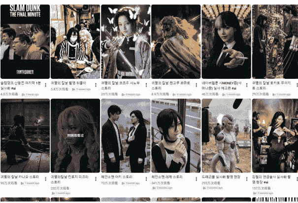

多语言矩阵早就被市场验证过了。更早的时候，国内团队从YouTube赚到真金白银，最典型的就是短剧的出海分发——把国内短剧配成多语言版本发向全球。能打动人的故事，放到任何地方都会有回响，道理就是如此朴素。再加上你覆盖的是完全不重叠的观众，平台也没理由给你扣上“内容重复”的帽子。

### 最后看IP储备

每个地区都有自己的原生IP。如果眼里只装着一个K-pop猎魔女团，当然会觉得没东西可做。Roblox、Minecraft、龙珠、火影……这些在YouTube扎根近二十年的经典形象，多到数不过来，每个IP背后又站着完全不同的粉丝群体，创作素材怎么会缺？

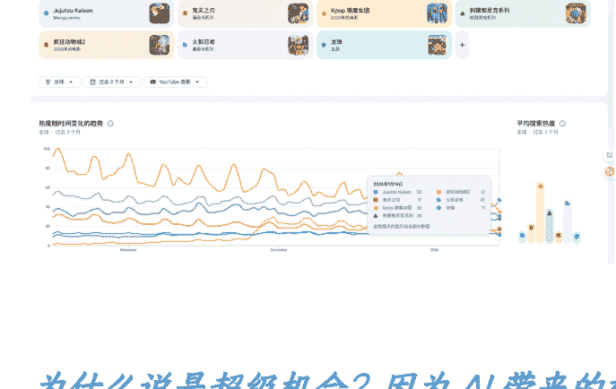

为什么它可以被称为“超级机会”？答案就藏在工具带来的杠杆里。

最近 OpenClaw 把 AI Agent 玩到了新阶段，谁能最快找到赛道、谁能最快把工作流固化成可复用的 AI 员工 Skill，谁就更容易做到月入万美元级别，甚至十万美元级别的体量。

但光有工具还不够，赛道池子小也白搭，内容产量再高也装不下。

真正能放大的是垂类内容+真人脚本+多语言+多 IP 的矩阵打法，让一个人用同一套生产体系，去吃通多个赛道。举个好理解的例子：

深海圈之前收录过的三个标杆频道，就都在做养老金和各类补助政策，分别锁定英国、美国、澳大利亚。

公众号懒人搜索，懒人专属群分享

UK Pension Guide 坐拥 7160 订阅者，148 条视频，主打英国养老金与银发福利解读，近期高热选题围绕 DWP 562 英镑发放资格、2026 年养老金调整、60 岁以上驾照新规、State Pension 大改动、1781 英镑一次性补发等。

Seniors Benefits 4970 订阅者，458 条视频，聚焦美国社安金更新，近期热帖包括低收入老年人与退伍军人救济批准、3 月社安金上调、SSA 今日到账提醒、SSDI 提前到账、3 月 18 日大更新、周日到账预警、SNAP 资格规则变更、5181 美元付款新消息等。

Aussie Pension Update 3990 订阅者，160 条视频，专注澳洲养老金动态，近期爆款有 Centrelink 规则变动冲击 Age Pension 与 DSP、2026 年 3 月必须知道的 10 条长者法、65 岁以上驾照新规、取消 67 岁养老金门槛、Centrelink 双重打击、2026 年 1600 美元增幅解读、70 岁后驾照规则、取消年龄门槛对退休人士的影响、2026 年出境规则与 3 月发放变化等。

看完这三个号，逻辑就通了。

能做养老金，就能做教育补贴、就业政策；能做英美澳，就能做日本、德国。只要在细分的垂直赛道里跑通一套 SOP，就能用 AI 快速复制到别的地区、别的领域。过去靠自动化工具也能做，现在 AI Agent 直接把门槛拉低、上限拉高。

今年深海圈会做两件事：一是加大不同赛道、不同玩法、不同变现模式的输出与引导；二是和赚钱一起打造类似 AI 龙哥的形态，把 AI 能力更深地植入社群运营与内容生产，把沉淀的几千条爆款脚本、几十万字的方法论工具化，让大家更低成本、高效率地完成创作与变现。

### 2. 收益多元化的机会 = 海内外多平台分发 + AI 自媒体

### 关于多平台分发

以前平台调性差异大，分发性价比不高。现在 AI 内容进化快，优质内容的国界感在变淡，YouTube 的 AI 爆款搬到国内也能爆，甚至 YouTube 没火、国内先火。NANA 教练去年 1 月就提过，YouTube 爆款赛道分发到国内收益更好，实现一鱼多吃。

受此启发，我去年 12 月加入了 Youtube 大航海，首条 Shorts 上线，今年 1 月中旬开始实战陪跑至今，春节后复现 @方波妮 和 @gary 曹淦 两位教练的油管新打法，目前已达高级 YPP 门槛，数据本周更新。期间踩了不少坑，也磨出抗波动的心态。国内意外收获更香，零心插柳拿到 3000+ 收入、全网涨粉 10w+、累计播放 5 千万+。🤟 方波妮教练一直鼓励分享，她说“你已经很棒了，越分享越幸运”。感谢最大推手，鞠躬波妮教练。

平台 启动时间 内容数 粉丝数 累计播放量 累计获赞 累计收入

抖音号 2024.12.18 27 2.37 万 350 万 7.1 万 33.8
快手号 2024.12.22 24 2.7 万 240 万 7.5 万 44.9
小红书 2024.12.18 39 2604 20 万+ 1.8 万 0
视频号 2024.12.18 45 9.8 万 4400 万+ 129 万 3000+

截至 2025.02.16

海外平台：YouTube、TikTok、FB/Instagram、Shorts、X。
国内平台：视频号、抖音、小红书、B 站等。

这些平台都有创作者分成，同样一条 AI 视频一次性制作、多端分发，本就是创作者该有的打法。

### 关于 AI 自媒体

徐徐教练去年底给过一个典型样本，她的 YouTube 视频同步到视频号后大爆，还引来机构和甲方合作，进而启动了 AI 自媒体的第二曲线：一边做 AI 内容，一边以 AI 创作者身份输出经验，把创作能力本身变现。

随着 AI 编程普及，国内团队和个人开发的 AI 产品出海加速，这些产品天然和 AI 内容创作者的人设契合。AI 自媒体和 AI 内容一样，是双向通吃的生态位。海外 AI 产品商单，即便小博主，普遍报价也在 200 美金/条以上，而且供不应求。

后面我们会先从分发入手，逐步帮大家搭建内容 IP，构筑 AI 时代创作者的核心壁垒。

### 3. YouTube 联属营销带货

YouTube 的带货生态在成形，平台主动降门槛、加工具、推创作者。今年与 Shopee 台湾、速卖通韩国、乐天日本的合作传闻不断，最早起步的美国已接入沃尔玛、Best Buy、Etsy 等 3000 多家商户，以及 Nike、Adidas 等大牌。

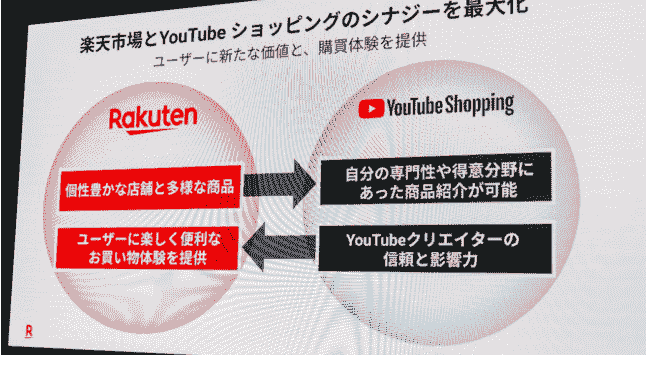


这是 YouTube 摆明了要做的方向。

TikTok Shop 2025 年仅美区电商销售额就约 158 亿美元。YouTube 哪怕只撬走一小块，也足够养活一批小玩家。

就像四水年华圈友 12 月一个频道带货 19 万 GMV，做法很简单：在一条毫无带货引导的 AI 视频里挂了件沃尔玛 T 恤，用户跳转后顺带下单，GMV 与佣金就来了，想象空间很大。


过去做联署营销需要高级 YPP + 1 万粉丝，门槛很高。最近 YouTube 把门槛降到初级 YPP + 1000 粉丝。我们一个 1000 多订阅的 YPP 频道，之前没有带货权限，现在已经开通联属营销带货。


怎么和出海电商玩家联动，探索 YouTube 带货的更多可能，会是水到渠成的事情。

### 4. YouTube 信息套利

品牌、企业、IP 都在出海，国内领先的产品自然要拓展海外市场，出海服务是超级机会，只是普通人现在还没到最佳入场点，后续我会专门写篇拆解。

和我们更相关的是信息差：国内被忽略的内容在海外很值钱，海外习以为常的信息在国内很稀缺。

比如 YouTube 虽然 21 年了，把国内特定内容搬上去依然能拿到原创待遇，通过 YPP 获取分成。当然搬运有风险，不建议。

比如直播看起来高冷，但去年我们带一批圈友用 YouTube 直播会说话的汤姆猫、地铁跑酷等小游戏，开了上百个 YPP。

比如闲鱼、小红书上一个普通 YPP 账号能卖到几千块，买回来可能无售后，还没变现就被封。去年 4 月做出 2 亿播放爆款的圈友小圈，00 后，下半年切入 YPP 账号交易，月流水六位数，高峰期每月出 200+ 个 YPP 账号。

再比如有年份的老频道更易起号，有些号商卖 100 块，有些卖 10 块，差别可能不大。

类似的操作还有不少，下次整理专题再分享。

## 结语

我常说，靠 YouTube 赚钱不一定要靠 YouTube 发钱，靠 AI 内容赚钱也不一定靠创作者分成拿钱。

道理都懂，但很多人视野被锁在很小的收益窗口里，这和我们过去重 YPP 有关。现在过去埋的种子正在发芽。

我们会继续带大家在细分赛道拿到结果，帮助圈友跨过 AI 内容与 YouTube 的门槛，让大家借助 YouTube 和 AI 内容真正拿到结果。

感恩龙哥盟，特别感谢龙哥老大和欢欢团队的后盾，在运营九年的赚钱平台眼里，这些事都是家常便饭。

接下来我们会围绕三条主线推进：

- 1. 把 AI 内容相关的方法论与案例课程化、工具化，让新圈友速入门，老圈友放大产能，高效完成创作到变现全流程。
- 2. 深挖 YouTube 变现，站稳内容出海与流量渠道的生态位，提供带货、直播、AI 自媒体等更多变现路径与指导。
- 3. AI 视频不只在 YouTube 变现，国内外平台、商单、漫剧等商业化方向仍有巨大空间，这是龙哥老大指出的十倍成长路线。

最后说句掏心窝子的话。

做 YouTube、做 AI 内容、做用户需求，都不容易。要学工具、学创作、学规则、学运营、学矩阵、学玩法。好不容易出爆款赚到钱，YouTube 就给你来一波同质化。

我们只做社群不做项目？对一线毫无体感？

工作室从去年成立至今一年多，大家踩过的坑我们一个没少，甚至更多，然后拿出来让大家避坑。现在分享一部分心路历程。

去年 2 月 YouTube 直播可开 YPP，是春节期间我们自己测出来的玩法，反复验证安全后第一时间分享。

去年 4 月救援赛道，当时还没未成年有害内容的问题，先让圈友小圈去跑，确认大爆且合规后才在风向标和直播分享。

去年 5 月达人秀版权警告，小芬教练和波妮的账号是首批受影响。为尽快确认余地，波妮组织小群，用 3 个 YPP 账号被取消的代价验证基本无法申诉，才公开同步，让大家做马赛克或下架处理。

去年 5 月我就在风向标提过真人复刻思路，真正推广是梓超做出爆款后无私分享，我们安排实习生复刻，连大一学生都做出几百万播放，才在风向标内部同步。

去年 8 月 KPOP 猎魔女团，风向标连续两周已贴，真正大力推是因为大臣发来截图，告诉我流量大且单价高，我们内部测试可复现，才在风向标和内部直播分享，持续火到现在 [2026 奥斯卡最佳动画长片出炉，有人靠它拿下 YouTube 百亿流量]。如今市面上 60% 以上的 YouTube 公众号都写过它。

去年 6-9 月未成年有害内容审查不断升级，规则模糊。我们从不做儿童危险，到不做未成年危险，到不做拟人卡通幼崽，到现在不做任何面向未成年人或不利其身心健康的内容。边界的明确，都是踩坑圈友和波妮、博哥教练组织的 YPP 审核教练用血的经验换来的。

风口初起时，总有人来问：为什么不直接关掉，让大家别碰？说实话，直接封禁很简单，但也不现实。流量摆在那儿，不去承接就是浪费白白流失。做与不做之间的差别，有时候就是爆与不爆，本质上都是在刀尖上行走。我们能做的，也就是把风险管理好，把复盘做扎实：提前摸清极限、及时把新情况同步、尽量把损失压到最小。真正的战绩永远产生在一线，历史上的常胜之师之所以被反复称颂，是因为极少。普通人的成长轨迹大多是跌撞着走，吃亏了才学乖。一次打击可以把人撂倒，却打不垮一个人的意志。

去年十一月龙珠悬赏之前，我为什么会坚定地认为语言赛道值得押注？并非只是判断时机到了。当时正好接了孤山老师的合作需求，要一起验证欧美YouTube海外投放的可能性，想看看偏娱乐化的AI语言内容能不能带来有效的曝光和转化。所以我召集了一批做语言方向的朋友一起做小范围验证，Geektao也在其中。海外投放没跑通，却意外撞见一个现象：语言类视频哪怕制作简陋，也能出爆款，收益也不低。这才有了Geektao关于语言赛道的直播拆解和精华帖：https://t.zsxq.com/vli4b；

随后我们在YouTube深海圈发起十一月的龙珠悬赏，语言赛道才被大规模推开。十二月，四水年华直接贡献了月入两万美金的成绩，震动了整个圈子：https://t.zsxq.com/ungTy。

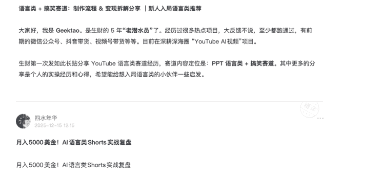

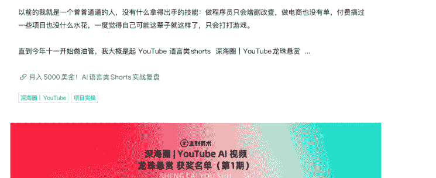

| 排名 | 星球昵称 | 星球编号 | 赛道 | 标题 | 奖励 |
|---|---|---|---|---|---|
| 1 | Geektao | 3228 | 语言类 | 语言类 + 搞笑赛道：制作流程 & 变现拆解分享 (新入局推荐) | 半截龙珠 |
| 1 | 四水年华 | 195233 | 语言类 | 月入 5000 美金！AI 语言类 Shorts 实战复盘 | 半截龙珠 |
| 2 | 亿豪 | 130975 | 语言类、长视频 | 1.8 万字分享「Youtube 新人如何突破万播&提高 RPM 单价」 | 一颗碎片 |
| 3 | 雨文 | 5751 | 长视频 | 初学者从 0 到 1 制作 AI 短剧全流程 | 一颗碎片 |
| 4 | Zero | 80974 | 语言类、长视频 | 【月入万刀】2 天速通高级 YPP+ 一亿播放量的语言类 Shorts 探索心得 | 一颗碎片 |
| 5 | 金鱼 | 60563 | 语言类 | 《Youtube 语言类 Shorts 月入万刀秘籍》——金鱼的选爆指南 | 一颗碎片 |
| 6 | 波哥 | 18907 | 长视频 | 1 年 9 次迭代：Youtube 长视频冲破 1000 万播放 | 一颗碎片 |

十二月以后，同质化审查逐步收紧，规则也是一层比一层严，这并不是只针对AI，传统方向同样受创。我们做的Reddit故事号，6个号里挂了5个。剩下的那个不是运气，是我们留下来做对照实验，想验证把视频全部清空是否会被判定为同质化。结果只有它活下来，其余5个全灭。

AI同质化频道我们也有十几个，累计亏损过万刀。心疼是自然的，但心疼无济于事。能做的就是一直待在前线：扩大风向标赛道的覆盖面、定期开风向标专场直播、保持悬赏机制的常态运行，引导大家尝试不同方向；通过一轮轮申诉来探明审核边界并沉淀SOP；和伙伴们一起测试删库换绑、主动退出YPP等策略，看哪种方式能保住更多账号和收益；每周直播反复强调风向标，提醒大家做内容整改和赛道迁移；把大量风险案例整理成内容审查工具供大家使用。

至于KPOP为什么到今天才被我明确叫停，是因为虽然一批号被封，但存活的KPOP仍在持续贡献收入。问题在于审查只会更严。高手或许能判断风险、也能承受风险，但大部分同伴很难评估风险高低，很容易被同质化波及。我们号多，死几个还能顶上；新手一旦踩坑基本就归零。所以我在这篇文章里明确表态：新手暂时不要碰KPOP，不是这个赛道彻底没戏了。

最近Seedance 2.0上线后几乎重塑了创作环境，我第一时间自己实测并发布到YouTube，效果炸了。随后我收集更多案例并整理思路，在当周的YouTube深海圈风向标里和大家分享。

> 完全未经过剪辑或调色变速处理，直接丢到视频号，一天25万播放；YouTube账号被限流，否则大概率同步爆


过去这些事我几乎从没公开说过，觉得作为社群的总负责人、作为YouTube深海圈教练团的一员，这是本职工作，做就完了，没必要拿出来讲。

如今我看到不少新朋友甚至老朋友都显出迷茫，我觉得有必要站出来聊几句，给点底气：

深海圈过去一年能多次踩中风口，未来一年就有底气去抓住更多更大的机会。我的底气不在于我个人，而在于深海圈每一位成员，以及教练团的每一位伙伴，正是一群优秀的人共同构建了这个社群。

- 没有木辞、邵先森教练去年分享的核心工具，直播玩法很难规模化；
- 没有怅惘教练、酷拉皮卡教练、小芬教练对达人秀赛道的深耕和分享，这个赛道撑不到半年；
- 没有小圈的执行力，救援类赛道很可能错过最佳入场窗口；
- 没有梓超告诉我他那条真人复刻视频爆了，真人复刻的优先级会晚很多才被看见；
- 没有一卒教练的提示词模板、S.Z的自动化思路，很多人可能还在手工作业阶段；
- ……

像这样优秀的同伴数不胜数，去龙哥盟官网检索YouTube相关的精华帖就能感受。我、波妮以及教练团的所有人，一直都在和大家同一战线。而每一个人，共同塑造了深海圈的核心资产——社群价值、人格价值，这是AI时代最难被替代也最珍贵的东西，因为人还在，希望和机会就不会断。

最后祝各位月入万刀。去年我们已是国内最强的YouTube AI视频社群；今年，让我们一起成为全球最强的YouTube AI视频社群。

———分割线———

读完这份SOP，你以为自己明白了。但九成的人一到实操就卡在第一步。

工具和教程只是入门级门槛，真正的门槛是“立刻动手”和“圈层信息差”。

如果你想看全网最新的变现打法，并且和一群执行力很强的极客一起落地拿结果，欢迎围观我的核心私域：【懒人专属群】。

我们不谈虚的，只拆商业闭环和AI效率的榨取。系统内已沉淀1000+条跑通的套利实战案例。

📎 查阅圈子完整数字资产与上车门槛：https://lazyso.com/insider/

认同价值、准备好立刻动手的，扫码加我微信（lazyhelper1）

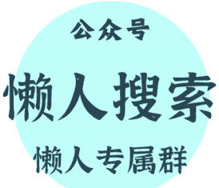


微信：lazyhelper1

备注：【实操上车】，不闲聊