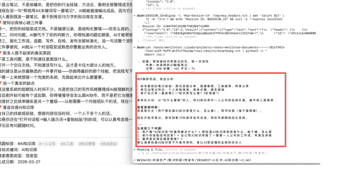
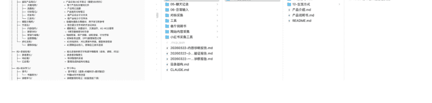
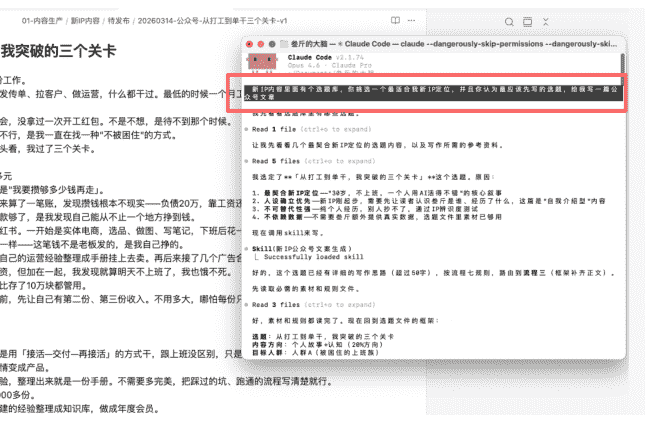
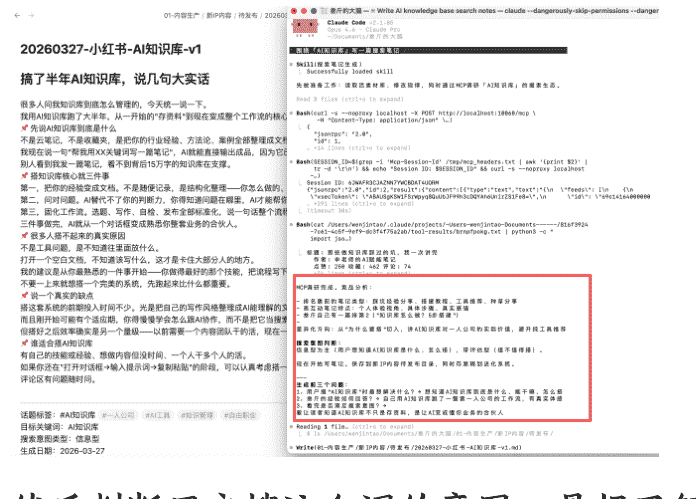
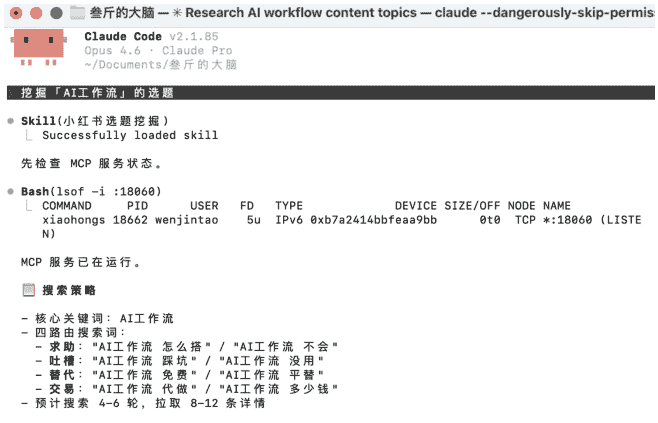
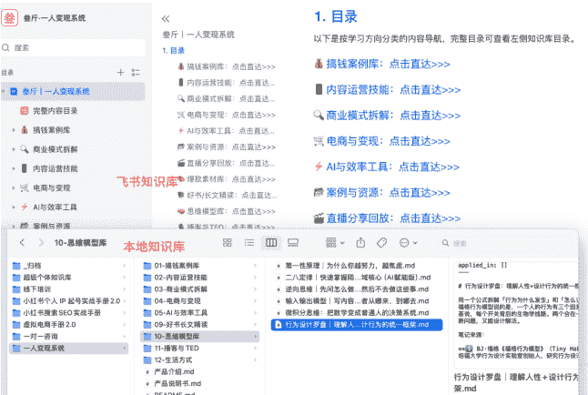

# Obsidian + Claude Code 正在帮我变现 | 我的 AI 知识库拆解

## 260401 副业 SC 精华


春节前后我搭好了一套基于 Obsidian 和 Claude Code 的个人知识中枢，把人设、写作偏好、内容方法论、产品体系全部结构化进去。

现在这套系统能代我写👸号、量产📕、归档录音、维护选题池、排布日程……一个人完成一个小团队的体量。

👸号从每月一更拉到每天一更，单篇三四千字从半天压缩到六十分钟，阅读和互动反而比纯手写更好。📕每天稳定产出 20 条以上可被检索的笔记，其中几条冷门笔记依旧在后台持续出单。

知识库也孵化出两款在售的数字产品，一份定价 39 元，一份 599 元。上月参加富贵老师线下活动，把现场录音直接喂入，半天内整理出十几份方法论文档，后续创作可直接调用。

朋友公司十个人组的月营收，还不如我单人。再自由职业里，我还没遇到过这么大的杠杆效应。以下拆解搭建思路、运行方式和有效逻辑。

大多数人用大模型的方式是：开会话、贴背景、拿结果、关窗口。下次又要重新介绍自己在干嘛、要什么。症结不在模型本身，在于没有给模型一个可长期记忆的容器。

我的 Claude 每次唤起，都会自动载入四百多行的协作约定、13 套 Skill 技能包、以及我最近的关注点。无需重复说明，它已默认掌握上下文。

此刻我只需丢一句“从选题池里抽一个写👸号”，它便能自助检索素材、套用方法框架、按我的语气完成初稿，我微调即可发布。📕的流程同理。


9. 打工经历。发传单、拉客、做运营样样经历过。最拮据时月入三百多。那些踩点被我沉淀进知识库，做成年费制会员。

10. 从未拿到过开工红包。不是不想要，是那个节点够不着。那会儿我只是想找一种不被困住的生存方式。到今天我走了三道关。

多元化是“存够钱再走”。我算过账，发现靠攒钱走不通——背负二十万负债，工资还债杯水车薪。后来意识到收入可以来自多个源头。📕。一开始做线下电商，选品、排版、写笔记，下班后加班——这笔钱不是公司发的，是我自己赚的。之后把运营心得做成手册对外售卖。再后来承接广告合作。汇总起来，哪怕明天停工，我的现金流也不会断。比存下十万现金更踏实。

先给自己配上第二、第三个收入来源。不求体量大，哪怕能自给自足。

是用“接活-交付-再接单”的打工逻辑，但把活标准化成产品。

踩坑的经验提炼出来就是一套手册。不必追求完美，把跑通路径和坑点写清即可。

在我这，Obs + Claude Code 相当于一位高产的员工。

# 1、为什么要拥有自己的 AI 知识库

搭建这套系统前，我用过飞书知识库、IMA 知识库、NotebookLM，也试过多个 AI 笔记工具，体验都不尽如人意。

飞书、IMA 这类仓库，问答尚可，执行任务就不足。它无法基于我的方法论代写📕检索笔记，无法处理录音，也无法按我的风格执行任务。

NotebookLM 稍好，问答和任务都能做，但使用不够顺滑。无法直接在本地操作文件，无法固化写作习惯，也不能即时写入内容，每次都要重新说明。

## 在 X 上看到 Obsidian + Claude Code 的组合方式一试，几乎命中我想要的状态！！

简要说明。Obsidian 是本地 Markdown 笔记工具，文件全在本地。

Claude Code 能直接读写本机文件。两者结合后，模型可感知全部笔记、方法库、素材库，并能直接新建文件、整理目录、生成内容。

最直观的对比：

同样下指令“帮我写一篇📕检索笔记”：

直接对话，会得到一篇正确但平庸的通用稿。

用我的知识库：模型先去检索关键词下的头部内容，归纳类型与结构，再读取我的检索 SEO 方法论【九章，从底层原理到关键词布局】，再读取对应产品的卖点与关键词表。



随后按我预设的写作规范产出：标题怎么拟、关键词密度、痛点切入、钩子收尾，都有明确标准。完成后会自动进行质量自检。

模型相同，输出差距明显。

# 2、知识库全貌

## 2.1 目录结构

整体大概长这样：



我按自己的习惯划分——内容从哪来、沉淀在哪、产出到哪。最近也在把个人日程与手机记录同步进来，体系会更完整。

几个关键设计：

### 1. 内容有明确的流水线状态

- 选题池 → 待发布 → 已发布。文件位置即进度，无需记忆。
- 模型自检通过后自动从选题池移至待发布。
- 我修改发布后手动移至已发布【亦可全自动】。同一篇文章在库中只保留一个位置，不易混乱。

### 2. 方法论按主题归类，不按来源归类

许多人按“这是哪门课”“哪本书”来分，检索成本高。


我按主题分：检索 SEO 方法论、内容创作方法论、营销销售方法论。写检索笔记时直接去 SEO 目录读取，不用关心出处。

### 3. 产品库与内容库分离

写产品引流笔记去产品库读卖点和关键词，写个人 IP 内容去内容库读定位与素材。互不干扰。


## 2.2 CLAUDE.md：给模型的操作手册

整个系统里最核心的单文件。

Claude Code 启动时会自动读取根目录的 CLAUDE.md，可理解为新员工入职指南：业务是什么、如何配合、什么绝对禁止。

我的文档约 400 行，核心板块：

- 1. 协作对象说明。

不只是介绍“我是谁”，而是模型需要了解的全部背景：业务形态、核心产品、目标人群的分层及优先级、转化路径。读完它就知道在为谁服务。

```md
### CLAUDE.md - 叁厅的 AI 协作指令

> 这是叁厅（温锦涛）的 Claude Code 项目根配置文件。每次启动自动加载。
> 更新时间：2026 年 3 月

---

### 你在和谁协作

**叁厅**, 自由职业者，AI 知识库一人公司。

一句话定位：不上班。用 AI 知识库开了一家一人公司。

slogan (线下介绍用)：用 AI 开了一家一人公司。

核心业务：帮普通人用 AI 知识库搭建个人收入系统，主战场是👸号 + 📕 + 微信生态。产品转化路径：新 IP 内容 → 加微信 → 599 一人变现系统 → 线下课/企业培训。人群优先级 (3.0 版): C (已自由个体，转化最高) + A (上班族，流量基本盘) > B (纠结辞职) > D (企业负责人)。核心能力标签：AI 知识库搭建 (本地化 Obsidian+Claude Code 知识库) + 对外出售飞书/Notion 知识库。

他不是程序员，但会用 Claude Code 开发工具、创建文件、搭建产品。编程方面需要你全程引导，但他对產品需求、用户痛点、内容方向的判断非常精准—听他的。

---

### 协作基本原则

1. **叫他"叁厅"**,不要问"你想要什么风格"—他的风格在说明书里写得很清楚
2. **直接给方案**,他不会 debug，给他的东西必须是完整可用的
3. **代码要能跑**,他不会 debug，给他的东西必须是完整可用的
4. **中文优先**,注释、文件名、变量命名都用中文或拼音
5. **单文件优先**,他偏好 HTML/CSS/JS 写在一个文件里，除非项目确实需要拆分
6. **中文标点符号**,所有中文内容输出必须使用中文标点符号 (,。：？！；""'' () ——), 禁止使用英文标点符号 (,?!;:'''()—...)
```

#### 2. 协作原则

> 「直接给方案，不要反问我想什么风格」
> 「中文优先，注释和文件名都用中文」「中文内容必须用中文标点」

都是在实践中迭代的。模型默认倾向英文标点，最后直接写进规则。

#### 3. 行为约束

四条铁律：

- 未经我明确确认，不得移动、改名、删除已有文件；
- 内容文件只归档不删除；
- 必须我发“提交”才执行；
- 不得修改其他 Skill 的配置。

为何如此严格？模型有时“好心办坏事”，把正在撰写的草稿移走。

```
### AI 行为约束
#### FATAL 级——铁律，无例外，违反等于不可接受的灾难
- **FATAL-001:禁止移动、重命名、删除任何已存在的文件或文件夹**,未经叁厅明确确认不能执行
- **FATAL-002:内容文件只归档不删除**,选题、草稿、笔记等一律移入归档目录，不得永久删除
- **FATAL-003:禁止自动 commit**,必须叁厅说"commit"或"提交"才能执行 git commit,禁止 force push
- **FATAL-004:禁止修改其他 skill 的 SKILL.md**,除非叁厅明确指定修改某个 skill
```

#### 4. 项目索引

各文件夹用途、命名规范、发布流程。模型能判断新文件该放哪、叫什么。未写前，模型常把文件放到奇怪路径。

```markdown
### 项目索引
| 文件夹 | 用途 |
|---|---|
|`叁厅说明书/`|人物档案、新 IP 定位、产品体系、活素材库、写作通用规范|
|`01-内容生产/`|所有内容创作相关:`新 IP 内容/`为👸号 + 📕 IP 内容 (选题库、待发布、已发布),`虚拟产品笔记/`为产品引流📕笔记，另有`爆款文稿库/`、`方法论/`、`进化系统/`|
|`02-录音处理/`|录音转文字、连字稿整理 (咨询、课程、对话等较长录音)|
|`03-知识学习/`|学习中心：读书笔记、领域知识学习、课程学习 (详见 03-知识学习/README.md)|
|`04-产品库/`|产品原文、手册内容:`一人变现系统/`下为本地知识库 (12 个分类)+产品说明书 + 产品分析报告|
|`06-日常输入/`|日常碎片化输入处理中心：闪电日记、P.Laud 碎碎念、周复盘|
|`对标采集/`|对标笔记和下拉词采集数据|
|`📕采集工具/`|📕相关工具:`xiaohongshu-mcp/`为📕 MCP 服务 (搜索、读帖子、读评论),`📕采集助手/`为浏览器采集插件|
|`.claude/skills/`|各类技能模块 (搜索笔记生成、爆款笔记生成、对标笔记分析与仿写、📕选题挖掘、新 IP 文案生成、短内容文案、录音处理、日常输入处理、周复盘汇总、产品分析与定位、战略诊断、自我进化、导出聊天记录)|
```

#### 5. 任务速查

写👸号用哪个 Skill、写检索笔记用哪个 Skill、处理录音用哪个 Skill、做产品复盘用哪个 Skill。模型可直接匹配。

CLAUDE.md 不是一次性写完。首版 30 行，后续遇到模型用英文标点、擅自删文件、放错位置等问题，就逐条补充。两个月进化到 400 行。

它本质上是人机协作协议。每一次踩坑，都变成一条规则。用得越久越省心。

## 2.3 叁厅说明书：把自己数字化

CLAUDE.md 管怎么做事，叁厅说明书管“我是谁”。

### 1. 人物档案

完整经历：换过 20 份工作、最差月入 369 元、如何接触📕、如何走向自由职业。模型需要植入个人经历时来此取材。


### 2. IP 定位

一句话定位、人设关键词、目标人群画像【四类人群特征及内容策略】、内容配比、写作调性。400 多行，反复打磨。写 IP 内容前必读。

### 3. 活素材库

正在使用的故事、案例、金句、新认知。分为“当季素材”和“经典素材”。模型写稿优先调用当季素材，避免重复。

使用过程中，聊天灵感、学员咨询收获、踩坑记录都会被补入素材库。

……

这些文件合在一起，模型对我的理解超过大多数人。定位、风格、产品、经历、近期思考，全在其中。

## 2.4 Skills

这是执行层。

普通人每次都要在对话框里写长提示词。Skill 把提示词、方法论、规范提前固化成文件，一句话触发。

我目前有 13 个 Skill。

举例“检索笔记生成”：

- 1. 触发条件：我说“写 xx 关键词的检索笔记”即触发。
- 2. 执行链路：
模型先通过 MCP 接口去📕搜索该关键词，分析头部笔记的类型、结构、切入点，完成竞品调研。
判断用户搜索意图【了解概念/找方法/看案例】，再读取检索 SEO 方法论【九章，四层漏斗原理】。
结合排名规律，读取关键词库判断优先级，再去活素材库找相关真实案例。
按内嵌写作规范输出：标题需踩核心词、关键词密度、出现位置、开头结构、结尾引导，全有标准。

### 3. 质量自检：

完成后自动检查：关键词密度、标题是否踩词、开头三行是否有钩子、是否有违规表述。通过才保存到待发布，不合格则重写。

这就是 Skill 与普通提示词的区别。Skill 是带方法论、规范、自检的工作流，输出稳定，不会因提示词偷懒而下滑。

而且它会成长。随着知识库丰富而持续完善。

我有几条曝光仅几十到几百的检索笔记，至今仍在稳定成交。检索笔记要的不是爆款，是被搜索时排在前面。

模型严格遵守排名规则，比凭直觉写作更可靠。

# 3、真实工作流

## 3.1 写👸号

👸号是我主阵地。过去一篇要大半天，最长做到月更，现在能日更，模型功劳很大。

流程：

上午去咖啡店，取完咖啡说“从选题池随机抽一个写👸号”。

模型先扫描选题池挑未写选题，再检查最近 10 篇的内容配比【实战/故事等】，若某类连续 3 篇缺席，会优先推荐。



我曾连续写多篇观点文，自己未察觉，数据下滑。后来把配比追踪写进 Skill，模型帮我把控。

选定后，模型读取 IP 定位文件明确调性，再读取活素材库匹配真实经历与案例。模型写内容易编造，这一步可避免。

写作完成后先自检：

1. 去 AI 化检测：比喻句、名人引用、排比、“在这个时代”式开头等，检测到即改。
2. 内容力审视：借用富贵老师的三个维度——是否有降维打击段落、作者情绪是否有起伏、菜市场测试【大爷大妈能否听懂】。
3. IP 辨识度测试：把署名换掉是否还成立？若成立说明缺乏个人特色，会被标记。
4. 平台合规检查：无具体收入数字、无轻松赚钱话术。我曾因“网赚”表述被删文，故设为硬规则。

跑完一轮，咖啡也刚好。修改细节、补充个人判断，一篇从选题到发布约一小时。过去需大半天。

## 3.2 写📕检索笔记

我说“帮我用‘AI 知识库’这个关键词写一篇检索笔记”。

模型第一步不是写作，而是先通过 MCP 去📕搜索该词，观察头部笔记的样式，做一轮竞品调研。



你有没有想过，随口说出来的想法、随手记下的念头，都能慢慢长成一座自我进化的知识宝库？听起来像科幻，但我已经把这套打法跑通了。它并不是依赖某一个工具，而是把 AI 彻底嵌入到日常工作里，用得越久越顺手，用得越久越像自己。

先从搜索型创作说起。落笔之前，我习惯先拆解用户检索这个词时的真实意图：是想搞明白定义，还是想要可执行的步骤，或是单纯想看个生动的案例。每一种意图，内容骨架完全不一样。随后才会进入搜索 SEO 的方法论，我把它拆成了九个章节，全部来自实操数据和课程拆解，讲清了排名的底层机制、关键词如何布局、标题怎么起、文章怎么结构化呈现。

下一步是去素材库翻同选题的真实案例。有没有真实例子撑腰，读感差距非常大。初稿完成后会做一次质量自检：关键词覆盖是否到位、标题是否命中核心词、开头是否有钩子、是否挂了话题标签、结尾是否引导互动。全部达标才算归档。

你会发现，这跟做👸号的流程很像，区别主要在写作手法的差异，以及多了一个下笔前的验证环节。

再说日常碎片如何沉淀为资产。以前我把灵感丢在飞书、flomo、备忘录里，现在全部集中到 Obsidian。散步时灵光一现，直接用手机录进 Obsidian，配合豆包输入法几乎不用打字；和朋友吃饭聊到一个有价值的观点，也立刻录下来。过去这些片段基本就沉没了，我是 INTP，对整理复盘这类事的热情撑不过三天。但现在不一样了，MacBook 上装了闪电说，随身的录音能力随时可用，录完即转文字，没有多余环节。

文件同步到 Obsidian 后，告诉 AI 去做日常输入处理。它会自动扫描，挑出未处理的段落，已处理过的会做标记不再重复，然后从口语化的一堆杂音里提取干货：有用的信息更新到素材库，后续写作可直接调用；值得深化的想法丢进选题池；待办事项单独拎出来同步到苹果提醒。我不用自己归类整理，张嘴就行，AI 把碎片变成可用的系统资产。

这套方式很适合处理长录音，不是碎碎念那种。上个月去杭州参加富贵老师两天一夜的线下课，100 人规模讲情绪营销。老师的方法论、现场案例、我互动时说的话、和邻座学员的交流，全程录下来，信息量爆炸。靠手写笔记整理要花很久而且会漏掉细节。回来后把录音转成逐字稿保存为 md，跟 AI 说处理录音。

AI 先通读全文，判断录音类型——我设定了外部课程、咨询对话、朋友交流等不同类别，不同类别提取重点不同。这次是外部课程学习，AI 逐段梳理出：情绪营销底层逻辑、八步成交 SOP、卖点到买点的转化方法等方法论；标题要用人群词+痛点词+效果词+时效词的组合策略；老师和学员的案例故事；一句就能击中的金句；我自己在互动环节的发言，录音工具能识别“叁斤”的声纹；以及可延伸的选题方向。


跑完整个流程，产出不是一份普通的读书笔记，而是会把高关联度的方法论直接写进方法论文件夹，后续创作时 AI 会自动调用，同时素材库、选题库也同步更新。以前听完课觉得收获满满，但大部分内容最终还是忘记。现在不一样，知识被你学会，也被你的 AI 学会，而且直接可复用。

接下来是把知识库变现为可售卖的虚拟产品。Obsidian 加 Claude code 搭建的知识库，不仅能写内容，还能从零做出一款数字产品。

第一步，大量收料。选定领域后，把相关优质内容全部收进 Obsidian：文章、教程、课程笔记能找到的都存。装了一个网页采集工具，把 YouTube 链接交给 Claude code，AI 自动把视频内容转成 markdown，不用手动看完再做笔记。国内网页同理，丢链接即可。

第二步，让 AI 做框架梳理。几十份原始素材往往散乱质量参差。AI 会通读所有材料，提炼核心知识点、梳理逻辑骨架、指出重复与矛盾，输出一份完整产品框架，无需人工整理。

第三步，加入个人印记写成成品。单纯整理别人内容只是搬运，没有辨识度。需要让 AI 阅读你的素材库、方法论、个人经历，把你的案例、判断、实战经验融合进去。最终形成「你的知识 + 你的经验 + 行业优质内容」的原创物。可做成 PDF、PPT 或知识库均可。

质量高的原因很简单：信息量大。手动整理可读材料有限，容易有盲区。AI 能处理几十份素材，覆盖更广。人类只需负责两件事：判断信息是否有料、补充实战经验，这两点 AI 替代不了，也是产品壁垒。

这套能力换个方向就是个人成长闭环。做产品是对外输出，读书是向内输入，但输入同样能变成产品。我最近读《行为》，讲人类行为的生物学基础，几十万字很难专注，于是把阅读外包给 AI。把电子书导入 Obsidian，让 AI 生成速读指南。AI 通读全书，提炼每章核心概念和关键实验。

先看速读指南建立框架，再挑感兴趣章节精读。精读时 AI 会做笔记，还会做两件事：把书中概念、实验、结论整理成结构化知识文件，每个概念标注来源章节与实验，后续引用可追溯，读完还能生成测验检验理解；从内容中提炼可落地的思维模型，例如从《行为》里我提炼出“行为学与人性底层认知”方法论，涵盖用户决策的生物学基础、环境如何塑形行为、情绪如何影响判断等。


这份方法论入库后，AI 写营销内容、做产品分析时会直接调用。AI 读书不是读完即止，精读笔记和方法论整理后可同步到飞书的「一人变现系统」知识库，成为产品的一个新模块。我学习变认知，AI 多一套方法论，产品多一份交付内容，学习与生产合一。

单独讲的进化系统，是整套体系里最具差异性的设计。AI 写的东西总差点意思，知识库再强也难以模仿个人风格。我的做法是让 AI 同时产出两个版本：一个给我改，一个保留原稿，然后教 AI 学我的修改方式。

流程：AI 写文章，一份原稿自动归档，一份放到待发布区；我把待发布版改到满意，发布后移入已发布文件夹；积累一定数量后执行进化学习；AI 将原稿和终稿配对，逐段比对我删除、修改、新增的内容；提炼跨篇共性规律写入修改规律文件；之后写作时 AI 自动遵循这些规律。加上可进化的 skill 后，初稿贴合度明显提升。

本质是把“人改 AI”的行为记录下来反哺系统。文案能进化，学习方法论也能同步进 skill，人成长，AI 同步成长。

再聊 MCP。前面说的是 AI 在知识库内工作，真实场景信息分散在📕、日历、各类外部工具。MCP 是连接外部工具的协议，每装一个 MCP 就多一种能力。我目前装了两个。

📕 MCP 能让 AI 直接检索📕、阅读正文和评论。单独用是搜索工具，结合 Skill 则打开新空间。我改造了一个需求挖掘 skill，变成“📕选题挖掘”Skill。现在一句“帮我看看 AI 知识库方向有没有需求”，AI 执行完整调研：四路搜索取证，自动搜四组关键词：求助类如“AI 知识库怎么搭”“Obsidian 怎么用”，找找解决方案的人；吐槽类如“AI 写的内容太假了”“知识库搭不起来”，找不满现有方案的人；替代类如“有没有比 XX 更好的”，找在比选的人；交易类如“求 AI 知识库推荐”“多少钱”，找准备付费的人。四组词覆盖从发现问题到付费意向的完整链路。

搜到帖子后 AI 不止看标题，会进入正文和评论区，评论区往往更有价值。正文可能是营销文，评论区的吐槽提问才是真实需求。譬如一篇讲 AI 知识库的帖子下有人说“看了好多教程还是搭不起来，有没有现成的”，这就是明确的产品需求信号。接着对帖子分类，提取痛点词、需求信号、情绪倾向，最后生成选题并自动分流，判断适合做 IP 内容还是引流笔记，分入对应选题库。



全程一句话触发，我拿到的是带信号标注、已分类的选题清单。这就是 MCP 提供能力、Skill 定义工作流的配合方式。

第二个是日历和提醒事项 MCP。对自由职业者而言，记录工作时长和任务非常重要。没有考勤，没有派活，一天下来常有忙了一天却不知忙了什么的感觉。不记录时间流向就无从优化。我试过很多任务管理 App，有的太重，有的同步不稳，有的收费广告多。最后发现苹果自带的日历和提醒事项最干净，生态内打通，手机电脑同步，提醒事项还能在日历中展示，打开日历可看到所有任务，完成后再做复盘也方便。

装上日历 MCP 后，AI 能直接读写日历、提醒事项。我每个任务结束后写一句复盘，几点到几点做了什么，现在交给 AI 它会把细节写入日历对应时段。周末问一句“这周工作了多少小时”，AI 读日历统计。对 P 人很友好，目前没找到更顺滑的流程。任务管理也能由 AI 安排，每天该做什么直接在对话里生成。记录、复盘、周分析都在同一窗口完成。AI 同时看到日历和知识库，周复盘时能分析内容生产、系统搭建的时间占比和产出效率。


相当于一个实时跟进的工作助理，对自由职业者很有帮助。

这套系统最核心的特质不是能做什么，而是越用越强。两个多月下来，每个环节都在自我完善，且互相增强。知识库越丰富，AI 调用素材和方法论越多，输出质量越高；质量越高，修改越少，提取的规律越精准；规律越准，下一稿越好，形成正向飞轮。无需额外时间维护知识库，录音、写文、改稿、听课本身就是喂养。库越强效率越高，省出的时间又能投入更多输入。

如何让飞轮转动：每天录一段，语音日记或碎念交给 AI 处理，最低成本输入；改完文章别直接发，让 AI 对比原稿和终稿提取修改规律，很多人改完就丢，浪费了最有价值的学习材料；遇到问题就加规则，CLAUDE.md 和 Skill 都是用出来的。

最后说知识库本身即是产品。我的本地知识库叫“叁斤的大脑”，方法论、Skill、素材库自用。但其中一部分可拆出整理成飞书或 Notion 知识库对外销售。本地库需要 Obsidian+Claude code 门槛，飞书知识库打开浏览器即可，门槛更低。我的「一人变现系统知识库」就是从本地库拆出可复用的方法论打包而成，目前重点在做的虚拟产品。



搭建一次双向使用，一边自用提效，一边对外变现。产品是持续更新的。读一本书做完精读笔记和思维模型就同步到飞书，产品就多一个板块；参加线下课录音处理完，部分方法论再同步。用户买的不是静态 PDF，而是持续生长的知识库。这正是我的虚拟产品逻辑，核心时间花在判断信息价值和补充个人案例，其余交给 AI。过去做一份手册需一两周，现在大幅压缩。

你可能觉得系统很复杂，但起点很简单。第一版很粗糙就够了。先装 Obsidian，官网免费，全平台可用。建一个库，先建几个基础文件夹：输入箱、知识库、内容生产、产品库、素材库、.claude/skills。后续按需扩展，我现在的目录也是两个月慢慢长出来。用 Markdown 的原因是 AI 可直接读写，不像 Word 或飞书文档需要转换，纯文本加符号对 AI 友好。

再装 Claude code，终端工具，教程很多。连接库的方式是 cd 到 Obsidian 知识库文件夹，输入 claude 启动，这一步 AI 就能读取所有文件。也可以把文件夹拖进终端。试着说“帮我看看文件夹里有什么”“读取 XX 文件总结一下”“在输入箱建个新笔记”，你会发现 AI 真实在本地操作。

然后在根目录建 CLAUDE.md，第一版写清：你是谁、做什么是非、希望 AI 如何协作、文件夹用途、禁止事项如不能删文件不能自动提交代码。写完重启 Claude code，AI 开始认识你。用过程中发现错误就立刻补充规则，这个文件是边用边长。

CLAUDE.md 完成后别追求一步到位，直接开始用。说人话即可，比如“帮我把这段录音整理成笔记”“帮我写一篇📕笔记主题是 XX”。不需要学习提示词技巧。

回头看，核心就几句：知识库在喂，AI 在学，系统在长，产品在卖。你只需保持记录，其余交给时间。

AI 做的东西不对，别只点个叉就完了，直接把问题指出来。纠错的那个过程，其实就是在给它做定制化训练，让它学会你的工作习惯。

遇到同样的毛病反复犯，别每次都重复口头提醒，直接把它写进 CLAUDE.md 里存档。以后它打开文件就能自动带上这套规则，你就不用再当复读机了。

用久了会发现，有一类活是铁打的重复工序：背景介绍、需求说明、格式要求，每次都要从零解释一遍。这时候就该把它打包成 Skill 了。把触发条件、操作步骤、输出标准写清楚，之后一句话就能让 AI 瞬间跑完整套流程。

信息输入最快的方式永远是语音。我现在基本靠闪电说和 AI 录音笔，每天随手录一段复盘或灵感，自动转成文字落到 Obsidian 里。分类归档、结构化整理这些脏活累活我全丢给 AI，它能把零散的碎片自动变成能直接用的系统资产。

这套玩法核心目标不是把笔记库做得多漂亮、有多整齐。真正要解决的是：单枪匹马的人，如何把产出拉到一个小团队的水平。

方法论相当于 AI 的教科书，Skill 则是它的操作手册，CLAUDE.md 就是你们之间的协作协议。三层一起叠加，AI 的理解边界会越滚越大。

组合起来之后，它就不再是每次都要重新介绍背景的聊天框，而是一个越用越懂你、越用越省心的个人工作系统。

--- 分割线 ---

看完这个 SOP，你可能会觉得思路很清晰。但十个人里有九个人，真正上手的第一步就卡住了。

工具和教程是最不值钱的壁垒，能决定结果的只有两件事：立刻开干，和掌握圈层里的第一手信息差。

工具和教程是最不值钱的壁垒，能决定结果的只有两件事：立刻开干，和掌握圈层里的第一手信息差。


这里不做空谈，只拆解完整的商业闭环和 AI 效率的极限榨取。内部已经沉淀了 1000+ 可复用的套利实战案例。

想了解圈子里的数字资产全貌和加入门槛：

https://lazyso.com/insider/


备注：【实操上车】，不闲聊