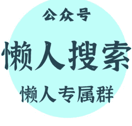
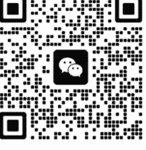
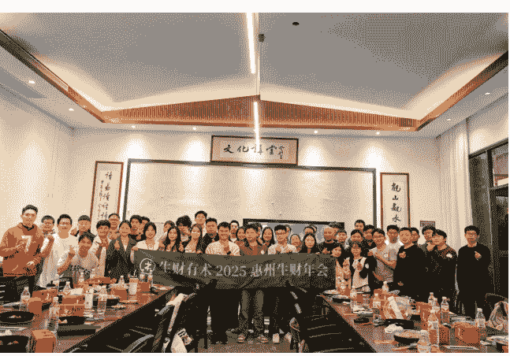
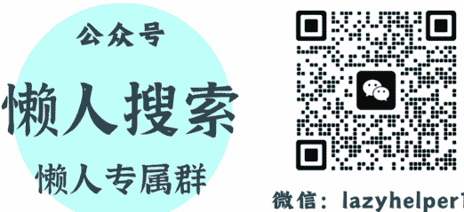

# 先把人搞明白，再谈搞钱：写给想靠人脉变现的人一份实操笔记

260407 副业 SC 精华

👸号懒人搜索，懒人专属群独享

懒人🛰️：lazyhelper1

🛰️：lazyhelper1

## 开场

哈喽，圈里朋友们好，我是 Alice。今天不聊方法论，也不讲项目。今天聊聊技术之外最值钱的东西——人情世故。

契机来自年前一次线下见面，我约了 @陈铭 ivy 陈铭姐聊了整整一下午。她听到我的一些做法后挺意外：

( 你是我见过分钱最爽快的人)

( 第一次见面有人愿意在门口等我)

( 我们说话时你一直在观察我)

( 送礼这套你得教教我)

( 这么年轻对人与人之间的事怎么这么通透)

聊之前我自己都没意识到，这套东西已经在我身上成了条件反射。长期浸淫下来，它已经变成被动触发的本能。约大佬/朋友喝咖啡时，我潜意识里会觉得自己在占用对方的时间，所以必须创造对等价值。比如提前到门口等、提前准备聊点、聊完后复盘反馈等等。

过年回家吃饭，这个话题又被提起。表哥问我：你怎么走到哪都有人愿意帮你？

表弟也说：哥，上班后才懂你以前说的那些话。

还有个前同事私聊我：XX 项目已经跑通，一年毛利可能到 8 位数，要不要一起做？

最近刚做了个小手术住院，躺着有空复盘。折腾这么多年，觉得这项跨周期的底层能力值得拆开讲讲。

如果你正卡在下面这些想法里，文章对你会有用：

- 1. 00 后要整顿职场，拒绝被资本榨干。
- 2. 从没送过礼也没请过客，自认节俭。
- 3. 觉得技术产品做好就行，不用理人。
- 4. 学生思维严重，只索取不付出，把大佬当免费搜索引擎。
- 5. 用内向社恐掩饰社交懒惰。
- 6. 自尊心作祟，觉得丢面子。
- 7. 道德洁癖，认为走关系就是拍马屁。
- 8. 事事要公平讲对错。

先做个自我介绍吧。

我是 00 后，17 岁家里变故后辍学北漂 4、5 年。起初我也瞧不上人情世故，觉得只要技术够硬服务够好就能赚钱。那会儿更愿意跟代码待着。

当时在乙方外包被派到甲方驻场，地位是最末。那种环境甲方有政府、学校、金融、证券等。一次项目里要同时对接自己公司老板同事、甲方对接人领导、友商。大部分难题都不是技术，而是人。夹缝中待久了，察言观色和表达能力被迫练出来了。

18 岁那年参与一个国企项目，开会 5、6 小时，用沟通和真诚赞美拿下甲方高层好感，也得到乙方领导认可，甚至被友商挖。项目 450 人，平均年龄 30+，最后总负责人是我。说明这项能力到位，机会来时会比别人更快。

从那以后我明白，人情没做好，技术 90 分也白搭。人情做对了，成果平平也会被记住。好人情是故事，坏人情是事故。

后来做流量项目，有贵人带路，第一个 100 万到得特别快。

从 18 到 26 岁，它帮我积累了长期朋友、贵人、现金流，抗周期能力很强。

# 一、上桌资格——先把自己盘清楚

大佬对你的第一印象几乎定格在第一次见面。所以在见人之前，先把自己的本金攒够。

## 看清自己的真正强度

老话“不打无准备之仗”。人情世故也一样。不知道自己会什么、不会什么、强在哪、弱在哪、有什么资源。机会来了也接不住。想破圈，首先要把自己盘清楚。

## 优势自检

SWOT、MBTI、盖洛普这类工具都可以。赚钱里有专业的盖洛普航海，感兴趣可以看看。

快速自问几个问题：

你常花时间金钱精力的事是什么？

哪件事让你有强烈的成就感？

做哪件事会进入心流忘了时间？

别人最常夸你哪点？

哪些事你做起来轻松，别人费劲？

同事朋友什么问题会找你？

朋友情绪低落会不会找你倾诉？

也可以做个问卷收集外部视角：

合作时哪个瞬间你觉得我最靠谱？

如果介绍我给陌生人，你会用哪三个词？

你愿意为我的哪项能力付费？

我做哪件事看起来毫不费力？

你遇到什么难题会第一时间想到我？

合伙的话，你觉得我适合负责哪个板块？

我身上最难被替代的特质是什么？

我在你认识的人里最独特的是什么？

我给你反馈时通常带来什么感受？

你觉得我的标签是什么？提到它就想到我。

我未来在哪方面最可能突破？

我目前的优势里哪个商业变现潜力最大？

我擅长整合哪类信息资源？

有没有哪个瞬间让你觉得我在这个领域很专业？

我有哪些优势是我自己没发现或低估的？

跑完这个流程，优势就清晰了。

项目选择和结交人时，要用长项去打。很多人有学生思维，考完试想把弱科补到及格，而不是把强科提到满分。这种补短板思维会让你在关键选择上偏离赛道。要把优势做成护城河。

## 给别人创造价值的能力

第二个学生思维是索取陷阱。学校里花钱买服务，养成了消费者心态：我坐下你就得给我。

职场表现：入职了公司就该教我，遇到问题老板就该手把手带。

社交表现：加了大佬🛰️，大佬就该无条件回答。

预期是：对方不回应就是冷漠不负责。

现实是，职场和社交没有义务为你买单。

解法是利他，把“我要什么”换成“他要什么”。

核心公式：你的收入/地位 = 解决问题的能力 × 不可替代性

链接大佬、加入小团队、求助时先自问：

我的技能能帮他省时降本吗？

除了技能，还能提供情绪价值、整理信息吗？

他为什么要带我？

举个例子，加入惠州赚钱群后，@朝暮 在一次聚餐说想办一场大型的赚钱年会。我立刻想我能贡献什么？能不能上去分享？得到肯定后我做了 PPT，也主动说布置现场我可以早起当志愿者。

那次是我当“知识韭菜”多年里最开心的线下体验。分享后收到很多大佬的合作邀请，这就是利他的回流。

最近跟 @叁斤 教练频繁去户外办公，体验很不一样。身边没有工位，只有自然空气。叁斤说：**这才是惠州赚钱的正确用法**。过程中我一直在想我能为他做什么。约瑞幸我提前占座付钱，户外露营我带零食水果。

有次叁斤问了个代理相关问题，我帮他解决了，价值大概 50 块钱。

后来他把自己花 1 万块线下课整理出来的 skills 发给我了。50 价值换 10000 价值。图我就偷一张。

弱者伸手要糖，强者提供蛋糕。当你开始解决问题，资源自然靠拢。从今天起做一个持续利他的人。

## 保持进化

第三个学生思维是学完高考就停止学习。认知错误，人需要终身学习。

持续学习是链接大佬的敲门砖，是聊天时的接话能力，是大佬抛砖时你能接玉的能力。

大佬的知识面很宽：行业逻辑、趋势、地产金融、地缘政治、历史名著等等。当话题跨界时你能接上，这次你就从仰望者变成对话者。

### 我的学习方式

学技术时养成看书自学习惯。意识到技术天花板后，我把这套迁移过来。两年里看几十本书，报大量付费社群当韭菜，上班戴耳机听课。长线学习能力让我现在能跟任何人聊很久。

最近罗永浩的博客我几乎全看了。感兴趣可以去看，大佬的来时路很有启发，换作你会怎么做。

另一个点是**不要失去向任何人学习的可能性**。最近有个实体行业的问题我不懂，就去问我爸。他在惠州做全屋定制 20 多年。聊完给了我几个方向，还提醒我不要用狭隘眼光看待千万上亿级别的老板。这句话对我项目思路帮助很大。所以，**永远保持跟任何人学的开放性。哪怕是你爸。**

# 二、怎么找到贵人

贵人不是救命稻草，而是放大你价值的杠杆。很多人找不到贵人，是因为定义太窄，非要身价过亿能直接打钱的大佬。

其实能帮你认知升级、开源节流的人，都是贵人。

安全圈子里朋友曾点醒我一句：“你学啥都跟学安全一样学就行。”这句话让我复制了自己已有的学习路径，把技术迁移到新行业，照样做出成绩。路径是：

学新行业
1. 打基础多看 = 书籍👸号付费星球课程
2. 看案例多想 = 赚钱精华帖 0-1 复盘
3. 动手多做 = 结合技能反复试错
4. 放大优势
5. 复盘总结

## 上位贵人

定位：掌握核心资源权力人脉。职场里的上级、前辈、行业里跑通的人。

现在很多<00后整顿职场>的视频很火，怒怼老板很爽。但冷静想：情绪发泄完，筹码增加了吗？

把职场看作卖命换钱，老板就是工头。多做一点就是被压榨。

聪明人把职场看成价值交换场，上班是原始积累，创业式上班。

主动死磕项目，会得到：领导青睐、靠谱标签、公司资源试错、话语权提升。

## 向上社交

现在很火的向上社交/向上管理。很多人以为就是拍马屁 PUA，用汇报艺术混职级。

上位者最怕八面玲珑。他们要安全感大于好用。

我选的路是真诚+守拙+前置付出，跟领导做朋友。

前提是领导还不错。

做法是利他：
- 展示超出 KPI 的技能
- 思考他需要但没说的增长点
- 主动帮他解决公私事
- 建立信任后再扩展
- 成果后超预期回报

龙哥老大的回答说得好，上位者看到你像看到过去的自己。他们看重的是靠谱好用不可替代，而不是听话。当你不再计较加一两个小时，开始关注核心能力成长，你就从牛马心态进化到创业者心态。

## 中位贵人

定位：平级同事、同频创业者。可互补的情报交换站。

很多人把平级当对手，怕技能被偷。其实把自己关进信息孤岛。

我的认知：中位贵人是资源整合的关键。核心是**带他们赚钱**。

我之前在公司认识很多部门同事。A 同事是前端测试，跳槽后想外包后端给我。我技术栈不匹配，就介绍给 B 同事。B 拿下 8k 项目。这件事后 B 极度信任我。后来我更了解他的边界，能接更多项目。

上班几年里这种资源整合发生无数次，经我手分出去的钱已有 6 位数。

深度协作的好处：低成本获取信息差、外包自己不擅长的环节、为离职后储备合伙人。如果你擅长整合，把同学同事变成战友；不擅长就先练发现他人资源的能力，小步测试合作。

## 下位贵人

定位：新人、学生、有潜力的亲友。

很多人嫌下位者是负担，其实是社交资产浪费。今天的下位者可能是未来的上位者。与其等大树，不如种树。

我表弟就是例子。我观察到他勤勉学习能力强人品好，在他入职前给了付费学习资源、模拟面试简历优化、职场相处技巧。相当于把我走过的路复刻一遍。

今年过年我又给他做认知升级，聊钱怎么花。

命题：一年能存 6 万，你怎么花？

他说 90% 存 10% 开销，还给父母。

人品没问题，但上限思维要补。

我给他的建议后面展开。

把一笔收入拆开用，才是职场里最安稳的变现思维。

我把每月的钱分成三块，每块都服务于同一个目标：让自己更有价值、更容易被需要。

第一块，大约一成，拿去经营人脉。每月五百块左右，请同事、领导、朋友吃顿饭。饭桌上没有 KPI，却能换来信任和贵人。关系是可以复利的资产。

第二块，同样一成，投资自己。买书、付费课、找高手请教，任何能加速认知的消耗都算。能力提升是最不贬值的现金流。

第三块，还是自已，又一成，用来做小规模试错。买单的不是产品，是认知。花钱买经验，让可能性越滚越大。

算清楚自己的时薪，也是一种赚钱能力。能用钱买回时间的活，只要价格低于你的时薪，就果断外包。时间省下来，才做只能你来做的事。

这套打法在真实场景里很管用。我的健身教练朋友想增收，我请他吃夜宵聊了现状。最后建议他去注册京粉联盟，把会员常问问题的对应好物整理成清单，用🛰️直接推送给用户：

“你这块有点僵，拉伸不够，我发你个滚轮，买回去每天滚几分钟。”

“这个阶段增肌要补蛋白，我给你推个靠谱牌子。”

顺其自然就有转化，先让他赚到第一笔钱，再慢慢沉淀内容和产品。投资人选人，广结善缘就是一种长期主义的价值投资。

一、三、沟通的艺术——最高级的夸奖是懂得欣赏对方

所有有效沟通里，最高情绪价值的，就是夸赞。而最高级的赞美，不是泛泛的恭维，而是“我懂你的厉害”。

拍马屁可以临场发挥，真夸奖需要观察细节。想想最近一次你被真诚夸奖是什么时候？上一次你认真夸别人又是什么时候？

18岁那年我正好赶上夸赞的红利。一次和甲方高层开会，我用心夸、会提问，硬是把半小时的汇报拉成五个多小时的深度面谈，最后接下项目负责人。那个核心打法来自《销售洗脑》里的问-答-赞，后来我才知道它有多好用。

实战打法一：Q-A-P 脚本
提问引出对方的得意处 → 倾听捕捉细节 → 针对细节升华赞美。

比如领导聊到大学学计算机、写过汇编和 C 语言、对安全感兴趣。

Q：当年有没有写过什么有意思的代码，或者干过什么大胆的事？
A：写过一个小杀毒软件，还黑过学校机房。
P：这太可惜了，您当年要走安全路线，绝对是一号人物。雷军当年也是汇编写杀毒，后来进了金山，您有同样的底子。

再比如高端美发场景，别只夸漂亮，要夸审美和底子。

Q：你选的这个冷灰棕，是想更干练一点，还是想中和肤色显得更清冷？
A：想更白一点，现在头发有点黄，精神也不好，但又不想太夸张。
P：你一眼就挑到冷调，很多人只求显眼，你在求质感。对色温这么敏感，说明你对自己的风格定位很清晰。这个冷棕能把肤色通透度拉上来，很有高级感。

后续再追问护理习惯、给出专业共情，最后让她照镜子对比，强化“我为你定制”的满足感。不断的问答赞，既在解决需求，又在不断抬升她的价值感。遇到顶级销售的人，大多都是被这种张力牵着，开开心心付钱。

实战打法二：赞美细节
细节事实 + 背后付出的推导 + 人格特质的定性。

别只说“领导您英明”。要夸到他的工作习惯和底层逻辑。

曾经公司亏了一千多万，领导靠策略追回大几百万。普通夸法等于没夸。

细节夸法：我注意到您在复盘报告第 XX 行特意标了几个账号，这些账号是怎么筛出来的？是风控模型触发的，还是您追踪了充值转账链路？您对异常数据的嗅觉和对流程的处理力很专业，这种大局观我得学很久。

夸他投入精力的点，而不是运气。每个人都需要被看见和被尊重，你替他说出不能自夸的话，他就把你当自己人。

实战打法三：结果反馈
你的建议 → 我的行动 → 具体结果 → 对你能力的升华。

最打动人的感谢是：因为你，我变好了。

人情世故的闭环，始于你带着结果回来复盘。太多人拿了建议就消失，成功闷声，失败消失。大佬最怕的就是自己的真心付出听不到回响。

反馈范例：
XX哥，跟你报个好消息！上次你拆解的那个流量模型，我按你说的改了三个钩子，这周转化直接涨了30%。数字之外我更受冲击的是你能在乱麻里一刀切中要害的复盘能力，真的让我少走了大半年弯路。

哪怕只是用了一句话改掉坏习惯、面试过了、跑通一个流程，都可以反馈。功成名就的前辈最在意的，不是又一句“您真厉害”，而是他的经验真的被传承、真的帮到人。

四、破冰邀约——线上聊一千次，不如线下见一次

链接再深，线下不落地就是浅层关系。很多人不敢约，是因为怕拒绝、怕刻意。我反感三种做法：

无效开场：别发“在吗”“有空吗”，别上来就说请吃饭。
制造压力：一开口就要资源、要指点。
自轻自贱：酸话、捧杀式自贬。

邀约的核心是四件事：我是谁 + 为什么找你 + 我能带来什么 + 降低他的参与成本。

平级/弱关系可用的四种理由：

成果感谢型。承接上条结果反馈，用感谢做名义邀约，对方有成就感。
“XX哥，上次你那个思路我照做了，转化翻了三倍，帮我避了大坑。这周末有空吗？我请你吃饭，面谢。”

阶段收尾型。项目收尾，传递重视感。
“项目收尾了，这段时间辛苦你了。周五晚上有空吗？我组个局放松下，顺便聊聊下一步。”

顺路型。把邀约变成顺手的事，给对方台阶。
“我正好在你们公司附近办事，中午一起吃个便饭吗？”

中间人搭桥。用共同好友背书。
“XX哥，这周末B从XX过来出差，咱们仨一起吃个饭？我来订。”

向上邀约大佬，核心是价值前置。别索取，先给。把“请你吃饭求指点”变成“我带着可落地的成果/方案想跟你当面对齐”。

我当时在甲方驻场，得知华北总负责人要来拜访。加了好友后发：
“X总您好，我是XX项目驻场的X。久仰大名。销售X说您明天过来，我已把项目成果、客户痛点和新需求整理成文档，但对贵司产品覆盖还不了解。想中午占用您一小时当面请教，不耽误下午工作。”

拆解：精准锚定身份 + 先发价值文档证明不是空口 + 选午间、控制时长、在公司附近。

邀约的终极心法是勇气。话术只是辅助，敢不敢发才是关键。18岁的外包装大佬，也靠一封邀约打开局面。被拒也赢过不敢发的人。

为什么要请客吃饭

很多朋友问我，为什么要花钱做这些虚的。我北漂外包时也这么想，直到踩坑才明白：很多事在会议室谈不透，在饭桌上才说开。

请客的四个回报：

最低成本的维护。每月花点钱维系核心关系，比事到临头临时求人强。人情是银行，先存后取。

最核心的内部信息。谁有实权、哪里有坑、领导关注点，这些不在群里，在饭桌上放松时才说。老员工的内幕，一顿饭就能拿到，省几年弯路。

1v1才能沉浸链接。线上碎片化，线下沉浸式。1v1饭局没有干扰，能聊成长、聊信任，这种记忆线上永远替代不了。

合作是吃出来的。我的不少赚钱项目，都是饭局里孵化的。信任是几十顿饭堆出来的。

注意事项：同事约周五下班，领导优先午休；餐厅让对方选，男生吃烧烤烤肉海鲜，女生选颜值高可拍照的；多听少说，别炫耀。

五、深度合作——接住机会

当链接、邀约、信任都做到位，大佬会抛橄榄枝。很多人这时翻车：不敢接、拎不清、贪功。

帮个小忙=最后测试。大佬让你做一两件小事，是在测态度、执行力、靠谱度。我以前被要求做内部分享、帮他忙、帮他朋友忙，我认真完成才拿到后续合作。

拿到机会要前置付出，别等靠要。先想好能提前做什么，主动扛事。邮件营销项目我没经验，我先说明情况、做调研、对比平台、报方案、汇报卡点、跑通闭环后给评估。让领导只做决策。

分钱时拎清位置。项目跑通最容易出问题的是归属感。没有大佬的资源，你连机会都没有。先敬畏，再成长。

我起步做的一个盘，是认识很久的朋友领进门的。老板是他介绍的，我负责把盘子跑通、把执行落地。首月到账大概是三万八。我把其中一万二的现金加上一些小礼物给了引荐人。扣掉成本和外包，我手里实际留了两万五左右。非常清楚的是，没有他的渠道资源，我连门都敲不开。光靠我把活干好，功劳的核心也离不开他。

这件事给我上了一课：谁掌握关键资源、谁牵引机会，谁就该拿大头。哪怕执行全是你在扛，也不要抢功，更不要生出“他没干活就不配分”的念头。

大佬把机会丢给你，不是冲你那点提成，而是想找个靠谱的人去兑现，寻求长期配合。你把边界感守好，不贪名、懂感恩，他才会持续放权，甚至把更核心的资源交给你。反之，一贪功忘本，这次合作立刻变味，以后也很难再有机会。历史上盖过主的人，最后都不好收场。

# 六、送礼的艺术——把人情当成长期持仓

给人送东西，看似简单，实则门道很深。没送过几次的人，容易卡在两头：送贵了怕对方为难，送便宜了怕显得敷衍。逢年过节怕撞礼，平常又不知道怎么开口。

很多人送礼的心态是补救型：求人办事才想起送，朋友帮忙才掏礼，平日连声招呼都没有。结果东西送了，关系没近，反而让对方觉得无事献殷勤，心意打了折。

这一章我结合底层逻辑和真实经历，聊聊送礼怎么送得让对方舒服、自己也长线受益。

## 体面与实用

《一代宗师》里有句话点破了本质：

一屋子里总有人当门面，有人做支撑。门面不能有瑕疵。要流血，得让里子去承接。收不住，血漏到台面上，就是毁门灭派的大事。

映射到送礼：

- 外在：收礼人能不能安心体面地收下
- 内在：礼物有没有真实的使用价值，能不能被记住

## 常见误区：重标价轻体面

比如直接拎现金上门。对方要么拒绝，要么收下后心里别扭，会想你到底想换多大的人情。

再比如送顶级奢侈品，对方只能回一句：太贵重了，我不能收，请拿回去。场面瞬间尴尬。

因为礼物的等级已经超出关系边界。礼物一旦变成压力，体面就没了，双方都难受。

体面不在于贵，而在于不让人有负担，还能感受到被尊重。

## 案例 1

北漂时带的一个项目。

与销售老大聊天，他常去爬山，想买台无人机在山顶拍片子。可太太不同意买。

项目结束，我想着送他一台四千左右的大疆。老板起初反对，觉得项目利润有限。最后我还是坚持定了下来。

话术很简单：X哥，这次能顺利多亏你搭桥，麻烦给弟弟个地址，我寄点家乡特产过去。

复盘：

无人机是他心心念念却买不动的东西。价格不低，但使用频次高，每次使用都会联想到我。收到礼物大概两周后，他主动把一个五万的单子外包给我。这就是自然的回馈。

体面层：礼物拿得出手，收下不尴尬。他在项目里出过力，后续回馈也承担得起，不会觉得被压。

实用层：高频使用，情绪价值被不断放大。

## 案例 2

朋友问我，导师住院了该送啥。

我建议带一篮应季水果，篮底放一张一千的京东卡。临走时说：都是当季的，放不住，赶快吃，多吃点早点好起来。

体面层：应季水果没毛病，也不算贵重。没有直接塞现金的生硬感。

实用层：卡藏在底部，走后才发现。用得上就用，转手也不难。

## 案例 3

最近有朋友求助：

有个女性朋友做保险团队长，年收入百万级别。第一次见面，她帮我牵了个中医调理的医生。她很注重养生，有个上幼儿园的孩子。请问送什么好？

我的判断：

第一，第一次见面，她介绍医生只是举手之劳，回礼太重会让对方有负担。
第二，这阶段不建议送孩子。信任基础薄，送娃容易让对方提防，且喜好未知。
第三，回馈的核心是：我记得你的付出，我不是忘恩负义的人。

表达可以这样：XX，上次你推荐的医生我看了，效果很明显，还给了我不少日常保养的思路。我刚好买到一款补品，平台在做活动买二有折，给你也带一份吧，一起调养。

千元以内日常食补或美容养颜类的东西，接受度通常很高。

思路可延展：我最近回老家探亲，给个地址我寄点特产过去。最好能当面给，约个下午茶顺势递出。礼物的价值不在于本身，而在于传递的在意和维护关系的心意。媒介是礼物，核心是“我记得、我重视”。不贵但里子足，这份心意比昂贵礼物更扎实。

## 功夫在日常：人情靠积累

送礼是长期持仓，关键在于平时就得攒。别等要用人的时候才想起维护，平时不经营，临场再贵的礼也让人无感。

## 日常小赠：细微处见真章

真正有效的送礼，往往是节日的低调表现，而非大动作。一杯饮品、一包零食、一盒特产，随手送出，不刻意不功利，关系却在暗中升温。

比如我回家给领导带了两盒手工龟苓膏，一盒几百块，不值钱，却传达出我心里惦记你。平时无往来，临时送大礼反而让人不适。

给前辈送茶叶，说是亲戚寄来的，我喝着可以留给你一盒。不谈礼物不谈求，只做分享，反而更亲近。

送礼太功利，对方会觉得你有所图。用分享的名义递出，压感会小很多。

## 曲线路径：关注家人

送礼可以送本人，也可以送家人，后者往往更暖心。本人碍于身份难收，送给家人则是细心懂事的体现。

比如一位大哥提到女儿要过生日，我就送了个大玩偶。领导说家里老人爱食补，我就主动送了两斤野生灵芝。

给老人送体检套餐或养生小物件，给孩子送玩具，给伴侣送护肤或家居小物，这些不功利，却能精准打中软肋，直接送本人效果更好。

## 常备礼物思路，仅作参考

最后说一句，送礼不是技巧训练，而是人情修炼。它不是花钱买关系，而是用心意、行动和长期经营把关系慢慢做实。

硬实力让你站得住，软实力让你走得顺。送礼就是软实力的重要支点。别觉得送礼丢面子，它只是人情的润滑剂，是社会上立足向上的必备能力。就像学门技能一样，掌握它你在人情场才能游刃有余。

# 七、总结

人情的归宿是双赢。

回望过去十年，连接贵人、实现成长的路上，我始终认为：人情世故不是投机取巧，不是阿谀，不是拍马，而是一门需要长期修炼、跨周期的核心软能力，与天赋无关，与真诚和用心有关。你愿不愿意跳出自我学会利他，愿不愿意放下索取学会沉淀，在细节里付出，在长期里坚守。

全文我都基于真实经历拆解：入局前要自身过硬，挖掘优势持续进化，攒够本金，这是人情投资的根基。相处中要识别贵人，上位者握资源，伙伴能互补，下位者有潜力，每个人都能带来认知增益。

沟通时要学会赞美，用真诚观察和细节反馈传递情绪价值。链接后要敢于破冰约见，把线上浅层关系拉到线下深度信任。合作中要守住分寸懂感恩，前置付出坦诚相待，既不贪功忘本也不退缩不前。送礼时要平衡体面与实用，用日常点滴替代临时功利，让人情在长期维护中沉淀为资产。

我曾经也看不起搞人情，觉得实力至上，直到在职场博弈中受挫，在贵人帮助中成长，才明白：硬实力是底气，软实力是放大底气、让机会落地的桥梁。你不必变成八面玲珑的人，但要学会真诚利他；不必刻意堆社交，但要珍惜每一次相遇；不必急于回报，要相信每一次用心的付出终会在未来以意外的方式回来。

人情世故的本质不是搞关系，而是做人。做一个靠谱的人，懂得感恩的人，愿意为他人创造价值的人，做一个长期主义者。当你不再计较一时得失，不纠结输赢，不带着索取与人交往，而是专注提升自己温暖他人，你会发现贵人不是找来的，而是自身价值的吸引，是真诚付出的回响。

愿看到这篇文章的朋友，能跳出学生思维的局限，放下偏见，慢慢修炼这项跨周期的软技能。愿你既能深耕自身拥有安身立命的硬实力，也能懂得人情拥有链接贵人的软技能。在人生路上，一路向阳，把每一次相遇都变成前行的力量。

如果你想看全网最新的变现玩法，并且和一群执行力极强的极客一起下场拿结果，欢迎围观我的核心私域：【懒人专属群】。

我们不聊虚的，只做商业闭环的拆解与 AI 效率的压榨。系统内已沉淀 1000+ 跑通的套利实战局。

👉查阅圈子完整数字资产与上车门槛：

https://lazyso.com/insider/

认同价值、准备好下场干活的，扫码加我🛰️ (lazyhelper1)

备注：【实操上车】，不闲聊