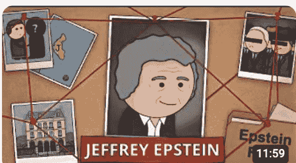

公众号懒人搜索 · 懒人专属群独享
【全拆解】YouTube长视频为什么做不起来？是赛道这一关就没过（筛选标准公开）
260413 副业SC精华
懒人微信：lazyhelper1

先说句题外话，感谢圈友们的点赞和收藏，有点受宠若惊。所以这篇必须掏点真正能用的东西出来，算是给大家的回礼。

做YouTube长视频，我观察下来，最先让大多数人卡住的，根本不是剪辑、配音或脚本，而是一个更底层、也更致命的问题——赛道选错了。

别小看这件事。绝大多数人对“选赛道”的理解，从根上就是偏的。有人觉得，赛道就是找热门方向，看别人做什么就跟着做什么；有人觉得，反正YouTube讲坚持，干脆先按自己的兴趣来，后面慢慢看结果；还有人一上来就死盯RPM，觉得金融、商业、科技单价最高，就往里挤。单看这些想法，好像都有道理，但放进真实打法则全部失效。原因很简单：它们是一堆零散建议，不是一套可以反复使用的决策系统。

长视频和短视频完全不同，它的周期特别长，启动也很慢，一旦靠感觉走，一个“我猜这个方向应该行”的直觉，可能就消耗掉两三个月。所以我越来越确定一件事：YouTube能不能做起来，重点从来不在于你的内容先做到多精致，而在于你有没有站对位置。位置一旦错了，后面步步都是错。你花大把时间打磨脚本、抠剪辑、调配音，最后做到的，充其量就是让一条本来就不该被看见的内容，看起来更像样了一点。算法不会被你的辛苦打动，它只依据观众的真实行为来判断：这条视频有没有被推荐的价值。

这也是为什么我一直强调，长视频的成败权重里，选题和赛道才是大头。按照我的经验，可以拆成这样：选题占四成，脚本占三成，封面占一成，设置占半成，另外一成半，看运气。很多人不爱听“运气”这两个字，觉得它不可控。但真正下场做过的人都懂，运气这东西确实存在，只是你能不能接得住它，前提是你已经站在了一个正确的位置上。而这个位置，不是拍脑袋拍出来的，是靠一层一层筛选滤出来的。

那真正有效的赛道，到底该怎么选？

我认为至少要同时满足三条硬条件：你能做；市场要；还能做出差异化。缺了任何一条，都走不远。

先讲“你能做”。这句话说起来容易，大部分人对它的理解却非常浅。我经常听到有人说：我对这个方向有兴趣，我也愿意学，这样能不能做？答案是，不一定。兴趣和护城河不是一回事。能撑起一个频道长期走下去的，从来不是“你愿不愿意学”，而是你有没有一种别人很难快速复制的认知密度。判定的标准其实简单到有点扎心：不查任何资料，你能不能把这个主题连续讲满五分钟？如果能，这个方向大概率就是你的护城河。如果讲不出来，那你的所谓兴趣只是水面的浮萍，不是水下的根。

举个最直白的例子。一位牙医去讲牙齿矫正、根管治疗、牙龈出血背后的机制，就算他的剪辑毫无亮点，天然就有说服力。因为他讲的是自己的临床经验和判断，不是靠搜索拼出来的公共知识。再比如一个多年研究二战、越战的人，张口就能讲出战役细节、武器演化、指挥逻辑、争议史观，那他做出来的内容，和普通爱好者“翻几篇资料总结一下”完全不是一种东西。前者是输出，后者是搬运。而搬运出来的公共信息，恰恰是这个时代最危险的东西——AI三分钟就能生成一份看起来差不多的脚本。一个没有真实积累的人，只要会写提示词，就能做出一份像模像样的稿子。如果你的内容任何人都能这样复制，那你根本没有进入竞争，你只是占了一个随时可以被替代的坑位。

但只有护城河还不够。YouTube不是学校，不是你把内容讲得又深又对就一定有人看。市场没有需求，再专业也是白费。所以第二步，不是急着做内容，而是验证市场。

注意，是验证，不是猜。

我听过太多人说：“我觉得这个方向应该有人看。”这句话一说出来，基本等于宣告还没做过调研。平台从来不奖励“我觉得”，它只认可已经真实发生的东西。你必须从真实频道、真实数据里找答案。而最值得盯的数据，不是大频道，而是小频道。大号自带信用、自带历史、自带分发优势，它们爆，不代表你也能爆。真正有参考价值的，是小频道能不能在这个赛道里拿到远超自身体量的播放。

如果你看到的情况是：一个订阅只有几千的小号，视频动不动就是几万甚至几十万播放——请注意，这不是这些频道有多厉害，而是这个赛道正在被算法主动放大。需求已经远远跑在供给前面。这是最核心的入场信号。如果你翻遍整个赛道都找不到这种结构，那这个方向基本不成立。

除了这条核心信号，还要再加三条过滤条件。

第一，还没有巨头垄断，而且整个赛道仍处在早期。如果一个领域里已经有大量十万、五十万、百万级订阅的频道，你的赢面会变得很低。因为这些大号在算法那儿天然更有信任权重，推荐系统更倾向把流量先给他们。时间也是关键因素——一个赛道一旦被主流创作者大量涌入，往往说明红利期已经走了大半。真正好的入场窗口，是在爆发前3到6个月。你要做的不是挤进已经被证明过的市场，而是找一个刚刚被算法注意到的缝隙，先在里头站住。

第二，不能有“小频道死海”。有些赛道看起来无人竞争，大量小号也一直在更新，但播放量常年稳稳地停在一两百、两三百。很多人会把这种状态理解成蓝海，事实恰恰相反。这说明这个赛道要么存在隐藏门槛，要么根本不存在真实需求。那地方看上去安静，其实是坟场。只要看到这种结构，一分钟都别犹豫，直接掉头。

第三，你有没有降维空间？也就是说，你是否有能力把一个主题做得比现有玩家更“厚”。不是剪得更好看，而是你的信息密度能不能更高；你的视频时长能不能做到对手的1.5倍而且不注水；你的叙事结构是不是比多数同行更完整。这三个优势一个都占不到，就别硬挤。

把这四条叠加起来，基本能帮你筛掉九成以上的凑数赛道。

赛道逻辑清楚了，接下来才是怎么找候选方向。我不说泛泛的理论，只讲三个能直接落地的招。

第一招：让算法帮你挖赛道。操作不复杂。拿一个全新的油管账号，去搜你感兴趣的大方向，然后只点那些“没有真人出镜”的视频。每看完一条，就点赞、评论、订阅，接着继续点进推荐。坚持三十分钟，你的首页会慢慢变成一个“隐藏赛道陈列室”。这时候再打开NexLev这类分析工具，按一个特定的筛选条件去找：订阅量很低、但最近播放量高得反常的频道。这些就是最值得解剖的对象。

第二招：发明赛道。今天的YouTube，已经不是简单的“做内容”，而是在做“位置”。你讲什么当然重要，但你怎么讲，同样重要。我把内容理解为两个层次：一个是类目，比如健康、历史、健身；一个是形式，比如动画、纪录片、AI配音、图解。大部分人的思路只是在类目内部寻找机会，而真正高效的做法，是形式迁移——把一个领域已经被验证过的爆款表达方式，搬到另一个还没人这么做的类目里。

举个例子。过去做健康内容，观众看到的大多是专家坐在镜头前讲课。同样的知识，如果换成高质量动画去解释人体内部机制，观看感受就会完全不同。再比如历史内容，过去很多人习惯平铺直叙地讲故事。但你如果把纪录片式旁白、悬疑节奏、电影化转场、地图图解整合进去，观众会觉得自己在看一个“新物种”，哪怕底层的类目根本没有改变。内容还是那些内容，呈现方式换了，位置也就跟着换了。

最近有个很典型的例子。爱泼斯坦的故事想必不用多介绍，大多数人讲他，翻来覆去都是岛上的受害者、权贵八卦名单（克林顿、安德鲁王子都在上面）、死因阴谋论。但有一个频道完全跳出这套叙事，把爱泼斯坦当成一个“金融幽灵”，专盯他那1.9亿美元从哪里来、又是怎么被洗白的。这个频道叫Capital Case，那条视频标题是Epstein: The $1.9 Billion Mystery Nobody Can Explain，发出4天，已经有5.2K播放。这就是新赛道。链接放这里：https://www.youtube.com/@Capital_Case_e

找到候选赛道后，别急着开工。还有最关键的一步：排雷。这一步同样要靠标准，不能靠感觉。我把它拆成一套“绿旗/红旗”清单。

先说绿旗，也就是好信号。如果某个赛道里，一个刚建立没几周的账号，第一条视频就跑到十万甚至百万播放，这基本是最强的信号。如果这种内容用“AI+素材+剪辑”就能完成，不需要很高的专业门槛，说明它具备规模化复制的能力。同时，还要特别注意同质化的问题。别再做那种PPT轮播风格，尽可能在呈现上做出自己的变化。当然，说句实话，现在的油管本来就很动荡，指望单账号一步到位不现实，多号布局是很多人的常规做法。如果你对同质化这件事本身就非常焦虑，那现在就可以关掉这篇文章了。

再看红旗，也就是危险信号。第一条，如果某个频道只有一条爆款，而且那条爆款已经是几个月前的，之后更新的全部扑街，这叫假信号。第二条，如果整个赛道里的爆款几乎都来自老频道，那说明起作用的是账号权重，不是赛道本身。第三条，如果受众清一色集中在低RPM地区，播放量再好看，商业价值也会很有限。这三条，占到任何一条都不要心存侥幸，果断放弃。

过了排雷这一关，你基本能找到一条成立的路了。但还有最后一层很多人会漏掉的东西——差异化。

有人会问：那我要是没有护城河，是不是就不能做了？当然不是。公共内容完全可以做，但你要清楚，如果你讲的东西别人也能讲，你就必须在形式上拉开差距。同样的知识点，你可以用动画讲，用故事讲，用结构化拆解讲，也可以用更长的篇幅、更强的节奏来讲。说到底就是一句话：内容可以相似，体验必须不同。关于脚本同质化的具体问题，我之前已经发过专门的拆解，这里不再展开。

这套方法论如果压缩成一句话，其实很简单：带着你的认知优势或表达优势，进入一个供不应求的市场，用已经被验证有效的形式，做出一个还没有被人占据的位置。这才叫选赛道。不是凭感觉，不是追热门，不是跟在别人后面跑。而是用一套系统，把自己放到一个真正有机会赢的地方。

长视频的确不容易。周期长，启动慢，这也是为什么大多数人最后都放弃了。但换个角度看，也正是因为这样，现在布局长视频，反而是一种“入手简单、回报丰厚”的事。如果你之前做过短视频，那长视频真的欢迎你。你只需要想清楚两件事：脚本能不能搞定？成本能不能降下来？如果你是宝妈或上班族，长视频可以成为一个相对稳定的副业方向。如果你正在做AI写作、代写，那这波从短视频到长视频的迁移，可能是你最容易放大的机会。

看完这篇SOP，你可能觉得自己已经懂了。但我说句实在话——90%的人一到实操，还是会卡在第一步。工具和教程永远只是最低级的壁垒，真正的壁垒是“立刻动手”和“圈层信息差”。我们这边不聊虚的，只做商业闭环的拆解和AI效率的压榨。系统里已经沉淀了1000多套跑通的套利实战局。

想查看圈子完整数字资产与上车门槛：https://lazyso.com/insider/

认同价值、准备好下场干活的，扫码加我微信：lazyhelper1

备注：【实操上车】，不闲聊