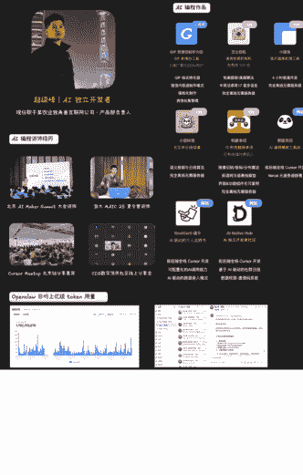
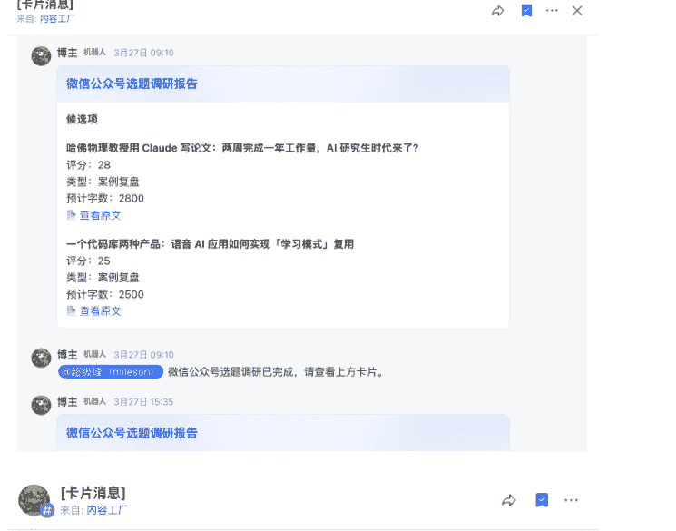
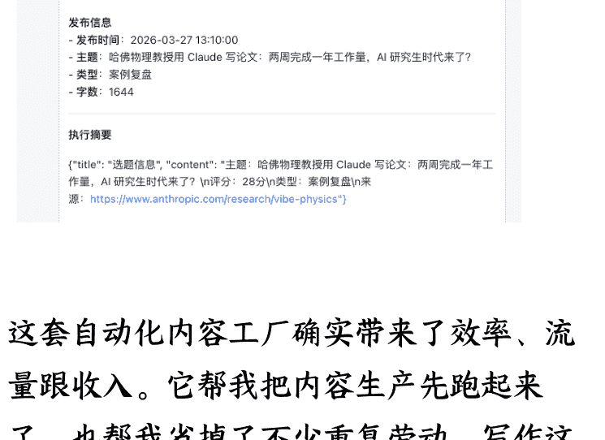
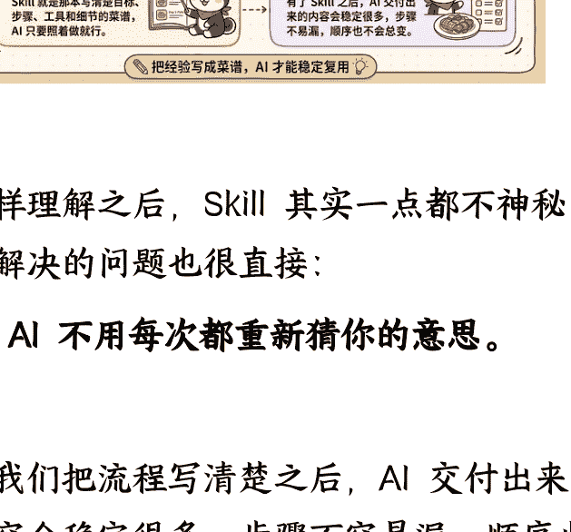
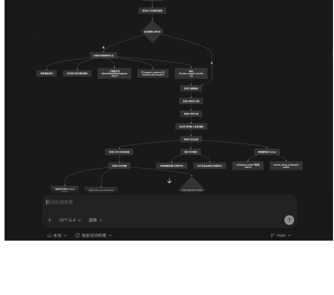
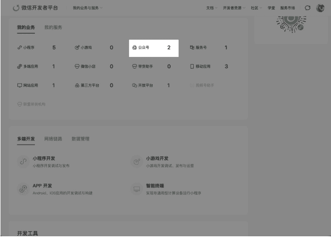
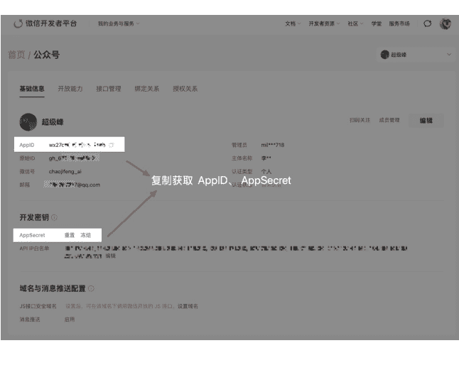
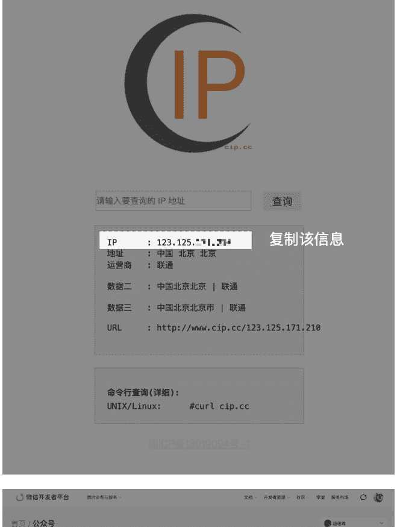
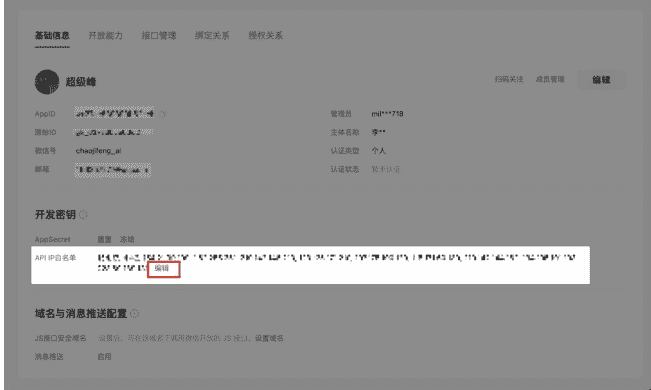

# 👸号写作自动化，我真的跑通了一个月：全自动负责启动，人机协同负责走远
作者：龙哥


大家好，我是龙哥，又见面了。



这些年我一直在“产品、开发、写作”三线并行。做过的工具，累计用户到过 200 万；过去一年多，又靠着 AI 编程一口气上线了 7 款产品。但👸号内容，是我最想先动手改造的事。原因很简单：偶尔写一篇并不难，难的是长期稳定地写，而且越写越有自己的辨识度。

最近，我终于把这件事往前推了一大步。思路是：先把写作流程拆成一个个 Skill，再把 Skill 接进 OpenClaw（大家更常叫它“小龙虾”），最后搭成了一套👸号内容生产流水线。从自动捕捉选题，到自动生成正文，大部分环节都能交给“小龙虾”去跑。



这套流水线确实带来了效率、流量和收入。它让内容生产先滚动起来，也帮我省掉了大量重复劳动。👸号写作第一次让我有了“可以持续运转，还能产生收益”的感觉。打开流量主后台，数字就是最好的证明：昨日收入 21.80 元，日环比 +1333.55%，周同比 +6503.03%，本月累计 35.02 元。


不过，真正跑了一个月后，我反而转变了一些想法。能自动跑起来，和长期跑得好，完全是两码事。全自动确实能帮我把“持续输出”这个动作先做出来，也确实送我拿到过一些不错的结果。可一旦你想把内容当成一件长期事业，很快就会遇到更关键的问题：文章里真正值钱的，从来不是“生成”这个环节，而是创作者自己的判断力、个人观点和内容品味；否则，大多数内容生产都只是在撞大运。

所以，下面我想把三件事讲清楚：Skill 是什么、OpenClaw 是什么、两者怎么接起来。以及最后我的结论——全自动负责开局，人机协同才能走远。

## 一、Skill 到底是什么

很多人第一次听到“Skill”这个词，容易觉得它很高冷，好像要写一堆代码才能碰。

其实不用。把它理解成“一本写给 AI 的工作手册”就好多了。想象你请来一位厨艺很厉害的大厨，刀工、火候都没得挑，但他刚来，完全不了解你的口味，也不知道调料放在哪里。每次做菜，你都必须在旁边反复交代：“少放盐，多点甜，不要葱，最后装蓝色盘子。”运气好的时候，味道对了；运气不好，总觉得差一点。

于是你干脆把常做的菜写成一本小册子：这道菜要达到什么效果、需要准备哪些食材、先做什么、后做什么、哪些细节不能错、装盘标准是什么。以后只要递给他一句“按这个做”，他就能稳定交付。

放到 AI 这边，逻辑完全一样：大模型，就是那位聪明的大厨；Prompt，是你临时喊的话；Skill，则是你沉淀下来的那本菜谱。

所以，Skill 到底是什么，用一张图来加深理解：


这样看下来，Skill 并不神秘。它解决的核心问题只有一句话：让 AI 不用每次都重新猜你的意思。本质上，它是在满足一个需求——让某条固定的业务流程 SOP，被持续、稳定、正确地执行。

拿👸号写作举例。你只丢一句“帮我写一篇👸号文章”，AI 当然也能写，但它的发挥大概率是即兴的：这次先出标题，下次先出大纲；这次给 Markdown，下次给 HTML。没有固定流程，账号的风格和统一性就很难建立。而一旦把流程写进 Skill，顺序、节点、格式、哪一步要停下来等确认，全部变成约定。步骤不容易漏，顺序也不会总变。

更重要的是，写 Skill 的过程，会逼你面对一个很现实的问题：你到底有没有把这件事想清楚？

比如👸号写作，你绕不开这些选择：先给选题还是先给素材？先出标题还是先出大纲？要不要给几个方向让我挑？生成后是直接继续，还是停下来等我确认？最后只交初稿，还是连排版、草稿箱一起处理？这些问题平时放在脑子里，可能觉得“差不多就行”；但一旦写成 Skill，就必须给出明确答案。

所以说，写 Skill 表面上看是在教 AI 做事，实际上是在帮自己梳理业务，让经验变得可复制、可执行、可稳定交付。

## 二、第一个 Skill，应该怎么做

第一个 Skill，我建议千万别追求大而全。别一上来就想做一个“全自动👸号写作系统”，把所有环节一次性塞进去。那样大概率会越做越乱。

更好的起手式，是挑选一件你已经重复做过很多次的小事，先让 AI 稳稳接住。比如：

- 根据一个选题，先出 5 个标题和一份大纲
- 把一段录音整理成结构化摘要
- 把几份资料改写成一篇👸号初稿
- 把群聊内容总结成日报

这些事都有同一个特征：足够具体。而具体，恰恰是 Skill 最好的起点。

真正开始写的时候，也只需要先写四件事：启动时机、输入物料、执行流程、交付格式。这四个要素，就是第一个 Skill 的骨架。


拿👸号举例。如果暂时不想做完整系统，只想做一个“选题 → 标题 + 大纲”的小 Skill，第一版可以写得很朴素：```markdown
### Skill 名称
根据选题生成👸号标题和大纲
```

- **启动时机**：用户给一个👸号选题
- **输入物料**：选题、目标读者、希望强调的方向
- **执行流程**：先给 5 个标题候选，再推荐 1 个标题，最后生成三级大纲，并标出每一部分的写作重点
- **交付格式**：5 个标题候选 + 1 个推荐标题 + 1 份结构化大纲

第一版能做到这个程度，已经算成立。后面再往里加历史文章风格参考、多平台适配、初稿生成等能力，都是在已经能跑的地基上继续扩建，而不是对着一个巨大的念头硬搭。

还有一件很容易被忽略的事：做 Skill 真正难的，从来不是把文档排版得多漂亮，而是你有没有把流程想清楚。如果一时想不清楚，可以先画流程图。你可以打开 ProcessOn、Visio 这类工具，把自己想实现的业务画出来；或者更直接地告诉 AI：“我打算实现 XXX 自动化，我们一起来梳理业务流程。”让 AI 先把流程图整理出来，你确认通过后，再让它把图落地成 Skill。

如果你想要一个现成的创建器，也可以用 Anthropic 开源的 /skill-creator，下载地址在这里：https://github.com/anthropics/skills/tree/main/skills/skill-creator

做 Skill 这件事，很适合抱着打磨产品的心态来。它可以是一个只帮你整理排版的小工具，也可以是一整套融合多个流程和脚本的复杂系统。能做到哪一步，取决于你对业务的定义能力，以及对 Skill 的熟练程度。

## 三、OpenClaw 到底是什么

Skill 这本“菜谱”写好了，总得有人按时下厨房。这个人，就是 OpenClaw，国内社区更习惯叫它“小龙虾”。

大家叫它“AI 数字员工”，不是没有道理。它最直观的能力，是能结合定时任务，到点自动开工。比如每天早上固定推一个选题，或者定时跑一段流程。更特别的是，你可以去睡觉，它还在跑；你去忙别的事情，它依然按着流程推进。这种 24 小时在线的状态，确实会让人产生“多了一个不用休息的员工”的感觉。

不过，还是要分情况看。

简单任务，你直接交代给小龙虾，它也能做。比如定时提醒、固定时间推一个结果、按照同样方式处理一批重复动作，这些都比较直接。

但内容创作不是这种简单任务。一篇内容要经历选题、角度、结构、配图、格式、交付，甚至发布，链条非常长。如果每个环节都靠临时口头交代，今天你可能想到这一步，明天又补那一步，后天再改顺序。结果就是输出极不稳定：今天先出标题，明天先出大纲；今天是文章，明天是草稿。

所以，一旦事情开始变复杂，最稳的做法仍然是先把流程写进 Skill。你先把启动时机、操作顺序、交付标准约定好，小龙虾再接过去执行。它最适合接住的，不是一团模糊的任务，而是一条你已经写清楚的流程。

换句话说：Skill 是把流程固定下来，OpenClaw 是把流程持续、稳定、正确地跑起来。

## 四、Skill 和 OpenClaw，怎么连在一起

两者配合起来，其实只要记住四步：

1. 先把做事的方法写成 Skill
2. 再把 Skill 交给小龙虾
3. 然后告诉它什么时候开始
4. 它就会按这套流程自动执行

本质就是一句话：规则由你定，执行交给它。

当然，边界也要讲清楚。不是所有事情都必须先写成 Skill，再交给小龙虾。简单、短链路的任务，你直接临时安排，它也能做。真正需要 Skill 的，是内容创作这类长流程。

所以，流程能不能稳定跑起来，关键不在小龙虾有多勤快，而在于你定义的 Skill 是否足够清晰。一个模糊的 Skill，只会让一个勤奋的执行者，把模糊的结果重复很多遍。

## 最后说两句

这套全自动流程，确实让我先把内容生产跑通了，也带来了流量和可观的反馈，这是事实。但支撑长期走下去的，一定不是“全自动”三个字，而是人机协同。

人可以负责设计流程、把关判断、提供品味，AI 负责不知疲倦地稳定执行。全自动适合冷启动，人机协同才是 AI 内容自动化真正的长期主义。

如果你始终想不通“为什么别人能用 AI 稳定地更新公号，我这边却时灵时不灵”，那这篇文章也许能把窗户纸捅破。下面会聊透三块：Skill 到底强在哪、拿到结果的底层三件事，以及如何从零搭出一套自己的内容自动生产线。

### Skill 真正的威力，在于将流程焊成框架

Skill 不是随口丢出去的一句临时任务，它更像一册预先写死的操作剧本。同一件事，可以被拆解成这样几段：

- 什么时候正式出发
- 依照什么次序推进
- 哪些动作一步都不能省
- 哪些位置必须停下来核对
- 最后要端出怎样的成果

把规则先写清楚、写死，OpenClaw 之后照着执行，才不容易走样。这一点在做内容这件事上尤其要命：写稿真正难的，从来不是某一手功夫，而是环节一多，你心里那杆秤就开始晃。今天觉得标题是命门，明天觉得结构才是关键，后天又想把排版和发布统统塞进来。

如果这些都是临时起意、临时添补，那 OpenClaw 每次接到的就不是同一码事，输出自然忽高忽低。Skill 的价值，恰恰是把整条线路提前冻结——它拿到的再也不是含糊的要求，而是一套写明白了、能一遍遍照做的作业流程。

### Skill 的另一桩好处：它能边用边长

这也是我后来越来越看重 Skill 的原因：它的生命周期不是“写完即止”，而是可以不停迭代。

今天发现标题环节还不够稳，回到 Skill 里补两条规则；明天觉得提纲不够像你的调性，再回头继续改。每优化一轮，这条流程就清晰一分、结实一分。

所以 Skill 更像这条生产线的骨架：先把骨架立起来，再慢慢往上补血肉，整套系统才会越来越硬朗。要是少了这层骨架，OpenClaw 再勤快，也只是把一件含混的事反复执行——而含混的事，执行一万次依旧是含混的。

### 系统稳不稳，先看流程有没有定住

我现在更愿意这么理解：Skill 和 OpenClaw 之间真正的咬合点，不是自动化做得有多炫，而是流程有没有先被定死。

流程是飘的，助手就只能边猜边做；流程是定的，它才有机会越跑越靠谱。就内容生产而言，让长链路稳定下来的关键，不是催着助手按时开工，而是先用 Skill 把这条路画出来。

要往最简单里记，就这么一句：Skill 负责将流程焊死，OpenClaw 负责把焊死的流程原样、准确、持续地跑完。

## 拿结果的核心心法，说穿了就是三件事

不少新手以为，把活儿丢给 AI 就算大功告成。但真想靠自动化换来流量和收益，只盯着“全自动”是远远不够的。回望我全部的试错过程，底层心法无非是三件事：

- 先让流程自己转起来：解决“能否持续产出”的频率问题，告别三天打鱼两天晒网式的更新
- 把人安回选题环节：解决“到底写什么”的方向问题，让内容有长线价值
- 往流程里塞进个人观点：解决“写出来有没有你自己的味道”的风格问题，避免变成干巴巴的机器稿

我最初把 OpenClaw 引进公号写作，也是踩着这条路径——先任由它自己一路跑下去。

前半程，我交给它的活儿其实特别简单：

- 自己检索话题
- 自己拟标题、搭提纲
- 自己出初稿
- 自己整理版式
- 最后把成品自动投进🛰️后台草稿箱

这套打法最大的功劳，是先把“稳定更新”从口号变成了现实。以前写公号最折磨人的不是不会写，而是链路太长：找题、攒料、理结构、起标题、写稿、调格式、排版、进草稿，每一步都得亲手切换。当 OpenClaw 把这条链路接住之后，最直观的变化就是：内容真的开始按节拍往外冒了。不是有灵感才写、没灵感就断更，而是能保持节奏一路往前推。

那个阶段，我压根没想要完美——先让机器转起来，比什么都重要。就像做产品、启动一个项目，最重要的是快速上线、拿到反馈之后再迭代，而不是憋着一步到位。

### 先跑通，再谈跑稳

这段路不是没收获。恰恰因为它是真跑起来了，我才开始正眼看待这套东西。它替我卸掉了一大堆重复劳作，也让我吃到过自动化的甜头。有些稿子数据亮眼到会让人恍惚，以为“这套系统已经成了”。但跑着跑着我越来越清楚：这种偶发的成绩，更像刮彩票。

资讯是 AI 挑的，内容是 AI 写的，整条链路都泡在不确定性里。这篇为什么能爆，下篇还能不能复现，谁也说不好。它能让你动起来，却还谈不上帮你稳住。

### 真正的痛点：稿子能出来，但不像你

纯自动流程最拿手的是解决“有没有内容”。可做内容真正的坎，从来不只是产出，而是这一连串问题：

- 这个话题该不该碰
- 这个题目值不值得发
- 得挑哪个角度下刀
- 哪些观点必须立住
- 成稿到底有没有你的味道

这些才是一篇文章有没有灵魂、有没有判断力、有没有长久生命力的根源，也恰恰是最不擅长的地方。所以我后来慢慢想通了：光靠“自动写出来”远远不够。一篇稿子最有价值的部分，从来不是生成，而是作者自己的判断、偏好和审美。

### 优质内容的命门：把人安回关键决策点

全自动跑了一段之后，我发现爆款率其实低得可怜，表面的高产和持续更新掩盖了不少假象。我开始不再让它一路蒙头冲到完，而是把最关键的决策点重新收回到自己手里——最先动的，就是话题筛选环节。

以前是它自己找、自己写；后来改成它先把候选话题端上来，由我来做头一轮把关。这个改动看着不起眼，分量却极重：一篇文章值不值得写，在话题筛选这一关，成败就已经定了一半。题目不对，后面写得再顺也难跑出来。

所以后半程，我让流程变成这样：OpenClaw 先抛一批候选话题，我筛出值得做的，定下来之后再由我告诉它这篇往哪个方向写、要突出哪些点、保持什么语气、哪些边界不能碰，然后才放它继续往下写。

但只卡话题还不够。题目对了，文章最终长成什么样，仍然取决于你到底想从哪个角度切、想强调什么、想让这篇东西更像什么样的你。于是我又往前迈了一步：不只是审核“做不做”，还会在审核的时候把自己的观点直接填进去。

举个例子，它曾推过来一个选题：“Anthropic 8 万人 AI 意愿调查深度解析：159 国 70 语言史上最大规模研究，人类到底想让 AI 做什么”。我在旁边批了一句：题可以，建议参考之前“Claude 博士 2 周做了 1 年的活”那篇的角度来写，读者会更买账。

这样一来，协同机制终于跑顺了：

- 它先给出候选话题
- 我筛第一轮，定去留
- 定下来后，我交代方向、重点、语气和红线
- 它再接着往下创作

这个变化的含金量在于：我不再是事后改稿，而是在动笔之前，就已经把人的决策嵌进了流程里。这也是为什么后来的文章明显更稳——因为创作者的声音，重新回到了生产线上。

## 前半程与后半程，聊到这里

前半程，我用全自动把“持续产出”跑通了，管的是频率问题。后半程，我把人的决策放回选题和观点环节，管的是质量问题。

全自动那一段绝不是白走。它很重要，因为它让我亲眼看见，链路接起来之后到底能跑多远。但恰恰是它真跑起来了，我才更清醒：想让内容长期做下去，话题的把关和观点的表达，最终还是得攥在自己手里。

所以现在再有人问我“你是怎么把 AI 用在公号写作上的”，我不会只回一句“我让 AI 自动写文章”。我会说：先用无人值守的自动化把生产带动起来，再把人的决策放回最要紧的位置。前半程管住发布频率，后半程管住内容质量。从那个节点起，我才真正觉得，这套玩意不是在替我写稿，而是在帮我把整套内容生产变成一条持续、可控的作业线。

## 用 Skill + OpenClaw，搭一套属于你自己的内容生产线

看到这里，如果你已经摩拳擦掌了，那就跟着下面的步骤，亲手搭一条专属的内容生产链路。

### 第 1 步：先造一个自动抓取话题的 Skill

动手之前，先锚定账号的定位和信息来源。以 AI 类博主为例，把下面这段指令发给 AI，它就会先给你画一张图：

我想建一个“🛰️公号话题抓取工具 Skill”。

请先按 /skill-creator 的规范流程执行：第一步只给我流程图，待我确认之后，才允许创建 Skill 文件。我点头以前，不许新建任何文件，也不许运行 init_skill.py。

基于下面这些信息源，产出一份 Mermaid 流程图（主流程 + feedback 回路都要），同时提交：
1. 你对信息源分层策略的判断（我的账号定位由你自行判断）
2. 你判断出来的工具路由顺序
3. 一套可复用的记忆更新机制
4. 计划新增或改动的文件清单（只列计划，不动手）
5. 图中必须逐个覆盖我给出的每一个信息源，一个都不能少
6. 图中每个信息源统一标成“中文名（英文关键词）”，由你根据 URL 自动识别，示例：OpenAI 新闻（openai news）
7. 涉及技术细节时，请附上技术小白也能看懂的业务化解释，尽量别堆术语
8. 图中请写明话题结果的 Markdown 存档规则：后续产物统一写入 wechat_topic_proposals.md，并给出该文件的结构模板（必须含生成时间、目标渠道、数据源映射、候选话题清单、每条话题的引用出处）；“审核/审批/审核状态”这些字段一个都不要有

待我回复“确认流程图”后，你才能进入下一步。

我的信息源如下（定位由你判断）：
- 信息源 1：[换成你的链接]
- 信息源 2：[换成你的链接]
……
目标渠道：____（如：🛰️公号 / 即刻 / 通用监控）

AI 会吐出一张流程图。如果哪里不对，继续跟它沟通，比如“某条信息源有问题，换成 XXX”，它会重新出图，直到你满意为止。

图确认之后，再发这段指令，让它正式动手：

流程图已确认，现在开始创建。
沿用本回合已经确定的目标渠道和信息源，直接调 /skill-creator 来建这个 Skill，并严格照此执行：
1. 能力等级参照原范例，不许降配
2. 只允许改动信息来源的配置项
3. 路由规则、兜底（fallback）方案、记忆（memory）机制必须原样保留
4. 路径一律用相对路径，不许写死成机器上的绝对路径
5. 不要新建 README、安装文档、更新日志之类的多余文件
6. 话题结果的结构化存档文件统一用 wechat_topic_proposals.md，且不得包含“审核/审批/审核状态”字段
7. 创建完成后，给我：
   - 真正生成的文件清单
   - 主要改动的摘要
   - 验证命令与执行结果摘要
   - 遇到识别不了的链接，你是怎么处理的（若有）

本次技能的名字：wechat-topic-fetch-tool
它的用途简述：为🛰️公号抓取并整理具备深度挖掘潜力的候选话题，自带优先级和兜底方案

照这两段指令跑一遍，你就得到 wechat-topic-fetch-tool 这个抓题工具了。先搁一边，后面用得上。

要是手头没有 AI 编程环境，又急着要一个能用的版本，也可以直接用开源版。下载地址在 GitHub：

https://github.com/mleson/wechat-topic-fetch-tool

### 第 2 步：再造一个从写到发的全能写作 Skill

在让 AI“全程代劳”之前，你得先像做产品需求一样，把“写公号文章”这件相当感性的事，拆成一条标准化的作业流程。

很多新手让 AI 写稿翻车，都是栽在“一波流”指令上——甩一句“帮我写一篇关于 AI 变现的公号文章”，结果还回来的东西又空又假。真正靠谱的自动化，必须把大目标切成一个个独立的小任务节点。

一篇常规文章，主干可以先拆成 3 个阶段、6 个主节点。但要真把它送进🛰️后台的草稿箱，还得补一个特别容易漏掉的交付动作：封面。所以实际上线，建议按下面 7 个节点来排：

#### 公号写作自动化：7 个节点

三段流程：前期策划 → 内容生产 → 交付发布

01 话题选定：想清楚写给谁、解决什么问题、长线价值在哪
02 标题拟定：提炼点击钩子，决定打开率
03 提纲搭建：立好结构护栏，防止 AI 跑偏
04 正文撰写：按提纲分段扩写，补细节、补案例
05 排版生成：输出适合公号阅读的 HTML 样式
06 封面制作：提前备好发布必需的封面素材
07 推送发布：上传封面，再把正文推进草稿箱

将写作拆成 7 个可执行的节点，稳定自动化才有地基：

- 话题选定是源头，决定文章写给谁、解决什么。
- 标题拟定决定打开率，是引流量的那只钩子。
- 提纲搭建是控住 AI 质量的核心，有提纲才有护栏，AI 才不会信口开河。
- 正文撰写，就是照着提纲分模块、分步骤地填肉。
- 排版生成，把纯文字转成适合公号阅读的 HTML 版式。
- 封面制作不是锦上添花，而是发布链里的硬性物料——公号在生成草稿之前，必须先把“这篇文章用哪张封面”定下来。
- 推送发布的正确顺序是：先把封面上传，让🛰️后台收下这张封面，再把 HTML 正文连同封面一起投进草稿箱。

很多人第一次做 Skill 时，会把“排版完”误当成“可以发”。其实公号这一步还差一层物料交付：article.html 负责正文展示，cover.jpg 负责草稿封面，两者缺一不可。

想让想法真正落进 Skill，记住这个心法：每一个环节，都是一个“输入 → 执行动作 → 输出”的完整闭环。开头不必贪多求全，更稳的打法是先让最小的组合转起来——比如先让 AI 把话题、标题、提纲跑顺，再逐步加正文、排版和发布。

至于怎么把这些节点变成真正的 Skill？别慌，你现在的角色不是敲代码的程序员，而是提需求的产品负责人。把每个节点的要求打包成一段说明，交给 AI 去实现，剩下的，就交给时间和迭代吧。

先把丑话说在前面：做👸号最耗精力的往往不是“写”，而是排版、配图、登录后台发布这一堆杂活。这篇文章给你一个能直接照抄的解法——把选题、标题、大纲、正文、排版、封面、发布整条链路塞进一个 Skill，扔给 Cursor 这类编程 AI，让它替你跑完剩下的环节。下面这段指令，原样复制就能用。

**发给它的提示词**

帮我搭一个“👸号内容自动生产线 Skill”。

先调用 /skill-creator，并按其确认机制执行：第一步，把我下面说的这些环节画成一张 Mermaid 图，图上要有主流程，也要有失败时的兜底分支；在我确认之前，一个文件也不要生成。

图里必须覆盖七个节点：

① 热点发掘：用 WebSearch 联网扫一遍当下热门议题，圈出 3 个候选方向。

② 标题产出：针对方向写出 5 个不同打法的标题，每个都带数字或情绪因素，附上评分与解释，系统直接锁定最高分那条。

③ 大纲搭建：按最高分标题排出全文骨架，每个分区写明要点与数据来源。

④ 正文撰写：沿骨架分模块补齐。**【硬性要求】**：内置“人工感净化”机制，自动抹掉破折号、套路句式（如“不是...而是...”）、英文编号等机械痕迹，让读者读起来像朋友在分享。

⑤ 排版转换：把 Markdown 源文件改成适合👸号阅读的 HTML 页面样式。

⑥ 封面设计：在图上给出两个可切换方案——
   - 快速版：AI 阅读最终 article.html、标题、摘要和一级小节关键词，直接生成一张 21:9 的👸号封面，保存至 Output/wechat/images/cover.jpg。
   - 工程版：将画图能力封装成 generate_cover.py，该脚本接收标题、摘要、画面风格、保存位置等入参，产出同规格封面。

⑦ 发布推送：调🛰️官方接口时，先把封面上传让平台保存，再把编辑好的 HTML 正文与封面一起投递到草稿箱。可参考下述 Python 片段创建一个自动发布脚本，让它读取 HTML 并推送：

```python
import requests
import json

def create_wechat_draft(app_id, app_secret, title, content, digest, thumb_media_id):
    # 1. 获取 Access Token
    token_url = f'https://api.weixin.qq.com/cgi-bin/token?grant_type=client_credential&appid={app_id}&secret={app_secret}'
    token_resp = requests.get(token_url).json()
    access_token = token_resp.get('access_token')
    
    # 2. 构建草稿数据
    article = {
        'title': title,
        'content': content, # 这里传入美化好的 HTML 正文
        'digest': digest,
        'thumb_media_id': thumb_media_id # 封面图 ID
    }
    
    # 3. 调用微信官方 API 创建草稿
    draft_url = f'https://api.weixin.qq.com/cgi-bin/draft/add?access_token={access_token}'
    body = json.dumps({'article': article}, ensure_ascii=False).encode('utf-8')
```

resp = requests.post(draft_url, data=body, headers={"Content-Type": "application/json; charset=utf-8"})

return resp.json()

### 需要你处理的两件事：① 由于安全原因，示例代码中没有内置我的 APPID 与 APPSECRET，请在方案中安排“启动时人工填写或从本地配置读取”；② 把“先传封面、再发文章”的先后依赖设计完整，别让封面来源出现断点。

另外，在图上明确最终交付物（如 article.md、article.html、cover.jpg）。技术细节请用大白话解释。

我回复“确认流程图”后，你才能开始建文件。

---

把这段发过去，AI 会先交出一份流程图。你就当自己在审施工图纸：哪里缺了，比如想做自动配图、想要二次校对，直接提，让它现场改。

图纸没问题，再发这句话开工：

## 确认流程图。现在进入创建阶段。

开工时交代三件事：

1. 七条节点必须连成一线，整条链路不能有断档；
2. 把标题评分、内容净化、封面制作这些配置拆到 templates 下的独立指令模板文件里，别让主逻辑变成一锅粥；
3. 建完之后，把生成的文件清单和关键改动汇总发我。

Skill 的名字就叫：topic-to-wechat

一句话说明：👸号长文写作、封面、排版、发布的一体化自动产线。

用“先看图、再出码”的办法，就算你对编程一无所知，也能把脑子里的变现思路落成一套随时开工的自动内容车间。

**封面这步，让 AI 留两条路**

别在提示词里甩一句“自动配图”就完事。封面是👸号的门面，也是交付物，必须当成独立环节来设计。比较稳的做法，是让它在流程里给两个备选分支：

A：成稿直出封面。文章写完后，AI 从 article.html、标题、摘要、一级小节和关键词里提炼一个统一的视觉主题，画一张 21:9 的头图，传🛰️备用。这套方案最快落地，指令很短，适合先跑通整条链路。

B：把画图能力做成独立脚本。写一个 generate_cover.py，参数为标题、摘要、画面风格、保存路径，内部调用 AI 图像服务，生成 Output/wechat/images/cover.jpg 后再传🛰️。也可以对接 Gemini Banana 之类的画图服务。这个路线的优点是画风选择多、能反复用，以后做整套封面模板、批量上新号都更省力。

刚开始做号，先用 A 把流程走通；到了要规模化生产的时候，再升级到 B，把封面制作并入你的内容基础设施。

要是你暂时没有编程 AI，也想要个能直接跑的版本，可以用超级峰开源的 topic-to-wechat：

[GitHub: mleson/wechat-topic-fetch-tool](https://github.com/mleson/wechat-topic-fetch-tool)

**开跑之前，先把两件事备齐**

第一，身份凭证。发布接口要拿 APPID、APPSECRET 验明正身。去🛰️开发者平台，把这两个数值取出来：



👸号后台的凭证参数就在这个位置。



第二，IP 白名单。平台要求，只有登记过的 IP 才允许调用发布接口。做法是：在负责发布的那台机器上，用浏览器打开 https://cip.cc/ 查一下公网 IP，然后把这个 IP 配置到👸号后台的安全名单里。





以上都完成，再逐项确认下面三条，推送才算真正闭环：

- APPID、APPSECRET 能被脚本读到；
- 调接口的机器 IP 已在白名单中；
- 封面已生成并完成上传，发布时能正确随文推送。

**想省事？现成 Skill 直接改**

不想自己从零搭，也可以去这些地方找现成的 Skill，拿回来改改就能用：

可在 GitHub 按 Skill 关键词检索：https://github.com/search?q=skill&type=repositories

或从 Vercel 生态里找：https://skills.sh/

ClawHub（Openclaw 官方源）：https://clawhub.ai/

ClawHub 国内版（字节跳动与 Openclaw 官方合作，内地访问更稳）：https://cn.clawhub-mirror.com/

到这里，一个能用的 Skill 就算初步搭好了。想搞懂底层原理，就看 Anthropic 出的免费教程《使用 skills 扩展 Claude》。

**把 Skill 放到 OpenClaw 能认出的位置**

听起来像技术活，实际上不需要写任何对接代码。如果你还没装 OpenClaw、也没配过飞书，跟着飞书官方教程走一遍就好：《二文完全搞懂 OpenClaw（Clawdbot）附飞书对接教程》。配好之后，飞书官方还有一个一键生成 OpenClaw 机器人的入口，点一下，专属助理就直接出现在飞书里。


要把 Skill 喂给 OpenClaw，最简单的方式就是把 Skill 文件夹打个压缩包，扔到飞书对话里发给它。这里有两个规则：

- 想做成共享能力（比如“自动找图”这种通用功能）：解压到 ~/.openclaw/skills/，所有助理就都能用了。
- 想做成某个助理的独家能力：给它单独弄一个 workspace。比如我做一个专门写👸号的助理，目录叫 workspace-blogger，那我就在 workspace-blogger/skills/ 下放这个 Skill。这样它就成了拥有绝活的“金牌写手”。

这期先按共享方式处理，把两个 Skill 放进 ~/.openclaw/skills/：

- ~/.openclaw/skills/wechat-topic-fetch-tool
- ~/.openclaw/skills/news-to-wechat

目录放得规矩，后面 OpenClaw 找起来不费劲。放完之后，先让它做一件边界清晰的小任务，验证一下。

接下来按“手动、半自动、全托管”三段递进，把系统变成一条能稳定运转的内容流水线：

**手动验证**
- 测选题：直接对 OpenClaw 说：

  ```
  "请执行 wechat-topic-fetch-tool Skill 进行选题调研。"
  ```

  ```
  【观察】：看它能不能找到内容，并写进 wechat_topic_proposals.md 选题池文档里。
  ```

- 测写作：告诉它一个题目：

  ```
  "请使用 news-to-wechat Skill，创作一篇关于 XXX 的文章，核心观点是 XXX。"
  ```

  ```
  【观察】：看它能不能成功写完，并自动推送到你的微信👸号草稿箱。
  ```

**半自动**
- 定时采题：给它挂一个定时任务：

  ```
  "任务：请每 10 分钟执行一次 wechat-topic-fetch-tool Skill，执行完告诉我。"
  ```

- 想动笔时再写：从选题池里挑中意的，再发出写作指令：

  ```
  "请读取 ~/.openclaw/wechat_topic_proposals.md 选题池，挑出最高分的选题，使用 news-to-wechat Skill 进行自动化创作与发布。"
  ```

**全托管**
- 选题自动转：“每隔 10 分钟运行一轮 wechat-topic-fetch-tool Skill，跑完必须汇报结果。”
- 写作也交给系统：

  ```
  题库 /
  "~/openclaw/wechat_topic_proposals.md 选题池文档，选择评分最高的选题，并使用 news-to-wechat Skill 进行自动化创作与发布，执行完告诉我。"
  ```

这样像拼乐高一样一步一步搭，复杂的长流程被拆成可独立验证的小模块，任何一环出了问题都能立刻定位，单个 Skill 也能抽出来另作他用，不会和整条产线死死绑在一起。

最后，与 OpenClaw 相处时记住两个原则：

原则一：手动派活，要求宁多勿少。别只说“帮我列一份大纲”，要交代用到哪个 Skill、围绕什么话题、产出几个选项、在哪一步停下来等反馈。指令的颗粒度越细，它一次做对的可能性越高。

原则二：定时任务不要只挂一个空闹钟。别只说“每天早上八点自动跑”，要把时间点、Skill 名称、任务目标、交付要求全部装进一句话。比如“每天早上 8 点用选题 Skill 跑一轮，结束之后把汇总结果发我”，时间、动作、反馈一次锁死。

这两条经验配合上面的三段验证，你的内容工厂才能真正稳定转动。

**别把“全自动”当作起点**

到了这里，可以给整篇文章做个收束：先把关节想明白，再把这些关节写进 Skill，最后由 OpenClaw 执行。顺序反了，后面寸步难行。

很多人一接触自动化，恨不得马上让 AI 全权接管。可流程没想清、Skill 没写好，AI 做的只是把一件糊涂事重复一百遍，最后变成一轮又一轮的修改。

所以，第一步应该是这四件事：

1. 选一个你平时最想甩掉的重复动作；
2. 把它画成流程图，自己先过目；
3. 用 skill-creator 生成 Skill 初版；
4. 交给 OpenClaw 跑通这个小任务。

开头慢，是为了后面快。地基扎实，上层才不会塌。

这篇内容如果对你有用，别只是放进收藏夹。工具与教程从来不是真正的壁垒，拉开差距的是“现在就去试”和“你身边的信息密度”。


👉 查看圈子完整数字资产与加入方式：

https://lazyso.com/insider/


备注：【实操上车】，不闲聊