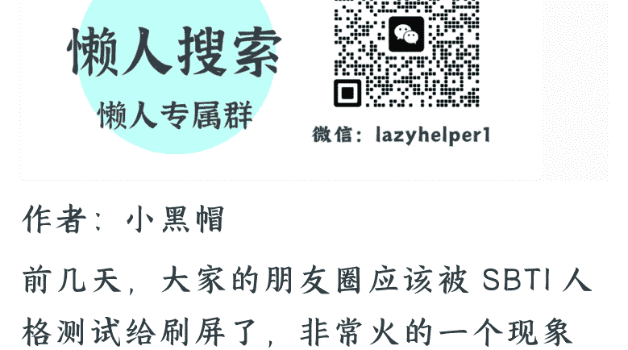
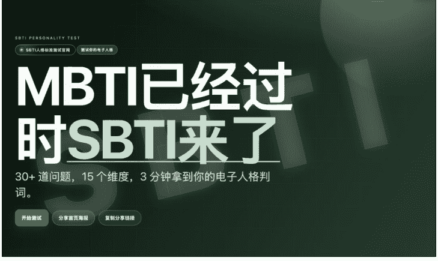
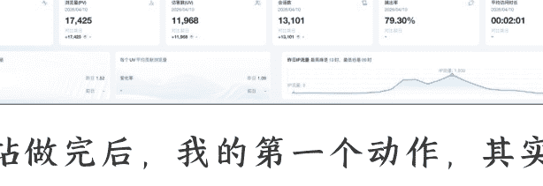
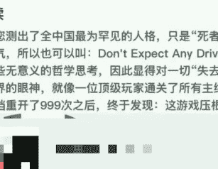
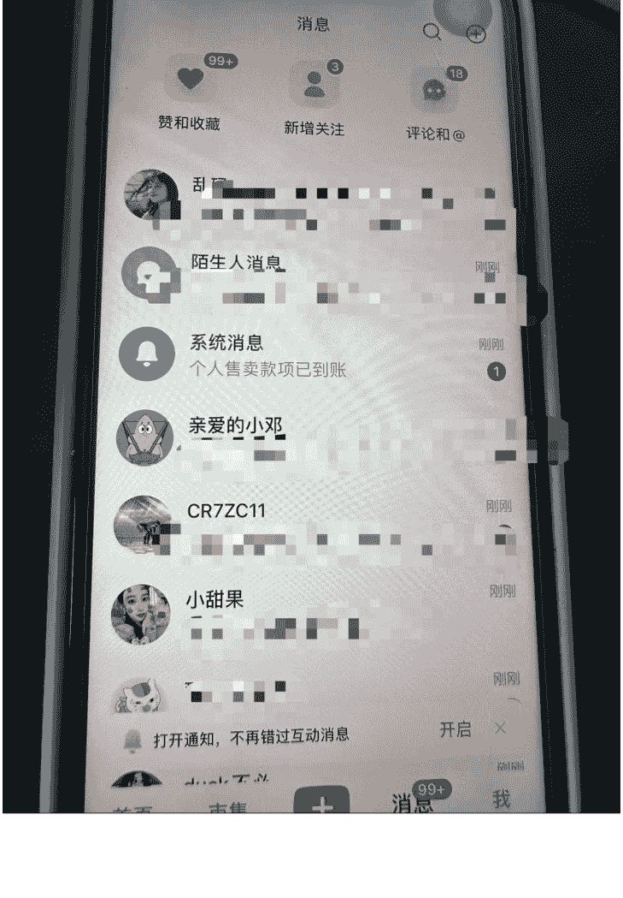
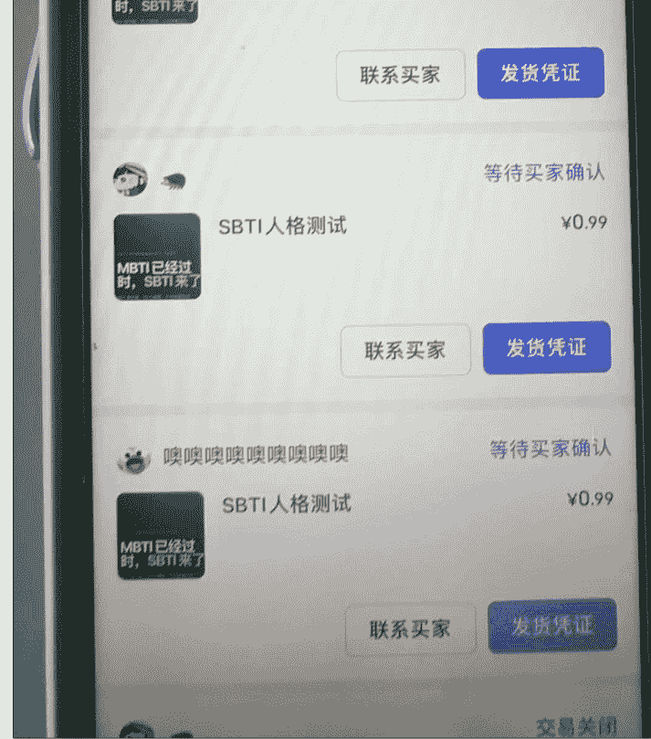
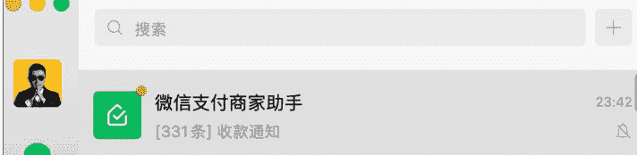
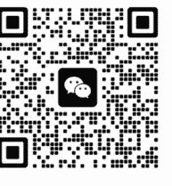

# 一次 SBTI 热潮跟跑复盘：1 小时📕 600 单，站内日活 1.2 万，峰值同时在线 500+
作者：龙哥

**260414 副业 SC 精华**

**作者：小黑帽**

上周 SBTI 人格测评几乎占领了全网朋友圈，典型的现象级跟风。源头据说是 B 站一位 UP 给朋友做的测评，没想到一发不可收拾，发酵程度远超原作者预期。

我第一次察觉到不对劲，是凌晨十二点刚准备关机，刷到朋友圈已经被 SBTI 结果刷屏。紧接着各大群里都在说被刷屏了。那一刻我就嗅到了新一轮大流量的味道。

促使我连夜行动的，是过往对同类测评市场的了解。MBTI 以及各种人格/心理测试，我之前都做过调研，搜索需求和付费意愿都很稳定。更早之前我做过一款性取向付费测评 iOS 小程序，曾冲到 App Store 分类付费榜第 9。

于是看到 SBTI 爆了，我直接从床上爬起来开机。

第一步我想做的是抢占搜索入口，于是去申请注册了一个👸号做认证并提交了。逻辑很简单，这类爆款必定伴随搜索高峰，先占坑再说。

但我栽了个跟头，手头没有现成的个人号可用，只能走最贵的 300 元认证通道。结果第二天，所有带 SBTI 名称的👸号注册都被系统拦截了。白白起大早赶晚集。

认证递交后，我做的第二件事是快速搭一个 SBTI 测评页。因为时间紧，我让 codex 直接用 html/css/js 生成纯前端页面，改完就部署上线。

能这么快上线，靠的是我常年有做站的习惯，手里有已备案的企业域名、国内服务器和 ICP/网安资质。即便域名临时注册，也没有选择海外部署。因为我判断核心传播场景在🛰️生态，海外节点延迟高还容易被限流。

先说结果。站点早上六点开始起量，持续到下午一点多。峰值时段同时在线 500-600 人，单小时访问峰值接近 2000，全天累计访问 1.1 万人次。

上线后我第一反应不是去推，而是先提交百度和谷歌收录。可百度收录速度太慢，第二天热度已经起来了页面还没收录，基本没戏。

这个站之所以能在没有主动投放的情况下持续吃到自然流量，关键就做对了一点：

首页放了“一键复制链接”，测完后用户能生成自带网站二维码的结果海报分享。

我观察到朋友圈里大量在转的都是截图或裸链接，对小白极不友好，根本找不到入口。二维码海报在社交场景里转发成本极低，于是我加上了这个设计。

## 海报已生成

先预览海报，再手动保存到相册。

你的主类型 · 匹配度 73% · 精准命中 9/15 维

## DEAD（死者）

> 你的类型是：

逝者

DEAD

## 人格解读

恭喜你，您测出了全中国最为罕见的人格，只是“死者”这个名字实在有点晦气，所以也可以叫：Don't Expect Any Drives。死者已经看透了那些无意义的哲学思考，因此显得对一切“失去”了兴趣。死者们看世界的眼神，就像一位顶级玩家通关了所有主线、支线、隐藏任务，删档重开了 9999999999999 次之后，终于发现：这游戏压根就没意思... 

https://www.something.com/xxxxx

结果是海报 🩴 

🛰️内请长按图片保存到相册；电脑端可点击“保存图片”。

有了这套分享机制，站内流量才一直滚雪球。

站点上线次日早八点，我发了条朋友圈说自己做了个 SBTI 测评站，点赞只有三四个，首小时访问不足百。但随后流量陡增，下午两点左右冲到 500 多人同时在线的高峰。此后因🛰️风控无法直接内链打开，只能复制到浏览器，流量立刻断崖式下跌。

白天高峰期我还做了变现尝试。早上九点左右我在📕发了带个人售卖 SBTI 的笔记。发布 1 小时后开始爆推，当天仅📕就卖出 600 多单，私信根本看不过来。

很快平台开始对 SBTI 关键词进行屏蔽，相关笔记无法检索，随后我的笔记也被强制下架。我之所以敢上架，是因为我在评论区看到大量用户在问链接在哪，有明显的信息差。

下午四点多，有同行和我说他把支付接入到测评站后转化直接到了 20%，当天订单炸了。于是我从下午五六点开始，用 codex 重写后端，把原本纯前端的站改成 html+php 架构，接入支付接口，连数据库都没加。

折腾到晚上八九点重新上线，直接把主站强制跳转到新站。上线两三个小时内站内就成交了 400 多单。

实际上这只是截图的一部分，期间我两次打开后台看都发现数字还在涨。直到我写这篇复盘的第二天，付款依然在陆续进来，只是频率比昨晚慢了不少。

次日早晨查百度统计：当天 500 多访客，成交 100 多单，转化率约 25%。

|  | 浏览量 (PV) | 访客数 (UV) | IP 数 | 跳出率 |

|:---|:---|:---|:---|:---|

| 本日 | 849 | 558 | 542 | 72.31% |

| 昨日 | 110 | 71 | 69 | 69.01% |

| 预计明日 | -- | -- | -- | -- |

回头来看，如果第一天就能直接带付费，至少能多拿两三千单。但等我把支付加上时，流量基本已经见底了。

从纯收益角度，这波并不算暴利。真正让我受启发的，是传播模型。

我本来的玩法是靠内容撬动公域流量做电商，这次完全不同。几乎零启动成本的种子流量，通过社交自传播撬动了上百倍的裂变。我第一次发圈后就再没做过任何主动推广，只不断优化分享海报和复制链接体验。

所以，能在社媒场景里自传播、能提供情绪价值的轻测评类产品，机会依然很大。

### 分割线

看完这套 SOP，你可能觉得懂了。但 90% 人落地第一步就卡死。

教程和工具是最廉价的壁垒，真正的壁垒是“立刻开干”和“信息差圈层”。

我们只拆商业闭环，不聊空话；沉淀了 1000+ 跑通的套利实战案例。

👆 查看圈子数字资产与入群门槛：

https://lazyso.com/insider/

备注：【实操上车】，不闲聊