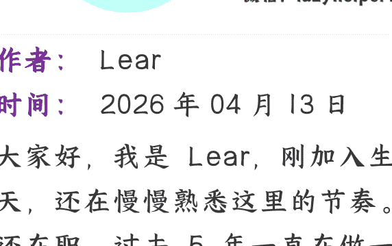

## 每年5000人的线下大会我办了五年，这几个坑最容易让人翻车

260415 副业 SC 精华

出品：公众号『懒人搜索』，内容来自『懒人专属群』精选

懒人微信：lazyhelper1

作者：Lear

时间：2026 年 04 月 13 日

大家好，我是 Lear，刚进生财圈三天，还在适应氛围。目前仍在职，过去五年只专注一件事：操办国内规模最大的教育行业年度聚会。这个项目线下稳定在 5000 多人，线上直播覆盖超过十万。从最初的兵荒马乱，到如今拥有一套可以反复使用的成熟执行框架，中间积累的教训，我想值得单独拿出来聊聊。

这些年，选场馆、定搭建、排推广节奏、接待讲者、设计入场动线、现场指挥、双线并行……每个环节都有我踩坑的影子。最近接连参加了几场外部口碑不错的中大型会议，发现即便是很成熟的团队，在流程拆解、预算管控和风险预案上依然有很大提升空间。所以我把一些看起来不起眼、却对最终效果影响极大的点整理出来，供准备办会的朋友参考。不管你是几十人的闭门交流、几百人的线下聚会，还是上千人的大型会议，底层逻辑都是同一套。

## 一、入场登记这件事，远比你想的复杂

不少人对入场登记的认知还停留在“门口放张桌子、安排两个人扫码”。但当天到场人数一旦超过两百，这项工作就从“一个动作”膨胀为“一套系统”。

最常见的翻车画面是：所有人卡着同一时间涌向大门，明明设置了多条核验通道，最后全部淤堵在一个入口。排队的人越来越不耐烦，开场时间已经到了，还有一大半没进来。主持人在台上拼命找话暖场，台下空了大半，精心准备的开场气势瞬间凉透。

我们自己的五千人场子，早期最严重的一次入场堵塞持续了四十分钟。后来把三件事做扎实，才把全员落座时间压缩到一刻钟以内。

第一，提前一晚开放报到。很多外地观众头一天就已经住进附近酒店，当晚顺手完成入场手续，次日早上的压力轻轻松松卸掉三分之一。

第二，多点位分散办理。报到台别只放在正门口。酒店前台旁边、电梯厅、用餐区附近，都可以设服务点。人流从不同方向过来，自然就被拆散，不会全挤在同一条队伍里。

第三，用隔离带把人流引导成蛇形队列。这招最朴素，效果也最直接。没有隔离带，人群会不自觉裹成一团；拉出排队通道后，大家自动排成一列，每条核验通道都能被充分利用。

哪怕你只是办一场百人级别的小型分享会，提前一晚报到和隔离带分流这两招同样成立。规模越大，收益越明显。

## 二、讲者的体感，直接影响他台上那几十分钟的水准

很多主办方把心思全放在“能不能请到大咖”上，似乎人点头答应就万事大吉。可事实上，从讲者落地那一刻起，他就已经进入你的服务范围。他休息得好不好、有没有人帮他操持杂务，最后都会真实地反映在演讲状态里。

我们承办一百五十多位分享嘉宾的大会时，接待工作由独立小组负责。每一位讲者都配了一位固定的对接人，从接机、用车、房型、忌口，到走台时间、候场位置、登台路线，全部提前沟通妥当。

团队起初也担心这是不是太小题大做，真正执行下来才发现，这比预想中划算得多。

讲者神清气爽，分享质量肉眼可见地提高，台下观众自然买账。讲者感到被认真对待，这次合作完还会想再来一次。更关键的是，他们会主动在各自的圈子里替你积攒口碑——“这是我参加过安排最好的活动”，一句话胜过无数广告费。

哪怕你只请了三五位讲者，也值得拨一个人专门对接。不需要多复杂的系统，一张确认单就够了：行程、住宿、饮食偏好、彩排时间、上台顺序，全部写清楚。核心就是让讲者感受到：有人在管我的事，我不用操心。这样他才能把全部精力放在内容上。

## 三、看起来是场馆的责任，最后全由主办方买单

空调温度不合适、网络卡顿、午饭排队太长、洗手间不够用……这些问题的直接责任方似乎是酒店或场馆，但观众不会去找他们申诉，只会默默给这场活动打低分。所以，主办方应该在事前就把这些事主动揽过来。

温度是最容易翻车的一项。上千人聚集在同一空间，体感温度会迅速上升。进场前觉得舒适的温度，坐满之后可能变成蒸笼。与其等观众开始坐立不安再去调，不如提前和场馆约定好空调启动时间和温度档位。

人流同样需要提前设计。上千人集中涌入门口，本身就存在挤压风险。主动安排分批次、分区域的进场方案，能把峰值摊平，避免入口处堆成罐头。

声音方面，前排和后排的听觉体验往往是两个世界。音响布置必须根据场馆的空间结构来做点位设计，而不是“装上喇叭能响就行”。坐在最后一排的观众如果全程听不清楚，他对整场活动的评价会和前排完全不同。

洗手间也容易翻车。中场休息铃声一响，所有人同时涌出，最近的洗手间立刻排起长队。主办方可以在会前就问清楚厕位数量，不够就和场馆商量增加临时设施，或者通过动线设计把一部分人引导到其他楼层的洗手间。

这些细项单独拿出来都不算什么，但叠在一起，就是“专业”和“业余”的分水岭。

## 四、死磕细节，办会总成本能降两成

很多人默认办会就是烧钱，但我们一年年优化下来发现，可以压缩的地方远比想象中多，而且砍完之后体验不降反升。

别急着在合同上落笔。场馆方给出的初始报价只是个起点，场地费、音视频设备、餐饮、服务费，每一项都有商量空间。行业内通常预留了百分之二三十的余地，如果在淡季或工作日办，这个空间还会更大。

谈判时机比谈判话术更重要。设备商、搭建商、餐饮供应商都有明显的淡旺季。同样的配置放在旺季（十月到十二月）和淡季（次年二月到四月），价差可能拉到三到五成。而且越早敲定，对方越愿意给低价——合同早一天落下，他们就能早一天安心排期。很多团队非要等到日期彻底定死才开始询价，实际上已经错过了最好的议价窗口。

多想想“哪些可以砍”，胜过琢磨“还能加什么”。很多看似必不可少的环节，本质上是预算黑洞：观众不感兴趣，讲者觉得占时间，主办方还要花钱花人筹备。判断标准就一条：能不能说清楚这个环节对到场者有什么实际价值。说不清楚的，趁早拿掉。删完之后节奏更紧凑，口碑反而更好，钱也省了。

人手要精，不要多。靠堆人来维持现场，结果常常是有人忙到脚不沾地、有人闲到不知道站哪儿，还得互相问“这事归你管吗”。正确做法是给每个人一张任务卡，精确到时间段和具体点位，连行动步骤和完成标准都写清楚。效率提上去了，人力成本自然就降下来了。

这几条叠加起来，每届的总开销能压掉一到两成。这个数字不是拍脑袋估出来的，是我们一年又一年真实优化后才拿到的结果。

## 五、体验的天平，在开场前就已经倾斜

做活动越久，我越觉得现场执行只占最后两成。真正决定体验的，是那些藏在开场之前的准备工作。

不妨拿几个问题问自己：动线有没有被不同身份的人完整走过三遍？每个时间节点的人流峰值有没有精确测算过？讲者的每项需求是不是都落实到了纸面？各种“万一”有没有对应的备用方案？团队的每个人是否清楚自己在每个时间点该出现在哪里、做什么？

这些问题没有一条是硬性规定。可为什么有的会开完就被人忘记，有的却能让人记很久？拉开差距的不是内容本身，而是那种“每一件小事都被认真对待过”的感觉。

最近我常想，这么多年攒下的经验，如果只服务一个项目，多少有些可惜。能不能把它拆成更轻巧的模块，在筹备早期就帮团队做一次全面体检——哪里容易出故障、哪里还能省钱、哪里值得多投入、哪里干脆拿掉。如果有人能在起跑前就把这些理顺，后面每一步推进都会省力得多。

上面这些，是我这几年办会踩坑攒下的几个观察角度，希望能给你多一个参考维度。如果你正在做项目，或者正准备启动一场线下活动，欢迎来交流。我踩过的那些坑，也许正好能帮你绕开——实战换来的教训，永远比方法论更值钱。

---

看完这篇拆解，你可能觉得已经会了。但实际操作中，九成的人都会卡在第一步。

工具和教程只是最浅层的门槛，真正的差距是“立刻动手”和“圈层信息差”。

想第一时间看到最新的变现玩法，和一群执行力极强的实干派一起拿结果？欢迎来我的私域阵地：『懒人专属群』。

这里不谈虚的，只拆商业模型、只聊AI提效。社群里已经沉淀了 1000+ 跑通的实战案例。

完整的圈子资产与上车方式：https://lazyso.com/insider/

如果认同价值，也准备好下场干活，扫码添加微信（lazyhelper1）

验证备注：【实操上车】，闲聊勿扰