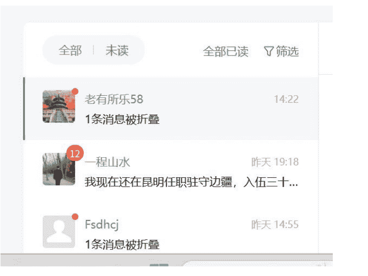
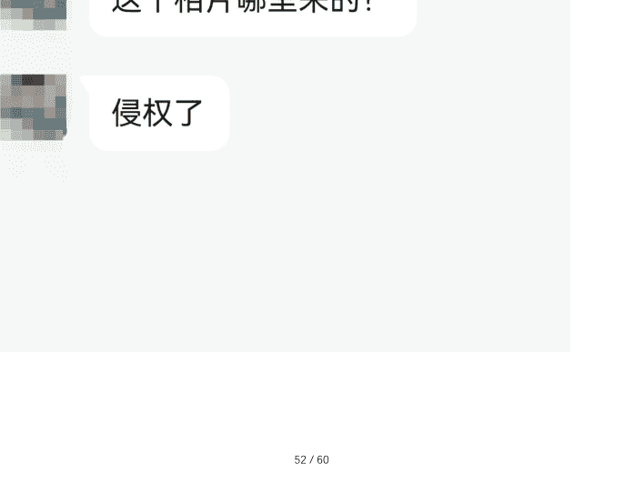
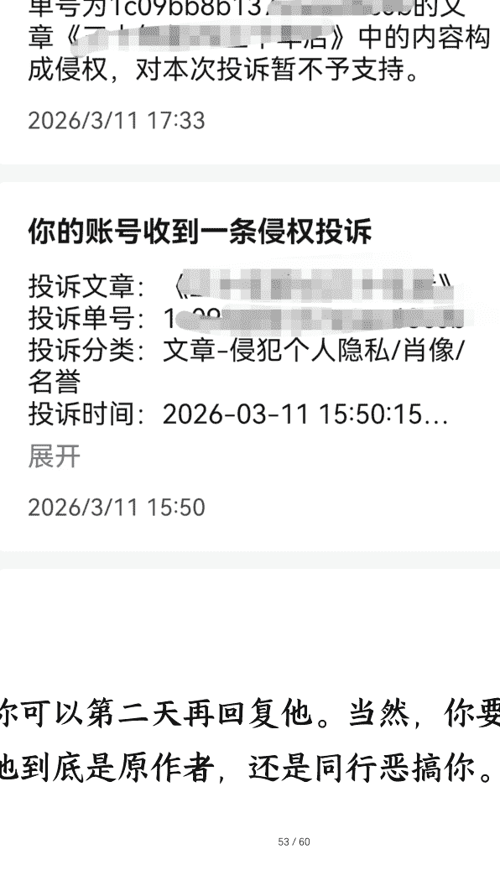
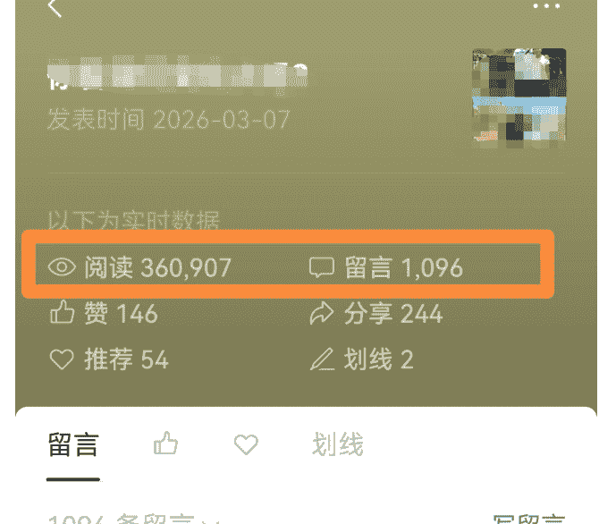
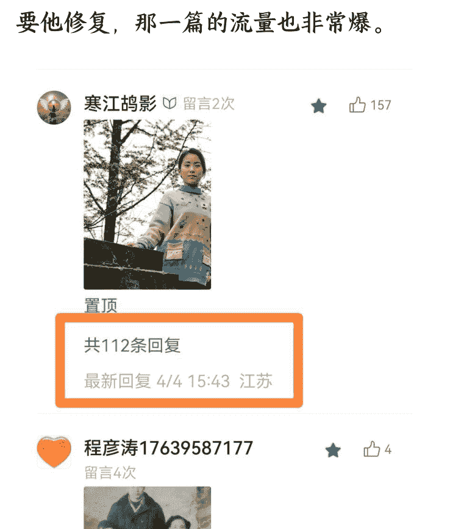

# 从线下美术教学转向公众号小绿书：一位培训机构主理人的 20 天 4 千元复盘

260416 副业 SC 精华

公众号懒人搜索，懒人专属群独享

**懒人微信**：lazyhelperl

我是澄心，做了十多年美术书法教学，线下艺术培训机构操盘快八年。生财学习五年，近两年线下获客艰难，留存也不理想。去年半年试口播短视频招生，投入产出一般。于是想在网上找一条能慢慢替代主业的副线，目标是两年到三年能独立成型。

转折来自一次与圈友吴泽承的交流。他提到公众号贴图正被平台扶持，慧哥也在做，并把方法发给我。

我立刻开两号去验证。

首号踩到一个隐藏小坑，一周左右被封。换第二号重启后很快有反馈，第一笔收入 1.99 元。第 8 天阅读冲到 110 万，当天流量主到账 1500+。

![img/c84dd5d362754d40fcdbcd3dfcf73e21_1_0.png]

![img/c84dd5d362754d40fcdbcd3dfcf73e21_1_1.png]

## 数据回看

更新至 2026/02/24

110.3 万                        300

昨日阅读        昨日分享

较前日 ↑530%    较前日 ↑435%

## # **关注我的人** 512 >

## # **付费内容收入** 去开通 >

流量主                    昨日收入¥1511.03 >

## # **内容助推** >

## # **我的足迹** >

随后又新注册一号，十多天后迎来爆发，单日 4 条内容同时破 10W+，旧作也被带起，浏览量突破 90 万，当天收益 1000+。

## # 数据统计

931,344

昨日阅读          较前日↑4047%

452

昨日分享          较前日↑11200%

![img/c84dd5d362754d40fcdbcd3dfcf73e21_4_0.png]

*关注我的人* 429 >

*付费内容收入* 去开通 >

![img/c84dd5d362754d40fcdbcd3dfcf73e21_4_1.png]

*流量主* 昨日收入￥1043.54 >

*内容助推* >

*我的足迹* >

*传图片到素材库* >

同一天上线的 10W+

在实操过程中，我逐步摸清贴图爆款的规律。把思路分享给一位朋友，他此前一条最高才 1000 播放，听完第二天就迎来 10W+。

![img/c84dd5d362754d40fcdbcd3dfcf73e21_5_0.png]

公众号贴图，圈内称小绿书，上手门槛低，方法对了就能快速起量拿下流量主分成。

下面把我从零起号的路径和细节拆开。

## 从零起步的核心三件事：建号 + 开通流量主 + 找到对标并做出爆款

用三句话概括玩法：

下载公众号助手也就是小绿书，用微信登录完成实名，打开流量主即可发图。入口在贴图，图 + 文案 + 热门话题。用户浏览贴图，评论区挂广告，你靠曝光拿钱。

同步块

## # 创作发表

## # 贴图

草稿 新的创作保存后将存在草稿中

2026/3/25 09:24

+   [![My][image11]](image11:https://mmbiz.qpic.cn/mmbiz_jpg/bEFRTxYIzk6dfCTVlKZOIqoYy1v9e1n5n3a4xx/0)

看看我的鱼缸水培大蒜，怎么样？够不够炒一盘菜？😀

10 万 + 北京 2 月 18 日 08:33

168

![img/c84dd5d362754d40fcdbcd3dfcf73e21_8_0.png]

##### 35-45 岁，黄金十年，做个干净的“中年少女”

经历过年少的热闹，更懂得安静的珍贵

见识过生活的复杂，更珍惜内心的纯粹

所谓“少女”

# 36 岁的我站在试衣间前

想起高三数学考了 149

但这和我现在已经没关系了

![img/c84dd5d362754d40fcdbcd3dfcf73e21_9_0.png]

36 岁的我站在试衣间前，想起高三数学考了 149，但这和我好想已经没关系了

#年龄与穿搭无关 #试衣间穿搭灵感 #高三回忆录 #时尚穿搭分享

阅读 10 万 + 广东 4 月 7 日 12:14

留言 2029

# ### **摩托车分类大全集**

你是

*   真玩家

*   还是通途选手

*   - **踏板车**

    

*   - **通路车**

    

*   - **经典车/街车**

    

*   - **Cafe Racer**

    

*   - **征航车**

    

*   - **CHOPPER**

    

*   - **旅行车**

    

*   - **运动征航车**

    

*   - **超级街车**

    

*   - **走车/越野**

    

*   - **ATV**

    

*   - **BOBBER**

    

*   - **ADVENTURE**

    

*   - **弯机**

    

*   - **越野车**

    

*   - **探险车**

    

*   - **雪地摩托**

    

一张图看懂机车全分类，你是爱好还是关心

摩托车分类全解析了：超跑通勤、街车赛道、复古越野、ADV 去哪都行、征航长途。

并告诉你

11/60

# 笑死

张高澄道长教你

少动情，能保命

做一个守神高能量的人，从少动情开始！

最近看了两会顶流张高澄道士🔍与窦文涛的一段对话。

好家伙，直接给我整清醒了🙄

# "人近则贱"

![img/c84dd5d362754d40fcdbcd3dfcf73e21_12_0.png]

成年人最大的自律，是管住自己“别对别人太好”

# 我拉黑 10 年闺蜜后，才懂什么叫“人近则贱”

上周，我拉黑了一个认识十年的闺蜜。

原因很小：她凌晨三点打电话诉苦，我说“明天聊”，她说“你变了”。

这些都是 10W+，单条收入大约 100 到 180 元。

收益取决于 eCPM，广告位只在评论区，3 条评论以上才会出现。千次曝光收益大约 5-7 元。

## # 指标数据明细

日期范围

*   - 近 7 日

*   - 近 30 日

*   - 自定义

广告位

*   - 全部

*   - 底部

*   - 文中

*   - 关键词

*   - 留言区

*   - 后贴

*   - 互选

*   - 返佣

数据指标

*   - 组合指标 - 收入

*   - 组合指标 - 点击

*   - 组合指标 - 曝光

| 日期 | 曝光量 | 收入（元） | eCPM |

| :--- | :--- | :--- | :--- |

| 2026-04-11 | 6,000 | 26.70 | 4.45 |

| 2026-04-10 | 11,555 | 60.13 | 5.20 |

| 2026-04-09 | 11,154 | 52.95 | 4.75 |

| 2026-04-08 | 9,973 | 44.79 | 4.49 |

| 2026-04-07 | 8,346 | 36.56 | 4.38 |

| 2026-04-06 | 883 | 6.20 | 7.02 |

## # 数据统计 更新至 2026/04/09

**65,981**

昨日阅读

较前日 ↑16%

26

昨日分享

关注我的人

728

付费内容收入

去开通

流量主

昨日收入¥52.95

互选合作订单

内容助推

我的足迹

该号在 4 月 9 日阅读约 6.5 万，曝光约 1.1 万。曝光大约是阅读量的五分之一。所以 10 万播放约 2 万曝光，按 eCPM 5 算收益在 100 元左右，实际区间 100-150。

# 实操拆解

*   ①账号注册
*   ②赛道选择
*   ③选图与图片处理
*   ④标题撰写
*   ⑤发布时机

## # ①账号注册与基础设置

1. 下载公众号助手，微信登录，微信需实名。注册前先确定名字和头像，注册后改名要等一天，且主页会留改名记录，建议提前规划。
名字可参考小红书上的好听网名。长期运营的话，名称要耐看。
2. 登录后在“我”里完成实名，和微信同步。
3. 解决 100 粉门槛。可通过靠谱渠道直接补到 100 粉，对后续推流影响不大，我测试过图文和贴图均正常。
4. 粉丝到位后开通流量主，在“我”里点击开通，开通后进入广告管理，将广告全部打开。

## # ### 流量主

## # ### 广告管理

## # ### 昨日收入（元）

如何提现收入？

## # ### 指标趋势

![img/c84dd5d362754d40fcdbcd3dfcf73e21_17_0.png]

### 2 新人友好赛道

首次尝试建议选熟悉的领域：

婚姻、成长、养生、名人名言/娱乐、老照片、退休生活

![img/c84dd5d362754d40fcdbcd3dfcf73e21_18_0.png]

##### 87 年二胎宝妈：与其离婚，不如“婚内微寡”

> “结婚不是找到依靠，而是学会与自己相依。”

- 曾经不知道有多少个瞬间，让我想过离婚

每次孩子在那边哭闹，他还在那玩手机

# 婚姻赛道

![img/c84dd5d362754d40fcdbcd3dfcf73e21_19_0.png]

人这一辈子，

该吃的苦，该走的弯路，该掉的陷阱，

该撞的南墙，一个都不会少。

无论你怎么选择、怎么躲避，

都逃不过一场命运的安排。

## ## 婚姻赛道

# # 上班=省钱

我终于治好了厌职症

终于治好了厌职症！上班=省钱，一年攒下 10w

过去上班 15 年，我从来没想过现在会喜欢上班这件事。一只在深圳的牛马，每天两点一线，打卡、开会、加班。压力大最烦的时候，胸口压着大石，结节长多 5mm，甚至

# 成长赛道

# **40 岁，我靠自学找到了几份居家工作**

85 年，40 岁，发现了几份不上班在家里就能做的副业。

嗨！大家好，我是瓶子，两个孩子妈妈。

11 年前，一个偶然的机会，让我接触到了莫小在，也就是我现在做的护肤品牌。

# 成长赛道

# # 身弱之人

# # 不上班就是大补

# 身弱之人，不上班就是大补 

 hi，~我是瑶妈，一边带娃，一边做自媒体

~

生完孩子以后，我发现自己经常容易累，气血不足，常常一天没干啥，都觉得累。

# 养生赛道

![img/c84dd5d362754d40fcdbcd3dfcf73e21_23_0.png]

# 最近气血变足了，我干了啥？

*   一、心态先行：情绪不内耗，就是最大的补

中医常说“思虑伤脾”，以前我也爱纠结、爱较真、爱内耗。后来逐渐发现 情绪一堵 气血全堵在身体里。

一晃眼，我们一起经过了十七个春夏秋冬。

我们一起穿过、闹过、哭过、醉过，也一起开心过、疯狂过、发光过、自豪过。也在彼此最狼狈、最迷茫的时候，毫不犹豫地伸出手。我们不用每天联系，却永远不会疏远；

不用刻意讨好，却始终真心相待。是时光，

# # 老照片赛道

![img/c84dd5d362754d40fcdbcd3dfcf73e21_25_0.png]

为什么没人觉得大冰很装？因为他承认红利，从不说教！

十几年前，大冰就火过一阵，那时候他还在出书。

最近几年，他又火了。最火的时候，直播连线，同时在线的人都有好几万。

## ## 名人/娱乐赛道

![img/c84dd5d362754d40fcdbcd3dfcf73e21_26_0.png]

# 请“临时儿子”陪护：丁克老人的晚年底气

看到一个视频：一对高知丁克夫妻晚年生病住院，经常在病房里的病友吵闹骚扰，无奈之下花钱请了“临时儿子”来医院陪护。

虽然不知道视频内容真假，但这件事确实指向了银发经济的一个新好道

# 老人/退休生活赛道

③选图与图片处理重点

先找对标，再去选图、处理图。

打开服务号，系统会给你推荐贴图内容。

# 最近最火的一句话

# 一图看懂 | 体制内公认的白酒

# 她顶着一张与世无争的脸，竟干惊天动地的事

看到 10W+ 作品点进去看他的其他内容，平均播放过万就可以当对标。

先锁定自己感兴趣的 10W+ 贴图，比如明星八卦、养生、成长，发给小号或群里，算法会持续推相似内容。初期不确定会不会爆，就先发自己喜欢的。

# 6. 再去抖音、小红书找同款图，可搬运也可二创原创

找到 10W+ 贴图后，按其领域在抖音、小红书搜热图，点赞 1W 以上的图文都可以截。截图直接用要做些处理，流量高但有侵权投诉风险，我就吃过亏。

除了正文，评论区高赞评论也可以截下来用。

先说原创。

我开始做的老照片就是原创模仿。

![img/c84dd5d362754d40fcdbcd3dfcf73e21_30_0.png]

好想回去看看，看看我的青春

阅读 265 广东 4 小时前

留言 1

写留言

想起了 04 年夏到了深圳宝安，一个村镇。忘不了那个月的黑水欠工作，...，却出到...

# 第一步：

让豆包反推提示词，帮我生成类似图。

把图片截图，复制下面指令发给豆包：

你是一个视觉专家，摄影师，擅长处理图片，现在请帮我仔细分析这张照片，然后写出详细完整的图片提示词。

我希望这张图片必须是东方美学的图片，按照以下要求用汉语输出：

人物景别：

视角：

详细构图：

核心主体：

情绪动作：

环境场景：

艺术风格：

氛围光线：

色调：

它会拆解出元素，你微调后试生成，不满意多生几次。

# 第二步：

得到提示词后，可直接让豆包生成，也可用即梦做更精致。把豆包给的内容发给元宝/Deepseek，让它改成适合即梦的分镜提示词，80年代胶片老照片风格，效果更好。

# 第三步：

加上文字即可发布。

下面这张就是我模仿别人的老照片，用豆包生成的提示词做的，年轻和中年对照，特意让人物形象有好看有一般的。

![img/c84dd5d362754d40fcdbcd3dfcf73e21_32_0.png]

34 条留言

切慕溪水 留言 7 次 · 关注 1 个月

图一右二跟图二左二是双胞胎吗

![img/c84dd5d362754d40fcdbcd3dfcf73e21_33_0.png]

![img/c84dd5d362754d40fcdbcd3dfcf73e21_33_1.png]

### 二十五年过去了，你还能认出她吗？

二十五年前

那一朵朵温柔的花

我们曾一起走过四季

> 人会随岁月开又谢，可陪你胡闹的那份心意

和我的花园

# **做二次创作的好处在于，不仅能发图，还能发图文。**

我之前用 AI 生成过几组穿搭图，嵌进长文里配点文字，播放量也能做到两三万。长文的收益比单纯发图高出好几倍。

## 怎么做二创搬运

直接去抖音找一万赞以上的图用就行。

把图片做个镜像、AI 修复一下清晰度、调一下拼贴顺序。

这样和别人的差异化就出来了。

搬运之所以容易火，是因为都是被市场验证过的，情绪共鸣点很精准。

在原图基础上做点加工就能用了。

**截屏保存 + 裁剪 + 滤镜 + 拼图**

可以搬运和二创混着做，效率更高，也能更快摸清哪类图会爆。

爆过几次后，手感就有了。

## 4、标题怎么写

我现在的用法是拿别人的原标题丢给豆包微调一下直接用。

新号前两三天基本没啥推量，坚持发个两三天后流量才会慢慢起来。起初一天发一条，等单条播放破百了，就加到两三条。

两个关键点：

- 第一、标题要留点槽点，让人忍不住想反驳
- 第二、文案里要有争议性，能撩拨评论区

## 5、发布节奏

### 新手一天发几条？

### 什么时间发？

### 怎么发？

新号头一两天，每天只发1条。

这段时间主要精力放在找图和处理图上。

处理好的图先存草稿箱，不着急发。

等单条能稳定到1000播放，再逐步加量。

# 发稿时间有个规律，就是别人不发的时候你发。

比如凌晨4-5点，甚至凌晨两三点。你半夜醒了就用手机先发一篇，然后继续睡。

不建议用定时。我的测试是定时基本没流量。自己手动发，半夜发完两三个小时就能有大几千的浏览。定时发的几乎看不到动静。

想想用户什么时候不刷，你就什么时候发。

# 当你每天发到3-4条，怎么判断要不要继续？

看上一条的反馈来决定。

发一个小时后浏览量能到3000+，就可以继续发。

如果只有二三百，就先歇一下。

新号的初始推量很有限。比如第一条给了1万播放，第二条可能只有几百，第三第四条就掉到几十到一百，就先停下。

用WiFi还是移动流量？号多的情况下建议用移动流量发。

好几个号共用同一个WiFi，往往只有一个有推量。切到流量发，更容易起。

一般坚持发四五天，号就活了。新人建议先集中做1-2个号，把精力放在素材筛选和加工上，先把一个号做起来再扩号。一下子开四五个号很容易累，也做不起来，慢慢就没信心了。

也不用把一个号看得太重。怕伤号怕没流量，只要不是彻底封禁，大不了注销重开，当天注销当天就能重新起号，选择“立即注销”即可。

## 3、怎么让播放量起飞？

除了选图和加工，还有一个关键点，就是用好流量券。

### (1) 流量券是什么？

是官方给新号的快速推流工具。

每个新号在注册的前一个月都会赠送不少流量券。用得好起号快。

**有人说用流量券会触发人工审核**，如果内容有问题就会被限流。

我的实操经验是前期用是没问题的。用好了就是一个快速拉量的过程。

我几次大爆都是靠流量券带起来的。

### (2) 怎么拿到流量券？

完成一些互动成就就会发放，比如

### 我的足迹 - 被收藏 100 次达成

截至 2026 年 3 月 11 日，你的内容在平台被用户收藏 100 次，可在「我 > 我的足迹」中查看。

已获得 300 额度平台曝光激励，可让更多用户看到你的创作。前往使用

2026/3/12 08:26

### 我的足迹 - 被分享 500 次达成

截至 2026 年 3 月 11 日，你的内容在平台被用户分享 500 次，可在「我 > 我的足迹」中查看。

已获得 300 额度平台曝光激励，可让更多用户看到你的创作。前往使用

2026/3/12 08:21

### 我的足迹 - 收到留言 500 次达成

截至 2026 年 3 月 11 日，你在平台收到用户留言 500 次，可在「我 > 我的足迹」中查看。

已获得 300 额度平台曝光激励，可让更多用户看到你的创作。前往使用

2026/3/12 08:10

新号只要有留言、转发、互动，就会自动送券。

### (3) 使用注意点：

- 1、流量券有有效期，一般是发放后10天左右作废，要提前规划。
- 2、一个作品只能投一次券，但可以叠加，单次300-500，甚至叠加到上限5000。
- 3、只能用于最近7-10天内的作品，一个月前的作品用不了。

### (4) 实操技巧：

- 1、优先给优质作品用。看播放、点赞、评论，评论数在10条以上的优先。
- 2、作品播放最好在1500-2000左右投放，能到4000以上更好，基本能冲到1万播放。
- 3、如果作品卡在1000播放徘徊，可以等等再投，作用不大。
- 4、如果作品正在自然推流，发布后很快到8000，就先别投。等它突破1.5万再投，有概率冲到3万+。
- 5、如果作品都卡在1000或10000，券又快过期，就果断用掉。

核心指标是评论，所以优先选评论多的。

### (5) 如何判断要爆了？

我有几次都是先有征兆。

新号前一周流量很不稳定，有几十也有几千。

当出现一条破1万播放，甚至更高时，就要警惕要爆了。

我的第一个爆款是晚上出现的。之前都是几百一两千，突然来一条1万，约莫一小时后涨到10万+，我就赶紧再做一条发出去，播放依然蹭蹭涨。再发一条，带动了账号里其他图一起涨。

一旦发现播放增速变快，要马上做三件事：

- 1、备好几张图随时能发
- 2、把每条留言都回，每条点赞都谢，大概率会让对方去你其他内容下继续互动
- 3、自己先挑一个有争议的点评论并置顶

我那两篇跑了一天，播放达到了110万。

#### 坑一、一直没流量

很多朋友卡在这里，缺乏信心，会反复刷号想不通要不要继续，看到别人火就急着换方向。结果导致流量被卡在100或1000上不去。

前期最好以5-7天为一个周期，持续做同一垂直领域。实在没动静再换。频繁换标题、改名字、换赛道都会让流量断掉。

就像做垂直小号，固定一个年龄段的内容，很快就会起量。

新手如果一开始没播放，别急着注销。想办法先做出1000播放，就知道下一步怎么走了。否则换号也会遇到同样的问题。

#### 坑二、爆了之后掉回几百

我遇到过好几次，爆完第二三天流量掉到一百二百。

这时候就要精细化运营

比如：

- 7、点赞关注都回个谢谢，每条评论都回，能回表情也行，既是礼貌，也能增加评论数，别人点进评论区会提升广告收益
- 8、适当增加发图量，平时发4张可以试着发6张
- 9、让二创更细一点，可让豆包改色调、裁剪，把爆款文案叠加到图上，增加信息量
- 10、增加人设真实感，最有效

我当时流量掉下来后，就在文案里加入了个人人设。写上我是谁、哪年生的、有啥爱好、生活经历和感悟，提升真人感。

流量掉了千万别躺平，要主动调整。

#### 坑三、私信要不要回？

尽量少回。我新号做两三天，经常回私信，结果两天后被封，只能注销重来。

遇到问年龄、住址、爱好、是否退休、有什么打算之类莫名关心的，都别回。回个表情即可。回得太多容易被判定引流或被投诉封号。

#### 坑四、被投诉怎么办？

搬运的图爆了，很容易被原作者发现来私信或投诉。我就遇到过。

## 公众号懒人搜索，懒人专属群分享

刚开始别慌，当没看见就行，先不回复。

他能找到你，说明这篇确实爆了。

他在私信我之前就投诉过，但平台没处理。因为他是抖音发的图，没在公众号发，所以不算侵权。

我也没说是本人。

可以第二天再回，先确认对方是原作者还是同行恶搞。后来我对比了头像确认是本人，就在收益结算后把那篇隐藏了。

## 四、怎么提升收益？

贴图的广告主要在评论区，所以发完后前几条评论可以自己写或找人补。

标题、图上的文字、内容里都要有槽点和争议点，才能让人想吐槽。

发布后尽快补上三条评论，等流量起来广告才有曝光。

再就是在标题和图片里增加信息密度，比如加年龄、经历等。找有吸引力或前后对比强的照片，更容易引发留言。

我有一篇评论破千，就是因为加了一句有争议的话，大家都来吐槽。

## 五、最后的话

我之前一直处于做项目、换项目，持续了好几年。

期间做过短视频带货月入千元，视频号直播月入500，小红书虚拟资料卖了几单不到百元，AI短视频20多天播放2000万+涨粉1.5万，分成仅100元。

**每次遇到卡点就换项目，从来没把一个项目做大过。**

相信很多朋友和我一样，还没在网上赚到大钱，就是选方向、定定位定不下来，一直不敢动手。

我会建议他们从贴图开始，几篇就能有几千播放，**信心**就有了。

我自己经历了这次公众号贴图，也会未来一年深耕公众号，从最简单的方法入手，用短时间高强度攻克，把坑都踩一遍。

不管是AI写作、AI生图、资料采集、数据整理，都希望能把AI用起来，成为这个领域的专家。

-------分割线-------

看完这篇SOP，你觉得懂了。但90%的人实操第一步就卡住了。

工具和教程是最不值钱的壁垒，真正的壁垒是“立刻开干”和“信息差”。

如果你想看全网最新的变现打法，和一群执行力强的极客一起实操，欢迎围观我的核心私域：【懒人专属群】。

我们不聊虚的，只拆商业闭环和AI效率。系统内已沉淀1000+跑通的套利实战。

[点击查看圈子完整数字资产与上车门槛链接](https://lazyso.com/insider/)

认同价值、准备下场的，扫码加我微信（lazyhelper1）

备注：【实操上车】，不闲聊

[阅读 30,877]

春天 留言 2 次

这双凉鞋有点土，夏天穿也不好看。

琙远的生活

感恩友友分享，祝元宵节快乐🎆🎆🎆

[img/c84dd5d362754d40fcdbcd3dfcf73e21_39_0.png]

## 页内图片及数据统计

**时间数据**

发表时间 2026-02-21 以下为实时数据

阅读 502,641

赞 373

推荐 168

留言 430

分享 108

划线 2

留言 👍 ❤️ 划线

## 数据统计 更新至 2026/02/24

| 数据项 | 数值 | 变动 |

| :--- | :--- | :--- |

| 昨日阅读 | 110.3 万 | 较前日 ↑ 530% |

| 昨日分享 | 300 | 较前日 ↑ 435% |

| 关注我的人 | 512> | - |

| 付费内容收入 | 去开通> | - |

| 流量主昨日收入 | ¥1511.03> | - |

寒江鸽影 留言 2 次

彭燕铭:@HP Gold: 可以帮忙恢复下 [图片]

56/60

关注公众号懒人搜索、懒人专属群分享

----------

**判断自己老公是不是蠢，就看以下三点：**

1. 谁说的话他都听，就是不听你的，谁讲的话他都信，就是不⑨你的。

2. 家里面什么事他都往外说，好事儿当消遣，坏事儿当泄愤

3. 跟别人说话都是和颜悦色的，跟你说话呢，全是火药味儿。

**这个图就是非常好的示例。**

!-- [PAGE 34] 结束！