# 新手怎么用视频号做高客单？从 0-1 踩完坑的合规指南

这段时间不断有人跑来问我同一个问题：那种平台不允许投广告的品类，光靠免费流量怎么搞客户？这事我确实有点发言权。过去八个多月，我一直在视频号上做教育方向的客源获取，前后弄到1112条精准线索，签约金额5.9万，中间搭进去的学费和教训也算一箩筐。


先聊几句为什么眼下值得在这个平台下注。

第一，起步门槛低得离谱。淘一台旧手机只要两百块，再收一个养满月、带正常朋友圈的微信号一百块，总共三百元就能把一套基础配置备齐。前期热身大概十五天就能走完，之后一个人同时盯五到十个号完全不是问题。全程不用真人露脸，特别适合手里有贵价产品、但一直缺线上入口的个人和微型团队。

第二，花同样的力气，拿到手的客资质量却高出一截。在这个平台做获客，开销大约是抖音的三分之二。我身边有个在小县城开店的朋友，用四五个号拉客源，营业额直接翻了一到三倍。而且这里找过来的买家特别爽快，不问东问西，付款不磨叽。

第三，内容形式能吃的周期很长。抖音上一个好用的模式通常半个月就被人抄烂了，视频号这边一套简单的打法可以稳稳用上一年。眼下的视频号，特别像两三年前的抖音：七十年代、八十年代出生的人手里有闲钱，又没被各路玩家轰炸过，高客单价的生意放在这里，正好是窗口期。

再说说我真金白银换来的教训。

早期我冲得很猛，数据也确实一时好看：第二条视频干到2万观看，第六条18.8万，第七条直接20万，三千粉很快就有了。然后呢？一周之内五个号全被端。按每套三百块的成本算，一千五百块直接蒸发。

教训一：回复消息太勤快会被禁言。咨询一多我就忍不住秒回，连着回了19条，换来七天禁言。后来摸出的安全线是：每条话术必须换着说，每回五条停一停，每天总量不超过二十条。最稳妥的还是把诱饵埋在内容里，让客户主动来找你。

教训二：搬来的素材早晚要还债。从别的平台搬内容，随便剪一剪就发，前十来条都能过，结果发到十条出头就被一锅端。这个平台的查重不是只看你主页上的过去，而是全网范围比对。

教训三：医药类词就是一个大雷。心理医生、中度抑郁这类表述，教育赛道里一个都不能沾。想做健康相关或心理方向的，只能用一种心照不宣的拍法：真正在找答案的人看一眼就懂，审核那边完全没谱。

教训四：违规次数多了会被关进深度审查池。一旦进了这个名单，你之后发什么都会被人为放大检视，哪怕每条都老老实实，照样可能误伤。我试过做A/B对照想救活一个号，试来试去全是浪费时间。结论很简单：号废了就重开，别舍不得。新号拿到的初始流量倾斜，比老号强太多。

教训五：单条跑到三万是个坎。流量一旦突破三万，大概率会被人工捞出来过一遍。我自己就吃过这个亏：有个号做到十几万观看，客资还没收完，号先被限制七天。后面的操作策略变成：眼看一条视频逼近三万，就主动把它删掉，让账号整体维持在一千到三万之间的区间，反而能活得更久。

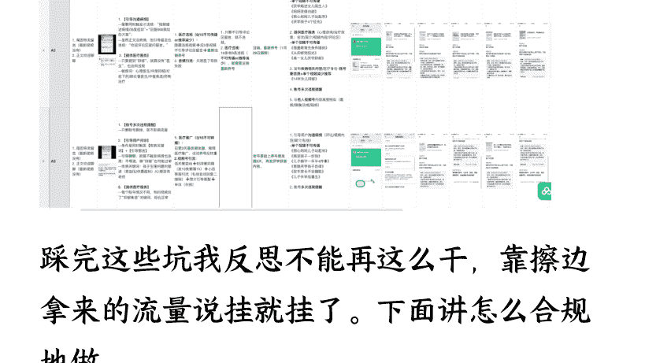

踩完这些坑我彻底想明白了：靠灰色手段搞来的流量不值钱，说没就没。下面进入正规军的打法。

号正式开工之前，先留出十五天做热身。为什么要这么认真？我把2025年以来的规则变化摸了一遍，平台是松一阵、紧一阵。做过热身的号，底子明显更稳。本身就在高风险行业里混的，更要把防御动作做足。

十五天的流程拆成四段：

头三天：新号到手先别急着发任何东西，每天花一两个小时在这个平台里刷内容，算是让号先热个身。

第四到七天：拍一点生活里的日常，花花草草、街边小店都行，跟发朋友圈一样自然，发两三篇就好。

第八到十四天：开始定向看自己行业的东西，刷同行、点赞、留评、关注，让平台把你的垂直标签逐步打上。

第十五天：发布第一条正式内容。最省力的做法是看同行最近三天有没有跑出来的爆款，照着做一版，起号速度最快。

要是中途被封了，提示要好友辅助验证，可号上根本没有真实好友，怎么办？有个土办法：先把通讯录里所有人的备注改成“!”，然后删好友，删到只剩两三个，放着不动七天，最后找个真人面对面扫码解开。这个方法2026年年初实测还有效，不同赛道可能得自己试试。

另外有几条细碎但保命的提醒：

热身期间千万不要夹带任何引流操作，哪怕一条都别发。
一定要用流量卡，别连WiFi。同一个WiFi底下挂好几个号，容易被系统串在一起处理。虚拟iPad协议也别碰，IP地址跳来跳去一样会招来封禁。
如果十五天之后流量还是惨得没法看（比如连500都跑不到），或者已经被限过流，别犹豫，直接注销换新号，新号的扶持力度明显香得多。
手上跑着五个号，就要同步把五个号都热起来。号就是自己的资产，你精心维护它，它才能给你赚钱。

号的基础打好了，接下来就是发什么内容的问题。这一块我也走过弯路。

先说一个根本性的认知：做这个平台不是为了刷播放量，是为了让客户主动加你。一条视频几万次观看，结果没一个人来私聊，那就是白干。

我自己绕过的两个弯，你们可以直接避开。第一个是内容形式，一开始我用图文拼接，文字一多，年纪偏大的用户根本看不完，数据惨淡。后来换成动画配音，效果立刻不一样。第二个是钩子设计，最开始用“免费领资料”当钩子，招来的全是想占便宜的人。后来我明白了，真正会掏钱的客户，要的是那种拿来就能解决问题的具体方案。拿我们行业举例：“100个孩子叛逆场景的应对话术”“30分钟免费家庭系统诊断”，这种钩子引过来的才是有付费意愿的人。

下面四个内容形态是我实测有效的，普通人照着抄就行。

形态一：大字报。五秒翻一页的家长故事，视觉冲击力强，教育和心理赛道都很合适。去📕找爆款图文，用剪映或者平台自带的拼接功能，两步就能做出来。

形态二：动画配音。专为年龄偏大的用户设计，他们只需要听，不用盯着字幕看，完播率自然高。剪映的AI配画面可以搞定基本操作；想要质感更好，就去B站或YouTube找素材回来混剪。

形态三：Coze火柴人动画。直接用Coze工作流量产，一年前配这么一套还要666元，现在去闲鱼定制一百元都不到。


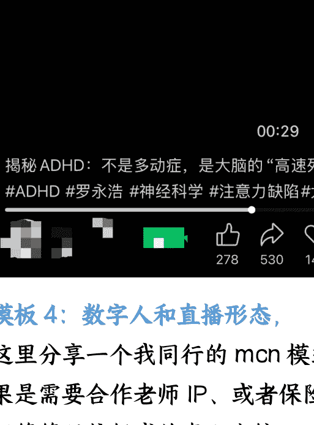

形态四：数字人和直播。分享一个同行MCN机构的模式，如果你准备做老师IP，或者保险、法律、心理这类重度依赖真人信任感的项目，可以参考：

内容层面，公司内部搭一个内容中台，统一收集各平台的爆款选题，编导负责出脚本。直播话术打磨完以后，一套本子能吃三个月，到期再换新。

IP层面，直接找演员。IP只负责在镜头前把脚本演出来，不参与内容创作，表现力到位就够。

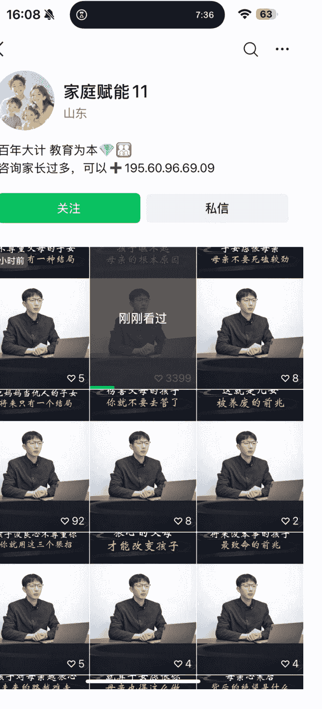

这么设计的精妙之处在于利益绑定：客单价四位数到五位数的产品卖出去以后，利润按10%-20%返给前端引流的IP团队。团队有动力干活，同时IP哪怕做大了也舍不得走。

如果你的赛道本身带点敏感属性，内容表达上要讲策略。养生、医疗、心理这些方向，别拿敏感词硬碰硬，学会用场景说话。比如养生赛道就拍穿道袍、摇扇子、打坐冥想；心理方向就拍公园里散步、安安静静沏一壶茶。

核心心法只有一句：让目标人群秒懂，但审核那边完全没感觉。

我见过几个号把这种方式玩得很明白。有个叫“思洋静心岛”的账号，博主坐标广东广州，是国家二级心理咨询师，个人简介写着“心理学不是答案，是通往自己的路”，口号是不卖鸡汤、只讲科学与陪伴，主页里置顶的几条视频都做到十万加播放。另一个叫“无相心玥”，坐标浙江杭州，主打修心悟道，线下还有“暖玥庭”文化雅集，做过“当你不再害怕睡不着”的系列内容，专门聊失眠人群的那些困扰。


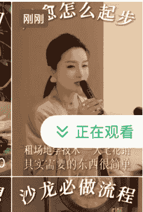


这类账号的标题也很有讲究，像“人睡困难就默念这三句”“翻来覆去睡不着”“躺平也是在给认床打预防针”，字面上看不出什么，但失眠的人一眼就会点进来。


顺带送大家一个省钱技巧。有些敏感赛道的朋友想去办安防许可证，一问价动辄几十万，直接吓退了。其实不用这么烧钱。先联系自己所在行业的协会，办一个协会颁发的资质证书，几千块就能落地，而且账号的安全系数还会更高。

做到后面，矩阵跑起来会碰到一个新的门槛：比如你有十个号，全都用差不多的套路发，平台会认为你在批量运作营销号。这时候就要学会去重。

先弄明白系统的查重规则。它主要看两样东西：一是画面素材本身，二是视频的包装层，包括贴纸、滤镜、转场、字体这些。如果你故事内容换了，但包装一直一模一样，连着发好几条，热度又不小，系统很容易把你判定成批量搬运的营销团队。所以内容要换，包装也要跟着换，两条线同时动。

还有两条流量警戒线请记住：

数据走到6000到7000这个区间时，流量爬升速度会明显加快，这时候就要开始盯数据了。
一旦摸到3万的边，可能触发人工审核，建议主动把这条视频删掉，防止整个矩阵被贴标签封号。

接下来是一份素材无限循环利用的完整方法，分四步。

第一步，储备原始素材。按业务类型走两条不同的路线。

一条是实拍派，适合传统工厂和实体门店。我有个做工厂跨境的朋友，做法非常直接：跑到拍摄现场，找到同行爆款视频里最火的那个动作，让摄影师对着同一个角度连拍30遍。这笔素材入库之后，之后好几个月的内容都不用再跑现场了。做矩阵最缺的就是素材，找到一个好角度，就是大力出奇迹。

另一条是洗稿派，适合知识付费、图文和口播。没法天天实拍，就去找👸号、知乎、抖音上的爆款案例。把故事骨架抽出来：当事人遇到什么问题→试过什么方法失败了→转折点出现在哪里→最后拿到什么结果。骨架到手之后交给AI去改写。

```
"你是一个资深心理咨询师，擅长写家长育儿故事。现在有一个素材：
【内核】孩子沉迷游戏休学一年，家长从崩溃到找到方法的经历
请把这个故事改写成：
```

AI提示词可以参考这一段：把城市背景从上海换成成都；情感内核保留下来，家长的焦虑、无力感、绝望感以及最终转变都要在；读起来要像真实家长说话的口吻，别直接套网络热梗；字数控制在800到1200字。这么操作下来，一条脚本能变出十几条完全不重样的新内容，最后自己再手动替换掉5%-10%的字眼，基本就安全了。

第二步，包装随机化。有些时候被查重不是内容素材撞了，而是去重模板撞了。确定好内容方向以后，给每条视频叠加三层到五层滤镜，组合方式每次都不一样，机器就识别不出来了。

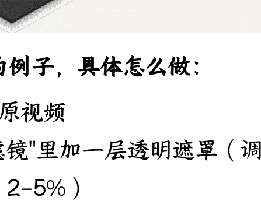

以剪映为例，具体操作是：把原视频导入；在滤镜里加一层透明遮罩，不透明度调到2%-5%；进去调节参数做微调，亮度增加1到3，对比度增加1到2，饱和度在-1到+1之间随机取值；再到特效里加一层噪点，强度控制在1%-3%；最后把画面轻微旋转0.1到0.3度；导出。建议存下三到五个预设，每次随机组合着用，关键是每一条都不同，最好连自己都看不出这是同一份素材。

第三步，素材轮换，打时间差。已经发过的素材直接扔掉太浪费，我们可以让它在电脑里换个身份重新出场。操作很简单：建立两个素材文件夹，A放未使用的，B放已使用的。每天只从A里定量取素材发视频，比如拿30条，发完就挪进B。一个月后A被搬空，把B整个改个名，全部搬回A里，继续新一轮使用。

为什么这样不会被判重复？因为一个月前你用旧素材发的那些视频，早就被你自己删干净了。平台查重看的是你主页上现在有什么，所以这个方法要配合第四步一起用。

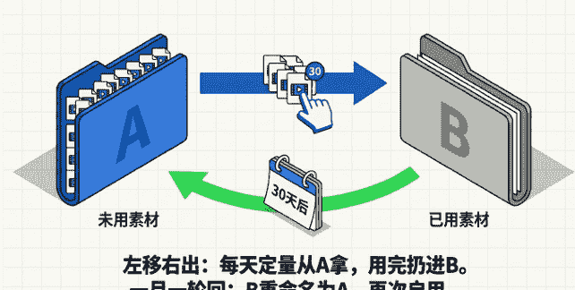

第四步，主页始终只留15-20条视频。不管你发过多少条，主页只保留15到20条。每发一条新的，就删掉最早的那一条。这样系统永远只能看到你最近期的内容，素材的循环利用也就真正成立了。

总结下来，这套玩法的内核就几条：小成本入场、十五天热身、内容模型化、素材循环翻新。敏感赛道靠意境去绕过审核，防封则靠包装细节的随机组合。路一步一步走，高客单价不是能不能做的问题，只是时间问题。

别把视频号主页做成“历史档案馆”。更建议只留下近期开出的 10—20 条作品，过去表现再好的内容，也要根据风险和获客价值决定是否撤下。

为什么要这样做？假设一轮素材消耗周期约为四周，等这一批内容重新轮到时，最初发布它们的视频已经从主页移除了。此时再对旧素材进行重新剪辑、换封面或调整表达，账号表面上已经没有对应的近期发布记录，重复识别的风险相对更低。具体执行仍要以平台规则为准，不要把删除内容当成规避审核的保证。

保持少量存量，还有三个现实好处：

+ 出现异常时，排查范围更小，便于判断是某条作品，还是某套表达方式触发了问题；
+ 减少同行长期翻看主页、复制高表现内容，或利用旧作品进行投诉的机会；
+ 降低平台重新检查老内容时带来的不确定性。实际运营中，早期高播放作品过了热度期后，新增咨询往往有限，隐藏或清理也能让账号更轻量。

## 五、从观看到咨询：内容之后如何承接

内容方向确定、发布流程也稳定后，还要解决一个关键转化：怎样让看过视频的人，进一步进入微信沟通。

### （一）把用户自然带到私域

相比频繁私信，更稳妥的方式是设计明确但不过度打扰的入口，让真正有需求的人主动联系。

### 直播预约页承接电话

我曾经测试过这种方式，单条作品可以带来约 5—8 个咨询线索，效率高于逐个私聊。

操作思路是：完成视频号实名后开通直播预约，把预约说明改写成电话号码的谐音或拆分表达。直播日期并不需要与近期活动完全对应，关键在于用户点击预约时，能够看到这组信息并主动联系。使用前应先确认平台最新规范，避免因联系方式展示方式导致风险。

## 雨棚发明家

长沙虹宇传媒有限公司

180—2921—2179

已关注

私信

🙋‍♂️180 发 2921 财 2179

4 月 21 日 12:00 直播

主页

视频

音频

预约

## 音频 (1)

~180~2921~2179~

12 秒

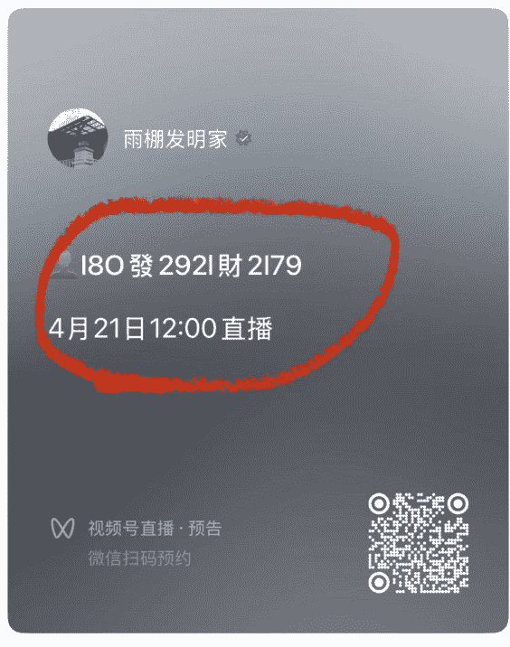

音频承接。

也有人把电话号码放进音频文件名里，再上传到账号。这个做法存在不确定性，建议先用测试账号验证，不要直接拿主账号尝试。

## 广东佛山

佛山源头雨棚定制看音频❤️📞1🗨️1

植生—👉🏻📞18027427092

1 条原创内容

## 主页

## 视频

## 音频

## 音频（1）

雨棚 18📞0274📞27092

1 分钟

## 最新视频

~~~180~2921~2179~~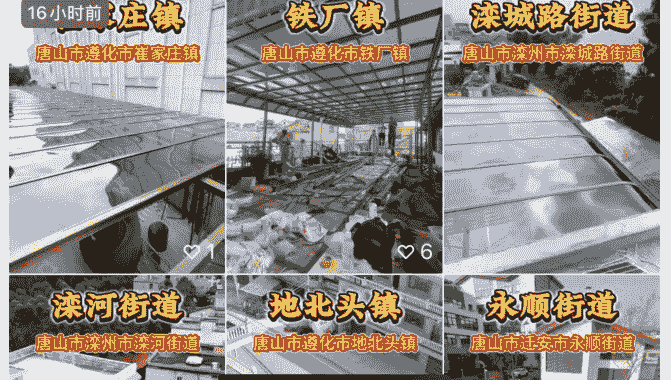

### 👸号入口

视频号的引流规则变化很快，更像是在不断调整的试验场。可以持续观察各行业成熟账号的公开做法，尤其是工厂获客、特殊商品等竞争激烈的领域，再结合自身业务选择合规的承接方式，不能机械照搬。

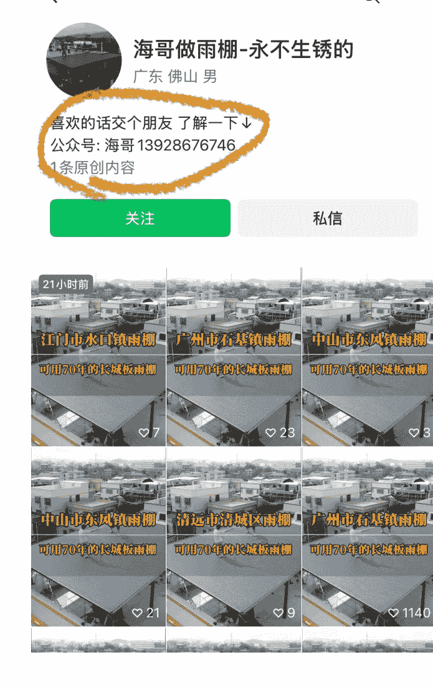


### 微信小店客服：优先考虑的官方路径

如果希望稳定一些，可以使用微信小店的客服能力来承接咨询。

+ 19. 开通微信小店：个人主体通常可开 1 家，企业主体通常可开 2 家；
- 20. 将视频号与店铺关联，并把主页私信入口切换为客服入口；
- 21. 在客服自动回复中配置企业微信二维码，也能设置关键词触发，例如用户发送“666”后自动收到进一步联系方式。

开店本身不收费，保证金则根据经营类目不同，大致从几百元到几千元不等，停止经营后按规则办理退还。

相比冒险使用不稳定的导流手段，官方客服链路更容易长期维护。刚开始测试时，可以先用一个实名店铺连接 3 个账号，组成小规模账号组合，观察咨询质量和后续成交情况。

⭐ 独有的“三位一体”服务体系

⭐ 机构累计服务 3W+ 组家庭

⭐ 北大、北师大一线专家背景

❤ 孩子休学厌学专注力等问题免费 1V1 咨询

### 一个更稳的区域化打法：围绕本地需求获客

面向全国广泛投放，往往更容易触发审核。如果业务本身能够在线下完成交付或核销，可以采用本地网络环境配合城市关键词，聚焦所在区域寻找咨询者。

区域流量通常更精准，规模也较容易控制。一个城市先安排 5—10 个账号进行观察即可；全国性咨询服务则可以先选 2—3 个地区做小范围测试，确认内容与转化都成立后，再考虑扩展。

可参考下面的设置方式：

| 位置 | 建议处理 | 示例 |
| :---: | :--- | :--- |
| 封面 | 露出目标地区 | “北京家长必看” |
| 正文 | 在叙述中自然带出地区 | “上海一位妈妈说，孩子已经休学 3 个月……” |
| 发布定位 | 选择对应城市 | 发布时定位“上海市” |
| 话题 | 增加地区相关标签 | #上海 #上海家长 #上海厌学 |

标题是否直接放城市名称，并不是决定性因素，其他位置的地域信号更值得保持一致。

### （二）怎样在一天内整理出可承接咨询的朋友圈

流量进来后，如果账号没有足够的信任材料，用户很难继续了解。若没有时间长期积累，可以用“参考结构—整理业务—批量生成”的方式快速搭建。

#### 第一步：提炼成熟账号的内容结构

先准备一份公开可参考的优质朋友圈样本，整理后交给大模型，让它归纳内容类型、表达顺序和常见套路。提示词如下：

```
你是一个 200 年的朋友圈写稿大师，我给你上传了我对标同行的所有朋友圈，你帮我
```

分析它使用了哪几类框架，给我输出并命名为【朋友圈框架Ⅰ】。

#### 第二步：建立自己的业务资料库

把产品特点、目标人群的困扰、真实咨询记录、成交数据和典型案例整理在一起，再让模型提炼成一份对外传播方案。若现有资料不充分，可以参考成熟的服务型业务宣传案例，逐项补齐客户最关心的内容：

24 年 12 月 24 日&25 日&26 日&27 日&28 日-自驾游&路书-打法分析-如果你不知道从哪些方面宣传自己的服务（是服务，不是带货某个产品），就看这个豆包投喂话术哦


完成资料整理后，可以使用下面这段指令：

你是一位拥有丰富经验的产品营销顾问。我会提供产品资料、用户访谈、服务记录和客户案例，请你提炼目标人群、核心卖点、常见疑虑、信任证据与传播角度，并将结果命名为【宣传方案Ⅰ】。

#### 第三步：让模型协助批量拟稿

随后把“内容结构库”和“业务传播方案”一起交给 Gemini、Claude 等工具，让它按照指定顺序组合出朋友圈选题、文字和配图方向。

示例指令：

你是一位资深朋友圈营销策划。我准备为青少年学习适应与家庭教育项目制作朋友圈内容，目标人群是重视教育、具备较强支付能力的家长，服务价格区间为 3980—29800 元，内容包含咨询与长期陪伴。请结合我的【宣传方案Ⅰ】和【朋友圈框架Ⅰ】，完成以下工作：

+ 1. 先梳理目标领域的核心卖点，并理解已有用户案例；
+ 2. 识别参考账号的语言风格、情绪切入、痛点呈现和配图习惯；
+ 3. 挑选适合本项目的表达结构，组合主题与案例，输出朋友圈选题；
+ 4. 为每条内容给出配图方向。

本轮只需要提供选题、结构和配图建议，不要直接展开完整成稿，后续再逐条细化。

示例：

## 【结构 5：强观点与认知反差】

素材来源：01.pdf（用户画像：P8 高知家长，海淀区，高焦虑）

核心逻辑：切入家庭中的角色失衡、体面压力与过度掌控，通过鲜明判断制造认知冲突。

只要家里有个太能干的奶奶，通常就有一个无能的妈和一个废掉的孙子。这话不好听，但是事实。

今天这个案子，爸爸常年隐身，奶奶掌握财权和话语权，妈妈像个受气的小媳妇。孩子一旦不想上学，奶奶就护着：“不想去就不去，别逼坏了我的孙子！”

这种【隔代结盟】，直接废掉了妈妈的管教权。孩子很聪明，他知道谁是家里的老大。他躲在奶奶的保护伞下，就可以肆无忌惮地逃避成长。

我的方案是：请奶奶退出。哪怕要爆发家庭大战，父母也必须把教育权夺回来。权力不归位，孩子永远长不大。

批量生成后仍要人工复核，尤其是涉及未成年人、健康、教育效果和家庭关系的表述，避免绝对化或制造恐慌。

### 如何向新联系人说明朋友圈内容较多

如果短时间发布大量案例，确实可能让人产生压力。可以提前解释：

“之前的账号因为容量或其他运营原因无法继续使用，现在把部分案例和服务资料整理到这个账号。若内容较多，您可以按需屏蔽，我会把最有参考价值的内容集中置顶。”

我的说法是：

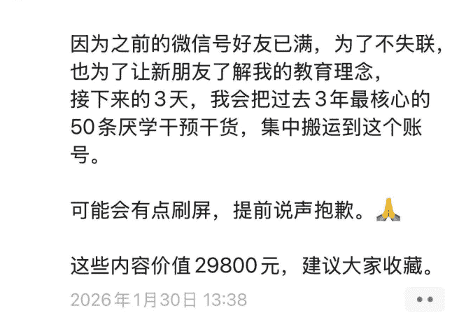

# 0—1 阶段验证完成后，要不要扩大规模？

当最小闭环能够运转，下一步不是马上复制，而是先把账算清楚：

+ 每月大约能获得多少有效咨询？
• 平均每位咨询者最终贡献多少利润？
• 扣除账号、工具、人力和时间后，净收益还有多少？
• 这个结果是否值得继续投入？

数字让你满意，再考虑增加账号；若利润不理想，应优先修正产品和成交环节。

## 22. 后端业务的利润空间

以代运营获客为例，每月约 2 万元的收入，在不同圈层中的评价并不相同。再比如，做建材出口的朋友拥有自己的工厂，若促成一笔 ToB 意向，订单规模可能达到千万级。两类业务使用的测试逻辑相近：先在单个城市安排 5—10 个账号验证内容，再把成熟且风险可控的版本复制到更多地区。

因此，若手里有法律、装修、教育、工厂出海等高客单服务，获客方法本身只是基础，最终收益还要看后端产品的客单价、交付能力和成交率。

## 23. 规则环境是否允许长期运行

在敏感领域做内容运营，很难承诺持续、平滑的增长。平台政策会调整，咨询量有波峰波谷，季节变化也会影响结果。以青少年学习适应类内容为例，运营过程中经常需要根据规则变化重新调整，更适合先当作可控规模的副业项目，而不是默认成一门稳定生意。

## 24. 业务能否标准化

如果选题、发布、审核、客服和成交全由一个人盯着，增加账号只会增加工作量。只有内容模板经过验证、流程文件足够清楚、普通新人也能依照步骤执行，才具备复制条件。

先梳理风险边界，再讨论规模化；否则账号铺得越快，整体风险也可能同步放大。

## 写在最后

绕了一圈后，我更认同一个原则：不要把主要精力放在和平台规则硬碰硬上。合规虽然需要投入，但往往能换来更稳定的运营空间。把省下来的时间用于打磨内容、优化服务和提升成交，才是长期收益更高的做法。

感谢 lyj-江哥，视频号流量这块非常权威，帮我少走很多弯路；

感谢珍妮老师，精细化运营的获客大王，想夸一百遍；

感谢 yeye 同学，在写内容方面很到位，很有耐心给我建议；

越分享越幸运，希望大家顺风顺水顺财神！！

---

读完流程说明，很多人会以为自己已经掌握了方法，但真正执行时，最难的往往不是工具，而是持续行动、及时复盘和获取有效的一手经验。

如果你想了解近期的变现案例，并和一群愿意亲自测试、持续复盘的人一起推进，可以关注我的核心私域：【懒人专属群】。

这里不做空泛讨论，重点放在商业链路拆分、自动化工具应用和实战复盘。系统中已经整理了 1000+ 个经过验证的实战项目。

🔎 查阅圈子完整数字资产与上车门槛：

[https://lazyso.com/insider/](https://lazyso.com/insider/)

认同价值、准备好下场干活的，扫码加我微信（lazyhelper1）

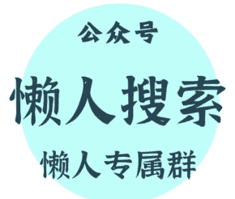

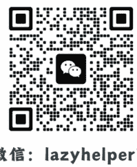

备注：【实操上车】，不闲聊