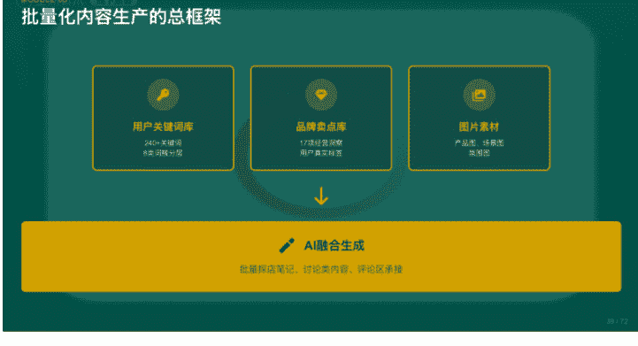
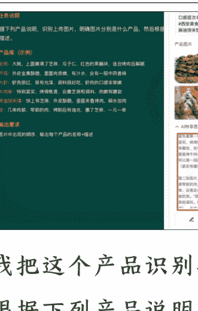
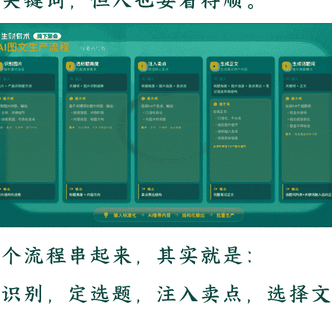
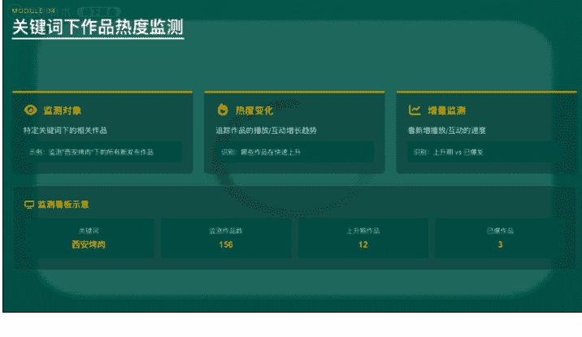
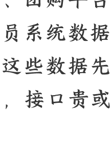
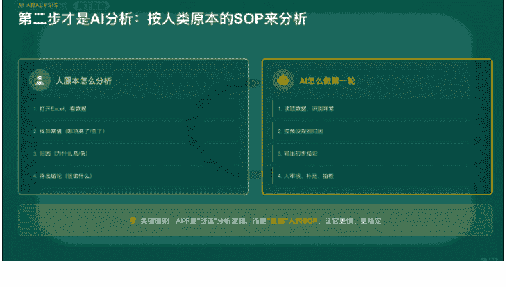
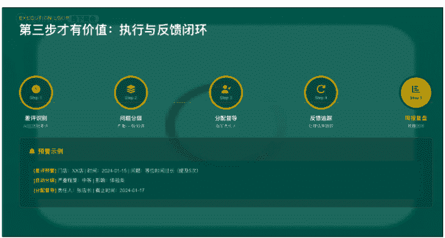
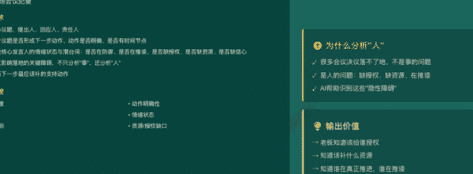
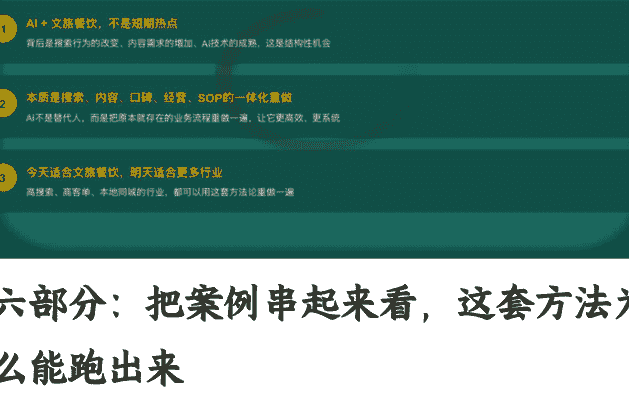

# 把文旅餐饮的搜索获客全链路用 AI 重塑

260416 副业 SC 精华

整理:公众号懒人搜索，懒人专属群精选

懒人微信: lazyhelper

作者:大周 | 时间:2026 年 04 月 13 日

清明假期首日，我在上海做了内部分享。

逐字稿 +PPT 资料汇总如下。

【课件原稿链接】

https://www.kdocs.cn/l/ca6loyGogk5S

![img/a840b9dfd814ebdb8caf3e4794a9a442_0_0.png]

# 文旅餐饮 AI 搜索增长实战逐字稿

各位好，我是大周。

今天这场分享想聊的是，近一年来我如何把文旅餐饮过去那种投入高、节奏慢、极度依赖个人经验的获客体系，整体用 AI 重新搭建。

先简单介绍下背景。

![img/a840b9dfd814ebdb8caf3e4794a9a442_1_0.png]

我从业餐饮经营五年，后来转向餐饮营销两年。

最近一年多，团队聚焦文旅餐饮赛道，已服务西安的刚刚烤肉、陕拾叁糕点、军军绿豆糕、小骆驼福苗烤肉，成都的螺旋桨螺蛳粉、三毛兔头，嘉兴的薛八千，安吉的阿露佳等一批城市标志性餐饮。

我并不是先迷上 AI 再去硬套行业，而是先在餐饮里摸过路，清楚哪些环节最臃肿、哪块最耗人工、哪些判断过度依赖经验，才明白 AI 插入的性价比最高点在哪。

先抛一个判断。

![img/a840b9dfd814ebdb8caf3e4794a9a442_1_1.png]

从 2023 年起，泛餐饮大盘承压已成行业共识。但在整体下行里，有一条线在逆势增长，伴随交通基建完善、人流加快、文旅消费抬头，那就是目的地餐饮。

原因很直观。常规餐饮基本只能吃 3~5 公里半径的生意，而文旅餐饮除了本地客，还多了一个游客客群。游客消费意愿更强、打卡欲更高、传播意愿也更强。

![img/a840b9dfd814ebdb8caf3e4794a9a442_2_0.png]

![img/a840b9dfd814ebdb8caf3e4794a9a442_2_1.png]

文旅餐饮有两个非常鲜明的特点。

第一，搜索流量占比显著。
第二，消费决策周期偏长。

用户很少刷到就走。通常先检索、再比较、再看评论区、再翻评价页、再研究差评，最后才下决定。链路越长，可改造空间越大。过去一年，我们就是把这条路径逐段 AI 化，把原来靠人工、靠经验、靠线下巡店、靠消费者调研的环节，尽量变成自动化作业流。

[图片]

我对 AI 的定位是清晰的：它擅长两类活，一类是高频重复，一类是需要专业初筛但不必由专家逐条手工完成的活。所以让 AI 先完成 80% 的体量，最后 20% 决定结果的取舍、判断、推进和拍板，仍由人来做。AI 不是替你当老板，而是先把大量低价值重复劳动扒掉。

# 本次分享围绕五大方向。

- 其一，AI 如何介入用户需求挖掘与检索词库搭建。
- 其二，AI 如何挖掘品牌卖点与品牌标签。
- 其三，AI 如何批量覆盖检索结果，沉淀 GEO 资产。
- 其四，AI 如何做评论区种草、热度监测与上升期截击。
- 其五，AI 如何从营销工具进化为经营工具，覆盖会议、差评、预警与组织协同。

顺便把商业模式摊开说。

当前变现大概有几层：
项目制服务，2~5 万/个，做完整策略与搜索增长方案；
陪跑模式，10~30 万；
工具分基础版与进阶版，进阶版 29800/年；
企业内训 5 万/场；
另有线下课程。

逻辑很简单：先用服务把方法跑通，沉淀 SOP，再把 SOP 接到 AI 做成工作流，再把工作流产品化成工具与课程。

## 第一部分：AI 如何介入用户需求洞察与检索词库搭建

![img/a840b9dfd814ebdb8caf3e4794a9a442_5_0.png]

先讲需求洞察与词库。AI 介入前，这块非常笨重。

![img/a840b9dfd814ebdb8caf3e4794a9a442_5_1.png]

以前通常要花两天和客户深度沟通，明确想获取谁、现在来的是谁、未来要谁；再用 5118、聚光后台等工具一层层梳理目标用户的检索地图。

重要，但极耗精力。难点不是想出几个词，而是要想全。地标词、场景词、景点词、人群词、路线词、决策词、避坑词、预算词，都得穷举。

去年 8 月后，我们开始让 AI 先上。

最早期的提示词很简：让 AI 扮演消费决策洞察师，基于行业与人群拆解浏览、搜索、购买行为，提炼关注点，再基于行为路径与转化漏斗输出各决策阶段的检索需求。作用是把从产生想法到完成消费的全过程拆开，告诉每个阶段会检索什么。确实能快速搭框架。

![img/a840b9dfd814ebdb8caf3e4794a9a442_7_0.png]

但很快发现问题：AI 生成的词 ≠ 真实检索词。它给的是语义上合理的表达，未必是用户真的会敲进搜索框的。比如“高颜值伴手礼”“附近美食地图”，听起来没问题，但搜索行为上可能不匹配。

于是早期流程变成 AI 出词后，还要人到聚光、小红书后台逐一校验、替换、补热度，负担依然重。

![img/a840b9dfd814ebdb8caf3e4794a9a442_7_1.png]

后来优化为：AI 产出的候选词直接喂给关键词热度工具/API，去跑真实检索量，减少人工核查。

流程从“人工想词+人工查词”变成“AI 生成+工具验证+人工定夺”。最烦的环节被大幅压缩。

再往后，提示词升级为完整版。核心规则：不先锚定行业/品类/品牌，先建用户问题空间再建方案空间，最后才出现供给词；词类配比上，问题/目标词≥50%，方案/路径词≈30%，供给/行业词≤20%；信息不足时先给假设与待验证点；全程用用户口语与长尾表达；每个决策阶段必须给出替代方案。

输出六步固定：Step0 给关键假设、反假设、待验证点；Step1 建用户问题空间，覆盖触发、目标、风险、约束，提炼隐藏动机；Step2 造 3-5 个 Persona，含场景、动机、恐惧、决策风格、搜索句式；Step3 按触发→验证→定标准→对比验证→决策→体验后拆解情绪与需求；Step4 输出阶段-搜索意图-问法模板表；Step5 产出≥240 个词，按阶段分层，覆盖 8 类词簇，每阶段≥40 个，60% 以上不带行业词。最终交付：阶段情绪需求总表、TOP30 占位词、锚定自检反例清单、≥20 条不建议投放词及原因。

这版与初版最大差别是先不锚定品牌词，而是先构建问题空间。先问用户为何检索、在担忧什么、在什么场景下检索、会用什么替代。视角从“我想投放什么词”转向“用户为什么会检索这些词”，这个切换很关键。

![img/a840b9dfd814ebdb8caf3e4794a9a442_9_0.png]

举例：重庆火锅，客单 50，目标游客。

不会直接让 AI 写“重庆火锅关键词”。先给城市、品类、人群，让它自己做假设、画像、旅程拆解。最后会给出：学生穷游检索什么、带父母检索什么、情侣闺蜜检索什么、刚下高铁检索什么、怕踩雷检索什么、怕太辣检索什么。出来的词才像用户语言。

![img/a840b9dfd814ebdb8caf3e4794a9a442_10_0.png]

这套流程的价值不止于出词，还能得到三样东西：核心用户是谁、各阶段检索什么、应优先占位哪批词。

![img/a840b9dfd814ebdb8caf3e4794a9a442_11_0.png]

这就是第一部分。

## 第二部分：AI 如何介入品牌卖点与品牌标签挖掘

接下来是卖点与标签挖掘。AI 前，这个环节也很重。

![img/a840b9dfd814ebdb8caf3e4794a9a442_11_1.png]

以前要巡店、看竞品、聊创始人、聊厨师长、聊店长、聊顾客、做问卷、蹲点。最后整理卖点库、内容方向、视觉模板。费时之外，老板自嗨是最大坑。老板觉得走心，顾客未必感知得到。

所以要区分两件事：老板认为的卖点 vs 顾客真实感知到的卖点。

我们把这步 AI 化，思路是尽可能读取全网真实表达。

![img/a840b9dfd814ebdb8caf3e4794a9a442_12_0.png]

数据源三大类：小红书/抖音品牌相关笔记与评论；美团/点评评价；菜单、团购、价格等补充。

相当于把“线下访谈十几二十人”换成“一口气读几百上千条真实表达”。

核心 Prompt 定为资深餐饮经营诊断顾问，要求把评价数据转为可落地经营决策报告，禁止空泛。

一、基础信息与数据要求：基于门店基础信息、多平台评价及菜单团购补充分析，缺失项需标注。
二、核心分析目标：完成 17 项洞察：目标群体、高价值流失客群、价格敏感度、价格锚点、服务流程、体验断点、菜品结构、消费场景、到店动机、预期落差、复购理由、品牌标签、决策阻力与优劣、真实竞品、口碑趋势、系统根因、经营动作优先级。
三、硬性输出规则：每个模块完整输出数据处理流程、AI 分析流程、逻辑、结果表、经营建议、结论分层与信心等级；核心结论附≥3 条评价证据与量化数据；严格区分价格敏感、场景动机、服务流程、菜品类型、品牌定位等易混维度；建议明确改什么、谁负责、改哪里、改善指标、优先级。
四、统一执行标准：先清洗、标签抽取、人群场景识别、时间切片、证据强度评估，按频率、营收影响、复购流失、传播风险、可修复性算优先级。
五、输出规范：固定模板，表格完整，语言落地，聚焦钱人菜流程口碑复购，最后给出综合总结。

这套 Prompt 的核心是把评论变成经营诊断输入。

![img/a840b9dfd814ebdb8caf3e4794a9a442_14_0.png]
![img/a840b9dfd814ebdb8caf3e4794a9a442_14_1.png]

# 菜品结构分析（上）
| 菜品 | 提及 | 正负比 | 主要口碑争议 | 稳定性 | 近期 |
|---|---|---|---|---|---|
| 招牌烤肉筋 | 60 | 44:9 | 少数门店优劣不稳 | 中高 | 高 |
| 古都熏肉大饼 | 49 | 35:7 | 凉、肉少、夹生纠纷 | 中 | 高 |
| 金牌酸辣白菜 | 39 | 32:3 | 白菜少、挟粉多 | 中高 | 高 |
| ... | ... | ... | ... | ... | ... |

核心结论：招牌烤肉筋、熏肉大饼、酸辣白菜是高记忆招牌，真正风险是少数招牌失格会拖累爆单。稳定性影响购买，先保招牌稳定再做新品。

结构缺口：解腻菜不足、快菜不足、儿童友好弱、高价菜风险高、招牌外延不足。

复购判断：复购不是因为“都挺好”，而是决策成本低。证据：风味油脂和酸白菜百吃不厌；每次都专门打车过去；以后还会再来。

场景与动机：亲友聚会 24.8%，游客打卡 15.9%，家庭聚餐 12.3%。动机：冲着招牌 22.7%，朋友推荐 20.3%，社交 9.5%。

客群细分：主力盘是朋友局、游客情侣、社区熟客。

最终能回答：核心受众是谁、流失高价值人群是谁、价格敏感否、菜品结构、场景、动机、复购理由、品牌标签、体验断点、真实竞品、优先级。

卖点要翻译成用户视角。比如商家说“鱼没有小刺只有大刺成本更高”，用户视角是“老人孩子能放心吃不用怕刺”。AI 的作用就是完成这层翻译。

同一盘菜，走出后厨的说法和落在顾客嘴里的说法，根本不是一个频道。老板讲工序与用料，食客讲自己是否省心、是否被照顾到。

拿鱼举例。菜单上写“去刺干净、处理到位”，客人分享时往往是：“敢带老人小孩来，不用担心被刺卡住。”表述很家常，却精准点出了一个可被复用的场景价值。

红烧肉同理。制作端会强调“慢炖两小时”，而真实口碑是：“家里没牙的长辈也能吃得动，不必另起一盘软烂菜来迁就。”

这种差异正好可以用来和经营者对齐认知。很多店主执念于自家主推的新品或细节，以为市场会买单。但把全平台点评跑完后，常常会出现反差：用户反复记住的菜名、标签和用餐场景，未必是老板最想放大的那一个。此时才看清，消费者的心智锚点和经营者的推广锚点并不重合。

因此这一步的意义不只是“找卖点”，而是做一次溯源与排序：哪些是用户真实买单的，哪些只是店里自嗨。把专业话术转译成用户能对号入座的生活情境，这项翻译工作完全可以交给模型来完成。

## 卖点剧本化工具

把产品描述转成消费者可感知的场景

- 直接体感描述一：“羊排炖足两小时，筷子一夹骨肉即分，老人小孩咀嚼都不费劲。”关联点：打通“嚼不动”的物理障碍，落在“筷子夹脱骨”的具体画面。
心理情绪描述一：“总算有能让老人一起吃的羊肉了，不用再单独点软菜照顾。”关联点：家庭聚餐中的照料心理，减少额外麻烦。
- 直接体感描述二：“羊排既绵又香，入口轻轻一抿即化，满口肉香。”关联点：软烂口感叠加嗅觉满足，双重感官。
心理情绪描述二：“往常吃羊肉总觉得费力，这次一抿就烂，挺解压。”关联点：把“吃肉费劲”的烦躁转为轻松感。
- 路线3：适合4人+198元 → 省心效率型（性。

以上是第二块，模型介入品牌卖点与标签挖掘的思路。

## 第三部分：模型如何批量覆盖关键词搜索结果

进入最实操的环节：内容生产与关键词占位。

前两步完成后，手上已有两类资产：用户搜索词库与对应需求，以及品牌卖点库与内容标签。下一步就是把两者拼接，产出大量能承接搜索的内容。

这里有一个关键坑：图文不匹配。很多批量工具文案产出量不低，但图说不符：图里是烤肉，正文却在夸饮料；图里是环境，正文却在讲菜品。读者一眼识破，平台也不会给流量。

所以第一步不是写，而是先让模型看懂图。

我把这个产品识别提示词贴出来。

根据下列产品说明，识别上传图片，明确图片分别是什么产品，然后根据产品在图片中的形态输出相应的图片描述。八宝粥，大碗，上面撒满了芝麻、瓜子仁、红色的果脯块，适合烤肉后解腻，烤肉聚餐时搭配。西安特色小吃葫芦鸡，外皮金黄酥脆，里面肉质嫩，有汁水，适合喜欢炸鸡的人，跟其他炸鸡的区别是炸制的时候里面会加入中药，更养生，会有一股中药香味。烤大虾，虾壳很红，很有光泽，调料很好吃、虾肉的口感非常嫩，适合喜欢海鲜的人，西安很少吃到这么鲜嫩的烤大虾。烤牛肉串，特别紧实，烤得焦香，会撒芝麻和调料。西安牛肉串必吃、肉嫩有嚼劲、会有一点点的简单腌制，特别适合适合下酒菜吃。芝麻油饼夹馍，饼上有芝麻，外皮看起来酥脆，里面夹着烤肉，碳水加肉，特别满足，西安特色必吃小吃。盐筋，几串肉筋，看起来是带筋的肉，烤制后有油光，撒了芝麻。一元一串，招牌肉串，店里走串式的上菜，可能要等一下，转到自己这桌，才能吃到。

这个提示词不只是认图，而是让模型同时获知：这是什么产品、图里呈现的状态、核心卖点、在何种语境下提及。信息完整，后续生成才不会跑偏。

图识别后，第二步不是直接写正文，而是先定选题。因为同一组素材可对应多个搜索意图。武汉的项目里，同一套图既能做“武汉美食攻略”，也能做“武汉周末好去处”，还能做“武汉情侣约会餐厅”或“武汉探店拍照打卡”。因此给模型一个关键词方向，让它基于图片与目标人群选出最合适的标题角度。这一步本质是把关键词转化为选题方向。

第三步，把非菜品卖点也注入正文。菜品卖点在识别阶段已解决一部分，但打动人的往往还有服务、氛围、节奏、细节与温度。我们会准备一个非菜品卖点池，让模型在写作时自然抽取1到2条。例如：迎宾会照顾排队顾客、服务员会帮忙催菜、打卡不打扰，一抬手就来、烟很小吃完身上味道轻、店里热闹但不吵、氛围高级适合带外地朋友、服务员会推荐酱料吃法、提供围裙、头绳、宝宝椅、小风扇等。

接着第四步是语言风格。下面这套情绪化提示词常被使用，能提升互动：

- 它背后打中的核心情绪是什么
- 它满足了读者的哪个心理需求
- 它隐含的对立关系是什么
- 根据图片识别的结果、结合分析出来的情绪，需求和对立关系，分析可能存在的事件场景画面。根据已经完成的选题，分析可能的读者目标受众的画像，这个选题。

然后请你：
- 用更直接、更尖锐、更像“朋友私下吐槽”的口吻
- 重写一篇结构全新、但情绪更集中的内容
- 开头必须是一句让人不舒服但忍不住继续看的话，这句话同时作为标题
- 全文短句为主，允许留白
- 需要完整、顺序

展示相关图片内容。- 不解释概念，只下判断- 全文逻辑通顺，要尽可能简短把笔记要表达的内容讲清楚- 语言风格必须要说人话，要像真人说话- 禁止总结式语气、教科书式表达、客观中立- 字数不超过200字- 改写目标：让读者忍不住评论，而不是点赞就走 这套提示词为什么有效？

因为它不是让模型写一篇端正介绍，而是明确目标是触发情绪与讨论。产出更像真人随手发的内容，而非官方说明。

最后一步是关键词埋入与话题词生成。正文成型后，再让模型按目标用户常用搜索表达把相关词自然植入，并生成10个以内话题词。强调自然，而不是硬塞。平台要识别关键词，人也需要读得顺。

流程串起来就是：图识别，定选题，注入卖点，选择文风，埋关键词，出话题词。

### 关键词策略

| 特性 | 大词 | 小词 |
| :--- | :--- | :--- |
| 示例 | “西安美食”、“烤肉” | “回民街烧烤”、“大雁塔附近烤肉” |
| 流量 | 流量大 | 流量小 |
| 竞争 | 竞争大 | 更精准 |
| 资源需求 | 需要大量资源才能占位 | 更容易占位，转化率高 |
| 后缀 | 细分地名词、场景词 | 细分地名词、场景词、路线词更容易占位，且用户意图更明确 |

不是每个词都值得硬打。大词和小词不能同打。比如“武汉美食”“西安烤肉”流量高，竞争也高，发上百篇也未必上前排。而“武汉龙兴东街美食”“武汉新竹路美食”量虽小，却极精准，且平台供给常不足。一旦持续供货，很容易被推到前排。

搜这两个小词时，常能看到同一品牌在前十多次出现。不是店有多神，而是这个词本身缺内容，品牌恰好填了坑。这就是供需。平台缺内容时，先供给者拿位置。所以第三块核心不是大量生产，而是用模型去打最值得打的搜索词。

## 第五部分：评论区种草、讨论类内容与热度监测

结论先行：在小红书，很多用户不是被正文说服，而是被评论区说服。求推荐帖、攻略帖、红黑榜、避坑帖的评论区本身就是种草位。所以我们做两种打法。

第一种，讨论类内容改写＋评论区维护。像“马上到西安了，请推荐本地人爱吃的烤肉店”这类笔记，天然带流量。用户点开几乎必然看评论。我们批量采集这类求推荐帖，用模型改写延展，再在评论区做种草露出。

第二种，热点监测＋上升期截击。先监测目标关键词下的新内容，让模型判断哪些值得介入、哪些不值得。值得的由模型生成评论文案，最后由人工确认发布。AI 负责筛选与生成，人负责最后一步。不能全自动，风险与风控会升高。

热度监测的关键点在时机。别等爆完再进场，最值钱的是内容还在爬升期。我们记录关键词下新内容的播放量、互动量，再对比后续增量，判断是否处于上升期。若是，就在流量窗口内做评论区种草。

抖音上尤其关键。抖音一条内容的推荐流量，常集中在前12到24小时。等跑完再进场，效果打折。

再补一个认知：小红书真正值钱的不只是小眼睛和点赞，而是搜索。要把所有动作绑定品牌词。

## 第六部分：模型不只是营销工具，还应进入经营流程

前面讲流量，下面讲经营。

很多餐饮老板会问，模型能不能做排班、备货预测、客流预测、搭大数据中台。我的回答很直接：如果这个场景原来业务里没有，别为追新硬造。先有场景，再找技术。别因模型热，给自己加一堆原来不看的报表、不做的动作、不存在的会议。

模型最适合先进入哪些环节？先进入企业本来每周就会开的会。

财务会。本来就在看分店营业额、客单量、客单价、毛利率、人效、食材占比、水电气、纯利润。重点不是看数，而是归因：为何这家店气费高，那家店食材占比异常，是片区问题、损耗问题还是流程问题。模型可以先采数，再按财务分析逻辑做第一轮判断。

营销会。本来就在看渠道来客数、投入、曝光量、阅读量、互动量、加微率、核销量、投入产出比。抖音和点评更接近交易，小红书更多看曝光、阅读、小眼睛和互动。口径不同，目的相同：判断下周加码还是缩量。模型可以先清洗、归因、给出结论初稿。

还有新品会、门店管理会、舆情会。新品会看上架、下架、销量与菜品结构变化。舆情会看差评、好评、NPS、服务问题、体验断点、食品安全。这些原本就有的场景，模型切入最顺。

顺序要先明确。

### 第一步其实不是模型，而是数据采集

外卖平台数据、团购平台数据、收银系统数据、会员系统数据、小红书、抖音、点评，这些数据先拿上来。有接口走API，没有或接口贵就走RPA。

### 先数字化，后智能化。

这是顺序问题。

举一个很值的场景。

比如督导与差评预警。可把全网品牌词和门店链接持续采集，一旦新增差评，模型先判断是否为差评、严重度、属于服务/产品/食品安全问题，再自动推送给对应督导；督导处理后回填。总部每周可看到：问题总数、集中门店、问题类型、处理率。

到这里，模型不再只是写内容，而是进入督导与经营闭环。

另一个推荐场景是会议纪要分析。

很多人做纪要只总结“聊了什么、定了什么动作、谁负责”。但管理更关心下一层：谁在推进、谁在防御、谁在推诿、谁缺授权、谁缺资源、谁缺信心。很多事落地不了，表面是业务，本质是人。

把纪要从“总结事情”升级为“分析组织卡点”，可用以下提示词：

请分析本场会议纪要：
- 列出核心议题、提出人、回应人、责任人
- 判断每个议题是否形成下一步动作、动作是否明确、是否有时间节点
- 分析每位核心发言人的情绪状态与潜台词：是否在防御、是否在推诿、是否缺授权、是否缺资源、是否缺信心
- 给出真正影响落地的关键障碍，不只分析“事”，还分析“人”
- 输出老板下一步最应该补的支持动作

把这类提示词套进钉钉会议纪要，价值完全不同。它不再只是记录，而在识别组织问题。

## 最后讲三个底层逻辑

第一，模型不创造需求，只放大原本存在的高意图需求。用户本来就会搜、做攻略、看评论区、比价。模型的价值是让你更早知道他在搜什么，更快供给内容，更准埋伏决策路径。

第二，真正的竞争不是一篇爆款，而是占住整条决策链路。从起心动念到搜攻略、比品牌、看评论、翻差评、成交、分享。谁能系统占住这条链路，拿到的不是一次流量，而是长期心智。

第三，先找场景，再找技术。不要因为新模型出来就急着上。先看原来在做什么：开会、看数据、做营销、盯评价、盯门店、做复盘。哪里原本就在发生，哪里最适合模型进入。

记住：先有场景，再找解决方案；先有SOP，再接模型。

这件事本质很朴素：找到本来就存在的高意图搜索需求，提炼品牌该说的话，再用模型高效连接。今天适合文旅餐饮，明天也适合搜索需求强、决策链路长、高客单、重口碑的本地同城业务，比如本地婚礼、本地首饰、小众景区。

分享到此，谢谢大家。

---

看完SOP，容易产生“我已懂”的错觉。真到实操，九成会被第一步卡住。

工具和教程只是表层壁垒，真正的壁垒是立刻动手和圈层信息差。

如果你想看全网最新变现玩法，和一群执行力强的极客一起下场拿结果，欢迎围观我的核心私域：【懒人专属群】。

我们不聊虚的，只做商业闭环拆解与效率压榨。系统内已沉淀1000+跑通的套利实战局。

> 👉 查阅圈子完整数字资产与上车门槛：
>
> https://lazyso.com/insider/