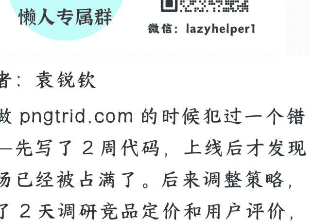

## 我花 3 小时研究了一个出海工具，发现多数独立开发者从第一步就走偏了

260414 副业 SC 精华

整理：公众号懒人搜索，懒人专属群精选

懒人微信：lazyhelper

作者：袁锐钦

我曾经做过一个 pngtrid.com。

当时没有验证需求，直接埋头写代码，连续开发了两周。产品上线后才发现，市场上的同类工具已经非常拥挤，自己做出来的功能几乎没有竞争空间。

后来我换了方法。

我花两天时间研究竞品价格、用户评价和使用场景，重新调整定位。产品上线一个月后，收入做到 5000 元。

这两天调研带来的价值，远远超过之前两周的开发时间。

今天，我准备把这套调研流程完整拆开。不是讲抽象的商业理论，而是带你从零开始，真实研究一个海外在线抠图产品：从打开浏览器，到判断这个项目值不值得做，整个过程控制在 3 小时左右。

你可以把它当成一份实操指南。每一步我都会告诉你：

- 去哪里找信息；
- 搜索什么关键词；
- 重点观察哪些数据；
- 如何判断一个信号到底有没有价值。

即使你没有任何市场调研经验，也能照着执行。

为什么要写这篇？

因为我在龙哥盟 AI 编程深海圈担任教练，每周都会收到类似的问题：

“钦哥，我想做一个 XX 产品，你觉得有没有机会？”

我的回答基本只有一句：

“先花 3 小时做调研，再来讨论。”

问题是，很多人并不是不愿意调研，而是不知道从哪里开始。他们不知道数据应该去哪儿找，也不知道看到一个趋势后该如何判断。

你现在准备开发的产品，很可能有超过 90% 的概率没人真正需要。

这不是故意打击积极性，而是独立开发领域的常见规律。大量产品失败，并不是因为代码写得不好，而是因为在动手之前，根本没有确认市场是否存在真实需求。

所以，我把自己的方法整理成一套 6 步 BRD，也就是 Business Requirements Document，商业需求文档流程。

这是一个做过 5 个产品、踩过许多坑的独立开发者总结出来的实践方法。

现在有 AI 辅助编程，做出一个 MVP 也许只需要两周。但需求判断这件事，仍然不能交给 AI 替你完成。

---

## 第一步：先确认，是否有人愿意付钱（5 分钟）

以前做 pngtrid.com，我直接跳过了需求验证，马上开始写代码。

最后得到的结果是：产品本身完成度不低，但市场根本没有足够的人愿意使用。

这类错误非常普遍。很多独立开发者打开 IDE 的第一件事，就是开始设计数据库、写接口、做页面。等产品完成后，才发现自己解决的是一个没人关心的问题。

真正应该先问的，不是：

“我要开发什么？”

而是：

“有没有人愿意为这个问题付费？”

这句话，我花了两周开发时间和一次失败的投入，才真正理解。

### 先用搜索趋势判断需求

假设我们准备做一个海外在线抠图工具，主要帮助电商卖家把商品照片处理成白底图。

第一步，打开 Google Trends，搜索：

`remove background online`

观察过去 3 年的走势。

如果你看到的是一条缓慢向上的曲线，而不是突然冲高后迅速回落，说明这个需求具有持续性。

暴涨暴跌往往意味着短期热点。

比如 ChatGPT 刚出现时，`AI writing tool` 的搜索量在几个月内快速增加，之后又逐渐回到原来的水平。盲目追逐这类曲线，很容易在热度最高时进入市场，最后成为接盘者。

而稳定上升的趋势通常代表：

- 需求长期存在；
- 使用人数逐步增加；
- 它不是由某个短期事件制造出来的。

接着，把时间范围扩大到 5 年。

如果一条需求连续多年保持增长，基本可以排除“只是特殊时期带来的临时需求”。例如 `remove background` 从 2020 年开始明显抬升，而这个时间点正好对应电商快速发展的阶段，市场变化与需求增长之间存在比较清晰的关联。

### 看哪些国家正在搜索

继续查看搜索量最高的地区，通常会看到：

- 美国；
- 英国；
- 印度；
- 菲律宾。

美国和英国属于成熟市场，用户支付能力更强；印度和菲律宾则属于增长市场，用户数量可观，但对价格更加敏感。

这也能帮助我们确定语言策略：英语市场应该是主要战场。

### 从大词，继续往细分场景挖

把关键词换成：

`remove background from product photo`

搜索量可能会减少约 60%，但趋势曲线反而更加陡峭。

这个变化非常关键。

它说明“所有类型的抠图”虽然是大市场，但“电商商品图抠图”这个细分场景，增长速度更快。

你的产品定位就不应该停留在：

“我做一个在线抠图工具。”

而应该进一步聚焦为：

“我为电商卖家提供商品图片批量抠图和白底处理工具。”

### Related Queries 里，藏着更有价值的方向

继续搜索：

`background removal from product photo`

然后查看 Google Trends 里的 Related Queries，也就是相关搜索。

你可能会看到一个搜索量不高、但增速很快的词：

`bulk background removal`

它的热度指数也许只有 15，但同比增长达到了 48%。

这意味着什么？

市场里可能存在一小批用户，他们不一定是人数最多的群体，却有更明确、更强烈的需求：批量处理图片。

批量处理通常对应商业场景，也意味着更高的付费可能性。

如果只看主关键词的总搜索量，很容易忽略这种细分信号。但相关搜索可以帮助你发现：

- 哪些需求增长更快；
- 哪些用户正在改变行为；
- 哪些细分方向更接近商业用途。

这才是 Google Trends 的正确用法：不只看总体规模，也要看局部增长速度。

5 分钟下来，我们至少能得到三个结论：

1. 在线抠图的需求仍在增长，而且不是短期热点；
2. 英语国家是主要市场；
3. 电商商品图和批量抠图，是增速更快、商业价值更高的细分方向。

### 如果搜索趋势正在下降，怎么办？

趋势下滑不代表项目一定不能做，但必须先搞清楚下滑的原因。

通常有两种可能：

第一，市场需求真的在萎缩；

第二，原来的需求已经被更好的替代方案吸收了。

这两种情况，结论完全不同。

例如我曾经研究过在线 PDF 压缩工具。Google Trends 显示相关搜索量正在缓慢下跌。

继续调查后才发现，Chrome 和 macOS 已经提供了相关功能。大量普通用户不再需要单独寻找 PDF 压缩网站。

这类下降属于“系统功能替代”，独立开发者很难扭转。

所以，看到趋势下降时，不要马上下结论。先问一句：

“用户不再搜索，是因为不需要了，还是因为已经在别处解决了？”

如果是前者，最好避开；如果是后者，就要寻找系统方案尚未覆盖的部分。

---

## 第二步：去找用户吐槽竞品的地方（60 分钟）

这一步对 pngtrid.com 的调整帮助最大。

如果当时没有花时间去研究用户为什么不满意，我可能至今还在维护一个没人使用的网站。

调研竞品时，不要先去看官网。

官网上的内容往往经过精心包装，展示的是：

- 产品功能；
- 客户案例；
- 品牌故事；
- 精选好评。

这些内容只能告诉你竞品希望用户看到什么，却不能告诉你用户为什么离开它。

真正有价值的信息，通常出现在用户不满的地方。

一个三星用户说“功能还可以，但价格太高”，往往比五星用户说“非常棒”更有参考价值。

因为那两颗没有拿到的星星，正是你的机会所在。

### 三层渠道，分别看不同信息

#### 第一层：专业评价网站

这些平台的评论数量多，信息也比较完整。

- **G2**：企业用户较多，评论通常比较详细，可以重点看 Pros 和 Cons；
- **Capterra**：同样以企业软件评价为主；
- **Trustpilot**：普通用户更多，情绪表达往往更直接；
- **Product Hunt**：适合观察早期用户的第一印象和首次反馈。

#### 第二层：社区讨论

社区里的表达往往更真实，尤其是匿名平台。

- **Reddit**：搜索 `[竞品名] sucks`、`[竞品名] overpriced`、`[竞品名] alternative`；
- **Twitter/X**：搜索 `[竞品名] frustrated`，适合追踪近期反馈；
- **Hacker News**：搜索产品名称，重点查看 Show HN 帖子下的评论，技术用户会提出不同于普通用户的关注点。

#### 第三层：应用商店

这一层非常容易被忽视，但往往是痛点密度最高的地方。

- Chrome 扩展商店：重点阅读 1 到 3 星评论；
- App Store 和 Google Play：如果竞品有移动端产品，差评区通常能发现大量真实问题。

好评往往是用户主动表达认可，差评则更可能直接指出产品缺陷。

---

## 四类搜索词：覆盖用户从发现问题到准备购买的全过程

找到平台之后，还要知道该搜索什么。

我一般会从四个方向展开搜索。

### 1. 求助型：寻找正在解决问题的人

可以搜索：

- `how to remove background from product photos`
- `background removal tutorial`
- `XX 怎么做`
- `XX 怎么搭`

如果结果里出现大量教程、博客、问答和论坛帖子，说明用户确实在主动寻找解决方案。

还要观察前 10 个结果的构成。

如果其中有 5 个以上是教程、博客或问答，而不是直接指向某个商业产品，说明这个需求还没有被工具完全承接。

用户目前可能还在自己研究、自己操作。如果你能提供更简单、更省时间的方案，就有机会把这些 DIY 用户转化过来。

### 2. 抱怨型：寻找对现有产品不满意的人

可以搜索：

- `remove.bg overpriced`
- `remove.bg sucks`
- `remove.bg alternative`
- `XX 太贵了`
- `XX 太难用了`

吐槽内容往往比官网功能表更接近真实需求。

实际操作时，不要只看 Google 搜索页上的摘要。一定要点进 Reddit 或 Twitter 的原讨论，尤其注意回复区。

例如标题可能只是：

“remove.bg 太贵了。”

但回复里可能会出现：

- “我后来换成了另一个工具。”
- “那个工具也不便宜，但至少没有额度限制。”
- “我只需要批量处理，不需要其他功能。”

这些信息的价值，通常远高于标题本身。

### 3. 对比型：寻找正在做选择的人

搜索：

- `remove.bg vs photoroom`
- `better than remove.bg`
- `switched from remove.bg to`

当用户开始比较不同产品时，通常说明他已经有较强的使用需求，也具备一定付费意愿。

他不是随便浏览，而是在认真做选择。

### 4. 交易型：寻找已经进入购买阶段的人

搜索：

- `best background removal tool 2025`
- `background removal pricing`
- `XX 推荐`
- `XX 哪个好`

尤其是搜索价格的人，往往已经完成了“要不要使用”的判断，现在正在评估“应该买哪一个”。

这类用户的商业价值最高。

---

## 五步分析评论，不要陷入无效浏览

看到大量评论之后，不要一条一条漫无目的地读。

可以按照下面的流程处理。

### 第一步：集中看一到两星评价

先筛选这些词：

- expensive
- overpriced
- slow
- buggy
- frustrating
- ripoff
- waste of money

不要因为一条差评就下结论，至少看 10 条以上，寻找反复出现的问题。

如果 10 条评论里有 6 条都提到价格，那定价很可能是竞品最明显的缺陷。

在 Reddit 等社区里，也不要只读最上面的评论。高赞评论不一定代表最严重的问题，它有时只是表达方式更激烈。

建议把 1 到 3 星评价全部展开，再用 Ctrl+F 搜索关键词，统计不同问题的出现次数。

### 第二步：关注用户为何从一个工具转向另一个工具

搜索：

- `switched from [竞品名] to`
- `[竞品 A] vs [竞品 B]`

用户在对比和迁移过程中，往往会讲出真实体验。

“主动切换工具”的用户通常同时具备三项特征：

1. 之前已经在使用，甚至已经付费；
2. 对原来的产品存在明确不满；
3. 愿意投入时间比较替代方案。

这类人正是最值得争取的目标用户。

### 第三步：重点研究三到四星评论

一星用户往往是极端不满，五星用户通常已经完全接受产品。

真正有参考价值的，很多时候是三到四星用户。

他们的状态是：

“整体还能用，但有一些地方让我不满意。”

这个“不满意的地方”，很可能就是你的切入点。

三到四星评论往往写得更长，因为用户并不是完全否定产品，而是愿意认真说明哪里可以改进。

这些建议，实际上就是一份来自真实用户的需求文档。

### 第四步：只看近期反馈

重点查看最近 3 到 6 个月的评论。

几年前的问题，竞品可能已经修复了。只有当近期用户仍然反复提到同一件事，才能证明它依旧存在。

竞品长期没有解决的问题，往往比已经被修复的旧问题更有价值。

### 第五步：识别评论者是谁

记录评论者的身份：

- 电商卖家；
- 设计师；
- 开发者；
- 学生；
- 企业运营人员。

然后统计哪一类人出现最多。

你不可能同时满足所有用户。找到占比最高的群体，再围绕他们做深，产品定位才会清晰。

---

## 一个真实例子：差评里藏着什么机会

我整理过几条匿名评论。

一位经营饰品店的 Shopify 卖家说：

“我用了 remove.bg 半年，抠图质量其实没问题，但每天处理的图片太多，月度额度根本不够。额度用完后只能切换到低质量模式，边缘锯齿很明显。要么升级更贵的套餐，要么等第二天额度恢复。”

一位独立开发者提到：

“每张图片收费 0.20 美元。如果做批量处理，1000 张就是 200 美元。我一个月收入才 500 美元，四成收入都花在抠图 API 上了。”

另一位 G2 上的电商运营表示：

“PhotoRoom 的功能很多，但 49 美元一个月的团队套餐对我们 3 个人来说太贵。我们只想要批量生成白底图，不需要模板，也不需要 AI 背景。”

这三个人的身份不同：

- 卖家；
- 开发者；
- 电商运营。

但他们表达的是同一个核心问题：

现有产品的计费方式，没有和真实使用量匹配。

行业报告只能告诉你市场正在增长，而这些评论会进一步告诉你：

用户确实愿意为这个市场付费，但他们对当前价格和套餐设计并不满意。

“愿意买，但买得不舒服”，往往就是独立开发者的机会。

### 30 分钟整理出一张痛点表

| 痛点 | 频次 | 来源 | 核心信号 |
| --- | --- | --- | --- |
| 99 美元套餐只有 40 张，实际不够用 | ⭐⭐⭐⭐⭐ | Reddit / Product Hunt | 计费空间较大 |
| 用户转向更便宜的替代方案 | ⭐⭐⭐⭐ | Reddit | 用户并非无法迁移 |
| 积分规则复杂，高清图片还要额外扣费 | ⭐⭐⭐⭐ | Product Hunt | 计费策略存在问题 |
| 必须注册登录后才能使用 | ⭐⭐⭐ | Reddit | 首次体验存在阻力 |
| API 每张 0.20 美元，成本太高 | ⭐⭐⭐ | 开发者论坛 | 开发者用户有机会 |
| 批量功能必须购买 39 美元专业套餐 | ⭐⭐⭐ | Reddit | 高价值功能被高门槛限制 |

判断一个痛点是否真实，可以用一个简单标准：

同一个问题至少出现 3 次，并且来自不同平台，才值得认真对待。

只在一个平台出现一两次，可能只是个别用户的特殊情况。

不过，出现次数最多的问题，也不一定就是最佳机会。

例如“太贵”通常是被提及最多的抱怨，竞品也往往知道这一点，甚至可能已经开始调整价格。

更值得关注的是：

- 频率不低；
- 但竞品长期没有修复；
- 用户仍然持续抱怨。

例如复杂的积分系统可能被提到 4 次，但产品方迟迟没有改变。这类问题往往更容易成为切入口。

我曾经犯过一个错误：只研究 Reddit，看到“价格太高”出现很多次，就以为找到了机会。

后来才发现，单个平台很容易形成信息回音壁。比如 Reddit 用户整体上可能更排斥付费，因此“太贵”会被放大。

正确做法是跨平台验证。

另外，也不能只看差评数量。

如果某个竞品在 Trustpilot 上评分只有 2.3 分，不代表它一定值得挑战。仔细阅读评论后，你可能发现，大量一星评价其实集中在“信用卡被扣款”这类支付问题上，而不是核心功能本身。

### 建议的时间安排

- 四类搜索：每类 5 到 8 分钟，总计 20 到 30 分钟；
- 整理痛点表：约 10 分钟；
- 单条评论不要停留太久，尽量控制在 30 秒以内；
- 重点不是记住所有评论，而是找出重复出现的模式。

---

## 第三步：明确你的真实用户是谁（20 分钟）

pngtrid.com 上线后的第一个月，我原本以为主要用户会是设计师。

但后来统计发现，约 80% 的用户其实是电商卖家。

如果一开始就做用户分析，至少可以提前两周确定产品方向。

用户画像不能停留在“设计师”“电商从业者”这种模糊标签上。

你需要具体到一个真实的人。

### 从评论中识别用户身份

我重新查看评论，发现 10 条评论中有 6 条来自电商卖家，例如：

- “I use this for my Shopify store.”
- “Need white backgrounds for 50+ products daily.”

于是，核心用户逐渐清晰：

英语市场中的中小电商卖家。

接下来，我去 Reddit 的 r/ecommerce 和 r/Shopify 观察他们的日常讨论。

注意，不是注册账号发帖调查，而是先潜水，观察真实交流。

30 分钟里，我发现：

- 每隔两三天，就有人询问“你们用什么工具处理商品图”；
- 几乎每周都会出现“remove.bg 又涨价了”的抱怨。

这说明它不是偶发需求，而是电商卖家日常工作中的重复性问题。

### 一个更具体的用户画像

假设核心用户是 Alex：

- 28 岁；
- 使用 Shopify 经营家居饰品店；
- 每天新增 5 到 10 个产品；
- 每个产品需要 3 到 5 张白底图；
- 供应商提供的图片通常带有复杂背景；
- 上架之前必须统一处理成白底图；
- 目前使用 remove.bg 的月度套餐；
- 基础额度只有 100 张，但每天实际需要处理约 50 张；
- 经常需要额外购买额度；
- 每月实际支出大约是 39 美元基础套餐，加上约 59 美元额外额度。

她不是完全不愿意付费。

她真正不满的是：

“我只是需要把图片处理成白底，为什么每个月要花这么多钱，而且处理效果还不稳定？”

这就是一个有商业价值的用户画像。

### 用户画像必须包含付费能力

很多独立开发者会写出这样的画像：

“设计师需要更好用的抠图工具。”

但他们没有继续追问：

“这个设计师愿意为它支付多少钱？”

如果答案是“完全不想付费”，那这个画像即使看起来再精准，也不能帮助你建立商业模式。

没有支付意愿的用户画像，本质上只是包装得很漂亮的自我安慰。

---

## 还原 Alex 的一天，你才能真正理解需求

早上 9 点，供应商把 15 张新商品图发到 Dropbox。

Alex 打开电脑，将照片一张张拖入 remove.bg。每张图处理完成后，她还要检查边缘：

- 头发丝是否被误删；
- 商品阴影有没有消失；
- 轮廓是否出现锯齿；
- 背景是否清理干净。

如果需要手动修正，每张图片大约还要多花两分钟。

15 张图处理完成后，已经消耗了 15 张额度。

上午她还要为 8 款旧商品制作新配色图片，每款 3 张，又需要 24 张。

额度很快见底。

屏幕上出现“升级套餐以获得更多积分”的提示。她只能再次购买额外额度。

她心里想的是：

“每个月都在这个工具上花不少冤枉钱，但不用它，我一天能处理的图片至少会减少一半。”

真正值得解决的，不只是“用户需要抠图”。

而是：

“用户每天都因为额度、价格和处理效率而焦虑。”

这才是具体的使用场景。

---

## 最后，直接询问用户愿意付多少钱

如果你想知道真实价格预期，不要靠猜。

可以直接去目标用户聚集的社区提问。

我曾在 Reddit 的 r/ecommerce 发帖：

`What do you pay monthly for background removal? What would you pay for a better tool?`

一共收到 23 条回复，结果如下：

- 8 人愿意支付 10 到 15 美元/月，前提是效果稳定；
- 6 人可以接受 15 到 20 美元/月，具体取决于额度；
- 4 人预算在 5 到 10 美元/月；
- 3 人愿意支付 20 到 30 美元/月，但希望支持批量处理；
- 2 人表示免费最好，目前可以用 Canva 暂时替代。

这组结果至少能帮助你初步判断：

- 用户是否具备付费意愿；
- 合理价格大致位于什么区间；
- 哪些功能会直接影响价格；
- 用户真正想买的是单一功能，还是完整工具。

调研的目的，从来不是证明“我想做的产品一定能成功”。

而是在写下第一行代码之前，尽可能确认三件事：

1. 市场上是否存在持续需求；
2. 用户正在被什么问题困扰；
3. 他们是否愿意为更好的解决方案付费。

先把这三件事弄清楚，再决定要不要开发。

这 3 个小时，可能是你整个项目里回报率最高的投入。

很多人做独立产品时，最容易犯的错，是把“我觉得用户会这样”当成真实需求。

用户到底愿意付多少钱、市场到底有多大、竞品是否已经足够强、自己有没有机会获客，这些问题不能靠想象回答，必须用数据验证。

## 一、先确认用户愿意为什么买单

调研中有一个很有意思的结果：82% 的受访者接受月付，价格中位数大约在 15 美元左右。

这比最初预计的 5-10 美元高出约 50%。如果完全按照自己的直觉定价，很可能一开始就把价格定低了。

还有 3 位用户主动提到：如果支持批量处理，他们愿意支付更高价格。

这说明“批量处理”并不是所有人都需要的基础功能，但对高频用户来说，它足以成为付费理由，也可能成为产品的差异化卖点。

### 用户画像最常见的三个问题

**第一，画像太宽泛。**

“所有需要图片处理的人”不叫用户画像，只能算一句空话。

这种描述无法帮助你决定：

- 应该优先开发什么功能；
- 产品应该卖多少钱；
- 去哪些渠道找用户；
- 哪类用户最可能转化。

**第二，画像建立在猜测上。**

比如有人写：

> 30 岁的电商运营经理，月收入 8000，每月愿意为效率工具支付 50 美元。

问题是：这些信息是问出来的，还是自己想出来的？

没有真实访谈或行为数据支撑的画像，往往比没有画像更危险。因为它会让你基于错误前提做功能、定价和营销决策。

**第三，只描述用户，不写付费意愿。**

一份画像如果只写用户的职业、收入、工作内容，却不说明：

- 他现在每月花多少钱；
- 采用什么付款方式；
- 已经在为哪些替代方案付费；
- 什么情况下愿意升级；

那么最后一句“用户愿意为优质产品付费”，基本等于什么都没说。

### 画像必须持续验证

完成用户画像不是终点。

比如你先画出一个叫 Alex 的典型用户，然后去 Reddit 的 r/ecommerce 搜索“Shopify sellers background removal”，看看真实讨论是否符合你的假设。

如果你发现大多数真实用户其实是设计师，而不是电商卖家，就要及时调整画像。

正确流程应该是：

1. 根据评论、访谈和社群讨论建立初版画像；
2. 到目标社区验证；
3. 根据反馈修正；
4. 再次验证。

通常经过 2-3 轮迭代，就能得到一个相对可靠的用户画像。

---

## 二、市场究竟有多大？

在做 pngtrid 之前，我原本以为 AI 生图只是一个小市场。查完资料后才发现，仅 AI 图片生成工具这一细分领域，规模就达到约 120 亿美元。

很多时候，不是市场太小，而是我们的视野太窄。

### 1. 从行业报告开始

可以先搜索：

> background removal software market size

公开资料显示，2025 年全球抠图软件市场规模约为 100 亿美元，预计年复合增长率约 8%。部分市场报告还给出了更高的增长预测。

但不要看到一份报告就直接相信。

### 2. 用多个来源交叉验证

可以再去 Statista 搜索同一关键词，比较不同报告的数据：

- 如果结果相差不超过 30%，通常可以作为参考；
- 如果数字相差 3 倍以上，至少有一份数据可能不可靠。

还可以查看相关上市公司的财报。

例如 Adobe 的年报如果提到 AI 驱动的图片处理、背景移除等业务增长，说明行业趋势得到了真实商业数据的支持。

公开财报往往比一份昂贵的行业报告更值得信赖。

### 3. 再从竞品流量反推

打开 SimilarWeb 的免费版，查询 remove.bg：

- 月访问量约 3000 万；
- pngtrid.com 的月访问量约 3-5 万。

两者相差大约 600 倍。

这并不代表 remove.bg 的产品能力是你的 600 倍。更大的原因在于它拥有先发优势、品牌认知和长期 SEO 积累。

如果按工具型产品较保守的 0.1% 付费转化率估算，remove.bg 的月收入大约可以达到 27 万美元。

但这个数字不能直接当成你的收入目标。新产品不具备同样的流量基础，也不可能直接复制竞品结果。

### TAM、SAM、SOM 怎么理解？

- **TAM**：理论上的全部市场，也就是全世界所有潜在用户都购买时的规模；
- **SAM**：在你的语言、渠道、产品定位和能力范围内，真正可以触达的市场；
- **SOM**：你在第一年实际有机会拿到的市场。

例如：

- TAM：约 14.5 亿美元/年；
- SAM：英语国家的电商卖家和内容创作者，约 5 亿美元；
- SOM：第一年争取 500-1000 名付费用户。

融资材料喜欢写 TAM，但真正做产品决策时，更应该盯住 SAM 和 SOM。

### SOM 不要拍脑袋，要倒推

假设你的获客渠道每天带来 10 个注册用户，注册到付费的转化率按 1% 计算：

1. 每天新增注册：10 人；
2. 每月新增注册：10 × 30 = 300 人；
3. 每月新增付费用户：300 × 1% = 3 人；
4. 前 6 个月累计：约 18 人；
5. 如果后续扩大渠道，第一年可能达到 100-150 人。

这个数字远低于“第一年拿下 500-1000 用户”的乐观预测，但更接近现实。

独立产品前 6 个月没有盈利，并不一定是失败，而是应该提前纳入计划。

### 常用的免费调研工具

| 工具 | 用途 | 费用 |
|---|---|---|
| Google Trends | 判断搜索趋势 | 免费 |
| SimilarWeb | 查看竞品流量 | 免费版有限 |
| Statista | 查询行业数据 | 部分免费 |
| Ubersuggest | 关键词与搜索量 | 每天免费 3 次 |
| Google Keyword Planner | 关键词规划 | 免费 |

---

## 三、定价不是上线后再补的功能

pngtrid.com 最初采用了完全免费的方案，想法是先积累用户，再慢慢收费。

结果是：免费用户很多，付费用户为零。

定价应该从产品设计初期就确定，而不是上线后临时添加。

### 低价竞争为什么容易把自己困住？

很多独立开发者会先查看竞品最低价，然后再设置一个更低的价格。

这通常不是好策略。

**第一，低价并不意味着成本更低。**

你卖 5 美元/月，竞品卖 9 美元/月，但竞品可能拥有更高的处理效率、更低的基础设施成本，以及更成熟的转化体系。

**第二，低价更容易吸引薅羊毛用户。**

有开发者分享过一个案例：价格从 19 美元降到 5 美元后，用户数量增加了 40%，但付费转化率从 2% 降至 0.8%，最终总收入反而减少 15%。

新增用户很多，却不愿意长期续费，这就是低价带来的问题。

**第三，低价会限制未来涨价。**

如果一开始卖 19 美元，之后为了促销降到 9 美元，用户可能觉得占了便宜。

但如果一开始卖 9 美元，后续再涨到 19 美元，老用户就可能强烈反弹。

### 更合理的方式：参考竞品中位数

| 产品 | 免费额度 | 付费起步 | 高级版 |
|---|---:|---:|---:|
| remove.bg | 1 张/天 | 9 美元/月，40 张 | 39 美元/月 |
| PhotoRoom | 10 张/天 | 12 美元/月，300 张 | 49 美元/月 |
| Removal.ai | 1 张/天 | 7 美元/月，40 张 | 20 美元/月 |
| Canva | 有限额度 | 13 美元/月，含抠图 | 30 美元/月 |
| Erase.bg | 免费，低质量 | — | — |

样本中的价格区间约为 7-49 美元，中位数大约在 19 美元。

不要总想着做市场上最便宜的产品，更应该让用户觉得“这个价格很划算”。

### 为什么价格锚点很重要？

消费者会用最先看到的价格判断产品价值。

行为经济学中有一个经典的“锚定效应”：人们一旦先接触到某个数字，后续对其他数字的判断就会受到它影响。

比如用户先看到竞品高级版 39 美元/月，再看到你的产品 9 美元/月，就会觉得你“功能类似，但价格低很多”。

但如果你的产品只卖 3 美元/月，用户未必会认为便宜，反而可能怀疑质量。

9 美元暗示的是：

> 我与竞品属于同一档次，只是价格更友好。

而 3-5 美元可能传递出：

> 这是不是一个低质量替代品？

所以，与其单纯追求低价，不如选择中等偏上的价格，并通过额度、体验和功能制造“占到便宜”的感觉。

### 如何验证价格？

不要直接问：

> 你愿意付多少钱？

用户往往会下意识报出更低的数字。

更有效的问题是：

- 你现在使用什么工具？
- 目前每个月实际花多少钱？
- 如果换成体验更好的产品，你愿意接受什么价格？

用户当前已经支付的金额，就是更真实的价格锚点。

另外，社群里经常有人说“最好完全免费”。不要被这些回答带偏。

免费用户不一定是你的目标客户。真正值得关注的是那些已经在为替代方案付费的人，他们才是有明确付费意愿的用户。

### 一套可测试的定价方案

- 免费版：每月 10 张；
- Pro：9.9 美元/月，包含 200 张；
- API：0.03 美元/张。

免费额度不能太少，也不能太多。

太少，用户体验不到效果；太多，用户没有升级动力。

每月 10 张对每天处理几十张图片的电商卖家而言，大约只能支撑 1-2 天，刚好形成：

> 产品确实好用，但免费额度不够。

这比完全限制体验更容易推动升级。

此前测试过两个价格版本：

- A：19 美元/月，100 张；
- B：9 美元/月，200 张。

选择 B 的人数高出 37%。

这再次说明，用户比较的不是单纯的数字，而是“价格与使用量之间是否划算”。

API 的定价也可以明显低于竞品。假设竞争对手每张收取 0.20 美元，你的成本约为 0.10 美元，那么把价格设在 0.03 美元附近，虽然利润空间有限，但足以形成迁移动力。

对于开发者来说，如果只需要修改几行代码，就能将处理成本大幅降低，迁移就有可能发生。

### 出海 SaaS 常见价格区间

| 产品类型 | 常见价格 | 说明 |
|---|---:|---|
| 单功能工具 | 9-19 美元/月 | 抠图、压缩、格式转换 |
| 多功能效率工具 | 19-49 美元/月 | 设计、项目管理等 |
| 企业级产品 | 99 美元/月以上 | 团队协作、数据分析 |
| API 按量计费 | 0.01-0.10 美元/次 | 依据调用量收费 |

---

## 四、把账算清楚，再决定做不做

走到这一步，你应该已经掌握了用户、市场、竞品和价格信息。

接下来要做的，不是继续幻想，而是把投入和回报放在同一张表里。

### 启动成本估算

| 项目 | 预计成本 | 说明 |
|---|---:|---|
| 开发时间 | 1-2 周 | 借助 Claude Code 等 AI 工具，不雇人 |
| 服务器 | 20-50 美元/月 | Vercel、Railway 或轻量云 |
| API 调用 | 0.01-0.10 美元/次 | 取决于模型方案 |
| 域名 | 10 美元/年 | .com 域名 |
| 初期营销 | 0-100 美元/月 | 以 SEO 和垂直渠道为主 |

总启动成本大约为 100-300 美元，独立开发者完全可以承担。

### 如何控制图片处理成本？

你不必一开始就训练自己的模型，可以先使用成熟方案：

1. **RMBG-1.4**  
   BRIAI 开源模型，效果接近商业级，自部署成本约 0.005 美元/张，但需要部署 GPU 和一定技术能力。

2. **Clipdrop API**  
   Stability AI 旗下服务，按调用量收费，约 0.02 美元/张。

3. **Photoroom API**  
   提供免费额度，超出后约 0.05 美元/张，接入更省事。

更现实的做法是：

> 先接入第三方 API 验证产品和商业模式，有了稳定付费用户后，再迁移到开源模型降低成本。

先借助别人的能力跑通业务，再自己优化成本。顺序反过来，很容易在产品还没有用户时就开始烧钱。

### 收入预估至少做三个版本

不要只做一个乐观数字，而要分别计算：

- 保守情况：100 用户 × 9.9 美元/月；
- 中等情况：500 用户 × 约 9 美元/月；
- 乐观情况：2000 用户 × 9 美元/月。

核心问题是：

> 即使按照保守版本，收入能不能覆盖服务器和基础运营成本？

如果保守版本都无法维持，那就应该重新审视定价、成本或获客渠道。

---

## 五、最大的风险通常不是技术，而是获客

| 风险 | 具体问题 | 应对方式 |
|---|---|---|
| 技术风险 | 模型更新导致产品过时 | 保持模型可替换，不绑定单一方案 |
| 市场风险 | 用户需求下降 | 持续监控 Google Trends |
| 获客风险 | SEO 竞争激烈 | 从细分渠道切入 |
| 竞品风险 | 大厂进入市场 | 服务大厂忽略的垂直需求 |

技术问题往往有多个解决方案：

- 换开源模型；
- 使用商业 API；
- 自己训练算法；
- 更换基础设施。

但获客没有一个万能解法。你只能找到一条有效路径，而且这条路径随时可能失效。

“background removal”这一关键词的搜索结果，已经被 remove.bg、Canva 和 Adobe 等大品牌占据。新网站即使内容写得不错，也很难短时间进入首页。

因此，Reddit 社区、Shopify 插件市场和 YouTube 教程不是附加选项，而是新产品的生存渠道。

大公司的战场是 Google 首页；独立开发者更适合去争夺垂直社区、应用市场和细分场景。

### 大厂免费化，并不代表没有机会

Canva 已经提供免费 AI 抠图，Adobe Photoshop 也加入了一键移除背景功能。

但大厂通常服务的是“80% 用户够用”的需求：

- Canva 的免费抠图在边缘处理上可能不够精细；
- Photoshop 虽然效果强，但每月 23 美元的订阅费，对只想处理商品图的卖家来说太贵。

剩下的 20% 用户，往往才是更有价值的群体。

例如每天处理 50 张以上图片的电商卖家，他们对速度、批量、稳定性和价格都更敏感，也更愿意为解决具体问题付费。

---

## 六、用 GO / NO-GO 框架做最终决策

### 满足 3 条以上，可以考虑 GO

- 至少发现 3 个以上、被不同平台验证的真实痛点；
- 找到竞品没有做好、且用户确实在意的差异化方向；
- 市场仍在增长，Google Trends 呈上升趋势；
- 启动成本低于 500 美元；
- 理论上 6 个月内有机会回本。

### 出现 2 条以上，可以考虑 NO-GO

- 找不到 3 个以上真实痛点；
- 竞品已经做得足够好，而且免费；
- 搜索趋势持续下降；
- 启动成本超出承受能力；
- 没有任何可行的获客渠道。

NO-GO 不是失败。

用 3 小时确认一个项目不值得做，远比投入 3 个月后才发现方向错误更划算。

有个例子很典型：一位开发者花了 4 个月做在线简历生成器，功能完善、界面漂亮，但上线后才发现 Canva 有免费模板，Google 搜索结果前几名也都是免费工具。

4 个月的开发时间，换来 0 收入。

如果他在开始前做一次基础 BRD 调研，可能 3 小时就能发现这个问题。

---

## 七、最终决策与获客计划

针对这个抠图工具项目，评估结果如下：

- 有 3 个以上真实痛点：免费额度少、竞品价格高、积分机制复杂；
- 有明确差异化：中间价格带、更简单的使用体验；
- 市场仍在增长，年增长率超过 8%；
- 启动成本低于 500 美元，实际约 100 美元；
- 6 个月回本需要达到中等表现。

前四项比较明确，第五项存在一定压力，但整体仍然可以 GO。

最大障碍是 SEO。

因此，获客不从大词开始，而从垂直渠道逐步推进。

### 第一优先：Reddit 电商社区

r/ecommerce 拥有 50 万以上成员，r/Shopify 也有 30 万以上成员。社区里经常有人讨论商品图、白底图和图片处理工具。

不要直接发布广告，否则很容易被删除甚至封禁。

更好的做法是先花两周回答问题、分享方法、提供解决方案。有人询问如何把商品图处理成白底时，先完整解释方法，再自然提到相关工具。

### 第二优先：Shopify 应用市场

Shopify 拥有超过 400 万活跃商店。

如果把工具做成 Shopify 插件，用户可以直接在工作流程中完成处理，不需要离开平台再搜索工具。

审核周期通常约 3-5 天。只要功能稳定、价格合理，就有机会获得应用市场的自然流量。

### 第三优先：YouTube 教程

可以制作：

> 如何用免费工具制作商品白底图

用户搜索的是解决方案，而不是你的产品名称。

视频中先展示完整操作流程，最后说明：

- 免费版每月可处理 10 张；
- 有更高需求的用户可以升级 Pro。

这三个渠道应当分阶段启动：

- 第一个月：集中做 Reddit；
- 第二个月：上线 Shopify 插件；
- 第三个月：开始持续制作 YouTube 内容。

三者分别承担不同作用：

- Reddit：获得第一批种子用户和口碑；
- Shopify：带来稳定的长尾流量；
- YouTube：积累品牌曝光与信任。

---

## 3 小时调研 SOP

在决定投入开发前，先用 3 小时完成以下动作：

1. **30 分钟：收集真实用户痛点**  
   浏览 Reddit、产品评论和社群讨论，记录用户反复抱怨的问题。

2. **30 分钟：确认用户画像**  
   写清楚目标用户是谁、每天做什么、现在用什么替代方案、已经支付多少钱。

3. **20 分钟：验证市场趋势**  
   用 Google Trends、行业报告和公开财报判断市场是在增长还是收缩。

4. **30 分钟：分析竞品**  
   记录竞品的功能、价格、免费额度、流量来源，以及用户对它们的不满。

5. **20 分钟：测试价格**  
   找到目标社群，询问用户当前真实支出，而不是单纯问“愿意付多少”。

6. **15 分钟：估算成本**  
   计算 API、服务器、域名和初期营销费用。

7. **15 分钟：倒推第一年结果**  
   从获客渠道出发，估算注册量、转化率、付费用户和收入。

8. **20 分钟：做 GO / NO-GO 判断**  
   如果真实痛点、市场、差异化和获客渠道都站得住，再进入开发；否则及时止损。

独立开发最宝贵的能力，不是把产品做出来，而是在投入大量时间以前，判断它是否值得做。

3 小时的验证，可能帮你省下 4 个月的无效开发。

独立开发者最容易犯的错误，不是不会写代码，而是还没确认有没有市场，就一头扎进开发。

一个人做产品，时间、预算和试错次数都有限。与其连续写几周代码，最后才发现赛道拥挤、需求虚假，不如先用 3 小时完成一次快速 BRD 调研，尽量把大坑提前暴露出来。

## 一套 3 小时的市场验证流程

| 环节 | 建议用时 | 核心动作 | 推荐工具 |
| :--- | :--- | :--- | :--- |
| 趋势判断 | 5 分钟 | 输入核心关键词，观察整体走势与地区分布 | Google Trends |
| 痛点挖掘 | 30 分钟 | 通过多渠道检索，按固定方法阅读内容，并整理高频问题 | Reddit、Twitter、Product Hunt、G2 |
| 用户识别 | 20 分钟 | 从用户评论推测身份，潜入相关社群，整理 Persona | Reddit、Facebook Groups |
| 市场估算 | 20 分钟 | 查行业资料、看竞品访问量，粗算 TAM、SAM、SOM | Statista、SimilarWeb |
| 竞品与价格 | 20 分钟 | 对比价格体系，询问用户接受价，设计 Freemium 版本 | 竞品官网、Reddit |
| 最终决策 | 15 分钟 | 核算投入与回报，列风险，进行 GO/NO-GO 判断 | 计算器 |

核心逻辑很简单：

**3 小时的验证，可能帮你避开 3 个月的错误路线。**

调研不是创业流程里的装饰，而是独立开发者必须掌握的生存能力。

## 调研时，记住这几件事

### 1. 不要等到“全部确定”才开始

调研做到七成，通常就足够支持第一次判断。剩下的部分，可以在产品上线后通过真实用户继续补齐。

不少人并不是输在产品，而是困在调研里：搜了三周资料，却始终没有开始行动。

调研的目的，不是获得百分之百的确定性，而是确认自己大概率不会踩进明显的大坑。

**完成 70%，就可以启动。剩下的 30%，让市场告诉你答案。**

### 2. 把看到的信息当场留下来

建议建立一个 Notion 页面或 Google Sheet。

每当你发现一条有价值的评论、一组数据、一个用户抱怨或一个竞品细节，马上记录。不要指望自己之后还能准确回忆。

当你查到第三步时，第一步的许多细节，很可能已经模糊了。

### 3. 提前设定终止时间

3 小时就是 3 小时。时间到了，就必须做 GO 或 NO-GO 判断，无论资料是否已经完美。

如果查了 3 小时依然完全无法判断项目是否值得做，这本身就是一种反馈：说明这个方向可能还不够清晰，或者问题定义存在缺陷。

### 4. 找真实的人交流

如果身边有电商从业者、独立开发者或目标行业的朋友，拿出 15 分钟，把你的发现讲给他们听。

外部视角经常能暴露你自己看不到的盲区。

我当时调研 pngtrid.com，就从一位做电商的朋友那里听到一句关键反馈：

“你做的不是生图工具，而是电商视觉工具。”

这句话直接改变了产品定位，也让我重新理解了目标用户和应用场景。

## 调研只能帮你决定“要不要做”

市场验证可以回答：

- 这个问题是否真实存在？
- 是否有足够多人正在遭遇它？
- 用户当前用什么方式解决？
- 他们愿意支付多少钱？
- 竞品哪里做得不够好？
- 这个项目是否值得投入时间？

但它无法替你完成后续的事情。

真正把产品做起来，还需要：

- 产品设计能力
- 持续开发能力
- 获取用户的能力
- 根据反馈迭代的能力

判断方向，也许 3 小时就够；把方向做成，需要更长时间。

别重复我第一次做产品时的错误：花了两周写代码，上线以后才发现市场早就被别人占满。

**先用 3 小时做判断，再决定是否投入 3 周开发。**

最终结果无论是 GO 还是 NO-GO，这段时间都不会浪费。

## 调研最重要的不是结论，而是形成判断力

当你亲自读完 200 条用户评论、自己推算市场规模、直接和 20 个潜在用户沟通过，你对这个行业的理解，会比单纯看几份报告深得多。

这种理解会在后续不断产生价值：

- 做产品时，你知道哪个功能应该优先；
- 做定价时，你更清楚用户的心理区间；
- 做营销时，你知道目标用户聚集在哪里；
- 做内容时，你能准确使用用户真正会说的话。

一次高质量的 3 小时调研，可能在未来 3 个月，甚至 3 年里持续回报你。

可以把它理解为：

**调研是低成本投资，直接写代码则是一场高成本下注。**

另外，BRD 调研不是做完一次就永久有效。

市场会变化，竞争对手会变化，用户需求也会变化。建议每隔 3—6 个月重新跑一遍流程，及时更新判断。

尤其在以下情况出现时，更应该重新调研：

- 产品增长开始放缓；
- 用户流失明显增加；
- 竞品推出重要新功能；
- 用户反馈发生方向性变化；
- 原有获客渠道效果下降。

不要在信息已经变化之后，仍然只靠盲目堆功能解决问题。

## BRD 调研模板

| 项目分类 | 内容填写 |
| :--- | :--- |
| 项目名称 | ___（产品名称） |
| 问题定义 | 用户在进行___时非常痛苦，因为___ |
| 目标用户 | 姓名___ / 职业___ / 当前解决方案___ / 月均花费___ / 最大痛点___ / 付费意愿___ |
| 市场数据 | TAM___ / SAM___ / SOM___ / 增长趋势___ |
| 用户来源 | 竞品 A 用户___ / 竞品 B 用户___ / 目标用户___ |
| 竞品短板 | 竞品 A 弱点___ / 竞品 B 弱点___ / 我的差异化___ |
| 定价方案 | 免费版___ / Pro 版___ / 单次价格___ |
| 投入成本 | 开发周期___周 / 服务器成本___ |
| 收益预估 | 保守情况下___/月 / 乐观情况下___/月 |
| 最终决策 | □ GO（满足___项条件） / □ NO-GO（触发___项信号） |

## 可用工具清单

- Google Trends
- SimilarWeb
- Ubersuggest
- Reddit
- Product Hunt
- G2
- Capterra
- Trustpilot
- Chrome 商店
- Statista
- Google Keyword Planner
- Facebook Groups

看完这套 SOP，很多人会产生“我已经懂了”的错觉。

但真正开始操作时，90% 的人依然会卡在第一步。

工具和教程只是入门门槛，真正拉开差距的是两件事：

**马上行动，以及掌握圈层之外的信息差。**

如果你想了解全网较新的变现方式，并和一群执行力强、愿意直接下场的极客一起拿结果，欢迎关注我的核心私域：【懒人专属群】。

这里不做空泛讨论，只拆解商业闭环，研究如何用 AI 提升效率。系统中已经沉淀了 1000+ 个跑通的套利实战案例。

👈 查看圈子完整数字资产与上车门槛：

https://lazyso.com/insider/

如果你认同这种价值，并且已经准备好亲自下场执行，可以扫码添加我的微信：lazyhelper1

备注：【实操上车】，不闲聊