# Obsidian + Knowledge mem + Codex：自建知识中台，给自己造一个会写稿的数字分身

**2026-04-20** 副业 SC 精华  

公众号懒人搜索，懒人专属群独享  

懒人微信：lazyhelper1  

  

  

**微信：** lazyhelper1  

大家好，我是九歌，目前在南宁创业。

主营两条线：本地同城教育业务，和 AI 内容生产变现。过去两年从家教中介做起，逐步建成后端教师交付团队，同时也深耕同城教育个人 IP。

最头疼的问题是：内容产出不稳定、质量起伏大、团队协作成本高。

后来把 Obsidian、Knowledge mem、Codex 组合成一套“私域知识库 + 数字分身”系统，把写稿从临时发挥变成可复用的标准作业流程。

系统跑起来后，小绿书图文单号获客做到近 3 万营业额，公众号单篇阅读冲到 6000+，推荐占比达到 96%。

## 一、缘起

两年前的家教中介起步，如今已从单纯撮合转向自营交付，同时推进个人同城教育品牌，持续输出能力变得关键。

为了让老师也参与发声，内容需求进一步放大。

起初带老师用 GPT、Claude、DeepSeek 等大模型直接生产。结果每篇差异大，老师写稿还挤占备课授课时间，进度被拖慢。

改由专职运营统筹生产分发，效率依然不高，成稿品质参差。

我还尝试过搭建 Coze 工作流、写指令让运营套用，效果有限。要么模型胡编乱造，要么缺乏我们的品牌气质。  

  

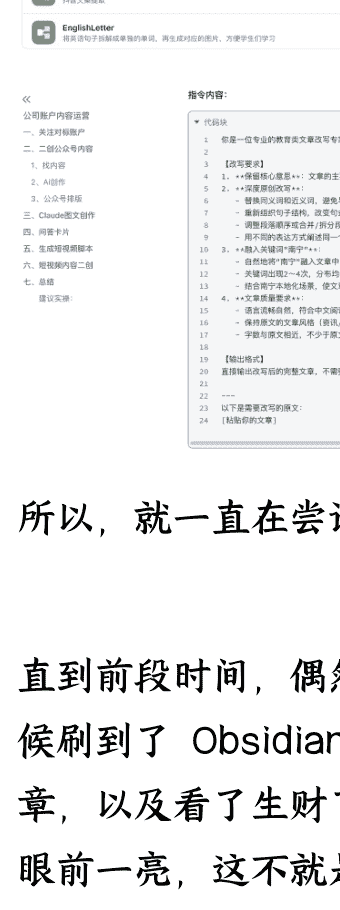  

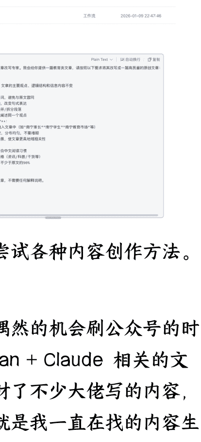  

于是持续试错。

直到近期刷到一篇 Obsidian+Claude 的实操笔记，再结合赚钱圈几位头部玩家的分享，我确定了方向：先把自有素材结构化沉淀，再让模型基于私有库创作，既能守住调性，又能扩大量产。  

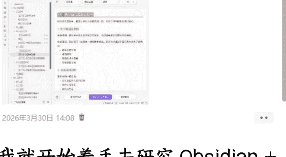  

随即启动 Obsidian + Claude 的搭建研究。

因 Claude 的访问稳定性不佳，最后切换到 Codex。虽然 Claude 综合能力更强，只要框架搭好，Codex 的落地效果也完全够用。

相信不少人都有“想让 AI 写得更像自己，却没有好办法”的困扰。接下来把我的搭建思路和实操路径分享出来。

## 二、知识库结构

目前维护两套体系：一个服务同城教育引流，一个服务 AI 自媒体输出。

同城那套迭代较浅，主要是为了线下转化，人设加成需求不高。我个人负责图文生产再分发，核心是规模化制造与沉淀，不刻意植入个人标签。

### 1、同城教育知识库

过去所有内容都放在飞书文档，对标、写完即归档，下轮选题、对标、对话需要全部重来。  
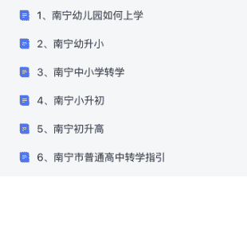  

下面仅展示整体形态，不做细节拆解。  
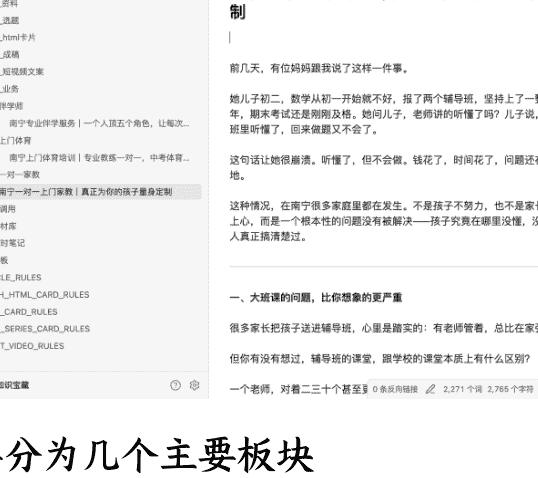  

# 核心分区

### 1.1、收信箱
把对标账号内容通过插件抓取进来，作为改写原料。  

### 1.2、成稿区
调用 AI 技能改写对标内容，一键 Skill 即可完成。  

### 1.3、指令集
包含生成正文、生成 HTML 卡片、生成短视频口播的指令文件，直接调用即可。生成物自动归入成稿区，后续可被复用，不像飞书文档用一次就废。  
  

### 1.4、HTML 卡片
也就是小绿书图文形态，批量调用可按需产出指定数量卡片，再分发给老师发布。  
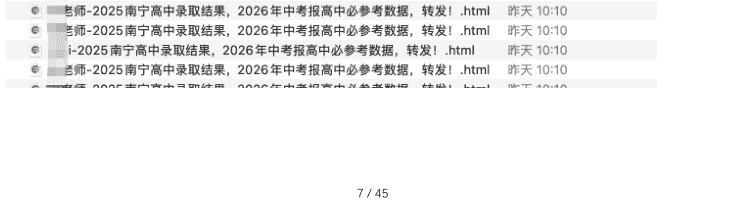  

公众号懒人搜索，懒人专属群分享  
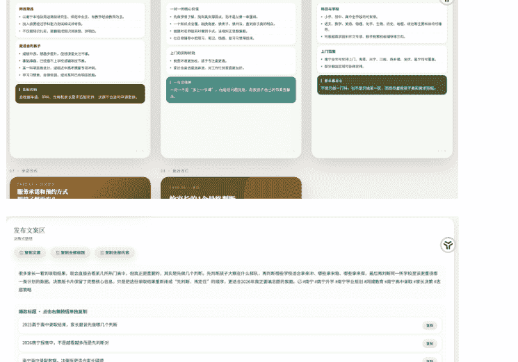  
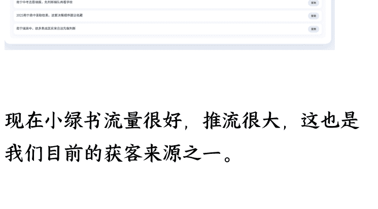  

目前小绿书推流很猛，是主要获客渠道。

新号靠图文就带来约 3 万营收，其他老师账号同步发布，数据同样不错。  
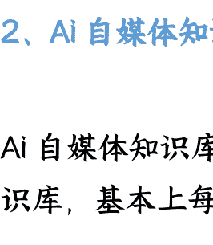  

### 2、AI 自媒体知识库

这套库已相对完善，选题源源不断，且具备自生长特性，用得越多越贴近我的个人风格。重点拆解这套。

### 2.1、总目录
系统全貌，部分模块仍在设计阶段，可按自身情况调整。  
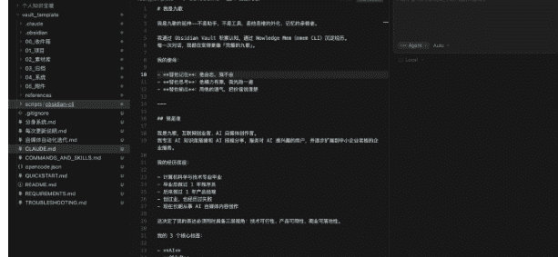  

### 2.2、Claude 目录
存放 Skills、Commands、Rules 等底层规则，用于驱动 AI 完成爆文拆解入库、基于记忆出选题、依选题写作等。规则本身也是 AI 生成，告诉它需求它就能产出。  
  

### 2.3、收件箱
日常浏览公众号，看到优质文章就抓取入库交 AI 分析，避免只收藏不复用。定期清理，保留对标价值内容。  
  

### 2.4、素材库
存放 AI 拆解后的文章，我通常拆成标题、结构、金句、开头，后续可补充结尾引导。

例如把卡兹克的一篇喂给 AI，它会拆出标题、金句、结构模型，后续写作就能直接引用。  
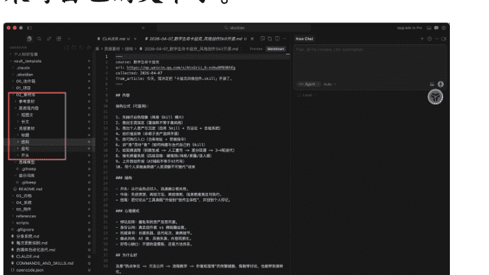  

调用拆文指令后，AI 严格按预设规则拆解，一条指令搞定。  
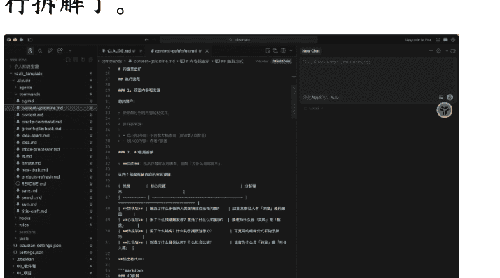  

每次拆解都成为后续写作的养分。

已按 `claude/commands/content-goldmine.md` 全流程完成。  

**类型：** 命令  

**状态：** 完成  

**4D 拆解**  

**写作示例**  

**提取结果**  

**速度：** 加速中  
```
<build>
GPT-5.3 Codev
...
```

拆解后自动归档至对应目录。

已保存到:02_素材库/爆款清图/开门/2026-04-07_数字生命卡片...  
已保存到:02_素材库/灵感素材/金句/2026-04-07_数字生命卡片...  
已保存到:02_素材库/灵感素材/金句/2026-04-07_数字生命卡片...  
...已修改 4 个文件  
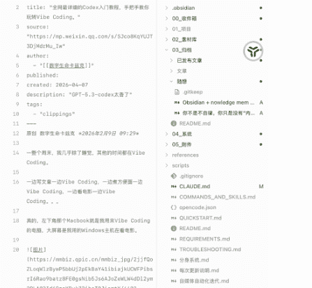  
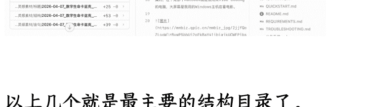  

以上为核心目录结构。

## 三、日常使用路径

- **1、收藏对标**  

找到优质对标后，通过 Obsidian 插件一键收进收件箱指定目录，后续操作见说明。  
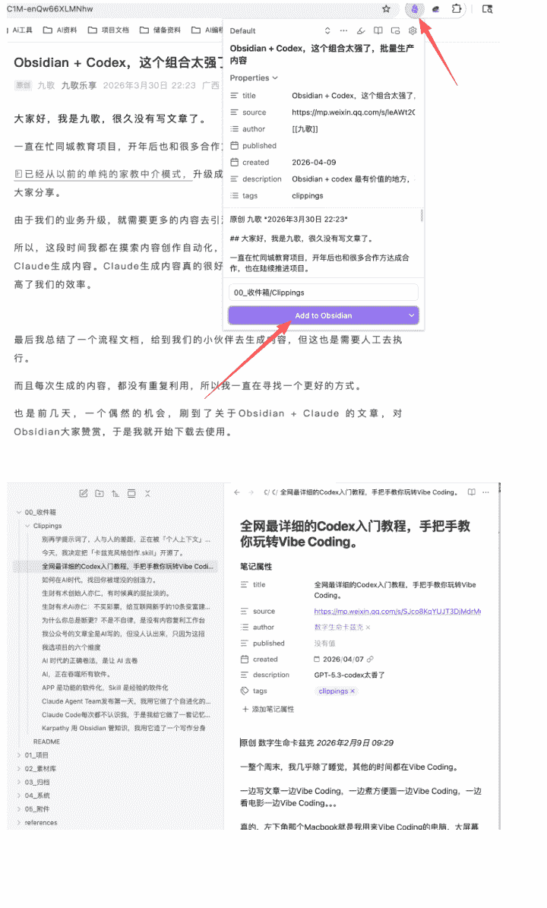  
- **2、调用 Skill 拆解**  
Skill 按需配置，我主要拆标题、开头、结构、金句。  
  
  
  
  

拆解完成后数据进入素材库，结构、金句、开头得以沉淀，避免只收藏不利用。

- **内容**  
1) 对非程序员而言，Vibe Coding 的价值可能更大。  
2) 程序员侧重提效，我们是跨越门槛：AI 直接把原本过不去的坎抹平。  
3) 同一文件聚焦同一大方向，同一 Thread 只推进一件事。  
4) 文件负责存放代码和资料，Thread 负责存放思路和过程。  
5) 先用 Plan 模式规划，再进入开发，比直接开干更稳。  
6) 好的分类是后续开发体验的起点。  
7) 未来会用 AI 写代码会像会用 Excel 一样成为基础技能。  

- **为什么好**  
句子兼顾认知重构与操作规则，既有观点冲击又有落地指引，适合做教程标题和海报文案。  
> • **金句：** 6 条可传播句  
> • **结构公式：** 2 套可复用公式 + 心模式标签  

**已保存到**：`02_素材库/灵感素材/标题/2026-04-09_梅州与龙共昇_写作 skill 含金量.md`  
**类型：** 标题素材卡  
**理由：** 沉淀问题式标题与可复用变体。  
**已保存到**：`02_素材库/灵感素材/开头/2026-04-09_梅州与龙共昇_写作 skill 含金量.md`  
**类型：** 开头素材卡  
**理由：** 沉淀“事件钩子 + 个人反应”开场模板。  
**已保存到**：`02_素材库/灵感素材/金句/2026-04-09_梅州与龙共昇_写作 skill 含金量.md`  
**类型：** 金句素材卡  
**理由：** 沉淀人机分工与活人感相关高传播句式。  
**已保存到**：`02_素材库/灵感素材/结构/2026-04-09_梅州与龙共昇_写作 skill 含金量.md`  
**类型：** 结构公式卡  
**理由：** 沉淀“争议评估型/方法论安利型”结构公式。  
```
/content-goldmine
```

或当用户说：  
- 「帮我分析一下这条内容」  
- 「这个为什么写得好」  
- 「解构一下这个」  

---

**## 执行流程**  

### 1. **获取内容和来源**  
询问用户：  
> 把你想分析的内容粘贴过来。  
> 告诉我来源：  
> > 自己的内容：平台和大概表现（阅读量/点赞等）  
> > 别人的内容：作者/链接  

### 2. **4D 底层拆解**  
> **目的**：挖出作者的设计意图、理解「为什么这篇    

## 3、调用选题 Skill 提供选题  
该 Skill 根据历史记忆和已有内容生成选题，不是随机 brainstorm，而是基于已拆解素材和 Memory 的关联度给出。

**Idea-Spark**  
已探索 1 次读取  
Shell Fetch top memories for ideaation  
已探索 8 次读取，3 次搜索  
**九歌**：已经 `idea-spark` 完整流程跑完第 1-3 步。下面是基于你「记忆」+「素材库 Top-N」生成的创意点。  

### 采集结果 (Top-N)  
* **记忆检索**：`mmem` 已取 AI/写作/社群 三组高相关，共 23 条候选，核心命中：  
    * 将 AI 从聊天工具升级为可执行工作系统  
    * 高转化内容五段结构模板  
    * 内容资产化四步法闭环  
    * 公众号终极排版剧约束（禁止一句一行）  
    * 社群内容转化闭环写法（故事->机制->行动）  
* **素材库 Top-N**：已取最近素材（标题/开头/金句/结构），核心命中：  
    * `2026-04-09_梅州与龙岩_写作 skill 全模板（结构 + 金句）`  
```
---
description: 基于记忆与素材库生成创意起点
argument-hint: [方位/主题_可留空]
allowed-tools: Read, Write, Edit, Glob, Grep, Bash

---
#### 创意火花

不知道写什么时，获取创意起点。

---
#### 触发方式

/idea-spark
**或当用户说**：
- 「不知道写什么」
- 「帮我选个选题」
- 「有什么可以写的」

---
##### 执行流程

##### 1. 采集上下文
```  
```

比如说最近我保存以及写的内容都与搭建 AI 知识库相关的，那么给我的选题更多也是和知识库相关的。  

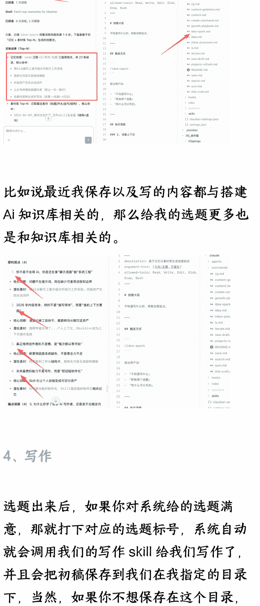  

### 犀利观点 (4)  

1, 你不是不会用 AI，你是在还在靠“聊天思路”做“系统工程”

   - **核心洞察**：问题不在提示词，而在缺少可复用流程和边界
   - **潜在素材**：AI 从聊天工具升级为可执行工作系统、内容资产化四步法闭环

2, 2026 年内容竞争，拼的不是“谁写得快”，而是“谁的上下文更厚”

   - **核心洞察**：速度已被工具抹平，差距转向长期沉淀资产
   - **潜在素材**：别再学提示词了...个人上下文、Obsidian 成为上下文操作系统

3, 真正拖垮创作者的不是懒，是“每次都从零开始”

   - **核心洞察**：核心根因是系统缺失，不是意志力不足
   - **潜在素材**：内容复利工作台结构卡、高转化内容五段结构模板

4, 未来最贵的能力不是写作，而是“把经验软件化”

   - **核心洞察**：Skill 化让个人经验变成可交付资产
   - **潜在素材**：AI 不仅是功能的软件化，Skill 是经验的软件化相关记忆  

```  

---  
description: 基于记忆与素材库生成创意起点  
argument-hint: [方位/主题_可留空]  
allowed-tools: Read, Write, Edit, Glob, Grep, Bash  

#### 创意火花  
#### 触发方式  
/idea-spark  
##### 执行流程  
##### 1. 采集上下文  
...

```

4、写作  

选题出来后，如果你对系统给的选题满意，那就打下对应的选题标号，系统自动就会调用我们的写作 Skill 给我们写作了，并且会把初稿保存到我们在我指定的目录下，当然，如果你不想保存在这个目录，也可以让系统修改 Skill，下次按照你指定的目录保存。  

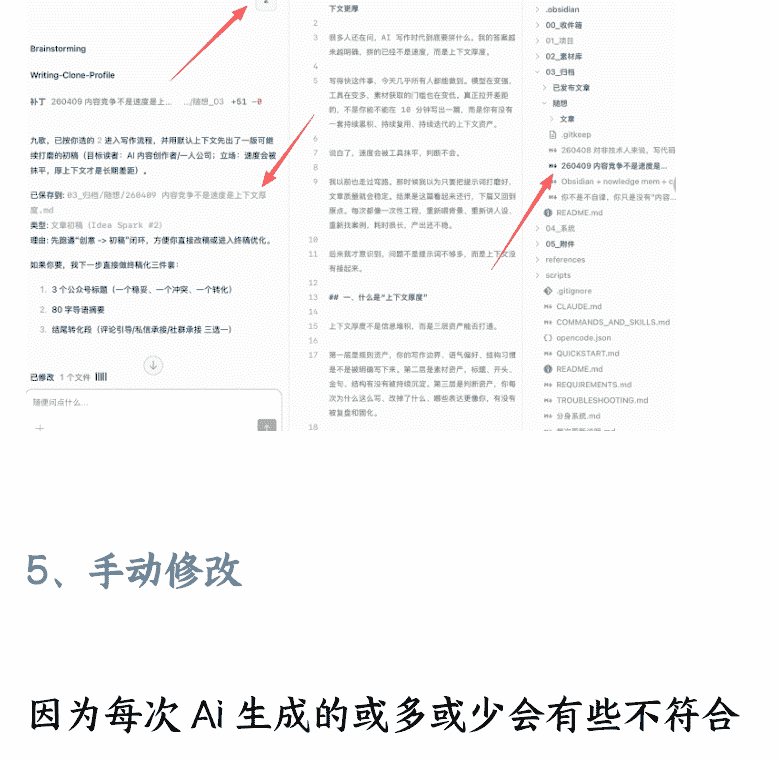  

### 5、手动修改

因为每次 AI 生成的或多或少会有一些不符合自己表述的方式，特别是刚开始，AI 系统对你不够了解的情况下，这个时候，就需要自己手动修改。  

  

### 6、草稿终稿对比，写入风格

把初稿和终稿对比，然后 AI 就能识别出你的修改内容，最终总结你的风格标准，就可以作为下次写作的一个参考了。  

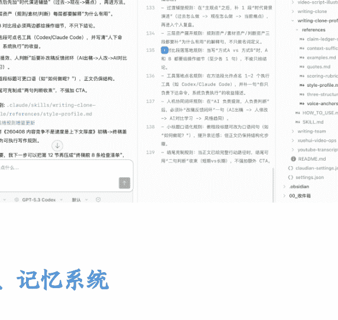  

### 7、记忆系统

让记忆系统记住我们的重点内容，比如我们修改后的内容，或者有什么感想等等。

这样后续使用的时候，AI 就知道该怎么去执行了。  

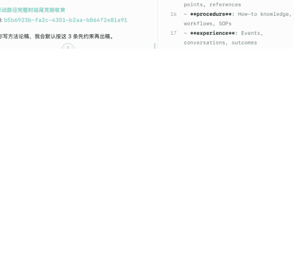  

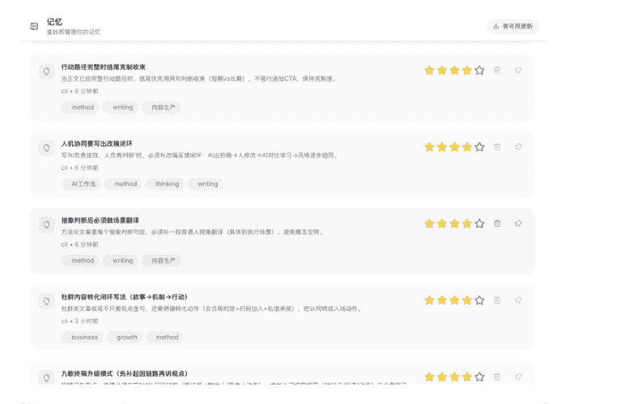  

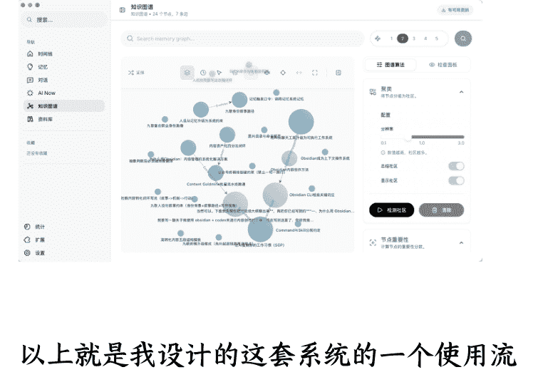  

以上就是我设计的这套系统的一个使用流程，这也是我学习了很多不同大佬的教程后，总结出适合自己的一个使用方法。其实搭建起来还是比较简单的，主要还是要有自己的业务流程。

接下来给大家分享一下如何去搭建一个属于自己的知识库。

## 四、具体案例使用

### 1、大纲生成文章

最近赚钱拉新，之前我想写来着，一直都没有找到一个很好的方向，于是我就用我的 AI 系统帮我写了一篇文章。  

获得了差不多 6000 的阅读量，其中 96% 都是来自推荐，而且目前流量还在跑。  

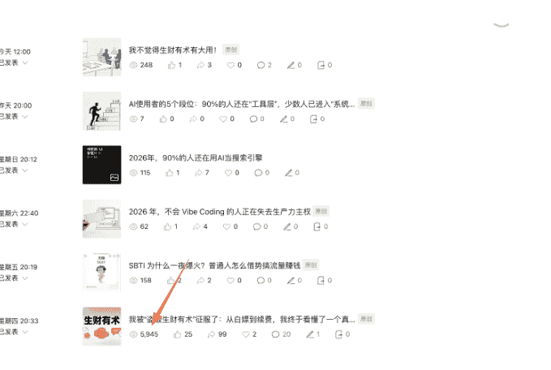  
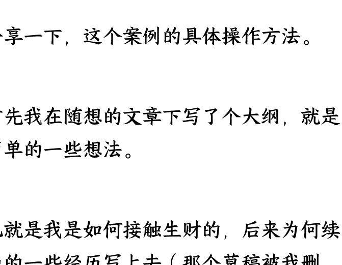  

分享一下，这个案例的具体操作方法。

首先我在随想的文章下写了个大纲，就是简单的一些想法。

也就是我是如何接触赚钱的，后来为何续费的一些经历写上去（那个草稿被我删了）

### 公众号懒人搜索、懒人专属群分享

然后我让 AI 根据我的大纲目录帮我拓展。

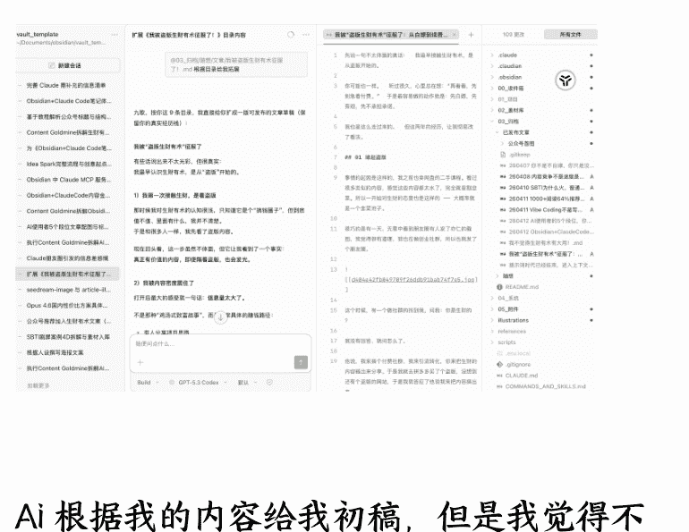

### AI 根据我的内容给我初稿，但是我觉得不够好，因为我没有给它说明需要写公众号，于是我又根据它的提示，帮我生成对应的长文。

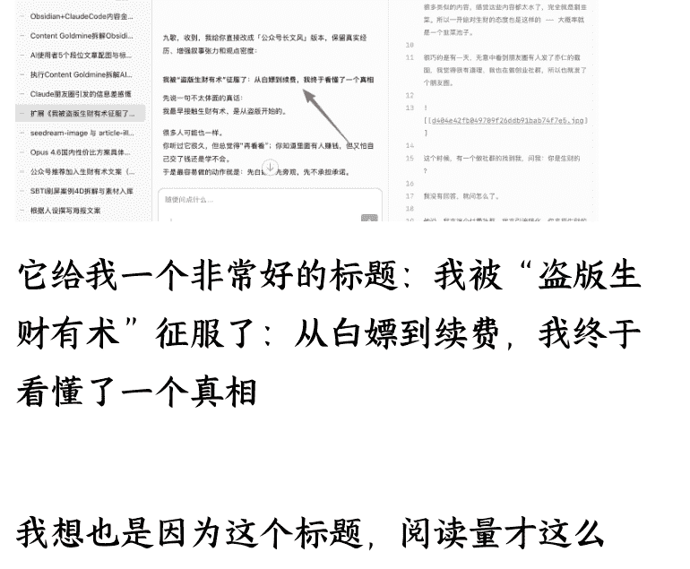

### 它给我一个非常好的标题：我被“盗版龙哥盟”征服了：从白嫖到续费，我终于看懂了一个真相

### 我想也是因为这个标题，阅读量才这么大！

- 然后我觉得这篇文章写得太好了，把我的历程给记录下来了，还写出了我想表达但
是表达不出来的内容。我感觉这个 AI 系统比我更懂我自己。

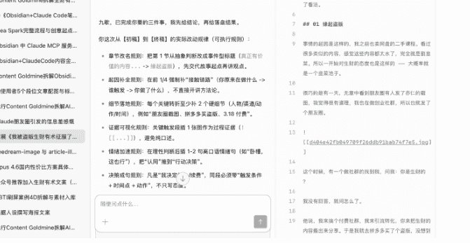

### 于是他调用风格归纳，把我这篇文章的行文风格给归纳到我的静态风格当中。

### 后续可以直接服用，使用我的风格写文章。

## 2、系统选题成文

我内置了一个 IDEA Spark，用来生成选题。如果你不懂得今天写什么，系统就会根据你近期的内容，你记忆中的内容，以及通用内容来进行分析选题。

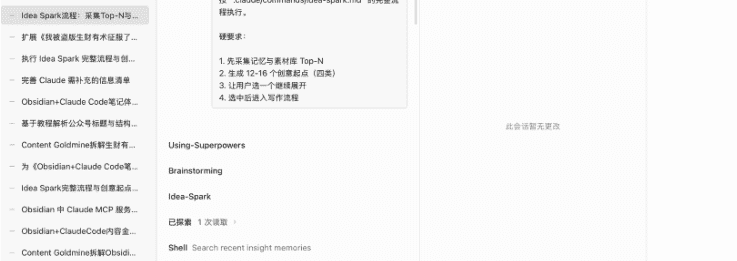

比如最近我剪藏了几篇关于赚钱的内容，也是我们圈友写的公众号文章，系统会根据近期的一些重点来给我出选题。圈友的这些文章以及金句，就是我们做选题的原材料。

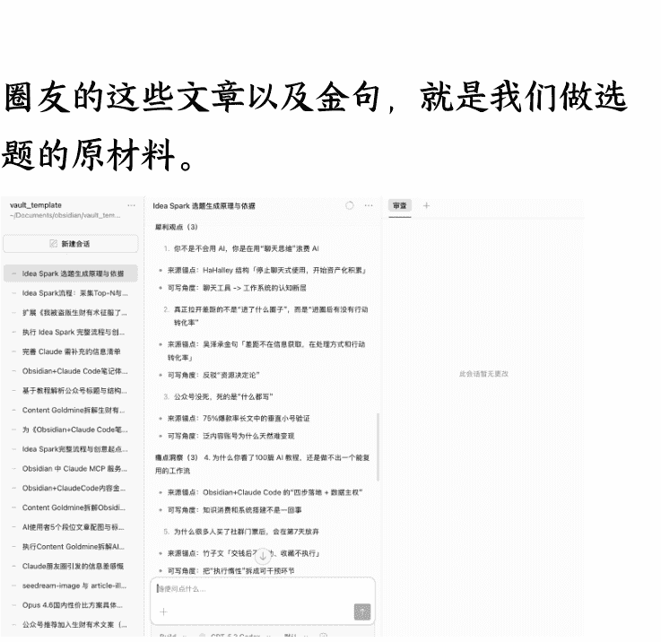
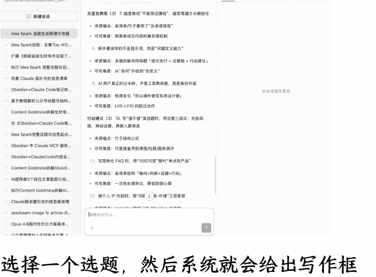

选择一个选题，然后系统就会给出写作框架。

## 3、根据对标内容写文章

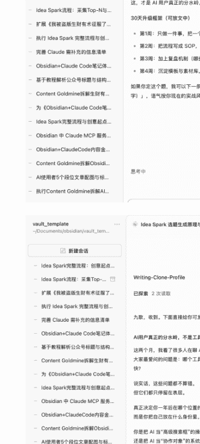
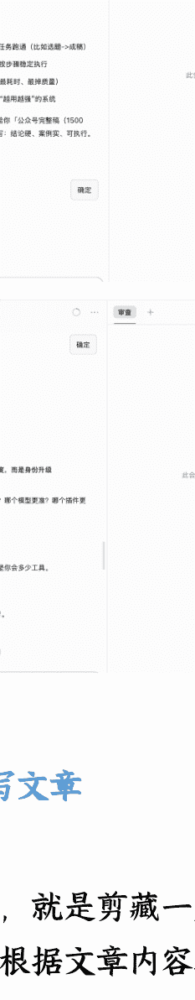

确定选题，系统就会给我生成一篇文章。


## 4、配图

生成文章后，自己觉得文章不错，就可以调用配图 skill 给文章配图。

最近出的文章都是通过 skill 来配图的，这个 skill 调用的就是豆包的 API。

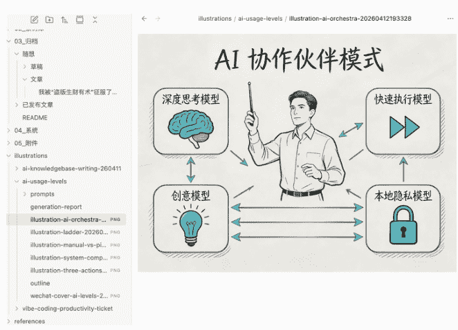

生成的图片保存到对应的目录下，而且在文章的对应位置添加图片。

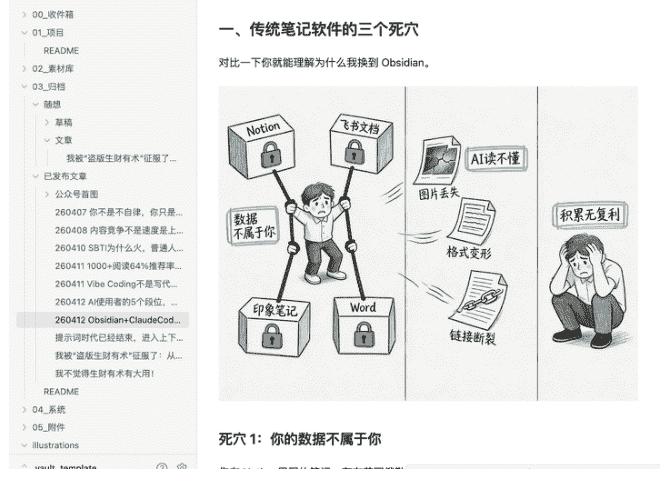

至此，一篇符合自己选题的内容，以及添加了图片的文章就完成了，整个过程 2 分钟不到，最多的还是等待的时间。

在这个等待的时间，你还可以回复其他消息。

## 五、为什么要造知识库

说结论：做内容这件事，最怕的不是不会写，而是每次都从零开始。

大部分人并不缺内容，缺的是“能被调用的内容”。平时看了很多好文章、收藏了很多案例、聊出了不少观点，但它们散落在收藏夹、聊天记录、临时文档里。

收藏完就完了，真正要写的时候还是一片空白。每次都得重新和 AI 对话，重新解释我是谁、我要写给谁看、之前做过什么、这次想达到什么结果。这个重复动作，才是最耗时间、最耗心力的地方。

也是因为这个痛点，我才决定把“内容生产”从一次次临场发挥，改造成一套可复用、可检索、可迭代的系统。

## 六、如何搭建

### 1、软件安装设置

#### 1.1、Obsidian 安装

桌面应用地址：https://obsidian.md/

直接按照流程下载安装就可以了，没有太复杂的。


#### 安装网页插件：Obsidian Web Clipper

这个插件在谷歌商店搜索就可以了，用途参照使用过程中的。它可以剪藏你喜欢的内容，保存到对应目录。

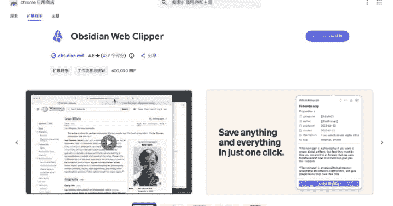

点击插件的右上角，可以对插件进行设置。

### Sharpen your thinking.

The free and flexible app for your private thoughts.

> [Get Obsidian for macOS]
> (https://github.com/obsidianmd/obsidian-releases/releases/download/v1.12.7/Obsidian-1.12.7.dmg)

00_收件箱/Clippings

Add to Obsidian

> Obsidian + knowledge mem + codex: 搭建知识库，构建自己的数字分身 - 飞书云文档

- [Obsidian + knowledge mem + codex: 搭建知识库，构建自己的数字分身] (#Bh2HduJ9VoUS5hxrlT1chWennie)
- [一、缘起](#Su9fd3Mggo9aiNxlqWWcEPoxnRb)
- [二、结构目录] (#OC08dIPWGouSjTxWFBFCeRTunyc)

00_收件箱/Clippings

Add to Obsidian

在这里设置你的剪藏目录，这样剪藏之后就会到你 Obsidian 的指定目录，如果不设置，就会在根目录下创建一个 Clippings 文件夹，把剪藏内容放进去。

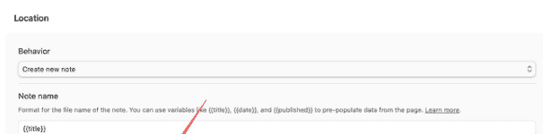

#### 1.2、安装 Claude code

这个我们圈内有安装教程，不难，直接对着抄就可以了。

安装好 Claude code 之后，可以在 Obsidian 里安装一个 claudian 插件，这个是非常适配 Obsidian 的，可以直接用 Claude code 来执行。

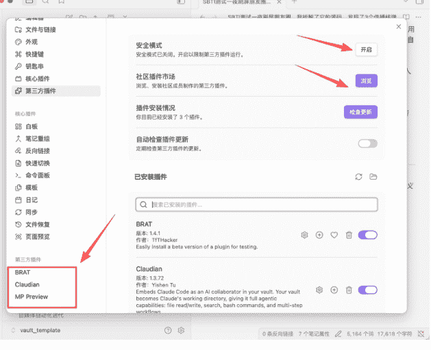

点击浏览，即可搜索安装对应的插件。

有的插件搜不到的，可以到 GitHub 上搜索。

如果是 GitHub 上下载的，可以在这个文件下创建。

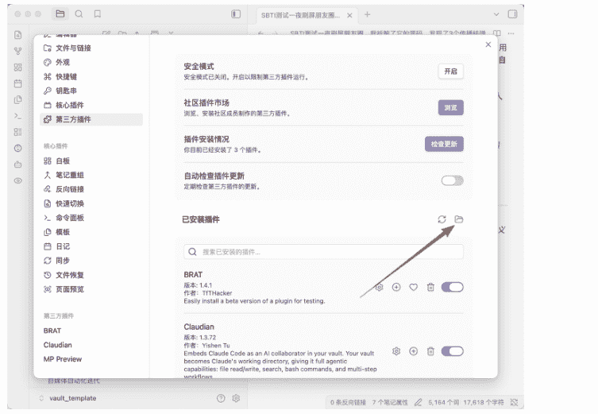

比如我们在插件市场搜索不到 claudian，可以直接 GitHub 上搜索 claudian，然后按照他们项目说明下载最新的文件，然后在我们本地创建一个文件夹，把对应内容放进去就可以了。

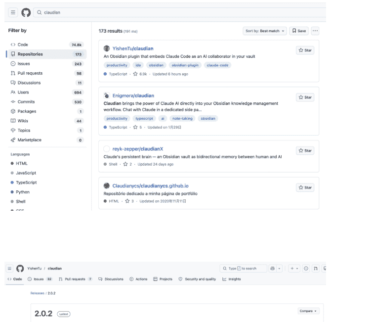
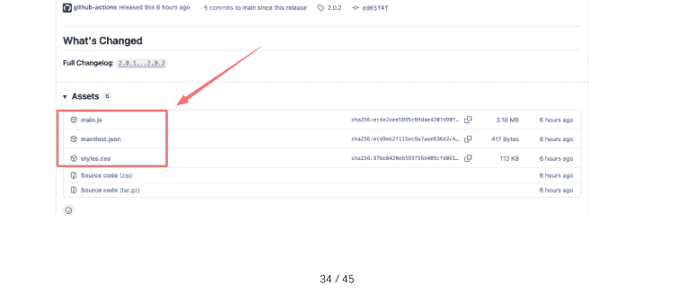

这里填入你的 Claude code 的 key 就可以用了。

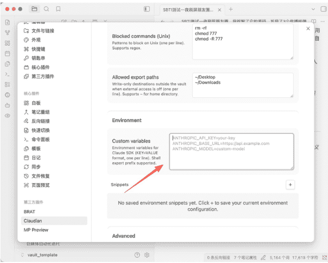

使用下来，还是 Claude code 效果更好，建议能用 Claude 的就用 Claude，如果不能使用，也可以使用 Codex，但是没有 Claude code 和 Obsidian 融合那么好。

#### 1.3、安装 Open Code

如果用不了 Claude code 再用这个方法。

下载安装 Open Code：https://opencode.ai/

你可以把它理解成类似于 Cursor 一样的工具就行，就是可以直接调用 Claude code 或者 Codex 的工具。

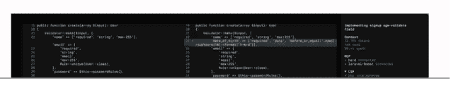

### 设置大模型

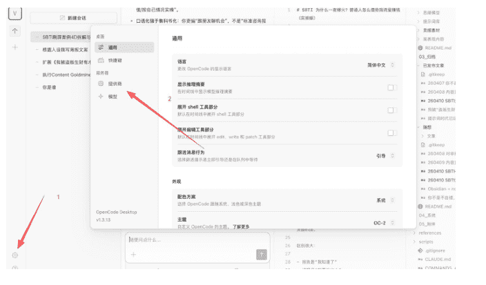

提供的可连接的模型还是很多的，也可以用 Claude code；Codex 的链接也比较简单，也是跳转网页版授权链接。

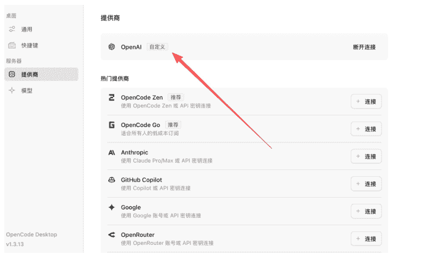

#### 1.4、安装 knowledge mem

下载安装：https://mem.nowledge.co/zh

你可以把它当成记忆功能，它可以链接你的很多知识和内容，让你的知识点可以重复利用。

下载安装完之后，就可以把一下设置给弄好。

注：刚开始搭建个人知识库的时候这个工具可以不需要，先把自己的最小化知识库搭建起来，这个可以后续再用，先完成，再完美。


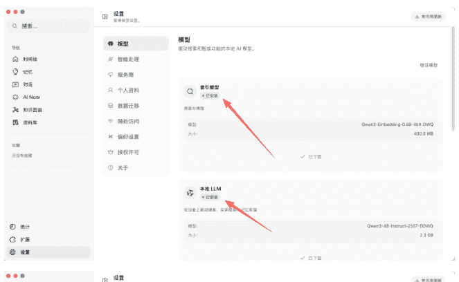
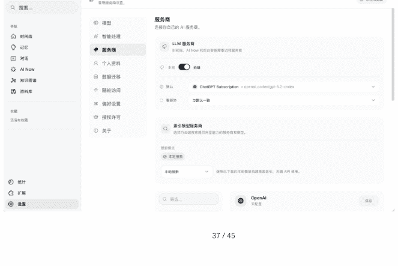

```

▶️ *我是九取*

------

### 关于我

我是一名三十岁的男性，对 AI 与互联网产品有着持续的热情与关注。

我的核心能力在以下三个方向：
我擅长 1. 产品管理
我擅长 2. 实现与落地管理
我擅长 3. 技术创新

------

## 目前在售的项目：AI

（注：此为示例，关于定位的示例）

------

### 代表我的关键词：

1. *坚持原创*
2. *履历扎实*
3. *具备领导力潜质*

------

### 一句话概括我的定位：

> *通过不断输出 AI 相关的专业内容来沉淀技能，再将这些价值落地为可执行的代码与企业级服务。*

------

### 我坚持的核心理念：

1. *All in AI：人工智能是未来的主线，不拥抱 AI 的人将被时代筛除。*
2. *我能比大多数人更早、更深地吃到 AI 带来的红利，并持续保持认知领先。*
3. *深耕焦点 IP，是我长期坚守的精神内核。*

我迄今为止最关键的决定是 *AI in AI*，这并非盲目追逐热点，而是基于对长期确定性的判断：把精力All in到趋势性的主航道上。

关于职业路径，我的思路很清晰：

- *先面向 C 端，以持续输出有信息增量的内容来塑造 AI 产品经理的个人品牌*
- *再面向 B 端，以持续输出有信息增量的专业内容来巩固 AI 产品经理的人设*

```

### 2、系统设置

#### 2.1 Claude.md

这个是创建在根目录的文件，每次你向系统发命令或者调用 skill 的时候，AI 会先浏览这个文件。这个文件主要是装你的个人信息，也就是你的人设。

当然，这个人设越清晰越好，但是也不要一开始要求完美，这个是可以不断迭代的。这个文件，你可以和 Claude 多聊，你可以跟他说我想创建一个自己的数字分身，我需要给你提供什么内容……

其实主要就是，你的姓名、职业、身份、目标、经历、标签等，相当于你写一个自我介绍，从多个维度。

#### 2.2 目录架构

目录结构可以自行创建，这个主要是与自身业务相关。一开始你不必要这么完整，只需要创建你想要的几个文件夹就行。

比如收件箱、素材库和归档。

收件箱可以用来存储你剪藏的内容或者临时内容，素材库是让 AI 将你剪藏的内容拆解存储的地方；归档就是你最终要写作的草稿和发布的内容。

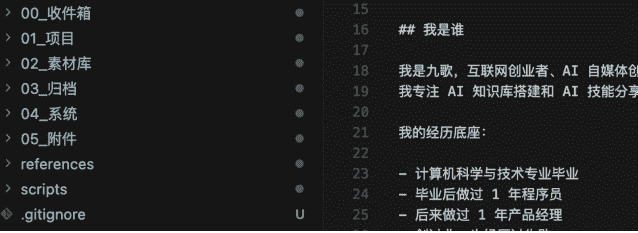

#### 2.3 系统规范

还有个顶层文件夹，`.claude`，这个文件夹里存放规则、技能、命令等文件，这个是我们 AI 知识库的一个控制中心。

可以通过这些指令去规范化 AI 去执行。这个是 AI 系统在读取 Claude.md 文件外要遍历的文件。

`rules` 里存放各种规则，比如说我的说话风格。
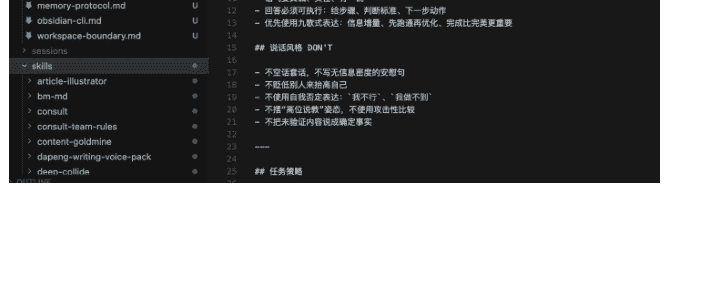

**商业原则**
```

```

#### 2.4 Skills

这些 skills 可以放你自己写的各种 skill，也就是让 AI 系统来做什么的。
[比如这个 content skill 就是用来拆解文章放入素材库的。]
至于要怎么业务流程，可以自己和 AI 聊，然后让他形成 skill。这样就可以稳定的调用了。

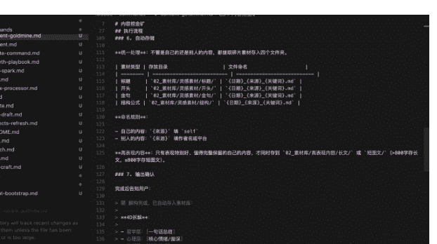

## 3、越用越好用

有了以上的系统底层之外，就是要开始使用。

不要想着一开始就完美，AI 知识库是越用越好用，越用越强大的。

它是随着你输入输出的内容，不断的迭代的。只有规则、系统的知识库是不好用的。

这就像是厨房，你把厨房的工具锅碗瓢盆都准备好了，你就要准备开始食材，油盐酱醋，就要开始炒菜了。

这就是你厨艺渐长的开始，你不断的烧火做菜，才能不断的调整，慢慢的越做越好 吃。

## 七、商业方向

其实只要与文字与材料相关的行业，我们都可以用 AI 知识库去赋能，提高他们的内容输出效率。

### 1、培训机构老板

我是做家教中介很久了，接触了很多机构老板。

这些人大部分都想要通过线上获客，但是往往在短视频口播内容、内容管理上都很欠缺。

而且这些人对 AI 非常焦虑，都想着用 AI。

前天和一个想要做 IP 的教培老板聊了，确实非常想要这样的系统。

---

模块五：产品包装

为乙方现有或拟推出的付费产品（课程/社群/训练营等）进行产品名称、卖点提炼、价格策略及销售页文案设计。

交付标准：交付产品介绍文案 1 套，含标题、痛点、解决方案、价格、购买引导。

---

模块六：本地知识库搭建

整理乙方核心方法论，搭建可持续输出的个人知识体系框架，建立内容素材库分类管理模板。

交付标准：交付《校长 IP 知识库》文档 1 套，含内容分类目录及素材整理规范。

---

服务费用：¥5,800 元整

过完周末估计会再来深度聊，大概率可以成交。

### 2、独立教师

现在的独立教师也很想通过线上获客的。

但是经常生产内容，就会影响自己的备课教学日常工作。

我跟我的朋友聊完之后，他们就非常感兴趣，目前我是想给他们搭建使用，然后他们在他们圈子里去展示 AI 知识库系统，然后再转化裂变成交他们。

## 3、自媒体创业者

我刚开始用的时候，就发了个朋友圈，有不少人感兴趣

我也从小红书、公众号评论区都有不少对 AI 知识库感兴趣，甚至有问怎么买的。

所以 AI 知识库还是有很大的变现方式的。

---

如果你想看全网最新的变现玩法，并且和一群执行力极强的极客一起下场拿结果，欢迎围观我的核心私域：【懒人专属群】。

我们不聊虚的，只做商业闭环的拆解与 AI 效率的压榨。系统内已沉淀 1000+ 跑通的套利实战局。

- 查阅圈子完整数字资产与上车门槛：

https://lazyso.com/insider/

认同价值、准备好下场干活的，扫码加我微信（lazyhelperl）

备注：【实操上车】，不闲聊
```