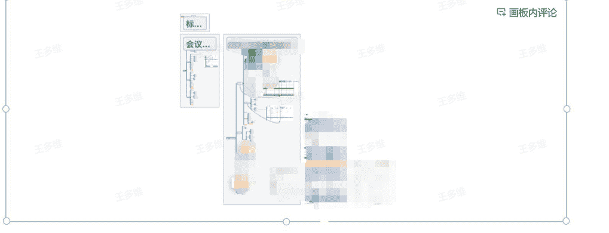
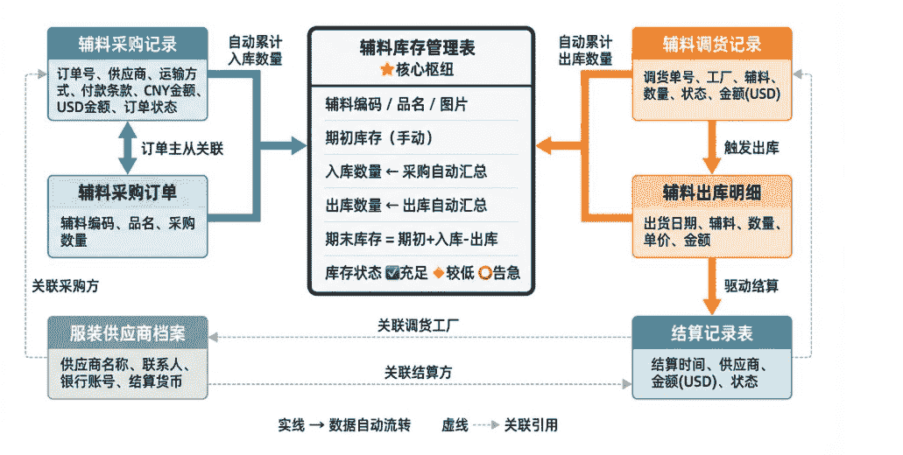
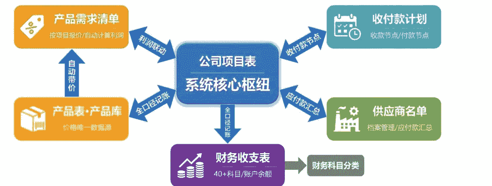

# 11万粉账号转身做企业数智化，30天内拿到10万+订单的复盘

大家好，我是多维，赚钱四年级学员，📕虚拟赛道的陪跑者。

白天在国企做系统相关工作，晚上运营一个11万粉的📕账号。往年副业集中在平台运营和虚拟资料售卖。今年我新增了多维表格系统搭建业务，并在龙哥发布的「企业AI学习与服务」超级标的启发下，补齐增值项，正式进入小微企业数智化转型服务领域。最近的一个月里，已完成10万元以上的服务签约，同时还有一笔10万+的长期合作在谈。转型算是站稳了。

今日分享一次从0经验到30天内累计拿到10万+交付的经历，拆成四个维度：如何找准切口、如何低成本启动、如何构建增值项、如何重构商业模式。

## 一、在AI热潮里，找到自己能落地的细分

年初市场全在讨论Agent、龙虾、各类AI应用。朋友圈和短视频里充斥着“AI月入五位数”“AI编程速成”“AI绘画接单”等说法。

我也曾心动，花了两周时间研究技术，甚至自费购课。研究后判断清晰，这些热门赛道不适合我。编程、绘画方向，我没有场景需求，也缺乏技术沉淀，变现周期长、天花板有限，于是放弃追风口。

### 从既有资源里选切口

我梳理了自身可用的资源：

1. 主业接触软件系统，对企业内部流程熟悉；
2. 多年做职场效率内容，对内容生产和产品设计有积累；
3. 重度使用者身份，对飞书及多维表格生态有深度认知；
4. 粉丝池里已有大量线上创业者和小团队负责人，主动咨询如何用表格管理项目和业务。

这些线索叠加后，方向变得明确：不追热点，而是做一个极窄的切口——

为小微企业和小型团队定制基于飞书多维表格的管理系统。

### 为什么这个切口可行

其一，需求真实且高频。无论是三人初创团队还是二十人工作室，都需要项目管理、客户管理、内容排期。以往依赖Excel，数据汇总要等助理整理数日。通过表格把客户、人员、业务串联成可视化看板，能直接解决老板看不清、管不住、缺乏数据的问题。

其二，数字化是智能化的前置环节。最初我也想先做AI周边喝点汤，但看过龙哥的超级标后认识到，真正的刚需在于企业流程梳理与数据沉淀。企业做智能化转型，必须先完成数字化，不能脱离数字化谈智能化。老板被AI倒逼着重审工作流，这本身就是一个必经步骤。

其三，人设匹配。长期输出效率工具搭建方法，本就吸引来带着问题的人。私信里来的大都已是小团队决策者，需求明确，几乎不需要额外说服。

其四，技术门槛友好。市场上有大量人投入开发、大模型算法，而企业落地的需求是稳定、即时。飞书多维表格在流程梳理、搭建部署上的门槛适中，既能筛掉纯新手，也不用投入大量时间在技术迭代上。

## 二、低成本启动，用交付建立信任

方向明确后，如何获客、成交、交付？我沿用了以往的打法：小步试错、快速迭代、暴力开局。

### 产出高流量内容

我把之前的职场晋升、副业思维类内容，改为“飞书+AI工作流”“多维表格语音录入”等实操型视频，并同步到抖音。很快在📕和抖音出现多条几十万播放内容，抖音从零涨到1200粉。主页标注为飞书多维表格搭建师，咨询量上升。为方便对接，上线了1元免费咨询商品。

其中一条AI工作流笔记，📕45万播放，抖音25万，合计70万播放。

流量来了，但转化不顺。报价、谈单、需求挖掘、服务边界、咨询不付费、交付后风险，全部没有答案。浪费了不少曝光。后来我明白，不能等所有答案齐全再出发，答案会在解决问题的过程中自然形成。

### 先接低价单跑通链路

我从后台挑了一个需求描述清晰、明确要求代建的客户，主动约腾讯会议详细梳理。沟通中发现，不要被客户牵着走。客户最初要求把Excel原样复现到表格里，实际痛点是流程混乱需要结构化。重新拆解后，客户信任感提升。报价时把交付范围、售后、价格说清楚，首单顺利拿下。

用两天完成首个模板，反复校对需求并增加自动化同步、自动增添数据的设计，超出预期，客户满意，我也获得信心。

这单沉淀了三个心得：

谈单并非先讲方案，而是先确认对方是否有意愿。缺乏诚意的客户，任何方案都是无效投入。

老板的痛点不在表格技术，而在管理困局。信息流转、权限分配的难题被点出来，比展示功能更有说服力。

报价不仅是数字，更是价值的具象化。用“关联表数量+业务梳理+深度沟通次数+后续优化”这类具体项来说明，价格才有依据。

跑通数单后，瓶颈出现：内容、自谈、设计、自交付并行，一个月完成不了几单。时间成为最大约束。

### 组建团队放大产能

项目周期约7-14天，我最多并行2-3个。后台常有近10个待沟通客户，手头还有交付中项目，明显卡在带宽上。

当时有两个选择：涨价做精品个人工作室，或组建团队扩大产能。我选了后者。现在正是跑马圈地阶段，不快速占位，先发优势会流失。

组队思路是最小成本撬动最大产出。不直接招全职，而是拆解交付链路为：商务沟通、系统搭建、培训。自己保留商务沟通关键环节，搭建与培训外放。若能找到互补的合伙人更好。

### 形成SOP后进入爆发期

团队运转后首月签约量明显提升，涉及电商、保险、留学、知识付费等多行业。最近一个月咨询量约30人，日均对接需求。

这个体量是此前的数倍，没有团队根本承接不了。随之我们把经验固化为流程：

意向收集：从📕/抖音进私域后，先填写信息采集表，说明规模与业务场景做初筛。

免费诊断会议：预约腾讯会议，现场梳理需求、评估难度，会议免费，用来确认意向并过滤无效咨询。

成交流程：破冰、需求深挖、方案呈现、确认价格。报价提供两种形式：详细方案+报价，或一口价，并不断优化报价单与方案框架。

服务模块包括：需求分析、表格搭建、看板搭建、权限与素材流转、自动化设计、数据关联、全流程测试优化、售后培训。优先选用飞书优惠方案控制成本，交付周期约14天。

## 多维表系统结构图

为了让客户感知能力，我们把过往项目整理成案例，呈现需求分析与设计逻辑。客户能看出并非纸上谈话。

## 辅料采购管理系统 · 数据流与逻辑关系

## 系统数据流与逻辑关系关图

报价→合同→收款→付款→财务 全链路贯通

案例清单包括：AI智能化部署案例·汽车软件研发企业、外贸企业数字化管理系统、装修设计公司数字化管理系统、执法单位考勤管理系统、服装品牌辅料采购管理系统。

交付阶段坚持需求确认、方案提交、功能落地、部署培训四步，不达标不付尾款，符合B端交易习惯。

售后除承诺微调与bug修复，还做定期回访。部分客户满意后会追加其他业务模块。

## 三、构建增值项，拿下10万+长期意向

SOP与团队就位后，接单交付不再是问题。新瓶颈是客户只认“做一张表”的成本，客单价难以提升，看不到信息与数据混乱的本质。因此明确两项增值服务。

### 增值一：调研诊断与流程优化

客户要表格只是表象，深层是管理混乱。我们把调研与流程优化策略纳入服务，从技术执行者升级为懂技术又懂业务的顾问。客户一旦意识到问题核心是管理思路，就会为整体方案买单。

### 增值二：AI智能体搭建与流程自动化

龙哥的超级标提到知识库、工作流、智能体的需求旺盛。小微企业在数字化与智能化转型的意愿与落地效率反而高于大企业。

平台+服务模式更接近企业服务公司做法，通常提供课程库、场景模板、知识库、工作流、Agent模板、后台工具、顾问服务。收入结构不再单一，长期价值更高。

普通人切入企业服务的现实路径有五类：企业AI培训、行业AI顾问、AI工作流搭建、企业知识库与内部助手、AI工具选型与集成。AI时代智能化转型的基础是数字化，飞书多维表格是数据引擎，智能体是智能化引擎。因此我们在表格设计基础上，聚焦多智能体协作、Skill开发、企业知识库搭建。

这让交付物从“一张表”变为“能自主运转的系统”。定位从工具服务商升级为数智化转型服务商，成功签下一家传统企业的全面转型项目，预期合同六位数，覆盖会议、人力、业务、财务等板块。客户感知价值不同，预算自然打开。

## 四、重构商业模式，让利润可复制

测试跑通、客单提升后，我意识到规模仍不足。全国中小企业超6000万家，哪怕覆盖1%也有60万家。单纯定制模式一年服务上限约百家。

行业正处圈地期，主要矛盾不是利润分配，而是能分利润的合作伙伴太少。为此我重设计商业模式：做大蛋糕，与他人共享收益。

梳理全链路为五环节：前端流量、客户签约、策略制定、落地实施、售后服务。前端与签约短期仍由核心团队负责；策略制定需培养接班人；落地与售后可脱离核心运转，但需人手。

于是设计客户成交后的策略师与搭建师流转标准，明确对外对接与交付规范，形成稳定SOP，支撑团队扩张与模式复制。

### 搭建培训闭环：B端服务+C端培养

为扩充搭建师人才，并满足粉丝学习需求，我整理出《多维表格搭建课程》，后升级为《多维表格提效与商业变现训练营》，加入系统设计与产品设计内容。

闭环形成：B端为企业提供数智化服务，收费数千到数万；C端培训学员，收费数百到数千；优秀C端学员可进入B端项目担任搭建师，赚回学费并成为长期合作伙伴。

这就是完整的转型逻辑：从热潮中筛选出能握住的手术刀，用最低成本跑通首单，再以团队与增值服务放大，最后通过商业模式重构让利润可复制。

如果你正处瓶颈，建议先审视手里已有的资源。那把手术刀，可能就在你现有的工具箱里。

很多人问我，为什么团队明明存在，业务却依然接不过来？其实带人成长这件事，没法一蹴而就，而短平快的需求又总是源源不断。面对那些五花八门的项目，我们也有力不从心的时候：有的行业我们压根不熟，硬啃只怕辜负期待；有的单子金额太小，投入产出完全不成比例；反过来，遇上大体量的需求，我们又暂时吞不下；还有些客户，预算明明很紧，需求却千真万确——你让我怎么忍心回绝？

过去我的做法很简单：接得下的就接，接不下的就礼貌拒绝。但后来我反过来想，拒绝的不只是一个项目，而是那个愿意相信我、把诉求交到我手上的人。信任这个东西，本身就是最值钱的资产。

后来陆续有同行团队主动找我谈合作。起初我心里是抗拒的，但转念一想：这市场足够大，同行未必是冤家，没准儿还能变成并肩作战的伙伴。于是，我收起戒心，大方地对接各种合作。我们约法三章：

第一，优势互补、资源互补、经验互补，谁擅长什么，就去打哪块仗；
第二，项目质量互相把关，谁都不能砸了彼此的招牌；
第三，白纸黑字签合同，利益分配清清楚楚。

就这么跑起来之后，我的业务开始流动，我也越来越清楚自己真正擅长的是哪一块。更意外的是，我的C端培训业务竟然变成了人才输送口——给合作团队送去合格的搭建师。这大概就是我作为知识博主最独特的优势。

就这样，我围绕飞书生态做起了中小企业数智化转型的业务，整个过程跑得很顺，现在已经稳定运转一个多月。接下来，我想把蛋糕继续做大，服务更多企业，也欢迎大家持续关注我的后续分享。

——————分割线——————

看到这儿，你可能觉得理论和流程都懂了。但现实是，90%的人一到实操，第一步就卡住。

工具和教程从来都是最不构成门槛的东西，真正拉开差距的，是“立刻动手”的执行力，以及“圈层信息差”的加持。

如果你想第一时间看到市场上最新的变现玩法，又想加入一群执行力拉满的极客，一起下场拿结果，欢迎来到我的核心私域：【懒人专属群】。

这里不谈虚的，只做商业闭环的拆解，以及AI效率的极限压榨。目前圈内已沉淀1000+跑通的套利实战局。

👉 想查阅完整数字资产与上车门槛，点这里：
https://lazyso.com/insider/

如果你认可我的价值观，也准备好真刀真枪干活，就扫码加我🛰️（lazyhelperl）

**备注：**【实操上车】，不闲聊