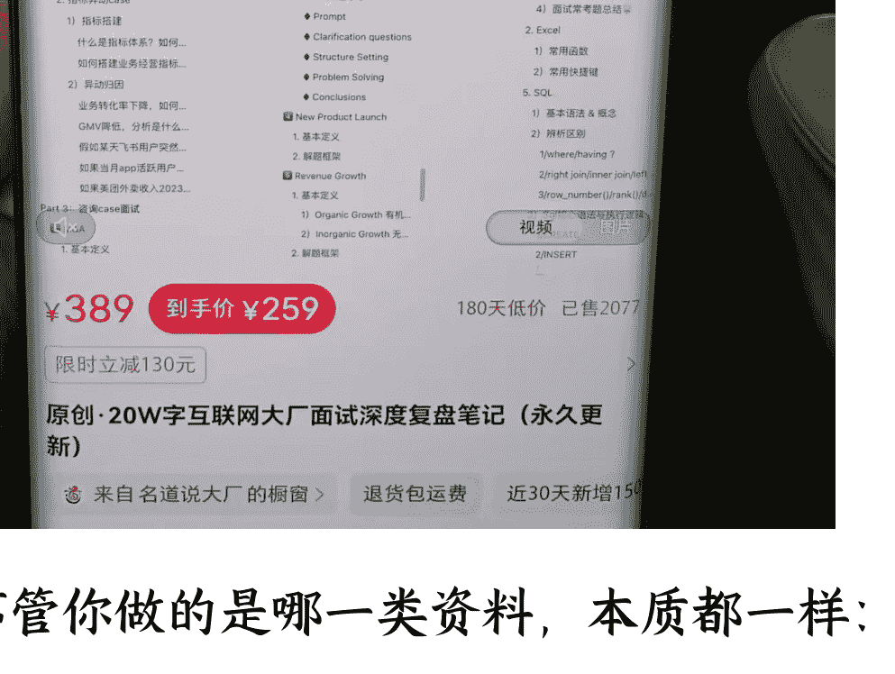
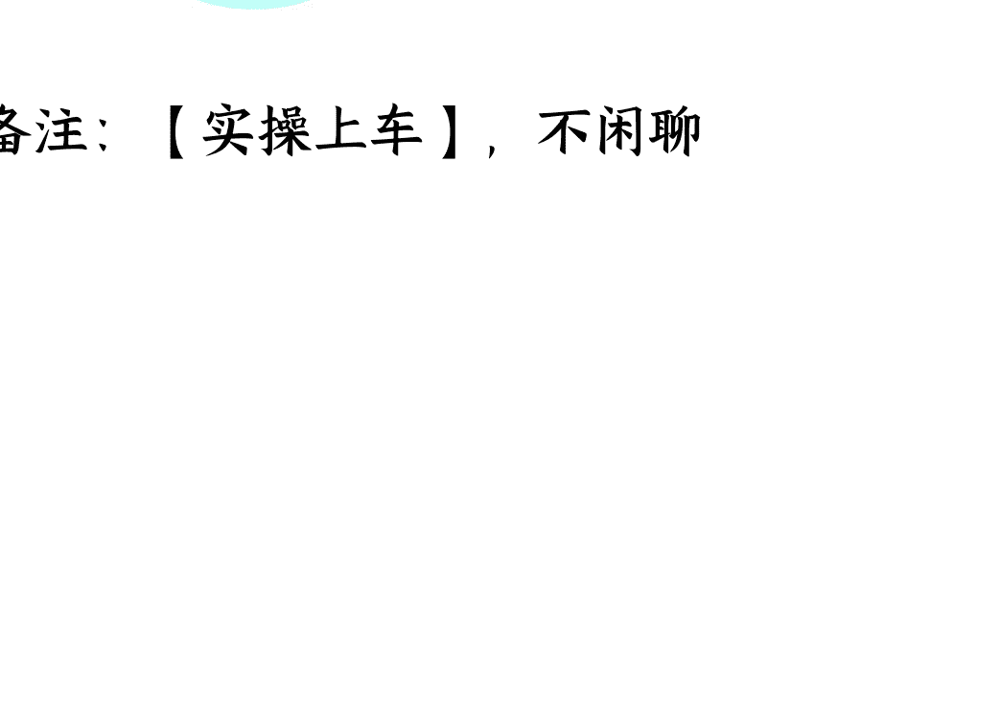

# ('从航海交白卷到稳定月入 2W，我在小红书 PPT 赛道的心得与经验', (4, 37))

嘿，我是舒蓬，以前在线下活动行业摸爬滚打，如今全职扑在小红书虚拟资料这块。今天想跟你分享的不是“一夜暴富”的传奇，而是我实打实走出来的路——从航海“挂零”到月入2W，我做对了什么。

先报个底：目前1个店4个号，不投一分钱广告，全靠自然流量。每月稳定在2W上下，工作日进账600-900，偶尔冲上四位数。我不赌短期爆红，只求一件事：这活儿能不能一直干下去。所以我的玩法是顺着平台的脾气来，不硬碰硬，把它当成一场长期陪跑。

**一、不是天生就会跑的**

说出来你可能不信，我第一次参加航海活动，是颗粒无收的，一分钱没见着。那时候连赛道都挑不出来，对标账号也找不到，整个人跟无头苍蝇似的。后来跟着圈友做教务资料，说实话当时心里是打鼓的，只当练手。拖到8月底9月初，才慢慢见到回头钱，赚了几千块，心里挺美。结果开学季一过，流量断崖式下跌，月收入直接掉到3000，而且一趴就是好几个月。那阵子，放弃的念头天天往外冒。

但后来我想通了一件事：不是这个方向错了，是我压根没用心。今年开始，我把注意力全收回来，一头扎进这个项目里。

**二、运营不是胜负手，内容才是**

我在成都常混线下圈子，也当过航海志愿者，发现一个有趣的现象：大家聚在一起，聊的全是——

一天发几条？
几点发效果最好？
要不要挂车？
该不该搞矩阵？
执照办了没？

但很少有人静下心来问自己：我的内容，真的拿得出手吗？

我就走过弯路。刚开始图省事，从闲鱼、淘宝买现成课件转手卖，结果呢？流量起不来，要么被判重复，要么被原创者投诉下架。那些侵权通知一封接一封，真心打击人。

后来我才彻底明白：

小红书拼的不是信息多少，而是表达方式。
内容占八成，运营技巧只占两成。

**三、转折点：从“填鸭”到“设计”**

真正让我开窍的，是今年开学季。我做了一个改变：不再为了整理而整理课件，而是开始琢磨“设计”。

举个小例子。以前讲历史，就按教材念时间、事件、意义，学生听得昏昏欲睡。后来我换个思路，不讲“结果”，而是问——“如果你穿越回那个朝代，你眼前会看到什么？耳边会听到什么？”

把知识点变成有画面的场景。这一改，学生能代入，老师讲得省力，内容魅力也上来了。我把这套思路搬到笔记里，点击和转化肉眼可见地涨。那一波开学季，我用这个法子做的原创课件，单品卖出了上百单。

那一刻我确定了：不是赛道的问题，是你有没有把内容做到“走心”。

**四、AI加持，我把内容能力放大了N倍**

这块我讲细致点，新手可以直接抄作业。

**第一步：找原始素材，别瞎编**
我一般去淘宝或闲鱼买教材的电子版。核心原则：必须用一手内容，别用别人嚼过的二手货。然后我会把整本书拆开，一节课对应一个文件，这样后面喂给AI时，它不会一头雾水。

**第二步：用AI拆课件结构，这是心脏环节**
把一节课的内容丢给GPT或Gemini，让它拆成“每一页PPT的标题+要点”。

但关键来了：一定要多轮对话，反复打磨。我的节奏是——
第1轮：让AI出个初稿
第2轮：我手动删废话、理结构
第3轮：融入自己的想法，比如生活化的比方
第4轮：再让AI润色成终稿

有时候来回折腾好几回。这一步是我每天最耗时的地方，因为它直接定了后面内容的调性。别想着一步登天，慢工出细活，反而更见效。

举例来说，讲古代市集，我会引导AI去想象：街边开着什么铺子？商贩们在忙啥？有没有熙攘的夜市？是不是像今天的“夜生活”？这样一来，内容就从“干巴巴的信息”变成了“身临其境的场景”。

再进一步，我还会配上逐字稿和教案，做成一个“开箱即用”的完整教学包。此时它不仅是个课件，而是一个产品。整个链路就是：教材复述→内容设计→产品化。转化率的提升，基本都是在这个过程里发生的。

另外我有个习惯：每次对话调优完，都让AI帮我沉淀一版“提示词”。迭代多了后，这些提示词越来越贴合我的风格。现在我的提示词库已经攒到将近3000字，内容产出的质量和稳定性都上了一个台阶。

**第三步：固定输出格式，至关重要**
最后我要求AI按这个模板输出：
标题：XXXX
正文：XXXX

只保留PPT上要显示的文字，不要注释、不要废话。因为后面要直接丢给AI去配图。

**第四步：用AI生成PPT视觉**
我现在是用中转API配合Banana模型，想省事的话，NotebookLM也能顶上。有个要点：得提前给AI找好参考图。推荐三个找图站点：
1、花瓣网
2、小红书（它本身就是个巨型图库）
3、百度图片

选图时尽量避开强IP，比如疯狂动物城、哪吒这类，挑些其他作品的手绘稿或无版权图片更稳妥。

总有朋友吐槽：这种PPT不能编辑，有啥用？但我想明白了：别老盯着短板，得看见长板——
1、它的优势不在于“能改”，而在于“好看”
2、那我不卖素材好了，我直接卖“成品内容”

比如沉浸式课堂、故事型课件、展示类内容，这些场景根本不需要频繁修改。思路一换，路就通了。

**第五步：飞书多维表格，让笔记批量飞**
写图文笔记时，我会借助飞书多维表格做结构化生成。前期把提示词和模板搭好后，后面只要输入几个关键词，就能秒出一篇完整笔记，效率翻了不止一倍。

**五、不赌爆款，我用“多SKU”把收入焊死**

**1、为啥我一开始就走多SKU路线**

做这个项目之前，我有个很清醒的认知：只卖一个单品，收入就像过山车。单品就算突然爆了，天花板也看得见，风口一过就凉凉。

小红书的流量本来就有起伏。有时候一条笔记火了，某个商品哗哗出单；可等风头过去，收入也跟着跳水。如果店里只有一根独苗，那本质上就是在押宝。

因为我在活动行业吃过收入大起大落的亏，所以这次重做项目，我特别在意一件事：不靠运气，也能持续进账。所以我从一开始就没想“做个爆款”，而是想搭一个稳当的收入结构。

多SKU不是为了显得热闹，而是为了平抑波动，让收入从“偶尔爆一下”变成“每天都有水喝”。

**2、我的SKU布局思路**

很多人一开始就容易犯浑：SKU之间各管各的，没有联动。比如一个卖班会主题，另一个卖语文复习资料，这俩根本不搭界，没法互相引流。

我的办法是：所有SKU都围绕同一类内容扎堆，让它们彼此呼应、互相放大。不用指望每个SKU都成为爆款，但20个里面跑出3-4个，太正常了。

在具体设计上，我不是简单挂几个商品就完事，而是给每类SKU派了明确的任务。同一套内容，拆成三个层级：

a、单节（低价）：负责拉新
b、模块（中价）：负责承上启下
c、全册（高价）：负责扛利润

这么设计的核心，不在于价格差，而是让不同购买力的用户，都能找到适合自己的“入口”——想先试试水的，有低价单品；已经有了信任感的，可以上模块或全册；想一步到位的，直接选全套。

说到底，这不是在卖三个东西，而是在用不同价位的SKU去匹配不同决策阶段的用户。

**3、用户是怎么一步步掏钱的**

从后台数据看，用户的购买路径基本两种：

第一种是“尝鲜后加码”：先花小钱买节单课试试水，觉得值，再补齐模块或直接上全册。
第二种是“果断决策型”：看完笔记和展示内容，直接全册拿下，懒得挑来挑去。

多SKU的价值就在这儿：不是逼用户多做选择，而是降低他们的下单门槛。想谨慎的，有低价试水坑位；想省事的，有打包好的方案。这样一来，不管哪种用户都不会被挡在门外，整体转化自然更溜。我的转化率常年稳在15%到20%左右。

**4、多SKU带来的连锁反应**

SKU结构跑顺之后，最明显的变化有三个：

第一，客单价上去了。有了全册和组合款，用户一对比，更容易选那个“看着划算”的高价档。
第二，收入底盘稳了。不再看某个单品或某条笔记的脸色，就算单个SKU有起伏，整体也不太掉链子。
第三，做内容有谱了。清楚哪些内容拿来引流，哪些适合推利润款，选题和生产有了节奏感，不再是瞎猫碰死耗子。

一句话总结：多SKU解决的不是“多卖货”，而是“稳赚钱”。

**六、没灵感？用预售“反向选品”**

**1、为啥我改变打法**

以前我踩过坑：吭哧吭哧把整套内容做完，再拿去卖。结果经常是：做的时候自我感觉良好，发出去却无人问津。后来我才想明白：我以为的需求，并不等于市场的真实需求。

所以我换了条路：不再闷头做完整内容，而是先拿个简单的产品形式去探探市场口风。

**2、预售怎么玩**

操作很简单：先备一批基础内容，拆成4-5个独立小SKU去挂，看看市场反馈，根本不用把所有活都先干完。这一步不是为了赚钱，而是为了观察——

哪类内容有人掏钱？
哪类点击高但转化差？
哪类压根无人问津？

这一轮测下来，基本就能摸出哪些方向有真实需求。然后在此基础上，把表现好的内容打包组合成一个合集SKU，挂上“预售/持续更新”的标签。

说白了，就是用真金白银的成交，来验证方向值不值得砸时间。

**3、这一招带来了啥**

用这套方法跑下来，我最大的体会有三个：

第一，不再瞎忙活。每一套内容都有前置验证，不是靠感觉下注。
第二，执行力反而爆表。因为一旦有人下单，就倒逼自己必须按时交货。
第三，选题越来越灵。做几轮之后，自然就练出了手感：什么类型好卖，什么内容容易转化。

这种打法的本质是：不要用“埋头做内容”去试错，而要用“成交数据”去反推内容方向。

**七、几个容易忽略、却很重要的细节**

前面聊的是大框架，这部分说点执行层面的小事，但往往就是这些小事，决定了你的转化和稳定性。

**坚持原创，拒绝搬运**

我一开始就是搬运课件，下场很惨：流量忽高忽低，随时被举报，平台也不给推荐。后来痛改前非做原创，比如用奶茶、外卖、游戏这些场景来打比方讲知识点，这类内容在小红书上反而更容易跑出来。

**先小步跑通，再考虑矩阵**

我最多的时候铺了8个号，结果一团糟：精力被撕成碎片，内容质量下滑，流量也跟着跌。后来砍到4个号，反而活得更好了。我的建议是：先用1-2个号把模型跑通，再想放大那点事，别急着铺摊子。

**主动经营好评，而不是坐等**

很多人是等着用户给评价，我是主动去“要”的。

具体做法：用户下单后，我会主动问问使用感受，满意就引导给个好评，偶尔再送点补充资料提升体验。比如发货时设置好自动推送消息，顺手再给个“15字好评+配图返全册”的小福利。

好处很直接：好评攒得快，转化也跟着提。新用户下单前几乎都会翻评价，这一环太关键了。前期你要不养成索要好评的习惯，遇到一两个差评，好评率就不好看，直接影响成交。

**遇到难缠用户，我选择快刀斩乱麻**

如果碰到明显情绪化、反复吐槽的用户，我通常会直接退款，不做过多纠缠。原因很现实：小红书店铺对回复时效有考核（比如3分钟必须响应），在一个人身上耗太久，反而拖累整个店的运营节奏。而且经验告诉我，这类人就算继续沟通，转为好评的概率也微乎其微。我的原则是：把时间花在内容打磨和正常用户上，不在垃圾沟通上耗心血。

**作品做完，顺手做版权登记**

内容跑起来后，一定要尽早把版权登记办了。原因简单：虚拟资料本质上就是内容，一旦有销量，肯定会招来同行惦记，特别是搬运和二次传播。

操作也不复杂：可以直接在淘宝找代办，几十块钱就能搞定一份基础登记。有条件的话，也可以走本地官方免费渠道，像四川这边就有免费注册的入口。

登记时，作品名称直接填作品内容就行。创作说明可以按这个模板写：“本作品为作者基于……的教学课件，采用……设计方式，对……进行结构化整理与表达，包含PPT课件内容及配套讲解文本，用于课堂教学使用。”要是不会写，直接丢给AI代笔。

版权登记有啥实际好处？三个字：护身符。
1、提前做防护：把证书亮在商品页，增加内容可信度，也能降低被随手搬运的几率。
2、方便平台维权：真被抄袭了，手里有证，投诉流程会顺畅得多。

**最后聊两句**

从航海交白卷到月入2W，这条路我踩了不少坑。如果你也在折腾小红书虚拟资料，希望我这些经验能帮你少走点弯路。核心就一句话：把内容当产品打磨，把收入当结构搭建，把项目当长期事业。剩下的，就交给时间吧。

最近有不少朋友问我，凭个人感觉做小红书虚拟资料，总是在“有点起色”和“突然断档”之间来回横跳，到底差在哪？这篇聊聊我自己的理解。

先提醒一个实操细节：如果你做的是自己原创的内容，被搬运后去投诉，通过率通常很高——不管是在小红书还是抖音、视频号，这类申诉一般都站得住。但前提是，你得拿得出原创的证据。

再说说长期积累这件事。内容发得越多，本质上是在慢慢建一座属于自己的知识仓库。这个仓库里，版权登记是其中一小块，但也是有价值的资产砖块。个人建议：前期不用急着去做登记，等你发现某个内容开始稳定出单了，那一步就值得补上了。

给刚入局的朋友，我想说三句话。

第一句话：坚持原创，别碰搬运。搬运在短期也许能蹭到流量，但这种流量极其不稳定，而且平台对搬运的态度越来越严，注定走不远。

第二句话：别急着铺矩阵。很多人一上来就搞七八个账号，看起来很努力，其实是在分散精力。先让一个店铺完成闭环、跑出结果，比做一堆空架子重要得多。

第三句话：鸡蛋别放一个篮子里。这本身就是个轻资产项目，但骨子里拼的是长期输出能力。当内容真正属于你之后，延伸非常自然——发到小红书，再复制到抖音、公众号，一套内容多平台开花。这本质上是在放大同一种价值，而不是重复做很多份复制品。

看得长远一点，真正能攥在自己手里的，从来不是某个平台的规则或技巧，而是持续产出好内容的能力。平台会变，技巧会过时，但那份内容力，谁拿不走。

对这个方向，我的判断是：短期内仍然有机会，但想清楚一件事——你做的不是某个具体商品，而是“内容产品”。爆款的背后，是反复迭代打磨出来的，不是运气砸出来的。

不管哪个类目的资料，本质上都看三件事：信息是否被重新整合过、表达结构是否足够清晰、用户拿回去能不能直接用。所以我现在做东西的逻辑，不是模仿谁，而是做“内容组合”的思维：把内容和真实使用场景绑定，把内容和清晰的讲解逻辑串联，把内容和更高效的呈现形式结合。一旦开始这样组合，使用场景会被拓宽，客单价也有了抬升的空间。

最后，如果你也在做小红书虚拟资料，正处于“有点小成果但还不稳定”的阶段，不妨认真问自己一个问题：你的内容是随手做出来的，还是刻意设计过的？这两者的差别，决定了你是在靠运气出单，还是在经营一个能稳定放大的生意。

——分割线——

看完这篇分享，你也许觉得掌握了全部要点。但要知道，90%的人真正上手时，还是会在第一步卡住。教程和工具从来不是真正的门槛，门槛在于“愿不愿意立刻动手”，以及“能不能拿到圈内新信息”。如果你对最新的变现玩法感兴趣，也想和一群动手能力极强的执行派一起实战拿结果，欢迎关注我的私域：【懒人专属群】。这里不谈空话，只拆解商业闭环、压榨AI效率，已有1000多个跑通的实践案例沉淀在系统里。

想进一步了解圈子，点这里查看：

https://lazyso.com/insider/

如果认可价值、准备好下场开干的，加我微信：lazyhelper1

添加时备注：【实操上车】，非诚勿扰。