# 谷歌广告投放保姆级教程（基础篇）
作者：龙哥

谷歌广告投放，新手完全可以从零开始！这份保姆级基础教程请收好

最近我计划用谷歌广告快速验证一个新想法，结果发现一个尴尬的问题：作为投放小白，我完全不知道第一步该干什么。翻遍了手头的社群资料，也找不到一份适合新手的系统教程。没办法，只能自己从零开始，到处查资料、反复试验。好在最后广告成功跑了起来。既然踩过坑，就忍不住把流程整理出来，帮大家少走弯路，快速上线第一条谷歌广告。

这次分享会围绕账号创建、转化目标设置、转化代码布置、关键词研究和广告创建来展开，一步步说清楚。

一、注册Google Ads账号，这几个设置要仔细

新创建的Ads账号有赠券金可以领。不同档位对应不同的消费门槛，比如我这次看到的就有消费满18000港元送9000港元的档位，仅限新广告客户，并且要在限定时间内（比如60天）完成条件。这里注意：赠券金是用来抵扣之后的广告花费，而不是首笔消费的直接折扣。打开谷歌广告官网，用谷歌账号登录，如果之前没开通过Ads，系统会提示你新建账号。

需要提醒的是，一个Ads账号最好只投放一个网站，不要把多个网站混在同一个账号里，不然转化目标容易乱。一个谷歌账号可以创建多个Ads账号，目前每个新账号都能领一次赠券金。

创建过程中，有几个地方要特别留意：

- 进入后台后，先别管“制作首个广告系列”的弹窗，点击弹窗以外的区域关掉它。
- 填入商家信息时，不填商家名称，只填要投放的网址，然后点下一步。
- 后续“添加更多信息”页面，全部留空，直接跳过。
- 账号类型选最底部的“仅开设账号”，广告系列目标后面再单独配置。
- 账单与地区设置很关键：账单地址选中国，时区选北京时间（和你的流量统计平台一致），币种建议选港币，因为港币不需要额外缴税，而人民币要。当然，前提是你有能支付港币的银行卡；如果没有，就只能选人民币了。

接下来填写支付资料。这里要强调，后面会有实名认证，需要上传护照或身份证，所以姓名、地址都要真实填写。填写中文信息没有问题，一次认证后后续可以复用。

付款选项这里，第一次绑定卡片建议选择“手动支付”，比自动支付更容易通过风控。支持香港银行信用卡，或者招商银行全币种信用卡。之前我试过中银香港的储蓄卡，绑不上。如果你选的是人民币，手动支付时还可以用支付宝；但港币的话，支付宝能不能用需要自己试试。绑定银行卡后，会有一笔100港币（或100元人民币）的临时授权扣款，一般一周内会解除。如果走支付宝，同样会有一笔100元的授权验证，之后自动消失。预付款模式下需要先充值，余额用完了广告就会停止，充钱后自动恢复。

完成这些后，账号就注册好了。不过正式开始投放前，还需要做广告客户验证，补充商家信息时选择“非代理机构”“自己付款”。另外，如果界面不是中文，可以在设置里切换，方便操作。还要一个重要动作：把谷歌Ads和GA4、Tag Manager关联起来，这步别漏掉。

二、转化目标不配好，广告费可能白花

为什么要配转化？因为谷歌Ads有自己的统计代码，它要知道从搜索广告进来的用户，是否完成了你关心的动作（比如购买）。如果没配置好，系统就无法通过数据学习来寻找精准人群，广告作用会大打折扣。投放前期最重要的就是积累数据，让机器学习什么样的人更容易付费。

1. 添加Google Ads代码

在后台左侧点击“工具”，进入“数据管理器”，找到“Google代码”，点击右侧的“管理”。会看到一个以AW开头的ID，这个ID就是Ads账号与网站绑定的凭证。

2. 设置转化事件

点击左侧“目标”下的“摘要”，新建转化操作，勾选“网站上发生的转化”。数据源建议选择Google代码，比GA4更准确。接着选择转化类别，一般选“购买/订阅”，因为我们最终要的是付费用户。

进入具体设置后：

- 选择“手动添加代码”；
- 操作优化选“主要操作”；
- 转化名称保持默认“购买”或自己改；
- 价值选择“为每次转化使用不同的价值”，然后填一个兜底金额；
- 统计方式选“每一次”，方便智能出价学习；
- 检查“增强型转化”是否勾选，没有的话记得勾上。

注意，这套代码记录的是从谷歌广告点击进来并完成购买的用户行为，自然流量产生的购买不在统计范围内。

3. 部署事件代码

在转化类型设置完成后，选择Google代码，点击“查看事件代码段”，把代码复制给Codex等AI编程工具添加到你网站。代码加上后，一定要核对“sent to”后面的AW-ID是否正确，这关系到追踪数据的准确性。这一步也可以用Google跟踪代码管理器，只是我自己不太熟，感兴趣的朋友可以试试。

4. 测试代码是否生效

如果后台显示状态为“无效”，不要慌，点击“问题排查”，输入你的网址进行连接。注意用Chrome浏览器，别用AI浏览器，可能会被拦截。网站还没上线也没关系，可以先在本地测试。测试“购买”就用支付沙箱跑通一次真实购买；测试“注册”就现场注册一个新账户。总之，你的转化目标是什么，就真实触发一次，完成后回到Ads后台查看状态，应该就会更新。

5. 补充次要转化目标

除了“购买”这个主要转化，还可以继续添加“试用”“注册”“加入购物车”等目标。操作步骤类似，唯一的区别是操作优化要选“次要操作”，统计方式选“一次”。次要目标不参与智能出价，但可以作为优化落地页的参考数据。“加入购物车”可以理解为用户点了购买/订阅按钮，但最终没有完成支付。

三、创建广告前，先搞懂四个层级

- 账号：相当于“后台总公司”，管理登录权限、付款方式、时区币种、转化追踪、账单权限等。
- 广告系列：相当于一个“投放项目”，设定投放目标（购买/注册/获客等）、广告类型（搜索/展示/视频/效果最大化等）、日预算、地区、语言、出价策略。预算通常在这一层控制，比如某个系列日预算50美元，它下面的广告组一起竞争这50美元。
- 广告组：把搜索意图相近的关键词放一起，匹配对应的广告文案，从而让用户在搜相关词时看到更匹配的广告。
- 广告：用户最终看到的标题、描述、显示网址、落地页，以及站内链接、宣传信息等附加内容。

层级关系是：账号 > 广告系列 > 广告组 > 广告。

四、关键词研究，用官方工具就行

点击后台的“关键字规划工具”，它有两个主要作用：扩展关键词、查看已有词的流量趋势。操作很简单，按提示输入即可。但有件事别忘了：把地区切换到你要投放的市场。

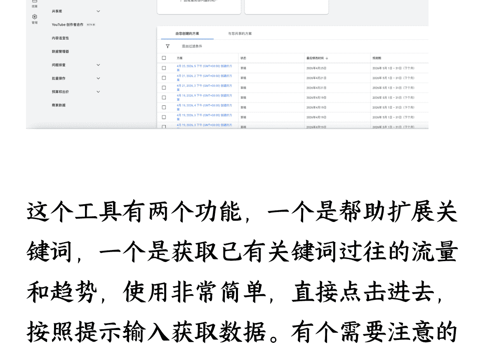

在“发现新关键字”页面，可以输入你的产品或服务相关词。 注意词不要太具体，也不要太笼统，比如做食品配送，用“送餐”比“餐食”更合适。

也可以输入一个网站网址，让系统过滤掉不相关的关键词。

你还可以添加过滤条件，进一步缩小范围。

如果需要批量查词，可以直接粘贴关键词列表，每行一个词，或者用英文逗号分隔，再点“开始”。

工具返回的结果里，能看到每个词的平均月搜索量、竞争程度、页首出价区间等信息。还没有投放历史时，搜索量会显示为一个范围，投放几天后会变成具体数字。这些出价数据可以作为后续设置出价的参考。举个例子，它会返回类似这样的关键词列表：

- image 
- yandex images 
- foto search 
- foto google search 
- check foto 
- foto reverse 
- foto search engine 
- foto search google 
- google image argentina 
- google image creation 

除了官方工具，也可以结合Semrush的数据，再和AI讨论一下，最终确定关键词和出价。

五、创建第一条广告

关键词准备好后，进入创建流程。在后台页面点击左上角的“创建”按钮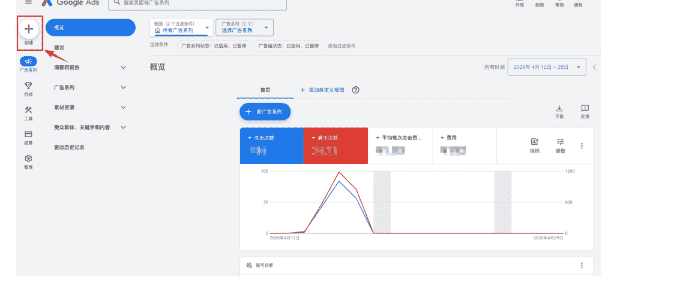，选择“广告系列”，广告系列目标选择“网站流量/转化目标”，然后按实际情况选择账号默认的转化目标（就是之前设置好的那些），点击继续即可。

到这里，一条谷歌广告就正式搭起来了。当然，后续还需要根据数据不断优化出价、文案和落地页。这篇先帮你把基础流程跑通，希望能帮你在投放路上少踩一些坑。我们下篇继续聊实操细节。

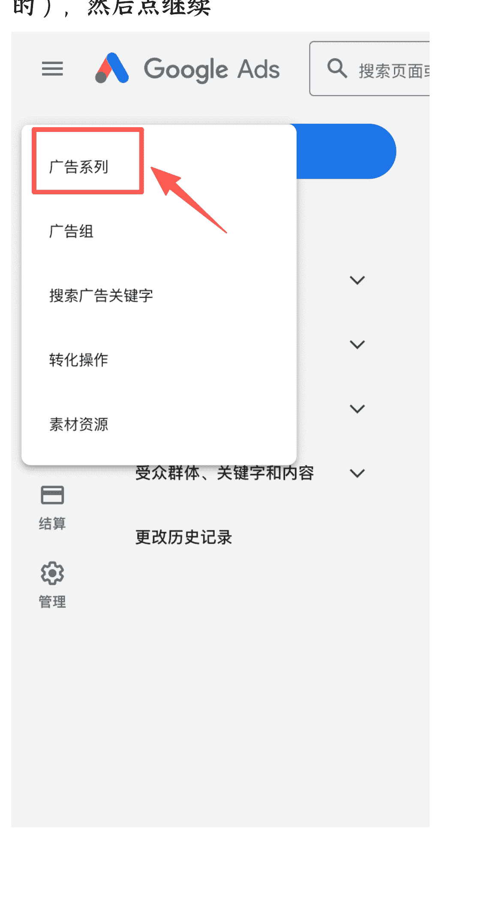

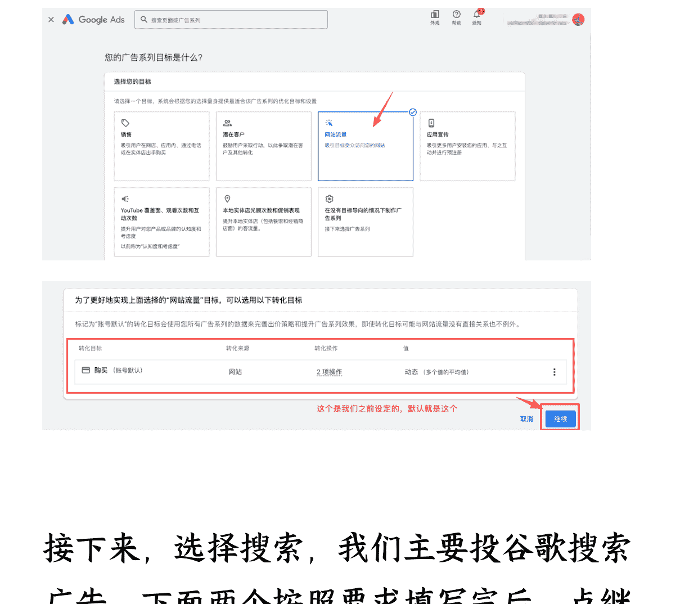

先给结论：在 Google Ads 后台新建 Campaign 时，选 Search 类型，把必填信息按提示补好，点继续。

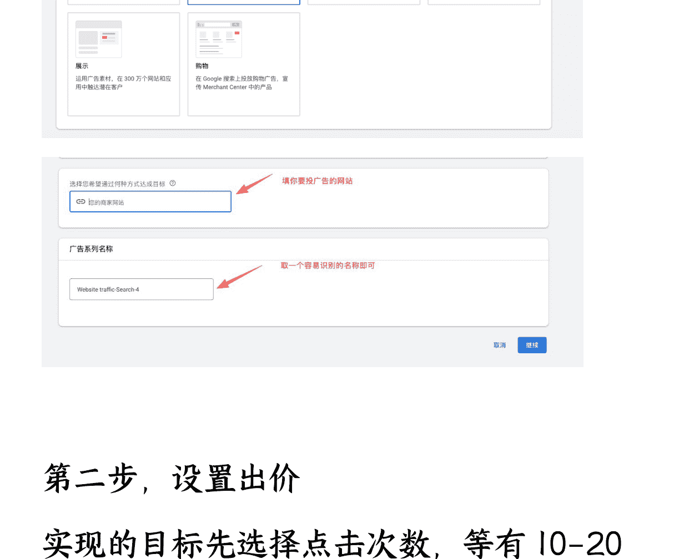

接下来是出价方式。前期优化目标先锁定“点击数”，等账户积累了十到二十个转化事件，再切换成“转化量”。CPC 上限按自己预算填，但最好先去 Keyword Planner 查一下行情，要是报得比市场水平低太多，广告基本拿不到曝光。

然后是 Campaign 参数设置，这里有几个阀门容易开错：

- 流量渠道：所有默认勾选都要去掉。留着它，创意有可能被分发到 YouTube 等联盟站点，看起来量很大，实际来的用户七零八落，预算三两天就空了。
- 受众地区：可以直接圈定目标客户所在的区域，也可以先用“全球”，拿数据后再收缩。注意选“用户实际位置”，别选“感兴趣地点”。
- 语言：跟着网站内容走。站内多语种的，别塞在同一个 Campaign 里，拆成多个项目跑。
- 其余按默认，继续。

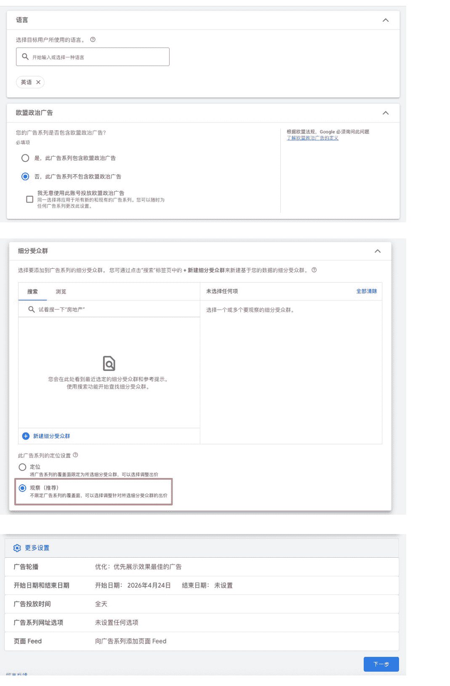

第四步会遇到 AI Max，先不要开启，跳过。

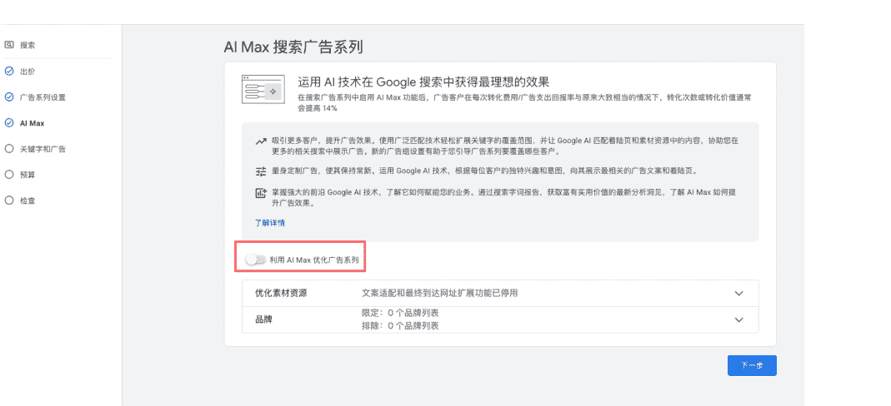

第五步把筛选好的词填进 Campaign。这边最关键的，是搞清楚 Match 模式。三种模式各有各的脾气：

- Broad 模式（宽泛类）：用户搜的东西只要跟词义沾边，就有机会触发展示，流量散、意图杂，不适合一般人持续投放。

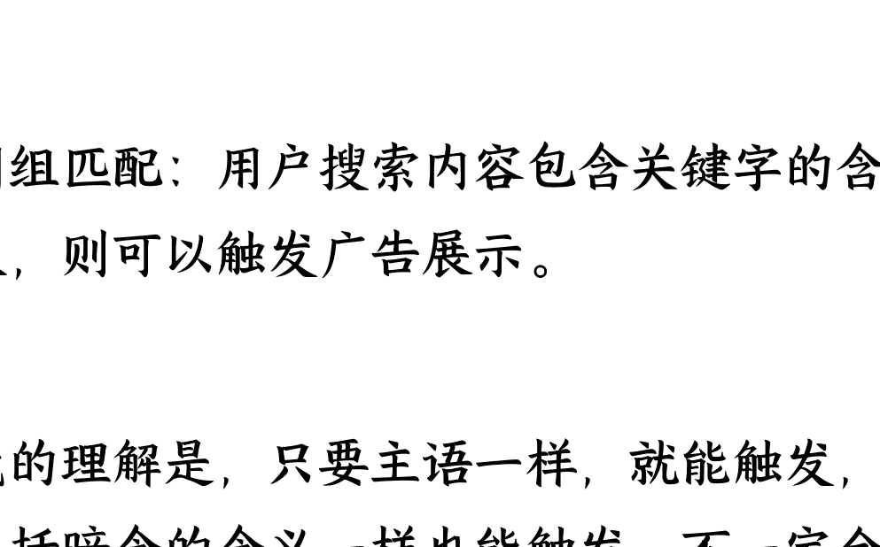

- Phrase 模式（短语类）：只要搜索内容包含这个词的核心含义，不必一字不差，就能触发。同样的事物换种说法、加修饰词，也能覆盖到，精准度和覆盖面比较平衡。使用时要给词加上英文引号，如 "网球鞋"。

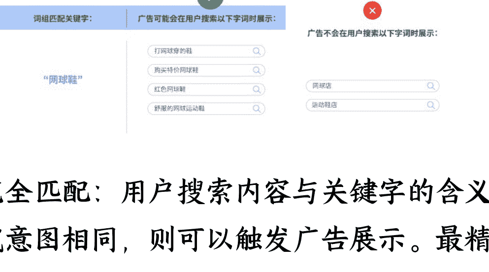

- Exact 模式（精准类）：用户搜索意图与这个词高度一致才会展示，流量最纯、规模也最小。写法是用方括号包住词，如 [红鞋]。

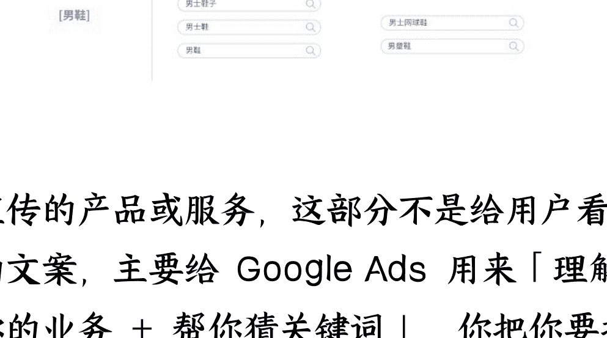

我的建议是只保留 Phrase 和 Exact，Broad 很容易让预算失控。

那一栏要求填写的推广说明，并不是面向访客的广告语，而是让 Google Ads 快速读懂你的业务，顺便联想更多相关词条。把推广目的写明白就好，面对英语市场就用英文写，权重差异不大。

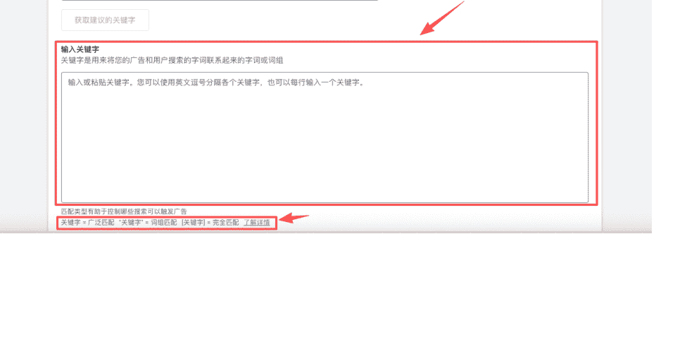

第六步是创意配置。AI Max 还没启用，因此留空。照着页面提示逐项完成，创意综合评级到“良好”就能上线。我当时直接开了一个 AI 浏览器，让模型先给几组标题和描述，再从中挑顺眼的。

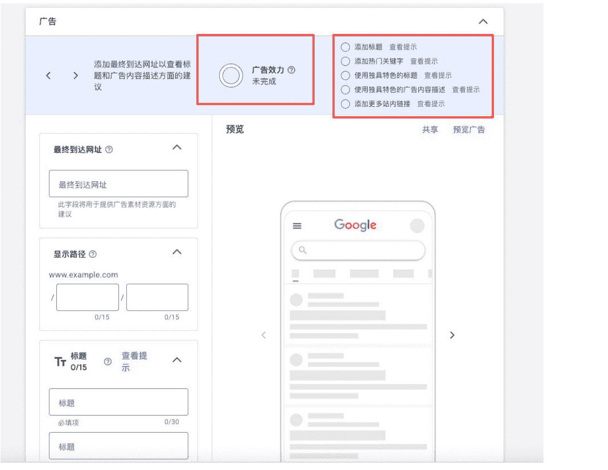

第七步确定单日消耗上限。拿单个 CPC 出价乘以期望获得的点击数，就能算出大概；或者直接填一个心理能承受的金额。额度耗尽后系统会自动暂停展示，不会超扣。

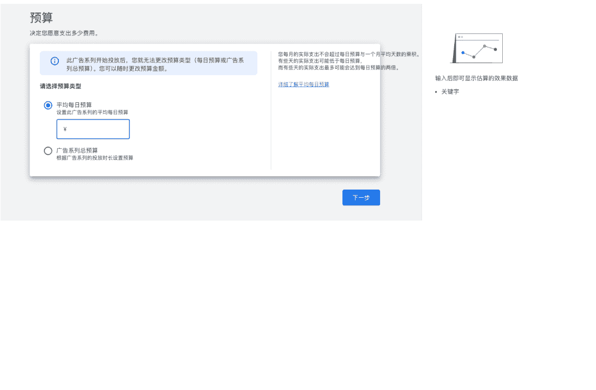

第八步，系统会做全面校验，通过后就能发布。到这里，你已经在 Google 上放了第一个 Search Ads，后面真正要花心思的是数据优化。

再讲几条实操心得：

① 开投前先定量化指标。比如 AI SaaS 网站，付费成交比例一般在 0.5% 到 2% 区间。前期可以把基线设定为：每一千次访问至少产生一位付费客户。如果连这个都做不到，多半不是投放手法不对，而是产品没有解决用户的问题，应该掉头重新验证需求。

② Google 的智能出价体系是靠转化数据来学会识别付费人群的，这个调教周期至少一星期。期间别频繁动设置，否则系统会永远在重新学。除非 ads 没有展示，或者花钱速度像漏水，才需要干预。

③ 适应期内最该做的事情是清理坏词。每天盯后台报表，把点击多、烧钱多但零成交的词拉黑。地区、人群如果总在吃预算却不出效果，同样关掉。创建项目的第一天，就可以把 free、download、app 以及 near me 这类词以 Broad 模式放进负向列表，再让 AI 帮忙补充一批类似的词。核心理由：既不陪白嫖党玩，也别让根本用不上产品的访客浪费你的钱。

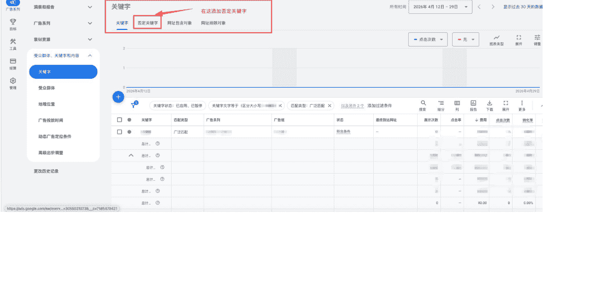

④ 想看对手的投放底牌，直接打开 adstransparency[.]google[.]com，能看到全网正在跑的广告创意。搜同行的名字，研究他们的文案、选词和落地页设计，这等于免费的情报站。

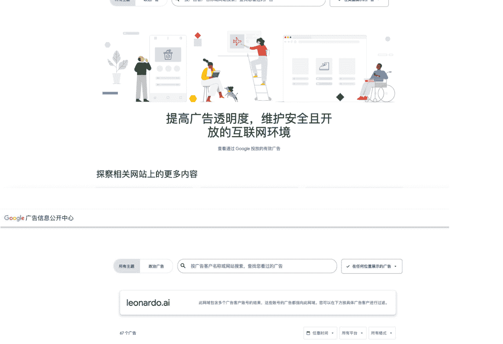

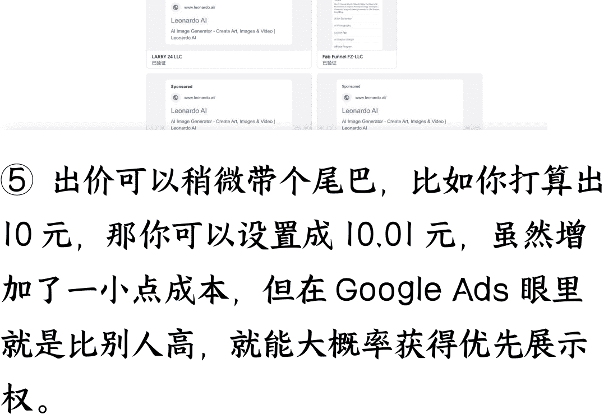

⑤ 出价可以故意留个尾差。本来想出 10 元，那就设成 10.01 元。多花的钱可以忽略不计，但在系统排序时，你可能会比 10 元的对手高出那么一点点，更容易抢到展示位。

最后说点题外话。这篇内容是我用两周时间把 Google Ads 从零运作起来后整理的，每一步都配了图。投放只是起点，真正拉开差距的是后续怎么通过数据做优化。我自己也在探索中，最近的想法是把投放日志丢给 AI，让它参与分析和决策。如果你有更好的玩法，很欢迎来聊。

顺便打个小广告：这次实战的契机，是帮一个股票工具站 aistock[.]tools 做引流，才把整套流程走通。网站大家可以放心用，想要更多积分就联系鱼丸，我免费送一批。祝各位流量增长稳定，早日跑通盈利闭环。

看完这份 SOP，别以为你已经会了。90% 的人实际操作时，第一道坎就迈不过去。资料和攻略只是最表面的门槛，真正的护城河是“立刻动手”和“资源与信息的不对称”。

如果你想看最新的变现打法，也想和一群行动力很强的人一起实战出成绩，欢迎来我的私域圈子。这里不聊虚的，只拆真正的赚钱链路，顺带研究怎么把 AI 用到极致。圈内现在已经沉淀了上千个已验证的项目。

想查阅完整的圈子资料和加入条件：lazyso[.]com/insider

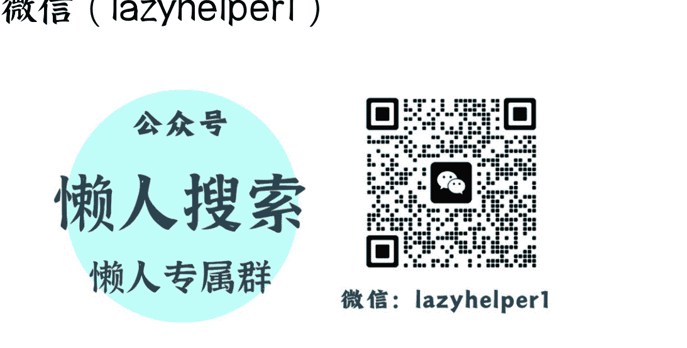
