# 2026 最新 X 创作实战复盘：4 个月 1.8 万关注 +1182 创作者分成，我踩过的坑和走对的路

## 2026 X 实战复盘：从零到 1.8 万粉丝，4 个月赚到 1182 美元分成的心路历程

**260512 副业 SC 精华**

👸号懒人搜索，[懒人专属群](https://mp.weixin.qq.com/s/1234567890) 独享

懒人🛰️：lazyhelper1

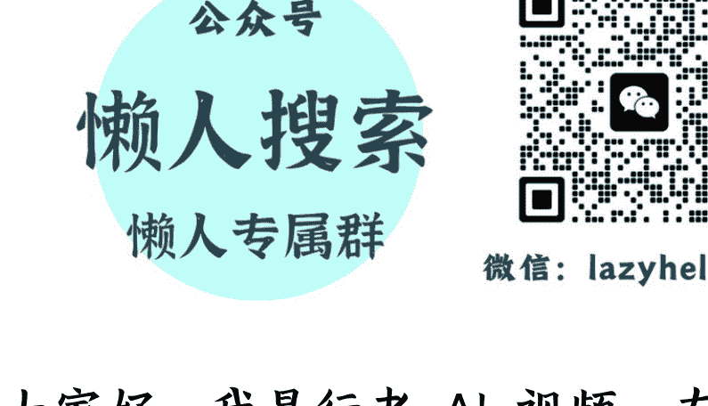

大家好，我是行者 AI 视频，主攻 AI 影像制作和个人品牌打造。

过去作品斩获北京国际电影节 AIGC 奖项，并在央视网播出，在 AI 新榜👸号的最高排名达到第 4 位。

2025 年 12 月我把阵地搬到 X，算是半个新人起步。等到 2026 年 4 月把数据截图标在朋友圈时，收到的第一条回复是：

> 卧槽，你这是怎么搞到的？

## 四个月涨到 1.8 万关注，累计触达 1270 万次，分成到手 1182 美元

数字听起来漂亮，起点却是只有 73 个关注。

那段日子每天盯后台，阅读没有、互动没有、推荐也没有。内容发出去像扔进海里，我一度怀疑 X 不适合我，AI 影像这条赛道在 X 上根本没有生存空间。

差点就要删号了。

转折点在 12 月 8 日。我上传了一条用海螺 AI 复刻《疯狂动物城》赛车场景的教学。

手机从那天开始不停震动。

64K 触达，293 个赞，277 个新增关注……

我盯着手机发了很久的呆。原来 X 上，真正有料的内容依然会被算法推起来。

从 73 人到 1.8 万，从日均几十阅读到单条 83 万触达，中间的挫败、试错和顿悟，我一次讲清。

如果你也在 X 上感到卡壳、流量起不来、刚拿到分成资格却不知下一步，这篇希望对你有用。

# 一、我在 X 上的成绩单

2025 年 12 月入驻，4 个月内涨至 1.8 万关注，总触达 12.7M，60 天内通过创作者变现审核，首月到账 296 美元。

这篇文章本想三个月前就整理，拖到现在，部分数值沿用当时的截图，没有二次加工。

X 的分发逻辑比国内多数平台更看重内容质量。好东西很容易获得长尾推荐，哪怕几百关注的账号也有机会冲到百万级触达。关键在于方法对不对。

# 二、为什么现在值得投入 X

# 1.1 分发对内容创作者更友好

做内容必须做多平台对冲风险。

👸号没推荐基本没声量，📕算法波动大，随时可能被限。

X 给我的体感是当下最尊重创作者的阵地。

涨粉不一定快，但机制确实看内容。100 来个关注的号发一条干货照样能破百万触达，这在国内平台很难复制。

推荐规则公开透明，每周四更新，由 AI 完成分发和惩罚。最近的版本对低质内容打击更严厉。

# ### 1.2 信息源头优势

做自媒体会发现，国内大量 AI 资讯和热点，本质上都是 X 的二次加工。

大厂新品、工具迭代，第一手消息永远在 X。X 是 AI 圈的信息原点，国内平台的信息往往是三四手转述。

# ### 1.3 真金白银的分成

马斯克的创作者分成，按量算下来 100 万阅读约 100 美金，确实属于保底型收益。

但 X 的爆量概率高，积少成多。

我现在每月能稳定到几百美金，够日常消费。更关键的是，它证明了内容有市场价值。

# ### 1.4 X 与👸号的机会差异

# ### 1.5 适合人群和不适合人群

比较适配：

1. 已有内容创作经验，能把能力迁移过来的创作者
2. AI 领域从业者或深度爱好者，X 是核心聚集地
3. 想搭建矩阵的人，X 可做信息中转反哺国内账号
4. 具备一定英文阅读能力的人，能更快捕捉源头资讯

不太适配：

5. 零基础纯新手，建议先在国内平台练手
6. 只想搬运蹭热度的，算法能识别低质
7. 追求短期暴富的，分成是保底不是捷径

# 三、0 到 1 的实操路径

# 2.1 冷启动迷茫期：11 月下旬 -12 月初

**11 月 17 日，我开始正式运营。**

每天像摸黑走路。看他人疯狂互动蹭热点，我的帖子零反馈。12 月初只有 73 个关注。

焦虑、自我否定、凌晨三点刷数据，反复问自己是不是选错赛道。

几乎要放弃。

**当时卡住的点：**

- 没有清晰定位，东一榔头西一棒子
- 对标对象选错，研究了归藏、神娃、宝玉，差距太大且方向不符
- 缺乏差异化，别人有的我都有

# **2.2 首个爆点：12 月 8 日**

12 月 8 日，我发了海螺 AI 的《疯狂动物城》赛车教程。

已经不抱期待，结果逆袭。

64K 触达、293 赞、277 新增关注。

原帖链接：

https://x.com/joshesye/status/1998023856129511727

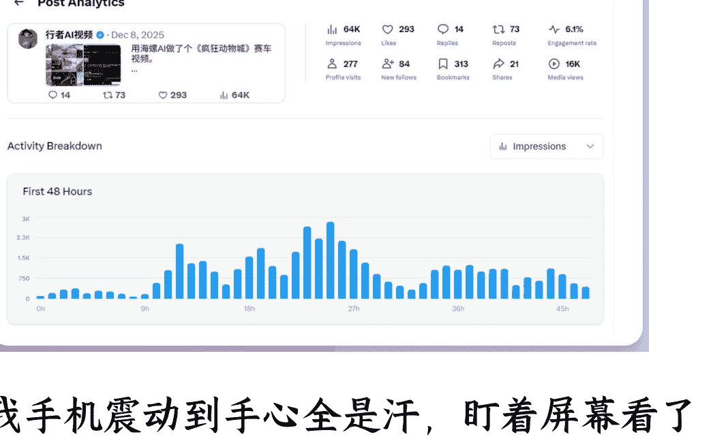

手机震到手心出汗，我盯着页面看了十分钟。那一刻我确认，好内容在 X 真的能被看见。

从 73 人到 500 人，靠的就是这条。

那晚睡得特别安心，因为看到曙光。

# 爆的原因

- **形态权重**：视频 > 图片 > 纯文字
- **干货属性**：完整流程拆解，不是单纯晒片
- **话题结合**：热门 IP 加 AI 视频赛道
- **外部助力**：神娃在内部群帮我转发放大

X 圈里普遍认为 500 关注是冷启动的毕业线。

# ### 2.3 加速期：7 天破千 12 月 8 日 -12 月 15 日

找到方向后，我聚焦在 AI 视频领域的硬核教学加优质作品输出。

12 月 14 日，好莱坞片场教程再次爆发：83 万触达，1.8K 收藏。

**原帖链接：**

https://x.com/joshesye/status/2000193701591875608?s=20

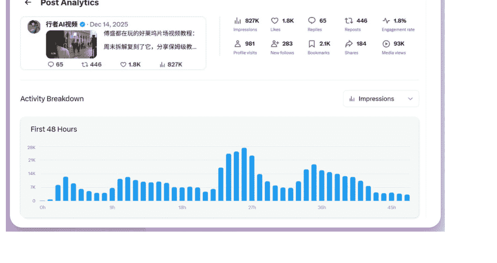

**这一阶段做对的事：**

- 定位垂直：AI 视频工具教学为主
- 高频输出：连续产出多条原创视频
- 保持一致：海螺 AI、Nano Banana Pro、可灵等工具持续深耕
- 原创优先：拆解复盘自己做

**12 月 15 日，7 天到 1000 关注。12 月 18 日，10 天到 2000 关注。**

# ## 2.4 稳定期：18 天达 4000+ 12 月 8 日 -12 月 25 日

圣诞节当天关注数 4428，剔除冷启动期，用了 18 天。

我总结的打法：

- **内容比例：**硬核干货 60% + 热点 30% + 人设活人感 10%
- **发布频率：**每日 2-3 条，保持活跃

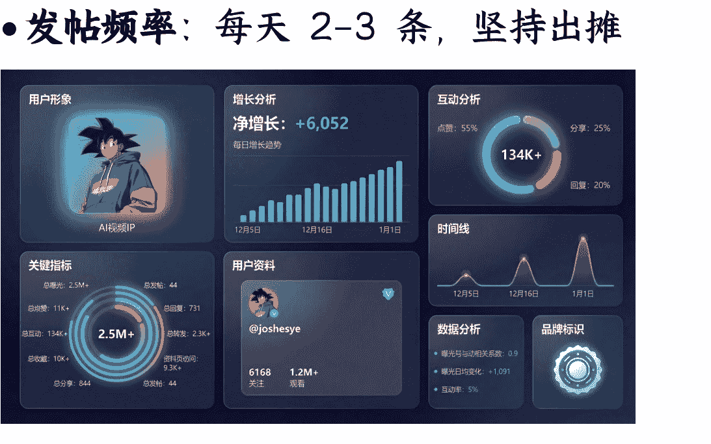

# ## 2.5 破万：抓住 Seedance 风口 1 月 -2 月

春节期间 OpenClaw 和 Seedance2 同时火。Seedance 2.0 发布后我吃到流量红利。

OpenClaw 我 2 月才接触，但我的受众是 AI 视频创作者，匹配度低，文章表现平平。

热点必须结合自身定位才有转化。

春节后一周涨粉 3000，主要来自 Seedance 内容。

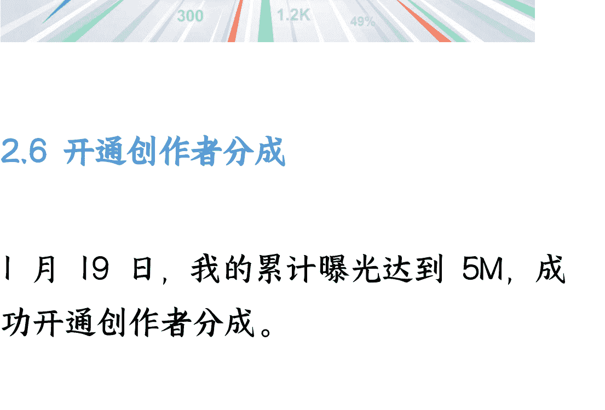

# 2.6 开启分成

1 月 19 日累计触达破 5M，顺利通过创作者变现审核。

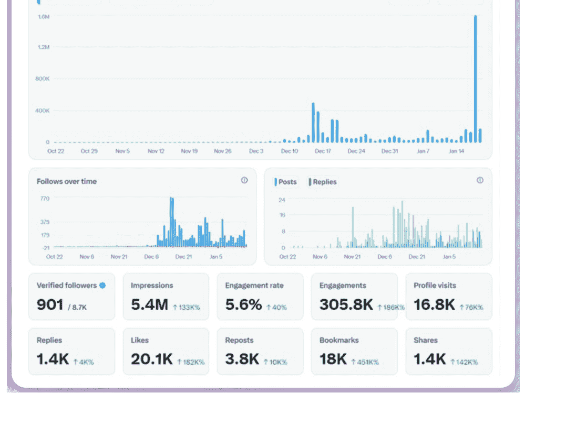

2 月 15 日到账第一笔 296.01 美元。

虽然属于保底收益，但第一次从 X 拿到现金，很有里程碑意义，像走过黑夜后见到光。

分成本质是每月一笔额外工资，不多但稳定。

# 四、可复制的起号框架

# # 3.1 六步起号法

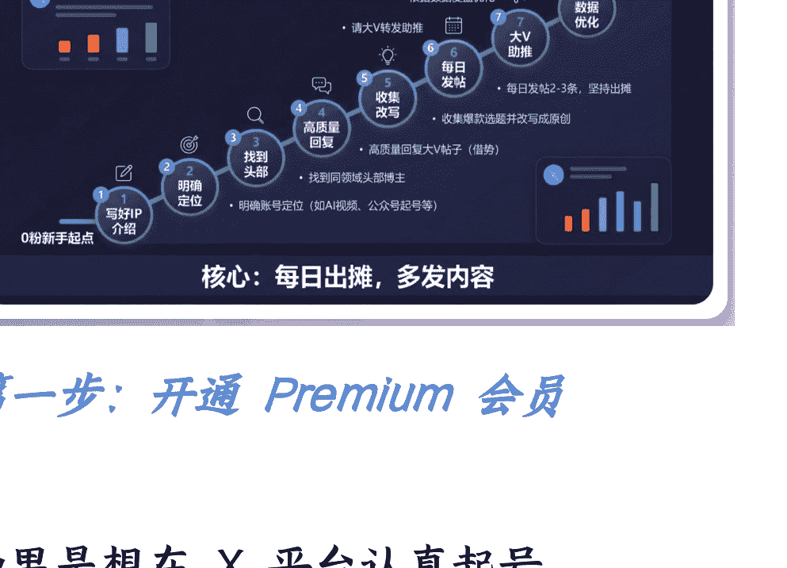

**第一步：开通 Premium 会员**

想认真做，先开会员。

优势：

- 非会员发帖字数受限，会员无限制
- 蓝 V 标识，提升曝光和推荐权重
- 参与分成的前提条件

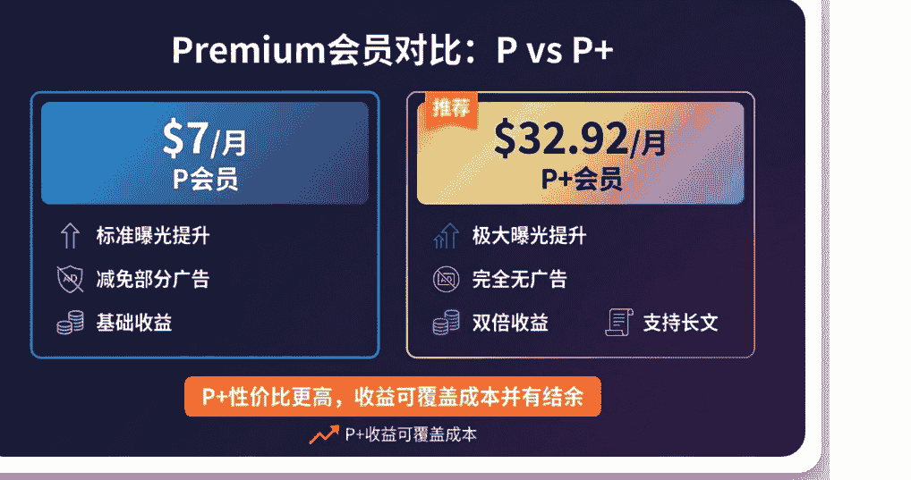

**真正坚持的创作者基本都会开 P 会员，8 美元每月，性价比很高。**

**第二步：打磨置顶个人介绍**

置顶帖就是名片。

要包含：

- 你是谁
- 背书：奖项、成绩、专业技能
- 你输出什么内容

我的置顶写明了获奖经历和在 AI 绘画视频领域的定位。

**行者 AI 视频** @joshesye · Nov 22, 2025

“中年废了”vs"AI 新榜第四/北影节获奖”，AI+ 个人 IP 是普通人逆天改命的最优解

2019 年，我也曾觉得自己“废了”。

创业失败，背着每月一万多的房贷，眼看着房价腰斩。

那是中年危机最真实的模样：焦虑、失眠，头发在大把大把地变白。

我不敢停下，却又不知道该往哪走。

直到 2024 年，Sora 横空出世。

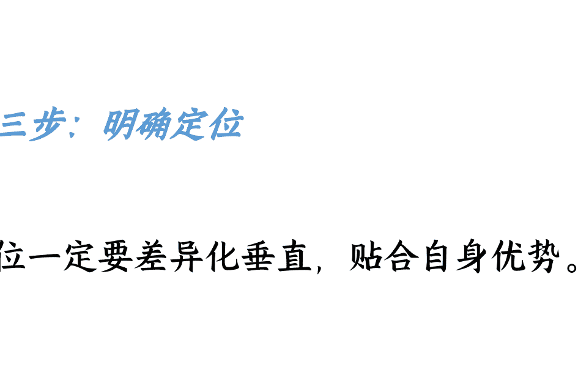

**注意：发帖后数小时内可编辑，之后只能删除重发，个人介绍务必一次性打磨好。**

**第三步：明确差异化定位**

X 的 AI 圈程序员和编程赛道占据大量份额，新人硬碰难度大。

找到细分赛道更易出圈，比如👸号起号、📕副业等。

我早期没突出视频优势，到 12 月初才 73 关注。

建议把你在国内积累的优势直接迁移过来。

# ### 第四步：锁定同领域头部账号

关注优质标杆，精选即可。

X BoostClub 有榜单，可按领域筛选。然后把关注对象加星标，只看通知，避免信息流被淹没。

```
https://regrowth.so/watchlists/x-boostclub-a044a9436ec34d399abef5042600a7d2
```

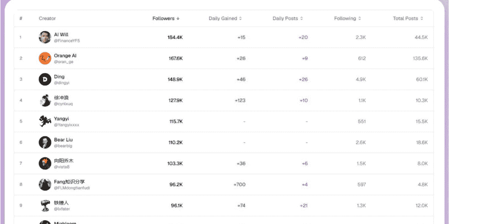

# ### 第五步：高质量互动评论

X 本质是社交平台。起步期可在头部账号下互动。

关键是高质量回复：总结原内容 + 加入个人见解。

好处：被注意、获得曝光、锻炼提炼能力。

# # 第六步：借力转发

这是起号阶段效率最高的方法。

打磨内容后主动联系头部创作者请求转发，转发能帮你进入推荐池。

难点是需要一定的个人影响力。

技巧：

1. 加入头部创作者的🛰️群，多发言混脸熟
2. 发专业帖建立差异点
3. 找认识的出海博主直接对接

案例：疯狂动物城的帖子被神娃放大，后续我帮神佬转发一篇优质帖子带来 56 万触达。

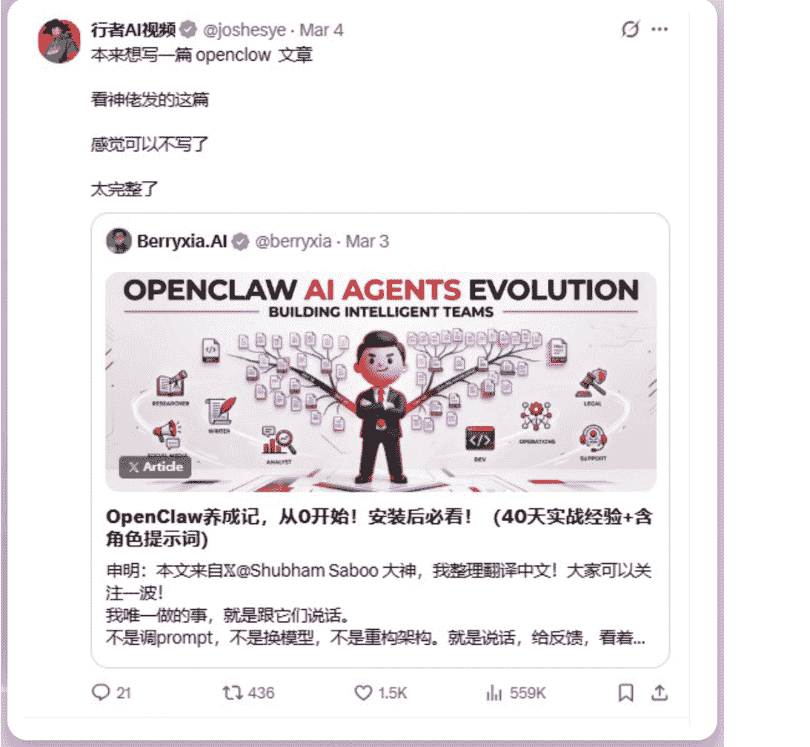

# ### 3.2 选题与内容策略

X 上容易走红的题材：

- 英语学习、出海变现、银行开户
- 35 岁焦虑、失业、创业
- 资源白嫖、变现方法
- 独立开发、工具设备对比
- ……

# 我总结的 5 类高效方向:

- **资讯 + 个人解读：**转发优质内容并加评论
- **阶段复盘晒数据：**如 10 天 2100 粉，过程透明化
- **成绩展示：**放大成果建立权威
- **热点结合定位：**借势补充观点
- **工具/博主合集：**实用沉淀价值

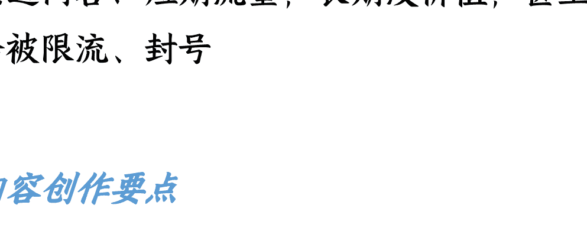

# 避坑选题

擦边内容短期有量长期无价值，还可能限流封号。

# 内容要点

# 标准:

- 原创为主，日更 2-3 条
- 账号一致性，避免发癫
- 视频 > 图片 > 文字

# 选题技巧:

- 资讯 + 自己的理解
- 复盘：涨粉周期、开通分成时间线
- 晒成绩：放大图
- 合集：提示词合集、工具合集

# 我的优质案例:

| 类型 | 内容 | 数据 |
| --- | --- | --- |
| 合集 | Nano Pro 提示词网址合集 | 480K |
| 干货贴 | 香港众安银行开卡 + 开通 Stripe 账户 | 45K |
| 教程 | 好莱坞片场视频教程 | 823K |
| 教程 | 豆包 + Seedance 2.0 做 AI 短剧，保姆级教程来了 | 349K |
| 热点 | 腾讯今天悄悄上了个大招：发布 ClawHub 国内镜像 | 103K |

# ### 3.3 算法要点

X 推荐算法每周四更新，基于 Grok 大模型分发与惩罚。

互动权重：回复 > 转发 > 点赞，互动质量很重要。头部互相关注能提升权重和收益。

所以 X 真的是社交平台。

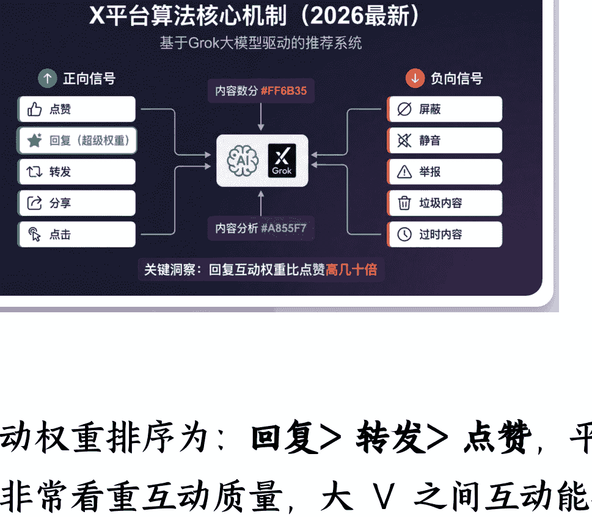

# ### 3.4 创作者分成机制

# # 开通条件

- 订阅 X Premium / P+
- 近 3 个月累计触达 ≥ 500 万
- 关注者 ≥ 500
- 绑定 Stripe 接收款项
- 遵守变现规范

达标后在 Monetization 设置中申请。

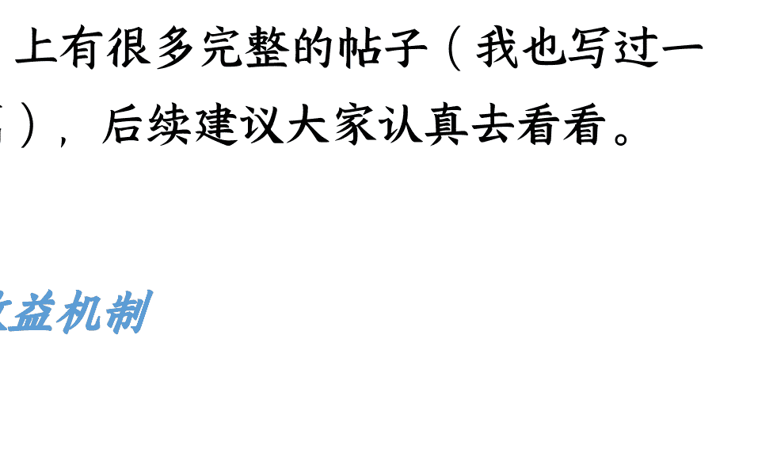

# # 收益逻辑

收入与 Premium 用户互动量挂钩。

优质内容 + 高活跃，每月几百到几千美元不等。

我的情况：

- 累计分成 1182 美金
- 首笔 296.01 美元
- 分成是保底，广告、商务更高

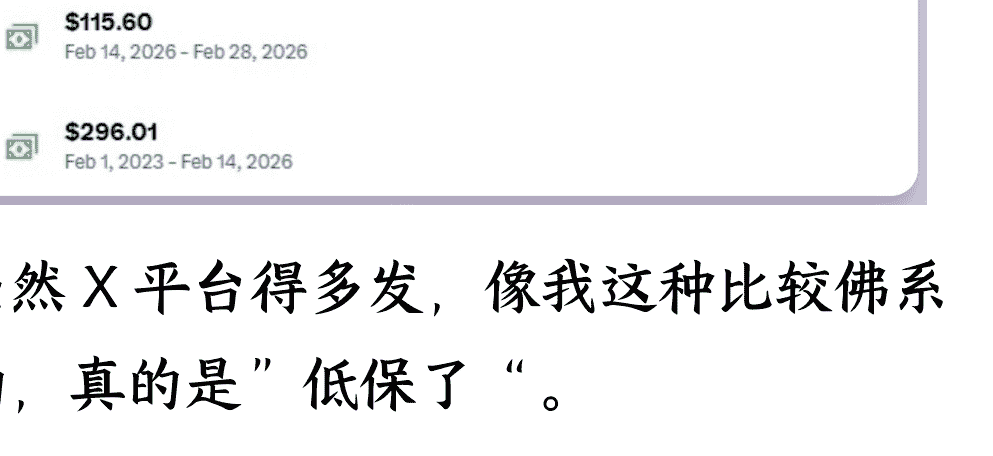

我属于佛系运营，所以目前还在保底水平。

# ### 3.5 避坑指南：4 种限流情况

先说别被封。

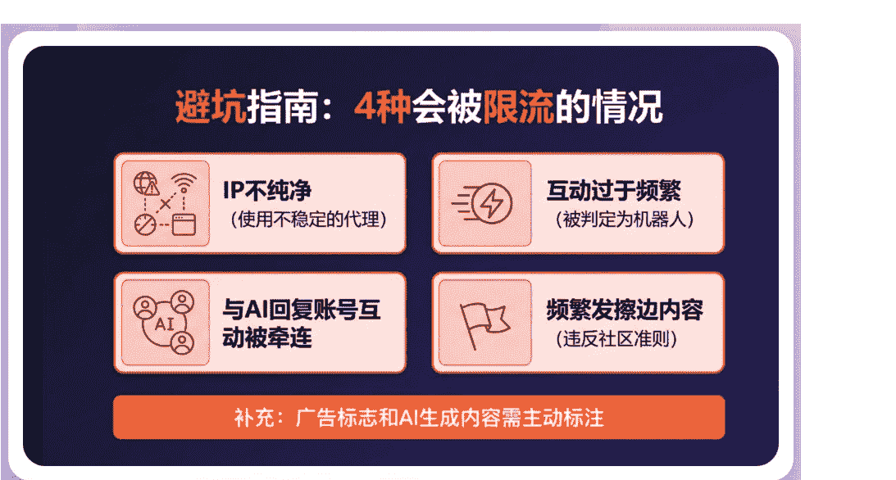

# 封号/限流原因:

- IP 不干净：代理不稳
- 互动过频：大量低质互动被判机器人
- 被举报：擦边或违规内容
- 与垃圾号/AI 回复账号互动被牵连

# 处理方法:

- 停更数天
- 可申诉
- 用限流检测工具定期自检

# 内容标注规范：

## 发任何合作帖前都主动开 Paid Partnership

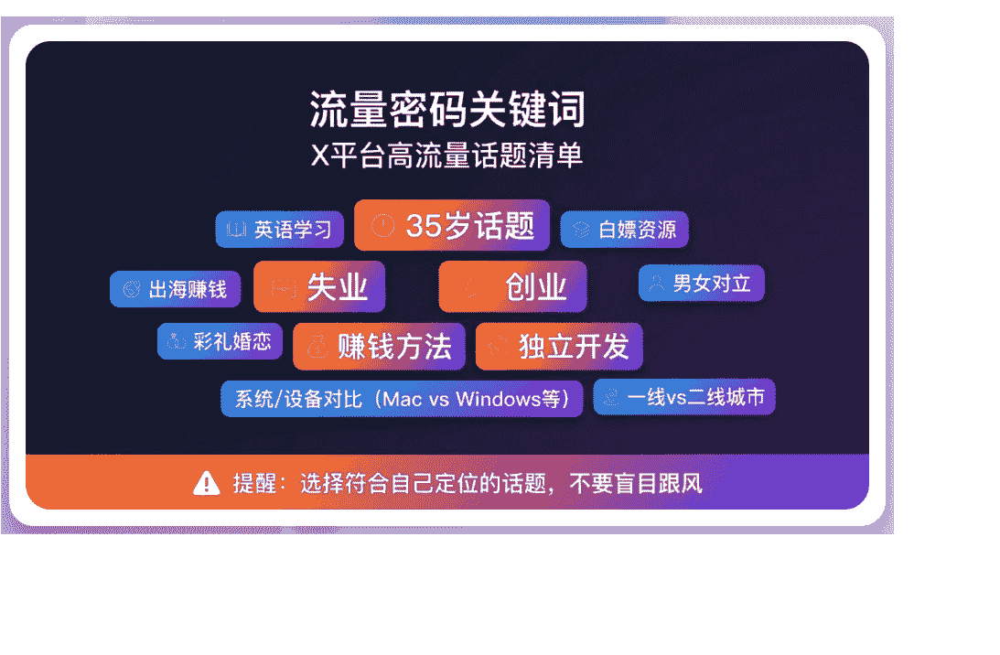

当听说有人只用90天就在X平台攒下1.8万粉丝，很多人第一反应是“运气真好”。可如果你真的去翻他的账号，会发现故事的开头并不光鲜——73个粉丝，零互动，甚至一度想删号走人。

这篇复盘，写给每一个正在冷启动期挣扎的创作者。

先说一个重要的提醒：如果你用AI生成内容，尤其是涉及新闻、冲突或敏感话题，请主动加上“Made with AI”标签。这不是可有可无的步骤，而是保护账号安全的基本操作。

一、先泼一盆冷水：有经验也会摔跤

博主坦诚自己并非从零起步。来X之前，他已经是一名内容创作者，只是把能力迁移到了新平台。但即便如此，他依然在73粉的阶段崩溃过、自我怀疑过。

所以别被“90天1.8万”吓到，也别觉得“我没基础肯定不行”。有底子的人都会踩坑，关键从来不是不犯错，而是跌倒了还能爬起来继续。

二、X拼到最后，拼的还是内容

不要被各种花哨的玩法迷惑。X虽然规则和👸号不同，但本质依然是一个内容平台。你的账号能走多远，取决于你输出的内容是否有价值、有温度。博主靠一条海螺AI的硬核干货教程起号，配合高质量的生图和视频，才慢慢撕开突破口。

记住：账号只是表象，IP才是资产。品牌方看的不是你发了多少条，而是你的内容能不能带来真实影响力。优质内容从来不缺，缺的是让人记住你的理由。

三、破局的公式，其实很简单

把这个公式抄下来：X Premium会员（基础）+ 明确定位 + 优质内容 + 大V转发（入池）= 突破0-1。

具体拆解为七个动作：开会员（每月8美元）；写好置顶帖介绍自己；找到差异化的内容定位；每天保持2-3条原创；认真回复大V的帖子；主动链接大V争取转发；坚持到500粉，踏入流量池。

四、那些你最关心的问题

**👸号能给推特引流吗？** 不建议。👸号读者大多没有出海条件，而且敏感词容易触发限流。反过来倒是可行——把推特的前沿内容深入加工后发👸号。

**发AI资讯没流量？** 太正常了。起号阶段资讯类内容很难跑起来，建议先完成0-1的阶段，有了500粉基础再发。

**Premium必须开吗？** 想认真做X，必须开。非会员只能写280字，没有蓝V标识，曝光差距不是一点半点。每个月8美元，这笔账算得过来。

**怎么才能让大V转发？** 两个路子：进X增长交流群互助，或者主动链接——内容足够硬，大佬自然会愿意转。

**创作者分成怎么开通？** 需要四个条件：订阅Premium、过去3个月累计曝光至少500万、至少500个关注者、设置Stripe账户（需要港卡）。收益方面，100万阅读大概可以拿到100美元，具体取决于Premium用户的互动情况。

**如何避免限流封号？** 别用不纯净的IP（用稳定的魔法）；别在评论区刷“沙发”“前排”；别发擦边内容；别和AI回复号或垃圾号互动。另外，付费合作必须标“Paid Partnership”，AI生成内容建议标“Made with AI”。

五、新手最常踩的五个坑

没有明确定位，今天发这个明天发那个；只转发不原创，账号成了别人的搬运工；低质量互动，输出内容不走心；盲目蹭热点，和自身定位毫无关系；置顶帖写得敷衍，别人看完不知道为什么要关注你。

六、写在最后

这篇复盘，博主断断续续写了半个月。写的时候，他把这四个月又走了一遍——从73粉的自我怀疑，到1.8万粉的深夜截图；从零互动的绝望，到1182美元到账的惊喜；从差点删号的崩溃，到现在每天还能稳定收到“低保”。

他最大的感悟只有一句：X对真正有内容能力的人，真的很公平。但前提是，你得熬过那段数据完全不动、黑暗到令人窒息的日子。

如果你现在就站在73粉的那个位置，请相信——坚持下去，找对方向，好内容真的会发光。

花开有时，静待芬芳。有人在前面等你。

看完了觉得自己懂了？别急，90%的人实操时会卡在第一步。工具和教程只是最低级的壁垒，真正的护城河是“立刻动手”和“圈层信息差”。如果你想看全网最新的变现玩法，和一群执行力极强的极客一起下场拿结果，可以围观博主的核心私域【懒人专属群】。里面只聊商业闭环的拆解与AI效率的极致压榨，已经沉淀了1000+跑通的套利实战局。

👉 查阅圈子完整数字资产与上车门槛：https://lazyso.com/insider/

认同价值、准备好下场干活的，扫码加🛰️（lazyhelperl）。