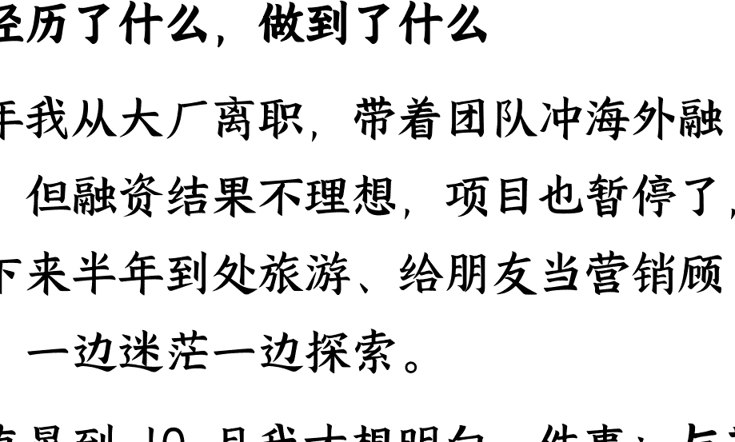
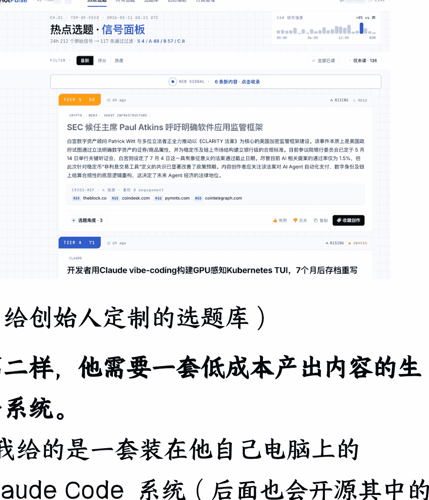
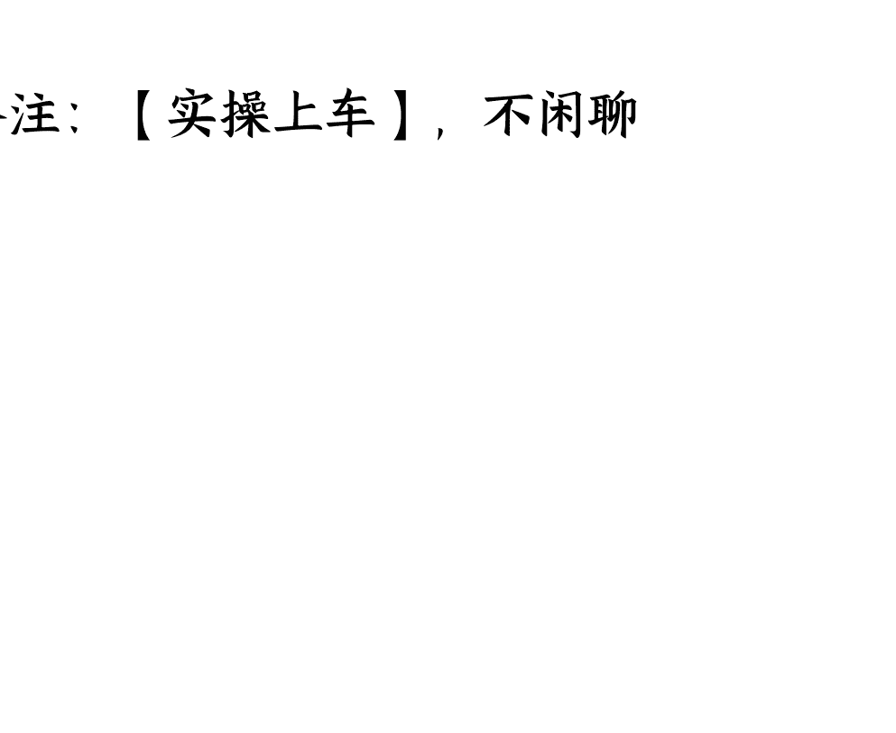

# 大厂离职后，3 个月跑通 B 端十几万客单的完整复盘

## 大厂离职后，3个月把B端客单做到十几万的完整复盘

**260514 副业 SC 精华**

👸号懒人搜索，[懒人专属群](https://mp.weixin.qq.com/s/69425fXJqQw87YvZg0y3QA) 独享

懒人微信：lazyhelperl



大家好，我是 Viola。曾在大厂负责 Web3 业务，23 岁就拿过 500 万融资，内部作为联合创始人推动业务拆分又融过数千万，近几年在海外主导过多个 AI+Web3 项目。

### 我经历了什么，做到了什么

去年我从大厂出来，带着小团队冲海外融资，结局不理想，项目被按下暂停键。随后半年我四处旅行，给熟人做营销顾问，表面上很自在，内心却一直空转。

直到 10 月，我才厘清一个问题：与其再赌一个尚未验证的方向，不如回到这几年我做得最多、也最有手感的事——帮创始人把自己讲清楚。

想通后 90 天，我签下了多位付费客户，单价稳定在十几万，最新的几条旗舰内容在海外也获得了十几万到二十万以上的传播量。业务还很早期，但从定位、定价到交付，整条链路已经跑通。

这次复盘我最有感触的两点：

- To B 服务远比 To C 产品容易起步。To C 要同时扛获客成本高、转化慢、留存难三重压力，To B 只需算清老板的投入产出比，决策就很快。0-1 阶段，用服务先跑案例比直接做产品更理性。

- 创始人 IP 的本质是杠杆，不是粉丝数。创始人要的是关键人群能看见你——资本方、核心客户、潜在用户。核心不是套流量模板，而是先建立一套稳定可复用的表达系统，爆款自然会来。

本文能带走的内容：

- 一条真实的 To B 验证路径：方向怎么选、下第一单十几万客户怎么谈、交付清单如何逐步长成、交付物到底是什么、这个价位为何成立
- 我对外开源的深度写作方法
- **Compound**：交付给自己和客户同款的 Claude Code Skills，可直接安装使用
- 换群和换链接：业务正处于 0-1，希望认识做 B 端服务或有创始人 IP 需求的朋友

### A. 为什么选这个赛道

去年初我带队出海融资，半年无果。那段时间很失落。过去我习惯带队作战，一旦资本通道关闭，我对自己下一步毫无头绪。随后几个月做顾问、旅行，焦虑并未缓解。每天用 AI 聊天做自我拆解，还找人做了盖洛普解读。结果是：天赋在领兵打仗，但我手上没有兵，内耗加剧。

10 月回头复盘后我发现，与我背景相似的创业者，卡住的点恰好是我能解的。我可以帮 AI 或出海创始人解决增长与影响力问题。

原因有二：

第一，我亲历过创业者的痛。23 岁融资、大厂拆分融资、海外项目实操，让我清楚创始人各阶段的卡点。自己下场失败后更确认，小团队撬动局面最有效的杠杆，是让市场先听见你。

第二，AI 时代，差异化比做到最好更重要。塞思·戈丁的紫牛理论让我印象深刻。几百头奶牛一开始会吸引注意，20 分钟后就被忽略；一头紫牛却让人记住。如今 AI 生产力暴增，内容和产品会迅速同质化。与其追求更好，不如追求不同。

于是我判断创始人 IP 会变得前所未有重要，未来科技类创始人必须亲自面对用户。

我也选择从 B 端切入。To C 是注意力战争，要和所有 App 抢时间，获客、转化、留存三座山一起压。To B 的逻辑很直接：帮你赚的钱或省的成本高于服务费，就值得买。算得清，决策就快。

当前策略是先用服务积累真实案例，验证方法论，再考虑产品化。

### B. 这个需求为何成立

#### 创始人 IP ≠ 网红 IP

徐沪生说得对，创始人做 IP 最大的误区是照搬娱乐网红打法。

两者底层不同：网红靠绝对流量卖广告，创始人需要精准人群触达自己的产品和服务。

创始人的核心资产不是表演力，而是专业沉淀。AI 创始人的 AI 认知、Web3 创始人的链上叙事能力，才是壁垒。离开专业，创始人就普通了。

所以创始人做内容，关键是呈现专业深度、思考品质和个人魅力。

#### 创始人的真实痛点

创始人脑中信息密度极高，决策复杂、行业洞察深，但产出却没人看。

主要卡三点：

- **太忙**：写一篇深度稿要花一小时，机会成本太高
- **怕丢面**：担心没阅读量、同行觉得掉价
- **不会转化**：写得好、有人看、能带来商业结果，很难三合一

更复杂的是，不同创始人目标不同：有人要融资，有人要做 C 端社区，有人要触达 B 端开发者。用统一模板服务，几乎没人满意。

#### 我的切入方式

我经历过 0-1 到增长的全过程，了解不同阶段的营销需求。

所以提供的是定制化创作操作系统 + 咨询 + 营销服务：

- 基于定位和阶段商业目标，明确 IP 表达策略
- 搭建可复制、可迭代、可生长的创作系统
- 共同产出旗舰内容，并精准分发给投资人、关键客户、潜在付费用户

### C. 验证与交付

#### 1. 首单为什么能成交

有想法后我没急着造系统，先列了交付清单，定了自认为合理的价格，去找真人聊。

对象是一位认识多年的创始人朋友，我认可他的产品和长期主义。沟通前我把他全部推特梳理了一遍，形成内容诊断：哪些表达到位、哪些深度没讲透、粉丝画像与真实客户错位点、下一轮融资该讲的故事线。

聊不到一小时，他就付了款。

复盘下来，三重叠加：多年信任降低了启动成本；我不是卖服务，而是直接呈现问题，创始人最吃这套。

但我清楚，朋友信任只能拿第一单，结果才能拿第十单。所以从第一单起，我把可复制性放成交之前。

#### 2. 交付清单如何长出来

这份清单不是预设的，是做几单后逐步补全的。

最初定价只想着战略梳理 + 写几篇旗舰稿。真正交付才发现，客户更在意结果确定性。

第一，帮他想清楚写什么。

大部分创始人不是不会写，是没想好写什么。我会先复盘他的阶段目标：融资？拿 B 端客户？做 C 端社区？目标不同，叙事和受众完全不同，不先对齐，后续再多写也是浪费。



给创始人定制的选题库

第二，给他一套低成本生产内容的系统。

我交付的是装在他本地的 Claude Code 工作系统，内置个人定位、经历素材、文风档案、选题引擎、深化工具、标题生成器。交付后，他或助理就能自主运转。

第三，呈现可感知的结果。

项目期内我们共同产出 3-5 篇旗舰长文或推特线程，并负责把内容推到目标人群手中——投资人、KOL、潜在客户。这是客户最看重的交付部分。

#### 3. 实际交付了什么

客户感知到的是一整套专属的创始人创作系统，包含战略诊断、行业知识库、分发网络、IP 资产沉淀，以及我的陪跑。

大致分三步：

- **先厘清身份**。几轮深度访谈，聊他的目标、关键经历、想在行业扮演的角色。这一步往往让创始人意识到身上有多少可讲的故事。
- **搭一套能跑的系统**。把定制系统装本地，手把手产出第一批旗舰内容。我负责结构、深化、打磨、标题判断；他提供观点和素材。写作负担明显减轻，从拖两天到几十分钟出初稿。
- **让内容被对的人看见**。按名单推送给投资人、KOL、目标客户。发完复盘，把反复修改的点沉淀回系统，效率持续提升。

#### 4. 真实数据

最近客户在海外的数据不错，但爆款并非目标，数据是策略对的结果。

11:09 AM · Apr 9, 2026 · **206.5K** Views
💬 37 ↻️ 47 ❤️ 135 🔖 138 ⬆

11:24 AM · Apr 9, 2026 · **99.4K** Views
💬 8 ↻️ 73 ❤️ 313 🔖 510 ⬆

#### 5. 价格为何成立

花这笔钱买的不仅是系统和几篇文章，而是这几年在真实商业增长中积累的判断力。它决定三件事：

1. 公司该做什么
2. 这个阶段该做和不该做的边界
3. 什么节奏投入产出比最高

这三件事没人帮你梳理时，你会在发不发文、方向对不对、时机是否成熟上反复内耗，时间与机会成本远超十几万。

系统可被复刻，稀缺的是带客户拿到结果的确定性。

### D. Compound 开源部分

整套交付的核心是一套创始人创作系统，覆盖战略诊断、定位、选题、深化、写作、分发、复盘到 IP 沉淀，客户版本会按行业、受众、商业目标、语言习惯重做。

今天分享的 Compound，是其中深度写作层的通用版，适合所有认真写作的人。

**设计思路：先知道你是谁，再开始写**

多数 AI 写作工具上来就让你写，填模板出稿。Compound 反其道：

- 不直接写文章，先让系统了解你是谁、怎么思考、怎么表达
- 不给爆款模板，而是让系统学会判断什么对你算爆款
- 不是一次性出稿，而是每次使用都在训练系统更懂你

每次发布，系统对你的理解就多一层，复利效应自然形成。

**越用越聪明的原因**

- **Personal OS** 为底座：先建立定位、经历素材库、文风档案，后续创作基于此，不从零开始
- **知识库为活体**：发布复盘、素材、AI 记者洞察持续喂入，用得越久越准
- **Skills 会进化**：同一类修改出现三次以上自动更新进 Skill，无需重复指令

**系统架构**

Personal OS 一次性初始化，个人定位 + 经历素材库 + 文风提取 → 让系统知道你是谁

日常创作循环：收集 → 选题 → 创作 → 发布 → 复盘，反哺系统

系统由三层构成：Personal OS 地基、9 个 Skills 覆盖全链路、Knowledge Base 素材库。

#### 安装

```bash
git clone https://github.com/Viola100X/compound-writing.git
cd compound-writing
claude
```

安装后先建 Personal OS，5 分钟完成定位和文风校准，后续初稿即贴合个人风格。

#### 一篇文章的生成路径

可自由进入任一节点，无需线性执行。

**首次使用：建 Personal OS，5-30 分钟**
- 个人定位 5 分钟
- 经历素材库 15-30 分钟，用英雄之旅 12 问挖掘故事
- 文风提取 5 分钟，提供 3-5 篇语料

**Phase 0：自由探索，可选热身**

**Phase I：选题**
topic-engine：无想法时基于定位与热点推荐 3-5 个方向并评级；有想法时五维打分，总分 50 分。

**Phase 2：选结构**
content-structure 推荐长文/短文结构并说明理由。

**Phase 3：深化**
工具 A 思想升华：跨学科、理论透镜、奥派辩论
工具 B AI 记者挖掘：诊断完整度 → 三轮提问 → SCQA 框架 → 质量雷达图

**Phase 4：出初稿**
生成有骨架的初稿，便于快速修改。

**Phase 5：人工打磨**
直接指令修改。

**Phase 6：标题、钩子、封面文案**
钩子优化、封面打情绪、标题抓关键词，三者需区分。

发布后复盘数据，反哺知识库，系统持续进化。

以上就是从方向到交付再到开源工具的完整复盘。如果你也在做 B 端服务或构建创始人 IP，欢迎交流。

**Personal OS 的进化路径：让文风 Skill 自行校准，让选题引擎靠复盘数据不断学习。**

这就是从套用通用模板，到真正长出你的个人系统之间的分水岭。

### 它跟你有什么不同

### 这套东西跟你到底有啥关系

不一定非得是 AI 还是 Web3 的创始人，只要你想被更多人看见、想让外界清楚地感知到你的独特性，这套方法论就能用上。

核心就帮你解决三件事：
第一，把脑子里那些模模糊糊的灵感，梳理成有骨架的内容；
第二，把动笔写深度长文的心理门槛降下来，AI 记者会来“采访”你，把你的想法聊透、聊明白；
第三，写得越多，越像你本来的声音。这是它和直接用 ChatGPT 写作最本质的差别。

用 ChatGPT 也能写，但它做不到“越写越进步、越写越像你”。不管你用多少次，底层的逻辑还是模型的逻辑，跟你这个人是脱钩的。

### 上手的方式很简单

装好 Compound 之后，你只需要做三步：

- 10. 把你脑子里想写的东西，用语音或文字丢给它
- 11. 跟它说一句“采访我一下”或“帮我一起完善”
- 12. 它会基于采访来回打磨，直到内容成型

### 我的真实用法

我写这篇分享的起点，就是先让系统去读我过往所有的项目资料，然后靠 Skills 自动补全框架。

### 最后说一句

学会用 AI 写作是迟早的事，没什么可纠结的。越早搭建起属于自己的创作系统，复利就越早开始。

> ———分割线———

看完 SOP 的时候你会觉得都懂了，但真正上手时，90% 的人都会卡在第一步。

工具和教程只是入门级的门槛，真正的门槛是马上开干，以及你所处的信息圈层。

如果你想第一时间看到全网最新的变现打法，并和一群执行力很强的极客一起实操出结果，可以来看看我的核心私域：【懒人专属群】。

👉 查看圈子数字资产清单和加入门槛：
https://lazyso.com/insider/

觉得有价值、准备立刻下场实操的，直接扫码加我微信 lazyhelper1



备注：【实操上车】，不闲聊