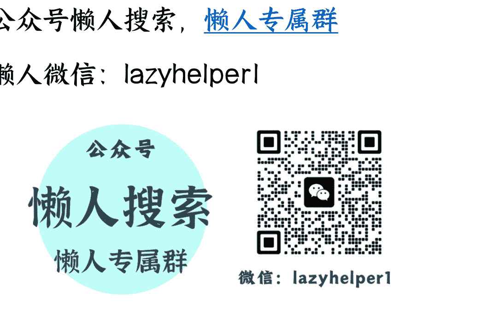
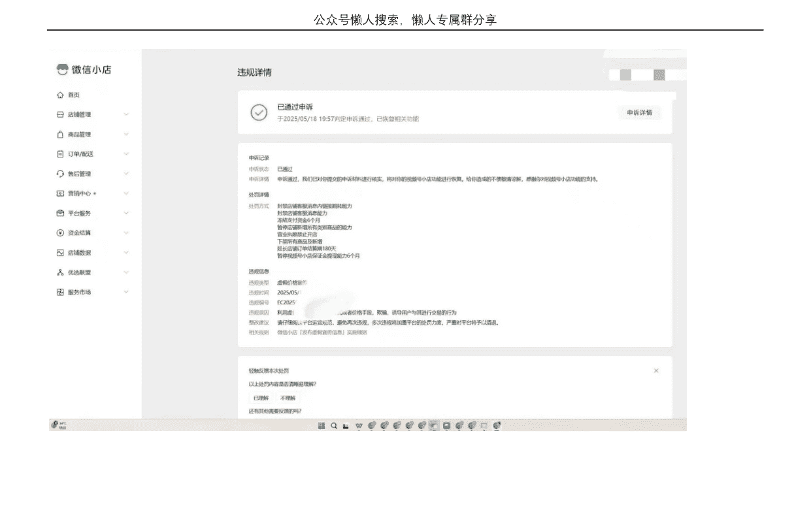
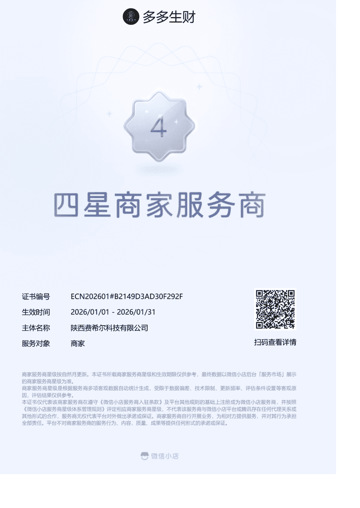

# 账面上仍有利润，人却被磨得快垮了：这门生意到底停不停？——一份实战止损复盘与六条判断准则

**260515 · 副业实战复盘精华**

公众号懒人搜索，[懒人专属群](https://t.cn/A6qXJz8L)

懒人微信：lazyhelperl

我是孟哥，00年生人，自媒体创业已经做到第六年。这些年一直泡在短视频和内容电商这条赛道里。2021年从多多视频切入，赶上第一波风口，赚到了人生第一个一百万；之后转战视频号，又踩中一轮生态红利，带过达人孵化，也做过供应链团长，2023-2024年累计GMV冲过3亿，还拿到过腾讯2025年度优秀带货机构，好几个品类做到过平台头部。2025年，团队切到小红书自营笔记带货，年利润稳定在七位数。

只看结果，好像我每年都在换阵地，而且每次都能赚到钱。但真实过程远没有这么从容。大家只看见我频繁切换赛道，没看见切换之前，我都先做了一件更难的事：把旧盘子从核心位置上拿下来。不是我喜欢折腾，也不是我天生爱变，而是平台规则变了，流量结构变了，原来的打法撑不住了。你不主动撤，就会被老业务一点一点拖死。

这几年最深的感受是：创业最难的关口，不是开新局，而是承认旧局的回报已经不行了。新方向能不能做，可以用数据去验证；旧业务要不要停，才真正让人辗转难眠。尤其是那种曾经帮你赚过钱、现在还能进一些钱，却越来越累、越来越难做大的业务。它不会让你瞬间死掉，只会一天一天吊着你。

去年我亲手砍掉了一个每个月还能贡献好几万利润的团长项目。做决定的时候，我犹豫过、不甘心过，甚至怀疑自己是不是太急躁。现在回头看，那次并不是切断收入，而是把团队从高沟通成本、低复利、天天救火的状态里拔出来，压到微信小店服务商、小红书AI带货这些更有长期价值的赛道上。这篇文章想聊的正是这个：当一个老业务还没亏，但已经让人疲惫到极点，老板到底该怎么判断去留？

2025年12月底，我从武汉出差回程。深夜十一点，机场外面冷风直往领口里灌。我刚拖着行李箱走出来，手机就开始疯狂震动。达人群、客服、商家，消息一条接一条地弹出来。事情的起因很小：客服沟通时漏了对齐信息，导致达人以为线上的链接能走线下结算，结果佣金对不上。几千块的差错，让达人气到炸，商家也觉得我们不专业。客服在电话那头声音发颤：“孟哥，我真的搞不定了。”

那一瞬间，我站在路边等车，看着满屏的投诉和质疑，脑子里只剩一个念头：太累了。

这笔钱其实不多，补上就行了。真正让我难受的是，为了这点破事，我出差谈事的节奏被打断，团队情绪崩了，商家信任裂了，达人群里的火气还得我去一一安抚。回到公司，看着展柜里那座腾讯2025年度优秀带货机构的奖杯，内心毫无波澜。以前看到奖杯，会觉得那是荣誉。

那天我猛然想通：奖杯只能证明你曾经吃到过一波红利，它决定不了你未来还能不能继续赢。

以前我总以为，业务下滑是执行不给力、团队不拼、达人不好带、素材不够好。后来才彻底明白，最底层的问题是：这门生意的终局正在变窄。很多老板被卡住，就是因为看得见新机会，也清楚老业务越来越难，但手就是抽不回来。旧盘子里有过去的成绩、有团队惯性、有沉没成本，还有那口咽不下去的气。你会反复想：“我都做到这个体量了，再调一调会不会活过来？”“投了这么多的人和钱，现在收手是不是太亏？”“每个月还有进账，直接停掉是不是太可惜？”

这些念头我全都有过。后来我才理解，停掉一个业务，本质上是做资源重排——把人、钱、注意力，从低回报的位置挪出来，放到回报率更高的地方。

# 一、先看终局，别只顾眼前有没有利润

很多老板判断一个业务，第一反应是看这个月赚不赚钱。这个指标有用，但远远不够。最迷惑人的业务，恰恰是眼下还能赚钱的业务。

我关掉的视频号团长项目，停掉的时候，每个月依然有几万块利润。当时手底下好几个账号在类目排名里很靠前：有服饰家居类目第一，有个护美妆类目第一，还有食品生鲜前五，动销销售额全部超过500万。同行听说我要停，第一反应都是：“你疯了吧？现成的钱不赚？”只看账面，这句话没毛病。但我看的已经不是那几万块钱，而是这个业务还有没有放大的空间。

视频号和抖音的生态差别很大。抖音达人数量庞大，品牌方对接不过来，团长在中间做撮合，确实有存在价值；但视频号的中小达人做出一点规模之后，品牌方自己就会跑来加微信，两边直接对接，团长夹在中间还能起什么作用？再加上平台规则持续收紧，原先靠短期账号、短平快打法冲起来的达人，生存空间被越压越小，而我们主要服务的正好就是这批人。我们当初吃到的，本来就是平台高速发展期的红利。红利不可能永远都在，吃到了是本事，红利退了也得认。

我也想过转去服务那些做长期账号的头部达人，但他们需要的是选品测品、大场策划、投放增长的全链路服务能力，根本不需要中间商赚差价。当一门生意需要你投入巨大的心力去维持，天花板却一天天下压，最聪明的选择不是坚持，而是止损。我骨子里是个草根，只信一件事：哪块地更肥，就往哪扎根。

所以我的判断体系里有一条：如果收入还在，但天花板向下走、协作越来越重、平台规则越来越不友好，投入越多边际回报越低，那就不能再按短期波动看了，这大概率是终局在收窄。有利润不代表有后劲，很多时候只是过去的底子还没吃完。能赚钱的业务很多，值得继续下重注的真没几个。

# 二、老业务最磨人的，是制造了一场大型虚假忙碌

老业务最让人头疼的地方，往往不是亏钱。亏钱反而简单，账本红了，谁都知道疼。真正麻烦的是，它让团队每天忙到飞起，却忙不出任何增量。

做视频号带货那阵子，团队每天看起来特别热闹：达人要维护，商家要对接，素材要测试，客服要盯着，售后要处理，平台规则一变，运营还得跟着改流程。办公室里群消息响个不停，运营催完客服催，客服解释完达人继续闹，老板永远在善后。可一到月底复盘，增长没有，人累得不行，钱没多赚，团队状态反而一路下滑。所有人都在低价值动作里打转，还个个觉得自己很努力。这就像掉进沼泽，越用力挣扎，陷得越深。公司灯火通明，不代表战斗力强。拆开看，大量动作只是在维护一套越来越低效的运转系统。

我判断这类项目，只用三个问题：

1. 团队忙完之后，有没有沉淀下可复用的资产？
2. 今天多招一个人，利润能不能跟着涨？
3. 老板不盯着的时候，业务会不会立刻变样？

如果三个答案都是否定的，那它表面是一门生意，实质上是在消耗组织。这种业务做久了，团队会越来越钝，所有人都在处理问题，没有人思考增长；所有人都在完成任务，却没人知道下个月靠什么变得更好。最贵的成本从来不是工资，而是一群人把时间烧在没有复利的事情上。

# 三、舍不得停，根源往往是自尊心在拦路

这个点我体会太深了。最开始舍不得停视频号老业务，不是没看到问题，恰恰相反，问题我早就看清楚了，只是心里不愿意承认。这个业务让我拿过成绩、拿过奖、跑出过规模，也养活过一整个团队。要让一个老板亲手停掉曾经证明过自己的东西，心里那股别扭劲儿，真的很难形容。表面看是在算账，骨子里是在跟自尊较劲。

你会忍不住问自己：“我以前都能做成，凭什么现在不行？”“是不是换一批达人、调一下团队、重新做素材，就能起来？”“现在停掉，是不是等于承认我输了？”草根创业者特别容易被这种情绪困住，因为所有东西都是自己一刀一刀砍出来的。从没有人信到有人跟着干，从一间小办公室到一支队伍，每一步都浸着血汗。停掉它，就像在否定自己的来路。

但生意不讲感情，生意只看投入产出。以前的打法帮你赚到过钱，说明你当时的判断是对的；现在这套打法回报率变低了，还继续死磕，就是在跟自己较劲。我后来用一句话逼自己清醒：假如这个业务不是我一手做起来的，而是别人拿上来给我看的项目，我还会不会投钱、投人、投精力进去？

只要答案出现犹豫，就要警惕了。你舍不得的，很可能不是机会本身，而是过去的成绩、过去的投入、那个曾经赢过的自己。太多老板一辈子被这个东西铐住手脚。最不容易砍掉的，恰恰就是那个靠这门生意赢过一回的自己。

# 四、新业务不是用来补窟窿的，是用来拉高回报率的

很多人一谈转型就着急：老业务不行了，赶紧找新项目顶上。今天看视频号可以，明天看小红书可以，后天又觉得AI漫剧有机会。什么都碰一下，什么都没打透。表面看是在寻找机会，实际是在用新动作缓解焦虑。

我后来挑新项目，不是随手找个东西去堵旧窟窿。我想验证的真问题是：公司能不能从原来那套重人力、重撮合、重维护的能力结构里，迁移到回报效率更高的能力结构上。拿微信小店服务商举例，这跟我以前做团长完全是两回事。以前做团长，核心是搭桥，撮合达人和商家，赚的是中间那一点佣金；做服务商，核心是帮商家解决真实存在的问题。

有一位商家，几个店铺被连坐封号，几百万货款冻结在账户里。他自己找了很多渠道，折腾了好几天，钱花出去不少，问题却纹丝不动。后来找到我们。我们没搞什么玄学方案，就是把半个月的订单、客诉记录、售后记录一条一条拉出来核对。最后锁定了来源：某位达人为了冲销量，在直播间过度宣传，触发了系统关联违规。我们做了一份非常扎实的复盘文档，该退款的退款，该拉黑的拉黑，把整条违规链路理清楚，再递交给平台审核团队。最后，店铺保住了，资金也陆续解冻。

那个商家后来给我发信息，没有什么煽情话，只有一句：“孟哥，你这是救命之恩。”之后他想约我吃饭，我没有赴约。因为这类事能办成，靠的是把平台底层规则啃透，靠的是专业，而不是饭桌上的面子。做团长赚的是缝里的碎钱，做服务商救的是人家的身家性命。在规则面前，情绪起不了任何作用，专业才是硬通货。

另一块让我感到兴奋的业务，是小红书笔记带货。2025年我们团队自营这块业务，利润做到了七位数。让我最满足的不是赚了多少钱，而是工作效率的彻底变革。以前做内容，团队要熬夜写文案，设计要一张一张磨图，还得手动一个账号一个账号地发。现在全面接入AI：爆款脚本丢进去，几秒钟就能生成十个带钩子的版本；图片用AI批量生成，提示词预设好就行；发布交给矩阵软件，全自动分发。以前需要三五个人的工作量，现在一个人配上AI工具就能全部跑完。很多人觉得AI离自己很远，总觉得那是大厂才玩的东西。其实AI就是一个不睡觉的超级外挂。以前写文案、做图、剪辑，每一项都是门槛；现在门槛没了，剩下的全是效率。我不需要懂什么高深的技术，我只需要懂生意，AI负责把想法变成钱。

所以我看新方向，会认真问自己几个问题：天花板有没有更高？交付结构能不能更轻？团队能力能否沉淀？老板的时间投进去，是在升级认知，还是换个地方继续打苦工？如果新业务只是换了一身马甲，里面还是重人力、低复利、靠老板到处救火，那它一样不值得重仓。

# 五、止损要靠规则，不能靠情绪：三条线提前划好

很多人一提止损，就以为是今天想通、明天全部砍掉。现实里不可能这么操作。有团队、有现金流、有客户、有供应链的时候，老板不能拍脑袋。我当时也没有上来就把老业务一刀切。我先盯了几个周期：素材测试成本在降吗？达人配合度变好了吗？平台规则对我们这类打法是放松了，还是收得更紧？团队出的问题是偶发性的，还是系统性失控？我继续投入时间，能不能把业务拉回到增长轨道？如果只是短期低谷，那就调整策略；如果连续几个周期都没有变化，就要按结构性问题来处理。

最关键的是把线提前划好。很多老板之所以越陷越深，就是因为没有止损线。今天亏一点，觉得还能扛；明天忙一点，觉得再优化优化；后天再砸几万去测素材，想着万一爆了呢。结果钱烧完了，时间烧完了，人也拖垮了，业务照样没起来。所以，不要靠感觉来止损，要提前把三条线写死：观察期多长？最多能投入多少钱？达到什么结果就继续，达不到什么结果就撤？

我当时给老业务设的是三个节点：30天看核心数据有没有回升，60天看团队运转效率有没有改善，90天看利润与增长能不能重新站稳。同时设好资源边界：最多保留几个人，最多投入多少测试费用，老板每周最多搭进去多少时间。到了边界还没有结果，就别再讲情怀了，该收缩收缩，该关停关停。很多时候，拖着不做决定，对团队的伤害反而更大。你拖的不只是一门生意，还有团队的时间、公司的现金流、老板自己的注意力。没有止损线的坚持，到最后一定会变成硬扛。

# 六、真正要想的，不是“还能不能做”，而是“值不值得做”

很多老板做取舍的时候，脑子里转的是：这个业务我还能不能继续做？这个问题天然会把人带偏。因为绝大多数业务，咬咬牙都还能再撑一阵。你有经验、有团队、有资源、有客户，继续运转并不难。但“能做”和“值得做”，根本是两回事。

我当年也能继续做视频号带货：继续维护达人，继续对接商家，继续测试素材，继续救火，继续赚点佣金，不至于马上死掉。但我心里已经很清楚了，它不值得再占着核心资源，因为它占据的是最贵的东西——老板的注意力。创业走到后面，钱不是最稀缺的，人才也不是最稀缺的，最稀缺的是你每天早上醒来脑子里第一个想到的事情。如果你每天最先想的都是低回报业务的琐事，你就没有余力去抓真正能翻盘的增量。所以我现在对业务的判断越来越冷静：它还赚钱，我认；它过去帮过我，我也认；但它未来不值得我继续押主力，我就撤。

被一堆琐事捆住手脚，看起来每个月有收入，实际上没有增量；看起来局面稳定，实际上人正在慢慢变钝。创业就像骑驴找马，但你不把驴卖掉，永远腾不出心思去找马。人总是这样，手里握着一点安稳钱，就舍不得转身，最后两头都做不好。所以我这次做了个干脆的决定：主力资源，全部押到更有未来的方向上去。我不怕少赚一点，我怕的是把时间浪费在没有未来的地方。

# 七、六条取舍标准，浓缩成六个问题

现在我评估一个老业务要不要留，基本只看这六条。

**1. 终局还有没有空间？**
不要只盯着眼下赚不赚钱。要看平台趋势、客户需求、竞争结构、利润空间是不是还在持续变好。如果收入还在，天花板却不断下沉，就需要重新评估。

**2. 团队忙完有复利吗？**
如果团队每天都在连轴转，但忙完之后没有资产沉淀、流程沉淀、数据沉淀、客户沉淀，那本质上就是体力活。体力活可以做，但不能长期占着核心资源。

**3. 边际成本在降还是在升？**
好的业务，规模上来之后，单位成本会自然下降。差的业务，规模越大，麻烦越多，人越疲惫，纠纷越频繁。如果增长带来的主要是四处救火，那就要停下来重新审视。

**4. 它配得上老板最清醒的脑力吗？**
老板的注意力比现金流更贵。一个只赚小钱的业务，如果长期霸占着你最核心的决策精力，它的隐性成本远远超过账面数字。

**5. 新机会是在升级能力，还是换个地方继续受苦？**
不要为了逃离旧业务，随手抓一个新业务。新方向必须带来更强的回报结构：更轻的交付、更强的复利、更高的利润、更高的效率。否则，只是换了个坑继续累。

**6. 止损线划好了吗？**
不要靠情绪刹车，也不要靠幻想硬撑。观察多久、投入多少、做到什么数据就继续、做不到什么数据就撤，全部提前写明白。没有止损线，人就一定会被不甘心牵着鼻子走。

# 八、写在最后

很多老板不是看不见新机会，而是被旧成绩捆住了手脚。过去赚到过钱，只能说明你当时的判断是对的；现在该停手，只能说明环境已经变了。别让一个曾经帮你赢过的业务，最后变成拖着你不放的包袱。能赚钱的生意很多，但不是每一门都值得一直做下去。最磨人的是那种：今天还能给你一点甜头，明天却一点一点把团队往泥里拖的生意。它不会让你瞬间死掉，它只会让你每天忙个不停，每月还能进一点账，然后悄悄耗光你的判断力、注意力、还有整个团队的心气。等你回过神来，一年可能就没了。

所以我现在处理老业务越来越果断。不是账上还有钱就继续干，而是看它值不值得继续占着主力位置和最好的时间。该收就收，该换牌桌就换牌桌，别把自己葬在曾经赢过的地方。

我是孟哥，00后，6年自媒体创业者，也是6年生财圈友。这篇文章是我关停一个老业务之后的真实复盘。如果你也在做微信生态、小红书带货，或者正纠结一个旧项目要不要继续死磕，欢迎来聊。

---

读完这篇内容，你可能觉得自己懂了。但90%的人一到实操环节，就会卡在第一步。工具和教程只是最浅层的壁垒，真正的壁垒只有两个：立刻动手，以及圈层内的信息差。想看全网最新的变现玩法，并且和一群执行力极强的实战派一起下场拿结果，欢迎围观我的核心私域：【懒人专属群】。群里只谈实操，不谈虚的。我们做商业闭环的拆解，也专注AI效率的极限压榨。系统内已经沉淀了1000多个跑通过的真实玩法。

👉 查看圈子完整数字资产与加入门槛：

https://lazyso.com/insider/

如果你认同这套逻辑，并且做好了真正动手的准备，扫码加我微信（lazyhelperl）

**公众号：懒人搜索**

别浪费时间听空谈，这里只谈真正能落地的实操。想一起干的朋友，直接加入即可；闲聊的恕不接待，咱们把精力都用在正事上。机会就在眼前，跟紧节奏，马上开始。