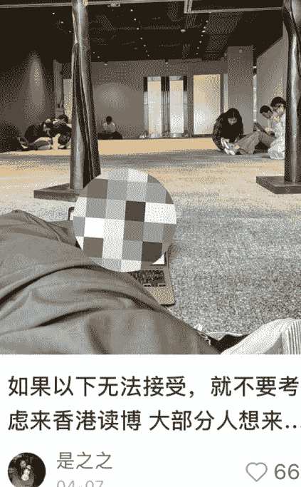
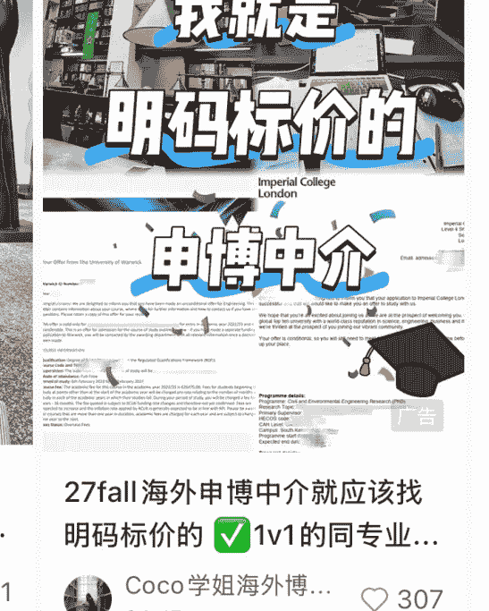
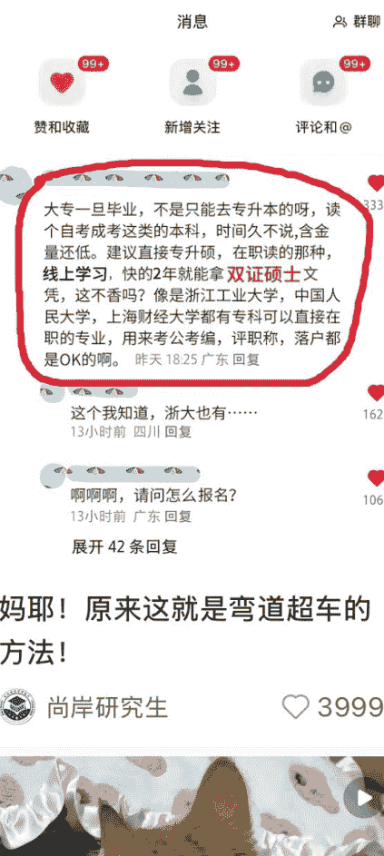

# 从零入坑冷门赛道到首单落地：我用 AI Skill 把📕获客打磨成 SOP 的全链路复盘
作者：龙哥

**260515 副业 SC 精华**

## 前言

大家好，我是龙哥，目前还在自由职业的摸索期。

这是我第一次把这段经历整理成帖，想聊聊最近尝试做获客时，AI 在提效上给我的具体帮助。

**先说明**，我接触获客时间很短，做法也是一边试错一边调整，不敢说完全正确。

不过在摸索阶段就意外成交了一单，于是把来龙去脉梳理出来，供同样从零出发的朋友参考，也算抛砖引玉。

最开始我只是想让 AI 帮我做信息抓取和归纳。

做着做着，发现几个环节可以串联起来，最后沉淀成一条很粗糙的工作链路：

采集 → 拆解 → 沉淀 → 生成

这套链路还在迭代，但已经帮我省掉了大量重复手工，也让我从最初的茫然，变成能明确下一步做什么。

下面分享探索过程和这套雏形的形成逻辑。

## 为什么会选择获客这条线

此前我做过抖音涨粉号、📕无货源、YouTube 频道。

能赚点零花钱，但体感很疲惫，也不容易沉淀成可复用的资产。

一停更，基本就归零。

去年我歇了大半年，就是在思考有没有一种能慢慢积累、自己能掌控的方向。

和朋友聊下来，我重新审视了获客这件事。

过去做的项目，大多是给平台打工，规则一变玩法就得重来。

获客不同。

只要把用户痛点、内容表达、私域沉淀逐步搭建起来，它更像一种可迁移的能力。

需求永远存在，只要你能持续找到人、读懂人、在合适时机承接，这件事就能长期做下去。

涛哥在一次线下交流里提过一个例子：他认识的房产中介扎根一个区，久而久之，区内买房租房的需求都会优先想到他。听起来很平常，但在有限范围内积累信任，最终结果也很可观。

这点触动很大：

项目不一定要高大上，只要能持续捕捉需求、持续累积信任，就有滚雪球的机会。

于是我决定试试。

## 起步时赛道还没定

起步时我也没想好具体做哪个方向。后来一次聚会认识圈内朋友，他后端能承接申博业务，我就顺势先以这个方向切入。注意，这是个入口，后续实际效果也超预期。

我的心态很简单：

先上车再看风景。赛道可换，获客方法论是可复用的。

## 实操后才暴露的盲区

真正开干后才发现坑比想象的多。

### 我对获客底层没概念

此前做的涨粉号、无货源、YouTube，本质都是找爆款抄作业、微调。

获客不是这个打法。

曝光前更重要的是需求判断。你不先弄清用户在焦虑什么，后面都是无效动作。

而留学申博这个领域，我是彻头彻尾的外行。

### 我对后端话术一窍不通

我是普通本科，没出国经历，也没申请过。

最基础的专业名词，比如套磁、RP、BG，起初我都不知道指什么。

这导致我根本不知道该产出什么。

### 我不知道第一步往哪走

我去问过后端合伙人，但自己空白，不知道怎么提问。

问得太宽泛，对方答不上来；问得太细，我自己也找不到切入点。

最后我决定，先做自己能做的事。

像做内容一样，先去看市场在发什么，哪些笔记有真实互动，评论区用户在聊什么。

先动起来，再看清市场长相。

## 如何找到切入点

### 先看什么内容在跑量

我注册了一个📕小号，搜留学、博士相关词，翻近半年有数据的笔记。

很快发现一个规律。官号、机构号、明显投放的笔记，基本都有“广告”标识。

而很多营销感强的笔记，点赞收藏很高，评论却很少，而且评论区都是“太专业了”“要价格”“怎么咨询”这种一眼水军的回复。

港大博一在读全奖 PhD 给 27fall 的申请建议历史总是...

Captain

04-23

穷鬼如何完全靠自己出国留学 (一) 很多女孩子和我一样觉...

屿小屿

03-30

如果以下无法接受，就不要考虑来香港读博大部分人想来...

是之之

04-07

27fall 海外申博中介就应该找明码标价的✅1v1 的同专业...

Coco 学姐海外博...

04-17

博士申请

全部

用户

商品

图片

地点

群

问一问

港大博一在读全奖 PhD 给 27fall 的申请建议历史总是...

Captain

04-23

穷鬼如何完全靠自己出国留学 (一) 很多女孩子和我一样觉...

屿小屿

03-30

如果以下无法接受，就不要考虑来香港读博大部分人想来...

是之之

04-07

27fall 海外申博中介就应该找明码标价的✅1v1 的同专业...

Coco 学姐海外博...

04-17

### 博士申请

全部 用户 商品 图片 地点 群 问一问

“

很烂的 bg

可以申到

全奖 phd 嘛

有的兄弟有的。

0pub0connection 申到北美...

文艺极客 AIGC

02-06

“

任何一个专业，

读到博士，毕业后

都会达到中产阶级的水平吗？

任何一个专业，读到博士，毕业后都会达到中产阶级的水...

大刘老师

2025-06-22

REAL PhD 先知全...

别再乱找中介了，这家申全奖

博士超专业的想申请全奖博...

REAL PhD 先知全...

04-03

不要读博

不要读博

不要读博

现在读博没有用!!!

不要读博

不要读博

不要读博#都说博士读的就是心态 #读博还是工作#

博士生#不懂就问有问必答 #学术 #49 年入国军#

想读博却全是劝退帖，求真实

读博体验！最近想读博的心...

凌晨 1 点的 pingu

02-05

8 / 36

### 发现

广州

### 你们看到忍得住吗

十六

### 你们一年要花费多少呀

飞天猪猪仔

### 住在养老院里的，摇滚青年

一块碗布

### 妈耶！原来这就是弯道超车的方法！

尚岸研究生

### 首页

### 市集

+ 

消息

我

而没有广告标识、评论区有真实讨论的笔记，多集中在几类。后来用 AI 帮我归纳，大致是：

- 分享文
- 经历文
- 问题型内容
- 避坑内容
- 判断型内容

很烂的 bg

可以申到

全奖 phd 嘛

有的兄弟有的。

0pub0connection 申到北美...

任何一个专业，读到博士，毕业后都会达到中产阶级的水平吗？

任何一个专业，读到博士，毕业后都会达到中产阶级的水...

不要读博

不要读博

不要读博

现在读博没有用！！！

不要读博

不要读博

不要读博#都说博士读的就是心态 #读博还是工作#

博士生#不懂就问有问必答 #学术 #49 年入国军#

想读博却全是劝退帖，求真实

读博体验！最近想读博的心...

### 申博

### 全部  用户 商品 图片 地点 群 问一问

### 没有申不上的博士

### 25fall 给 26/27fall 的一点申博建议 1.不要因为担心而犹豫...

### 无发表申上香港 phd，贡献一下我的申博思路 先分享我 b...

### 能吃苦也不要来申港博。。。。目前港中文博二...

看到这里我有点底气。

一是可以省掉付费投放的试错成本；
二是找到了用户真正愿意停留的内容带。

由此可以反推出两点：
一是用户现在对硬广、方案报价、优惠信息不买账，专业知识可以先放一放，先把流量拿到手；
二是市场真正有阅读量的，是围绕痛点展开的讨论型内容，要去打痒点。

## 我的下一步选择

基于这个判断，我决定照旧先做复制。把市场上能跑的内容先抄过来，再在做的过程中学专业。

因为越痛的点流量越好，而越痛的知识越需要我去向后端精准求证，而不是我盲目自学。这样也能解决之前“不知道问什么”的困境。

## 为什么要做 Skill

知道方向还不够，还需要批量收集、整理。

我一开始是人工一篇篇扒，手动做表格，累且慢，而且因不懂专业，整理出来的东西质量低，投入产出比很差。

### 📕 博士弹窗

| 提示词 | 用户阶段/画像 | 深层动机（他在担心什么？） | 文案属性（标题/封面建议） |

| :--- | :--- | :--- | :--- |

| 博士生活（案例） | 迷茫期小白 | 听说读博很苦，怕坚持不下来。想看真实感。 | 虚（吸粉/曝光） |

| 博士脱单 | 已经是博士 | 想找对象 | 虚 |

| 博士申请面试 ppt | 在申请博士的路上 | 担心因为 ppt 不行，申请不到，不安全 | 实 |

| 博士申请 | 想要尝试申请博士 | 还不懂具体的，细节的 | 半虚半实 |

| 博士求职简历 | 博士毕业了 | 找工作，想知道怎么找 | 实 |

| 博士招生 | 确定申博 | 想读博但是不知道要申请哪个 | |

| 博士申请简历 | 确定读博了 | 不知道如何写简历，担心简历不行 | 实 |

| 博士面试 ppt | 已经申请了，现在面试 | 担心面试不上 | 实 |

### 专业用词

| 行业标准术语 (Jargon) | 意思 | 用户大白话 (White-words) | 用户专业误区 (The "Wrong" Belief) | 行业内黑学术语 (The "Black" Knowledge) | 避雷/推荐 (标题/封面建议) |

| :--- | :--- | :--- | :--- | :--- | :--- |

| RP (Research Proposal) | | 申请整个几千字的东西，研究计划、开题报告 | 觉得只要字数够多，引用了大文献就能通过。 | 导师其实只看你的研究方向跟导师手里的"Funding（经费）"匹不匹配。 | 《这词对吗？！导师回怼 Welcome 其实是在看你是否省钱》 |

| Theoretical Framework (理论框架) | 基于理论搭建的、支撑整篇论文的逻辑结构。 | "逻辑框架说明书"，告诉导师你打算用哪几把尺子来量这块地。 | 觉得是抄一段书，其实是你自己选定并组合出来的逻辑。 | 它是你的"免死金牌"，只要框架稳，给啥逻辑也没人敢说你错。 | "10 分钟搭出导师点头的高级框架，告别逻辑混乱。" |

| RQ Research Question (研究问题) | 一项研究核心想要通过数据回答的语句的核心意义，就是为了辩中它。 | ""逻辑鬼打墙"或"废话文学"，比如："因为他厉害，所以他成功。" | 觉得"题目"当成"RQ"，题目是门面，RQ 是要充实的具体堡垒。 | RQ 定得越小，越具体，论文越好写。 | "RQ 定得好，论文不跑题！3 步教你精准定位研究方向。" |

| Circular Circular Reasoning (循环论证) | 结论已经包含在前提里，逻辑原地打转。 | ""逻辑鬼打墙"或"废话文学"，比如："因为他厉害，所以他成功。" | 觉得"自圆其说"就是完美，其实没有循导过闭环的闭环就是废话。 | 好的研究必须公开被证明是错的，这种逻辑闭环是学术自杀。 | "拒绝逻辑鬼打墙！教你识别论文里最隐蔽的废话逻辑。" |

| Theory (理论) | 解释现象的系统性规律。 | ""破壁的总想"，公认好使的工具，拿来就能用。 | 觉得是没啥数据的情操，其实是经过验证的"真理"。 | 它不是标准答案，而是一种视角（看问题的逻辑）。 | "别再盲目踩雷！用这个经典理论，瞬间看透本质。" |

| Paper Academic Paper (学术论文) | 发表在期刊上或用于学位考核的、具有逻辑严密性的研究报告。 | "学术界的没名状"，是你向同行证明"我发现了一个新秘密"的正式报告。 | 觉得字数越多越好，其实学术论文讲究越大。 | 论文的核心不在于"写"，而在于"贡献"，即便你写了 1 万字，如果没有提出新观点，在导师眼里就是一张废纸。 | "拒稿率 90%？掌握这几个核心逻辑，让你的 Paper 起死回生。" |

| 套磁 Academic Networking / Cold Emailing (学术套磁) | 申请人在正式递交申请前，通过邮件与潜在导师联系，展示科研背景并询问对方是否有组人名额。 | "私底下加好友"，在正式报名（投简历）之前，先私下问问老师："您那还招人吗？看咱行不行？" | 觉得就是发个邮件问候，其实有效的套磁必须包含你对导师研究方向的深刻理解，而不是套着套着。 | 很多博士名额在网申开始前就已经通过"套磁"定下了，没看邮箱很稳，很容易成为"套磁"。 | "回复率不到 100%！手把手教你写出一封让大牛导师无法拒绝的套磁信。" |

| 二区在投 Under Review in JCR Q2 / CAS Tier 2 (中科院 JCR/二区论文投稿中) | 有一篇质量不错（排名前 25%-50%）的学术论文正在投稿审核中。 | "有个半成品利益"，虽然论文还没正式发表，但已经写完并投出去了，证明有科研产出能力。 | 觉得"在投"等于"发表"，学术界只认已接收（Accepted），在投状态没被接收大。 | 在计算机（NLP）领域，大家更看重 CCF-A/B 类顶会（如 ACL, EMNLP），越二区"难带搭 SCI 期刊。 | "手握二区在投论文，如何在一众"顶会大牛"中杀出重围拿到 Offer？" |

| RA (研究助理) Research Assistant (研究助理 / RA) | 由教授用科研经费（Funding）聘用的短期科研工作人员。 | ""高帽科研打工人"，你还没正式入读博士，但先法教授的实验室干活，做工资、攒论文。 | 觉得 RA 就是行政助理，其实 RA 的核心工作是做实验、跑代码、写论文，是纯粹的科研。 | 很多博士名额在网申开始前就已经通过"套磁"定下了，没看邮箱很稳，很容易成为"套磁"。 | "得意不得 RA 米来！手把手教你如何透过 RA 职位看清博士三头六臂。" |

| CCF Class A (中国计算机学会 A 类推荐会议/期刊) | 由中国计算机学会（CCF）认定的、国际上最顶尖的学术会议或期刊。 | "学术界的品牌"，在 AI 领域，像 CVPR, ICCV, NeurIPS, AAAI 这些都是"A 类"，拿下一篇，就相当于拿到了名校的入场券。 | 觉得只要发了论文就行，其实在顶会没被接收，与跟普通论文也搭不上"A 类"的含量。 | 现在的墙博申请越来越"卷"，评区很严，尤其是港三（HKU, CUHK, HKUST, CityU, PolyU）的计算机专业，没有 A 类一作论文，创得可能过不去。 | "没 A 类论文真的无缘港五院？揭秘 2026 港博 CC 申请的"隐形硬指标"。" |

15 / 36

### 用户提问/吐槽原文分析

| 用户提问/吐槽原文 | 核心痛点/卡点 | 用户情绪 | 用户白话词 | 衍生选题/一锤定音方向 | 来源链接/笔记 ID | 备注 |

| :--- | :--- | :--- | :--- | :--- | :--- | :--- |

| “我这种双非本科、授课制硕士，一篇核心都没有，真的能申到港三吗？” | 背景薄弱/学术成果缺失 | 自卑、焦虑、怕被拒 | “零论文”、“双非”、“跨专业” | 《双非零论文逆袭港大：导师到底看中我哪一点？》 | [链接] | |

这半年我干了一件特别“笨”的事：把📕当成一个田野，一篇一篇地拆别人的爆款，然后让AI替我把拆解变成流水线。本以为只是练手，没想到最后跑通了一个完整的内容获客闭环，甚至稀里糊涂成交了一单。今天把全过程和盘托出，不藏私。

一切的起点，是我刷到一篇港大博士写的申博建议帖。那篇帖子数据很漂亮，评论区也炸出了大量真实提问——有人问绩点，有人问套磁，有人问RP要不要带。我盯着它看了半天，心里冒出一个念头：我能不能也写出这种帖子？

于是我把那篇帖子丢给GPT，让它和我一起拆。

第一次拆解，GPT直接说：你还在“翻译原文”，没进入“拆运营结构”。它告诉我，这篇帖子能跑数据，根本不是靠信息量堆出来的，而是靠三样东西——懂焦虑、给判断、给路径。它甚至毫不客气地指出，我写的“作用栏”太散，还把我说的“找机构”纠正为“埋了一个服务入口”。我一看，行，你这么厉害，那后面的活儿你来干吧。

这句话，成了我整个skills的起点。

我最初的设想特别简单：数据收集、数据处理、内容输出，三步走。但真正动手才发现，最难的恰恰是中间那一步——数据处理。

一开始，我让GPT对每篇帖子都做深拆。拆着拆着就发现不对：不是每篇帖子都值得拆，而且拆出来的东西乱七八糟混在一起。一篇帖子能解读出无数种内容，一千个读者一千个哈姆雷特，问题是——我到底要什么？

于是我做了一个关键决定：重构。在拆解之前，先让AI判断这篇内容有没有价值。有价值才拆，没价值直接过。拆完之后，也不要保留所有东西，只留两类：可复用的素材点，和可迁移的写作骨架。整个流程70%的工作量，全都砸在了这一步。工程量大到我差点放弃，但做完之后，基础闭环才算是真正跑通。

光有素材还不够。

我很快就意识到，素材是果实，骨架是树桩。没有骨架，果实只能烂在地里。同样是写字，王羲之写成书法；同样是写作，鲁迅写成文学——差别不在手里有没有笔，而在脑子里有没有结构。所以我又加了一个模块：拆别人的文章架构，最后和素材融合。到这一步，我才敢说，这套流程闭环了。

整个过程走下来，我的skills经历了不止一次推翻重做。工具是需要不断和AI交流、不断修改的，所以细节没法一一展开——改的次数太多，最早的版本我自己都找不到了。而且每个行业、每个人的需求都不一样，我只能做分享，不建议直接照搬。

不过有两个模板我可以毫无保留地拿出来，因为它们基本是通用的。

第一个是拆解模板。我把标题、正文、链接、标签尽量贴全，先让AI判断这篇内容值不值得留，如果值得，再往下拆：这篇内容为什么有用？它靠什么东西打动人？里面哪些素材以后可以反复用？拆出来的素材点，每条都要标清类型、内容、保留原因和建议去向。最后输出时还特别强调：宁可少，不要硬凑；没有高质量候选点，就输出空数组。

第二个是输出模板。这个模板用来合成文章，需要说清楚主题、人设、核心立场、素材和其他要求，然后让AI围绕一个明确观点，去选用素材生成文章。指令里反复强调：不要机械拼接，不要凭空新增事实，要像真人写的，有重点、有节奏，结尾落在一个清晰判断上。写出来不满意怎么办？直接和codex说，让它改。

这套流程跑起来之后，我做内容的方式彻底变了。

以前是一篇一篇看数据表格，手动判断哪篇值得拆、哪篇能复用；现在是AI先筛一遍价值，再深拆，经过两层过滤，留下真正高质量的素材进入选题池，最后进入成稿规划。整个过程标准化到，同一个厨师也无法保证每次都一样——但AI可以。只要指令足够清晰，它就能稳定输出同一水平的成品。而这恰恰是我最看重的东西。

真正让我意外的，是一次偶然的成交。

那段时间我在到处测试，流量不算稳定，来咨询的人大多数是白嫖党。有一个本科女生，不是直接申博的，跟我聊硕博的事。她不是我最想接的那类客户，但来者都是客，还是认真聊了。后来通过另一位朋友，我把她介绍给了一个留学机构的后端朋友，就继续忙我自己的事了。

结果某一天，那个朋友突然跟我说：谈成了。

我当时是懵的——我根本没想过这一单会成。

它让我重新理解了前端内容的价值。内容的价值不只是让读者看完、点赞、收藏，它更像是一张网，撒出去之后，你不知道捞上来会是什么。用户不一定按你原本设想的路走。你以为自己在测试A方向，市场可能给你B需求。这时候真正重要的，不是你一开始设计得多完美，而是你能不能识别这个需求，能不能找到人接住这个需求。

这件事之后，我对获客的理解改变了很多，AI的使用理念也跟着变了。

我现在最大的体会是：人的认知是有限的，盲区永远存在。当你意识到盲区再想补，需要时间。但AI能帮你快速发现问题，然后快速把事情做掉，把你解放出来去做更有价值的事。

最好的案例就是我的拆解环节。如果真的要完全吃透拆解这一环，我可能要花无数个日夜、反复试错才能做到。但现在，AI通过和我聊天就理解了我的任务，把固定性的工作全部消化掉了。与此同时，我也发现AI有一个特性：它通过对话来理解任务，所以很容易在某个范围内打转，走着走着离目标越来越远。正因如此，我们一定要先想清楚两件事：我的最终目的是什么？为了达到这个目的，我到底需要什么？

如果你连终点都不清楚，再聪明的AI也会把你带到沟里去。

每个人精力都有限。把时间花在重复性的流水线上，人几乎不可能成长。一个skills最大的价值，就是让你脱离流水线式的劳动，去做那些无法被“定义”的事情——比如思考、判断、做决策。代码和流程是死的，人是变化的；如果一份工作是流水式的、可定性的，那不要犹豫，直接交给AI。

最后说一句：这帖子不是成熟项目的复盘。它更像是一个草根选手，用AI跑通内容获客MVP的全过程记录。

中间有弯路，有推翻，有惊喜，也有很多乱糟糟的临时判断。但我想说的是，你不需要等到准备好再做。先把你手里那篇写得好的帖子，丢给AI拆一拆。说不定，它就是那个开始。

这套东西并不是什么高深的获客系统，就是我亲自从零摸索、磕磕绊绊踩出来的一套粗糙打法。

很多人以为用上 skills 就是为了批量生产内容，其实对我而言，它的真正作用是让我能更迅速地吃透市场信号，把那些零碎的想法拆解成清晰的框架，再转化成可以立刻去验证的动作。

这份 SOP 对我来说，意义也不在于让文章写得更快。

对我而言它最实用的价值在于两点：

第一，我不用再纯靠直觉去做内容了。
第二，我可以用更低的试错成本，把每一次发文都当成一次小规模的市场探测。

说实话，在获客和 AI 应用这条路上，我的短板还很多，学的东西也远不够。还希望各位前辈看完后能多批评指正。

————分割线————

很多人看完这份 SOP 会觉得自己已经掌握了，但真正动手时，九成的人都会卡在起步。

工具再全、教程再细，也只是入门级的门槛。决定你能不能跑通的，永远是当下就开干的行动力，以及你所处的信息圈层。

我们不做空谈，只做商业闭环的拆解复盘和 AI 效率的极限榨取。圈子里已经沉淀了 1000+ 可复用的套利实战案例。

👉 查看圈内数字资产清单和加入门槛：
https://lazyso.com/insider/
