三个超级标组合，两个月冷启动，首单赚三千

**260515 副业 SC 精华**

公众号懒人搜索，[懒人专属群](https://mp.weixin.qq.com/s/7X9qQ4y8zJvKjLmNpOqRsA)

懒人微信：lazyhelper1

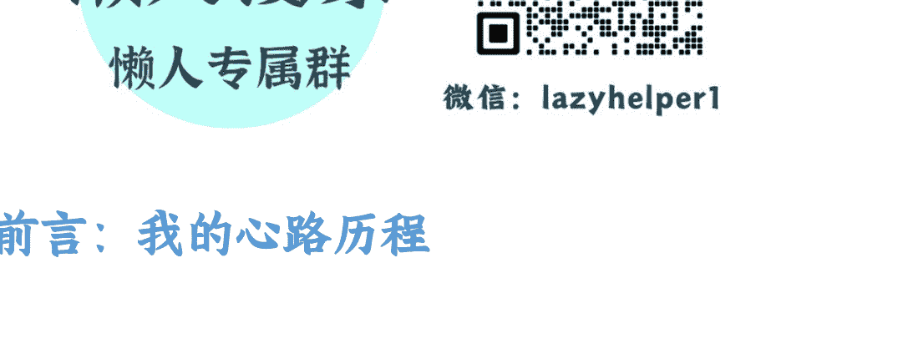

## 前言：我的经历与选择

我是卞言，2003年生人，本科刚毕业。目前在生财自称“精华帖命中率100%”——大家听听就好，纯属玩笑。

两年前，我用 RPA+ChatGPT+Lark 跑通了一套自动化爆文生成流程，赚到了人生第一桶金。后来脑子一热，想去当旅行博主，时间和钱砸进去不少，结果流量惨淡，只能回归现实。

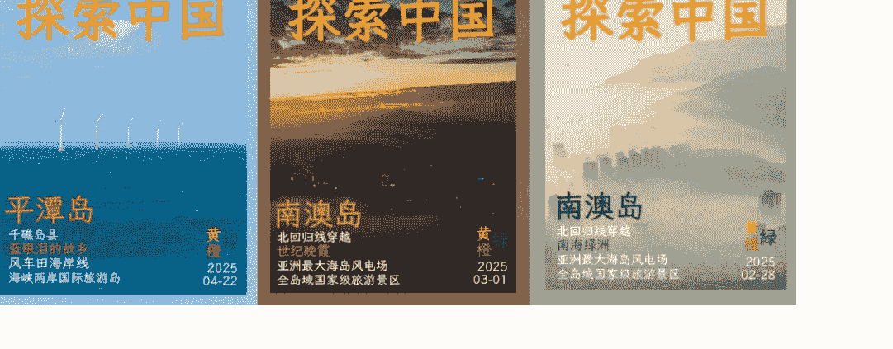

现在，我和搭档都顺利毕业，和多数应届生一样，在深圳一家公司上班。但我们俩骨子里就不安分，不想只当打工人。于是去年年底，我们重新加入了生财，下班后找机会做副业。当时定了一条规矩：一切围绕 AI，选那些有积累又跟得上趋势的方向。

按常理，应该先把生财的精华帖全部过一遍，但我们懒得按部就班，直接去超级标里筛。毕竟亦仁亲自筛过，项目本身不会有大坑，真正要考验的是我们自己能不能执行到位。

我们把所有超级标翻来覆去看了很多遍，慢慢发现有些方向可以互相打通，甚至能合成一个更强大的组合。比如 05AI 服务、11AI 工作流、12AI 工作流定制服务商，本质上是一条线；而 10 垂直小号能解决流量入口，AI 工作流定制服务就是变现产品，两者一拼，流量和交付都有了答案。

所以，我们最终选了垂类公众号做获客（这我们有经验），然后用 AI 工作流定制服务来变现（这跟上时代）。后来新出的超级标 16 企业 AI 学习与服务，又给了我们一针强心剂，证明方向没错。

废话少说，下面直接按我们当时的 OKR 进度表来梳理，进入正题。

| 阶段 | 目标 (O) | 结果 (KR) | 规划 | 进度 | DR1 | 奖励 | 备注 |
| :--- | :--- | :--- | :--- | :--- | :--- | :--- | :--- |
| 学习期 (1.20-2.08) | 明确文章定位与写作结构 | 1. 定下文章类型<br>2. 首尾和正文框架清晰<br>3. 第四段用标题式结构（正文主体配图，开头结尾另算），引言先不放——先放自己的内容 | 1.24 完成初稿 | 1.完成<br>2.完成<br>3.完成 | 赏 | 收稿方 | 各公众号任务进度 |
| | 搭选题库和对标号库 | 合成一个表格（关键是找到用户想要的号） | 1.25 前 | 完成 | 赏 | | 后续自动追热点 |
| | 写文章提示词 | 先出两版实践型 | 2.1 完成实操初版 | 完成 | 赏 | 周末加班 | 主要是开头故事 |
| | 学完 n8n 全部教程 | 1. 精读教程<br>2. 补充材料 | 2.8 前 | 完成 | 钟 | 收稿方 | 1. 小号自动 Q 参考（https://qian.com/2024/01/20/20240120/）<br>2. n8n 自动化工作流（https://qian.com/2024/01/20/20240120/）<br>3. 小号自动 Q 参考（https://qian.com/2024/01/20/20240120/） |
| | 提升 AI 编程基础 | 能看懂生财顾问里所有代码的意图 | 2.8 前 | 完成 | 钟 | 唐山 | 通过 AI 编程学习，达到 n8n 基本要求 |
| | 每周写 11 个讲解教程（公众号） | 每天 4 篇 | 2.5 前 | 完成 | 钟 | | 复现时植入自己的代码逻辑 |
| | 每周写 5-6 篇文章 | 1. 1.30 前每号 2 篇<br>2. 2.7 前每号 3 篇（共 5-6 篇） | 分阶段 | 完成 | 共 | | |
| | 保持每天发 3-4 篇 | 1. 两个号每号至少 4 篇<br>2. 进流量池，每号每周 300+ 流量 | | 1.完成<br>2.完成 | 共 | | |
| 跟号期 (2.08-3.08) | | | | | | | |

具体执行细节可以参考航海，这里不展开，只拎工作流定制相关的信息。

- 垂类小号入口：
https://scys.com/activity/landing/9635

- 公众号自动化 n8n 航海：
https://scys.com/course/detail/104

## 1. 平台数据观察

AI 305,814,215 2.17% ▼

+ 添加对比词 ☆ 订阅

指数趋势


**Coze**  

255,054   

13.40% ▼

+ 添加对比词   

☆已订阅

指数趋势  

i

近7天   

i

近30天   

i

全部   

i

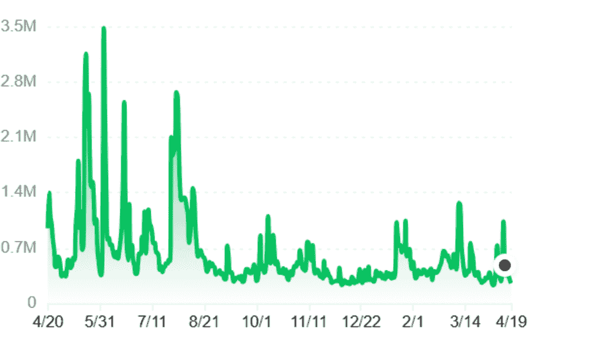

**N8N**  

38,769   

14.25% ▼

+ 添加对比词   

☆已订阅

指数趋势  

i

近7天   

i

近30天   

i

全部   

i

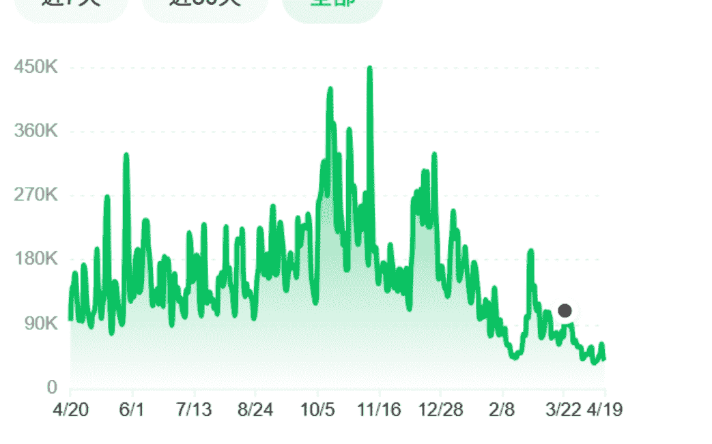

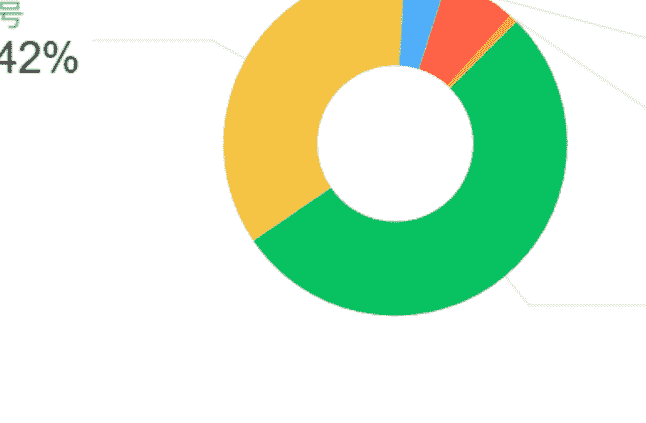

**视频号**   

35.42% 

**搜一搜**   

4.05% 

**直播**   

6.72% 

**其他**   

0.86% 

**公众号**   

52.95% 

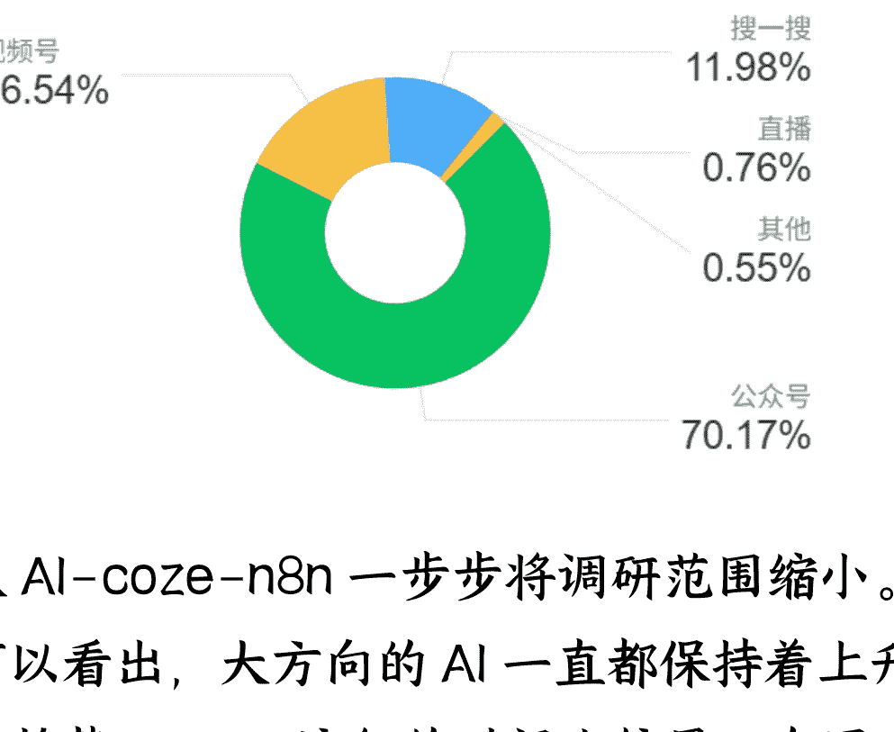

我们把调研半径从 AI 逐步缩到 Coze，再缩到 N8N，像剥洋葱一样。

结论：AI 大方向一直往上走；Coze 火得早，国内用户多，流量主要来自视频号；N8N 在公众号和搜索里占比更高。我们做文字内容更顺手，不太会做视频，所以公众号就成了主战场。

## 2. 对标账号拆解

我们按垂类小号航海里的模板（[垂直小号选题库](https://www.zhihu.com/question/627943807)），扒了一大批对标号，看它们的内容和私域玩法，大概有三类问题。

**懂技术的，把文章写成了技术说明书**

内容全是新工具、新框架、部署步骤，开头就是代码，排版也不讲究，非技术读者根本看不下去。这类账号流量看着不错，但评论区里涌进来的全是同行——求代码、讨论版本、催更新，根本不是我们想要的中小老板。

（技术号的高赞标题和评论见下方截图。）


（评论区截图，可以看出互动者多为开发者。）

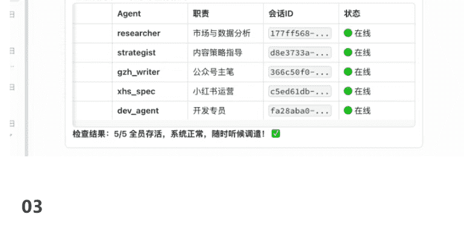

```
~/.openclaw/
├── openclaw.json # 全局路由和通道配置
├── skills/ # 全局技能库（放 nano-banana-pro, seedance2.0 等）
├── workspace-lead/ # 大总管工作区（含 SOUL.md, AGENTS.md）
├── workspace-geo/ # GEO内容优化师工作区
├── workspace-reddit/ # Reddit营销专家工作区
└── workspace-tiktok/ # TikTok爆款编导工作区
```

**懂业务的，还没把 AI 自动化接进业务**

这类账号讲选品、讲调研、讲投放，方法论一套一套的，但很少提 AI 怎么落地。说明这个细分市场还很空白，而这正好是我们的机会。

（业务号的部分内容截图如下。）

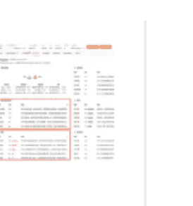

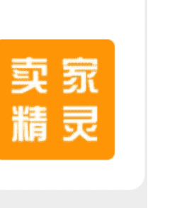

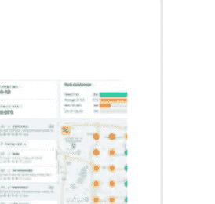

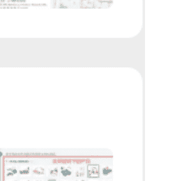

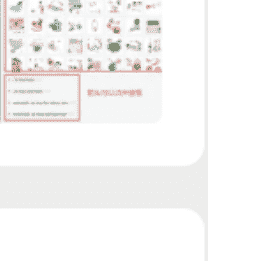

**私域沟通太生硬，不像做生意**

很多人做需求沟通就是单刀直入，没有引导话术，没有需求收集表，要案例也没有。我拿一个每篇平均阅读 1000+ 的工作流定制博主举例子——他已经算做得不错的了，但沟通环节依然很原始。

（下面是他们和潜在客户的对话记录截图。）

客户说想定制一个亚马逊选品的工作流，对方让他描述需求，他说希望从亚马逊拉销量评论数据，让 AI 分析后选出几个爆款，再去 1688 找货源，最后上架。问是不是全自动，他说是。问有没有类似案例，他说只有小红书的，而且没做到自动找货源和上架。问预算，他说五位数可以。客户想看效果，他说涉及用户隐私不能给，并反问客户能否发截图或视频。结果客户回了一句“这也看不出啥”，还说这种文字描述根本判断不了能不能做。


最后一点：目前专做工作流定制、且有一定规模的账号还很少，说明这个方向有早期红利。

我们抽样观察了一批自称深耕工作流定制的账号，翻看朋友圈的成交凭证后发现，能形成持续性现金流的并不在定制本身，而是课程销售、训练营、 小程序开发、网站定制，或仅在 Coze 上做局部自动化搭建。纯工作流的定制订单非常稀少，整体转化率基本徘徊在 1%-5% 之间。

🔥斑码三箭齐发｜2026搞钱必冲「OPC一人公司」全技能服务来了！...

🔥斑码三箭齐发，2026最火的「OPC一人公司」全技能服务来了！...

🔥2026破局新思路：打造你的"AI一人公司”！【OpenClaw实战训练营...

最近被「OpenClaw」刷屏了吧？其实剥开它神奇的表象...

🔥【顶配独享】谷歌 Gemini 3.0 成品号...

牛牛老师这个豆包训练营太棒了，真的是用好豆包，万事不求人呀，下...

昨天

电竞俱乐部双端 App 开发已付 1.2W 专业定制！服务靠谱，欢迎各位老板...

27 4 月

DIY 手串小程序项目 2.8K 开发中🎉🎉🎉 小程序、网站、APP 项目火...

19 4 月

电竞娱乐陪玩项目 5500，经过成员全力配合，项目完成顺利交付🎉🎉🎉...

08 4 月

艺术馆小程序项目 6K 开发中🎉🎉🎉，专业定制，欢迎咨询

03 4 月

做软件开发我们是认真的👊

APP、小程序、网站、...

23 3 月

棒球核销系统小程序开发中，总额 1.6w，是专业定制！服务靠谱，欢迎咨...

18 3 月

陪玩小程序定制开发，

今天

本科 给同学加急做出来了

🙈别被我朋友圈吓跑了

😂价格肯定都是根据具...

30₄月

强化学习二区顺利交付🐧🎉🎉🌹

27₄月

图像分类顺利交付🌹

18₄月

目标跟踪两个创新点顺利交付🌹

11₄月

都说晴西湖不如雨西湖。

难怪暴雨还这么多人😂

10₄月

哈哈哈跟个风~(´▽`~)~

### 3. 最终方向

前期调研后，我们把公众号的内容主线做了明确：以业务认知为主线，穿插AI自动化的实操案例，面向中小企业经营者。

要让老板第一眼看到的是熟悉的业务场景，而非晦涩的技术名词，由业务自然过渡到AI如何赋能，让他产生时代正在变化、自身业务也需要升级的认知。

## 二、账号冷启动期 2.08-3.08

| 阶段 | 核心目标 (O) | 关键结果 (KR) | 规划 | 进度 | 责任人 | 激励 | 备注 |
| --- | --- | --- | --- | --- | --- | --- | --- |
| 冷启动 2.08-3.08 | 周末保持发布3~4篇 | 1.两个号各发1~4篇<br>2.进流量池：单篇稳定在300以上 |  | 1.√<br>2.√ | 共 | 出国旅行 |  |
| 完成存量文章头图标题排版上线 |  |  |  | √ | 黄 | 出国旅行 | 参考:1.@nan35N源文件及其他资料<br>2.复刻同行公众号内容<br>3.多工作流融合 |
| AI辅助挖掘新工作流 | 持续复现并撰写技术解读 | 阶段任务 | √ | 钟 | 跟爸妈旅行 |  |

春节前后账号处在起步阶段，首要任务是维持活跃，让新号进入推荐池，其余时间用于家庭陪伴。

注意事项：

- 多号并行，提升进入池子的概率，个别新号发几十篇都上不了池
- 保持稳定更新，春节期间也挤时间写稿发布
- 首发即要保证质量，避免纯AI垃圾稿、排版粗糙
- 大量使用AI辅助创作，至少达到创作环节的LV3路人甲水平

最终仅用两台新号就成功让其中一个进入流量池。

更多细节可参考行业大佬的分享。

## 三、首笔收入期 3.08-4.6

| 阶段 | 核心目标（O） | 关键结果 (KR) | 规则 | 进度 | 责任人 | 激励 |
| --- | --- | --- | --- | --- | --- | --- |
| 首笔收入 3.08-4.6 | 梳理现有3D客户需求 | 为每位客户输出MAP需求拆解 | 3.18前 | √ | 钟 |  |
| 寻找技术合作 | 1.3.18前锁定1-2个试点<br>2.储备技术人员至少5人 | 阶段任务 | 1.√<br>2.√ | 钟 |  |
| 发布实操文章 | 每周1篇<br>1.3.23-3.29<br>2.3.30-4.5 |  | 1.√<br>2.√ | 钟 |  |
| 案例收集 | 1.公众号案例 2.case案例 | 持续任务 | √ | 钟 |  |
| 客户/技术需求模板化 | 整理成飞书模板 |  | √ | 钟 |  |
| 售后与交付能力 | 跑通一次标准交付并完成一次售后 |  | √ | 钟 |  |
| AI工具盘点 | 汇总当前主流AI工具 |  | √ | 钟 |  |
| 用户需求理解 | 建立需求收集模板，形成对接SOP | 持续任务 | √ | 赏 |  |
| 电商行业学习 |  |  | √ | 赏 |  |
| 私域成交流程梳理 | 输出SOP及话术 |  | √ | 赏 |  |
| 引流转化 | 引流100+，至少转化1人 |  | √ | 赏 |  |
| 拒绝原因总结 |  | 持续任务 | √ | 共 |  |
| 文章写法与转化问题总结 |  | 阶段任务 | √ | 共 | 去跑项目 |
| 保持发文频率每周2-3篇 | 单篇阅读破5000 |  | √ | 共 |  |
| 成交 | 赚到第一笔钱 |  | √ | 共 |  |

《财富自由之路》中提到，做事常呈现指数曲线，触及临界点后才会爆发式增长。

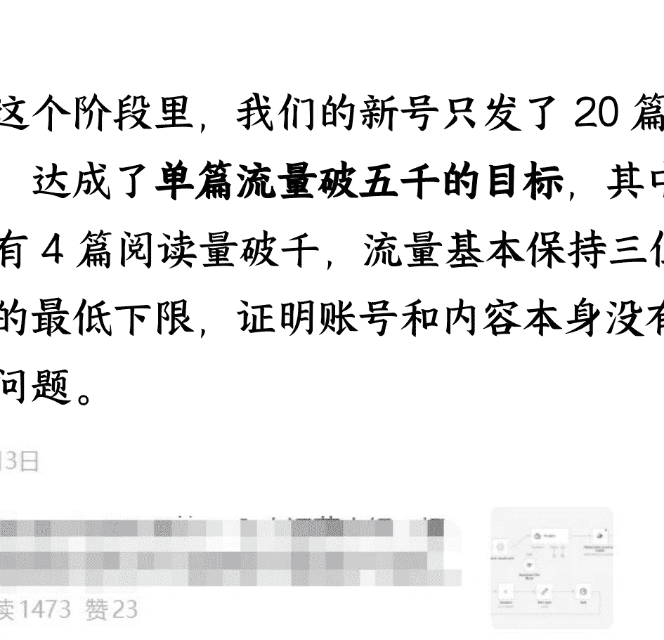

本阶段新号共发20篇，达成单篇破五千的目标，其中4篇破千，阅读基本稳定在三位数以上，说明号与内容方向是可行的。

## 流量概览

| 指标 | 阅读 | 分享 | 跳转原文 | 收藏 |
| :--- | :--- | :--- | :--- | :--- |
| 范围 | 近7日 | 近30日 | 自定义 | - |
| 时间 | 2026/02/05 — 2026/04/05 | - | - | - |
| 渠道 | 全部 | - | - | - |

阅读总人数：21390

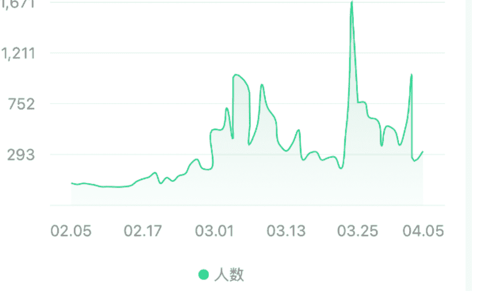

一篇五千阅读的稿子即可带来上百个精准线索，后续长尾也会持续带来咨询。

## 新增联系人

姜治国 King@跨境

n8n流程分享

已添加

...后续列表保持原样省略...

**本月实现首笔盈利，接下三单，其中一单出现违约，净赚超3000元，似乎触达了增长拐点。**


### 1.战略转向

初期我们想先掌握自动化技术，去接相对简单的定制单，但很快发现不合适：

- 非科班出身，学习门槛高：复杂工作流用n8n等低代码无法覆盖，需要手写代码甚至封装前端
- 技术迭代快：刚上手n8n就出现新工具，个人学习速度追不上迭代，底层通用能力更有迁移价值
- 产能受限：单人一段时间内只能交付一单，无法规模化复用

受生财社群启发，我们调整为中间商定位。

核心从做定制变为获客、需求整理、撮合靠谱技术方。

### 2.技术方筛选

我们把闲鱼、淘宝上的n8n定制商家全部排查，并用同一需求去询价，发现市场极度不透明。

相同需求报价从2000到20000不等，缺乏统一评估标准。

**这也带来了定价空间，谈判得当利润率可达80%。**


### 3.流程再造

完整链路为：发文→私域引流→需求沟通→技术对齐→签约→交付。

最关键的是需求沟通与技术对齐环节。

早期我们直接口头沟通，颗粒度对不齐，还需二次整理给技术，效率低下。后来尝试电话、腾讯会议拉技术同框，未成交则消耗技术耐心。

优化后流程为：

意向客户先填需求收集表→表单转技术方获取报价与周期→客户确认→需求确认→签约付定金→会议对齐细节→开发交付

用表单降本，用报价周期过滤无效客户，用一次会议统一对齐。

后续我们整理了含价格、周期、细节的收集表供参考。

需求确认时我们会先评估技术风险，提前告知客户并出具确认书。以电商图自动化定制为例。

### 二、业务拆解 4步

信息采集→款式匹配→AI出图→归档

| 步骤 | 需求 | 优先级 | 当前痛点 |
| :--- | :--- | :--- | :--- |
| 1.信息对接 | 从钉钉群自动采集并校验信息 | 高 | 人工采集易错 |
| 2.款式匹配 | 自动匹配产品款式 | 中 | 人工耗时 |
| 3.AI出图 | 按要求生成预览图 | 高 | 依赖PS手动出图 |
| 4.归档 | 图片归档管理 | 低 | 手动整理 |

难点1：钉钉信息自动采集
- 限制：钉钉消息监听权限严格
- 原因：聊天格式不统一需NLP解析
- 风险：AI群主功能影响周期

难点2：AI精准出图
- 核心：客户要零误差的效果图
- 问题：款式、颜色、Logo位置难以精确控制；Logo需单独处理；面料与多角度模拟成本高
- 矛盾：客户期望文字即精准，而现阶段AI在商业精细场景可靠性不足

难点3：产品库匹配
- 需建立结构化库：款式、颜色、尺码、可定制区，相对容易实现

难点4：Logo抠图
- 有成熟方案如rembg，难度低

| 方案 | 可行性 | 预期效果 | 说明 |
| :--- | :--- | :--- | :--- |
| 纯AI生成 | 不可行 | 无法保证准确无误 | 结果不可控，商业不可接受 |
| 模型合成+AI辅助 | 高度可行 | 准确率70%+ | 控制版型+图像合成，AI辅助裁剪 |
| 全自动 | 或许可能 | 7-15天难以完成 | 钉钉+AI出图+归档工程量大 |

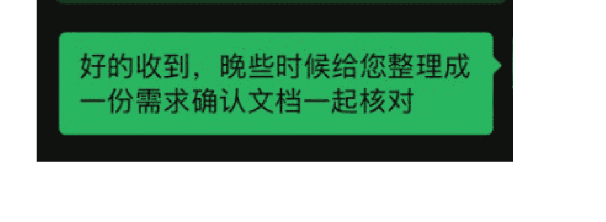

先说一个用真金白银换来的教训：无论合作对象说得多么天花乱坠，该签的合同一定要签，该走的平台一定要走，别怕麻烦，法律才是你最后的靠山。

我们自己的第一单生意，就撞上了一个“装死”的技术方——活儿没干完，人不见了，消息不回，电话不接。最后我们不但没赚到钱，反倒赔了客户一笔违约金，气得我们直接一纸诉状把对方告上了法庭。所以如果你问我这行最难的是什么，我会说，找到一个真正靠谱的技术合作方，比找客户还难。


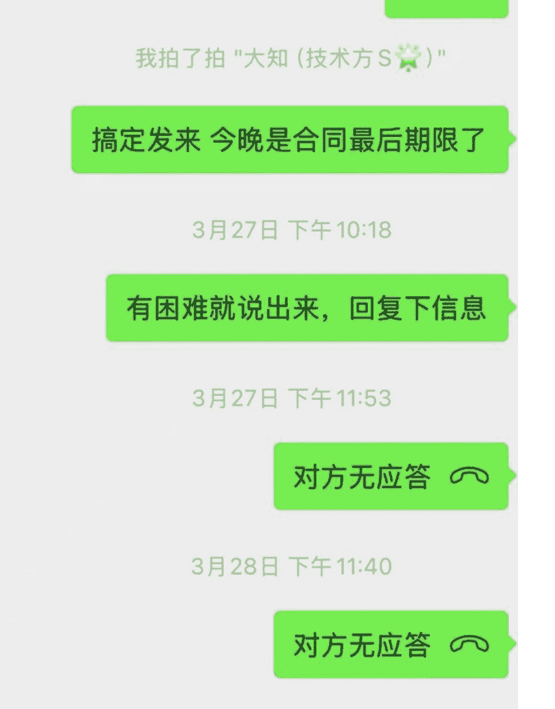

（这里是一段真实纠纷截图：对方撂下狠话“等着收律师函”，我们确实也这么做了。案件状态显示：技术合同纠纷，民事一审，已在深圳龙华区法院立案。）

### 一、这几个月跑下来，我们看到的真实市场

接触的客户越多，越发现一个规律：像个人工作室、小公司、个体创业者这类小微群体，对自动化定制确实有兴趣，但多半不是“非买不可”的刚需。说白了，花几千块去买一个看不见摸不着的东西，谁都得犹豫半天。

而且非标定制有个天然短板——前期沟通时，你没法把最终效果摆在客户面前，只能靠嘴描述一个“大概会是什么样”，这本身就是一种不确定感，客户心里打鼓太正常了。

这类客户对价格特别敏感，不管你的技术难度高不高，他们的心理价位基本就在 5000 块以下，再往上就很难说服他们试错。（当然，也可能跟我们本身的信任积累和案例沉淀还不够有关。）

结果就是，我们的转化率大概只有 1%-5%。我不太确定这个数字算不算正常，但私下问了几个同行，大家反馈也都差不多——这行，转化率普遍不高。

### 二、真正的成本不在技术，而在沟通

作为中间商，我们最耗时间的环节就是私信沟通。微信加了好友没及时通过，客户可能就跑了；消息回慢了，客户也可能就凉了。所以我们的原则是：消息必须秒回，同时准备一套标准话术，把客户引导到既定流程里来，别让双方在无效沟通上互相消耗。

还有一点特别重要——信任基础。

定制化产品加上相对高的客单价，客户如果不信任你，根本不会掏钱。而信任感最直观的来源是什么？朋友圈。朋友圈的核心又是什么？案例。

什么样的案例才算有效？不是嘴上说说“我做过几个项目”，而是实打实地把产品交付的样子、过程、客户沟通记录都展示出来。让人一翻你的朋友圈就感受到：这人是真在做事，有真实成交，也有靠谱的售后。毕竟客户最怕的就两件事：一是你压根做不出他想要的效果；二是出了问题你人就不见了。

> （附一个真实的客户需求实例：一份 300KB 的英文家电说明书，客户要求先用 AI 全面检查语法和用词，再导入 InDesign 套用特定模板，翻译成多国语言，还要处理排版问题。甚至有时发来的直接是转曲后的 PDF，AI 得先理解说明书内容再重新组织——这活儿真不是想象中那么简单。）

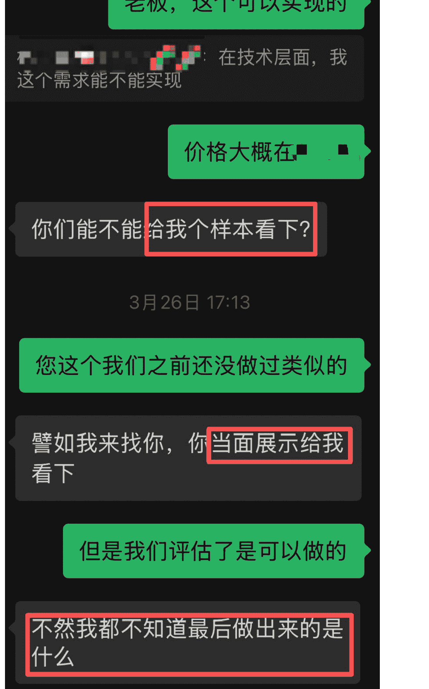

“你怎么保证做出来的东西是我要的？”“我以后不会用怎么办？”“售后管多久？能不能帮调试？”

这些是我们每天都会被问到的“灵魂三问”。

怎么解决？最直接的办法就是两条：走平台，或者签合同。

把交付项、交付周期、违约条款、售后天数全部白纸黑字写清楚，双方确认需求后再开工，过程中定期同步进度。另外，手里案例够多也是硬道理——直接甩一个类似的案例给客户看，比你说一百句都管用，成交率能明显上一个台阶。

### 三、几个不成熟的小判断

**1. 自动化定制这个赛道，未来只有两条路**

跟足够多客户打完交道之后，你会发现沟通成本极高，后期维护保障也极费精力。往后再做这个方向，要么往高客单价的深度定制走，要么把高频需求做成标准化产品交付，否则很难覆盖成本、也很难从后端的维护泥潭里抽身。

特别是电商生图这块，已经有不少人把整套流程封装成了标品——每次客户需求不同，就微调其中的节点和流程，本质上是“定制化的标品”，有些甚至能做到当天交付。而且做成标品还有个额外好处：前期沟通时你就能直接给客户演示大致效果，眼见为实，成单率自然高。

下面放两个电商服装和饰品生图的实际案例：

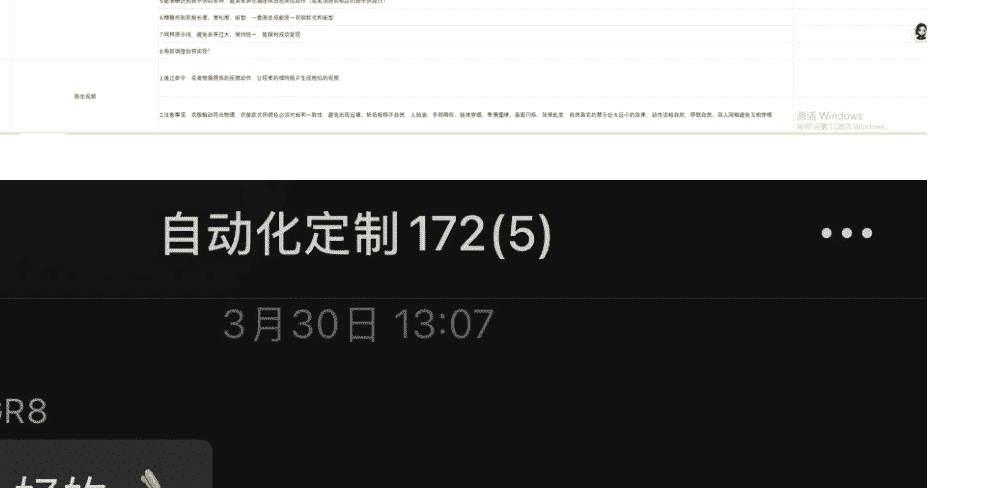

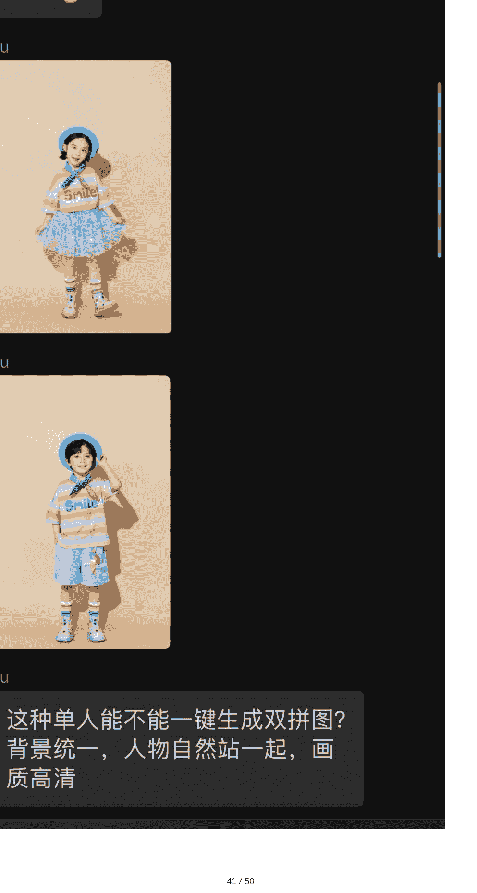

（比如这种：保留原图的姿势和造型，男女站位不变，背景统一，脚底光影自然融合。）


（再比如：造型姿势完全不动，只做拼接，其他部分自然过渡。用提示词描述就能实现，同一套工作流，换提示词就够用。当时客户问完，我们直接说：对的，今晚给你出效果图，先测三张看看。）

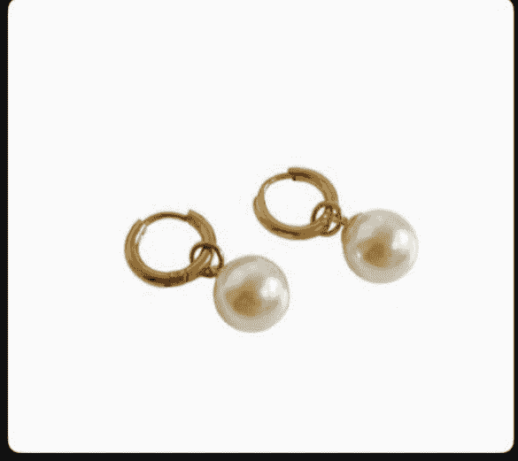

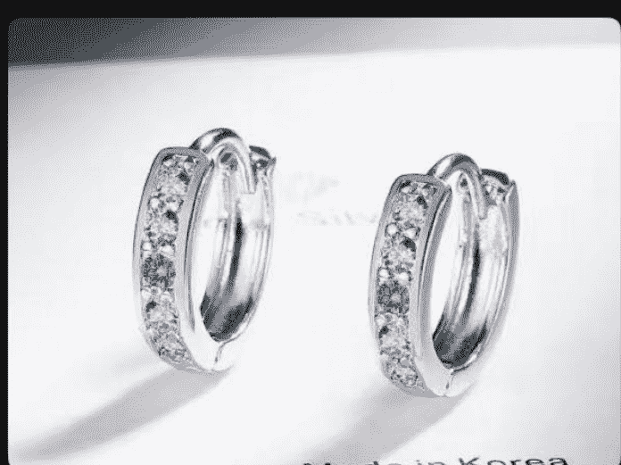

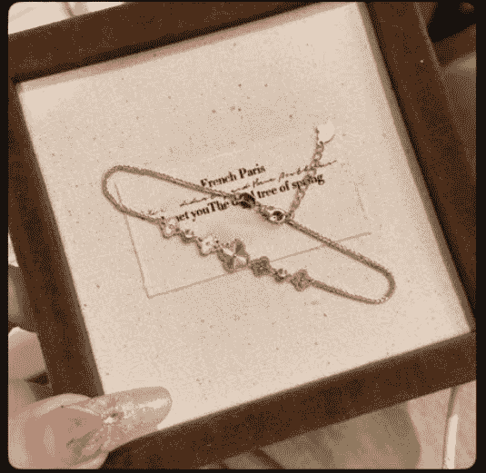


**2. 别贪多，做垂类，吃透一个行业**

我们现在的账号流量还行，私域也一直有人来咨询。但问题在于，我们发的内容太杂了——电商、生图、公众号、各种领域的工作流都有，结果吸引来的客户也来自各行各业。

这就尴尬了：电商我们只懂皮毛，生图也只懂个大概，公众号同样不深。客户聊到具体流程需求时，我们经常听不懂，根本不知道对方描述的那个流程该怎么落地。

举个真实例子，有客户说要定制一套选品工作流：从亚马逊采集销量和评论数据，用 AI 分析，再到 1688 上选品，最后把最优产品上架到亚马逊——

### 2.1 智能化选品流程

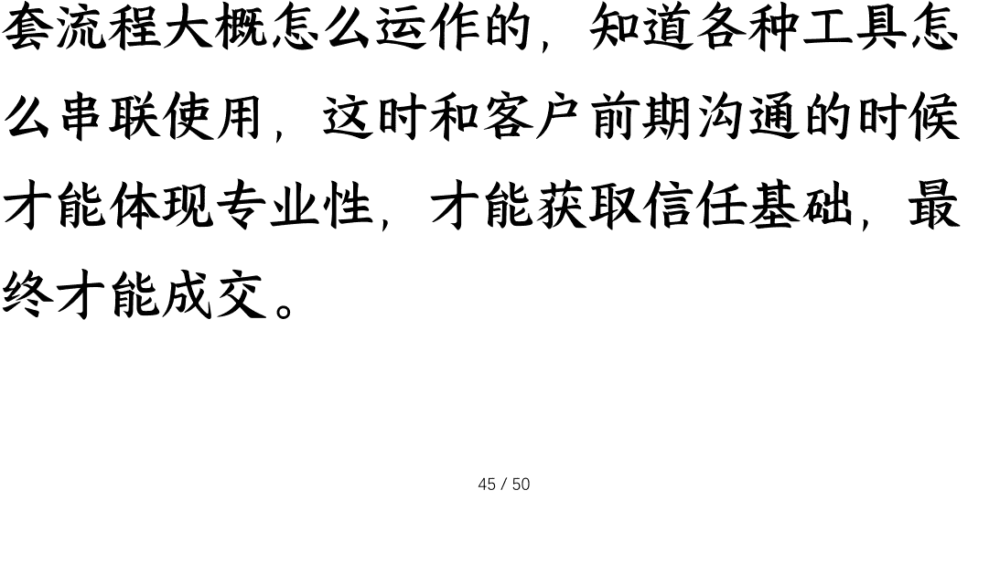

所以说，如果可以重来，我建议：选一个需求足够大的行业，死磕下去。公域文章、朋友圈案例、产品服务，全部往一个垂直方向打。这条路，或许是更优解。

**3. 持续学习，是唯一能对抗焦虑的方法**

这几个月我们最大的恐慌，来自技术迭代的速度。2025 年大家还在研究 n8n，2026 年又冒出了小龙虾、Claude code；去年还流行 banana，今年又变成了 GPT image2……

你会发现技术的更新速度快到离谱——你刚把一样东西学会，新的模型又出来了，又得从头学一遍，感觉永远追不上。

但当你鼓起勇气迈出第一步，真的开始学新东西的时候，又会有个神奇的发现：哎，这东西好像也没想象中那么难嘛。

而且趋势很明显：未来新技术的上手成本只会越来越低，学习周期只会越来越短。从最初纯代码编程，到 RPA、n8n；从靠 GPT 辅助写代码，到如今用自然语言就能通过 Claude code 编写 skills——每一次迭代，都在把门槛往下压。

所以，与其焦虑未来，不如现在就开始。

### 四、我们的迷茫，也想请你支支招

目前公众号自动化工作流、电商作图工作流、电商选品工作流这三个方向，都有客户在咨询。但我们最大的困境是：这三个领域我们都没有真正的行业实操经验，电商更是从来没上手做过，现在的工作也跟这些毫无关联。

这就导致一个很尴尬的局面：我们只知道电商大概有哪些板块，客户一深入聊需求，我们就抓瞎了。不少单子，就卡死在沟通这一步。

我们想到的办法是：尽快换工作，先让自己“肉身入行”，真正扎进去，才有机会接触到行业底层的资源和信息。当然，最理想的情况是遇到一位老板，愿意带我们入局，我们结合业务流程加上对 AI 的理解，帮他解决问题，互相成就。

目前我们能想到的高需求方向只有电商和公众号，很想知道还有没有其他领域存在“流程繁琐、急需 AI 自动化改造”的机会？欢迎大家留言一起探讨。

另外，我们最近拜访了一位做电商服装出图的朋友，他那儿的情况也很有代表性：现在主要靠实拍，尤其是带人物模特的那种服装图，稍微有点品牌的客户基本都指定实拍。原因有两个：

一是人物肖像版权问题——AI 生成的人物到底有没有肖像权？万一侵权怎么界定？品牌方不敢冒这个险。二是服装细节一致性——AI 生图最大的要求就是图上衣服和实物必须一模一样，但现在的 AI 仍然存在不稳定性，一个不留神就把衣服细节改得面目全非。

这些问题，不知道各位有没有更好的解法？还是说，其实都是我们自己吓自己？

说到底，我们现在挺迷茫的。不知道该往哪个领域深耕，要不要做标品？流量没以前稳定了，重心该放在流量还是转化率？要不要干脆辞职、全职出来干？现在的状态总是不温不火，本职工作跟 AI 也八竿子打不着。

我们知道，这些问题归根结底是认知不够。但就是这些实实在在的困惑，卡住了我们。

写这篇帖子，既是分享，更是求助。

快三年了，我们一直在埋头摸索，困在自己的小圈子里，没有对外打开过自己，也没有遇到过所谓的“师傅领进门”，自然也就到不了“修行在个人”那一步。

所以我愿意把所有细节、所有真实经历都摊开来讲，只希望能换各位大佬一句指点——哪怕只有一句话，对我们来说都格外珍贵。

希望我们的真诚、冲劲、执行力和不甘心，能被看见，能被肯定。谢谢每一个能看到这里的朋友。

————分割线————

看完这篇 SOP，你可能觉得自己懂了。但现实是，90% 的人一上手实操，第一步就会被卡住。

工具和教程，从来都是最低级的门槛。真正的壁垒只有两个：立刻动手的执行力，和圈层之间的信息差。

想看看全网最新的 AI 变现玩法，和一群执行力拉满的极客一起下场拿结果？欢迎来我的核心私域逛逛：【懒人专属群】。

这里不聊虚的，只做商业闭环拆解和 AI 效率的极限压榨。社群里已经沉淀了 1000+ 跑通的套利实战案例。

👉 查看圈子完整数字资产与上车门槛：

https://lazyso.com/insider/


备注：【实操上车】，不闲聊。