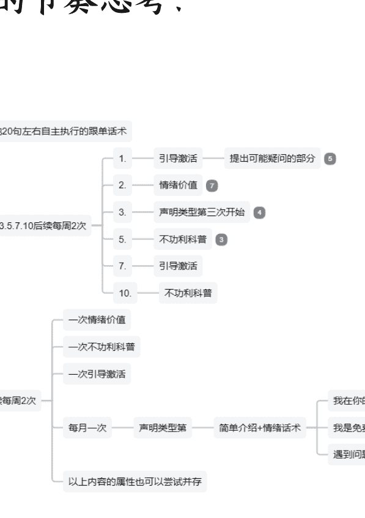
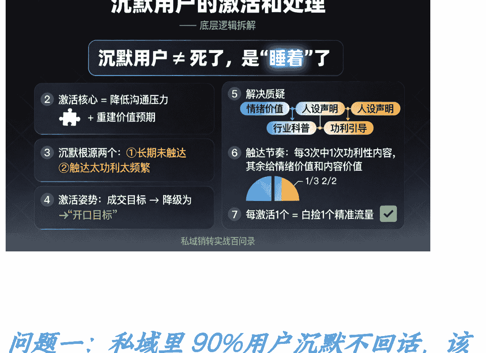
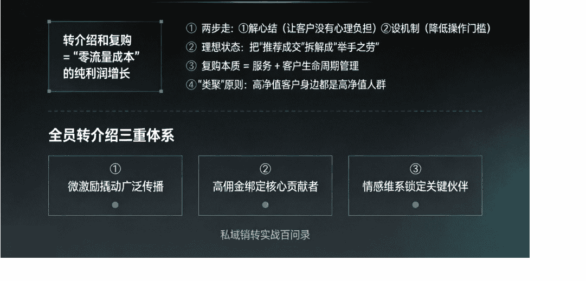
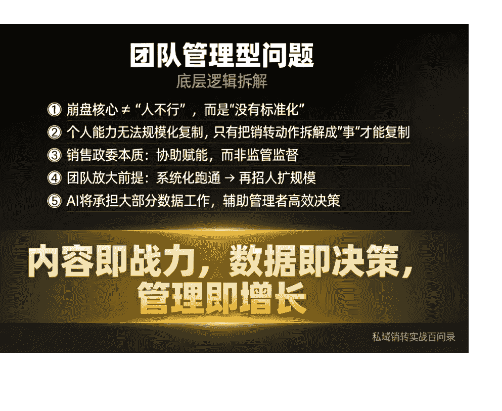

# 私域销售卡在转化？这份高客单与泛粉实战复盘，把思路一次讲透

最近总有人问我：私域里产品客单价不低，客户一直在犹豫怎么办？领资料的人加了一堆，就是没人掏钱怎么办？其实这些问题不是个例，而是大多数私域团队的共同痛点。

我把一位销转教练的实战分享重新做了梳理，重点围绕“高客单成交”和“泛粉培育激活”两大场景，结合真实案例和解决方案，整理成下面这篇复盘。全程没有空话，希望你读完能直接用上。

## 第一部分：高客单成交，到底在卖什么？

很多人以为高客单卖的是产品，其实卖的是“信任溢价”。同样一套服务，你的成本可能没变，但客户感知到的价值和安全感不同，最终结果会天差地别。高价客户真正在意的，从来不只是产品功能，而是结果是不是确定、你这个人值不值得信。

所以想让客户爽快付高价，可以从三个方向同时发力：

- **错位信任背书**：建立专业壁垒，让客户觉得“你不可替代”；
- **精准价值锚定**：让客户清楚知道钱花在了哪里、能换回什么；
- **风险对冲设计**：用分期、对赌、体验课等方式，降低客户做决定的难度。

换句话说，关键不是“说服”客户花钱，而是让客户看懂价值、感到有保障、比出你的优势。

哪怕你卖的是标品，也要想想还能提供什么额外价值：卖课的同时链接高端人脉资源，社群之外给到搞钱玩法和资源对接，甚至“男销售配女助理、女销售配男助理”，本质上都是在产品之外增加的附加值。

除了这些底层逻辑，还有几个高频问题值得细看。

### 1. 知识付费业务怎么做内容传递？

核心原则是：把产品价值“讲透”，让客户真的理解和认可——成交只是价值传递到位之后自然发生的结果。

具体落地四步：

- **干货占比放大**：把课程核心内容的30%-70%免费释放出去，通过👸号、视频号、朋友圈、私聊多渠道触达。你免费给的干货越足，客户越相信付费内容更值得。也不用怕泄露，大多数人根本看不完免费内容。
- **触达渠道做宽**：别只发朋友圈，还要配合长文、短视频、直播公开课、定向私信，多维度重复触达，强化客户对产品价值的认知。
- **内容紧扣痛点**：客户怕贵、怕不信任、怕没效果，就分别做对应内容，用“一说明、二解释、三佐证”的逻辑把每个顾虑讲透。
- **重复不怕啰嗦**：同一个核心价值点，要换着形式反复讲，客户才能真正记住。如果私域体量允许，还可以做直播公开课，一次转化一批人。

### 2. 产品要不要打磨到100分再发售？

别等，先用飞轮效应跑起来。第一轮做到六十分，拿到市场反馈和现金流，再用真实结果去迭代第二轮、第三轮。别犯“磨了一年产品，学员都用你的内容变现了”的错误。

产品打磨本身也要聚焦。尤其初期，别做全流程陪跑，而是盯住一个核心卖点打透。比如设计师IP教练，就围绕“帮设计师搞定高客单商业模式设计”来做产品。核心卖点够清晰，成交抓手才够多，后续销售团队、运营流程才有意义。

### 3. 客户总跟你倾诉负面情绪，怎么礼貌打断？

记住一个原则：先给价值，再做边界说明。可以分三步走：

先说“我特别理解你现在的处境”，建立共情；再坦白“我眼下工作排得比较满，空了跟你细聊”，设好边界；最后补一句“平时你有具体问题随时留言，我看到会免费解答”，留下钩子。

日常沟通也要坚持“你动我才动”：客户给出明确问题，你再针对性地跟进，别让情绪倾诉无限消耗你的时间。提前设计好这些话术，把“截断对话”变成一次客户筛选和价值传递。

### 4. 开场白转化率低，第一印象怎么优化？

高客单价客户一定会比价。第一印象的核心目标不是直接成交，而是让客户对你产生好感，愿意把你放进“备选池”。三个优化方向：

- **把价值和背书做厚**：品牌不够强，就用专业特长或服务差异化补位；
- **适当放大价值感知**：让客户在前期就能感受到你的不同；
- **明确破冰目标**：建立基础信任，而不是逼单。

很多背书不是没有，而是没花精力整理。就像罗振宇讲过的案例：所有人都说啤酒“17天深度酿制”，但只有你把它讲出来，它就变成了你的差异化。

## 第二部分：泛粉转化，关键在“培育”而非“筛选”

泛粉转化的底层逻辑，是“落差管理”和“分层培育”。

资料粉和业务粉本质不同：用户是奔着资料来的，你上来就推高客单产品，预期对不上，用户当然沉默。正确做法是放下“来了就成交”的执念，把资料粉当成“原材料”，先加工成精准客群。这个“洗一遍”的重点不是筛除，而是培育。

泛粉转化盯两个指标：开口率和培育率，而不是成交率。同时，沉默用户也要持续跟单激活。每激活一个沉默用户，就相当于白捡一个精准流量——你传递价值内容打动了他，价值杠杆就被放大一次。

### 1. 资料粉引流转化低，但又离不开资料粉，怎么办？

先想清楚：资料粉和业务粉是两类流量，不能用同一套逻辑去转化。转化率低的根源，不是资料不够好，而是流量、产品、销转三者之间存在巨大的价值落差。

破局思路是转换身份：别指望资料粉直接买高客单，而是先用免费服务、基础调研和内容价值，跟他们建立链接，拿到用户的核心需求和付费能力。再分层做价值传递，逐步从低客单过渡到高客单。一上来就聊大单，必死。

### 2. 泛粉初步聊完后，怎么进一步提高转化率？

核心原则：把成交放一边，先专注培育。把目标拆成添加率、开口率、资料领取率、成交转化率、复购率，逐个环节看数据、找瓶颈。

优化开口率，就“客户要什么，先给什么”，再在内容里自然植入你的价值；优化资料领取率，就准备好一套合理的过渡方案，解释清楚“为什么私聊内容和引流时有些差异”，让用户觉得有交代。

然后用内容做筛选：大量输出价值，帮客户对比免费和付费的区别。重点不是成交，而是挖掘有付费意愿的人。这个阶段，“一说明、二解释、三佐证”同样好用。

接着做好跟单。成交率低于3%的时候，跟单是性价比最高的动作，没有之一，单靠跟单就能让转化率翻倍。持续提供价值，做客户微信里最方便找到的靠谱专家，客户就不容易流失。培育做到位了，成交是水到渠成的事。

### 3. 有2万糖尿病精准粉丝，却变不了现，怎么办？

核心问题就一句话：有流量，没有产品，也没有变现路径。可以从五个方向同步解决：

- **跑通初级变现**：先用合规的低客单控糖食品、血糖监测耗材带货，验证粉丝的付费意愿；
- **升级社群运营**：把免费社群变成持续输出价值的阵地，筛选出深度需求的用户，再往付费星球、咨询、陪跑等更高客单产品引导；
- **拿规模当筹码**：主动找品牌方谈代理分销、定制内容或专场直播，你的精准粉丝本身就是商业筹码；
- **内容复用放大规模**：把用户提问和已有内容二次加工，专注一个平台持续做，做出规模和粘性；
- **守住信任底线**：永远不要为了短期收益推不合规、低质量的产品，否则会一次性透支所有长期积累。

## 说在最后

最近还有一个明显趋势：AI工具正在重塑私域销售的流程。有团队用AI笔记去记录销冠的沟通，一周后整理成一套标准话术库和常见问题清单；再普通销售的话术与销冠逐项对比打分，找出薄弱环节；新来的实习生拿着这套话术，三天就能开单。销售离职不再可怕，甚至敢招没有经验的人进来，这就是把“个人经验”沉淀成“组织资产”的价值。

私域销转，说到底就是两件事：让高客单客户看懂价值，让泛粉感觉到持续陪伴。方向对了，剩下的就是下笨功夫。

参考市面上已经被验证过的打法，“免费地域社群 + 付费星球 + 全国线下沙龙”这条线，门槛低、启动快，很适合起步。

- 先用免费群把同城的精准人群汇聚起来；
- 再用付费星球做轻量级变现；
- 最后用免费线下沙龙对接品牌赞助，放大收益。
这样做不用直接向粉丝收钱，回报却很可观。

三步可以错峰推进，先把离自己最近的一环跑通，没必要一上来就把整条链路想清楚。

## 三、沉默用户的唤醒与处理

### 底层逻辑描述

沉默不代表死亡，更多时候是进入休眠。

要唤醒的核心，是降低沟通的心理成本并重塑价值预期。私域里用户大量失联，原因基本就两类：一类是压根没被触达到，一直被搁置；一类是触达到太频繁、信息太功利，引起排斥甚至屏蔽。所以关键要放在“真正被触达”上。

激活的正确姿势，是先把目标从成交降级为开口。先让对方愿意回一句，再谈后续转化。具体把握三点：

1. 以无功利的免费服务和交叉提问撬动回复，让开口的门槛变低；
2. 用“私域小 IP”的姿态替代“广告号”的定位，让客户把你当成随时可调用的备选资源，而不是一个急于推销的陌生账号；
3. 用标准化的跟进表和节奏化策略，让后续跟进有据可依，而不是靠记忆临时发挥。

节奏上的参考思路：

更重要的是换个视角看激活的意义。哪怕这次没成交，把一个用户唤醒，也等于多捡一个赛道内的精准流量。因为是通过价值内容打动的人，被唤醒的用户本身就具备真实需求。

激活的节奏可以归纳为一个小公式。先定一句人设锚点：

> “我是你朋友圈里目前能触达到的这个领域的人，专业、和善、愿意分享，你随时可以来我这里了解行业最新情况。”

想想你微信里医生、律师、开锁师傅都给你这种感觉，为什么你不能成为“他”？

公式的底层是：先处理客户过往的成交疑虑，没有就跳过，再传递情绪价值，做个人设声明，随后输出不功利的行业科普。等非功利内容铺垫到位，再进入功利性的引导。后续触达建议三轮里放一轮功利，其余两轮分别给情绪和内容价值，比例可根据赛道微调。

### 问题一：私域里九成用户不回，该怎么激活？

沉默占多数是常态。核心是放弃一步到位成交的想法，把直奔成交的路径拉回到跟进节点重新设计。第一阶段的目标不是成交，而是让用户开口、建立沟通。

可分四步落地：

**第一步，用无功利的价值触达降门槛。** 对沉默用户做标准化唤醒动作，核心是给免费服务、给免费价值，而不是上来就推产品谈成交。用户感受到的是帮助意愿而非推销压力，回复意愿自然提升。

**第二步，设计交叉式基础提问引导开口。** 围绕赛道、个人情况、核心诉求、创业状态等维度，设计好回答成本低的问题。一方面降低回复难度，另一方面在对话中完成基础信息收集与分层，为后续转化提供依据。

**第三步，把开口率作为激活阶段的首要考核。** 不要急着成交，先把开口率做到预期，比如50%，把激活这个节点磨透，再进入下一阶段。激活没完成就推成交，等于在流沙上盖楼。

**第四步，建立“一旦回话即回起点”的标准路径。** 只要沉默用户开始回复，就按销转第一节点重新推进。每个回话的用户都是重新进入转化漏斗的机会。

### 问题二：夜校3000人沉淀，推新课发短信激活反馈很差怎么办？

私域沉了3000人，用推新课、发短信去唤醒长期沉默用户，反馈差、已读不回、少数婉拒“最近忙”。说明触达方式、内容设计、频率节奏都要系统性调整。

首先，从“推广告”转向“立人设”。停止只推课程广告，把内容重心调到“我是谁、能提供什么长期价值”。让客户感知到你是一个长期存在、专业可靠的本地培训资源对接人，而非只发广告的推销号。沟通感要诚恳，别太生硬。

其次，优化触达频率。把两三天一次的高频轰炸，改为一周一次的合理节奏。逢年过节、暑假等需求明确的节点再重点跟进，提升相关性，避免日常打扰。

第三，做精细化分层，告别无差别群发。按是否成交、意向高低、人群属性成人/学生家长做标签拆分，定向推送。比如家长群可围绕“神兽在家”的痛点设计方案；成人群侧重职业技能提升和时间规划。分层越细效率越高。

第四，把自己打造成微信里的“私域小 IP”。优化昵称、朋友圈内容，提升辨识度，让客户形成“本地找培训找他”的认知。可参考房产中介的跟进写法，把形象包装成值得信赖的本地培训资源专家，而非课程推销员。

第五，持续输出长期价值，成为客户的“备选资源”。定期推送行业资讯、转介绍福利等，让客户把你当成相关需求的备选。当下没需求无所谓，未来有需要时第一个想到你。这才是唤醒的终极状态——不求每次成交，但求每次需要时你在候选清单里。

### 问题三：私域客户隔一年才成交，决策周期长怎么优化？

不少去年加的客户，隔一年才自然成交，要么觉得你做得久靠谱，要么是之前买别家不好又回头。这种长周期本质不是成交率问题，而是跟进与沉默用户激活问题。自然成交靠朋友圈被动触达，你要做的，是把被动等变成主动运营。

优化跟进体系可从六方面入手：

第一，每次沟通结束留钩子。用标准化收尾话术，比如“不管最终买不买，相关问题随时找我”。避免客户说“再考虑一下”后就没下文，没钩子的收尾等于自己关门。

第二，标签化按节奏跟进。通话后立刻打3-5个标签：高意向、中意向、低意向，并记录核心异议与断联节点。高意向3天内跟进2次趁热打铁；中意向每周定向递内容逐步拉升；低意向做批量内容触达等待激活。

第三，主动多次内容传递，别只靠朋友圈。判断客户卡在哪个点：价值没讲透、觉得贵、不信任。按标签定向输出，客户在意哪就发哪，别空洞问“考虑得怎么样了”。

第四，植入长期价值认知。让客户明白微信里有你这么一个📕+私域转化的专家，随时可问小问题免费咨询，看看朋友圈也有收获。各行各业都该做到——现在用不上没关系，用得上时手机里能立刻找到你。

第五，养成跟进表习惯，给每个客户建基础档案。聊完后总结分析，判断断联节点，定下次跟进时间。跟进表不仅规范动作，更为团队复制做准备。

第六，抓住成交窗口期。客户热度会冷却。90分以上的客户要立刻跟进，别让热度流失；跟进失败转入养客户模式，用持续价值传递把热度拉回来。

### 问题四：客户简单回一句后不再追问，怎么设计追问话术？

客户回一句就没下文很常见。设计追问不是找一套万能话术，而是先分类型再匹配策略。

**第一类，愿意沟通、有明确回复的。** 正常按成交 SOP推进，结合核心诉求层层挖掘深层痛点，逐步推进。这类不需要激活，需要专业精准的推进。

**第二类，简单回复后沉默、不愿继续聊的。** 不用做精细追问，做低成本批量唤醒即可。准备一套价值明确的唤醒话术，隔几天批量跟一次，目标是“开口”，不是一次性成交。

唤醒话术的核心框架是“价值传递+零压力邀请”。先清晰传递专业价值，同时主动降低沟通压力。比如“平时有相关困惑随时聊聊，哪怕不付费也没关系”。先激活沟通意愿，再谈追问与成交。

不必追求唤醒每一个沉默用户，能把一部分拉回沟通流程就已达标。对完全不回的客户不必过度投入，把精力放在有回应、有互动迹象的人身上，性价比更高。流程跑通后，只管播种，收该收的果。

## 四、转介绍与复购的提升

### 底层逻辑描述

转介绍与复购是私域里流量成本最低的增收手段，值得重视。核心分两步：先消除客户心理顾虑，让他没有负担；再用低门槛激励和内容设计，把操作成本与心理门槛降到最低。

理想状态是把“推荐成交”拆成客户几乎零负担的举手之劳，比如转发一条朋友圈。但前提是你能否把朋友圈内容做好、把转发路径设计成“照着发就行”。同样一次朋友圈，转化效果差很多，所以这条内容必须用心打磨。

有结果，才有持续推动你和客户长期推广的动力。

复购的本质是服务，是客户生命周期的长期管理。成交是服务的起点，很多销售成交后态度就变了，这是大忌。你积累的每一个朋友和人脉，都是未来销售的资产。要懂“类聚”原则——高净值客户身边都是高净值人群。时间精力有限时，优先维护谁不言而喻。

在此基础上才能搭建“全员转介绍”体系：微激励撬动广泛传播，高佣金绑定核心贡献者，情感维系锁定关键伙伴，最终把老客户变成持续产出低成本精准流量的池子。

### 问题一：客户意愿低不愿分享转介绍怎么办？

客户不愿分享，核心往往不是不乐意，而是机制没帮他解忧，或操作麻烦尴尬。关键是先解心结再设机制。

第一步，分析真实原因针对性化解。不同赛道顾虑不同。比如求职辅导客户不想让别人知道用了辅助工具，想呈现“靠自己拿 offer”的形象。那就别设计私下发朋友的机制，可转向小号公域分享形式，既表达感谢又不暴露秘密武器。

第二步，调整激励设计，别只盯现金红包。激励可以是荣誉、服务、权益、节礼、微信送礼、甚至一杯奶茶。有人在乎被认可，有人在乎额外服务时长或专属权益。匹配心理的激励更有效。

第三步，把操作门槛降到零。别指望客户自己写文案做海报。把公域分享文案、海报做好，客户一键转发即可。这样客户不用费心，你也不破坏他的人设，专业感来自你而非客户硬推。同时公域形式避免私域熟人圈的社交压力。

第四步，掌握时机，别成交后立刻要求。转介绍要在客户深度信任、高度满意后才做。需要一段服务和情绪价值铺垫，用标准化话术引导，心急吃不了热豆腐，时机决定客户是欣然同意还是勉强应付。

### 问题二：20元现金红包浅层激励适用所有赛道吗？

20元现金红包是否通用？比如500元低客单夜校课，这个话术该广发还是定向？

答案：红包不是关键，关键是设计。发红包动作不重要，发出去的内容和效果才重要，和投广告逻辑一样：投放动作不重要，投产比才重要。20元只是行动的动力成本，内容没价值，红包越多越浪费。

真正该思考的是“效果价值比”。没有标准答案，需要自己测试。建议拿几十个微信号做小范围测试，不同内容+红包组合看转化，再下结论。

核心原则：内容是地基，红包是催化剂。有价值的内容，红包才能扩散；内容是自己出的，这是一切前提。

顺带补充低客单夜校常见问题：不能承诺无理由退换，客户纠结500元学费怎么办？答案是打造“有保障的感受”。清晰描述可达成结果，不做绝对承诺，且确保大多数学员能达成。

比如声乐课可说“8节课让小白学会3首歌，录制一首成名曲”；健身课可说“8节课学会胸肩背腿发力动作，学会后可自行练习”。这种大概率达成的结果描述本身就是保障，又规避个体差异风险。多跟机构磨合出有效模板，就是最好的引流品设计。

记住：有保障的感受，也是一种保障。

## 五、团队管理型问题类

### 底层逻辑描述

销售团队崩盘，核心从来不是人不行，而是没有标准化。个人能力再强也无法规模化，只有把销转动作拆解成可落地的事——标准化节点、话术、流程——普通人才能做出业绩。销售政委体系的本质不是监管，而是协助赋能：通过聊天记录审查萃取优质话术，通过数据化管理发现问题，通过激励机制推动执行。记住原则：团队放大前提是系统跑通，而非先招人再建体系。

未来管理中，AI将承担大量数据工作，辅助管理者在各维度高效管理。管理者基于数据做更精准决策，腾出精力做真正的管理动作。AI也帮助公司沉淀优质内容结果，协助销售做初步判断、洞察需求。

内容即战力，数据即决策，管理即增长。

### 问题一：团队到二三十人就崩盘，如何用标准化避免？

团队规模到二三十人就崩盘，根源通常是没有销转标准化体系和可落地的 SOP，业绩依赖个人能力，规模化复制无从谈起。

转化运营有叠加效应，每个小节点优化1%，二十个节点叠加，整体转化率就会质变，这些是支撑团队发展的富矿。

迭代节奏上，切忌同时优化流量、销售、产品。要一圈一圈推进：先优化销售环节，再优化流量渠道，最后倒逼产品升级。贪多求快欲速则不达。

对年营收200万到1000万的中小老板，当务之急是搭建全员销冠 SOP体系，把优秀销售个人能力转化为全团队可复制标准流程。先打磨单个运营节点形成闭环验证，再逐层放大规模。盲目扩充团队而体系未稳风险很大。

### 问题二：销售政委体系的核心价值与职能

销售政委是销转标准化体系落地的推进人，是团队的规则维护者、能力辅导者、氛围管理者。核心解决老板精力不够、销售管理无法落地、标准化体系无法持续执行。用最小成本实现团队转化能力持续提升与规模化复制。

三大核心职能：

第一，聊天记录审查与销售辅导。每日审查7-10个销售的全量聊天记录，萃取优质话术，发现共性问题，开展一对一辅导，把个人能力沉淀为团队能力。

第二，团队激励设定与发放。设计合理激励机制，落地奖金发放，化解矛盾，做好氛围管理，让制度驱动行为。

第三，话术体系搭建与目标推进。明确各节点话术目标，牵头迭代优化，跟进销转目标达成，组织团队培训。

延伸职能同样关键：通过聊天记录评估销售能力，判断新人是否值得培养，为招聘、淘汰、流量分配提供依据；同时通过客户沟通数据反向给流量端提优化建议，实现流量与销转闭环优化。

### 问题三：个人销转能力强但无法复制给团队怎么办？

个人能力无法复制，本质是你在复制“人”而非复制“事”。传统师徒制一辈子只能带出极少数人。要规模化，必须先把销转动作拆解成可落地可标准化的事，即量化销售行为。

具体分三步：

第一步，把销转全流程拆解为七个标准化节点：破冰挖需、痛点诊断、方案输出、价值传递、异议处理、逼单成交、收尾跟单。每个节点定好核心目标、必做动作、标准话术、常见问题应答。即便团队成员只做到你80%水平，复制10个人也相当于拥有数个完整的你。

第二步，把销转经验沉淀为可复用工具。把高频异议——“能不能分期”“没效果怎么办”“能不能便宜”——做成“一说明、二解释、三佐证”的标准化应答。把电话里的共情表达、价值传递逻辑拆成文字版优质话术，让团队直接套用逻辑，而非模仿语气。

聊了这么多有关销售、成交还有客户经营的话题，我忽然发现一件事——大多数团队的卡点，其实根本不在于“不会做”，而在于“想得太复杂、抓不到主线”。

今天换个角度，把那些看起来很玄的销售问题，重新拆开揉碎，讲点真正能落地的东西。

先说说很多团队最头疼的事：明明自己一个人干的时候，成交还挺顺，怎么一拉到团队，就处处不对劲？

原因很简单——你把一个还没打磨干净的个人模型，直接交给了别人复制。自己不成熟的打法，复制一百遍也还是不成熟。真正该做的，是把你自己那个单节点的成交打法先磨到极致，让个人转化率从1%爬到3%以上，流程跑顺了、工具沉淀下来了，再考虑怎么传下去。模型没成型之前就急着铺开摊子，结果往往是事倍功半。

那有人会问：就算我的打法成熟了，新人培养周期长，业务风格又难复制，这怎么破？

这里有个关键认知要扭转——你根本不需要让新人复制“你整个人”。你要做的，是把一套复杂的综合能力，拆成一个个简单到不需要动脑的动作。这就好比开一家餐厅，你可以让新来的帮厨只负责切菜、只负责洗菜、只负责摆盘，而不是要求他第一天就掌勺。

具体怎么拆？五个方向供参考。

第一，分类思维，拆到最小单元。别让新人复制你的全盘能力，只交给他一个标准化小动作——比如只负责打招呼、只负责收集基础信息、只负责客户激活。门槛一低，上手自然快。

第二，用“宏脚本”的思维搭执行体系。把那些重复性的工作做成标准化的SOP、话术模板和执行流程。新人不需要你有什么天赋，他只需要照着走，就能拿到基础结果。

第三，培养节奏上，先教简单的、高频的，再碰复杂的。就像中医带徒弟，先教他把感冒把脉练熟了，再慢慢接触疑难杂症。一上来就填鸭式地灌输全套能力，培养周期不被拉长才怪。

第四，用“晶核学习法”来沉淀认知。先给新人讲清楚这件事最核心的本质是什么，让他先建立一个认知框架，然后只学能挂在这个框架上的内容。无关的不碰，效率自然高。

第五，最重要的一点——接受60%到80%的复制率。你要的是一个能支撑业务运转的人，不是一个克隆体。完美主义是团队搭建最大的隐形杀手。记住六个字：先完成，再完美。

说完团队复制，再来聊一个很多销售团队都绕不开的坎——话术。

很多销售一提到写话术就头大，觉得又难又费时间。但说句实在话，在AI时代，这件事早就该从“痛苦清单”里划掉了。只要你掌握规则、明确目的，话术几乎是取之不尽的。

规则是什么？就是量化销售过程，拆成节点，每个节点只干这个节点该干的事。这个目的一旦清晰，话术思路就顺了，你也不会再来回纠结“既要又要”。

而一套好的话术，万变不离其宗：一说明、二解释、三佐证。先用大白话讲清楚核心好处；再用客户能听懂的逻辑解释为什么能达到这个效果；最后用案例、图片、视频这些可视化素材做佐证。

那具体到实操场景，比如“客服式咨询没有成交抓手”该怎么办？

很多人的问题在于——虽说客服式咨询能带着客户走，但整个过程中缺少把客户往成交方向推的内容。过去成交基本靠“随缘”，能吃到的只有大盘里那3%的先行者客户。但真正的增量，是那50%有需求但不强烈、需要浇浇水培培土的客户。

该怎么做？把那些客户没说出口的隐性需求挖出来。任何行业都有共性问题，价格、质量、售后——这些问题的解决方案，就是你的成交抓手。聊到合适话题时，适时丢出去，对话自然就往成交走了。

再比如“产品价值传递不到位”的问题。根源不是你讲得不够多，而是客户根本没接收到。解决它，还是回到“一说明、二解释、三佐证”这个黄金原则。

另外有三个坑千万注意：不要一长段话直接砸过去——一小段一个核心点，慢慢推；不要用长语音传价值——三成以上的客户根本不会听完；最后，别只盯着“我讲清楚了没”，要随时确认“客户理解了没”。

还有朋友问，身心灵和心理咨询赛道做销售，第一步该抓什么？

这类客户的核心诉求是情绪价值，是“被看见、被理解”。所以第一环，破冰环节千万别急着推产品。你要做的是共情式沟通，收集核心痛点、情绪状态，做好标签分类。第二环，展示价值时必须精准对准痛点，拿出对应的专业内容、解决方案雏形和真实案例，让客户快速感知“你能解决我的问题”。第三环，把AI用起来——用AI复盘聊天记录，挖出客户自己都没说出口的隐性需求，再针对性优化话术，这种“话术暴击”能精准解决“价值展示不痛不痒”的问题。

顺着这个话题，再聊聊两个认知层面的纠偏。

第一个：“服务做到位，但客户一直白嫖怎么办？”

首先要明白一个底层逻辑：好的服务跟进和“被白嫖”，根本不在一条线上。真正的服务边界，是可以被设计出来的。

具体怎么做？三点。

服务要是“设计过的”。哪些免费给，哪些必须付费解锁，这要在事前想清楚，而不是临场看心情。基础问题热情答，一旦触及核心痛点和深度方案，自然引导到付费环节。记住这个原则：该给的给大方点，这本身就是一种信任投资；不该给的，委婉表达难处，正常客户都理解，真要遇上胡搅蛮缠的，直接排除就行，别恋战。

服务更要多做“感受上的服务”。明明你实际提供的价值有3分，但通过你的表达方式、呈现节奏和情绪传递，让客户感受到5分甚至更多。很多“被重视感”往往比实际资源投入更重要——一份精心包装但保留关键要点的方案，一段用心编辑过的参考案例，成本不高，感受却可以很高。

先适度吃亏，再动态修正。比如送实体书让客户承担邮费，用这种小规则去平衡成本；提供免费咨询但自然规避核心关键点，让客户听得懂大部分内容，真正动手做时又无从下手。先用慷慨建立好感，再用规则保护边界，这是可持续的策略。

第二个：“59元低价精准粉丝，怎么转3000元高客单？”

这是个典型的认知错位。付过59元的用户，只是59元资料的精准粉，他不是3000元产品的精准粉。你非要人家一步跳到3000元，这本身就违背了消费决策的基本逻辑。

破局的思路是把路径拉长。第一阶段的目标定成“让用户愿意跟你建立沟通关系”，而不是“成交3000元”。先完成激活，让用户愿意回应你、信任你。然后用免费服务、价值内容、基础调研，一步步拿到用户的核心需求、付费能力和个人情况，再做精准的价值传递和产品推荐，完成渐进式的升单转化。

记住一句话：资料粉是原材料，不是成品客户。你要做的，是把原材料加工成你的精准客群，再谈成交。

那既然是AI时代，就不得不提一个更大的命题——数据化、AI化的销售思维。

我发现一个现象：很多团队还停留在经验主义时代，销售过程是个黑盒，话术凭感觉，客户状态靠脑记。这样的团队，就算把再强的AI工具递到手里，也发挥不出作用。就像给石器时代的士兵发火药炸弹，他不仅不会用，还可能炸伤自己。

所以在我看来，系统化是AI化的绝对前提。

怎么系统化？把“感觉”变成“数字”。把销售全过程拆成一个个可追踪的节点数据——开口率、回复率、需求挖掘率、成交率——像优化广告投放一样，逐个节点去打磨。AI在销售里扮演的，首先是一个“人形AI助理”的角色：先让团队知道什么是好、什么是坏，再用AI去批量分析聊天记录、生成话术建议、辅助新人培训。

这个顺序，一定不能颠倒——先有规矩，再谈智能。

落到具体动作上，怎么用数据思维持续提升转化率？

核心思路是把销售流程当作一个可量化的运营工作。第一步，借鉴广告投放逻辑，把全流程拆成数据节点。哪个环节卡点最多，看数据说话，而不是笼统地觉得“转化率低”。第二步，用“小步快跑”的方式迭代话术，一周只攻一个核心目标，让一线销售自主设计、测试不同话术，最后筛出效果最好的版本标准化落地。第三步，让每句话术都有一个明确目的，发出去之后追踪目的达没达成，做到了就保留，没做到就调整。第四步，二八定律——把20%的核心细节优化到位，就能拿到80%的转化结果。别在细枝末节上消耗太多精力。

再来看AI在具体的业务场景里怎么落地。

比如心理咨询和身心灵疗愈行业，怎么用AI识别客户的隐性需求？

这类客户的需求往往是感性的、隐藏的，很多深层顾虑根本不会说出口。AI在这个场景里的价值，是挖掘人工容易忽略的盲区。

但有一个关键前提要记牢：AI是辅助工具，不是替代品。它的分析效果，70%取决于你输入了什么，只有30%取决于它输出了什么。输入越精准、越完整，洞察才越有价值。

具体操作分三步：先把客户的完整信息给AI——包括基础情况、行业属性、核心痛点、你的成交目标和产品、完整的聊天记录或通话转写；然后给AI下达清晰的指令，让它分析显性需求和隐性需求，找出客户没说出口的深层顾虑，输出话术优化建议和跟进抓手；最后聚焦两个使用场景——复盘环节（客户聊着聊着没下文了，用AI分析不成交的核心原因）和沟通前准备（针对高意向客户，用AI提前预判核心顾虑，准备好应对方案）。

但要注意，AI的分析结果只能作为参考，不可以替代人与客户的共情和沟通。这类业务的成交核心是情绪价值和信任建立，一旦失去了人的温度，客户反而会产生抵触。

还有一个常见问题：老板自己扛销售督导，精力严重不够用。怎么解？

一句话总结：先用人形AI替代，再用工具AI提效；先标准化，再智能化。

第一步，把督导工作从老板身上剥离出来，交给专门的销售政委或助理。关键是要先定好清晰量化的审查标准——什么话术好、什么问题话术、每个节点的要求是什么。助理不需要懂深度的业务逻辑，只需要按标准做审查和记录，这就是一个“人形AI”。老板只做最终审核和关键辅导，精力消耗直接省掉80%。

第二步，用工具把基础工作量降下来。比如用SaaS工具实现聊天记录全量留档、后台统一查看；用批量导出工具或截屏长图，把机械化的工作交给工具。

第三步，前两步跑通之后，再引入AI深度辅助：批量分析聊天记录，自动识别违规话术和节点执行不到位的情况；用AI智能体基于标准化话术体系生成对应场景的销转话术建议；用AI给新人做模拟销售演练。

避坑点还是那句话：没有标准化的流程和规则，AI工具根本发挥不了作用。人没有标准，AI就没有方向。

最后来说说我一直特别看好的一个方向——AI在私域销售上的极致增效。

很多人觉得AI在销售里的应用很遥远，但其实私域环境里，AI的应用场景已经非常丰富了。我目前就在开发和使用四款智能体，给大家感受一下。

第一款是销售跟单工作流。

做泛粉或者高客单的朋友，可能深有体会——成交周期长到三个月甚至半年。这个过程里你得持续跟进客户，用不同方式、不同话术、不同角度传递价值。那能不能把这个跟单动作标准化？比如编排一套跟单话术序列——第1次讲什么、第2次讲什么、第3次讲什么，不同类型客户做不同套系。

但这个方案有个新的痛点：客户进线时间不同，每个销售一周要接三五十个新客户，根本分不清谁该跟到哪一步。手动操作的话，你只能精跟S级客户，其他客户大量流失。

而AI跟单工作流能做什么？精准跟进不同时间进线的客户——第1天进线的发什么、第7天进线的发什么、第15天发什么。不同标签跟不同内容：已成交的跟转介绍，差临门一脚的跟逼单，沉默的跟激活。这一套下来，跟单效率可以轻松提升到10倍以上。

你会发现，回头再看前面聊的那些问题，解法突然深了一层。那些说自己“不会跟单、甚至基本没启动跟单”的人，用这个工作流配合话术智能体，先做好内容序列和客户标签，剩下的就是自动化精准跟进。这也解释了为什么有人抱怨“客户一年后才自然成交”——本质上是把成交交给了运气。而主动触达的逻辑完全不同：第1天加微发什么，第7天发什么，第15天发什么，沉默30天发什么——整个节奏都在你的掌控里。

第二款是数据表格工作流。

我一直强调“数据即决策”。过去的决策靠经验和拍脑袋，但在数据化的工作方式里，你的每一个判断都应该有数据支撑。这部分的内容比较深，以后有机会再跟大家细聊。

写到这儿，你会发现这一路聊下来，其实核心就一个点：所有销售问题的底层，都逃不过“认知”二字。

要么是厌恶成本的思维在作祟，该投入的时间、精力、金钱犹豫不决；要么是惯性思维在主导，过去怎么做现在就怎么做，把路径依赖当成理所当然。而纠正认知，往往比优化动作更重要——认知对了，动作才有价值；认知错了，越努力反而偏离得越远。

所以别急着追求那些花哨的技巧，先把你自己的认知框架搭对、把系统化的地基打好，再谈复制、谈AI、谈放大。这条路看起来慢，但走起来，其实是最快的捷径。

[PRE*]如果你也在做销售、带团队，或者正在琢磨怎么用AI给业务提效，不妨从今天聊的某一个点开始落地。找到你能马上执行的那一步，先做起来再说。

过去我的做法很笨，就是让助理把数据全倒进 Excel，然后随时让我拉一下近期的销售报表——某个渠道、某个人、某几天 ROI 跑到什么水平，靠这个来判断销售链路有没有出问题、瓶颈卡在哪。

但这个模式有一个致命依赖：必须有人专门来做数据整理和解读。

现在这件事直接交给 AI 了。只要喂给它底层数据，它就能直接给出结论。我可以随时指定时间、指定人、指定渠道要看什么；也可以提前设定好规则，让它按周期自动推送分析报告，并且自动给出解读。比如这个渠道 ROI 持续高位，建议加大投入；某位销售最近 ROI 波动大，可能要去跟进一下；某个渠道放量后 ROI 明显下滑，是不是流量钩子变了、量上去了质降下来了……

输出形式可以是每天的日报，也可以是我临时要数据时它即时吐出的分析。操作逻辑和人工其实差不多，但价值完全不一样，有三层：

第一省人，第二提速，第三，也是最关键的，把“嫌做数据麻烦所以一直没做”的人，推到从零到一。结果未必完美，但从无到有就是质变。

## 三、话术库搭建智能体

前面反复提到话术库的重要性，节点三的搭建和节点七跟单阶段的搭建，都是核心。价值大家都懂，难在搭建过程长，而且每个人对话术的理解不一样，落地难度差异很大。

有了话术库搭建智能体，操作就被简化了。你把行业和基础信息丢进去，告诉它你要生成哪个节点的素材，它就能帮你补全这个节点的话术池。相当于一个专属的话术助理，还会带着你按节点一步步推进。

我的规划是两条线。AI 小白版，智能体主导引导，你只负责回答问题、提供信息，它来组织生成，适合刚上手的人。进阶版，你来主导指令，它来执行，追求更精准可控的输出，适合已经熟练的人。

## 四、会话分析智能体

在我看来这是目前最狠的一个。

基础用法就是替代销售政委“通读聊天记录”的工作，但在此之上还能做很多高阶的事。

最基础的是话术萃取，自动从销售聊天记录里扒出真正能成交的好话术，并标注使用场景和效果，自动沉淀到话术库。

再往上是风控，它能实时识别沟通中的违规行为，比如过度承诺、贬低对手、泄露客户隐私，立刻预警，避免风险放大。

再进阶，智能体能读懂上下文情绪和客户痛点，把关键信息提炼出来，给销售实时建议：比如“客户现在纠结的是价格”“客户对效果有疑虑，建议先发案例背书”，等于给每个人配了个在线军师。

再往上，它还能评估销售行为是否达标、能力短板在哪，形成周期性管理报告。比如“某销售在异议处理环节经常回避”“某销售逼单话术使用率远低于团队均值”。管理者不用一条条听录音、翻记录，看报告就能知道谁需要辅导、哪个环节要培训。

最后把这个会话分析的结果，和数据表格工作流里的销售结果数据结合，给销售做综合评分和改进建议。这样管理者能用数据全景掌握团队状态，把所有管理动作量化，提升管理的宽度和精准度，同时大幅减少调研耗时。

写在最后：

私域销转没有捷径，但有方法。把销转动作拆成可执行的“事”，把客户反馈变成可迭代的数据，把销售经验变成可复制的话术——当人的能力变成事的标准，规模化就不再是问题。

好了，今天先到这里。这篇我叫它“零篇”。最近在深耕私域系统化搭建和私域 AI 应用，有很多内容想系统输出。如果这篇文章对你有用，可以投个锚点告诉我需求。我会从“零”开始持续分享，后面会有一、二、三、四、五……

你的每一个锚，都是下一篇内容的燃料。

看完 SOP 你会觉得懂了，但 90%的人实操第一步就卡住了。

工具和教程是最基础的壁垒，真正的壁垒是立刻动手和圈层信息差。

如果你想看全网最新的变现打法，和一群执行力极强的极客一起下场拿结果，欢迎围观我的核心私域：【懒人专属群】。

我们不聊虚的，只做商业闭环拆解与 AI 效率压榨。系统内已沉淀 1000+ 跑通的套利实战局。

👉 查阅圈子完整数字资产与上车门槛：

https://lazyso.com/insider/

认同价值、准备好下场干活的，扫码加我微信（lazyhelper1）

备注：【实操上车】，不闲聊