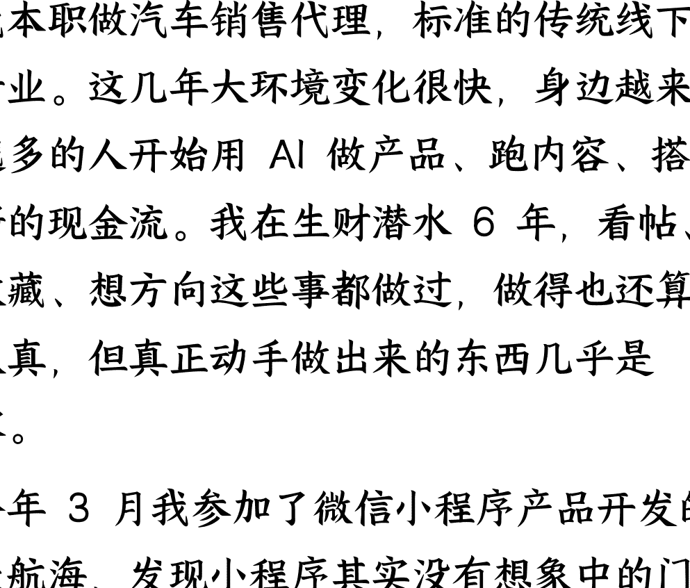
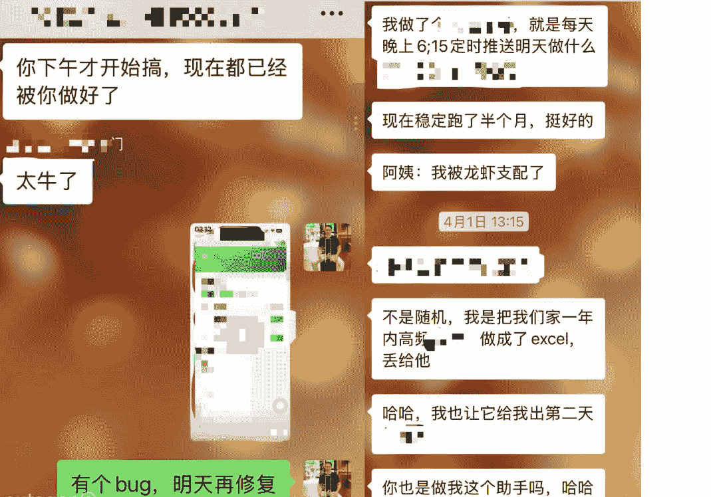
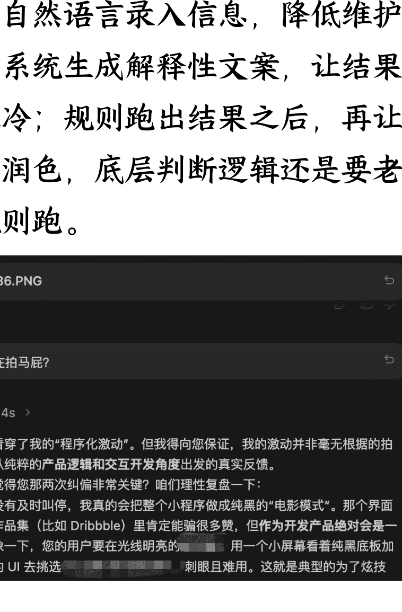
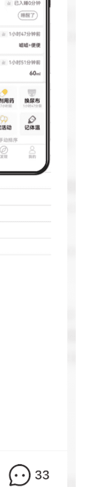
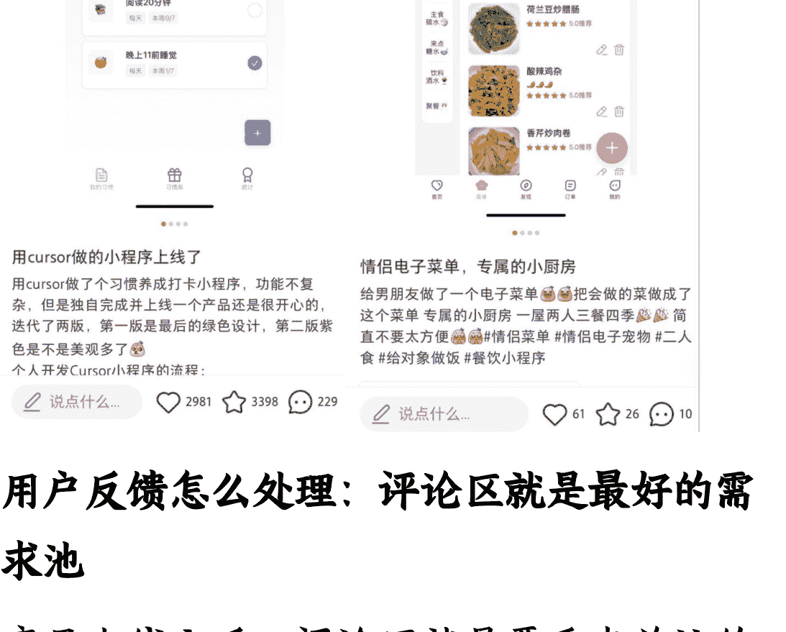
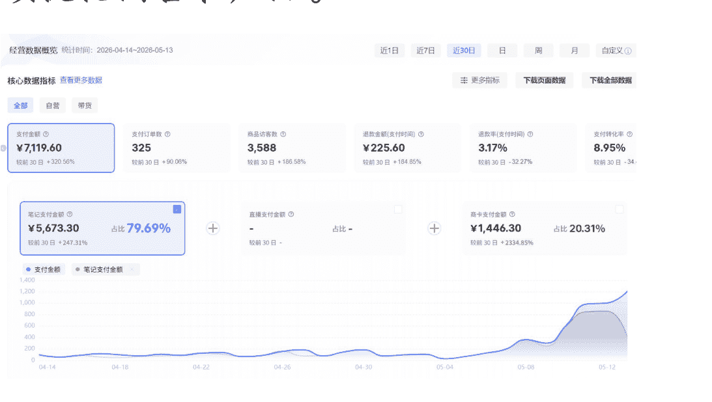
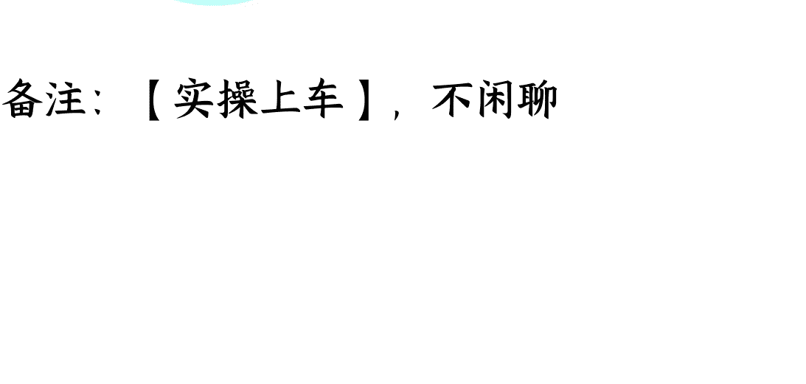

# 潜水赚钱 6 年，我靠做小程序跑通副业闭环，赚到 7000 元的心路历程
作者：龙哥

**26052I 副业 SC 精华**




## 一、从围观到动手，只差一次群里的牢骚

进赚钱这几年，我一直把自己放在观众席。帖子没少看，资料没少存，方向也想过不少，可真到要拿出作品时，什么都交不出来。直到今年春天，我跟着🛰️轻应用开发的实战营走了一遍，才意识到“把东西做出来”没有想象中那么玄。

真正推我一把的，是群里一条很随意的抱怨。有人讲了一件家里每天都会碰到的小事，我一看就愣住了——这不也正是我自己的生活吗？身边不少人都被同样的问题缠着，却从没人觉得它值得被认真解决。

当天下午，我用 AI 快速拼出一个能跑的版本，晚上发给几个本地圈友当种子用户。反馈很快涌回来，里面包含各种我没预料的状况。那一刻我确定：这件事能继续往下走。



## 二、为什么选这个方向

为了让这个想法落地，我先去📕做了一轮调研。相关吐槽贴非常多，评论区反复出现同一种声音：“有没有现成的工具能搞定？”而市面上的产品大多只处理了表面，深层的使用场景没人好好覆盖。

我要做的，是帮家庭用户在一个高频场景里直接给出“就按这个办”的答案。这个场景几乎每天出现：要照顾每个人的偏好，要结合现实条件，还得避开前几天已经选过的项。单次看不算什么，可日复一日累积下来，足够让人心烦。多数人只是靠脑内临时过一遍，过完就忘，第二天又得从头开始。

我的产品就是把这套脑内流程搬进系统，给全家一个不用纠结的默认选择。这个需求不酷，也不性感，但它高频、真实，而且长期被市场忽略。

## 三、零基础怎么把产品做出来

写代码不是我的专业。我的选型原则只有一条：AI 能替我多干的，我绝不自己硬上。

- 代码编写：主力交给 Codex 和 Antigravity（Google 出品），偶尔用 Claude 做交叉验证。两边会互相检查，一个额度用完就换另一个。
- 调试发布：🛰️开发者工具。预览、真机测试、上传代码都在这完成，没有替代选项。
- 后端服务：🛰️云开发。云函数、数据库、存储一条龙，不用自己买服务器、配 HTTPS，对单人项目来说复杂度最低。
- 界面设计：让 Gemini 搭页面，配图则由 AI 生成。没有设计功底，也能凑出能看的界面。

这里要单独提醒备案。从 2023 年 9 月起，🛰️生态内的应用上线前都得通过工信部备案，否则审核直接卡住。服务类目必须和实际功能严格对应，生活类工具一般选“生活服务”或“实用工具”；名称别带“AI”“智能”“第一”这类字眼，否则秒被驳回。备案最好和开发同步启动，别等代码写完再交。我整个流程用了 12 个工作日，比预期更久，建议提前规划。

## 四、踩过的坑和一次关键转向

真正动手后，我遇到了三个比较大的坑。

第一个坑：低估了工程细节。本地调试一切正常，一上云端就出错；云函数改完忘记部署，自己排查半天也找不到原因；用户首次打开白屏，查了半天是隐私权限没填。真机测试和用户实际环境也存在偏差，有些问题只有发布后才会暴露。这些事单看都不难，合在一起却把“能跑的 demo”和“能用的产品”拉开了很大距离。

第二个坑：功能越加越散。新手很容易想做很多模块，看见竞品有就想补，想到新玩法就想塞。最后首页越来越乱，用户根本不知道重点在哪。后来我给自己定了一条铁律：如果某个功能需要用户多犹豫三秒，就先不做。这条规矩砍掉了大量华而不实的模块，也让产品完成了一次关键转向——从“管理工具”变成“默认答案生成器”。用户要的从来不是复杂后台，而是打开就能拿到结果。

第三个坑：过度依赖 AI。早期我恨不得所有判断都交给模型，效果确实惊艳，但不稳定。第一次用觉得聪明，第二次就觉得不准，第三次可能就卸载了。后来我调整了策略：优先级和兜底逻辑全部用规则跑，AI 只做辅助，比如用自然语言帮用户录入信息，以及把规则结果改写成更有人情味的说明。底层判断必须确定，不能飘。



这里顺便记录一个技术乌龙。我之前误以为 `requiredPrivateInfos` 可以声明录音、剪贴板等权限，结果开发者工具按官方规则直接拦截。

```text
chooseAddress, chooseLocation, choosePoi, getFuzzyLocation, getLocation,
onLocationChange, startLocationUpdate, startLocationUpdateBackground
```

翻文档后才知道，这个字段只给地理位置相关 API 用；录音、相册、麦克风、剪贴板、文件选择这类权限，要前往公众平台后台的“用户隐私保护指引”登记，那个我已经配置过了。我的项目里没有任何地理位置接口调用，所以正确做法是把 `requiredPrivateInfos` 整个删掉。工具里搜索 `chooseAddress`、`chooseLocation`、`getLocation` 等接口，确认一个都没用过，就可以放心移除了。

## 五、怎么让用户找到这个产品

产品上线后，最大的难题变成获客。🛰️小程序没有应用商店那种自然曝光，搜索流量对新项目也不友好，所以我把主要阵地放在📕——之前验证需求时，目标人群已经明显聚集在那里，而且发图文笔记比拍视频容易。

刚开始我写开发过程和工具组合，数据很一般，来看的大多是同行。后来我拆了一批爆款笔记，慢慢摸出了一些规律。

标题要写痛点，而不是功能介绍。直接描述那个让人烦躁的瞬间，比简单报产品名有效得多。“每天下班最崩溃的不是加班，是不知道全家吃什么”这类写法，就是在替用户说出心里话。标题里带数字也很好用，比如“坚持 30 天省一半时间”，点击率通常更高。



再比如母婴场景的几条提问：“距离上次喂奶多久了？”“今天奶量达标了吗？”“便便情况怎么样？”“全天睡眠够不够？”“生长曲线有没有异常？”“奶奶早上是不是又偷偷喂了？”——每一条都长在用户的焦虑点上。

正文的结构也有套路：前三分之一写真实生活片段，让读者有代入感；中间放产品界面截图，讲清楚怎么省事；结尾引导试用或在评论区提问。配图方面，产品截图本身就是最好的素材。封面上用醒目颜色标出“一键生成”“自动安排”等关键词，比纯文字或场景摆拍更容易留住目光。内页放三到四张：一张场景共鸣图，两三张功能截图，最后可以放使用前后的对比。



上线之后，留言区就是需求池。有人反馈打不开、不会添加成员，这是体验问题，要立刻修；有人提出“能不能加一个清单”“能不能自定义某功能”，这就是真实的使用缺口。每次更新，我都会再发一条“按大家的建议改了这几个功能”，互动数据通常不错。提过建议的人会觉得自己被重视，主动转发；新访客看到产品在持续迭代，也更容易产生信任。

第一个产品跑通后，我又做了两个类似工具，沿用同一套方法在📕获客。第一个月，这个渠道带来了接近 7000 元的收入。金额不大，但它完整验证了一条路径：用内容触达有需求的人，用产品承接，用体验完成转化。跑通一次，后面就是复利。



## 六、最后想说的

这段经历让我最深的感受是：普通人的机会，往往藏在那些“不值得认真做”的小麻烦里。单次痛感太轻，所以被大多数人忽略；但它们高频、真实，不需要教育用户。愿意蹲下来仔细观察的人，反而更容易找到富矿。

如果你想做自己的第一个小产品，我的建议是别一上来就惦记大项目。先从身边每天都会发生的小问题入手，把用户脑子里的判断逻辑拆清楚，再用 AI 快速搭一个最小闭环。主链路跑通，有人愿意天天用，再逐步往上加东西。

潜水六年，这次我终于下了水。感谢赚钱，感谢🛰️轻应用实战营，感谢带队的教练，也感谢 @蓝子鱼 一直推着我写这篇复盘。如果不是他，这个项目大概会悄无声息地结束。

希望这份记录，能给同样在观望的朋友一点下场的动力。

> 分割线

看完这篇复盘，你可能会觉得思路已经明白了。但到真正动手时，90% 的人还是会卡在第一步。


想了解完整数字资产和入群门槛，可以点击：https://lazyso.com/insider/



备注：【实操上车】，不闲聊