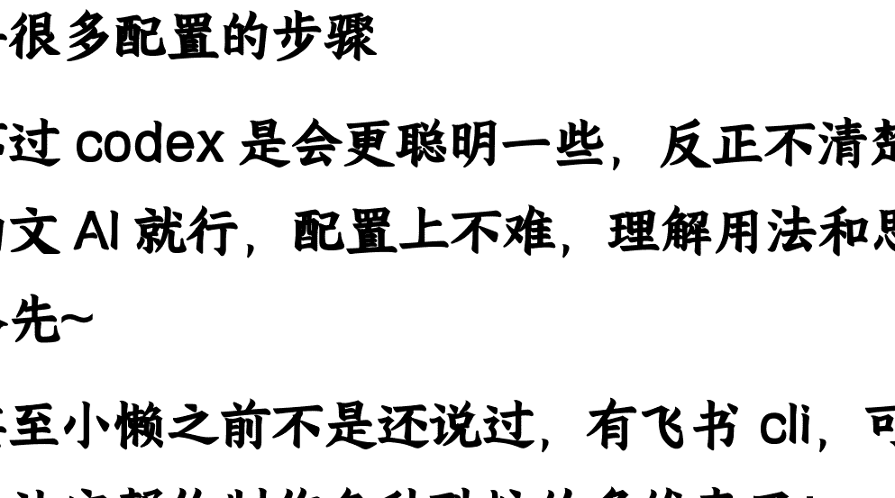
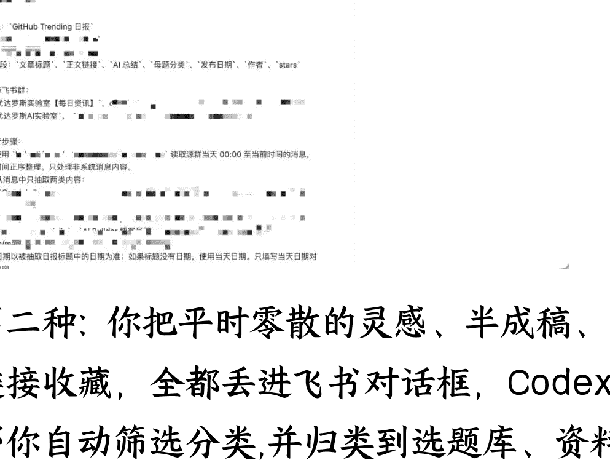
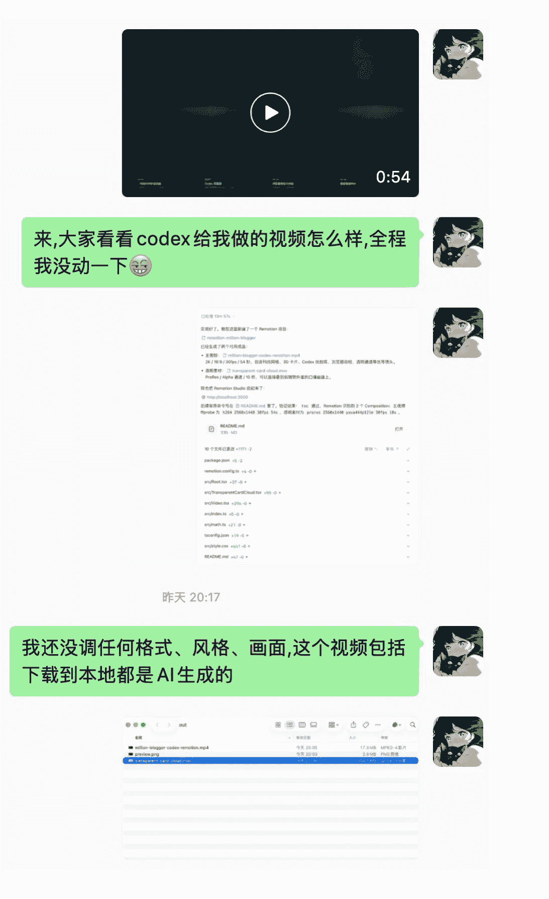

# 别死磕 Obsidian 了！飞书 CLI 接入 Codex，AI 在你睡觉时帮你打理知识库

260522 · 副业 · SC · 精华

👸号懒人搜索，[懒人专属群](https://t.cn/xxxx) 独享

懒人微信：lazyhelper1

小懒人插一句：其实有更省事的路径。飞书 CLI 已经对外开放，Trae solo 可以直接挂接，能省掉大量配置环节。当然 Codex 脑子更活，碰到拿不准的只管交给 AI 去弄，配置本身没什么难度，先把用法和思路学会就行~之前小懒也提过，有飞书 CLI 在手，再花哨的多维表也能让它顺手做出来。

以下为正文：

HI，我是九思 Summer。

最近 Obsidian 搭配 Claude Code 搭知识库的玩法被聊得很多，确实能打。不过我自己试了一圈下来，发现还有一条对更多人更友好、也更省事的路径。

我还记得 GitHub 上有一个专门讲 Obsidian 知识库架构的页面，但具体叫什么名字，一时想不起来了。昨天 18:21 我给自己留了句话：知识库这件事，我断断续续做了好多年，最后得出的结论是——最容易坚持的系统，就是最方便的。如果在记笔记之前，还得先去啃架构、学多维表怎么搭、研究分类法、背各种操作技巧，那你大概率每天连第一步都不想迈。**如果你的资料、想法、群聊记录、待办事项，本来就大量待在飞书里**，那就没必要再额外搭一套新的知识管理中枢。用飞书+Codex，掏出手机就能随时指挥 AI 帮你整理知识库。除此之外，还能让 Codex 给你生成定时任务和自动化流程，每天准点自动触发。

整个使用过程，你完全不需要碰飞书界面，Codex 会替你包办一切。如果你顺手打开了 computer use 功能，它连你电脑本地的活儿也能一并处理。我已经连着用了好些天，现在经常凌晨两点我睡下了，AI 仍在后台忙活，还会把结果推送到我手机上。11:27 <话题来自：每日 AI 资讯>

codex 02:52

已核实更新，最近一次集中更新发生于 **2026年5月12日 19:56-20:07**，主要内容分两块：

1. `remotion-million-blogger` 项目此次新增/补齐了 Remotion 动画工程，主视频合成和透明背景卡片云素材都在其中，相关 `package.json`、`src/*`、`README.md` 等文件均为该时段内的变更。

2. 飞书 Codex 代理的说明文档在 **2026年5月12日20:00** 也做过更新，文档中登记的 daemon 路径已切到新的 `~/.codex/feishu-codex-agent/...`。

另外要提一句：日志里暴露了一个尚未收口的问题，旧启动配置仍尝试运行知识库目录下的 `tools/feishu_codex_agent.py`，因此留下过启动失败记录。如果你需要，我可以继续帮你确认：**当前实际在跑的是不是新版配置**。

原理先不聊，下面直接把我的实操过程一步步拆给你看。

## 先把 Codex 与飞书 CLI 装好

**先装 Codex**（保姆级教程见我之前那篇文章👆点链接直达）。

**完全不会写代码的我，是怎么使用 codex 的？（附零基础保姆级教程）**。

**或者直接搜**Qhttps://chatgpt.com/zh-Hans-CN/codex/，打开这个网址，下载安装 Codex 桌面版即可。

**再让 Codex 帮你装飞书开源 CLI**。把下面这段内容原样复制发给 Codex，它会立刻帮你完成安装：

# 飞书

帮我安装飞书 CLI: https://open.feishu.cn/document/no_class/mcp-archive/feishu-cli-installation-guide.mdPlain

# Lark（海外版本）

帮我安装 Lark CLI: https://github.com/larksuite/cli

配置完成后，记得重启 Codex，确保 skills 完整加载，之后就能发指令操作飞书了。配置应用时默认会新建一个应用，也可以挑选已有应用。02

## 先让它学会读你的飞书知识库

这一步是最爽的地方。你不需要翻 CLI 文档、不用拼参数、不用理解 TSON 结构。只要把飞书链接丢给 Codex，比如这样：请读取这篇飞书 wiki，链接是 https://你的飞书链接。帮我做四件事：

1. 用一段话总结这篇文档现在在讲什么

2. 找出结构混乱、重复表达和空标题的地方

3. 给出一套更适合继续扩写的结构建议

4. 先别动手改，等我确认

说穿了，这一步的本质就是让 Codex 在背后替你把原来需要手动完成的 CLI 调用全部做掉，而你感知到的只是一句自然语言。我强烈建议，刚开始别把权限放得太松。先让它读。再让它提方案。最后才让它动手。比如你认可方案后，可以继续对它说：按照你刚才的整理方案，直接帮我更新这篇飞书 wiki。要求：

1. 不要编造新信息

2. 保留原意

3. 如果涉及大段改写，先分块处理

4. 改完以后告诉我你改了哪些地方

讲真，这一步一旦跑通，你对个人知识库这件事的体感会完全变掉。以前你要亲自当编辑、当排版工、当整理员。现在你只负责判断，AI 负责动手。这个角色切换太关键了。

### 03 更进阶的玩法

一旦你接受了这个视角，后面的玩法会自然长出来。比如：

第一种：想让几个高价值飞书群聊里的讨论，自动沉淀成知识卡片收进知识库，还能每天定时触发、不用你提醒👉：

第二种：平时随手记的灵感、写了一半的稿子、收藏的链接，一股脑丢进飞书对话框，Codex 会帮你自动筛选分类，归入选题库、资料库、项目库。

授权流程我接着走，下一步是定位目标多维表格并核对字段格式。授权成功。我的策略是先通过云空间搜索找到 Base，列出字段，尽量沿用现有记录的结构。可惜三次精确搜索都扑空，推测 Base 可能藏在知识库 Wiki 里，标题不是这个完整叫法，或者不在 BITABLE 类型筛选下。我于是放开关键词和类型，再顺藤摸瓜，从“代达罗斯AI实验室”群里分享过的文档里继续找。翻到一个叫"AI做图提示词"的 Wiki 文档，它并不是搜索结果里直接出现的 BITABLE。看情况目标内容可能嵌在文档/知识库页中；我把页面内容读一下，确认有没有表格或嵌入的多维表格入口。页面里确实嵌了多维表格：app token 和 table id 都拿到了。接下来我读表结构、翻几条旧记录，把字段映射弄清楚。

字段很精简：附件、名称、1级标签、2级标签、提示词。我先看几条旧记录，确认命名规则和标签习惯，再创建新记录；图片附件得单独处理，顺便确认旧记录中附件是否常填。旧记录会保留参考图附件，所以这条也该先建记录，再把九思消息里的两张图下载下来，上传到“附件”字段。分类我按现有选项填：1级标签=真人，2级标签目前没有“写真/商拍”这一类；为了不乱造新选项，先留空。我准备写一条新记录：名称用"GPT Image 2 提示词分享：新中式锦鲤高定艺术写真"，提示词保留完整结构文本，标签先写 真人。创建成功后再把两张参考图补到附件字段。新记录已经创建，record id 是 recvjoKpoUjzIh。现在我去下载这两张参考图，再传到附件字段。两张图都上传成功，不过我发现附件字段的返回疑似每次只写入单张。为避免第一张被覆盖，我马上读回这条记录，检查附件列表。读回后确认只留了第二张——刚才的并行上传把附件字段覆盖了。我来修：先看 CLI 上传附件的实现支不支持带已有附件一起写回，然后把两张图恢复成同一个附件列表。

第三种：你甚至可以在飞书聊天窗口里，直接指挥电脑上的 Codex 干活——不止是飞书知识库，连本地电脑的任务都能安排：

第四种：让 Codex 根据飞书知识库中的文章一键生成视频，连视频下载到本地这步都由 AI 包办：

这套体系里，三层分工很明确。

- **第一层**，飞书：负责承载你的知识库、消息流、表格、文档，以及日常涌进来的信息。

- **第二层**，飞书开源 CLI：把飞书里的各种能力暴露成 AI 能稳定调用的接口。说白了，它就是 Codex 的“手”。

- **第三层**，Codex 桌面端：负责听懂你的意图、拆解任务、调用工具、执行流程、汇总结果。

#### 直接在飞书对话框里指挥 Codex

以上这些，你全都不需要坐在电脑前手动发指令，直接在飞书聊天窗口里交代就行。也就是说，你在手机上发一句话，本地进程收到飞书事件，再去调用`codex exec`，最后把结果自动送回飞书对话里。这个体验完全不一样。它已经不是一个工具，而是一套在后台持续运转的小型工作流。

给新手一个直观的拆法，整套东西分 4 层：

1. 飞书里有一个 bot

2. 本机有 lark-cli，负责接收飞书事件、回复飞书消息

3. 本机有 codex，负责真正执行任务

4. 本机有一个常驻 Python 守护进程，把 2 和 3 串起来

**你只需要第一次时在 codex 里输入这个提示词：**请帮我这台 Mac 上搭一个“飞书对话框里直接指挥 Codex"的本地工作流，我是小白，请你不要只讲思路，直接帮我检查环境、创建文件、配置后台服务，并在每一步告诉我需要我点击或确认什么。目标是：我在飞书里给一个 bot 发消息 -> 本机后台进程收到飞书消息事件 -> 本机自动调用 codex exec 执行任务 -> 执行结果自动回复到原飞书线程 -> 整套流程配置成后台常驻，电脑开着就能用。**要求你按这个顺序帮我完成：**检查这台电脑有没有安装 Python、Codex CLI、lark-cli；如果缺东西，告诉我最简单的安装方式；引导我在飞书开放平台创建一个 bot 应用；告诉我这个应用要开哪些权限、订阅哪个事件；帮我完成 lark-cli 配置和授权；帮我生成本地桥接脚本，要求只允许我本人触发；帮我生成 launchd 配置，让它在 macOS 后台常驻；帮我做最小测试，比如 /codex ping；如果测试失败，继续排查，不要停在分析；最后把我在飞书里能用的指令写成一份简短说明给我。

注意：我是新手，不要默认我会命令行需要我手动点网页、登录、授权的时候再叫我其它能自动做的你都直接做不要只给教程，请你直接在本机帮我搭好然后，等着 AI 给你干活就好啦！

##### 把 Codex 机器人拉进对应的群聊

以下按飞书当前常见的中文界面整理，少数按钮名字如果有轻微差异，一般都在同一位置。

官方入口：

- [飞书开放平台](https://open.feishu.cn/) - 开发者后台 / 我的应用

- [飞书管理后台](https://open.feishu.cn/)

参考官方说明：

- [认识与配置飞书集成（飞书官方）](https://open.feishu.cn/)

- [飞书接入 OpenClaw 的安全防护与治理指南（飞书官方）](https://open.feishu.cn/)

###### 一、先创建飞书机器人应用

1. 打开 [开发者后台](https://open.feishu.cn/)，用你的飞书账号登录。

2. 点击 **创建企业自建应用**。

3. 填应用名称。推荐直接写成 Codex 助手、我的 Codex 机器人这种，后面群里更容易识别。

###### 二、给应用开“机器人能力”

4. 上传头像，填一句应用描述。例如：在飞书里一句话触发本地 Codex 执行任务并自动回复结果。

5. 点 **创建**。

6. 进入刚创建的应用后台。找到左侧类似 **添加应用能力**、**能力**、**机器人** 的区域。

7. 把 **机器人**能力打开。如果看到机器人欢迎语、消息卡片、可见范围之类的配置，先保持默认即可，后面跑通再细调。

###### 三、开权限

这一步很关键。没有权限，机器人就算在群里也收不到消息、回不了消息。

8. 打开左侧 **权限管理**或**权限配置**。搜索并开通和 IM 消息相关的权限。对“飞书里一句话触发 Codex"这类场景，优先开这些常用权限：

- `im:message:send_as_bot`

- `im:message:readonly`

- `im:message.group_at_msg:readonly`

- `im:message.p2p_msg:readonly`

- `im:chat:read`

如果你后面还想让机器人收图片、文件、语音，再补这些：

- `im:resource`

- `im:message.reactions:read`

开完后，点页面里的 **申请权限**、**批量开通**或同类按钮。

###### 四、订阅事件

这一步是让飞书把新消息“推”给本地进程。

9. 打开左侧事件订阅。找到添加事件或订阅事件。搜索并添加：`im.message.receive_v1`。如果界面要求先填写“请求网址”或“回调地址”，你有两种情况：

- 如果你走的是 lark-cli event consume这种本地事件消费方式，通常是由本地工具接管，不一定需要你自己手填公网回调。

- 如果你的方案是传统 webhook 回调，就需要填一个外网可访问的回调地址。你现在这套“本地收到事件 -> 调Codex"方案，本质目标就是让这条消息事件能被订阅成功。

###### 五、发布应用

很多小白会漏这一步。不发布，前面配的权限和能力经常不会真正生效。

10. 打开左侧版本管理与发布。点击创建版本。填版本号（例如：1.0.0）。填发布说明（例如：开通机器人消息接收与回复能力）。按页面提示继续下一步。如果系统提示有权限待申请，就先补齐。提交发布。如果是企业内应用，通常还要把可用范围设给自己或测试成员。

###### 六、把机器人加进飞书群聊

这一步完全在飞书聊天界面里做。

打开飞书，先新建一个测试群。推荐只拉你自己或 1 到 2 个测试成员，别一上来进正式群。进入群聊右上角 ... 或 **群设置**。找 **群机器人**、**机器人**、**应用**、**添加机器人**之类入口。在机器人列表里搜索你刚创建的应用名字（例如：Codex 助手）。点 **添加**。如果飞书提示你确认权限或使用范围，点确认。添加成功后，群里通常会看到机器人加入提示。

###### 七、测试群里能不能触发

先在群里 @机器人。发一条最简单的测试消息。例如: `@Codex 助手 /codex ping`如果是私聊机器人，就直接发：`/codex ping`正常情况下，后面的本地进程收到事件后，会再把结果回复回这个线程。

###### 八、最常见的卡点

1. 只创建了应用，但没开机器人能力。

2. 开了权限，但没发布版本。

3. 发布了应用，但没把机器人加进群。

4. 机器人在群里，但没开消息接收相关权限。

5. 机器人能收私聊，不能收群消息，通常是群 @ 消息权限没开。

6. 群里能触发，但回复失败，通常是 send_as_bot 权限没开，或者可用范围没放通。

###### 九、简单总结一段话

先去飞书开放平台创建一个“企业自建应用”，开启机器人能力，开通消息读取和机器人发消息权限，订阅 im.message.receive_v1事件（原文误写为receive_vl），创建版本并发布。然后回到飞书聊天界面，新建一个测试群，在群设置里把这个机器人添加进来。完成以后，再让 Codex 帮你接本地执行链路。

##### 最后几句心里话

关于个人知识库，我越来越确定：真正的问题从来不是“存不存得进去”，而是“谁来整理、谁来重读、谁来持续维护”。在过去，这个人只能是你自己。于是太多知识库，最后都悄悄堆成了信息坟场。但现在的局面不一样了。飞书负责承载内容，飞书开源 CLI 负责打通读写通道，Codex 负责理解与执行。你终于有机会把自己的知识库从一个静态仓库，变成一座持续被加工的活系统。这件事我打心底觉得重要。它不只是一件新奇的 AI 玩具，而是在帮你，把脑子里那些原本会散掉的东西，一点一点留下来。

> ———分割线———

看完这份 SOP，你可能觉得自己懂了。但 90% 的人一到实操就会卡在第一步。**工具和教程只是最低级的壁垒，真正的壁垒是“立刻动手”和“圈层信息差”。**如果你想看全网最新的变现玩法，并且和一群执行力极强的极客一起下场拿结果，欢迎围观我的核心私域：【懒人专属群】。我们不聊虚的，只做商业闭环的拆解与 AI 效率的压榨。系统内已沉淀1000+跑通的套利实战局。👉查阅圈子完整数字资产与上车门槛：**https://lazyso.com/insider/**认同价值、准备好下场干活的，扫码加我微信（**lazyhelperl**）**备注：【实操上车】，不闲聊**👸号懒人搜索，懒人专属群分享