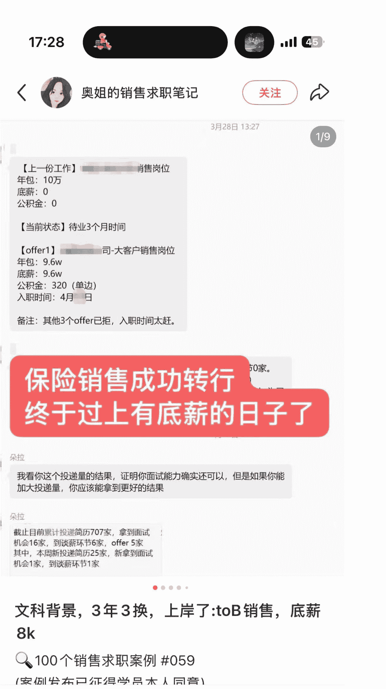
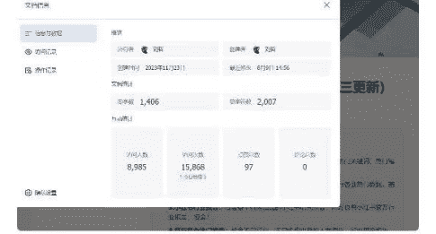
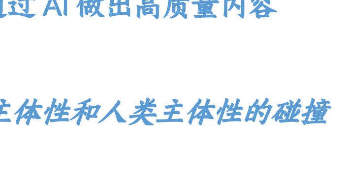
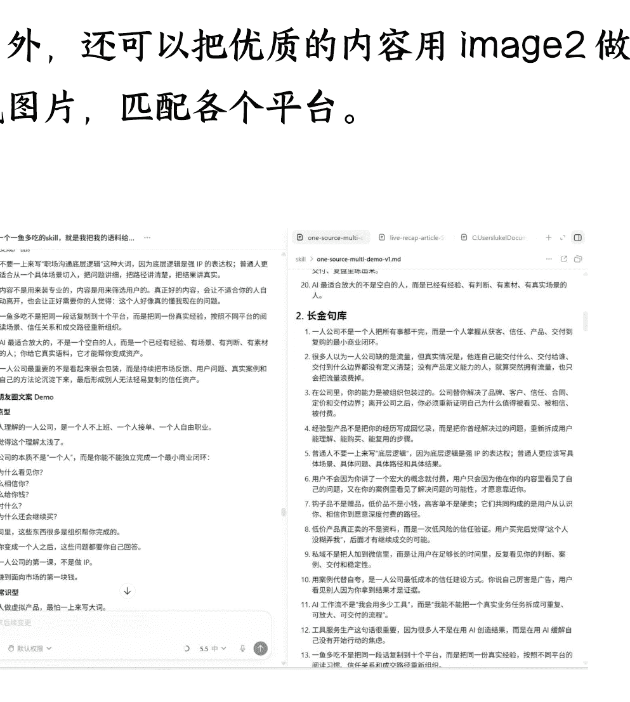
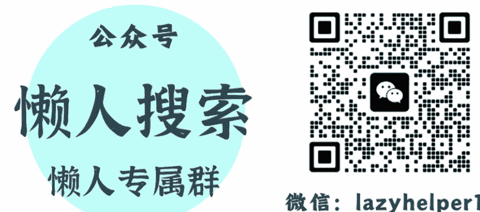

# AI 时代，一人公司怎么玩？一份17000字的实战复盘笔记

**260525 副业 SC 精华**

公众号懒人搜索，懒人专属群独享

懒人微信：lazyhelperl

这篇文章不吹捧一人公司，也不全盘否定它，只是把我自己从0到1走过的路摊开来说。成为一人公司到底经历了什么，以及做一人公司需要什么样的能力底座。

为了阅读更顺畅，先给你一个总览：

第一部分聊能力模型。职场里怎么借假修真，为什么必须做自己的虚拟产品，以及虚拟产品和1000个铁杆粉丝的底层关系；

第二部分讲虚拟产品体系怎么搭，从钩子品到经验型虚拟产品再到利润品的递进逻辑；

第三部分讲一人公司如何搭建 AI 工作流，如何做自己的提示词和 skill；

第四部分讲内容系统怎么建，代表作怎么打磨，高质量内容怎么做；

第五部分讲和 AI 协作的效率打法。

# 01 先练会赚到第一块钱的能力

很多人以为一人公司就是辞职去大理巴厘岛拍视频写流水账，这其实只是另一种自媒体，并没有真正建立自己的业务。

我的理解是，一人公司不必一开始就辞职。先用副业做探路，在有稳定现金流的前提下去试错。思维一旦打开，你就会开始主动找职场外的机会，直接面向市场。

到了这个阶段，脑子里自然会开始盘点：市场愿意为我的什么能力买单？我能卖什么价位？这种倒逼机制会逼你把技能做实。

关键是副业别选时间换钱的兼职，比如跑外卖、开滴滴。这类事只会消耗你的思考时间，投入产出很低。

真正有价值的副业是能复利的投资型副业。时间越投越值钱，专业度越来越深，最终有机会把时间解放出来，想象空间才大。

起步阶段报价上不去很正常。没有案例、没经验，就去【事上练】。能积累经验的事就别挑，抓住一切练手的机会。

举个我自己的例子。早期我做求职辅导，完全没经验，连流程都不熟。第一单直接免费。对方是做大厂的，职业困境多。我从自己的角度给建议，就是在实战中积累。没花钱但收获很大，案例有了、认知鲜活了。

这次免费给了我大量小红书选题和流量，后续自然转化。做一人公司也好做副业也好，功利心越重越走不远。用心态万物皆可利用，去收集养分，才会越滚越大。

赚到第一块钱，核心是学会【定义产品/服务】。

不同产品定价逻辑不同，必须让用户感知到价值边界。比如1小时多少钱，2小时多少钱，超时如何计费，都要提前说清楚。

重点是边界感。服务边界要清晰，什么做、什么不做，不能变成客户的24小时客服。价格边界也要清晰：改几次免费，之后怎么收费。

我朋友做课件定制，原本千元一单，结果因为没提前约定修改次数，一直返工，性价比极低。提前把修改次数、加价规则说清，双方沟通效率才高。

产品线也要多元化。小红书博主小咩学姐就是例子，外企求职是定位，但她卖陪跑、1V1咨询，还有针对不同能力的专题课。产品更多元，用户选择更灵活。

对于新手一人公司，提高客单价很难。能力到不了那种价格水平时，拓宽产品线是更现实的路。

### 素人起步，必须先有自己的虚拟产品

在行业里没名气，没人会为你付高价。信任成本太高。所以前期一定要降门槛。

我用的双管齐下策略：

第一，经营好小红书。平台对素人友好，便于建立个人专业感。我当时就是持续输出干货，很快带来咨询和商单。

第二，一定要创造自己的虚拟产品。信任是累积的，用户不可能上来就付几百上千。虚拟产品就是建立信任的桥梁。

最合适的载体是专栏型产品，类似海外的 Newsletter。长文有很强的信任积累力。把过往的方法论沉淀下来，用付费专栏去承接用户。

# 每个一人公司都应该有19.9的虚拟产品

我有两本专栏，《小红书创作指北》1800人订阅，《小红书虚拟产品指南》891人订阅。定价分别是19.9和69.9。第一本的目标不是赚钱，是交朋友。选小报童做载体，宣传成知识付费的酱香拿铁，第一天就来了134个订阅。

为什么有人买？因为我在公域持续表达，他们看过我的内容才愿意付费。这是公域到私域的基础路径。

小报童还能引导加微信，我建了读者群。弱链接变强链接，还成了产品的额外卖点。很多人买专栏就是冲着能进群。截止现在4个读者群，3个已满员，累计近2000人付费过，我只用了2年。

做IP、做一人公司，私域是基础。让读者加微信看似麻烦，实则打开了高频触达。

传统专栏，触达频率低，发新文章读者才想起你。而微信后，你可以持续触达：社群讨论行业信息、朋友圈做日常广播。朋友圈运营要做，但不是纯广告，也不是纯干货堆砌。最好的状态是立体的人设：行业认知、生活感悟、价值观分享，让人持续看到你。

表达即存在，别闷声发大财。

## 虚拟产品是通向1000铁杆粉丝的信任阶梯

凯文凯利讲过1000铁杆粉丝理论。但那不是粉丝数，是能响应号召、愿意付费的人。

我的两个专栏就是筛选铁杆粉丝的过程。用很低的价格+高品质内容把人筛出来，再用读者群持续影响。

小额付费解决信任，社群+朋友圈做高频触达，再带到高客单产品。

虚拟产品的意义不在于赚19.9，而是把用户推上信任的下一层。

总结一句话：素人要有内容、有阅历，但缺流量时，就必须用内容获客+虚拟产品做信任积累。在产品里秀肌肉，经营好付费用户，别止步于弱连接，一定要把用户拉到微信做强连接。触点多了，沉淀够了，高客单自然水到渠成。

前期不要all in高客单。资质不够时，一人公司的打法是铺开虚拟产品体系，广积粮缓称王。等朋友圈有了三千个为你付费并认可你的人，你做什么都有底气。

培养赚钱能力前，先学会借假修真

什么是借假修真？

假，指职场里那些看似无意义的脏活：周报、会议、方案、甲方需求。

真，是沉淀在这些事背后的能力：项目推进力、向上管理力、危机处理力、对人性的洞察力。

职场容易让人丧失意义感，感觉都在给老板打工。但一人公司的成长必经此道。AI是乘数不是加数。本身是1，用AI变10；本身是0，用AI还是0。

AI会放大认知差。不懂商业的人只会更快做无用功；不懂用户的人只会更快写出没人看的内容。

职场是你零成本试错的道场。用别人的资源、别人的钱、别人的风险来踩坑、成长。做方案学会规划和推进，处理危机学会应急，跨部门协作学会和人打交道，预算管理学会控成本。

更重要的是人性洞察。一人公司90%的问题是人的问题。客户嘴上要A心里要B付费理由是C。合作方表面热情背后在比价。这些PPT学不会，只能在职场的博弈里磨出来。

# 02 一人公司的虚拟产品体系怎么搭

没虚拟产品，很难积累1000个铁杆粉丝。素人期更要靠它降信任成本。

体系是三层递进：

### 钩子品

钩子品是让用户有理由关注你的入口，可以免费。核心是引流私域、了解用户，别一招吃到老，也别随便糊弄。

什么钩子好用？知识库当下很有效。小红书上不少人靠卖知识库做到年入百万。知识库自带传播和长生命力，你可以随时更新，放联系方式和进阶钩子。

裂变逻辑很清晰：用户觉得有价值就分享，别人看到联系方式就会加你。这是PDF做不到的。PDF沉重、拿走即终结关系，知识库每次更新都能再次触达用户。

飞书文档版本传播性强，适配各平台引流。我曾做过一个免费小红书知识库，定期宣传，最后被发到Twitter上，引流几百人到私域并转化付费。

如果你的领域信息更新快，就更适合做知识库，有了AI聚合信息很方便，关键是持续更新。

AI也可以帮你做钩子品。无需vibe coding，用成熟工具就行。99%的钩子品都是图文，AI现在都能处理。

比如你是营养师、健身教练、亲子教育，可以用AI整理海外优质YouTube内容做成PDF或知识库。很多博主靠搬运解读Huberman、Dankoe、Naval的内容涨粉变现。

核心商业模式：提供别人提供不了、用户真正需要的知识。健康减脂赛道，就可以整理海外干货做钩子。

注意钩子品要能承接后续高客单，不能做完就沉默。

### 低定价的经验型虚拟产品

这是钩子品的进阶。让用户付小额成本，19.9-69.9对标一杯咖啡，降低决策门槛。

核心价值是秀专业、叠信任。有两种形式：持续更新型像Newsletter，买断型把一个主题讲透。

小红书上有人把TO B经验写成指南卖了4000多单。这类产品就是引流+筛选铁杆粉丝的跳板。

公域直接卖高客单太难，信任成本高。小额产品是曲线救国：先让用户信任，再持续触达，再转化。

内容必须用心，不能糊弄。我的专栏每篇3000-5000字，还配社群同步更新。社群很重要，否则用户很难打开专栏。建立社群带来服务惊喜感，积累好感积分。

### 利润品

利润品就是高客单：1V1陪跑、高客单社群、TO B服务等。

很多人到这一步就退缩，不知道卖什么。最简单的方法是去调研同行。扮演一个想付费的用户去咨询，对方会主动介绍服务内容、周期、答疑等，你就能复刻一套完整体系。同行是最好的老师。

做一人公司，真正的壁垒不在你会多少工具，而在你把交付做到多细。

高客单的生意，本质就是重交付。情绪价值和服务颗粒度必须在线。AI 出现后，这件事被放大了。以前一个人的咨询项目，结束了就是结束，留给客户的也就是一段回放、一段录音、一段文字转录。这种转录其实很鸡肋，全是口水话，核心信息被稀释，用户看着累，你的专业度也体现不出来。

现在不一样了。咨询结束后，用 AI 把文字稿二次加工，整理成一份可读性极高的咨询报告，附上可执行的模板、清单、行动表。客户不一定会全部用到，但感知到的价值和好感度会明显提升。更关键的是，这些被沉淀的语料会反哺你自己，让咨询水平越做越扎实。

我自己的直播也经历了同样的升级。过去只发回放和逐字稿，现在会让 Image2 把直播精华提炼成一份阅读材料。生图能力越强，服务形态就越能从“听完就忘”变成“拿来就能用”。

---

# ChatGPT Image 2：从自然语言到可交付视觉

Image2 已经是当前图像生成里很成熟的一类工具。它的核心差异是门槛低，用日常说话的方式描述需求就能出图，不需要堆砌专业提示词。

它的理解力在于能把自然语言指令直接转成视觉表达。

目前能稳定落地的能力包括：

一句话把文字变成精准配图；把长文本快速做成高质感封面；把 PDF 内容转成 PPT 配图，实现内容到视觉的精准匹配；生成板书、手写笔记风格的图片，还原真实且美观。

适用范围很广：班会主题 PPT、教学课件、工作汇报、培训材料、小红书封面等。

一句话概括：用自然语言，就能把复杂信息快速变成可传播、可展示、可交付的视觉内容。

---

# 生产资料视角：你身边都是素材

打工人最缺的是生产资料，所以只能卖时间。时间本身就是生产资料。但一旦用生产资料的视角去看，身边的一切都能变成资产。

你的经历、过往、身份标签、车、房子、AI 对你的影响，都是生产资料。

想做自媒体却说没素材？素材就是你自己。在外企的，就把外企日常拍出来，这就是别人没有的内容。做数字游民的，身份本身就是资源，分享城市选择、办公地点、路上用的工具，把这些经验连同广告位一起放到网上，变现是自然结果。

还有一种路径是快速完成身份转变再输出。你曾严重失眠，实践某个方法后有所改善，这就是“验证他人经验并化为已用”的转变。YouTube 上有很多深度内容，各领域的 KOL 都在提供方法论，你把别人的方法落地后，完全可以摇身一变成该领域的输出者。

---

# 一人公司要用的 AI，而不是学的 AI

搭建对业务真正有帮助的 AI 工作流，第一步是观念：用 AI，别学 AI。

AI 的价值依附于生产。AI 迭代太快，如果只学不做，很容易陷入工具囤积症，学不完、学完也用不上，还会偏离主线任务。大脑带宽有限，带着问题找工具，工具才服务于生产。

学习本身很多时候是逃避，学 AI 没有市场反馈。你学了一堆写小红书的技巧，却不发笔记，就没有进步。

对于基础的内容工作者，Claude 加 NotebookLM 就够了。NotebookLM 在知识库整合和 YouTube 联动上很强，适合找选题、快速了解一个领域。Claude 在内容写作上更懂人味儿，写朋友圈、文案、小红书、公众号文章都自然，没有明显的 AI 痕迹，且代码能力也不差。

判断标准是：要不要学某个工具，先看它是否服务于生产。内容为主的工作，就不需要去深入 Claude Code，更该把精力放在 Image 2 和 Nano Banana Pro 这类能直接提升出图效率的模型上。

搭建工作流的核心是场景拆分，让 AI 分步介入，先规划流程再让 AI 执行。

错误的做法是让 AI 一次性写整篇笔记、想标题、写钩子、写正文、提炼金句、配标签、想配图。结果平庸，修改困难，浪费 token。

正确的做法是拆成：确定主题 → 生成标题 → 设计钩子 → 撰写正文 → 提炼金金句 → 生成标签 → 配图建议。上下文隔离，输出更可控，修改更高效。

以小红书为例，流程就是选题、写正文、写标题、做封面。我的做法是：用 POE 里的 Claude 做标题智能体和选题智能体，标题智能体只写标题，选题智能体负责找叙事角度，做图用 Image 2，中文表现好，出图质量高。

---

# 内容系统：不要日更 100 条，要做代表作

日更 100 条的讨论很热，但对想做一人公司的你完全没必要。因为日更会把你烧光。主线任务是打磨产品服务并卖给真正需要的人，内容只是放大器。

日更 10 条对一人公司都很难，它会占据 90% 的生产时间，10% 找素材，0% 思考。你会变成内容机器，输入越来越薄，三个月后空转，内容只剩吃了什么干了什么。

内容的质量取决于想的时间，而非写的时间。一条有价值的内容背后可能是三天的观察、两周的发酵、一个顿悟。写万字长文的过程往往是卡点驱动的，逻辑、案例、方法论沉淀不够时，别用废话填坑，去散步、换环境，带着问题思考，答案会出来。

一人公司做内容要信一条：每条内容都值钱，融合思考、经验、审美。用户买单是因为你展现了硬专业和有深度的观点，而不是更新频率。

Lenny's Newsletter 就是典型。百万付费订阅，代表作是他在离开 Airbnb 时总结的 7 年工作经验，细节扎实，一炮而红。他的创作态度和日更 100 条完全相反，平均一篇 10 小时，重磅文章 100 小时以上。核心原则是高信噪比、可操作、简洁。写 PMF 时，他直接上图表和 4 个步骤，再放创始人语录和故事在后半部分。

代表作要长，8000 字以上才有足够的干货密度。它不是写出来的，是磨出来的，写完你自己也会成长。

怎么找到代表作？把过去的自己封装起来。把你在某个领域拿到的结果和路径写成复盘，比如做 6 年 B 端大客户销售的心路历程，或 3 年深耕项目的实操细节。

AI 时代不用担心没写作功底。卡点往往是框架不清，和 AI 聊清楚你的经验，让它帮你梳理大纲和框架，你再去写命题作文即可。先定框架，再定章节，最后逐章击破。

你的独特数据和经验也是护城河：服务过的 100 个客户数据、50 次实验记录、跟踪 3 年的指标，这些一手素材整理出来就是代表作。踩过的最深的坑，失败案例的价值往往高于成功案例，因为教训更普世，更让人信任。

---

# 一人公司的内容矩阵

代表作是压舱石，但日常内容负责在场和信任积累。除了代表作，还需要稳定频率的输出。

案例内容是高客单转化的好抓手。讲你做过什么、帮谁解决了问题。比如职场博主分享改简历案例：“今天和一位毕业 3 年的同学沟通，他的职业经历挺有代表性的，我分享下…”

文科背景，3年3换，上岸了:toB销售，底薪8k

🔍100个销售求职案例 #059

(案例发布已征得学员本人同意)

待业半年，50天上岸 toB 销售岗：底薪 5k→11k

🔍100个销售求职案例 #063

（案例发布已征得学员本人同意）

私信提问也是素材库，AMA 形式能持续收集真实需求。

观点内容穿透力强，产出压力小。提出一个清晰观点，再给出论据，比空喊口号更有说服力。

矩阵内容的核心是聚焦业务做选题挖掘。定位清晰后，围绕定位设计 5 到 7 类长期栏目，内容就是你的市场部，没有营销预算时，这就是获客渠道。

做内容，先把定位拎清楚，定位不是给自己画框，而是给你一个能一直产出的系统。

拿新手班主任控班举例，你的内容轴就可以长成这样：现场痛点、办法拆解、真实复盘、现成模板、常见误区、工具推荐。开学第一天班级怎么乱、家长群第一条消息怎么写、学生不听话怎么办、立规矩三步怎么做、班干部怎么选、主题班会怎么开、家长通知怎么写、期末评语怎么写，一条条都能从这个轴里长出来。

换一个赛道，比如外企会议英语，轴就换成：表达纠错、场景句型、心理建设、真实案例、工具清单、职场文化。开场怎么说、怎么接话、怎么反驳、怎么总结推进、怎么确认，都可以写；听不懂时怎么稳住、怎么说不确定、外国同事为什么那样沟通，背后的习惯是什么，也都是可做内容。

再看装修避坑，轴就是预算、流程、材料、合同、沟通、验收、案例。每个点都能分出几十条选题。

一人公司别做“今天我想聊啥”的内容，要做“我的用户今天卡在哪”的内容。矩阵越清晰，你的专业感越明显。做矩阵还有个关键，是关键词的布局，因为真正愿意付费的客户，很多是带着问题来搜索的，搜索来的客户成交更快。

不知道写什么的时候，去看你赛道头部账号的选题逻辑。同行是最好的老师。

成长类内容很多人会忽略。成长类本质是把你学会一个技能、掌握一个工具的学习过程摊开讲，也叫灯塔内容，英文叫 learn in public。大家要的不只是干货，更需要一个能跟着走的参照。

在 AI 领域这种内容尤其重要，因为迭代太快。去年是工作流，今年是 skill、claude code，知识在快速更迭，博主的更新节奏就是机会。比如张咋啦，她就持续输出自己怎么学 AI，怎么用 AI 工具做内容，既有料又接地气。

硬广一定要明说你在卖什么，不然积累的粉丝是无效的。硬广要有理由，有一个自洽的由头。比如做了一个智能体解决了小红书笔记的 AI 味问题，就拿这个作为切入点宣传：如果想要这个智能体、专属提示词和去 AI 味的方法论，去订阅专栏，内容都在里面。这一波当天就带来 50 个新增订阅。

内容即便有流量，也要落在可转化的模型上。想要产出没有 AI 味、能在公域拿流量拿客资的内容，你需要一个高转化的内容模型。做法是找到高质量对标，并让 AI 提炼模型，再结合你的关键词仿写。

怎么找高转化内容，看三个信号：一是评论区有没有明显的客资需求，比如“怎么买”“怎么联系”；二是转发量，公众号文章底部转发数突然破万，就是信号；三是平台的置顶笔记，博主一般会把转化最好的置顶。

找高转化内容不能全靠 AI，得靠长期手动积累。AI 能整理能收集，代替不了你的审美和品味，审美恰恰是最值钱的部分，要持续培养。

一人公司的内容要会一鱼多吃。核心是对已有内容的再利用，现在有 AI 更高效。

第一步，先积累原始语料。以前做一次咨询没留存就浪费了。现在要把每一次咨询、直播、有效对话都录下来转文字。我自己就用飞书录音豆，随时录，随时成文档。

第二步，用 AI 重组语料。语料够了，就让 AI 去重新组织。AI 对信息的重组权就是一鱼多吃的本质。让它把同一份录音稿变成公众号长文、26 条朋友圈文案、观点库、金句库，甚至社群长文版。还可以把优质内容做成图片，分发到各平台。

第三步，飞书 CLI 加 claude code 的联动一鱼多吃。装上飞书 CLI 后，就能在终端用 claude code 控制飞书。如果你已经在飞书沉淀了大量原创内容，就能让 claude code 直接读取再利用。比如我之前在飞书建了一个小红书虚拟案例库，4 万字左右各赛道虚拟产品的独家解读，一直没二次利用。后来让 claude code 读取这些内容，自动生成了一人公司虚拟产品选品指南方法论和定位方法论，还涌现出很多我没想到的观点。飞书既能存资料，也能让各种 agent 在终端调用，性价比很高。

关于 AI 写长文，主体性不能丢。长文不能一键出，因为 AI 一旦长篇输出就会有 AI 味，风格会飘。也不建议在写作过程中边写边用 AI，会觉得别扭，人类主体和 AI 主体高度碰撞。

我的做法是：先按自己的思路写完初稿，保证创作主体性。然后再把每个章节单独丢给 AI 审稿，让它给修改建议。AI 能快速看出逻辑、结构、金句，以及听众视角下的表达问题。这个角色分配下来，你的原创能力会被放大，而不是被替代。有些手艺不能外包给 AI。

