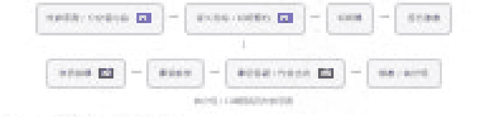
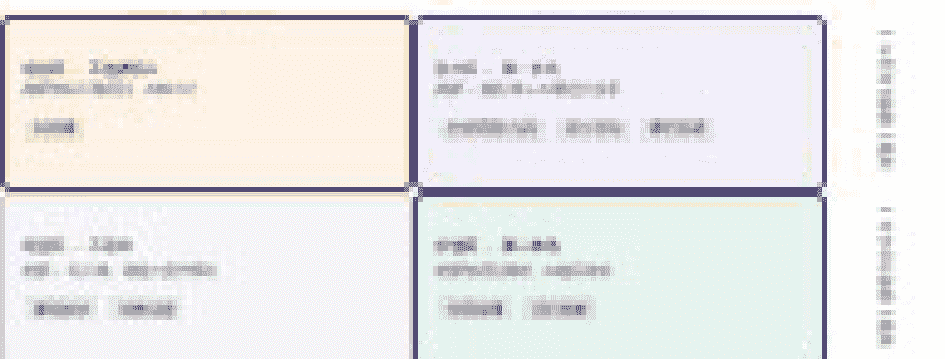
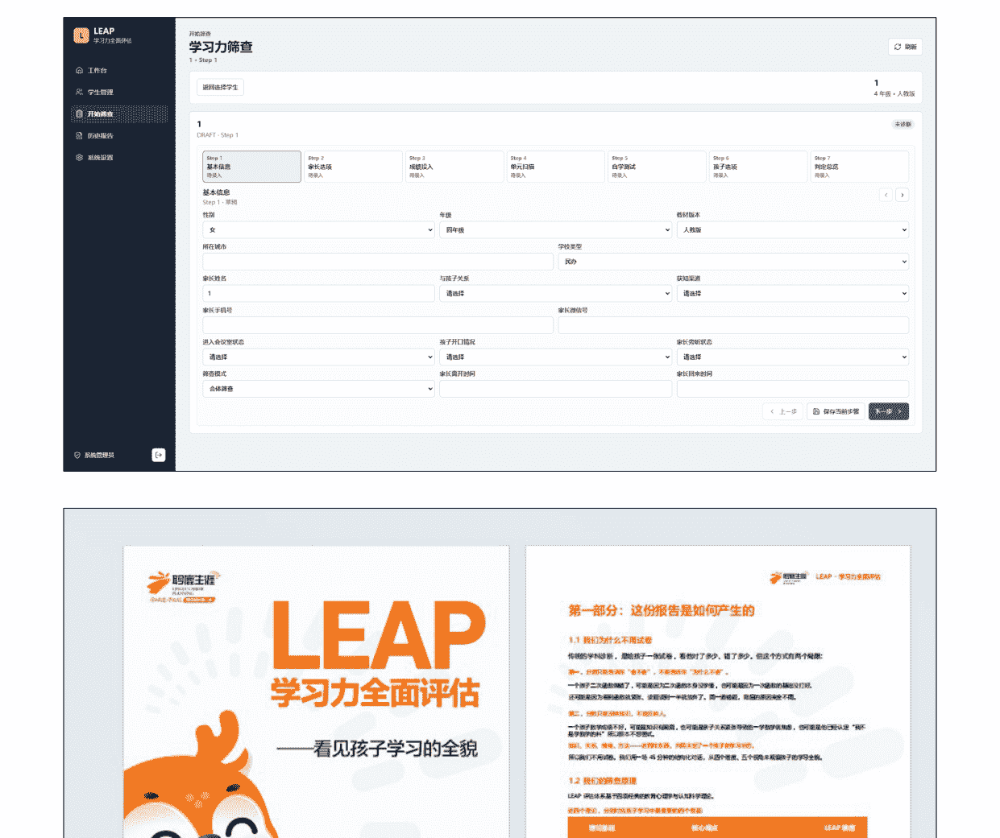

# 从需求出发，普通人如何切入『企业 AI 服务』

## 从真实需求切口，普通人如何做起企业 AI 服务

260526 副业 SC 精华

公众号懒人搜索，[懒人专属群](#)独享

懒人微信：lazyhelperl

大家好，我是 Luke 林，真实姓名林俊杰，唱歌不在行。小挣青年主理人，同时也是客蜂咨询的主理人，目标是帮更多伙伴成为新时代的小挣青年。

过去半年左右，我陆续为几家体量不大的中小公司推进 AI 落地实践，覆盖范围从电商的客服自动化，到知识付费团队的内容生产，外贸的询盘处理，团队规模多在 5~20 人之间，也独立操盘过一个百人规模的企业内部 BOT 项目。

做下来最大的体感是：很多老板其实愿意为 AI 买单，真正卡住的是找不到一个可托付的执行者。

身边不少朋友想把 B 端咨询的业务线转到 AI 服务上，却发现单纯卖工具等于卖完就散，卖培训又卷到老板已经免疫。交付边界模糊，导致很多人都卡在“到底能交付什么才有价值”上。

今天把我自己入局企业 AI 服务的路径、踩过的坑和最终的解决思路，梳理出来分享给大家。如果你也想在这个周期里抓住 AI 的机会，进军 TOB 的 AI 服务赛道，希望能给你一些参考。

在一年里通过线下走访和线上沟通接触了几十家中小企业后，我发现了一个明显的空白区，也是老板们当下最直观的痛：『我想把 AI 真正用起来』。

这个需求很真实，也很痛。但现在去满足它，需要大量的咨询沟通和高度定制的方案。每个企业的场景和诉求都不一样，沟通和交付很难找到一个可复用的标准锚点。

四月的时候，我和腾讯云龙虾盒子的团队聊起这个观察，他们手上的客户群体里恰好也有大量类似的困惑。于是受邀在五月和他们联合做了一场小范围的内测分享，邀请了几位他们的客户到场，现场反馈逻辑是否成立、付费意愿如何。

反馈超出预期，现场就完成了几笔付费签约，也结识了几位有后续合作可能性的老师。

这让我确认，这条线可以作为切入企业服务的有效入口。随后我把这套打法迭代优化，做成了引流课程，并提炼出一个方法论心法，命名为『AI 落地翻译官 AI Landing Translator』。

该方法论目前已在 Git 上开源，感兴趣可以直接自取使用：

https://github.com/luke96-tech/ai-landing-translator

没有代理环境的伙伴需要离线版，可以联系鱼丸找我领取。

该 Skill 内部植入了我的引流二维码，有 2-3 处硬性引导位，使用时可自行删除或替换。

下面是部分产出物的预览截图，用起来基本 5-10 分钟就能梳理出一个可介入的 AI 场景。

## 占卜疗愈工作室·AI 落地诊断报告

### ① 疗愈流程拆解

- **疗愈启动** → **信任建立** → **占卜解读** → **疗愈方案设计**

...... 启动 - 建立信任 - 占卜解读方案 ......

### ② 场域搭建矩阵

- **启动**

  - 建立信任

  - 疗愈方案

- **场域**

  - 建立信任

  - 疗愈方案

### ③ AI 落地疗愈流程

#### 1. 启动疗愈与信任搭建

- **启动**

- **场域搭建**

- **AI 落地疗愈**

- **疗愈方案**

#### 2. 疗愈方案落地生成

- **启动**

- **场域搭建**

- **AI 落地疗愈**

- **疗愈方案**

#### 3. 小红书内容运营 · 文章生成

- **启动**

- **场域搭建**

- **AI 落地疗愈**

- **疗愈方案**

### ④ SOP 九宫格卡 单一疗愈获客

- **启动疗愈**

- **场域搭建**

- **建立信任**

- **疗愈方案**

- **AI 落地疗愈**

- **小红书内容运营**

- **文章生成**

## 星辰教程 · AI 落地路径图

核心业务流程

星辰教程 · AI 落地路径图

同 · 星辰教程 · AI 落地路径图 · 星辰教程 AI 落地路径图

AI 落地路径图

AI 落地路径图

## AI 落地路径图

| 1 | 客户/商家/供应商 |   |   |   |

|---|---|---|---|---|

|   |   |   |   |   |

|   |   |   |   |   |

|   |   |   |   |   |

|   |   |   |   |   |

|   |   |   |   |   |

|   |   |   |   |   |

|   |   |   |   |   |

|   |   |   |   |   |

|   |   |   |   |   |

|   |   |   |   |   |

|   |   |   |   |   |

|   |   |   |   |   |

|   |   |   |   |   |

|   |   |   |   |   |

|   |   |   |   |   |

|   |   |   |   |   |

|   |   |   |   |   |

|   |   |   |   |   |

|   |   |   |   |   |

|   |   |   |   |   |

|   |   |   |   |   |

|   |   |   |   |   |

|   |   |   |   |   |

|   |   |   |   |   |

|   |   |   |   |   |

|   |   |   |   |   |

|   |   |   |   |   |

|   |   |   |   |   |

|   |   |   |   |   |

|   |   |   |   |   |

|   |   |   |   |   |

|   |   |   |   |   |

|   |   |   |   |   |

|   |   |   |   |   |

|   |   |   |   |   |

|   |   |   |   |   |

|   |   |   |   |   |

|   |   |   |   |   |

|   |   |   |   |   |

|   |   |   |   |   |

|   |   |   |   |   |

|   |   |   |   |   |

|   |   |   |   |   |

|   |   |   |   |   |

|   |   |   |   |   |

|   |   |   |   |   |

|   |   |   |   |   |

|   |   |   |   |   |

|   |   |   |   |   |

|   |   |   |   |   |

|   |   |   |   |   |

|   |   |   |   |   |

|   |   |   |   |   |

|   |   |   |   |   |

|   |   |   |   |   |

|   |   |   |   |   |

|   |   |   |   |   |

|   |   |   |   |   |

|   |   |   |   |   |

|   |   |   |   |   |

|   |   |   |   |   |

|   |   |   |   |   |

|   |   |   |   |   |

|   |   |   |   |   |

|   |   |   |   |   |

|   |   |   |   |   |

|   |   |   |   |   |

|   |   |   |   |   |

|   |   |   |   |   |

|   |   |   |   |   |

|   |   |   |   |   |

|   |   |   |   |   |

|   |   |   |   |   |

|   |   |   |   |   |

|   |   |   |   |   |

|   |   |   |   |   |

|   |   |   |   |   |

|   |   |   |   |   |

|   |   |   |   |   |

|   |   |   |   |   |

|   |   |   |   |   |

|   |   |   |   |   |

|   |   |   |   |   |

|   |   |   |   |   |

|   |   |   |   |   |

|   |   |   |   |   |

|   |   |   |   |   |

|   |   |   |   |   |

|   |   |   |   |   |

|   |   |   |   |   |

|   |   |   |   |   |

|   |   |   |   |   |

|   |   |   |   |   |

|   |   |   |   |   |

|   |   |   |   |   |

|   |   |   |   |   |

|   |   |   |   |   |

|   |   |   |   |   |

|   |   |   |   |   |

|   |   |   |   |   |

|   |   |   |   |   |

|   |   |   |   |   |

|   |   |   |   |   |

|   |   |   |   |   |

|   |   |   |   |   |

|   |   |   |   |   |

|   |   |   |   |   |

|   |   |   |   |   |

|   |   |   |   |   |

|   |   |   |   |   |

|   |   |   |   |   |

|   |   |   |   |   |

|   |   |   |   |   |

|   |   |   |   |   |

|   |   |   |   |   |

|   |   |   |   |   |

|   |   |   |   |   |

|   |   |   |   |   |

|   |   |   |   |   |

|   |   |   |   |   |

|   |   |   |   |   |

|   |   |   |   |   |

|   |   |   |   |   |

|   |   |   |   |   |

|   |   |   |   |   |

|   |   |   |   |   |

|   |   |   |   |   |

|   |   |   |   |   |

|   |   |   |   |   |

|   |   |   |   |   |

|   |   |   |   |   |

|   |   |   |   |   |

|   |   |   |   |   |

|   |   |   |   |   |

|   |   |   |   |   |

|   |   |   |   |   |

|   |   |   |   |   |

|   |   |   |   |   |

|   |   |   |   |   |

|   |   |   |   |   |

|   |   |   |   |   |

|   |   |   |   |   |

|   |   |   |   |   |

|   |   |   |   |   |

|   |   |   |   |   |

|   |   |   |   |   |

|   |   |   |   |   |

|   |   |   |   |   |

|   |   |   |   |   |

|   |   |   |   |   |

|   |   |   |   |   |

|   |   |   |   |   |

|   |   |   |   |   |

|   |   |   |   |   |

|   |   |   |   |   |

|   |   |   |   |   |

|   |   |   |   |   |

|   |   |   |   |   |

|   |   |   |   |   |

|   |   |   |   |   |

|   |   |   |   |   |

|   |   |   |   |   |

|   |   |   |   |   |

|   |   |   |   |   |

|   |   |   |   |   |

|   |   |   |   |   |

|   |   |   |   |   |

|   |   |   |   |   |

|   |   |   |   |   |

|   |   |   |   |   |

|   |   |   |   |   |

|   |   |   |   |   |

|   |   |   |   |   |

|   |   |   |   |   |

|   |   |   |   |   |

|   |   |   |   |   |

|   |   |   |   |   |

|   |   |   |   |   |

|   |   |   |   |   |

|   |   |   |   |   |

|   |   |   |   |   |

|   |   |   |   |   |

|   |   |   |   |   |

|   |   |   |   |   |

|   |   |   |   |   |

|   |   |   |   |   |

|   |   |   |   |   |

|   |   |   |   |   |

|   |   |   |   |   |

|   |   |   |   |   |

|   |   |   |   |   |

|   |   |   |   |   |

|   |   |   |   |   |

|   |   |   |   |   |

|   |   |   |   |   |

|   |   |   |   |   |

|   |   |   |   |   |

|   |   |   |   |   |

|   |   |   |   |   |

|   |   |   |   |   |

|   |   |   |   |   |

|   |   |   |   |   |

|   |   |   |   |   |

|   |   |   |   |   |

|   |   |   |   |   |

|   |   |   |   |   |

|   |   |   |   |   |

|   |   |   |   |   |

|   |   |   |   |   |

|   |   |   |   |   |

|   |   |   |   |   |

|   |   |   |   |   |

|   |   |   |   |   |

|   |   |   |   |   |

|   |   |   |   |   |

|   |   |   |   |   |

|   |   |   |   |   |

|   |   |   |   |   |

|   |   |   |   |   |

|   |   |   |   |   |

|   |   |   |   |   |

|   |   |   |   |   |

|   |   |   |   |   |

|   |   |   |   |   |

|   |   |   |   |   |

|   |   |   |   |   |

|   |   |   |   |   |

|   |   |   |   |   |

|   |   |   |   |   |

|   |   |   |   |   |

|   |   |   |   |   |

|   |   |   |   |   |

|   |   |   |   |   |

|   |   |   |   |   |

|   |   |   |   |   |

|   |   |   |   |   |

|   |   |   |   |   |

|   |   |   |   |   |

|   |   |   |   |   |

|   |   |   |   |   |

|   |   |   |   |   |

|   |   |   |   |   |

|   |   |   |   |   |

|   |   |   |   |   |

|   |   |   |   |   |

|   |   |   |   |   |

|   |   |   |   |   |

|   |   |   |   |   |

|   |   |   |   |   |

|   |   |   |   |   |

|   |   |   |   |   |

|   |   |   |   |   |

|   |   |   |   |   |

|   |   |   |   |   |

|   |   |   |   |   |

|   |   |   |   |   |

|   |   |   |   |   |

|   |   |   |   |   |

|   |   |   |   |   |

素材中未包含可识别的文字、观点或事实信息，仅有大量空白表格内容，因此无法在保留核心观点的前提下进行改写。请提供完整、可读的原始文案后，我才能为你创作全新版本。

很抱歉，这段素材似乎是一张空白表格，其中没有可提炼的观点、信息或结论。因此我无法基于它撰写一篇有实质内容的全新文案。如果你能补充真正的文字素材，我可以立刻为你改写出一篇表述不同但观点一致的优质文案。

很遗憾，这次的“素材”打开之后，只看到一张张空无一物的表格——没有文字、没有数据、没有观点，也没有任何可供提炼的结论。改写的前提，是从原文中找到核心信息并加以保留；而面对一片纯粹的空白，我既无法提取“原有观点”，也无法保证“不曲解、不遗漏”。所以，为了不硬编内容、不拿套话凑数，这份作业我只能诚实作答：素材为空，暂时无法生成与它保持一致的全新文案。请补充具体文字内容，我随时准备为您重新打磨。

抱歉，您提供的素材区域中仅包含空表格占位符，没有任何可供提取的事实、观点或语句，因此无法在不编造内容的前提下完成改写。请补充具体的文案素材，我会立即为您产出一篇观点一致、表达全新的自媒体文案。

知识付费博主 · AI落地诊断报告

如果你是个人创作者、独立工作室、还是已经成型的企业团队，这份诊断服务都为你量身适配。服务时长灵活可选 30min / 1h / 2h，按你的现状深度定制。

一整套业务闭环，我们帮你盘清楚
从外面把人引进来，到把人留下来再变现，最后让用户帮你带新用户，四个环节环环相扣：
内容端到底怎么做。流量获取要分公域和私域两条线走；
用户转化靠销售路径设计，把兴趣顺滑推到下单；
产品交付靠服务流程优化，让体验值回票价；
复购裂变靠口碑传播机制，让老用户自发帮你裂变。

怎么把流量稳定吸进来
公域引流先选好战场。抖音、小红书、B站等各个平台特性不同，先选对平台再说。内容要垂直锚定领域，同时直击用户痛点。运营层面，短视频脚本怎么写、直播互动怎么设计，都是直接决定涨粉效率的关键动作。
吸进来之后要沉淀。私域沉淀核心打法是微信社群 + 公众号矩阵搭建，把公域的热度稳定转化为可运营的私域资产。

AI如何真正赋能你的内容生产
选题策划不再靠感觉。借助AI工具如新榜、蝉妈妈等抓取热门话题走势，再结合用户评论的情感倾向去预测下一个潜在爆点。竞品拆解也自动化，通过爬虫自动收集同类头部账号的高赞作品特征，比如标题结构、封面风格，形成可视化对比图，直接指导决策。

脚本撰写效率直接翻倍。基于过往成功案例库训练的大模型，输入关键词就能批量生成多版初稿供你挑选修改，支持多轮对话式微调直到满意。内置实时语法纠错，会自动检查错别字、标点问题，并给出润色建议，让文案更顺滑自然。

知识付费课程从0到1的搭建方法论
第一单元：建体系
目标是搭出完整的课程体系框架图，并把具体内容模块填满。先做市场调研，锁定受众真实需求和痛点，据此设计知识点的分布与逻辑关系。随后输出详细大纲文档，作为后续开发的底稿依据。最后整合资源完成PPT制作和视频录制，形成可交付的成品。

第二单元：做个性化
目标是打造差异化的教学方案，满足不同层次学员的需求，让课程既能覆盖新手也能服务进阶人群。

从零搭建真正能用的AI学习陪伴，核心就两件事：先把“脑子”搭好，再把“节奏”配准。

第一步是建库。把市面上主流教材、参考资料、历年真题和师资笔记全部梳理进来，形成一个专属的知识中枢。AI要能快速调用、准确匹配，就必须先有质量可控的素材池做底座。

第二步是定制。不同群体基础不同、目标不同，统一的进度表只会制造掉队。基于建好的知识库，为每个群体单独制定学习方案，把大目标拆解成周计划和日任务，时间节点清晰、可执行。对学习中的卡点、情绪波动和进度偏差及时捕捉，策略跟着人走，而不是让人跟着策略跑。

有库做支撑，有计划做导航，再加上持续的人性化跟进，学习才不会空转。进度稳了，信心就起来了，效率和体验自然同步提升。

## 直播带货团队·AI落地诊断报告

### 业务流程图

[图片]

......

#### 场景落地矩阵

[图片]

### AI落地场景诊断

#### 1. 实时字幕文本生成
- **第一维度**

| 项目 | 内容 |
| :--- | :--- |
| **业务动作** | 货播过程中同步生成字幕，用差异化表达提升转化与留存 |
| **业务场景** | 播间内实现一对一讲解——AI+AI协同互动 |
| **AI模型/大模型** | 低延迟高还原的个性化话术生成，覆盖主播侧与用户侧 |

#### 2. 智能内容推荐与分发
- **第一维度**

| 项目 | 内容 |
| :--- | :--- |
| **业务动作** | 货播过程中同步生成字幕，用差异化表达提升转化与留存 |
| **业务场景** | 播间内实现一对一讲解——AI+AI协同互动 |
| **AI模型/大模型** | 低延迟高还原的个性化话术生成，覆盖主播侧与用户侧 |

#### 3. 线上复购文本自动生成
- **第一维度**

| 项目 | 内容 |
| :--- | :--- |
| **业务动作** | 货播过程中同步生成字幕，用差异化表达提升转化与留存 |
| **业务场景** | 播间内实现一对一讲解——AI+AI协同互动 |
| **AI模型/大模型** | 低延迟高还原的个性化话术生成，覆盖主播侧与用户侧 |

#### 4. SOP九要素 · 第一优先级
- **业务动作**

| 项目 | 内容 |
| :--- | :--- |
| **业务场景** | 播间内实现一对一讲解——AI+AI协同互动 |
| **AI模型/大模型** | 低延迟高还原的个性化话术生成，覆盖主播侧与用户侧 |

以下是我在企业AI落地服务里总结的实操方法。想切入企业AI服务的新人可以直接借鉴找入口；已在做的同行也可以对照优化思路。

从0到1的完整路径拆成四块：怎么让决策人愿意谈、怎样找到能付费的场景、如何分阶段收款、以及踩过的坑。

## 一、这条赛道到底卖什么

商业本质是解决真需求。目前中小企业主普遍有三类痛点：

1. 老板愿为“能用上”的方案掏钱。我接触的企业主很少否定AI价值，核心说法是“不知道起步点”。把“没头绪”变成“能执行”，这个认知差就是收费基础。

2. 近九成AI服务商交付即消失。腾讯云龙虾盒子团队也提到用户痛点：大部分服务商只负责把设备或软件装上，后续效果无人跟踪，出问题找不到人。你愿意接手落地这部分脏活累活，竞争反而小。大厂看不上小单，个人大多在卖课程。

3. 不需要技术背景。关键是翻译能力。老板说“让AI跟进客户”，你能拆解成“客户提交表单→提取行业规模→匹配话术库→生成跟进文案→推送到企微→24小时未回复自动升级提醒”。核心在于把业务流程理清，不是会写代码。

## 二、初次接触决策者怎么聊

个人或小团队做企业服务，最难的不是交付，是让老板不觉得你在割他。厂商在推硬软件，AI工具迭代快，企业主警惕性高。我常用三步：

### 第一：先别谈技术，先谈业务

一上来就讲“降本增效”，基本等于自断后路。老板心里会想“又来一个卖课的”，后面全程防备。

更顺畅的做法是先聊业务流程。

- 团队现在多少人
- 最想提效的部门是哪个
- 哪个环节最费时间
- 流程里哪些顽疾一直没解决

之前一个客单过万的老板跟我说：
> “客服每天回几百条重复问题，招人又贵”

我回应：
> “这个场景AI可以消化掉七成重复咨询，具体做法是……”

第一步重点是建立信任，AI是解决方案，不是开场白。

### 第二：现场给一个可验证的判断

“我知道AI很重要，就是不知道从哪下手”。做这行会反复听到这句话。别讲理论，直接对着他的现场过一遍：

1. 该动作每周重复几次？每周超5次才算高频
2. AI所需的输入能否结构化？有没有模板、分类、标准格式
3. 输出结果能否客观评判？准确率、响应时长、转化率这类可量化指标

三问之后，能圈定2-3个可落地的降本增效点。只要问题真实且适配AI，这一步就能体现专业度，为后续方案收费和交付做铺垫。

### 第三：用免费诊断换后续合作

**如果你是小团队或个人**

不要一上来就报价！

不要一上来就报价！

不要一上来就报价！

没有品牌背书时直接谈钱阻力很大。老板不是没钱，是你没讲清凭什么给钱。

我最初的做法是广发邀约，给每个老板安排30分钟诊断会议。

**常用话术：**
> “你好，我可以免费帮你做一次AI落地场景诊断，30分钟聊完给你一份可落地的建议”

免费诊断的好处：
1. 降低决策门槛，免费+30分钟没理由拒绝
2. 快速筛客户，想白嫖的通常一次聊完就看出来
3. 诊断过程本身就是展示专业与建立信任的舞台

## 三、如何锁定可收费场景

落地AI的第二难点是价值量化。场景选错交付翻车，口碑就没了。

我用的是“AI甜点筛选法”。判断一个业务动作适不适合AI，看三条：

- 高频
- 结构化
- 可评判/可客观衡量

| 标准 | 含义 | 判断方式 |
| :--- | :--- | :--- |
| 高频 | 每周重复多次 | 每周>5次 |
| 结构化/标准化 | 输入可标准化 | 有模板、有分类、有固定格式 |
| 可评判/可被衡量/客观判断 | 输出可客观衡量 | 准确率、响应时间、转化率等可量化指标 |

三项全中，就是AI最青睐的甜点区间，投入产出比最高，基本可直接拍板。

只满足两项要谨慎评估，往往需要人机协作，难以完全自动化。

只满足一项或零项，建议别接，哪怕老板要求也不做，纯粹浪费时间。

- **甜点区**：高频 + 结构化 → 第一优先级，立刻启动
- **价值区**：低频 + 结构化 → 单次价值大，第二优先级
- **鸡肋区**：高频 + 非结构化 → AI做不好，不值得投入
- **观望区**：低频 + 非结构化 → 等能力成熟再说

举例：
- 客服自动回复：高频+结构化+可评判 → 甜点区，优先做
- 品牌战略规划：低频+非结构化+不可评判 → 别碰
- 年度数据分析报告：低频+结构化+可评判 → 可做，非首选

这个筛选矩阵本身也是我获客的工具，很容易吸引咨询。

## 四、我是怎么拿到第一笔钱的

案例：河南郑州一家教育培训机构，常用workbuddy与openclaw。

### 第一笔：建立信任

我与老板聊了40分钟，用三问过一遍流程。当时没做SKILL，靠人工。前端每天电话访谈30分钟，再手工写家长评估报告，排版要1小时，每天最多做3-4个家庭，效率很低。

我判断该动作完全可AI化，边通话边自动生成报告。老板当场问“帮我跑通要多少钱”。只要是老板主动问价，成功率很高。因为他自己已经算清账：一个前端月薪大几千，只能覆盖几十个家长；自动化后覆盖量翻倍，多出来的全是增量利润。

### 第二笔：SOP拆解+Demo验证

我没有直接报大价，而是先做本地版Demo让她试用。熟悉Claude与Codex的人知道，现在用AI生成一个HTML非常快，成本低。这一步我收了百来块的基础费用，完成信任与价值验证。

拆SOP的核心就是把“电话访谈→手写报告”转译成AI可执行的步骤。我会用九要素卡呈现，让老板感受到专业度。

| 要素 | 内容 |
| :--- | :--- |
| 业务需求 | 电话访谈后自动生成评估报告 |
| 触发条件 | 前端在系统里点“访谈完成” |
| 输入数据 | 学生年级、学科成绩、性格标签、家庭情况、升学目标 |
| 处理逻辑 | ①根据学科成绩匹配评估模板 ②根据性格标签填充分析段落 ③根据升学目标生成建议方案 ④自动排版 |
| :--- | :--- |
| 输出结果 | 一份完整的PDF评估报告（含封面、目录、正文、建议） |
| 交付方式 | 自动发送到前端邮箱+家长微信 |
| 异常兜底 | 报告生成失败→前端手动补录；家长对报告不满意→前端人工调整 |
| 人工介入点 | 报告生成后前端预览确认再发送 |
| 成功标准 | 报告生成时间从60分钟降到5分钟内，前端日处理量翻倍 |

Demo跑一周后：

1. 前端人均日处理量从3-4单提升到6-7单
2. 报告质量家长反馈与之前持平，转化未下滑

数据出来后，老板主动找我谈正式开发。

### 第三笔：全量上线+使用培训

全量上线阶段，关键是人。执行层前端老师起初有抵触。我写过一篇吐槽这事的公众号文章，还被老板点赞。常见刁钻问题：

> “AI写的报告会不会很生硬？家长不满意怎么办？”
> “流程太复杂，学习成本高”

做法是让他们直接体验，并让业绩最好的老师当“水军”背书：

> AI省了敲字排版的时间，可以专注跟家长聊，业绩反而涨了。

最终结果成为我的对外案例：前端人均日处理量稳定在8-10单，产能翻倍。老板后来介绍了两个客户，并把其他场景也挖出来开发。

| | 上海浦东发展银行 |
| :--- | :--- |
| **网上转账支付操作凭证** | |
| 汇路：网银互联 | 凭证号：DW26032500168392 |
| :--- | :--- |
| 付款人 全称:郑州聆鹿生涯教育科技有限公司 | 收款人 全称:深圳市小挣青年文化传媒有限公司 |
| 账号:76200078801300014575 | 账号：771878820401 |
| 开户行:上海浦东发展银行 | 开户行:中国银行总行 |
金额大写 人民币伍仟元整 		金额小写 5,000.00
摘要 用于 IP 打造 		收费

| | 上海浦东发展银行 |
| :--- | :--- |
| **网上转账支付操作凭证** | |
| 汇路：网银互联 | 凭证号：DW26051800715443 |
| :--- | :--- |
| 付款人 全称:郑州聆鹿生涯教育科技有限公司 | 收款人 全称:深圳市小挣青年文化传媒有限公司 |
| 账号:76200078801300014575 | 账号：771878820401 |
| 开户行:上海浦东发展银行 | 开户行:中国银行总行 |
金额大写 人民币伍仟元整 		金额小写 5,000.00
摘要 软件开发费 		收费

这个案例的价值不在于技术多复杂，本质是信息录入+模板填充+自动排版。核心是你帮老板找到了“每天在流血的环节”，并给出了算得清的解法。老板很会算账，投入产出比够高，他会自己推动。

## 五、踩过的坑总结

**坑一：不要上来就做大项目。** 我曾想帮客户全面AI化，结果场景太多、SOP太复杂，差点烂尾。建议先切一个场景打穿，拿到结果再扩张。

**坑二：少承诺AI替代人。** 说AI替代员工，老板开心员工恨你，落地就难推。正确说法是“人机协作”，AI做初稿初筛，人做审核决策。

**坑三：数据不结构化别碰AI。** 有个客户客服连标准话术库都没有，每个人风格不同。输入是乱的，输出必然乱。先整理数据再上AI，顺序不能反。

**坑四：快比完美重要。** 第一版能跑就行，别憋大招。Demo跑通老板看到效果才有投入意愿。一周能用的版本，胜过三个月的完美方案。

**坑五：人工兜底是标配。** 别追求全自动无人值守。长期结构是AI处理80%标准化工作，人处理20%复杂判断和异常。没有兜底的方案，上线几天就会吃灰，翻车更惨。

## 六、如何启动你的第一个客户

零成本启动路径：

1. 在朋友圈、前同事群、行业群里找3个中小企业主
2. 约他们30分钟做免费诊断
3. 诊断后问是否愿意落地场景，收基础费
4. 收完钱就复制放大，同时做公域引流
5. 没收到钱就复盘顾虑点在哪

想都是问题，做才是答案。不要等准备好，你永远准备不好。第一个客户就是你的老师，第一个场景就是你的案例。跑通了，第二个客户会主动找上门。

希望对你有帮助~

# ————分割线————

看完这篇SOP，你觉得懂了。但90%的人实操第一步就卡住。工具和教程是最低级的壁垒，真正的壁垒是“立刻动手”和“圈层信息差”。

如果你想看全网最新的变现玩法，并且和一群执行力极强的极客一起下场拿结果，欢迎围观我的核心私域：【懒人专属群】。

我们不聊虚的，只做商业闭环的拆解与AI效率的压榨。系统内已沉淀1000+跑通的套利实战局。

👉 查阅圈子完整数字资产与上车门槛：

https://lazyso.com/insider/

认同价值、准备好下场干活的，扫码加我微信（lazyhelperl）

备注：【实操上车】，不闲聊