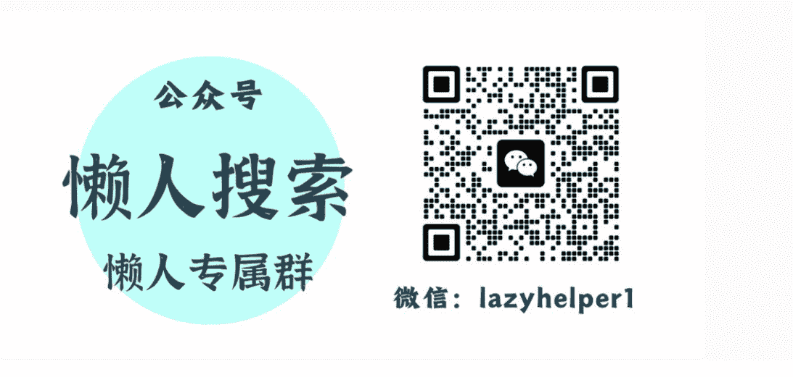

# 十二年电商路，我靠四次换赛道活到了现在

**260509 副业 SC 精华**  

整理：公众号懒人搜索，[懒人专属群](https://www.laorensearch.com) 精选  

懒人微信：lazyhelper1

和七天老师聊完过去的经历后，他说我经历的周期挺典型的，整理出来能给后来人做个参考。说实话刚开始我有些犹豫，不知道怎么开口，也怕写得不够好。但既然选择在一个愿意分享的平台，我就把这段复盘摊开讲一讲。

写完这篇，我才更敬佩那些能长期输出深度内容的人。这篇分享，不求完美，只希望对正在创业、卡在转型、找下一条路的朋友有一点启发。

做电商整整十二年，我走过淘宝分销、京东、做自营男鞋、切童鞋、玩过抖音，现在全押在 AI 上。中间有两次印象特别深，一次是把男鞋自营做到类目前列还拿到阿里奖项，一次是用几万块启动资金撬动合作店铺过千万营收。复盘下来我才明白，支撑我走这么远的，从来不是抓到一个爆款，而是每当旧打法失效前，我都提前挪到了下一个跑道。

很多人讨论电商，聊的都是运营、选品、投放，这些都很关键。但拉长周期看，真正决定生死的，是能不能在模式衰退前提前感知变化，并有勇气切换赛道。

今天结合亲身经历，聊一聊对我影响最大的四次转向：从职场转电商、从分销转自营、从单干转合作扩张，以及从传统电商转 AI。以及每次判断的来龙去脉。

## 一、认知从大学就开始种下

大学时我学习成绩很靠前，第一学期拿了专业第一。到了第二学期，我却开始发懵。十几年书本教育，让我怀疑只是闷头啃书到底有什么意义，能不能带来真实的能力和赚钱能力。

长时间的自我拷问后我才想通：我要的不是课本上的字面知识，而是能落地的能力。**能力才是核心竞争力**。于是学习投入从满分十降到六，剩下的精力拿去打比赛，简历设计、演讲、羽毛球，乃至省级国家级赛事。国家级比赛让我跟老师跑了常州、温州、武汉华科，收获很大。

比赛结束后我拿到一份很优渥的 offer，放到现在也算稀缺。回头看，很多后来的认知，其实种子很早就埋下了：我慢慢开始追问，决定结果的究竟是什么，而不是只做表面努力。

## 二、第一次转向：辞掉安稳工作去创业

那份 offer 在天津。公司氛围像养老，舒适但不符合我的野心。我开始利用下班时间做副业，话费充值、淘宝培训、女装。一次刷信誉操作被指点后，订单源源不断，手机一直响，那种兴奋至今难忘。随后卖女装也异常顺利，我确信电商是真机会。

天津不适合做电商，我和已婚的女朋友商量一起向杭州迁移。先让她去杭州的代运营公司学习，我在天津坚持到时机成熟再过去。她学得不错，店铺也做得好，我便辞职南下。身边人不理解这么好的待遇为何不要，但在我看来，心不在此，留也无用。

到了杭州本想自己开干，有亲戚介绍了一个品牌项目，做淘宝分销。听完分销模式我立刻心动：一双鞋卖出去我就分几十，上百双就是上千，规模越大收益越可观。而且我在天津与淘宝商学院有合作，对这个赛道有理解。

### 第一次真正触及“周期”

亲戚说最好两个人分工：我负责招商，他负责维护。招商是不断找淘宝商家来做分销，维护是确保商家持续合作并提供服务。第一阶段我做得很顺，还拉了高中同学加入。可很快发现招商越来越难。品牌负责人也想退出，我意识到必须撤退。

那时我第一次明白：**任何模式都有生命周期，阶段结束就要及时换路**。

## 四、第二次转向：从分销思维走向自营

我们脱离原团队换品牌，转向京东。京东对该品牌几乎是空白市场，我们迅速把品牌做活。但很快品牌方自己入场，优势消失。于是我开始思考：既然品牌好，为什么不自己做。

all in 淘宝，自营起步。没有完整实操经验，我一度虚。可面了几个操盘手后发现都是空话，还不如自己上手。当时很需要系统学习，我报了万堂书院，选了个有真实数据、长期在一线操盘的老师。那次投入回报几千倍，是我感恩的转折。

### 自营的突破口不是投流，是核心问题

老师教的低价引流核心靠直通车，但我发现点击率才是决定成本高低的关键，一图定生死。外包摄影效率低、试错慢，我决定自建 mini 摄影团队，让高中同学从零学摄影和 PS。

别人可能没这个魄力，让一个新人从零学起，店铺还等着出图。但我判断这就是瓶颈。不解决摄影，店铺做不起来。就这样大几千买了尼康，他苦练三个月后出了一张好图，产品直接爆单，神级大图贡献了近半收益。店铺冲上男鞋头部，淘宝还颁了奖。那年也是我女儿出生，事业巅峰。

回头看，成功不是靠运营套路，而是找到真正卡住结果的核心问题，并死磕到底。

## 六、认知升级会直接改变结果

那年我在社群里积极输出，数据漂亮，后来被聘为学委。持续输出价值后，代运营单子自然找上门，创始人和温州商家都来求助。这段经历让我更坚信：**好认知会直接转化为结果**。

## 七、男鞋触顶后寻找第二曲线

品牌方开始全面铺开挤压我们空间。虽然还在巅峰期，我已嗅到瓶颈。于是瞄准童鞋：一是我有了孩子，二是二胎政策带来需求，三是温州本地童鞋资源好。

在群里认识了一位温州做童鞋的朋友，他选款眼光极准，推起来基本都是小爆款。但精力有限，童鞋一做，男鞋下滑，利润也更薄。权衡后我一度放弃童鞋回拢男鞋。这让我更清楚：机会很多，抓不住是因为精力分配不过来。

## 八、看到不等于抓到

那个阶段我很早就看好短视频。2015年快手火时我就让哥哥去拍，说做好了能在杭州买房。后来我自己也做过书单、家居、直播带货，也出过成绩，但没持续下来。认知到位，执行力跟不上，机会就溜走了。这件事给我最大教训：**看见机会是一回事，能否吃透是另一回事**。

## 九、第三次转向：从单线作战到合作扩张

意识到一个人吃不下所有机会后，我再次回到童鞋，这次选择合作。那个朋友有选款和供应链优势，我有运营能力，正好互补。我们决定铺店模式，用十万启动金撬动了数千万营收。这是我第三次关键转型：从单线经营到双引擎，从单打独斗到搭档扩张。

## 十、第四次转向：押注 AI

ChatGPT 出现后我很快开始使用，并发朋友圈看好其潜力。但我没敢立刻放弃童鞋，而是选择大力培养合伙人接管店铺，自己逐步抽身投入 AI。现在店铺已稳由他操盘，我把全部精力放在 AI 上。这是第十二年里最关键的一次转向。

## 十一、赚钱是当下的主阵地

到了这个阶段，需要的不是闭门造车，而是持续学习和信息校准。赚钱有术正好提供这样的环境。我的规划很清晰：先学后分享，用输出倒逼自己成长。最近分享一些 AI 知识后，已有朋友咨询付费合作。这让我坚定要在赚钱赚到学费百倍的回报。

## 十二、四次转型的共同逻辑

很多人掉队，我还在，核心两字：居安思危。不是等到不行了再找路，而是在还赚钱、还稳定时就开始思考下一站。分销有周期，平台有周期，类目有周期，能力也有周期。满足于当下，等反应过来就晚了。

我没什么特殊，只是在模式走到尽头前选择离开：分销难了就自营，京东被挤就all in淘宝，男鞋被挤压就布局童鞋，看见抖音、AI 就提前试探。每次未必完美，但从未原地踏步。这比技巧更重要。

穿越周期靠的不是一次爆发，而是比别人早一步意识到：这条路要到头了，然后有勇气重新出发。

永远保持市场敏感度和信息好奇心。最关键的一步永远是：有看见的能力，有执行的决心。

### 总结

十二年里能支撑我走下来的，就是这四次关键切换。背后本质只有一个：**旧路将尽，提前去找新路**。

穿越周期，不是等条件成熟才动，而是看见变化就去尝试。龙哥在赚钱十周年直播里说过：看见才相信，不是相信才看见。这句话我一直记着。

这句话，正好对得上我过去十二年的体感。等大众都点头认可的时候，红利早已不像刚开始那样肥沃了。

———分割线———

想第一时间捕捉全网正在跑通的变现打法，并和一批动手能力极强的极客同行实战出结果，可以来看看我的核心私域：【懒人专属群】。

这里不做空谈，只聚焦商业闭环的拆解逻辑和 AI 效能的极限榨取。沉淀在系统里的，已经有 1000+ 套可复用的套利实战案例。

👉 查看圈子数字资产清单和加入门槛：

想第一时间捕捉全网正在跑通的变现打法，并和一批动手能力极强的极客同行实战出结果，可以来看看我的核心私域：【懒人专属群】。

这里不做空谈，只聚焦商业闭环的拆解逻辑和 AI 效能的极限榨取。沉淀在系统里的，已经有 1000+ 套可复用的套利实战案例。

👉 查看圈子数字资产清单和加入门槛：

https://lazyso.com/insider/

认同这个方向并且准备立刻动手的人，直接扫码添加我的微信：lazyhelper1

备注：【实操上车】，谢绝闲聊