## 离开 MCN 管理岗，我靠 AI 把个人业务重搭了一遍

260601 副业SC 精华

公众号懒人搜索，懒人专属群独享  

懒人微信：lazyhelper1

## 01 背景交代

生财的各位朋友大家好，我是河林，先做个自我介绍。

- 98 年，长期在杭州；
- 电商大厂 6 年，从头部达人团队全程操盘直播项目，到头部 MCN 做业务负责人，带过 8 人小组；
- 担任过视频号直播航海营的导师；今年 3 月起单干，定位顾问式陪跑，帮直播项目从 0 到 1 再到 1 到 100 的增长。

AI 给我的实际变化是：

- 用工作流把一人公司撑起来，多个项目并行，小时咨询从 1000 元起，陪跑客单月五位数；

- 付费学员累计 500+，经营一个 2400+ 人持续订阅的 AI 知识库；
- 个人公众号每月 15 篇左右稳定输出；
- 每月线下课讲解 AI 落地直播业务，已覆盖 300+ 品牌商家；

在职的同事常问我：
你时间怎么够？为什么产出能这么高？怎么做交付还能坚持写内容？

我的说法是：我养了一支 7×24 在线的 AI 专家队伍，天天迭代磨合，一个人就能做到一支团队的产能。

这篇文章想把三件事讲清楚：
- 用好 AI 的思维前提
- 我的个人公司运行方式与实操
- 从新手到熟手的速成路径

受 @七天 邀请，把我从 MCN 负责人到个体经营者的完整工作流分享出来，欢迎交流。

之前生财发过：
9000 字复盘 3 年头部视频号达播实操：百万 GMV 大场经验复盘
5000 字保姆级测评手册：搭建个人 AI 知识库，它是我最佳的第二大脑（秘塔 AI+get 笔记）

## 02 认知先行

### 1）AI 输出质量取决于什么

想让 AI 真正帮忙，先要明白产出受什么影响：
AI 结果 = 模型 × 指令 × 语料 × 流程

- 模型：是否具备领先优势
- 指令：提示的清晰度
- 语料：是否喂了优质背景资料
- 流程：AI 在工作链路里的位置，前后衔接是否顺畅

大多数人只琢磨指令，因为最好抄。等模型差距缩小后，真正拉开差距的是独家语料和可运行的流程。

在公式认知不到位的人，AI 使用基本停在对话框里，潜力被浪费。

### 2）业务理解的权重高于技术

懂业务的人学 AI，远快于懂 AI 的人学业务。

AI 补不上专业判断上的短板，做项目要同时深耕业务本质。

别追工具，先找到让你最疲惫的重复动作，把这一环跑通，比刷 100 篇测评更有用。

不必成为 AI 研究者，也不必研究花哨的 workflow。业务理解越细，越能定位真实痛点、真正可复用的动作和值得自动化的环节。

### 3）AI 有局限，不用才浪费

AI 不是万能，但不用就是浪费时间。

我判断是否交给 AI 的标准：重复三次以上且需要分析的，就交给 AI 或 Agent。

对个体而言，价值体现在：
- 执行类：放权给 AI，自己聚焦关键决策
- 策划类：与 AI 双人协作，先让它出第一版保底方案，再用业务逻辑推演、修正，多轮后质量提升

AI 执行力的提升，也倒逼我思考与决策水平同步提高，这才是提效本质。

接下来讲实操。
提前说明：不涉及龙虾流，不需要代码，文科生也能看懂，我自己就是文科生。

## 03 MCN 负责人转个体后的 Agent 体系

### 我的生产力矩阵

在 Claude Projects 里我分两种建
- 项目：围绕单项目搭建的知识库
- Agent：把一项技能封装成可调用的角色

目前分为业务专家、生活助手、内容创作三大类，常用 15+ 个。

#### 生产力矩阵

| 类型 | 名称 | 核心作用 |
|---|---|---|
| 业务专家 | 独立市场分析师 | 项目与商业模式拆解，出策略 |
| | 直播间塑品专家 | 提升塑品话术，产出上播文案 |
| | 直播间策划专家 | 视频号直播策划与发展规划 |
| | 直播预约短视频编导 | 按直播需求定制引流短视频 |
| | 视频号投放参谋长 | 基于数据搭建投放计划 |
| | 直播间拆解专家 | 接收话术稿，拆节奏、话术、排品 |
| | 会议纪要总结专家 | 处理播客、音频、会议录音 |
| 生活助手 | 健康顾问 | 营养、饮食、训练建议 |
| 内容创作 | Agent 创作专家 | 从元提示角度撰写提示词/skill/Agent |
| | 公众号爆款标题 Agent | 撰写有爆文气质的标题 |
| | 人格化文案锻造师 | 让文案更有人味、更贴用户 |
| | ……其他 | |

除稳定 Agent 外，我还会从生财收集场景化提示词，按需使用。

我高频的三个场景：
- 业务执行层：过去靠请咨询的专家判断，现在天团随叫随到
- 产品交付层：过往资料被 AI 打包成可收费的知识库+社群
- 创作输入层：个人 Obsidian 笔记被重构成可调用语料，写作不再从零开始

三层串起来，形成可运转的最小闭环：
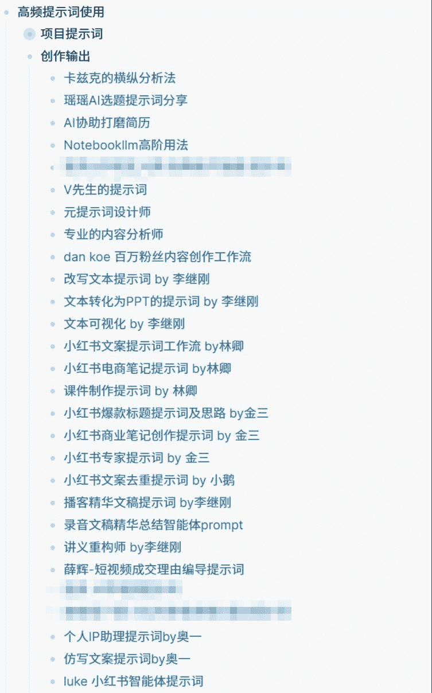
专家团队给判断 → 知识库变产品 → 笔记供创作 → 任务管家护执行

这套闭环是我作为超级个体底气的来源。

### 场景一：造一支专家团来打工

操盘项目涉及多个环节，陪跑项目包括塑品话术、市场分析、直播策划、投放策略、内容输出等。
一个人再全能也难以面面俱到，全部精进需数百小时，咨询费用一次几千到上万。

现在的方式是我把多年方法论、案例、笔记分类喂给不同 Agent，形成常驻专家团。
每个 Agent 都是被个性化业务语料喂饱的顾问：

- 塑品专家：输入产品信息与直播背景，输出可直接上播话术
- 拆解专家：投一份竞品录屏稿，结构化输出对标打法与可复用方法
- 投放参谋：输入预算目标，输出分时段分计划方案

业务专家 Agent = 方法论 × 语料 × 指令框架 × 真实场景

它们不是聊天工具，而是在每个决策节点给一份高于平均线的参谋意见。
多项目并行时不再被不熟领域卡住，这就是一人公司跑得开的关键。

#### 实操：直播拆解 Agent
看到优质直播，我直接让拆解专家处理，一次输出 5 模块：
- 货盘概览
- 排品节奏
- 主推话术
- 可复用框架
- 综合点评

同等深度过去需资深运营一整天，现在 20 分钟拿到可直接复用的报告。

#### 实操：塑品话术 Agent 与预约短视频 Agent
塑品话术 Agent 在 10 分钟内产出 90 分以上的主推卖点，交付主播用即可。
示例一：某品牌 南瓜茶 · 直播间塑品话术

🎬🎬 完整话术脚本

一、拉人（约 30 秒 | 聚人气+留住人）

来来来，所有今天刷到我直播间的姐妹，先别划走——

你平时是不是总觉得早上起来脸肿肿的？熬夜加班第二天整个人看起来胖了一圈？又或者你明明不胖，但看起来就是不清爽、不利落？

今天这个品，就是帮你解决这个问题的。

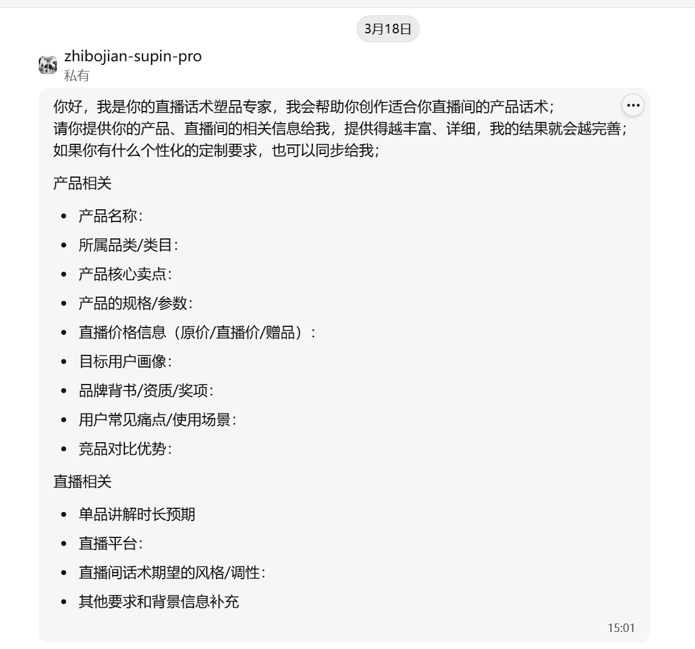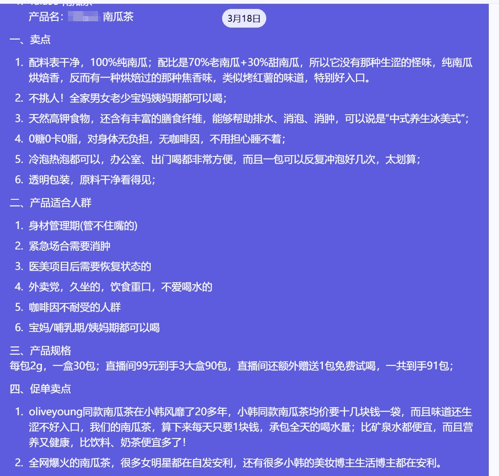

而且我先说一个炸裂的价格——算下来一天只要一块钱，比你楼下买瓶矿泉水还便宜。

等一下我会告诉你为什么这个东西全网都在疯抢，先点个关注停一停，听我花两分钟把它讲清楚，不适合你你再走，但你听完大概率要抢。

二、塑品（约 2 分 30 秒 | 核心价值塑造）

🔹🔹 第一层：场景带入——"你有没有过这种时刻？"

姐妹们，我先不说产品，我先问你几个问题——

你有没有过这种经历：第二天有重要场合，拍照、见客户、约会，结果前一晚吃了顿火锅，或者加班到很晚，第二天早上一照镜子，脸肿得跟馒头一样？

【停顿 1 秒】

还有，久坐办公室一整天，外卖吃得又咸又油，下午腿就开始发沉发胀？

或者你就是不爱喝白水，觉得没味儿，一天下来根本喝不够水，但奶茶饮料你又怕胖？

你把这些问题打在公屏上，有一条算一条，我看看今天在座的姐妹有多少中招的。

🔹🔹 第二层：产品引入——"我找到了一个特别好的解决方案"

好，我今天拿出来的这个东西，就是——xxx 南瓜茶。

【动作提示：拿起产品展示，特写透明包装】

你先看这个包装，全透明的，里面什么东西看得一清二楚，就是纯纯的南瓜颗粒，没有任何乱七八糟的添加。

翻过来看配料表——只有一个词：南瓜。

没有糖，没有香精，没有代糖，没有防腐剂，100% 纯南瓜，配料表干净到让你心安。

🔹🔹 第三层：卖点深度拆解

第一个卖点，也是我最想让你知道的——这个配比太讲究了。

它是 70% 老南瓜+30% 甜南瓜的黄金配比。老南瓜营养足，甜南瓜调口感。所以你泡出来喝，不是那种生涩的菜味，而是带一种烘焙过的焦香，有点像什么呢？就像冬天街边烤红薯飘过来的那个香气。特别好入口，完全不需要硬着头皮喝。

很多姐妹之前喝过小韩的南瓜茶，跟我说味道涩涩的不好喝，坚持不下来。这款你可以先喝一包试试，口感的差距是很明显的。

【动作提示：现场冲泡展示，闻香、试喝】

第二个，它的营养价值真的值得好好说一下。

南瓜本身就是天然的高钾食物，同时还含有丰富的膳食纤维。高钾帮助身体排水、膳食纤维帮你增加饱腹感。所以现在很多姐妹管它叫**"中式养生冰美式"**——提神不靠咖啡因，轻盈不靠饿肚子。

【语气提示：加重、放慢】

而且它是 0 糖、0 卡、0 脂、无咖啡因。这意味着什么？

意味着它不挑人。身材管理期可以放心喝；姨妈期、哺乳期的姐妹，也完全没问题；家里老人小孩也能喝；晚上喝也不用担心睡不着——因为没有咖啡因。

你找不到第二个适用人群这么广的日常饮品了。

第三个，方便到离谱。

冷泡热泡都行。早上到办公室，往杯子里丢一包，倒上热水，你的养生茶就有了；夏天在家，直接冷水泡，冰箱里冰一下，就是一杯天然南瓜冰饮。

关键是——一包可以反复冲泡好几次，从早喝到晚，承包你一整天的喝水量。比你一天点一杯奶茶、买一杯咖啡省太多了。

三、互动（穿插在塑品与开价之间，约 20 秒）

来，姐妹们，听到这里觉得想试试的，公屏上给我扣**"南瓜"**两个字，我看看有多少人有需求。

尤其是那种——久坐办公室的、外卖党的、日常容易肿的、不爱喝白水的——你扣个 1，等一下我讲价格你一定会觉得太香了。

我看到了哈，人还不少，那我价格直接给你们安排上。

四、开价（约 50 秒 | 价格锚定+价值对比）

这个南瓜茶呢，你如果去搜小韩 oliveyoung 同款的南瓜茶——一袋要十几块钱，而且还是那种生涩口感，不好坚持。在小韩这个茶火了 20 多年了，很多女明星、美妆博主、生活博主都在自发安利，这不是我们花钱请的，是真的火。

那我们直播间今天什么价？

【语气提示：先停顿，制造悬念】

99 元，三大盒，一共 90 包。而且直播间我再额外送你 1 包免费试喝，到手 91 包。

你算一下：91 包，99 元——一包一块零几分钱。

【语气提示：加重语气、放慢速度】

一天一包才一块钱。比矿泉水便宜。你每天少喝一杯奶茶省下来的钱，可以喝三个月的南瓜茶。

而且你喝的是纯南瓜、0 添加、高钾高纤维的天然养生饮品，不是糖水不是色素水。这个账怎么算你都不亏。

五、逼单（约 40 秒 | 打消顾虑+制造紧迫）

我知道有些姐妹可能还在犹豫——"我怕我喝不习惯怎么办？"

所以我们额外送了一包试喝，你收到货先泡这一包，觉得口感 OK 你再开整盒。怎么样？完全没有风险。

【语气提示：真诚、放慢】

姐妹们，我说句掏心窝子的话。这个东西不是药，它也不是什么神奇的减肥茶——它就是一杯干净的纯南瓜冲饮。但你想，你每天要喝水吧？与其喝没味道的白水坚持不下去，不如换成一杯有焦香味的南瓜茶，好喝的同时顺便还把钾和膳食纤维补了。

这不是花钱，这是把你本来就要花的喝水钱，花得更值了。

99 块三大盒 91 包，我今天就上这一轮，库存有限。

想要的姐妹——直接拍，现在就拍。

3、2、1，上链接！

📊📊 话术结构总览

🔍🔍 启发性建议——帮你进一步优化话术

以下问题如果你能补充回答，我可以帮你把话术打磨得更有杀伤力：

🔍🔍 1. 原料溯源与工艺

你们的南瓜是哪里的产地？用的什么烘焙工艺（低温烘焙/冻干/其他）？产地和工艺的故事在直播间能极大增强"干净天然"这个卖点的可信度，比如"XX 产地日照 2000

19 /
38

小时的老南瓜”就比单说“100%纯南瓜”更有画面感。

### 2. 用户真实反馈/回购数据

有没有印象深刻的用户好评截图、回购数据，或者你自己喝了多久的真实体验？“我自己喝了X个月”“回购率XX%”这类真实数据在塑品和逼单环节是转化率最高的信任素材。

### 3. 具体的明星/博主安利素材

你提到很多女明星和博主在自发安利——能否具体到是谁？（如果是公开场合的真实推荐，可以在话术中提及。）有具体人名的背书远比“很多人推荐”更有冲击力。

### 4. 使用体验的“啊哈时刻”

喝完之后有没有什么用户反馈特别集中的体验？比如“第二天早上照镜子脸明显清爽了”“泡出来颜色特别好看，很出片”等。一个具体的体验细节，比十句笼统的描述都管用。

### 5. 与白水/咖啡/其他代餐茶的替代场景延展

这款产品在送礼场景（比如送给久坐办公室的闺蜜、送给养生的妈妈）有没有实际案例？“送礼”是一个高转化附加场景，尤其是三盒装的规格天然适合送人。

### 6. 品牌资质与检测报告

有没有SGS检测报告、食品安全认证或其他权威第三方检测数据？尤其是0糖、0卡、0脂的宣称，如果有检测报告背书，在直播间可以直接怼镜头展示，信任感瞬间拉满。

### 7. 售后与物流细节

发货时效是多久？是否有运费险？这些信息在逼单环节能有效降低用户最后一步的犹豫——“今天拍，明天发”“不满意直接退，有运费险”，都是临门一脚的助推器。

### 8. 竞品差异化的更多细节

除了口感更好、价格更低之外，和韩国同类南瓜茶相比，在原料品质、加工方式、包装设计上还有没有其他差异点？“人无我有”的独特差异是直播间最有力的记忆锚点。

💡 使用建议：以上话术为基础框架版本，你可以将补充信息反馈给我，我会在对应模块进行定向升级。同时建议主播在实际开播前做1—2次口播练习，根据自己的语速和节奏微调句式长度。

### 示例二：某品牌南瓜茶直播间预约话术
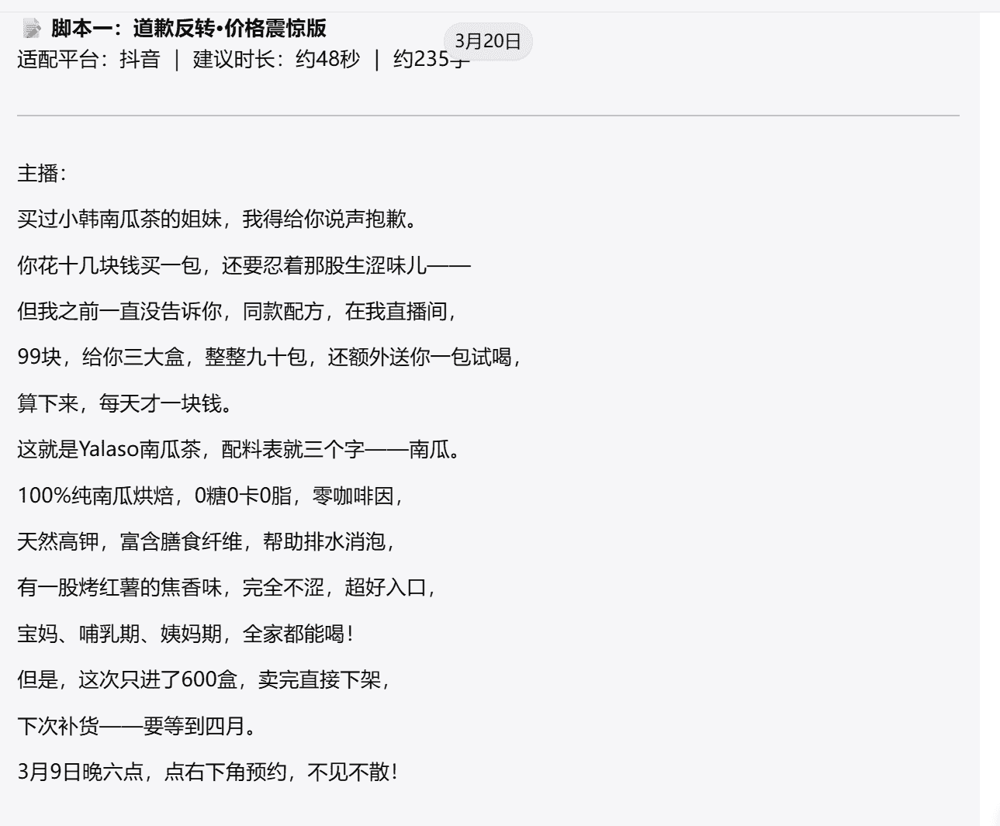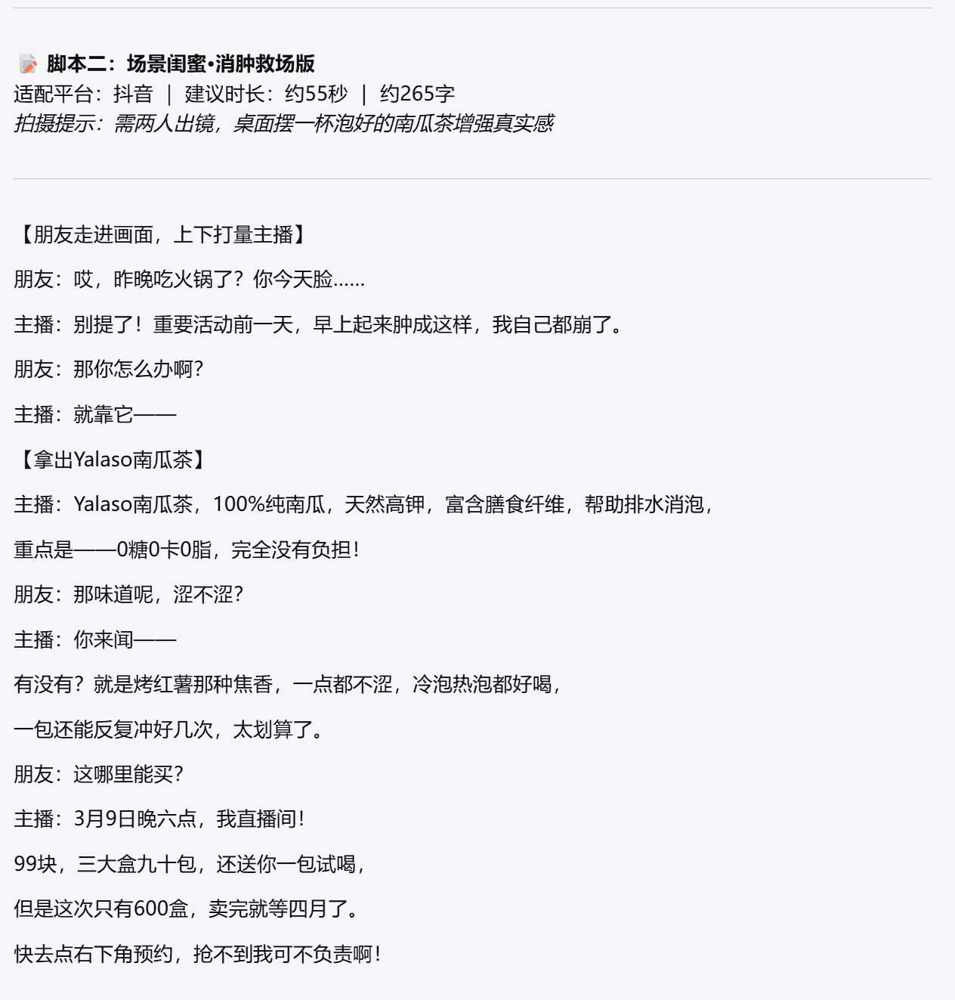

## 实操展示：制作IP内容策划方案

把项目关键语料上传到 Claude Projects 后，用于 IP 内容策划与脚本撰写，效率与质量都明显提升。

你有没有发现，AI 时代真正拉开差距的，从来不是谁更勤奋，而是谁更会“偷懒”。

今天这篇内容，我想用我自己的实战经历，聊聊我是怎么把 AI 从“玩具”变成“印钞机”的。

很多人问过我一个问题：为啥我用 AI 总是胡说八道、废话连篇，而你能用它直接干活？

答案其实很简单——你得给它“喂饭”。

我的玩法，是把项目的来龙去脉、商业模式、产品细节、IP 本人的历史内容、他的人生观、职业履历、讲话风格，全部打包成知识库投喂进去。这样子做出来的输出，基本不会鬼扯，而且比真人更像真人。有的时候，它比我还要了解我自己。

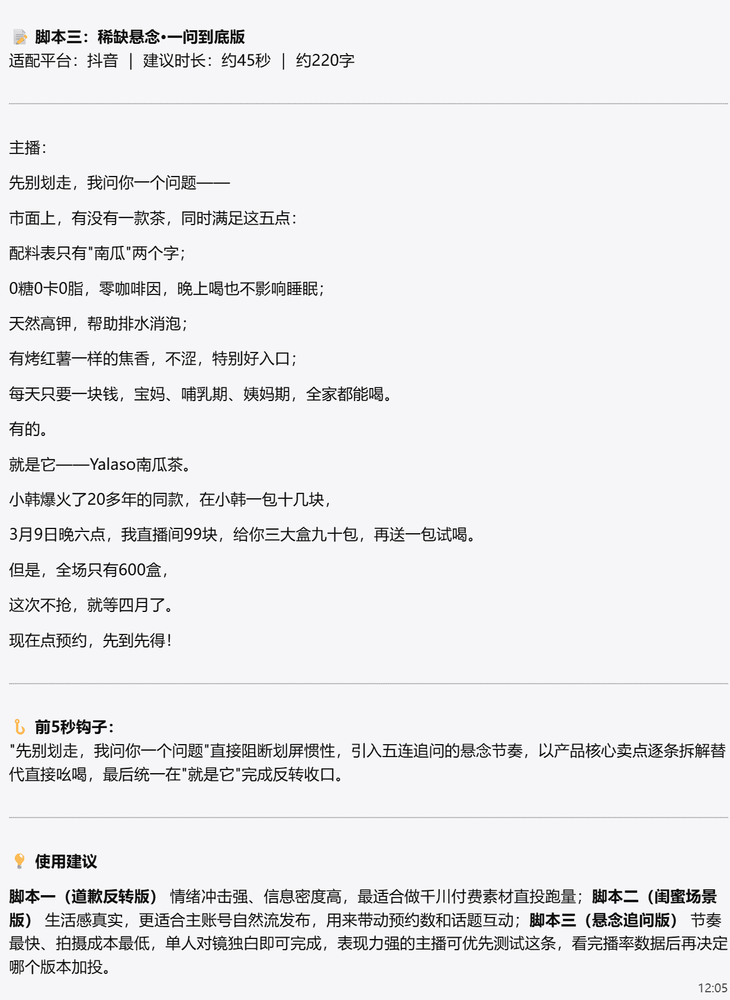

把项目用这套方法“投喂”给 Claude，并且用 Projects、Agent 持续调教后，它能干的事远超你想象。像日常的账号运营规划、策略拆解这些，不用我操心了。点一下，它直接给我一张 Excel 选题表；再点一下，它连内容脚本都给我写好了；以前我苦哈哈做 PPT 的日子也到头了，它一键就能生成可以直接拿去提报客户的方案，还能顺手输出团队可以直接照着执行的 SOP 表格。

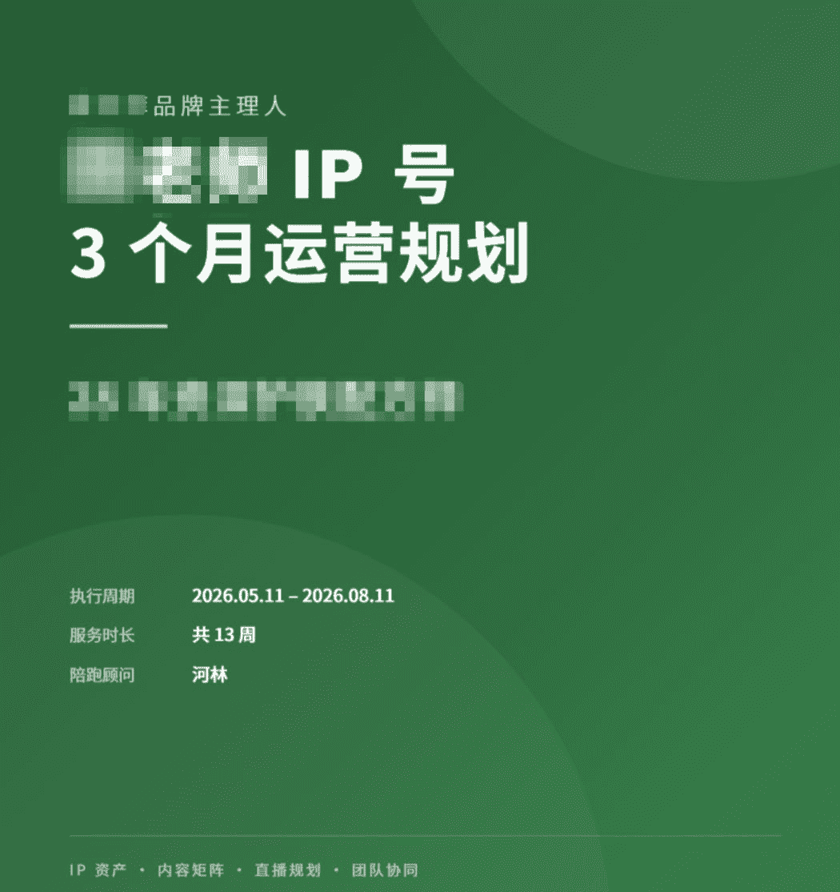

最让我骄傲的是这套流水线产出内容的能力。我给我们自己的 IP 做内容，一天稳定出 20 篇稿子。Claude 的初稿水平从 0 分到 100 分来打分，能稳定在 75 到 85 之间。剩下的交给我的审美和判断：手动筛选一遍，把每篇精修一下，直接就能拿到镜头前拍。你可以在我们账号里看到，数据表现一直没让我失望过。

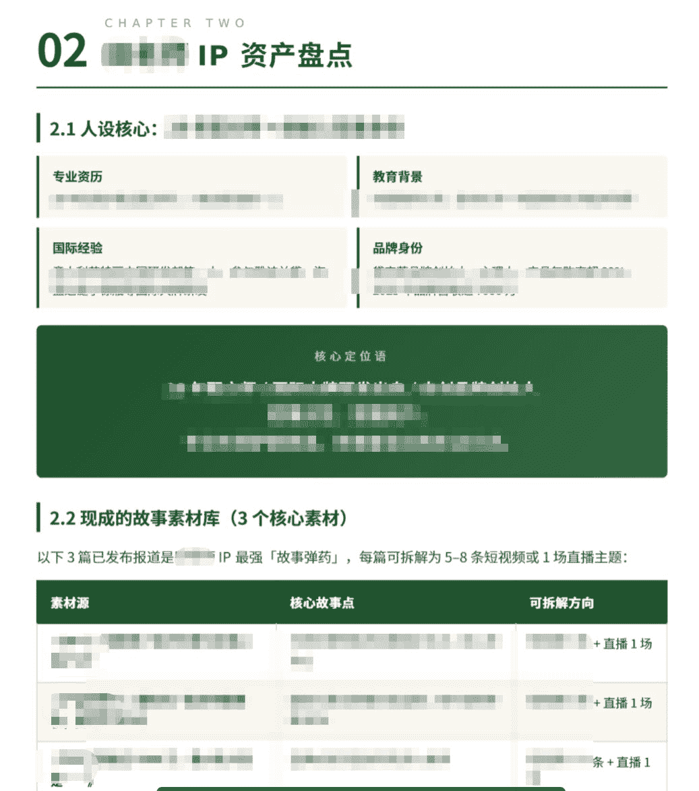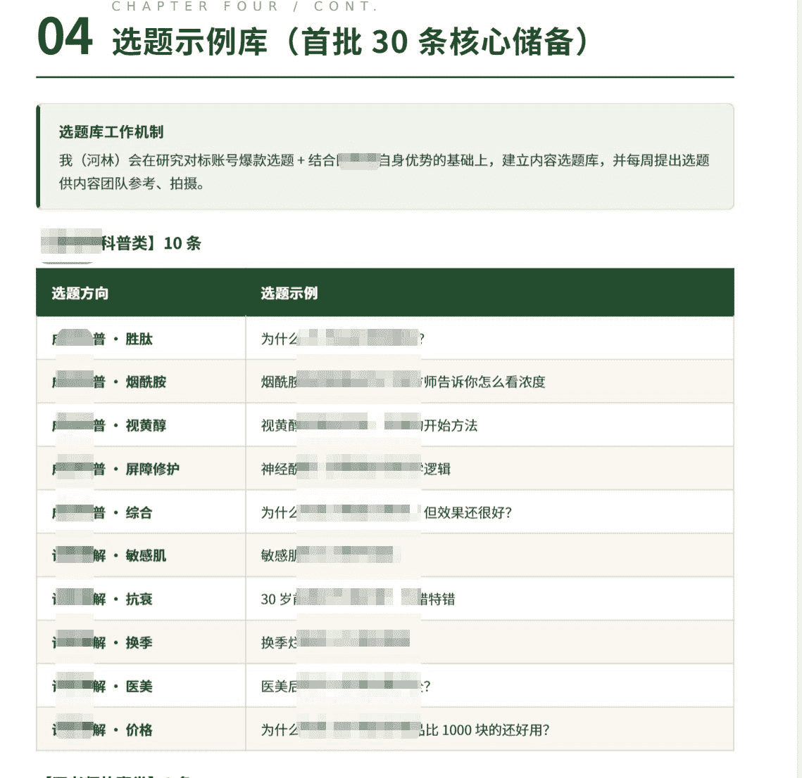

说完第一个场景，再说说第二个我特别看好的路子——把 AI 知识库本身变成一门生意。

我从做运营的第一年就开始攒家底：工作文档、看到的好文章、各种资料，只要觉得有价值，都留一份。三年攒下来，飞书知识库里躺着几百份我反复打磨过的精品文档、几十份调研报告、上千条剪藏笔记。

等 AI 知识库工具成熟了，我发现我攒下的这堆东西，一下子活了，一件东西拆出来三种用法：

- 它是一个内容输出源：当成一个内容工厂的流水线入口，大量往外撰稿；
- 它是一个业务大脑：可以为我的决策提供行业视角和知识支撑；
- 它还是一个现成的交付产品：直接打包成服务，交付给我的付费客户。

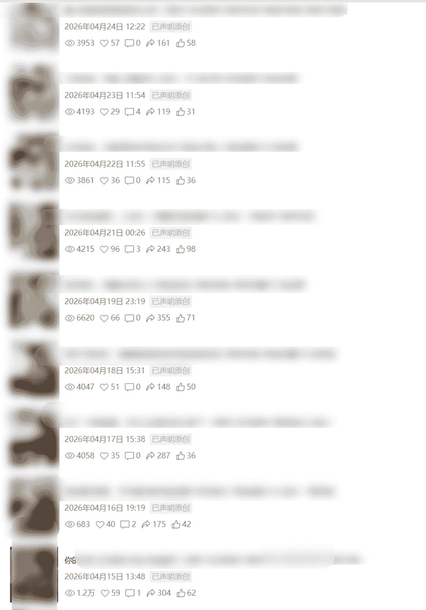

现在我手上这颗最亮的珠子，叫「视频号直播知识库2026 AI版」，部署在 ima 上。没怎么刻意推广，已经有 2400+ 人订阅了。配套的陪伴型社群，连续服务着 200+ 位视频号电商玩家。对我而言，做知识库的终极模式，就是把它变成“知识付费产品×社群服务”双拼套餐，用户买到的不只是一堆资料，而是一个可持续提供权益的服务。这就是一个完美的交付闭环。

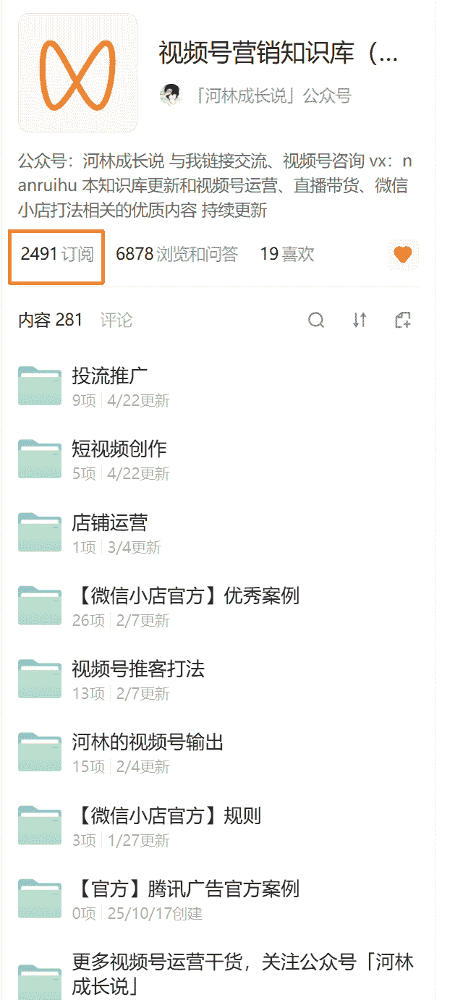

第三个场景，是我花时间最多的——从底层重构我的知识管理体系，搭建真正属于自己的内容工厂。

我本人是 Obsidian 死忠粉，电脑本地知识库里躺着 500+ 篇笔记，全是自己在各行各业的输入和摘录。过去用 Obsidian 管理内容已经很顺手了，但现在有了 Claude Code，我之前的老笔记库直接进化成“智能军火库”。

于是，我干脆用 Claude Code×Obsidian 把我落后的知识管理流程，彻底拧了一遍。

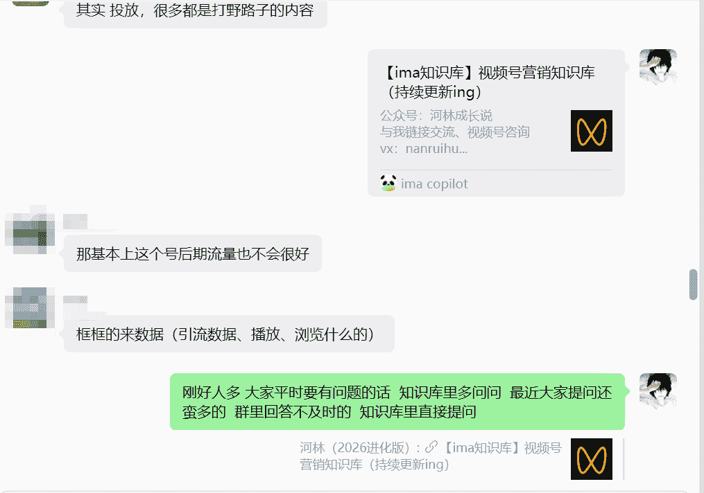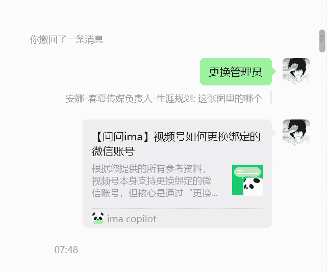

具体怎么做？我分享下我的四步走，你可以直接抄作业。

第一步，请 Claude Code 给所有本地知识库做一次“深度美容”。

我用 Claude Code×Cola×Obsidian 这套组合拳，把我整个笔记库彻底重构了一遍。你猜花了多久？不到半小时。

我的操作思路长这样，你可以直接把这段话扔给你的 Claude Code/Cola/Codex/Hermes Agent，让它照着办：

### 发给 AI 的本地库重塑指令

我现在要整理我的本地知识库，打算让它变成一个 Obsidian 库，今后要和我的 Claude Code 配合，专注服务「内容创作」。

我先说一下我的规划，你先整体浏览库里现在都有什么，判断我的想法靠不靠谱、需不需要调整。等你给出你的观点后，我们先对齐了再动手。

整理步骤如下：
1. 自动给全部笔记打上多维关键词标签；
2. 把空笔记、无效草稿统统删除；
3. 分析整个库的内容，提炼出 8 个最高频、最有价值的核心主题概念词；
4. 给每个概念词都做一张“索引卡”，把笔记之间的双向链接做好；
5. 最后给我输出一份结构总结报告。

走完这五步，我拿到手的不是一排排整齐的文件夹，而是一个能被 AI 随时调取、结构清晰的个人语料库。这种感觉就像是把仓库改造成了可自动分拣、自动出库的智能中台。

第二步，用这套魔法批量复制，搭出一堆本地知识库。

第一个库跑通之后，就可以复制方法了。把自己在各个领域的输出、输入、项目文件先下载回本地，整理成一堆；然后用同样的流程去优化每个库的结构。现阶段的我已经有四个这样的库在运转：

- 内容输出库
- 内容输入库
- 个人方法论武器库
- 业务项目知识库

第三步，给这些库立规矩、定门牌，让它们知道什么时候该串门。

几个库都搭好以后，我会让 Claude 帮每个知识库各写一份 claude.md 作为使用规则，并且在几个相关联的库之间，把互相引用的路径设置好。这样一来，当我在某个库里遇到一个跨领域的问题时，它可以根据场景，主动去别的库里调用素材，灵活组合。

第四步，真正用起来，解决实际业务问题。

库养好了，剩下的就只是“随时调用”了。我现在遇到问题直接用 Claude Code 提问，效率高了不是一点半点。关键是它基于我自己的私人语料库，完全懂我的语境、我的要求，还熟知我惯用的工作方法。做出来的东西毫无违和感。这让我从前的沟通成本、试错成本，全都降到了地板价。我自己的整个知识库体系，从此变得真正“可用”了。

以前写文章，是从一张白纸开始的，冷启动的痛苦你懂得；现在呢？每次创作都不再从零起步，那百分之九十的冷启动成本，直接被干碎了。我的笔记库，从“只管囤不嫌多”的储物间，彻底进化成一个懂我、有料、能直接出活的内容创作工场。

说完了场景，接下来上真东西。Part 4，我想把那些让我从 AI 小白一路逆袭成“速通选手”的心法，全盘托出。

如果你能把这些“邪修”心法吃透并内化，你就再也不用去埋头吃 AI 的苦，也不必当一只拼命囤“199 课程”的信息仓鼠；你会反过来，一切以我为主、一切为我所用的，把 AI 当牛马使唤，让它给你创造真金白银的业务价值。这才是我们使唤 AI 的终极奥义。

邪修法的精髓在于：不靠打怪升级，直接一路开挂通关。

### 邪修法一：AI 时代真正的万能作弊器

我的万能作弊配方 = 批量采集优质语料 × AI 逆向底层方法论 × AI 创作。

这是我亲手折腾出来的、也是最大的一颗邪修仙丹。原理其实一句话：整个世界就是一个巨大的语料库——采集 → 逆向 → 复刻。

把你需要的优质语料采回来，交给 AI 去拆解内核、反向推导背后的逻辑，还原出一套操作方法；再用 AI 基于这套方法论去完成你想干的事。这套炼金术，放在今天就是点石成金。

底层逻辑是：大模型发展到现在，同等条件下，提示词带来的差距越来越小，几乎被大模型自身的能力抹平了。所以，与其囤那些“万能提示词”和“所谓 skill”，不如赶紧去建属于自己的独家原始语料库。

你跟别人卷的信息差说白了都在这里。这件事没法假手于人，也不能全交给 AI——因为筛选语料是极度主观的事，本质是审美的比拼，审美就是壁垒。一份语料库的真正价值，就在于“这是你用你自己对商业的直觉，一条一条亲手挑出来的”。

自有、稀缺、带着个人体温的优质语料，搭上 AI 去做知识管理和批量化分析，才能成为带来爆发式增长的那根杠杆。

### 邪修法二：别自己写 Agent，让 AI 给你写 Agent

不少人卡在“搭 Agent”这一步，原因高度统一：手工写系统提示词太慢、太累、效果全凭手感。

打磨一个新 Agent 的提示词框架，一折腾就是几个小时；上了线还不一定好用，跑偏了又要改，改了又跑偏……死循环。

所以，真想破局的邪修姿势是：自己别动手，让 AI 来手搓 Agent。

分两步走。

第一步：先搞一个“元提示词 Agent”，也就是“Agent 它爹”。

它的唯一任务，就是帮你去写其他 Agent 的系统提示词。

它的输入端很简单：你想解决什么业务问题？用户是谁？典型使用场景是啥？你期望它输出什么格式？你手头有啥语料、SOP、案例参考？

它的输出端很惊人：一份结构清晰、可以直接扔进 Coze / Claude Project / GPTs 里就能用的完整系统提示词。

我自己就在用【河林的Agent】创作专家。自从有了它，我现在新做一个 Agent，从提出需求到落地干活，耗时不超过 15 分钟。

第二步：用元提示词 Agent，批量打造细分场景的专项 Agent。

有了“Agent 它爹”之后，做新 Agent 的意思就从“从零创作”变成了“填写配置”。我只要发现一个新场景，就跑去和元 Agent 聊五到十分钟，把需求交代清楚，它吐一份提示词，我复制进容器，新 Agent 立刻上岗。

为什么我能在 Claude Project 里同时养着十几个 Agent？不是我多勤奋，而是我把“做 Agent”这件事本身，也 AI 化了——用 Agent 去生 Agent，才是真正的一劳永逸。

说到这，直接给你们列一下现在各大厂商的 Agent 工具位置，自己对号入座就行。

国内阵营：
- 豆包 Agent
- Coze Agent（可以接入飞书）
- 微信端：腾讯元器、小微智能体小程序
- Monica

国外大模型：
- POE
- Gemini：Gem
- GPT：GPTs
- Claude：Project
- Claude Code：Skill

### 邪修法三：AI 时代解决陌生难题的标准通关 SOP

这招简直是“万能钥匙”。哪怕你遇到一个完全没碰过的领域、压根不知道怎么做的问题，用下面这套 SOP，也能碾压速通。

这套流程我反复验证过，你直接拿去用：

1. 先上 GitHub、即刻、公众号、小红书搜一圈，看看有没有人已经搞定了这个问题，发布了现成的插件或 skill；
2. 如果有，直接下载。别重复造轮子，把浪费的算力和时间留点下来。然后看一眼它的提示词，符不符合自己的需求，顺手再调优一下；如果条件允许，上一环的元提示词 Agent 也可以帮你再升级一遍；
3. 如果没搜到，就把所有关于这个问题的已知解法、思路都描述出来，交给你的元提示词 Agent，让它帮你手搓一个专属 skill 或 Agent；
4. 问你这个新 Agent：“你还需要我提供哪些语料，才能更好地干活？”它会给你一份清单；
5. 按着清单去采集优质信息，搭建知识库。推荐工具：影刀/RPA/八爪鱼/飞书多维表格字段捷径；如果工具覆盖不了，去万能的淘宝、闲鱼花钱找别人按需求采；
6. 把采回来的料喂给它，让它内化吸收，完善解决问题的路径。需要的话，你还可以顺便发展出几个细分领域的 Agent，专事专办。

这套方法我从没失手过。基本逻辑是：没有攻克不了的关卡。最直观的收益是：以前学一个新东西，起码要花一个月时间才摸到门道；现在，我可以毫不心虚地告诉你——3 小时，够了。

这就是 AI 时代给我的真正生产力。

### 邪修法四：真正的邪修，是心态的邪修

AI 时代最大的“心态作弊”：偷懒不可耻，作弊是正修。

真正的邪修不在技术，而在心法。

你应该有这样一种精神状态：世间万物，皆可用 AI 工作流重塑。AI 是炼丹术，是金手指。曾经那些卡住你的关卡、过不去的坎，都换个思路，扔给 AI 去破解一遍。你会发现，这个世界真的不一样了。

千万不要在那想“AI 能做什么”——它什么都能做。你只需要倒过来想：把 AI 做不了的事列出来，剩下的，全部交给 AI 重塑、打碎、重做一遍。排除法，永远比归纳法省力。

另外，克服你的“好学生”羞耻心：偷懒无罪，作弊无罪。当你越来越敢拿 AI 去替你完成那些重复的、机械的、浪费生命的事，你会越来越上瘾。

真正的快乐，不是停留在原地做卷王，而是看着自己打破了昨天的天花板。

到尾声了。

于我而言，AI 真不是“工具”这个词能装得下的——它是我搭建一人公司操作系统的地基。

感谢生财有术的大家，你们的分享，一直是我 AI 应用和 OPC 转型路上很重要的营养。希望我今天的分享，也能给圈友们一点启发。

篇幅有限，我也没法在这一篇里全展开。如果你觉得哪个部分还不够细，想让我开个专场细聊，欢迎评论区留言呼声，我后面接着更新。

————分割线————

看完这篇 SOP，你可能觉得：我看懂了。但我必须泼盆冷水：90% 的人会在第一步就卡住。

工具和教程只是最末等的门槛，真正的分水岭永远只有两条：一条叫“现在就去动手”，另一条叫“你周围是什么圈子”。

想围观最新最野的变现玩法，并且和一群执行力拉满的极客一起下场拿结果？欢迎来我的核心私域：【懒人专属群】。

这里不讲虚头巴脑的大道理，只做商业闭环的硬核拆解，和 AI 效率的极致压榨。系统内已经沉淀了 1000+ 条跑通了的套利实战局。

👉👉 查阅圈子完整数字资产与上车门槛：
https://lazyso.com/insider/

如果你认同这套价值，也准备好下场真刀真枪地干，直接扫码加我微信（lazyhelper1）

备注：【实操上车】，不闲聊。

