# 📕虚拟1年复制8家店，高峰时期月入6w，我是如何做到的
作者：龙哥

## 📕虚拟一年复制出八家店，巅峰月入6w，我是怎么打出来的

260605 副业SC 精华

各位好，我是龙哥，一个在📕深耕的00后。

21年就刷到过赚钱社群，24年底自己找方向时又重新关注赚钱👸号。之后我陆续看赚钱里的项目文章，试过闲鱼虚拟、闲鱼高客单、得物商单等，都没做出明显成绩，直到撞上📕虚拟电商。

算到今年6月，我在📕虚拟的赛道已经超过一年。现自营8家店铺，最高峰月流水6w+，月订单6000+。这期间经历了类目迁移、违规商品被清、入局门槛抬高等几轮周期，也有一些自己的感悟。现在想把赛道机会、从零到一、如何复制放大的思路分享给正在做或想做的朋友。

三月份流水6w+的截图在上面，其他店铺的数据暂不展示，仅作参考。

这篇是我基于个人实战写的复盘，干货比较多，希望能帮到大家。

## 一、为何押注📕虚拟

25年初选方向时，我对副业几乎是零基础。大学里碰过淘宝、拼多多都没走通，入赚钱前副业收入基本为0。

### 1.试错期

关注赚钱👸号后项目很多，我就挨个上手。第一个是闲鱼虚拟，起步难度不小，需要天天签到、累积曝光、会用超级曝光。25年2月入场正好撞上春节档电影热度，最高日入过千。

可版权意识薄弱，不知道影视资源属于强版权范畴。首店很快被封，再开第二家、第三家同样因版权被处理。一共开了四家，封了三家，最后只赚了几千块，这个方向就结束了。

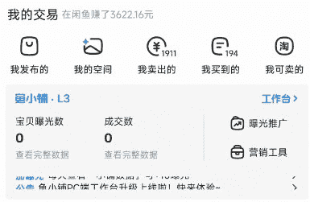

第三家店快被处理时，我开始物色备选，同期在看闲鱼高客单和得物商单。

第三家彻底凉后，我转做闲鱼高客单，只剩一店，卖二手台式电脑，一共出了3单，总流水几百，单笔赚100-200左右。想了想觉得闲鱼蓝海不太适合我，于是去尝试得物商单，同时把注意力正式放到📕虚拟上。

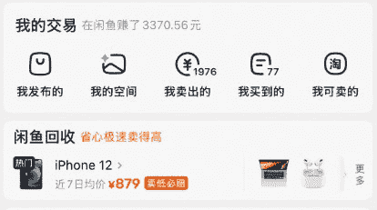

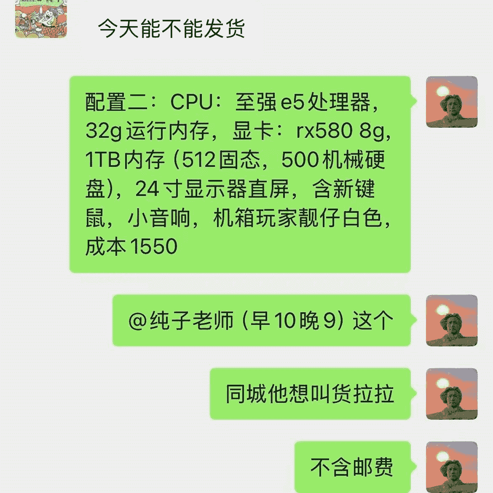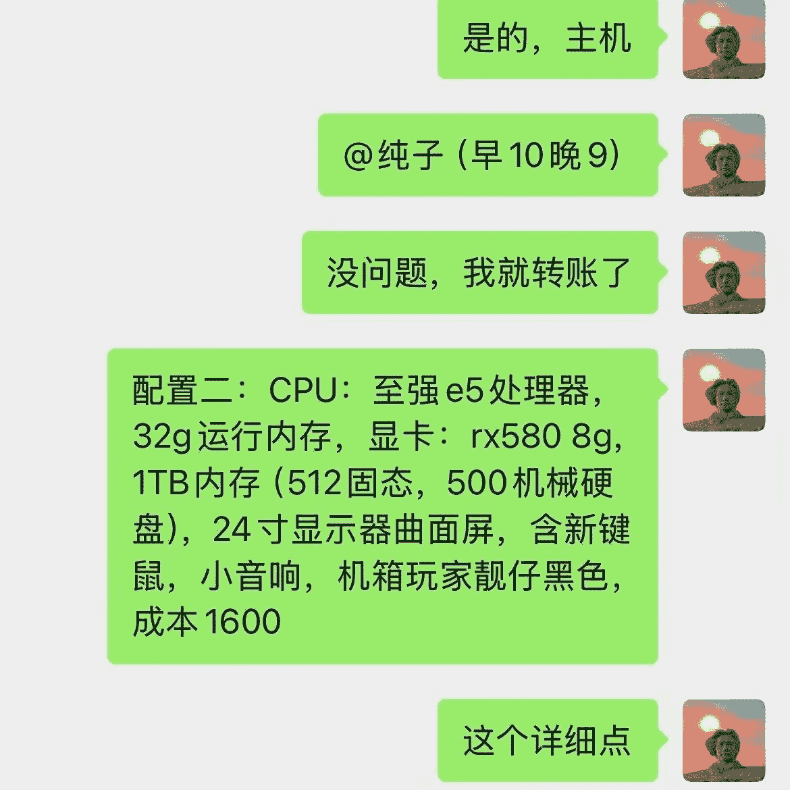

得物商单需要做达人并放实拍图，我拍摄不行剪辑也不熟，一个商单都没接到。期间靠AI生成仿实拍图赚了几十块。在做得物商单的同时，📕虚拟的推进也在进行。

### 2.锁定📕虚拟

前期试过很多品类，从PPT模板到掼蛋课程，再到四六级资料，最后才定在现在的细分赛道。25年4月下旬这个细分品开始发力，日单逐步累积，到5月12日单日破90，对当时的我已经很振奋。之后围绕这个爆品延展同类品，收益持续向好，一个月后重心基本转移到📕虚拟。

第一个月能起来，也得益于之前做过闲鱼虚拟，对虚拟电商的逻辑有一定认知。期间读到更绪老师的文章，干货很足，对我帮助很大，感谢更绪老师。

第二个月开始进入选品-铺笔记-起店-再选品-再铺笔记的循环。期间不断迭代打法、提升内容质量、找合伙人、引入外包客服、做投放等。

📕虚拟很适合新手，发货极其便捷，大部分商品只需交付网盘链接，基本无售后，因为虚拟可复制无限复卖。其次只要把流量做起来，产品自然有成交，部分品还能导到私域做高客单转化。

## 二、从0到1需要什么底层认知

### 1.基础认知

#### ①选择大于投入

好的赛道对普通人更友好，天花板更高。若入场时机合适，项目就能较快跑通。去年📕虚拟就是窗口期，多个细分供不应求，运营门槛不高，用户还在持续增长，只要坚持发内容就能有反馈。

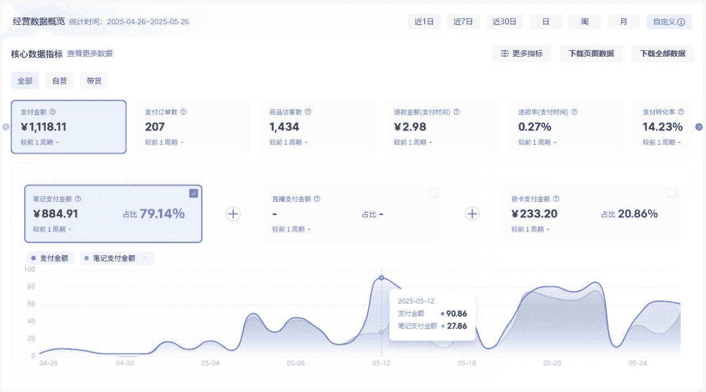

#### ②失败是常态，成功是例外

在📕虚拟之前，我试过好几个方向，虽然都有点小收入，但体量都不大。闲鱼虚拟四店封三赚几千，闲鱼高客单卖电脑赚几百，得物商单赚几十。做项目失败是常态，需要大量试错才能找到匹配的方向。

#### ③匹配度最重要

赚钱里案例很多，每个赛道都有大佬成绩，容易眼花。后来我发现资源、能力、兴趣、性格与阶段不同，别人走的路未必适合自己。关键不是不断换项目，而是找到匹配度高的方向持续深耕。以我为例，聚焦📕虚拟后，经历规则变化、流量波动、竞争加剧，但因持续坚持才积累了方法和认知体系。若当初因困难就换来换去，可能至今还在找方向。

所以适合自己的才是最好的。

### 2.基础方法

#### ①完成优先于完美

试新品或复刻爆款时，给自己定最低完成量，避免完美主义导致卡壳。比如前期每天发3-5篇，复刻不熟练时第一篇可能要花半天，给自己设时限，比如两小时内必须发出，有一定相似度即可上线。商品本身的需求度同样决定结果，花半天做一篇需求弱的内容，既浪费时间也打击信心。

做产品也一样，先上线一个60分版本测试真实需求，有需求就快速迭代，没有就放弃转战下一个。

#### ②最小闭环法

新项目要尽快跑通0到1闭环建立信心。比如📕虚拟，先挑3-5个商品，每个发3-5篇笔记，只要出一单就证明模式可行，形成闭环。

#### ③用数量对冲随机性

目前8家店累计发布超6000篇笔记，用足够的数量去平滑流量的不确定性。很多时候赚钱就是持续执行。

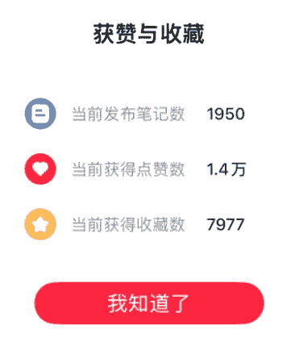

#### ④聚焦核心动作

80%的利润来自20%的关键动作。流程跑通后提炼核心环节，把精力放在影响收益最大的点上，其余可外包、自动化。人力杠杆、工具杠杆、代码杠杆都能释放时间，让自己聚焦核心。

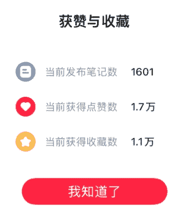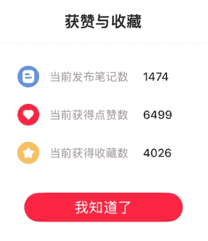

## 三、如何复制放大

主要从复制爆款品、内容、店铺；投放放大；流程标准化；引入工具与人手杠杆入手。

### 1.复制商品与店铺

早期选品也踩过坑，PPT模板客单低没起来，掼蛋课程太小众，四六级资料销量一般。后来找到新赛道，先把一个细分品跑通，再复制同赛道的其他品。当单店规模起来后，再复制同类型的店铺。第一家店从4月27日首单3元，到7月1日单日峰值879元，历时66天，后期日营收保持高位。

### 2.投放放大

入场初期我就用📕乘风投放，之前做闲鱼习惯用超级擦亮测流，转到📕后同样思路。早期用聚光拿客资，点击成本5-10元/次，后换成乘风。乘风前期也踩坑，点击成本常在0.3-0.5元/次。解决思路是提升ROI，挑选点击率和转化率双高的笔记。

一个常见问题是出单后系统把单次点击成本从0.5拉到2元/次，导致ROI掉落。我总结的做法：对已爆笔记，将预期ROI直接翻倍设置。例如预期ROI为3，则计划里设为6以上，可保持计划持续运行，日终ROI基本回到预期，且无需频繁关闭计划。实测有同行用此法做到ROI超5.5，下面是同行数据。

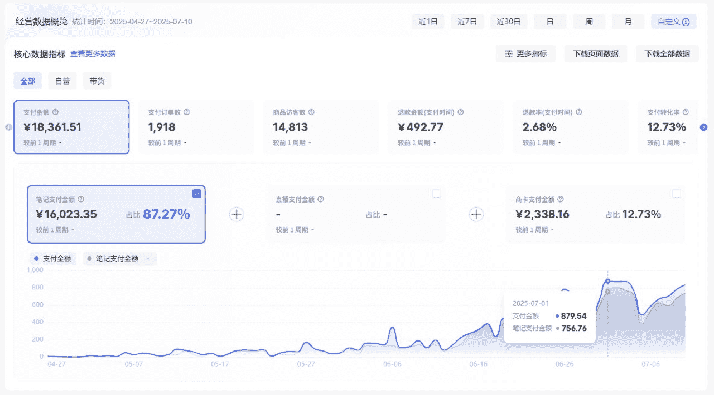

### 3.流程标准化

我把变现路径拆成选品、发笔记、客服、投放、运营。做第二家店时引入合伙人分工，我负责选品投放运营，他负责发笔记，再加上两名外包客服，效率大幅提升。

为提升笔记产量，建立了爆款素材库，用AI生成标题与文案，数量和质量同步提升。图片方面一直坚持实拍，因为平台更偏爱实拍，同样商品实拍的流量普遍高于截图或虚拟图。实拍流程标准化后，日产几十套图，覆盖多店无压力。

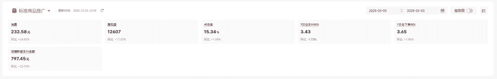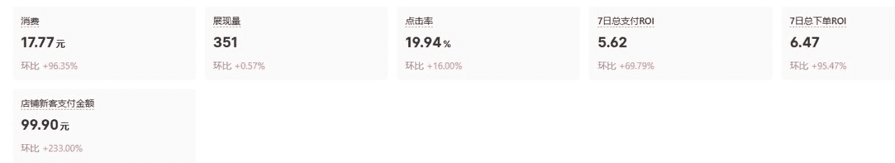

### 4.引入外包客服

订单量上升后开始外包客服。渠道是通过熟人推荐，店铺与资金安全才敢用。客服登录千帆客服端需要账号密码，安全是首要前提。

踩过坑：初期让朋友手机端回消息，因异地登录触发实名认证，店铺被要求验证，险些被封。咨询更绪老师后得知是跳实名问题，用家人实名后解封。此后放弃朋友客服路线。

外包客服需要培训。准备高频问题的百问百答，按频次分类，便于快速上手。培训要耐心，外包客服可能从未用过网盘，需当小白教。首批可能不顺手，可申请更换，磨合后客服环节基本被释放出来。

参考报价：首店基础500元，日咨询小于20次；第二店加300元，若咨询量从20增至50可加500。市面价位不一，仅供参考。

## 四、我走过的弯路

1. 过度关注非核心指标

发布笔记后频繁刷新后台，小眼睛少就焦虑，流量低就怀疑限流。实则商品笔记是精准流量非泛流量，推流需要时间，尤其在考试季需求爆发前笔记才逐步起量。

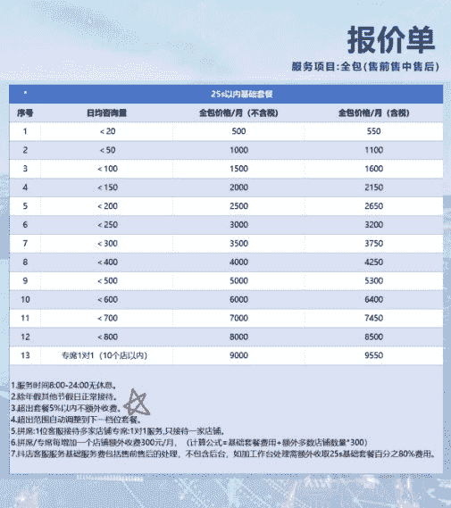

还做过找人互刷赞的事，后来发现点赞与成交无直接关联，决定成交的是内容质量与商品吸引力。

2. 定价策略失误

低估了📕用户购买力。平台核心用户为18-45岁女性，消费力强，对考证、提升资料需求旺。初期担心高价卖不掉，一直压价，吸引的是价格敏感型客户。价格本身是筛选漏斗，提高客单后订单量虽降，利润反而上升。

3. 自我设限

去年红利期应更大胆扩量，例如更早引入人手、大规模铺店、把所有合规商品都打一遍。当时发现多个好赛道却未深耕，错失窗口。今年政策收紧，门槛抬高，不合规商品下架，违规店铺被清，机会窗口已变窄。

## 五、为什么能坚持到现在

始终留在牌桌上，紧跟规则迭代打法，走精细化运营。

从打爆单品开始逐步扩展品类，每个商品都有高质量笔记、精准关键词、完善详情页。跟随同行的新打法同时也在摸索新方法。

平台商业周期大致可分三段：

红利蓝海期，做什么都能赚，竞争少、监管松，对应📕虚拟25年六月前；
竞争加剧期，玩家涌入，内容同质化、流量分散，对应25年六到九月；
政策收紧期，平台为降风险提利润，清理违规商品、封禁违规店铺、提高付费流量占比，免费流量不稳，对应25年九月到26年四月。

这期间我们经历电子资源类目上线、邀约制反复调整、商家在成人教育、儿童教育、电子资源之间被迁移。但因始终留在牌桌上，才能不断进化到今天。

以上是我的真实复盘，希望给还在摸索的圈友提供参考与信心。共勉。

电商的发展其实是一条清晰的周期线，大家晚一步入场，玩法就得跟着升级。

第四阶段已经进入精细化运营与存量博弈的时代。想要在这个阶段仍拿到可观的利润，就必须把每个店铺、甚至每一款链接都管到极致，产品和打法要持续迭代，否则很快就会被市场淘汰。这个阶段的残酷性会直接筛掉一批中小卖家，对应时间大概是从26年4月开始往后延展，目前封店的风声已经非常明显。

第五阶段则是项目的衰退期。平台整体用户在走低，利润也在不断被压缩，投入产出比越来越低甚至出现亏损。到了这一步，只能一边勉强维持存量项目，一边另起炉灶去找新赛道、换新平台，从头回到第一阶段重新打。

就目前来看，📕虚拟项目正处在第三阶段向第四阶段的切换口。精细化已经是必选项，比如实拍图要继续做深度去重，相似的元素和构图尽量剔除掉；用AI做标题和文案时一定要把AI味洗掉，避免被系统判定为低质内容；关键词的布局也要做得更全、更准。

2. 心态比方法更重要

做📕虚拟这十几个月，碰到的坑不少：平台规则一变再变、账号莫名违规、商品被下架、竞争越来越卷、数据一路下滑。但心态稳住后，处理问题的思路完全不一样了。以前一遇到状况就想直接撂挑子或者换赛道，现在会先去找解决办法，实在搞不定就去请教有经验的人，只要能把问题解掉就行。同时开始用逆向思维去拆平台规则、用户需求和市场变化，提前做应对。

正是这种持续学习、积极扛事的心态，让我能在这个赛道坚持下来并不断复盘成长。我始终认为，好的心态是做成项目的底座，也是未来应对任何不确定性时最值钱的资产。

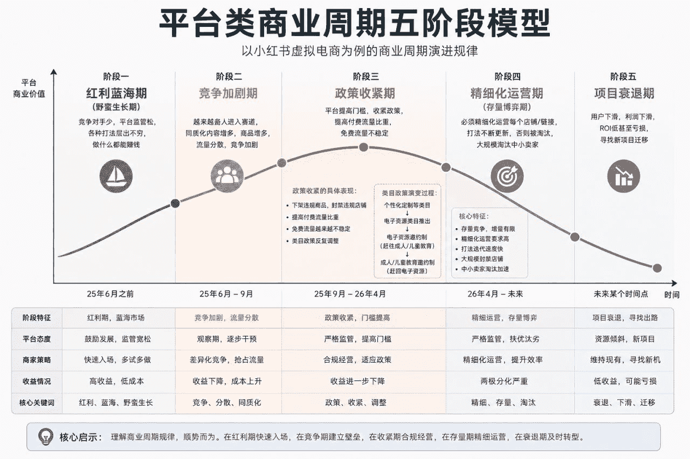

六、当前还能做的细分方向

今年📕对虚拟类目管控明显收紧，对AI批量内容更是高压，但这并不代表虚拟电商没机会，只是要更聚焦。几个值得关注的细分赛道：

1. AI加持的原创电子商品，比如学习资料、小程序、知识库、PPT模板、壁纸、头像、绘本等。平台打击的是低质批量生产的AI笔记，并非所有AI相关产品，部分高质量的AI提示词类产品仍有风险需谨慎。

2. 各类招聘类资料包，像银行招聘包、国央企招聘包、互联网大厂面经合集等。

3. 各类考试资料包，四六级、考研、教师资格证等需求一直很旺盛，📕用户结构偏年轻女性，对这类资料的购买意愿很高。

4. 考公考编的笔试面试资料包需求同样爆炸，选品不必只盯着国考省考，一些小城市的细分岗位资料包反而竞争小、需求稳定。

5. 纵深的细分知识库，比如健身知识库、对外案例知识库、人力资源知识库、装修设计案例库等。

七、结语

26年📕虚拟依然能做，但前提是选对细分赛道或做出创新型产品，并且得有耐心。做到这两点，起量是完全可期的。

另外一定要紧跟官方政策的动态。我们最近也在尝试用AI做原创商品的可视化呈现，比如一个大学生资料类的产品，经过AI可视化改造后已经卖出100单，有成为爆款的潜力。这一套打法可以复制到其它品类，挖掘出更多被低估的好商品。

最后想对还在副业0-1阶段、或者正卡在困境里的朋友说句话：一定相信自己能赚到钱。困境都是暂时的，可能只是你还没遇到真正适合自己的项目。也许就在你迷茫的这段时间里，人生的转折点就会突然到来。

————分割线————

看完这篇SOP，你觉得你懂了。但90%的人一到实操就会卡在第一步。

工具和教程只是最低级的壁垒，真正的壁垒是“立刻动手”和“圈层信息差”。

我们不聊虚的，只做商业闭环的拆解与AI效率的压榨。系统内已沉淀1000+跑通的套利实战局。

👉👉 查阅圈子完整数字资产与上车门槛：

https://lazyso.com/insider/

备注：【实操上车】，不闲聊

