# 视频号卖书不到一年，我用 23 天赚了 5 万佣金：一份 AI 提效复盘

先说要点：

- 用 AI 做一条卖书视频，成本不到 1 元，从拿素材到出片约 15 分钟，效率比传统剪辑提升明显；
- 内容是成交的关键，画面只是辅助。现在的 GPT-Image-2 出图质量够用，真正要死磕的是开头钩子与口播文案；
- 健康类图书遇到爆款时不要急着上新，先把现有流量吃完。也可以分流到其他账号承接，但要注意新视频一旦违规，可能连累橱窗。

大家好，我是龙哥。2025 年秋天，经吴泽承学长引荐进入赚钱。我的主业是程序员，有十多年软件开发经验；2023 年开始做跨境电商副业。真正下场做视频号卖书，是 2026 年 3 月参加 AI 视频图书带货航海之后。那次航海帮我赚到 500 多元佣金，之后因为主业和跨境太忙就停了。剪视频确实费时间，但我心里清楚，图书带货是能跑通的。

这篇不是“发现暴富项目”的鸡血文。准确说，这是我从程序员和跨境从业者的角度，把视频号卖书又跑了一遍后的复盘。完全没做过的新手，可以直接用文末的简化版路线，不需要懂代码。强烈建议先看完 3 月航海的视频教程，入门足够了；不要被“视频带货全流程”吓退，动手以后会发现没想象中复杂。

统计周期只有 23 天：2026 年 5 月 9 日至 5 月 31 日。时间虽短，但足以让我确定：视频号卖书这条赛道仍然有机会。最近和圈友聊下来，全职玩家月均收入 1-2 万很正常。这 23 天里，我把主要精力放在用 AI 自动化视频生产上；但真正决定赚钱的不是工具，而是内容选题和平台合规。目前合规这块我也在持续摸索。

【图 1：视频号后台 23 天总览数据截图，能看到播放、订单、GMV、佣金的数据】

| 项目 | 数据 |
|---|---|
| 统计时长 | 23 天（2026.5.9—2026.5.31） |
| 累计播放 | 接近 900 万 |
| 成交订单 | 1390 笔（日均 60 笔左右） |
| 交易额 | 118265 元 |
| 到手佣金 | 50042 元 |
| 平均客单价 | 85.1 元 |
| 发布视频量 | 40 支 |
| 单支制作成本 | 1 元以内 |
| 单支制作时长 | 约 15 分钟 |

这 50042 元佣金，剔除时间成本后，API 接口费用大约只有 30 元。

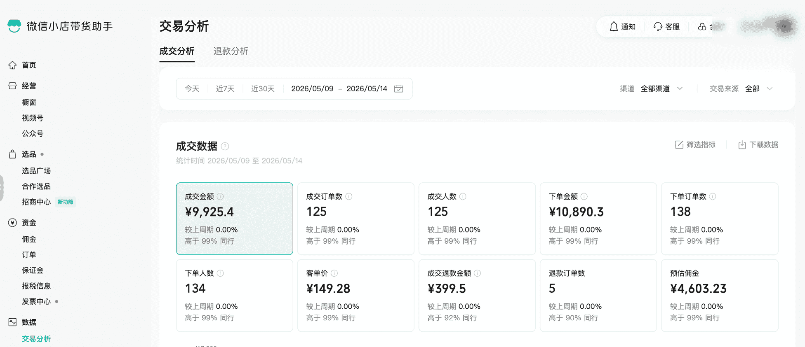

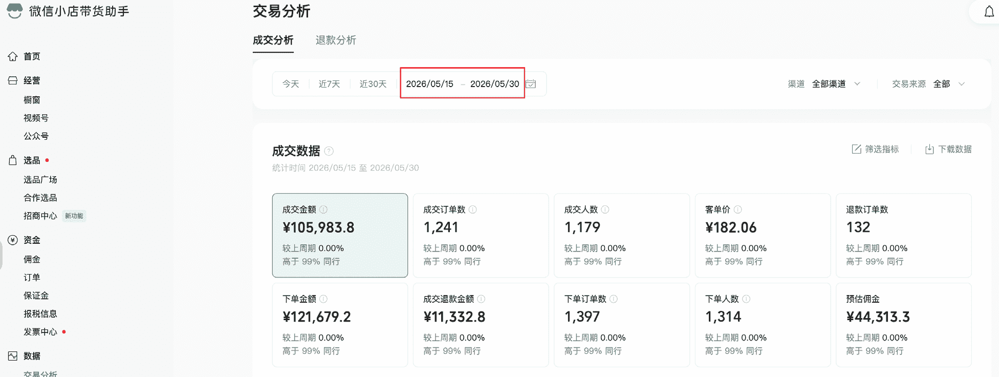

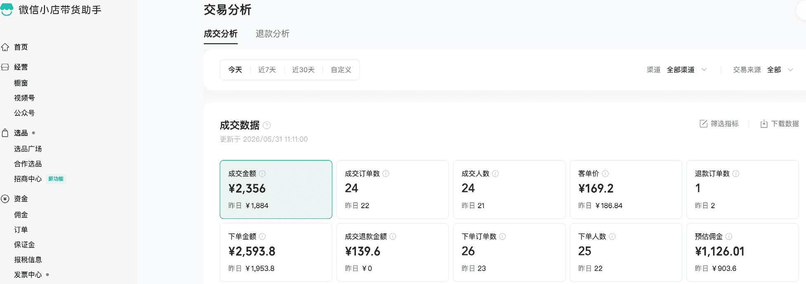

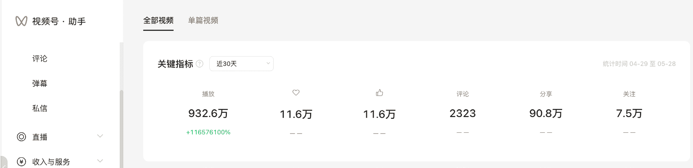

做过电商的人都懂，很多项目账面毛利很高，一笔笔扣掉仓储、物流、广告、售后后，利润所剩无几。图书类目有些特殊：我目前的退换比例稳定在 1%—2%，达人不需要处理售后，发货、物流、客服都由书商完成。对带货方来说，佣金基本就是净收入。

## 一、为什么不做跨境，改做视频号健康书？

跨境电商一年比一年难做。海外仓要压货，物流费用上涨，东南亚部分平台佣金抽到 20% 以上，再加广告投放，利润越来越薄。我认识的同期卖家，要么转型做公司，要么关门退场。对个人玩家来说，跨境已经不是轻资产模式，更像需要团队和现金流的小型贸易生意。

我的毛利水平从早期 40% 以上跌到如今 15% 左右，广告投放基本停了。

2025 年下半年，我开始寻找一个能复用电商“选品思路 + 转化逻辑”、又不需要囤货垫资和物流协调的方向。对比之后发现带货很合适：零库存、零物流，提现周期 20 天，跨境通常要 40—60 天。起步也不难，从模仿竞品开始。

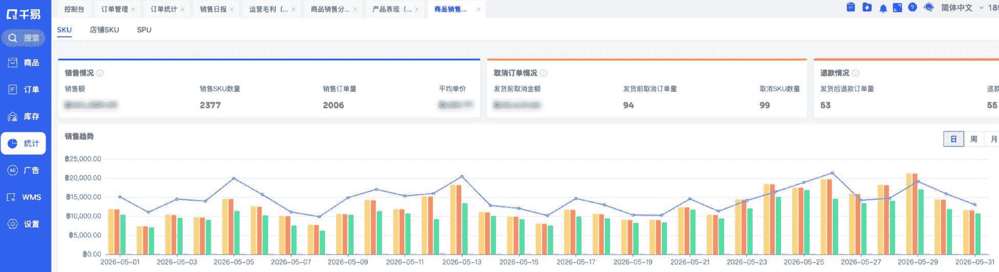

为什么选择图书？我在赚钱待了半年多，看了很多圈友日志里的真实数据，发现图书类目对新手的友好程度很高，正反馈来得快。我发的前三条视频就开始出单，也读了不少赚钱里关于视频号的精华帖。传统带货方案最重的部分是真人口播 + 数字人 + 后期剪辑，瓶颈在个人产能。我觉得 AI 完全能在这里提效。

那为什么进一步锁定“老年人 + 健康图书”？航海结束后，我观察到几个关键点：

1. 视频号没有比价文化，老年用户被内容打动后往往直接下单。我过去做电商，毛利从 50% 被砍到 10% 几，对价格战深有体会。
2. 卖科普书，相当于把老人买保健品的钱转到科学养生上。一本书几十块，比 6900 元买一堆营养品实在；对子女来说，也是很好的表达关心的方式。
3. 55 岁以上人群退休金稳定、房贷已还完、子女独立，购买力常被低估，而且抗经济周期。
4. 跨境最怕汇率、关税、政策波动，老年健康书几乎不受这些宏观变量影响。

把这 4 点叠在一起：高购买力、没有比价、抗周期，还带有正向社会价值。

## 二、AI 流水线：每个环节到底在解决什么

按传统玩法，一个账号一天发 2 条，十几个账号矩阵一天就是 20 多条。每条都写文案、配字幕、配音、加背景音乐、做封面，哪怕单条只花 20 分钟，一天也要 6—8 小时。这个模式的瓶颈就是个人产能。

实际上，视频号带货链路除了选书，其余环节都偏流程化。我花了一周时间，用 Claude Code 搭建了一套自动化工作流。当时的设想是：把抖音素材采集、口播稿生成、文案改写、配音、模板化混剪、字幕对齐、最终成片全部整合到一个网页工具里，粘贴链接后就能完成，不需要反复切换软件和手工操作。所有中间产物都放在同一个任务下保存，可以随时查看、修改、重跑。

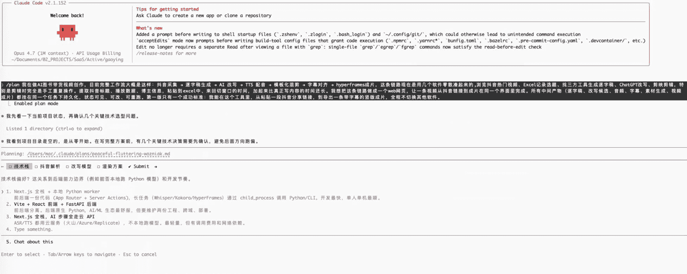

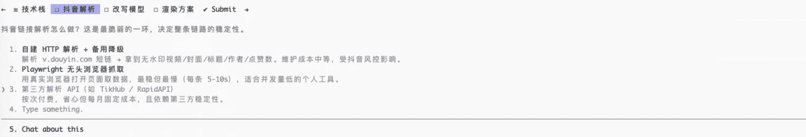

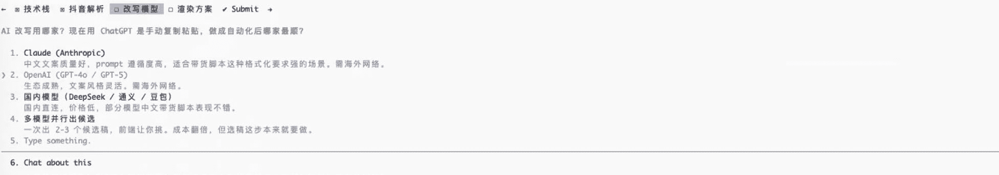

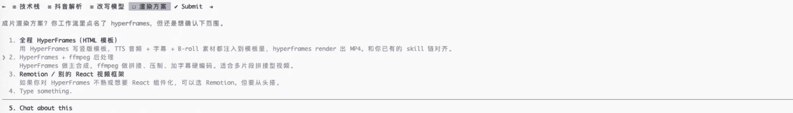

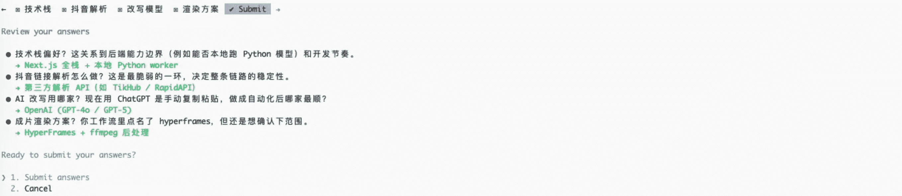

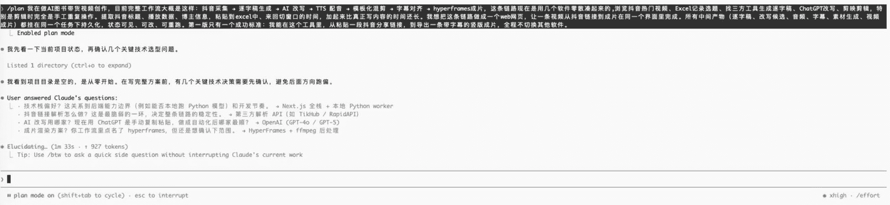

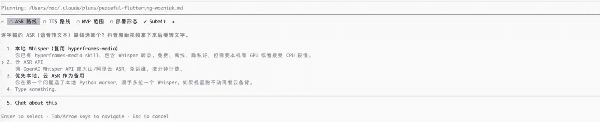

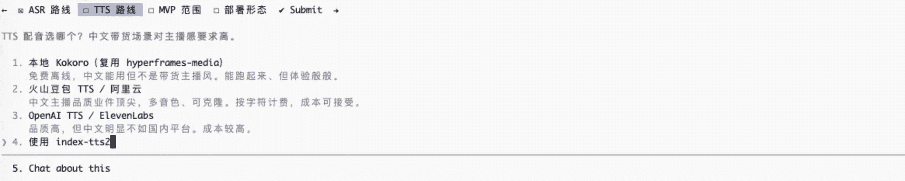

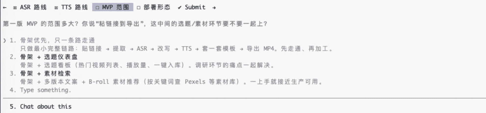

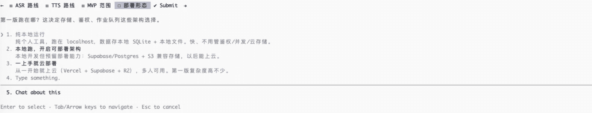

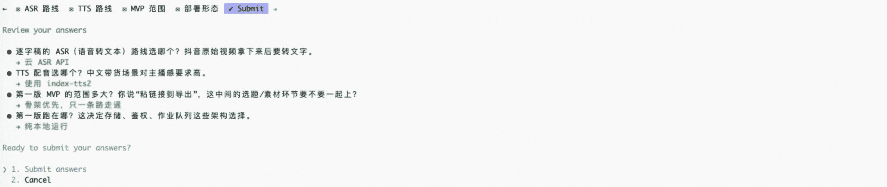

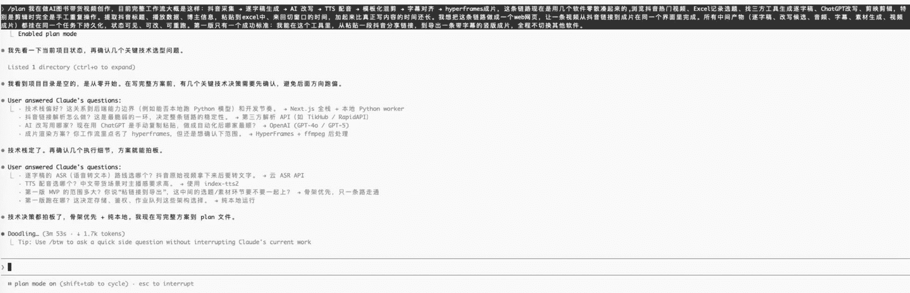

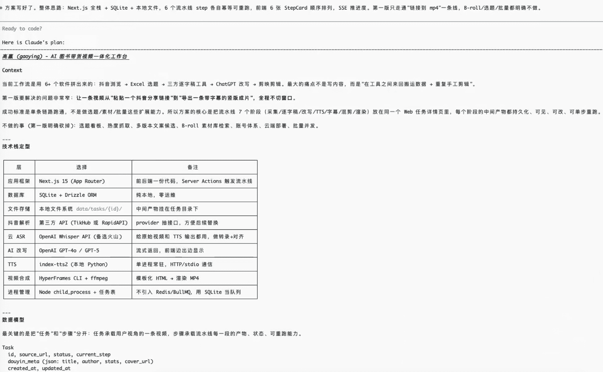

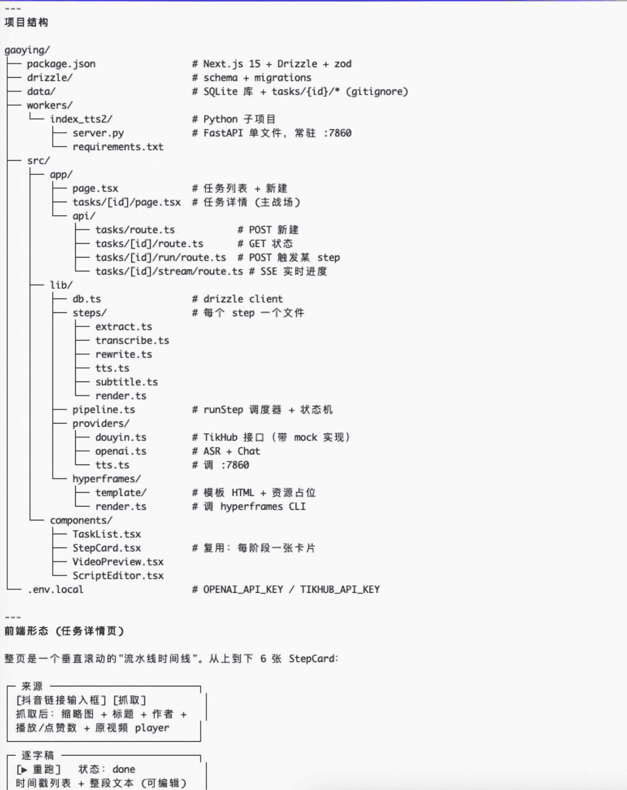

后面就是对着设计稿反复调整，直到效果符合预期。项目细节太多，这里不逐个展开。最终工具的操作效果如下：

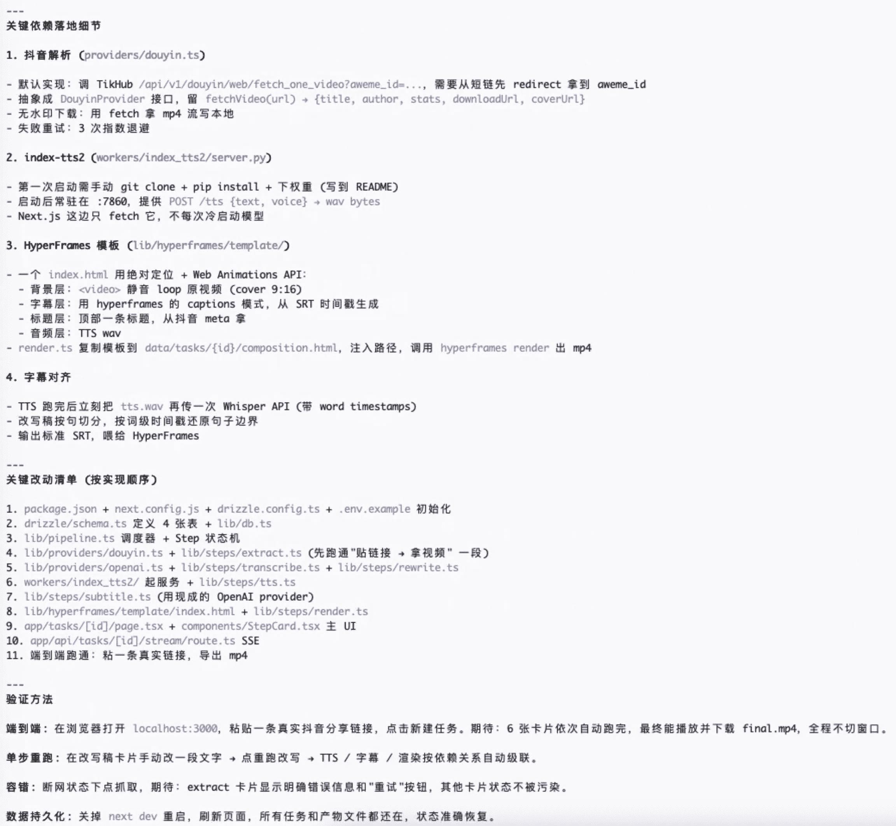

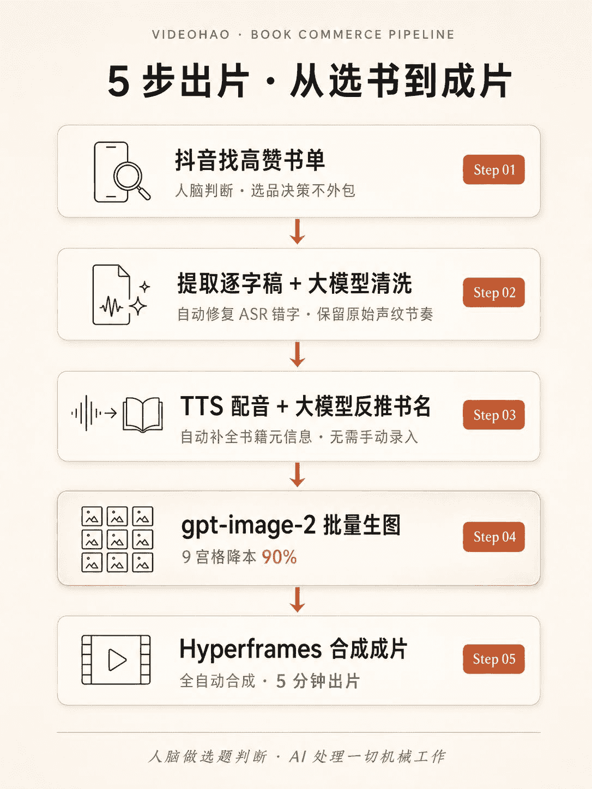

除了第一步“选书”需要人工判断，整条链路都可以让 AI 自动执行。下面讲每个环节的实现思路，以及踩过的坑。

### 环节一：从抖音找高赞书单视频

这是唯一需要人脑介入的环节。我暂时没有直接在视频号找选题，而是去抖音找。抖音的内容供给比视频号大一个量级，爆款质量也更稳定；先在抖音验证，再迁移到视频号，确定性更高。筛选条件有三个：点赞过万、主题是图书带货、评论区出现购买意向。第三条最关键——用户主动问书名，基本等于种草成功。

### 环节二：提取并清洗解说稿

抖音接口返回的识别文字错误率很高，人名、书名、数字错得离谱，还夹杂博主自己的点赞收藏引导。我直接交给语言模型去纠错、重新断句，把“这本书”这种模糊指代替换成具体书名。

医疗类文本尤其麻烦，“嘌呤”经常被识别成“飘铃”，“胰岛素”被识别成“衣岛素”。整段丢给模型修复，会比单独改某个词更准确。另一个细节是：数字要统一转成中文。十、百、千、万如果保留阿拉伯数字，我用的 Index-TTS2 很容易读成个位数，非常尴尬。

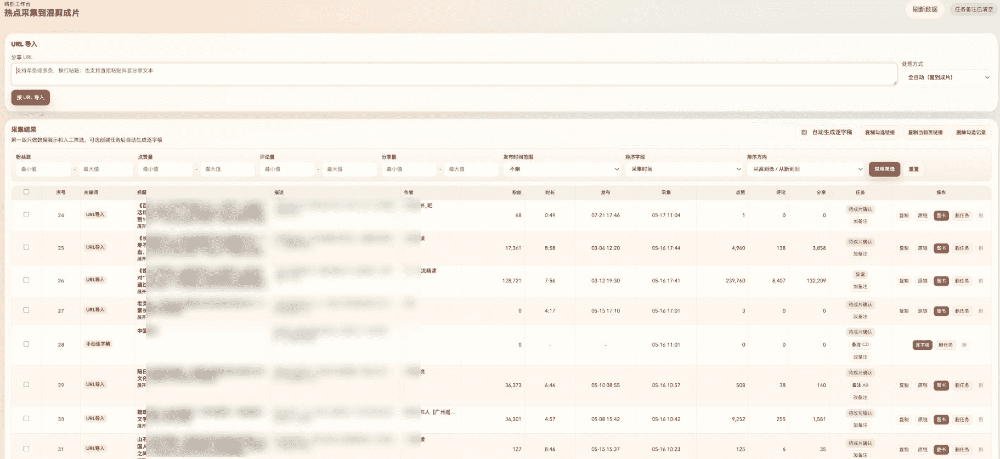

### 环节三：语音合成 + 书目信息反推

语音克隆我建议直接找成熟的 API。目前用下来 Index-TTS2 比较稳定，千问、MiniMax 也试过，但情感表现差一些。没有显卡的话，调用第三方接口更省事。我也在腾讯云自己部署过 Index-TTS2，生成速度慢，综合成本并不低。很多配音接口单次只能提交 1000 字以内，超了就把文本切开，分多次合成再在本地拼接。

停顿控制建议：逗号停 0.3 秒，句号停 0.8 秒，感叹号和问号停 0.8—1.0 秒，破折号停 0.6—0.8 秒，省略号停 0.8—1.0 秒，分号和冒号停 0.4—0.5 秒，双引号前后各停 0.1—0.2 秒。

同时，我会让模型从口播稿里反推真实书名、作者、国籍，避免手工填写书籍信息。如果书名无法判断，必须人工复核，否则后面返工很麻烦。这里推荐 DeepSeek-V4-Flash，便宜且准确。我也试过 GPT 系列模型，有的识别不了，有的成本太高。目前这一步的综合成本约 0.002 元。

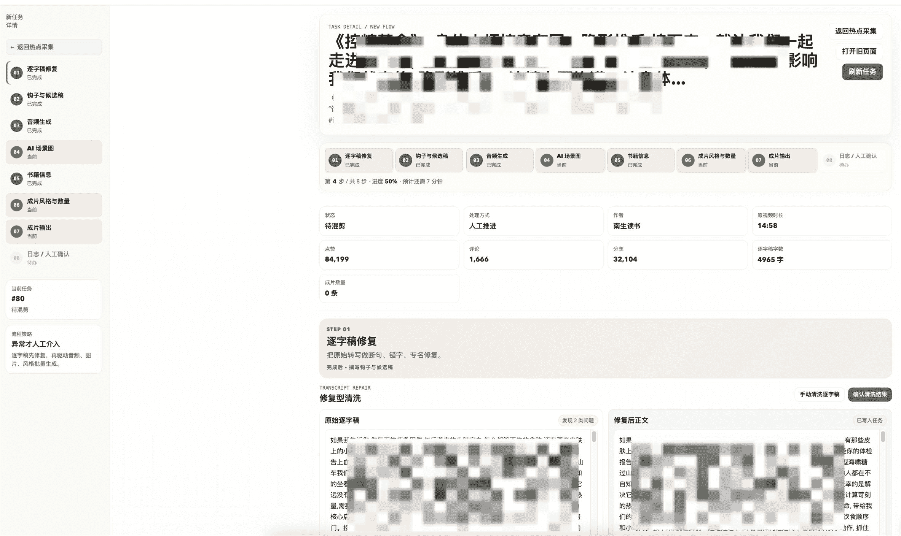

### 环节四：用 GPT-Image-2 成批配图

将口播稿按句子切片，每句生成一张对应的画面。比如稿子提到“肌肉、骨骼、血管、大脑、肠道，看似五个系统，其实共同决定一个人中老年以后的状态”，就让模型画一张有意境的图。一条 10 分钟的视频大概需要 64 张图。这个环节直接取代了传统剪辑里找素材、对音画的工作。

省钱技巧：一次图片请求可以生成九宫格，再由系统自动切分，成本能降 90%。我现在 63 张图的总花费不到 0.5 元（具体提示词在文末）。

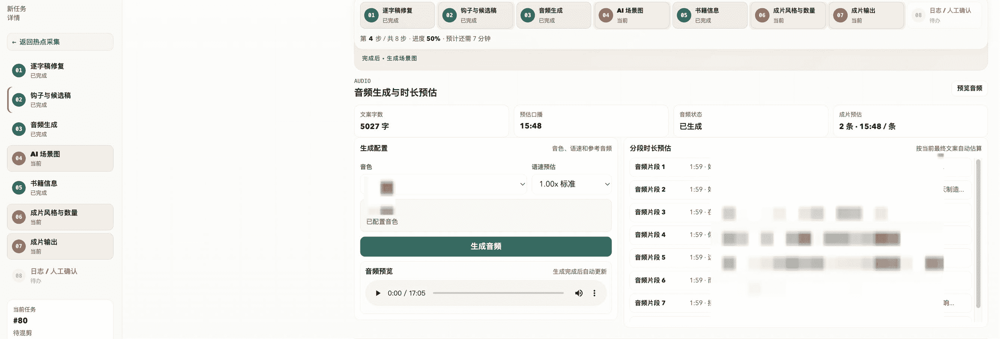

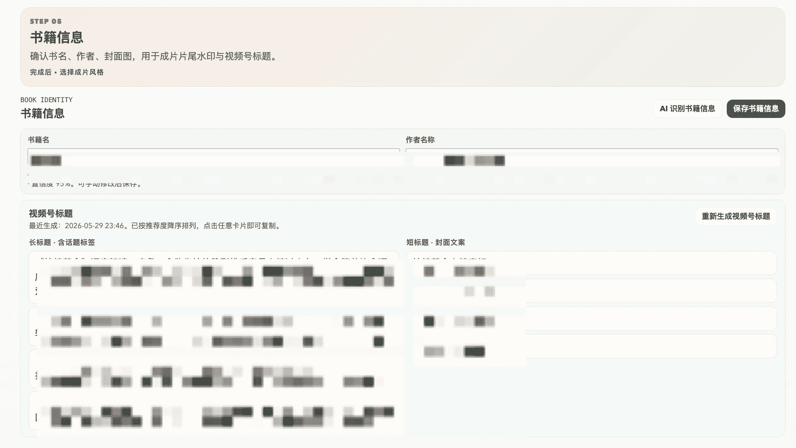

这步最需要注意的是医疗安全。即使内容涉及糖尿病、癌症、肾衰竭，也不能让模型生成病房、病理图。所有画面都要转译为生活化隐喻。比如“糖尿病晚期”画成“老人在厨房手抖打翻东西”，而不是“ICU 里的监护仪”。健康赛道很容易在这里被提醒甚至限流。违规词的规避我还在提升，欢迎圈友在留言区指点。

### 环节五：用 Hyperframes 完成最终视频

前四个环节的素材质量，直接决定最终成片质量。我花了三天把第一版流程跑通，之后两天一直在调提示词、模型参数、图片风格、字幕样式。Hyperframes 能一次生成多版本的风格，做多账号矩阵时能省下大量时间，书名、作者、健康声明等信息也可以自动填充。最关键的是不用再打开剪映做二次处理，也不用额外调视频生成模型，对图书带货来说完全够用。这步没遇到太多坑，主要是不断让 AI 调整画面效果。

目前单条视频的 API 总成本在 6—8 毛钱，控制在 1 元以内。从拿到链接到出片，15 分钟内完成，人工只需要审核一下。核心提示词（清洗、改写、书名识别、生图、生视频）我都放在文末附件中，需要的圈友直接参考。

说明一下：成片里还是有一些瑕疵，比如口播语气、停顿不够自然，但完全不影响出单。这种水平已经可以带货，所以不要把视频制作想得太完美、太复杂。

## 三、视频做得快，不代表一定能出单

刚把流程跑通时，我特别兴奋。以前一条视频要剪半个多小时，现在 15 分钟就能出一支，理论上可以无限量产。那是不是只要把产能拉满，订单就会源源不断？

后来发现不是这样。产出快只解决“能不能持续更新”的问题，没有解决“能不能爆”，更没有解决“用户会不会买”。我最近看了不少新账号，播放和转发数据都很高，但万次播放成交量不到 0.5，问题大概率出在选书和内容上。

我 23 天只发了 40 支视频，平均不到 2 支/天，但拿下了 1390 笔订单。所以数量不是最关键的。内容是否打动人，能否引导用户完成下单动作，才是最重要的。

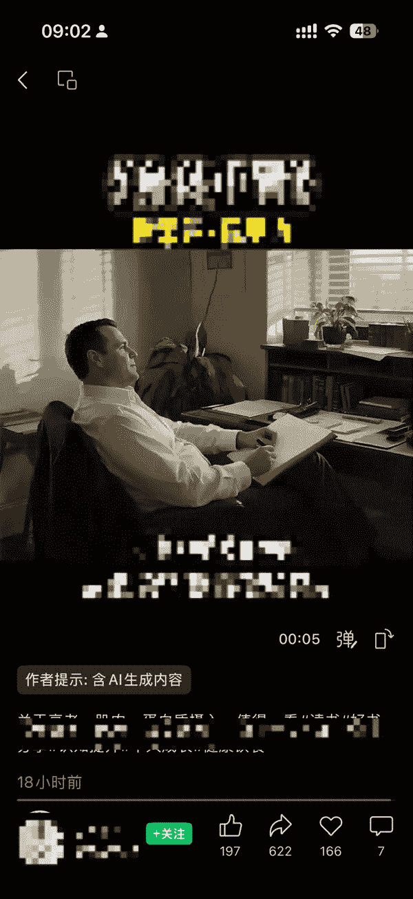

拿我自己的两条内容举例：《晚年健康由 70 岁决定》和《身体重置》。

这两条最明显的差异不是播放量，而是成交链路完整度。

第一条的播放量很高，说明“老年健康、70 岁以后怎么生活”这个话题流量充足。可问题是，视频里讲的是《晚年健康由 70 岁决定》，评论区和搜索里却冒出《抗老生活》，橱窗第一屏也看不出哪本是同款。用户就算感兴趣，也要自己判断买哪本，这一步就流失了大半。

而且第一条的口播更像科普节目，把具体建议都讲完了，比如每天走多少步、洗澡不锁门、不要乱停药。用户听完只觉得“我知道了”，不会产生“必须买这本书”的冲动。

第二条播放量低不少，但它是一个完整的带货故事：先制造焦虑，说 50 岁以后会发胖、没力气、肌肉流失；再给希望，说老了不是只能认命，肌肉还能找回来；最后把书包装成一套可落地的方案。用户看完会觉得，这本书对自己或父母有用，下单意愿自然更强。

所以第一条不是选题差，而是内容不像卖书的，后续链路也没接住。

第一条缺什么？书名统一、视频同款可识别、橱窗置顶承接爆款、评论区补下单引导、结尾给出购买理由。

第二条做对了什么？痛点明确、购买理由明确、书籍价值明确、用户知道为什么要买。

有些“养生知识”“情绪疗愈”类视频，播放、转发、点赞都很好，评论区也热闹，但用户只是觉得“讲得不错”，没有买书的动力。反而有些视频播放量一般，评论区却不断有人问书名、怎么买、适不适合父母——这种才是真正有价值的素材。

这里还有一个教训。

有一条视频播放量起来了，我很开心，但后台一直不出单。我的第一反应是文案不行、钩子太弱。后来自己顺着用户路径走了一遍，发现问题特别低级：视频里讲的是 A 书，橱窗第一屏挂的却是 B 书。50 岁以上的用户对手机操作不熟悉，很少会在橱窗里翻找目标书；第一眼看不见同款，就走了。

从那以后，我每发一条视频都会自己走一遍路径：点账号头像进主页，确认橱窗爆款是否在第一屏置顶，再看评论区有没有针对不带车视频的补单引导。

补充一个数据：这 23 天里，80% 的订单来自橱窗，其他渠道只占 20%。所以即使我有挂购物车权限，有时也会故意发几条不带车的视频，想测试推荐流量的差别。

新号没有购物车权限，也不必焦虑。你只是要把“刷视频—直接下单”这条短路径，换成“刷视频—点头像—进橱窗—下单”的长路径。长路径当然会损失转化率，但只要橱窗、主页和评论区承接到位，依然能出单。这也是我后来做新号时，没有把时间耗在冲千粉、凑原创上的原因。

工具负责产能，内容负责播放，引导负责转化。三件事要分开看，缺一不可。

## 四、购买人群：50+ 女性是家庭健康的代理人

【图 2：视频号后台人群画像截图，能看到购买人群的性别和年龄分布】

我的成交画像很清晰：买家女性占比65.3%，50岁以上粉丝占72%，40岁以上合计94%。

跑电商久了养成的习惯是，不只问产品好不好，还会去想买的人回去到底想解决什么事。

50+的女性买健康类书籍，多数情况下不是为自己消遣。更多是想转给父母、想跟爱人聊聊最近的血糖睡眠等指标，或觉得某段内容有用就发到家族群。她往往是家里最操心健康的那个人。几十块的支出，买的表面是本书，实质是给全家买安心。

所以写文案时我很少去追网感、追梗、做快剪反转。这个人群更在意长寿、睡眠、血糖、防摔、父母健康这些实在的话题。表达可信、通透、具体，反而更容易打动她们。

道理听懂了，具体第一天做什么呢？

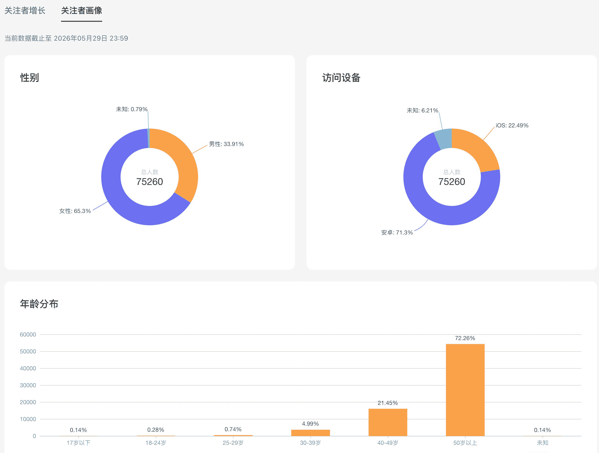

我的建议是走七天小闭环，别一上来就开十个号。

首日把地基搭好：确定赛道，比如50+健康；锁定1-2本主推书；橱窗第一位放同款视频图书；主页简介写成“xxxx视频同款 → 在下方商品购买”，参考方法可看26年3月AI图书视频航海教程。

接下来三天做素材测试，去抖音找带货爆款。这三天目标不是成交，是看哪个素材有播放和转发。

第四天看数据。挑出完播率最高、商品点击率最高的视频，作为放大用的种子。随后两天，基于种子钩子让AI改写出5-10个变体，注意是改写不是复制，分时段发。

第七天复盘。若七天累计订单≥5单则进入第二周；若0单，先别加号，回头检查评论引导和橱窗承接是否到位。

新手常犯的错误是没把一条书测够就换书。务必把第一本书的视频做到10条以上再下结论，否则分不清是书、逐字稿还是承接的问题。

我的参考数据供对照：纯橱窗无购物车场景下，万播约1.25-1.50单算正常；商品点击率接近7.5%算不错；我52.4%的订单来自早上6-10点。

复盘口诀：播放差看前3秒；播放高点击低看钩子；点击高不下单看橱窗；订单高播放降保留定时复发。

再说做对、做错和踩过的坑。

做对的，是先把视频生产流程搭好。我极度排斥手工剪辑，所以一开始就做工具。对多数人来说，先手搓入局更现实。任何重复三次以上的手工耗时动作，都要AI化或脚本化。

做错的，是爆款起来后急着乘胜追击。健康图书属于高违规风险品类，疗效承诺、极限词、医学暗示都易踩雷。第一条爆款出来后我下意识想多发几条吃透流量，结果新发一条没把控住医学暗示，账号被警告并掉了一次橱窗权限。那段时间爆款仍在跑，但用户进不来橱窗，订单直接归零。此类情况可把同素材分发到其他号。

复盘后明白：爆款是稀缺资源，最优策略是让它跑完生命周期。新增视频违规可能连带限制整个橱窗，连爆款流量也损失。这和电商爆品加预算的直觉相反。

补充一个隐形机制：视频号播放到10万+会触发人工审核。我是从圈友夏俊虎《理发师到500万GMV》一文中获知。爆款冲到10w+后，平台会重审；此时新视频若踩雷，会连带重新审视已爆内容。所以爆款期要踩刹车，先盯数据、调橱窗排序、补评论引导、联系商家上套装。新视频可发，但必须先合规审查，不确定就压着或换号发。

坑一：单品依赖。主爆品曾贡献80%GMV，后续转化会递减且易断货。TOP1占比超过80%时，须立刻孵化第二爆品，每天留2-3条测品，哪怕短期无单。

坑二：未及时联系书商做套装和定向高佣。前期我默认挂标准链接吃公开佣金。后来才想到爆款视频是谈判筹码。可做两件事：问书商是否有2本/3本套装，SKU可拉到300+，客单从几十元提升到150-300+，GMV翻倍；申请定向高佣，正常30%-40%，数据好45%+。若首轮就这么操作，5万佣金可做到6-7万。爆第一条就联系书商，别等。

还想测试的方向是微付费。图书兼具高客单、高佣金、低售后，适合投产逻辑。低客单品微付费是撬动自然流，图书则可直接算ROI：100元客单两单回本，跑正就持续追投。目前23天数据全是自然流，下一步叠加微付费做AB测试。

若只能选一个品类入局，我会选图书。它具备高客单、单本70-100元套装150-300+、佣金30%-50%、售后1-2%、不碰售后、无淡旺季、SKU稳定、AI适配强的特征。大多数品类至少缺两项。

更关键的判断是：用户买的不是产品本身，而是“成为更好的自己”的解决方案。50+女性买健康书，不是为了证明读过，而是想多懂一点回家跟父母说、提醒老伴少熬夜、在身体走下坡前做准备。买的是“我为家人操心了”的感觉。童书是“我没在教育上偷懒”，经管书是“我还在进步没被时代落下”。因此提示词和文案要围绕买完后的人设变化写，而非卖点。我最爆的书稿讲的不是书内容，而是“老了之后怎么活”。

很多人问自动化代码，我理解。做完一轮后我觉得工具不是关键。不会编程也能跑，元宝+豆包+剪映的低配组合足够验证。提示词经验三类：逐字稿清洗修复ASR错字去噪；口播改写保留爆点过查重；轻量去重便于二次发布。医疗类ASR错字难修，如“嘌呤”常被识别成“飘铃”，需把主题关键词带入；改写温度建议0.7，不要过度原创。

坦白说，我还在“第一抄”阶段。按夏俊虎“三抄”框架，我的爆款逐字稿基本来自抖音，还没原创爆款能力。但我把抄的杠杆做到极致：验证过的爆款15分钟内可复刻成视频号成片。务实做法是先抄作业，沉淀100条素材体感、做3-5个赛道对标后再谈超越。

货源售后不需操心。选品广场挂书商链接，发货售后由书商负责，售后率稳定1-2%。后台联系申请定向高佣，正常30%-40%，数据好45%+，叠加套装拉客单，杠杆很大。

真正不可替代的两件事：一是每天刷30-50条抖音带货视频练出选品判断力；二是7天无结果仍能保持日更5-10条的执行力。我观察到航海期坚持高频的圈友基本都有结果。AI解决产能，不替你打造爆款。

有电商背景者，把看懂用户、转化漏斗、数据思维搬过来即可。纯新手也能走，先用低配跑一本书连续7天看数据，比看百篇方法论管用。先问自己能否用7天把账号+一本书+转化链路跑完。AI只是把剪辑最累的环节拿掉，若追求一键躺赚会失望。

我认同“执行力是高级认知”。晚11点刷到爆款能立刻起来剪一条发出去，是能否跑通的朴素标准。

下一步：孵化第二爆品把TOP1GMV占比从80%压到60%以下；把选品、原创文案半自动化，用大模型按人群画像给抖音候选视频打分。持续优化，有进展再更。

新手六问简答：

1. 零号能起步吗？能。实名注册新号，先跑2个验证，再加号。新号200-300播放正常。阶段诊断：个位数到几十可能违规；100-400正常继续优化；500-1000进推荐池；1000-1w可考虑矩阵；1w-10w出单；10w+大爆触发人工审核需合规。

2. 前期投入？低配几乎零成本。剪映免费，豆包基础额度够用。API模式单条约1元，我23天发40条单号成本约30元，矩阵日更10-20条月成本300-600元。真正成本是时间是否愿每天投入2-3小时刷选题看数据。

3. 每天多久？跑通后单号1-2小时，矩阵5-10号需4-6小时。首周更高。

4. 如何谈定向高佣？选品中心每本书都有客服对接。挂车出几单后主动联系报账号和书名申请定向佣金，数据好可谈到45%+。

5. 无粉丝能起号吗？能。样本虽少但新号流量高，第一条好内容即可进池。我的23天数据来自零粉新号。老号转赛道也能跑。

6. 新号未开挂车权限怎么办？不用等。我23天80%订单来自橱窗。未开权限期间做好引导“主页橱窗下单”，把路径从刷视频→下单变为刷视频→进橱窗→下单。2026年利好：挂车政策放开，1000粉号单日挂车从2条提至5+条，纯橱窗是过渡阶段，千粉后立即挂车。

最后几个未解问题待交流：老粉权重如何计算？健康赛道单素材可反复爆多久？矩阵超10号是否会被关联？合规提示词仍易被提醒如何解决？

感谢赚钱及吃不胖圈友的指导。本文借鉴回声老师带货实操、亦恒老师“成为更好的自己”洞察、夏俊虎老师“三抄”框架及流量诊断表。相关阅读见文末。

希望减少弯路，欢迎同赛道及跨境、软件开发跨界朋友交流共勉。

