# 同城实体商家代运营，第二个月营收6w，我是如何做到的

## 同城实体商家代运营，第二个月6万，我是这么打出来的

260610 副业SC 精华

公众号懒人搜索，懒人专属群独享

懒人微信：lazyhelper1

各位圈友，我是Logan，圈里叫洛更，现居广佛交界的金沙洲。

很久没更新了，上一次精华帖还是好几年前的事。这几年项目换了两三个，最稳的感觉反而是这次的同城实体商家代运营。它不算风口，但对新人极其友好，回报是看得见的确定性。

全程我都是单人作战，一部二手苹果15 Pro Max，一台二手大疆Action 5，从今年2月开始做：

- 2月，起步期，12,659元；
- 3月，小爆发，56,025元。

收入截图放在下面。

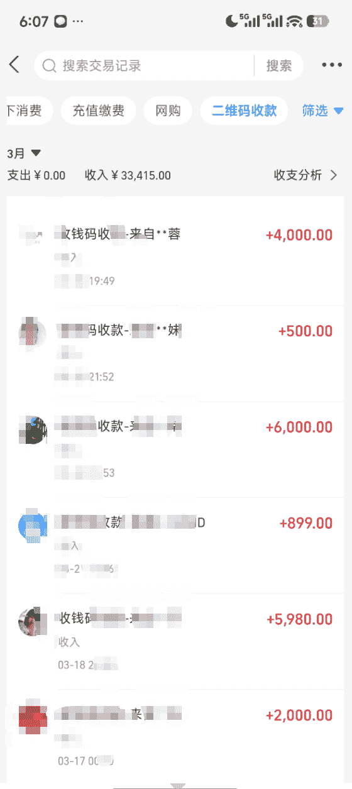

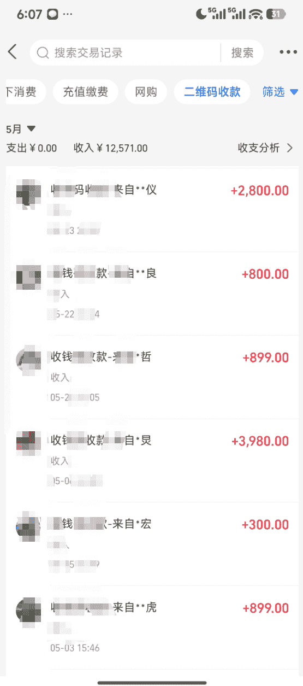

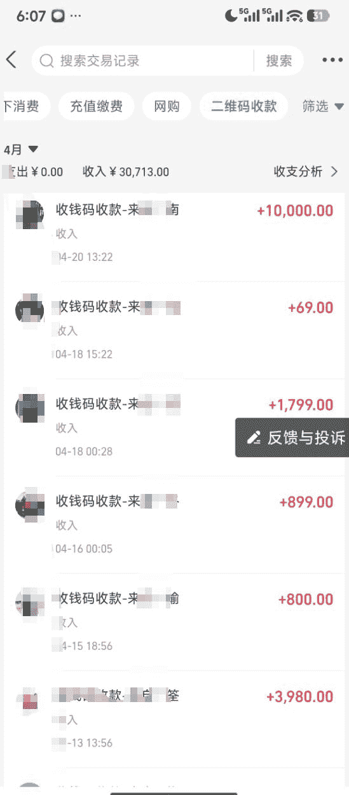

今天把这篇长文写出来，主要是想复盘一个零经验的人，怎么把这件事快速跑通的。

先坦白一句：我觉得同城代运营的本质是信息差+强执行+体力活。

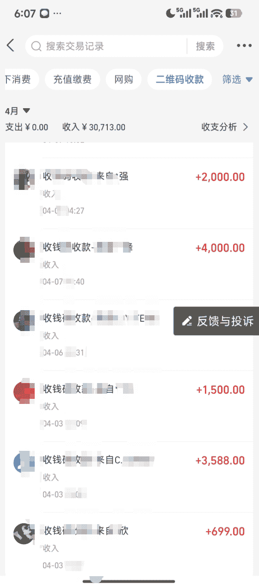

赚钱的确定性不低，但单人模式的天花板很明显。我不建议看了就头脑发热跟进，一定要结合自身情况判断。

如果你体力充沛、执行力在线，想零风险先月入1-3万，它确实是个不错的切口。理性的前提我会放在文末。

## 一、我为什么会选这条赛道

年初刷抖音时，我反复看到一种【第一人称视角】的记录类内容：拍手上戴Action，用第一视角记录自己如何为本地实体店拍引流短视频。

逻辑很直观：让商家一看就明白，原来做出“看起来很高质”的引流片这么简单。

不用懂得拍戏，不用有镜头感，不用背台词，效果依然能打。连后端数据都不用立刻展示，成片质感到位就行，直接击破了大部分实体老板的固有认知。

恰好有个朋友也在做代运营，拿这个形式试了一下。视频一发出去就接到咨询，很快成交。

这份正反馈太关键，它证明了需求是真实的，变现路径很短。

当时我正卡在YouTube和同城代运营的选型上。看到越来越多的博主靠同款内容吸粉，评论区全是同城老板在问价格，我意识到这条路的确定性更高，于是直接all in落地。

## 二、获客怎么破：让同城老板主动来找你

很多人做代运营，要么去街上扫楼，要么砸信息流广告。后者适合团队做稳定获客，但信任成本高，转介绍难，客单价还容易被压。

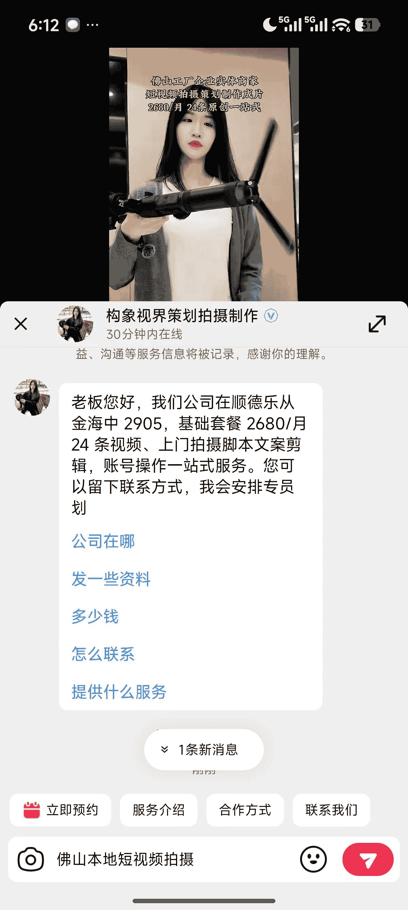

我走的是内容自吸。模仿第一人称跟拍的记录形式+片尾放成品，放在我的自媒体账号上。看到内容的老板，本身就对我的能力有初步信任，聊起来基本不用再解释基础逻辑，直接给方案和价格即可。

具体做法就是：用第一人称镜头完整记录一次上门拍片的全流程，剪成快节奏实操视频，最后接上精剪成片。

发这条视频只有一个目的：给同城老板造梦。

让他们刷到时瞬间产生代入：“原来就这么做啊？我这种小白找他拍也能出这个效果。”

能成单，根本在于点破了当下实体商家的三大焦虑，也是26年这个赛道还能赚钱的底层原因：

1. **能力困境**：绝大多数老板对互联网有天然畏难，觉得短视频门槛高。自己做怕试错，不如花钱买现成结果。

2. **生意压力**：今年自然客流普遍下滑，老板们急需新的流量口，短视频代运营正好填补这个空。

3. **同行焦虑**：看到街对面同行在做短视频、搞团购，怕被甩开、怕输给隔壁老王，花钱买本地流量船票的意愿极强。

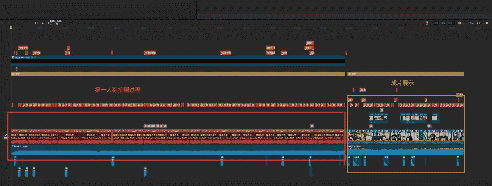

## 三、变现方式：三种阶梯产品承接不同预算

流量进来之后，我按预算和认知分了三档：

### 模式一：一站式全包代运营
- **价格**：珠三角地区5980-6980元/10-15条，不含差旅。
- **交付**：账号策划+脚本定制+上门拍摄+精剪。10-15条通常一天拍完，约30分钟一条。
- **老板配合**：出镜+场地道具。比如餐饮店摆几道招牌菜即可。
- **感受**：老板最省心，觉得花小钱买到不用动脑的成品。

### 模式二：纯脚本定制，轻交付破地域
- **价格**：约1000元/10条。
- **适用**：看完视频的外地老板，来不了现场。
- **SOP**：先发深度调研问卷，收集创业经历、门店特色、招牌产品等信息，回炉后定制10条可直接照读的口播脚本，老板自己手机拍就行。半小时内交付，利润率高。

### 模式三：实操课程培训
- **适用**：想长期自建团队、嫌持续付费成本高的老板，或想学SOP自己服务本地商户的创业者。
- **交付**：从对标、写脚本、拍摄到剪辑的全流程教学和陪跑。
- **感受**：承接了“觉得代运营贵但又很想要流量”的客户。

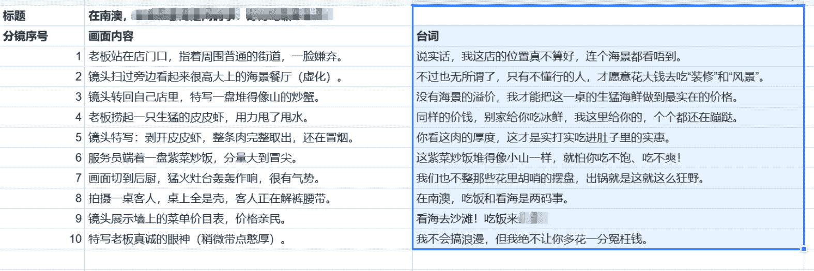

### 核心问题：没经验的新手怎么搞定策划、选题和脚本？两套打法

有人会问，一个新人怎么一个人忙得过来？

基础拍摄流程，一天就能摸清。拉开差距的，是现场气场和找捷径的能力。

1. **拍摄心法：装出导演范**
现场最重要的是气场。收了钱你就是导演，要敢指挥老板摆动作、改语速、调情绪、放大肢体。别唯唯诺诺，越敢带节奏老板越觉得专业。情绪到位，效果不会差。

2. **脚本生产线一：AI结构化投喂**
不再硬写。先收集行业爆款逻辑，比如8大爆款元素，或“痛点钩子+价值塑造+行动引导”的标准结构，写成能产分镜的AI提示词。把老板的调研问卷喂进去，几秒钟出10多套60分的初稿，人工润色去AI味即可。

3. **脚本生产线二：像素级拆解低粉爆款**
这是主力打法。别抄百万粉大V，去找同赛道几百粉但单条破万赞的低粉爆款，剥离粉丝滤镜，靠内容打算法。

我会把日常看到的好对标拆解进脚本库，既丰富网感，也能作为虚拟产品售卖。

拆解步骤很简单：扒原文案→抽底层逻辑→把客户信息填入。成品自带爆款基因，让老板1:1还原拍，效果稳定。

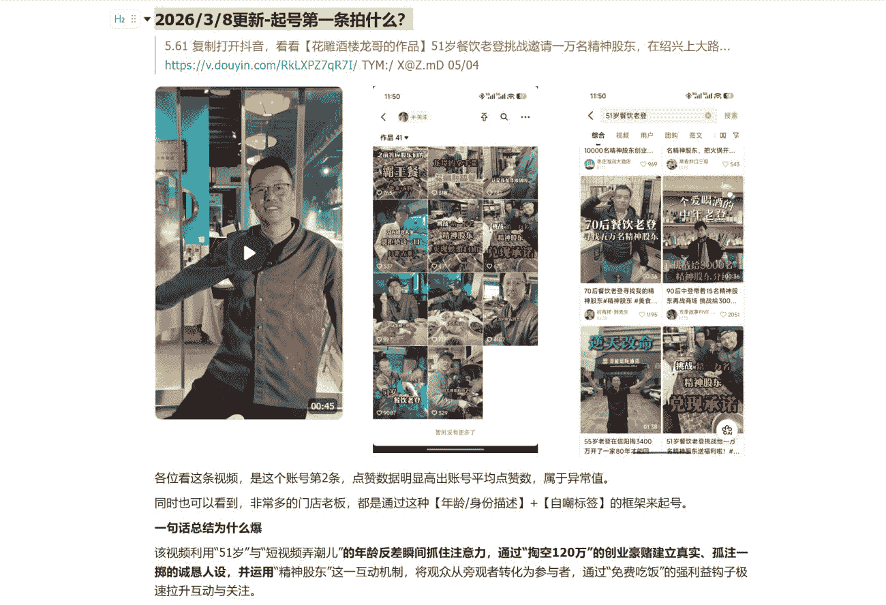

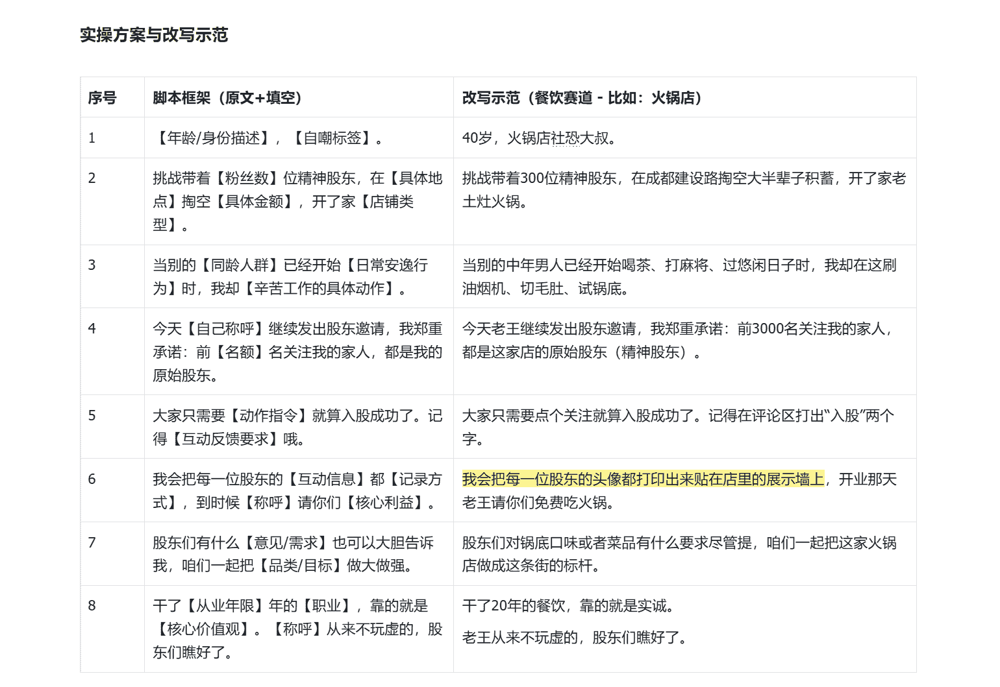

下面这组数据就是帮一个餐饮新号起号的实拍案例。

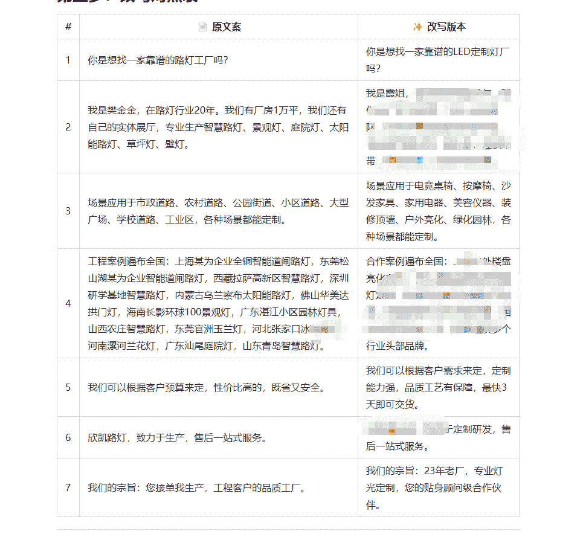

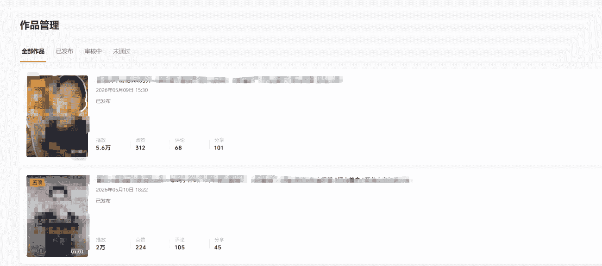

这套方法我反复验证，基本百试不爽。

## 四、做下来的认知和边界

### 4.1 先把底层认知摆正

不少人来问我：“万一拍了没效果怎么办？”

说明没想清楚，几千块/10条的代运营卖的是什么。

7. **卖的是专业苦力，不是魔法**
5000块买的是用成熟的爆款框架，把门店产品、服务特色翻译成短视频语言的能力。数据是多重因素叠加的，产品力、服务质量占比很大。店本身不行，拍再好也救不了。别把“生意没起来”全扣在代运营头上。

8. **别被播放量绑架**
老板常问“保播放吗？”我的答案是不保，也不该追求。本地餐馆不需要几百万播放，只要几千到一万的精准同城播放，覆盖3-5公里人群就能带来到店。泛娱乐大流量评论区全是外地IP，对门店零意义。我们要的是精准到店客流，不是虚荣流量。认可这个理念的客户才做。

### 4.2 守住服务边界，别当贴身保姆

很多同行越做越累，就是边界模糊。

业务范围是策划、拍摄、剪辑。老板常会延伸需求：能不能直播？能不能帮认证？新人怕丢单就全答应。

9. **破坏可复制性**：服务一非标，就无法批量复制，产能被锁死。
10. **掉入保姆陷阱**：预期被无限拉高，最后24小时被消息轰炸。

真正能长期做下去的，必须克制。把核心业务做深做透，吸引认同专业价值的客户，而不是讨好想花一份钱买十份劳动力的老板。

## 五、模式的限制与下一步

### 5.1 天花板低在哪

看完闭环，有些人会说一个月几万没成本也行。但我必须泼冷水：单人拍剪模式天花板很低。

11. **产能天花板：体力活**
脚本可以AI批量，但线下拍摄避不开。一天拍10条以上强度极大，拍完必须休。一个人一个月服务的人数有限，时间=收入上限。3月的5万多基本是我个人极限。

12. **扩张难：招人不容易**
电商SOP能拆碎，线下拍摄需要沟通+技能复合体：外向自来熟+有气场能指挥+会拍会剪+有网感。六边形战士难找，找到了大概率自己单干了。

13. **破局方向：从重交付转向轻资产**
做大的同行，基本把代运营当引流和案例工具，利润放在课程培训上。一场线下课二三十人，人均5000，轻松十几万。我现在重交付占比过高，接下来要做轻资产转型。

### 5.2 从卖体力到卖系统

AI提示我“停止出卖体力，去售卖系统”。我很认同。

我们真正该交付的不是几条漂亮视频，而是一套低成本矩阵获客系统。

痛点是精细化代运营续费率低：老板对10条视频期望值高，数据不稳就停单。

解法是用矩阵+混剪以量取胜。把老板和员工账号全部矩阵化，不再死磕单条脚本，用混剪把菜品、服务、环境素材海量裂变。单条质量可能下降，但靠数量堆曝光。

极端算：300条/月，每条500播放=15万同城曝光。

一家实体店的辐射范围，撑死了也就周围三五公里。就这么大点地盘，如果能在其中被十几万人精准看到，那感觉，就像在鱼塘里扔了个深水炸弹。

更妙的是，等到这套打法跑顺了，商家基本就绑在你身上了。成本不高，投入不大，但门店周边几公里内始终维持着巨大声量。万一哪天你把曝光一停，店里的客流立马肉眼可见地往下掉。到这一步，你就不再是帮他做条爆款视频的过路伙计，而是他同城声量的根基所在。从碰运气赌爆款，到长期持续地造声势，商家自然形成路径依赖，你的收入也从一次性买卖，变成稳定续费的管道。

有人可能会说：代运营现在这么多人做，赛道是不是已经红海了？我的判断恰恰相反，机会依然很大。原因就一条：这行没有赢家通吃的说法。

传统广告营销，能跑出华与华那样的全国巨头。但同城实体代运营不同，它必须依靠本地内容团队、拍摄团队上门服务。这就从根上决定了，它是一门“地头蛇生意”。在小县城，你把当地餐饮、娱乐的商家服务好，安安稳稳做个地头蛇，收益已经不错；在佛山、东莞、甚至北上广深，市场盘子大到你根本吃不完，只要肯跑、肯干，总能切下一块蛋糕。竞争激烈到活不下去？不存在的。

实体店一天不倒，老板们一天不解决客源焦虑，这门生意就永远有需求。要想把这门地头蛇生意的天花板彻底顶上去，跳出纯体力活的坑，我接下来会重点做两件事：一是提高轻交付占比，把已经跑通的SOP包装成课程，靠培训和咨询赚钱；二是售卖矩阵系统，帮商家用低成本搭建员工账号矩阵，通过海量混剪分发做裂变，把流量依赖牢牢握在手里。

这个项目给不了你一夜暴富的魔法，它只靠三样东西：信息差、强执行力、不断迭代的商业认知。特别适合那些暂时没有好项目、不怕吃苦、想快速拿到正反馈的新人当跳板。只要你肯吃这份苦，执行力够狠，正反馈来得会比想象中更快。

最后，欢迎同样在代运营赛道上深耕的朋友来聊。顺便求助一下：我接下来打算开课，有经验的小伙伴不妨一起搞点事情。我知道的东西，都会知无不言，一起研究破局点，少走些弯路。

我常驻广佛交界处的金沙洲，圈友如果路过，随时来喝杯茶，聊聊搞钱，交个朋友。

感谢耐心读到这里的各位，我是Logan（圈名洛更），一起赚钱。

————分割线————

看完这篇SOP，你可能觉得自己懂了。但现实是，90%的人一实操就会卡在第一步。工具和教程，从来都是最不值钱的壁垒；真正的壁垒，是你立刻动手的能力，以及你所在圈层的信息差。

想看全网最新的变现玩法？想和一群执行力极强的极客下场拿结果？欢迎来我的核心私域【懒人专属群】看看。这里不灌水，只拆商业闭环、压榨AI效率，目前已经沉淀了1000+跑通的套利实战局。

👉 查阅圈子完整数字资产与上车门槛：https://lazyso.com/insider/

认可价值、准备下场干活的朋友，扫码加微信（lazyhelper1），备注【实操上车】，不闲聊。

