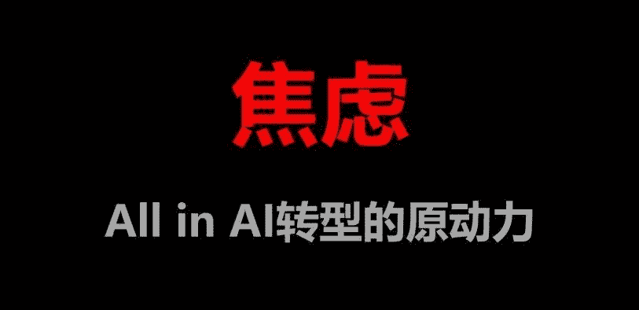
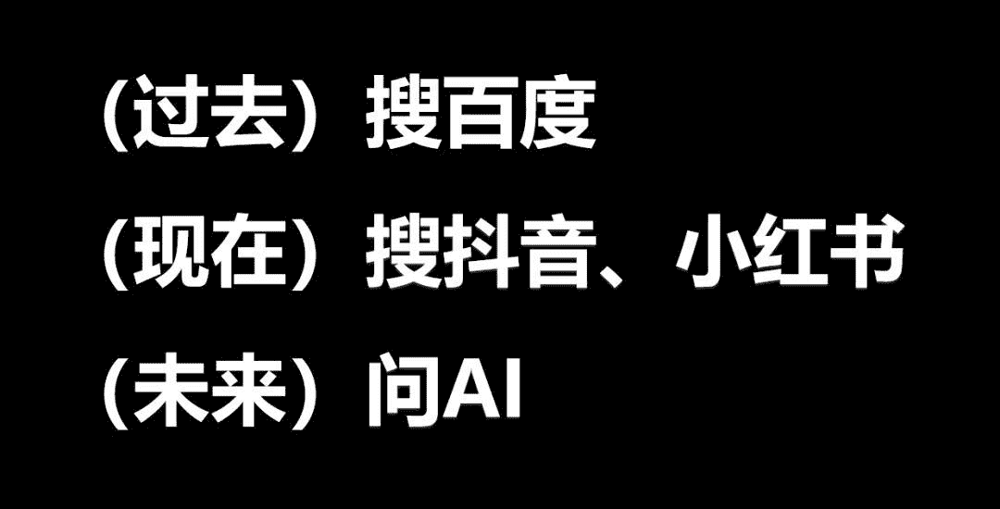
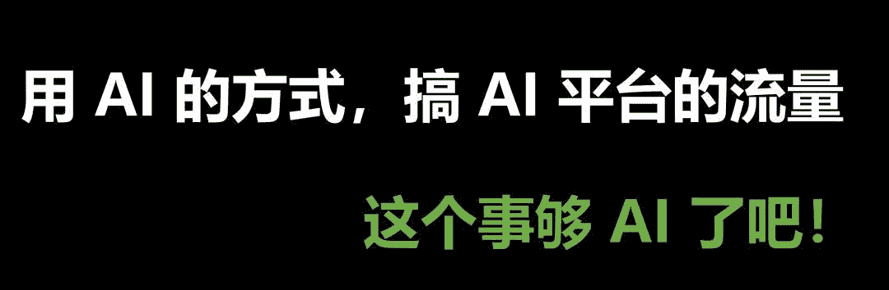
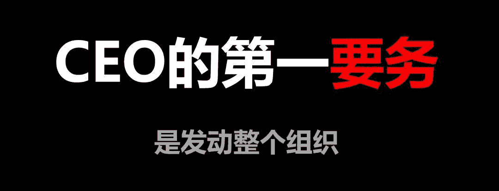
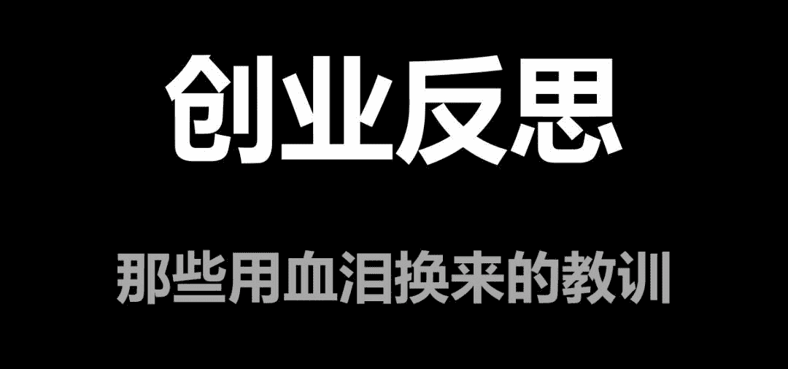
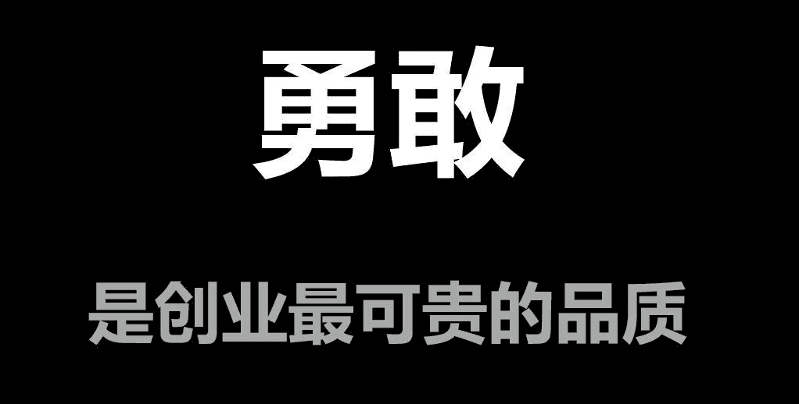

# 从焦虑到卡位：一个连续创业者的 AI 生存笔记 ^_^

260610 副业 SC 精华

整理：公众号懒人搜索，懒人专属群精选

懒人微信：lazyhelper1

关键词：生态、直播、赛道、焦虑、流量、创业者、分享、算法、复盘、验证、机会、移动互联网、连续创业者、数据平台、战略方向、公司复盘、创业周期、生意模式

我是波波，一个做了一轮又一轮的连续创业者。

最近两年，有没有人跟我一样，整夜睡不着？我的不安全来自老本行在掉链子，调了半天也调不对劲。把经历摊开给你看。

24 年收官那场公司复盘，各个业务负责人轮流上台报成绩、定 25 规划。业绩整体在滑，竞争在变狠，利润被压薄，大家给出的应对却是明年继续内卷。士气是起来了，但逻辑上我觉得没打到根子上。

我是理工科出身，一听就难受，越听心越紧，最后呼吸都上不来，血压飙了，直接去了医院。第二天复盘我没去，是合伙人顶的。那一刻我清楚，我的焦虑已经不是口头的了。

过年在家躺了阵子，心情慢慢回暖。25 年开年，我就开始系统性地去找 AI 结合的生意路子。因为我觉得我们原来的内卷，其实来自两处：

- 一是存量行业里的流量生态本身在走下坡，老打法见顶了；
- 二是 AI 能力在快速替代我们过去的核心手艺，投放判断被模型吃了，拍短视频的素材制作也被 AI 视频顶掉了。

打不过就加入，这条路我不是第一次走。每次老生态冲垮我的业务，我就去抱新生态的腿。

在 AI 生态里摸了一圈后，我发现一个普遍误区：老业务+AI 提效。很多人转型的第一反应就是把自己干了十年的东西用 AI 升级一下，期待增量。其实提效后 80% 的活能被 AI 干了，老业务盘子还在萎缩，增量仍然很小，转型问题根本没解决。

于是我换了个视角：别只去给老业务打补丁，而是把这些看似落后的生产力打包、消化、化成水，再重新组装成适配 AI 生态的组织形态。

我一直做的是流量这件事，而流量形态本身正在换代。过去是人主动搜，百度、淘宝、各种搜索框。后来是短视频和推荐算法，信息开始主动找人，按兴趣标签推送。往后看，AI 生态下，人不搜也不被推，而是直接跟 AI 对话获取信息。AI 去检索、筛选、提炼再回答。

我判断未来的大流量入口，就是人机交互。于是我们直接往这个生态布局，用 AI 的方式帮客户拿 AI 生态的流量，并且自己也用 AI 做。我们先拿了几个客户试水，验证是通的。

## AI 生意最后拼的是三件事

算法、算力、数据。现在很多国内外顶尖的 AI 原生公司，盈利逻辑已经从广告费、服务费、License 费，转向收 Token 费、收存储费，本质上都在这三块上赚钱。

我把过去靠广告服务费、代运营费、视频拍摄费、投流费的模式，也往这三要素上迁移。

方向一旦定，就要快。AI 生态会越滚越大，速度极快，能想明白就要立刻去占位。占住了，生态放大十倍你就跟着翻十倍，百倍千倍万倍同理。这比闷头卷效率性感多了。

看清后，公司节奏立刻从守转攻。以前很久都是省钱思维，能少招人就少招人，能省成本就省成本，因为看不到增量，只能靠控成本续命。这次我看到了红利，两个多月完成打法切换，把保守思维扔掉，直冲生态位。

我甚至拍了条短视频，对内对外讲清公司战略要备战、要卡位。24 年底的我还在焦虑防守，几个月后的我已经在喊进攻了。这个转变花了我半年去调自己，也要去带动团队。

作为 CEO，得把人发动起来。我先做了个人 IP 的短视频，再开直播。直播一开始同事会在，连我坐在工位上边干活边播，团队能感受到我的状态，观众也能看到需求是真实的。同时直播间里我们直接卖工具、资料课，来验证市场买不买账。

几场下来，场观几千，在线几百，单场能卖几万。这波正反馈很提气。

9-10 月，我把全公司拢起来，讲清战略和近期打法，定季度目标。为了让大家拥抱 AI 解决问题的思路，我直接发现金激励，冲业绩、冲挑战。既是激励，也是我作为一号位的信心表达。

一轮下来，公司的 AI 转型基本完成。回头看，之前那种长期的焦虑不是负担，是推动我转型的燃料。

我也遇到过同样焦虑却没动的人，或者动了没打通的人。基本盘还不错、公司还在运转时，很难做到彻底转型。转型做不成，往往是焦虑还没到临界点。等老业务波动变大，焦虑达到阈值，才有足够的动力去推。

别怕被逼死，到关键时刻出路总会出现。

现在我们已经冲进新赛道了。但好赛道一定会吸引一堆优秀创业者，甚至神级玩家。因为赛道够大，注定有人 All in。冲进去就意味着要承受失败风险，这是必须接受的。

我做了十几年连续创业，经历过 PC 到移动互联网、直播电商、疫情周期，也踩过坑，这次会注意。

第一坑，探索性项目不能甩手。我们曾经找人代劳做第二增长曲线，赔了几千万。小公司扛不住。好赛道必须亲自上。

第二坑，平台思维要做第一。之前做过一个工具化平台，没做品牌，没形成规模和网络效应，后来才明白平台是赢家通吃。这次我们目标就是第一。

第三坑，跑通就加码。之前做游戏，第一阶段就盈利了，我们没 All in，后来同行做大了，我们错失了窗口。跑通了就要持续加码，卡住生态位。

所以这次我亲自带队、亲力亲为，做短视频、做直播、盯产品、盯团队。平台策略直接冲第一，一旦跑出阶段性成果就立刻加码，确保随着赛道翻倍我们也跟着翻倍。

赛道定了，神对手也来了。创业者最核心也最有趣的品质，我觉得就是勇往直前。勇气是最宝贵的资产，只有往前冲才能抓住真正的机会。

这句话送给你，也送给我自己。谢谢大家。

————分割线————

如果你想看全网最新的变现玩法，并且和一群执行力极强的极客一起下场拿结果，欢迎围观我的核心私域：【懒人专属群】。

我们不聊虚的，只做商业闭环的拆解与 AI 效率的压榨。系统内已沉淀 1000+ 跑通的套利实战局。

👉 查阅圈子完整数字资产与上车门槛：

https://lazyso.com/insider/

认同价值、准备好下场干活的，扫码加我微信（lazyhelper1）

备注：【实操上车】，不闲聊

