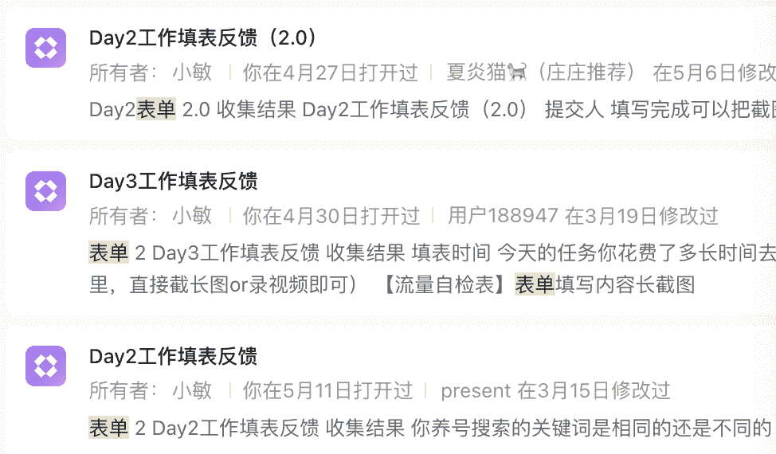
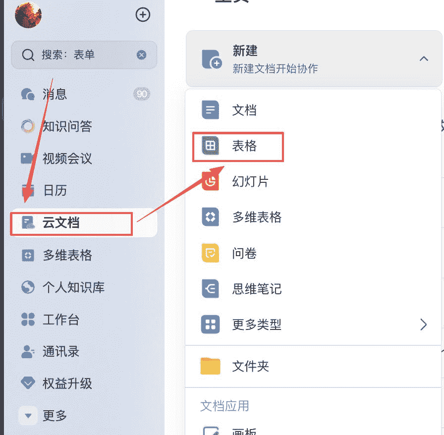

# ('从个人到小工作室，我在搭建 SOP、招人、培训到管理的思考和心得', (8, 40))

从一个人到一个小团队，我花了半年时间跑通了“招人—培训—管理”的全流程。今天把这些思考写出来，希望能帮到还在单干和犹豫要不要组队的朋友。

先说下背景：我是小敏，05年的搞钱女孩，加入生财圈两年，做AI写作两年多，存款六位数。以前一个人干，总觉得天花板近在眼前：流量、转化、交付、售后、朋友圈、临时杂事，全得自己应付。忙起来连客户消息都不想回，只能看着到手的钱溜走。一个人一个月赚两三万不难，但想做到四五万、甚至8到10万，几乎不可能靠单打独斗，必须上团队杠杆。更糟的是，每天80%的时间耗在重复劳动上，根本没空思考下一步的发展方向。

所以，如果你也正卡在“想放大但不敢动”的阶段，我建议你先别急着租场地、买设备、挂招聘，而是先把SOP写清楚。

SOP这关过不了，人来了只会添乱。它就像房子的地基，只有把地基打牢，才敢往上盖楼。它的核心价值，就是把自己能做的事，变成别人也能照着做。怎么写才合格？就是随便来个零基础小白，也能照着一步步上手。写的时候，别默认对方有常识，要把行业里最常见的术语单独科普一遍，比如闲鱼是什么、违禁词有哪些、留学常用词汇怎么理解。随后画一张业务流程图，让新人先知道整体有几个环节，再学细节。文字写步骤、截图标位置、录屏演示操作，三件套配合，能把理解偏差降到最低。

SOP要细到什么程度？让员工去上新产品，你不能丢一句“把产品发上去”，而要写清楚：对标哪款产品、标题怎么拟、图片怎么挑、地址填哪里、上传按钮在哪儿、什么词绝对不能出现。回复咨询也一样，别说“客户来了就回”，要写明白第一句说什么、第二句怎么接、已读不回怎么追、客户问价格问案例问交付分别怎么处理。越是基础动作，越要提前穷举。总之，细则写得越细，后面培训沟通就越省心。

SOP还可以按对象做几个版本。我自己就准备了三套：一套给员工自学，一套给自己培训时用，另一套给知识付费学员。是优是劣，标准只有一个：一个新手看完，能不能在你稍微点拨后独立跑完基本操作？

想快速写完SOP，也有办法。平时做业务就顺手记心得，别等要招人时才从零憋。真想突击，就先列大纲，按流程拆模块，一天补一块；再用语音输入工具口述流程，比如Typeless有免费试用；接着让AI扮演高手帮你查漏补缺，或者找个完全不懂的小白试读；最后用GPT里的Codex排版，结构瞬间清爽。

把SOP搞定，再来想线上还是线下。线上成本低，但沟通慢、人员流动高；线下成本高，但沟通爽、稳定性强。新手老板建议先线上兼职跑一跑，验证能赚钱了再转线下。线下一旦启动，场地、全职都是固定开销，说撤不容易，试错成本高。

决定转线下时，账号和设备一定要提前囤。比如我想让一个人管10个号，就先准备好了10台手机、10个认证账号、独立的IP，还有承接客户的多个微信号。业务基本都得往微信导流，但微信封号很严，异地登录、频繁加好友、朋友圈发太猛都容易触发，最好提前注册并养号。要储备的不止微信号，还有手机、电话卡、闲鱼号、小红书号、抖音号、实名信息、网络环境、素材库。设备能租就别买，手机电脑账号都能租，一天几块十几块，省下的钱能多试好几个方向。像转转、爱租机这类正规平台一般看芝麻信用分，记得提前养分。

找场地也不用一上来就盯写字楼。短租住房、家里空房间、大学城的工位都能试试。我朋友就在大学城租了两个工位跟实习生一起办公。不过如果用住房招人，要提前和房东谈好商用资质，可能需要房产证证明。渠道可以看看闲鱼、小红书、大众点评、高德，或者问朋友。当时我的硬性要求是：月租1500以内、支持短租、离住处近、交通方便、吃饭方便。最后找到一个月租980，还能短租两个月的房子，地铁站旁边，周围全是小吃和商场，一张大桌子正好坐下我和一两个员工。

接下来是招人。别等缺人了才招，要看到业务卡点。要么是你已经被重复事务压垮，需要招人解放时间；要么是模型跑通了，想加人放大增长。这两类招聘，管理重点不一样：前者盯动作执行和反馈，后者盯人效、转化率和回本周期。

我自己交过学费。当时对销售环节已经产生生理性抗拒，自己硬扛，利润就是0；试着外包给一个兼职销售，也就两千块成本，结果这位销售能力超乎意料，短期成交就很猛，我觉得少说能顶我七成的水平。我只要偶尔处理客诉、对接写手，一周居然做到2万GMV。现在他跟我合作四五个月，业绩很稳，我在外面玩也能被动日入四位。这件事让我明白，敢冒险，最差也是赚经验。

招人之后要用数据做决策。流量数据看咨询、引流和账号表现，决定要不要加号；销售数据看成单、GMV、转化率，判断话术有没有用；人效数据看单人贡献，决定岗位值不值得扩；成本数据看工资、房租、设备投入，确认利润是不是真的。先小范围MVP，跑通整个培训、执行、反馈流程，再考虑扩大。不看收入看利润，不看规模看人效，不看忙不忙，看忙的结果有没有增长。

招人渠道也各有讲究。Boss直聘流量大，但兼职类审核很严，容易触发环境认证，最好用本地执照在当地招；58和鱼泡相对宽松，但也要留意违禁词；朋友圈人多可以分组多发几次；圈内朋友介绍也很靠谱；买粉或渠道对接要算单人成本和留存。兼职流动性非常大，我线上引流200人，最后只留下三四十人，长期坚持的只有十个左右，所以前期靠数量筛，别指望一上来就稳定。

还有个思路特别好：从低门槛岗位开始筛人。我先招兼职做最基础的流量动作，成本低；合作一个月后，发现一两个人特别靠谱，再给机会转去做销售、财务助理或日常助理。因为已经磨合过，信任和沟通成本都比空降新人低。将来换项目，这些人也都是长期资产。

人到位后，岗位职责要清晰。小团队不需要复杂架构，但至少要分流量、转化、交付三个方向。流量端盯上新数、咨询数、引流数和账号状态；销售端盯咨询人数、单数、GMV和交付记录；助理端盯朋友圈素材、客户统计和杂事完成度。简单说，流量看动作是否到位，销售看结果是否成交，助理看是否帮老板省下时间。

薪酬也要按岗位属性来。重复性岗位给稳定底薪就行，比如闲鱼回复咨询，标准化程度高，按SOP做到及时回复，不需要复杂的KPI，搞太复杂反而是负担，态度不行的及时换人。销售岗位一定要有提成和奖励，否则大家不会拼命对结果负责；多劳多得，才能真正调动积极性。

以上就是我从个人转向小团队半年多的真实心得。愿你少踩一点我踩过的坑，早点用上团队的杠杆。

小团队在扩张时，最大的尴尬往往不是缺人手，而是人招进来后，创始人反而更疲惫。今天聊的就是一套可落地的思路，把招聘、带教、管控、激励这四件事串起来，让你逐步从亲自扛活转向用体系放大。

先从薪酬设计说起。底薪没有标准答案，关键卡住两个边界：一边要把前期投入压住，同时让对方明白跟着你有上升空间；另一边要给到基本保障，让人能体面地工作，别走极端资本化。启动阶段不确定性高，可以先用试用期过渡，起薪保守一些，等他熟悉业务、业绩稳定、承担的范围扩大，再分阶段上调。这样既控制了早期现金流，也给了对方看得见的成长预期。

岗位单价不高时，对应的工作设计就要跟着降难度。比如兼职定价仅几百块，就别指望他做高耗能的策略思考。做法是把作业拆解到颗粒度足够细的程度，把思考留给自己，把执行交出去。薪资水平与流程复杂度成反比，流程太重，人员周转就会变快。

带教的核心不是把手册丢过去了事，而是确保对方真懂会用。

第一，用输出倒推理解。别问“看懂了吗”，让他复述一遍完整流程，或者现场走一遍操作。讲不清、卡壳，就说明吸收不完。

第二，把长文档拆小。一次性塞满没人能记住，培训要分段推进，先把第一块打熟再进入下一块。前期宁可节奏慢，也别贪多求全，否则样样都半吊子。

第三，变换载体提升记忆。可以用小测验或表单做即时回顾；面对面演示、线上录屏或屏幕共享都行；关键规范让对方亲手抄写一遍，比如敏感词清单、风控要点；同时解释背后的原因，而不是只要求死记硬背。带教的目标是稳定达标，而不是浏览过。只要满足这一结果，文字、视频、表单、测试、演示都可以混用。

管控上，不要把“盯人”当成管理。很多创始人招完人，反而把心理能量全耗在监督上。有效的做法是先建标准、再建反馈、最后建抽检。

每个动作都要有明确的验收点。每天要做什么、做到什么程度算合格、需要留哪些凭证，都要写清楚。例如负责流量的同学，每天要归档：出勤记录、上新凭证、咨询回复截图、引流数据、异常账号说明。

用结构化表单收反馈。把日报所需的项做成在线表单，成员填完提交即可，负责人后台就能看见执行进展与数据波动，不用逐个追问。飞书文档中的问卷模板就很顺手，提交后会自动汇总成表。

用抽检代替全量巡查。没必要盯每个细节，但要定期抽样。发现偷懒、反复出错、态度消极时及时处置。属于能力上的问题，可以提醒一次并给缓冲期；同一问题反复出现，则属于态度问题，需要果断更换。

你投入资金请人，本质是腾出自己的时间和注意力，而不是把精力全部耗在监工上。轻度抽查即可，把更多脑力留给战略判断。

关于留存，光靠增薪不够，光画饼也不行。小组织可以从三条线入手：技能成长上，让他学到新方法，从基础岗位逐步接触价值更高的环节；收益成长上，达标就调薪、给提成、发奖金，让他看到实实在在的预期；情感认可上，适时发小额红包、送点小物件、及时点赞，让他感受到被重视。礼物不必贵，重在频次和心意，少量多次比大额单次更有效。

心态层面，从单干者转向经营者，需要跨过几个坎。

累是常态，只是痛点转移了。单干时累在做流量、谈客户、交付；带团队后累在搭架子、带人、做培训、分利益。动不动就想躺平的时刻很多：客诉来了、成员拖延、流量受阻、账号被封。沉下来想，多半是疲劳了而非真的想放弃。给自己放个短假，恢复后往往能满血复活。学会充电，比盲目硬撑更高效。

别自我设限。起步做业务时总会自我怀疑：没有经验、平台不熟、背景一般。但当你把这些顾虑放下，聚焦在解决具体问题、把每个业务环节做深做透，机会自然会出现。少想“我缺什么”，多想“我能做什么”。

不确定的试错，远好过确定的停滞。验证一个方向可能只花几千块，不验证可能永远困在单打独斗。跑通就放大，跑不通就及时止损。招销售同理，不招基本没产出，招了大几率能带来增量，而且这一步迟早要迈。

接受波动是常态。业务不是直线上升。前期经验不足，需要试错、磨合、接触各种人。平台规则会变、行业会动、人员会走。可能你刚把0到1打通，1到10也上来了，结果因人员或外部因素又掉回起点。这不是彻底归零，而是带着经验重启迭代。认清波动，在不同阶段调用不同能力，才能走得更稳。

招聘时重筛选，轻过度培养。人的习惯和态度大多是长期形成的，方法可以教，三观很难改。若发现对方不执行指令、敷衍了事、同一错误反复犯，就止损换人，别陷入内耗。

放下“嫌新人笨”的心态。基础岗位招来的人不可能全能，愿意干低价重复工作的也往往是潜力股。允许新人起步慢、起步差。容错是为了区分能力不足和态度问题。大部分基础岗，达到六十分就可接受。你做好体系和标准，让他对标执行，超出更好。这样你自己才不会被拖垮。

最后强调，小团队的核心是利润，不是体量。人越多，房租、薪酬、沟通、管控、试错成本越重。数据不明朗时，规模扩张只会侵蚀利润。人可以快速淘汰，但扩招必须循序渐进。

个人工作室的起步，别追求正规、庞大、完美。先把作业指导写细，先用少量人力跑MVP。能盈利、能交付、能降低对个人的依赖，才是值得放大的模型。

————分割线————

读完这份方法论，你可能觉得思路清晰了。可真实落地时，九成的人卡在第一步。

工具和教程只是基础门槛，真正的壁垒是立刻执行和圈层信息差。

如果你想了解全网最新的变现打法，并且和一批执行力极强的人一起实战出成绩，欢迎关注我的核心私域：【懒人专属群】。

我们不聊空话，只拆解商业闭环与AI效率提炼，内部已沉淀1000+跑通的套利实操案例。

👉 查阅圈子完整数字资产与上车门槛：
https://lazyso.com/insider/

认可价值、准备好下场干的人，扫码加我微信（lazyhelper1）。

备注：【实操上车】，不闲聊。

